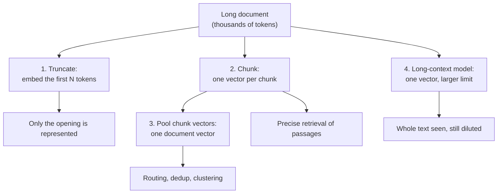

A sentence embedding squeezes one sentence into one vector, and that works because a sentence is usually about one thing. A document is different. Meridian's employee handbook covers leave, remote work, expenses, passwords, laptops and the support desk, and runs to thousands of tokens. What does it mean to describe all of that with a single list of 384 numbers, and what happens when you try?

This lesson answers that question. It shows the two things that go wrong when a long text is embedded whole (the model silently ignores most of it, and what it does read is averaged into a blur), measures both on a real model, and sets out the strategies engineers use instead: chunk-level vectors for retrieval, and document-level vectors for the jobs they are actually good at.

## Learning objectives

- Explain why an embedding model truncates long inputs and demonstrate that the truncation is silent.
- Derive and apply the formula for how much a single topic's signal is diluted when several topics are averaged into one vector.
- Compare four ways of representing a long document (truncate, chunk, pool chunk vectors, long-context model) and choose one for a given task.
- Identify tasks where a document-level vector is the right tool (routing, deduplication, clustering) and tasks where it is the wrong one (answering specific questions).

## Prerequisites

- [Sentence embeddings](/learn/embedding-fundamentals/sentence-embeddings): how a model turns a sentence into one vector by pooling its token vectors.
- [Semantic similarity](/learn/embedding-fundamentals/semantic-similarity): cosine similarity as the measure of closeness.
- [Why chunking matters](/learn/chunking-fundamentals/why-chunking-matters): the case for splitting documents before indexing, from the chunking side.
- [Tokens and tokenisation](/learn/understanding-large-language-models/tokens-and-tokenisation): what a token is and how to count them.

## Why this matters

The most common first attempt at a RAG index is "one document, one vector". It is simple, the vector store stays small, and every document is represented. It also fails in two ways that produce no error message.

First, every embedding model has a maximum input length, measured in its own tokens. Text beyond that length is cut off before the model sees it. The library does not raise an exception; it returns a perfectly normal-looking vector built from the opening part of the document. If the answer to a question lives on page 12 of a runbook, no query will ever find it, and nothing in your logs will tell you why.

Second, even within the limit, a single vector has to stand for everything the text says. When a text covers six topics, the vector ends up somewhere between all six, close to none of them. A precise question about one topic now has to compete with the other five for the vector's attention.

Neither failure shows up in a demo with three short documents. Both show up in production the week someone indexes the real handbook. Knowing how document embeddings behave lets you decide, before you build, which granularity each part of your system needs.

## The intuition

Think of a document vector as a photograph of a room taken from the doorway. If the room is a small office with one desk, the photo tells you nearly everything: what the room is for and what is in it. If the room is a warehouse, the photo from the doorway shows the first few aisles in detail and the rest as a grey blur, and the very back is out of frame altogether.

Two separate things are wrong with the warehouse photo:

- **The frame is too small.** The camera only captures what is within its field of view. That is truncation: the model reads up to its token limit and no further.
- **Everything is too far away.** Even the aisles you can see are small in the picture. That is dilution: each topic gets only a share of one fixed-size vector.

The fix for a warehouse is not a better camera. It is to take a photograph of each aisle (chunk embeddings) and, separately, keep a floor plan that says which aisles exist (a document-level summary vector). Someone looking for one product wants the aisle photographs. Someone asking "is this a warehouse or an office?" wants the floor plan.

## How it works

### The token limit and silent truncation

A Transformer embedding model has a fixed maximum sequence length, set by how it was built and trained (the position information it learned only covers so many positions, and attention cost grows with length). `sentence-transformers` exposes this as `model.max_seq_length`. For `all-MiniLM-L6-v2`, the model used throughout this course, it is 256 tokens, and the model card notes that the model was trained on even shorter sequences (128 tokens), so quality on inputs near the limit is less certain than on short ones.

When you call `encode()` on longer text, this happens:

1. The tokeniser splits the full text into tokens.
2. The token list is cut to `max_seq_length`, keeping the start (the special classification and separator tokens count against the limit).
3. The model processes only the kept tokens and pools them into one vector.
4. The rest of the text is discarded without an exception.

Two hundred and fifty-six tokens is roughly 190 English words (a rough rule of about 0.75 words per token, which varies by text and tokeniser). Many embedding models accept far more: several open models and hosted APIs advertise limits in the thousands of tokens. The exact figures change from release to release, so check the model card or API documentation for the model you use. A larger limit moves the edge of the photograph back; it does not remove the edge, and it does nothing about dilution.

### Dilution: one vector, many topics

Suppose a document's text could be described as a mixture of topics, each with its own direction in embedding space. Pooling (usually mean pooling over tokens, as in [Sentence embeddings](/learn/embedding-fundamentals/sentence-embeddings)) produces something close to an average of those directions. An average of directions that point different ways is a vector that points nowhere in particular: its cosine with each individual topic is lower than any topic's cosine with itself.

A query about one topic is compared with this average. The score it gets depends less on whether the document contains the answer and more on how many other things the document also talks about. A short, focused document about a minor subject can then outrank a long, comprehensive one that contains the exact answer. The mathematics section below quantifies this.

### Four ways to represent a long document



**1. Truncate.** Embed the first `max_seq_length` tokens and accept the loss. This is what happens by default if you do nothing. It is acceptable when the opening of a document genuinely summarises it: news articles, abstracts, product descriptions. It is wrong for handbooks, runbooks and contracts, where important detail is spread throughout.

**2. Chunk.** Split the document into passages small enough to sit comfortably within the limit, and embed each one. This is the standard approach in RAG, because a question is nearly always answered by a passage rather than a whole document. Each chunk vector is focused, so dilution is small. The cost is that a chunk loses its surroundings: a chunk reading "This must be done within 30 days" no longer says what "this" is. How to split is the subject of the [chunking](/learn/chunking-fundamentals/why-chunking-matters) modules.

**3. Pool chunk vectors.** Embed the chunks, then combine their vectors (usually by averaging, possibly weighted by chunk length) into one document vector. Unlike truncation, every part of the document contributes. Unlike a long-context model, it works with any embedding model. The result is still diluted by construction, so it describes what the document is about rather than what it says in detail.

**4. Long-context embedding model.** Use a model whose limit is large enough to read the whole document in one pass. Every token can attend to every other, so the vector reflects the whole text in context. It is still one vector for many topics, so for question answering it suffers the same dilution as pooling, and long inputs cost more compute per vector (attention cost grows with sequence length).

### Keeping context in chunk vectors

Chunking fixes dilution but creates the "what is *this*?" problem. Three techniques address it, from simplest to most involved; later lessons own the details:

- **Prefix the document title and section heading** to each chunk before embedding it: "Employee handbook > Expenses: This must be done within 30 days." It costs a few tokens per chunk and is the first thing to try.
- **[Contextual retrieval](/learn/advanced-retrieval/contextual-retrieval)** uses a language model to write a short, chunk-specific context sentence for each chunk before embedding.
- **[Late chunking](/learn/chunking-optimisation/late-chunking)** runs a long-context model over the whole document first and only then pools token vectors chunk by chunk, so each chunk vector has seen its neighbours.

### What document vectors are good for

A document-level vector is the floor plan, not the aisle photograph. It is a good tool for questions about whole documents:

- **Routing:** decide which collection or which handful of documents to search before searching their chunks. [Hierarchical RAG](/learn/hierarchical-rag/document-level-retrieval) builds on this idea.
- **Near-duplicate detection:** two versions of the same policy page produce nearly identical document vectors even if a few sentences changed.
- **Clustering and classification:** grouping a document store by subject, or tagging documents as HR, IT or product.
- **Recommendation:** "documents similar to this one".

It is a poor tool for "what is the expenses receipt threshold?", which needs the one chunk that says so.

## The mathematics

### Mean pooling of chunk vectors

To combine $k$ chunk vectors into one document vector, average them and normalise the result to length 1:

$$
\mathbf{m} = \frac{1}{k}\sum_{i=1}^{k} \mathbf{v}_i, \qquad \mathbf{d} = \frac{\mathbf{m}}{\lVert \mathbf{m} \rVert}
$$

- $\mathbf{v}_i$ is the unit-length embedding of chunk $i$.
- $k$ is the number of chunks.
- $\mathbf{m}$ is their mean, which is usually shorter than 1 because the chunks point in different directions.
- $\mathbf{d}$ is the document vector, rescaled to unit length so that cosine similarity is a dot product.

A **length-weighted** variant replaces $\frac{1}{k}$ with weights $w_i = n_i / \sum_j n_j$, where $n_i$ is chunk $i$'s token count, so a two-line chunk does not count as much as a two-page one.

### How much does averaging dilute one topic?

Intuition: the more different topics you average, the less the average resembles any one of them. We can make that exact under a simplifying assumption: all $k$ chunk vectors have unit length and every pair has the same cosine similarity $c$.

The cosine between the document vector and any one chunk $\mathbf{v}_j$ is

$$
\cos(\mathbf{d}, \mathbf{v}_j) = \sqrt{\frac{1 + (k-1)\,c}{k}}
$$

- $k$ is the number of chunks (topics).
- $c$ is the average pairwise cosine between chunks: 0 for unrelated topics, 1 for identical ones.

Where it comes from: $\mathbf{v}_j \cdot \sum_i \mathbf{v}_i = 1 + (k-1)c$ (one term is $\mathbf{v}_j$ with itself, the other $k-1$ contribute $c$ each), and $\lVert \sum_i \mathbf{v}_i \rVert^2 = k + k(k-1)c$ ($k$ self-products plus $k(k-1)$ cross-products). Dividing the first by the square root of the second gives the formula.

Two limits check it. When $c = 1$ (all chunks identical) the cosine is 1: nothing is diluted. When $c = 0$ (unrelated topics) it is $1/\sqrt{k}$: four unrelated topics leave each with a cosine of 0.5, sixteen leave 0.25.

**Worked example.** Six handbook sections, average pairwise cosine $c = 0.209$:

$$
\sqrt{\frac{1 + 5 \times 0.209}{6}} = \sqrt{\frac{2.045}{6}} = \sqrt{0.3408} \approx 0.584
$$

So even a vector built *only* from those six sections has a cosine of only about 0.58 with each of them. A query that matches one section perfectly cannot do better against the document vector than against that section, and in practice does worse. The same arithmetic in Python:

```python
import math

def dilution(k: int, c: float) -> float:
    """Cosine between the mean of k unit vectors (pairwise cosine c) and any one of them."""
    return math.sqrt((1 + (k - 1) * c) / k)

print(f"k=6,  c=0.209: {dilution(6, 0.209):.3f}")
print(f"k=4,  c=0.0:   {dilution(4, 0.0):.3f}")
print(f"k=16, c=0.0:   {dilution(16, 0.0):.3f}")
print(f"k=16, c=0.3:   {dilution(16, 0.3):.3f}")
```

```output
k=6,  c=0.209: 0.584
k=4,  c=0.0:   0.500
k=16, c=0.0:   0.250
k=16, c=0.3:   0.586
```

The last line shows the other side: documents whose sections are closely related (higher $c$) dilute far less. A runbook entirely about VPN problems survives being one vector much better than a handbook that covers everything. In the next section the real model's measured value matches the formula closely.

## In code

The example below takes a Meridian handbook long enough to exceed the model's limit, and measures both failure modes and the pooling alternative. It answers three questions: is truncation really silent, what happens to a section that falls past the limit, and how do whole-document, pooled and chunk vectors score against real questions?

Dependencies:

```bash
pip install sentence-transformers numpy
```

```python
import numpy as np
from sentence_transformers import SentenceTransformer

model = SentenceTransformer("sentence-transformers/all-MiniLM-L6-v2")

sections = [
    "Annual leave. Every employee receives 25 days of annual leave per year. Up to 5 unused days carry over and must be used by 31 March.",
    "Remote work. Staff may work remotely up to 3 days a week. Employees receive a home-office equipment budget of £400; contractors are not eligible.",
    "Expenses. Expenses must be submitted within 30 days. Anything over £75 needs a receipt. Expenses belong to the finance department.",
    "Passwords. Passwords must be rotated every 90 days. VPN is required on public Wi-Fi.",
    "Laptops. The laptop refresh cycle is 3 years. Lost laptops are reported to the support desk at once.",
    "Support desk. The support desk is open 08:00 to 18:00 UK time, Monday to Friday.",
]
# A long handbook: the six sections, followed by many pages of other policy text.
filler = " ".join(f"Clause {i}: staff should follow the general code of conduct and treat colleagues with respect." for i in range(1, 41))
handbook = " ".join(sections) + " " + filler

# 1. How long is the document in the model's own tokens?
n_tokens = len(model.tokenizer(handbook)["input_ids"])
print(f"handbook tokens: {n_tokens}, model limit: {model.max_seq_length}")

# 2. Silent truncation: the full text and its first 256 tokens embed identically.
ids = model.tokenizer(handbook, truncation=True, max_length=model.max_seq_length)["input_ids"]
first_part = model.tokenizer.decode(ids[1:-1])           # drop [CLS] and [SEP]
v_full, v_cut = model.encode([handbook, first_part], normalize_embeddings=True)
print(f"cosine(full handbook, first 256 tokens) = {v_full @ v_cut:.4f}")

# 3. Moving a section past the limit makes it invisible.
reordered = filler + " " + " ".join(sections)
v_reordered = model.encode(reordered, normalize_embeddings=True)

# 4. Chunk vectors, and a document vector pooled from them.
chunk_vecs = model.encode(sections, normalize_embeddings=True)
pooled = chunk_vecs.mean(axis=0)
pooled /= np.linalg.norm(pooled)

queries = [
    "How many days of holiday do I get?",
    "Can I claim a new monitor for working from home?",
    "When is the IT helpdesk open?",
]
q_vecs = model.encode(queries, normalize_embeddings=True)
print(f"\n{'query':<50}{'best chunk':>11}{'pooled':>8}{'trunc':>7}{'reord':>7}")
for q, qv in zip(queries, q_vecs):
    best = chunk_vecs @ qv
    print(f"{q:<50}{best.max():>11.3f}{pooled @ qv:>8.3f}{v_full @ qv:>7.3f}{v_reordered @ qv:>7.3f}")

print("\ncosine of pooled vector with each section:", np.round(chunk_vecs @ pooled, 3))
print("mean pairwise cosine between sections:",
      round(float((chunk_vecs @ chunk_vecs.T)[np.triu_indices(6, 1)].mean()), 3))
```

```output
handbook tokens: 835, model limit: 256
cosine(full handbook, first 256 tokens) = 1.0000

query                                              best chunk  pooled  trunc  reord
How many days of holiday do I get?                      0.461   0.409  0.275  0.014
Can I claim a new monitor for working from home?        0.354   0.370  0.329 -0.019
When is the IT helpdesk open?                           0.511   0.262  0.221  0.047

cosine of pooled vector with each section: [0.618 0.693 0.555 0.551 0.54  0.544]
mean pairwise cosine between sections: 0.209
```

**The important lines.** `model.tokenizer(handbook)` counts tokens with the model's own tokeniser, which is the only count that matters for its limit. The truncation check rebuilds the first 256 tokens as text and embeds both versions; `normalize_embeddings=True` makes every vector unit length, so `@` (the dot product) is the cosine. The pooled document vector is a mean followed by renormalisation, exactly the formula above.

**What the output means.**

- The handbook is 835 tokens against a limit of 256. Embedding the whole thing and embedding only its first 256 tokens give a cosine of **1.0000**: the remaining 579 tokens had no effect at all. No exception was raised.
- The `reord` column is the same handbook with the six useful sections moved to the end. Their content now sits beyond token 256, and every query scores close to zero against it. Identical text, a different order, and the document has become unfindable.
- The `trunc` column (the original order) scores lower than the best chunk for every query, because the 256 tokens it does see mix all six sections with the first of the code-of-conduct clauses.
- The pooled vector beats truncation on all three queries because every section contributes. Notice the second query: the pooled vector (0.370) scores slightly *higher* than the best single chunk (0.354). The question touches both remote work and equipment, and the document as a whole is a fair match for that blend. This is a reminder that scores at different granularities are not on a common scale; what matters for retrieval is how the right passage ranks among its competitors, and a whole-document vector cannot point to a passage at all.
- The pooled vector's cosine with each section averages 0.584, against the 0.584 predicted from the measured pairwise cosine of 0.209. The dilution formula is not just a toy.

**Errors people hit.** The tokeniser prints a warning when you count tokens on long text ("Token indices sequence length is longer than the specified maximum sequence length"). That warning comes from the counting call, not from `encode()`, which truncates without comment, so do not rely on it as a safety net. Counting with a different tokeniser (`tiktoken`, or splitting on spaces) gives the wrong number for this model.

**Extending it.** Replace the uniform mean with a length-weighted mean (exercise 4), or add a title prefix to each section and see how the chunk scores change.

## A real-world example

Meridian's Platform team built the first version of AskMeridian's IT knowledge base in an afternoon: each IT runbook became one vector. The runbooks are long, with a short overview followed by numbered troubleshooting steps and, at the bottom, an error-code table for the Atlas platform. In testing, general questions such as "how do I set up the VPN?" worked well. After launch, the support desk noticed that questions about specific error codes, such as E-4021, never retrieved the right runbook.

An engineer counted tokens per runbook with the embedding model's tokeniser and compared each count with `max_seq_length`. Most runbooks were several times longer than the limit, and every error-code table sat past it. The vectors had been built from the overviews alone. No one had seen an error, because there had been none.

The team made three changes. Runbooks were split into section-sized chunks, each embedded with a prefix naming the runbook and section ("VPN runbook > Error codes: ..."). A pooled document vector was kept per runbook, used only to show "related runbooks" alongside an answer. And an ingestion check now logs every input whose token count exceeds the model's limit, so a future document that slips through chunking unsplit is visible. Error-code questions also benefit from keyword search, since codes like E-4021 are exactly the kind of string embeddings handle badly; the [hybrid search](/learn/hybrid-search) module covers that.

## Common mistakes

- **Embedding whole documents for question answering.** Most of each document is truncated away and the rest is diluted, so specific questions miss.
- **Assuming the library will warn about truncation.** `encode()` truncates silently; the only warning you may see comes from a separate tokeniser call.
- **Counting length in words or with another model's tokeniser.** The limit is in the embedding model's own tokens; other counts can be off by a wide margin, especially for code, numbers and non-English text.
- **Treating a larger token limit as a cure.** A long-context model sees the whole document but still compresses many topics into one vector; precise retrieval still needs chunks.
- **Comparing scores across granularities.** A chunk scoring 0.35 and a document scoring 0.37 are not saying the document is the better answer.
- **Averaging chunk vectors without renormalising.** The mean of unit vectors is shorter than 1, so dot products against it are not cosines, and documents with more diverse chunks are penalised twice.

## Best practices

- Count tokens with the embedding model's tokeniser at ingestion time and log or reject anything over the limit.
- Use chunk vectors for retrieval of answers; keep document vectors for routing, deduplication, clustering and recommendation.
- Prefix each chunk with its document title and section path before embedding; it is cheap and recovers much of the lost context.
- When you build document vectors from chunks, store both the chunk vectors and the pooled vector, and record which pooling (mean, length-weighted) you used.
- Choose a long-context embedding model only when you need whole-document representations for documents beyond your current limit, and check its model card for the limit it was actually trained at, not just the one it accepts.
- Keep truncation behaviour in your evaluation set: include questions whose answers sit deep inside long documents.

## Performance considerations

**Index size.** One vector per document is small: 10,000 documents at 384 dimensions in 32-bit floats is $10{,}000 \times 384 \times 4 = 15{,}360{,}000$ bytes, about 15 MB. Chunking multiplies this by the average number of chunks per document. At 30 chunks per document, the same corpus needs about 460 MB of raw vectors, before index overhead. Adding a pooled document vector per document costs one more vector each, about 3% extra here.

**Embedding compute.** Self-attention cost grows with the square of the sequence length. Splitting an 8,000-token document into thirty-two 250-token chunks costs, in attention terms, roughly $32 \times 250^2 = 2{,}000{,}000$ token-pair operations against $8{,}000^2 = 64{,}000{,}000$ for one long pass: about 32 times less. The feed-forward layers cost the same either way, since they process each token once. This is one reason long-context embedding is slower per document even on hardware that can handle it.

**Pooling is nearly free.** Averaging chunk vectors you already have costs one pass over the numbers: microseconds per document. A pooled document vector adds no extra model calls.

**Query time.** A two-stage search (find the top documents by document vector, then search only their chunks) can reduce the number of chunk comparisons, at the risk that the first stage misses a document whose diluted vector scores poorly. Measure recall before adopting it.

## Security considerations

Document vectors that summarise whole files are often shown as "related documents" or used for routing. Apply the same access control to them as to chunks: a related-document suggestion that links to an HR file the user cannot open still reveals that the file exists and roughly what it is about. If documents carry permissions, filter by them at both stages of a two-stage search.

Truncation can also hide content from review. If an ingestion pipeline uses embeddings to classify documents (for example, to flag those containing personal data), text beyond the token limit is never seen by the classifier. Classify chunk by chunk, not whole documents.

## Summary

- Every embedding model has a maximum input length in its own tokens; longer text is truncated silently, and content beyond the limit has no effect on the vector.
- A single vector for a multi-topic text is diluted: under equal pairwise similarity $c$ among $k$ topics, each topic's cosine with the average is $\sqrt{(1+(k-1)c)/k}$.
- For answering questions, embed chunks and add the document title and section as a prefix; for whole-document tasks, pool chunk vectors or use a long-context model.
- Long-context embedding models remove the truncation problem but not the dilution problem.
- Document vectors are the right tool for routing, deduplication, clustering and recommendation, and the wrong tool for finding a specific fact.

## Exercises

**1. Predict the dilution.** A product guide has 9 sections whose average pairwise cosine is 0.1. What cosine would you expect between its mean-pooled document vector and any one section? How many unrelated topics ($c = 0$) would bring this down to 0.2?

<details><summary>Show solution</summary>

$\sqrt{(1 + 8 \times 0.1)/9} = \sqrt{1.8/9} = \sqrt{0.2} \approx 0.447$.

With $c = 0$ the cosine is $1/\sqrt{k}$, so $1/\sqrt{k} = 0.2$ gives $k = 25$ topics.

</details>

**2. Find what is invisible.** Write a function that takes a document and a `SentenceTransformer` and returns the portion of the text (as a string) that the model would ignore. Test it on the handbook above.

<details><summary>Show solution</summary>

```python
def ignored_text(text, model):
    ids = model.tokenizer(text, add_special_tokens=False)["input_ids"]
    keep = model.max_seq_length - 2          # [CLS] and [SEP] use two positions
    return model.tokenizer.decode(ids[keep:]) if len(ids) > keep else ""

lost = ignored_text(handbook, model)
print(len(lost.split()), "words ignored; starts:", lost[:60])
```

Decoding the tokens back to text lower-cases it for this model (it uses an uncased tokeniser), so the returned string is approximate as text but exact as to which content is lost.

</details>

**3. Choose a representation.** For each task, choose truncation, chunk vectors, pooled document vectors or a long-context model, and justify it in one sentence: (a) answer "what is the receipt threshold for expenses?"; (b) detect that two uploaded policy PDFs are near-identical versions; (c) group 5,000 product pages into themes; (d) embed 2,000 news summaries of about 80 words each.

<details><summary>Show solution</summary>

(a) Chunk vectors: the answer is one sentence, and only a focused chunk vector can rank it. (b) Pooled document vectors (or a long-context model): versions of the same policy produce nearly identical whole-document vectors, and every section contributes. (c) Pooled document vectors: clustering is about what whole pages are about. (d) Embed each summary directly: at around 80 words each they fit well within the limit, so there is nothing to truncate and no need to split.

</details>

**4. Length-weighted pooling.** Implement a pooling function that weights each chunk vector by its token count, renormalises, and returns the document vector. When would it differ most from the plain mean?

<details><summary>Show solution</summary>

```python
import numpy as np

def weighted_doc_vector(chunks, model):
    vecs = model.encode(chunks, normalize_embeddings=True)
    n = np.array([len(model.tokenizer(c, add_special_tokens=False)["input_ids"]) for c in chunks], dtype=float)
    d = (vecs * (n / n.sum())[:, None]).sum(axis=0)
    return d / np.linalg.norm(d)
```

It differs most when chunk lengths are very uneven, for example a document with one long body section and several one-line headings or footnotes: the plain mean gives the one-liners as much say as the body.

</details>

## Check your understanding

```quiz
[
  {
    "q": "You embed a 2,000-token runbook with a model whose `max_seq_length` is 256. What does `encode()` do?",
    "options": [
      "Raises an error saying the input is too long",
      "Splits the text into chunks and averages them automatically",
      "Embeds the first 256 tokens and silently ignores the rest",
      "Embeds the last 256 tokens, which are usually the most recent"
    ],
    "answer": 2,
    "why": "The tokens are truncated to the model's limit, keeping the start, and no exception is raised. Text after the limit has no effect on the vector."
  },
  {
    "q": "Four chunk vectors with pairwise cosine 0 are averaged and renormalised. What is the cosine between the result and any one chunk?",
    "options": ["0.25", "0.5", "0.75", "1.0"],
    "answer": 1,
    "why": "With c = 0 the cosine is 1 divided by the square root of k, and the square root of 4 is 2, giving 0.5."
  },
  {
    "q": "Why does a long-context embedding model not solve the problem of finding a specific fact in a long document?",
    "options": [
      "It still compresses all of the document's topics into one vector, diluting each",
      "It truncates even more aggressively than short models",
      "It cannot be used with cosine similarity",
      "It only supports English"
    ],
    "answer": 0,
    "why": "A larger limit means the whole text is seen, but it is still represented by one vector, so any single topic's signal is diluted by the others."
  },
  {
    "q": "Which task is a pooled document vector best suited to?",
    "options": [
      "Answering \"what is the expenses receipt threshold?\"",
      "Returning the exact error-code row for E-4021",
      "Quoting the carry-over deadline for annual leave",
      "Detecting that two policy files are near-duplicate versions"
    ],
    "answer": 3,
    "why": "Near-duplicate detection is a question about whole documents, which is what a document vector represents. The other three need a specific passage."
  },
  {
    "q": "A chunk scores 0.35 and its parent document's pooled vector scores 0.37 for the same query. What can you conclude?",
    "options": [
      "The document is a better answer than the chunk",
      "The chunk should be discarded",
      "Very little: scores at different granularities are not on a common scale",
      "The embedding model is broken"
    ],
    "answer": 2,
    "why": "Chunk and document vectors represent different things. What matters is how the right passage ranks against other passages, not a cross-granularity comparison."
  }
]
```

## Further reading

- Reimers and Gurevych (2019), "Sentence-BERT: Sentence Embeddings using Siamese BERT-Networks", [arXiv:1908.10084](https://arxiv.org/abs/1908.10084). The pooling approach used by most sentence and document embedding models.
- Sentence Transformers documentation, [sbert.net](https://www.sbert.net/), including the notes on `max_seq_length` and input truncation.
- The model card for `sentence-transformers/all-MiniLM-L6-v2` on Hugging Face, which states its input limit and training sequence length.
- Günther et al. (2024), "Late Chunking: Contextual Chunk Embeddings Using Long-Context Embedding Models", [arXiv:2409.04701](https://arxiv.org/abs/2409.04701).
- Anthropic (2024), "Introducing Contextual Retrieval", engineering blog post on adding chunk-specific context before embedding.
