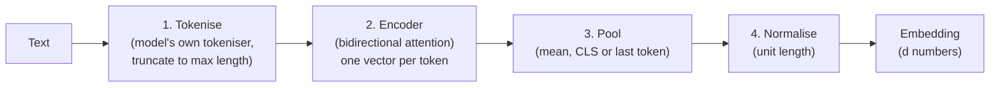

The previous lessons in this module treated an embedding model as a box: text goes in, a vector comes out, and similar texts get similar vectors. This lesson opens the box. An embedding model is a specific pipeline (tokeniser, Transformer encoder, pooling, normalisation) trained in a specific way, and every part of that pipeline is a property you must match when you use the model. Get one wrong, such as the pooling method, a required prefix or the input length, and you still get vectors. They are just worse vectors, and nothing tells you.

You will rebuild a real embedding model by hand from its parts and confirm it reproduces the packaged model's output, see how much one wrong step costs, learn how these models are trained, and learn to read a model card for the details that matter in production. The next module, [Embedding Models](/learn/embedding-models), surveys particular model families; this lesson gives you the framework for understanding any of them.

## Learning objectives

- Describe the four stages of a Transformer embedding model and reproduce a model's output from its components in code.
- Explain how contrastive training with in-batch negatives shapes an embedding space, and compute the loss for a small example.
- List the properties of an embedding model that a RAG system must match exactly (pooling, normalisation, similarity function, maximum length, prefixes, version) and the consequence of mismatching each.
- Read a model card and benchmark results critically, and explain why a public leaderboard does not replace evaluation on your own data.
- Treat the embedding model as part of the index's contract and plan for re-embedding when it changes.

## Prerequisites

- [Sentence embeddings](/learn/embedding-fundamentals/sentence-embeddings): pooling token vectors into one sentence vector.
- [Document embeddings](/learn/embedding-fundamentals/document-embeddings): token limits and truncation.
- [Dimensionality](/learn/embedding-fundamentals/dimensionality): what the output size costs.
- [Transformer architecture](/learn/understanding-large-language-models/transformer-architecture): what an encoder layer does.

## Why this matters

An embedding model sits on both sides of retrieval. Every document chunk is embedded once at indexing time, and every query is embedded at search time. The two sides must use exactly the same model, configured exactly the same way, for the similarity scores to mean anything. In practice, they are often produced by different code paths: a batch ingestion job written months ago and an online query service written by someone else. Any difference between those paths (a different pooling, a forgotten prefix, a library upgrade that changed a default) degrades retrieval silently.

The choice of model also has long consequences. Changing it later means re-embedding every document, because vectors from two models are not comparable. Understanding what a model is made of, how it was trained and what it expects lets you choose deliberately, use it correctly, and recognise when a quality drop has a mechanical cause rather than a mysterious one.

## The intuition

Think of an embedding model as a librarian who files every document by placing it at a spot on an enormous floor, so that books on similar subjects end up near each other. Two things make the librarian useful.

First, **how they read**. They read the whole text (up to a page limit), noticing how each word is used in context, and then form one overall impression. That is the encoder and the pooling.

Second, **how they were trained**. They were shown millions of pairs: a question and the passage that answers it, a title and its article, two paraphrases. Each time, they were rewarded for placing the pair close together and for keeping it away from the other items they were shown in the same session. Over time, "close on the floor" came to mean "one answers or restates the other".

A second librarian trained differently would lay out a completely different floor. You cannot look up a book filed by one librarian using the other's floor plan. And if the first librarian was trained to expect requests in the form "query: ..." and you leave that off, they will still put your request somewhere on the floor, just not quite the right spot.

## How it works

### The four stages

Almost every modern text embedding model, whether open or hosted, follows the same pipeline:

1. **Tokenise.** The model's own tokeniser splits the text into tokens, adds special tokens (such as `[CLS]` and `[SEP]` for BERT-style models), and truncates to the maximum sequence length.
2. **Encode.** A Transformer **encoder** processes all tokens at once. Unlike a text generator, which only lets each token look at earlier ones, an encoder lets every token attend to every other, in both directions. The output is one contextual vector per token.
3. **Pool.** The token vectors are combined into a single vector. The common choices are **mean pooling** (average over the real tokens, ignoring padding), **CLS pooling** (take the vector of the first, special token), and for some models built on generator-style networks, **last-token pooling**. Each model is trained with one specific pooling, and only that one gives its intended output.
4. **Normalise (often).** The vector is scaled to length 1, so that the dot product equals cosine similarity. Some models do this inside the model; others leave it to you.

Some models add a small linear projection layer between pooling and normalisation, to set the output dimensionality.



This design, in which the query and each document are encoded separately into vectors and compared afterwards, is called a **bi-encoder**. It is what makes retrieval fast: documents are embedded once, in advance, and a query needs only one encoder pass plus vector comparisons. The alternative, a **cross-encoder** that reads query and document together, is more accurate and far slower, and is used for reranking; see [Bi-encoders](/learn/reranking-fundamentals/bi-encoders).

### How embedding models are trained

A raw pre-trained encoder such as BERT already produces contextual token vectors, but averaging them gives poor sentence embeddings: the pre-training task (predicting masked words) never asked it to place related sentences close together. Embedding models get that property from a further stage of training:

1. **Start from a pre-trained encoder**, which already knows a great deal about language.
2. **Collect pairs of texts that belong together**: question and answer passage, title and body, a post and its top answer, two paraphrases. Large models are trained on hundreds of millions of such pairs, often mined from the web, then refined on smaller, curated, labelled sets.
3. **Train contrastively.** For a batch of pairs, embed everything, and adjust the model so each query is closer to its own passage than to every other passage in the batch. The other passages act as free **in-batch negatives**.
4. **Optionally add hard negatives**: passages that look relevant but are not, which force the model to learn finer distinctions. [Hard negative mining](/learn/embedding-optimisation/hard-negative-mining) covers this.

The result is a space in which distance tracks "belongs together" as defined by the training pairs. That definition matters: a model trained mostly on question-passage pairs from web search is good at question answering over general text, and may be weaker on, say, matching error messages to source code. [Contrastive learning](/learn/embedding-optimisation/contrastive-learning) goes into the training method in depth.

### Symmetric and asymmetric tasks, and prefixes

Some retrieval is **symmetric**: comparing two texts of the same kind, such as finding duplicate tickets. Most RAG retrieval is **asymmetric**: a short question against a longer passage that answers it. Some model families are trained to know which side they are embedding, by prepending a fixed text to each input. The E5 family, for example, expects `"query: "` before queries and `"passage: "` before documents; some BGE models recommend an instruction sentence before queries. Other models, including `all-MiniLM-L6-v2`, use no prefix at all.

When a model expects prefixes, leaving them off (or putting the query prefix on documents) still produces vectors, but not the ones the model was trained to produce, and retrieval quality drops. The model card is the authority on what each model expects. Recent versions of `sentence-transformers` can store a model's prompts in its configuration and apply them through `encode_query` and `encode_document`; check that your installed version and your model support this before relying on it.

### Properties you must match

| Property | Where to find it | If you get it wrong |
| --- | --- | --- |
| Model name and exact version | Model card, repository revision | Vectors from different versions are not comparable |
| Pooling method | Model card or `sentence-transformers` config | Vectors are valid-looking but degraded |
| Normalisation | Model card; whether the pipeline includes it | Dot products are not cosines; long or short texts favoured |
| Similarity function | Model card (cosine, dot product) | Ranking differs from the one the model was trained for |
| Maximum sequence length | `max_seq_length`, model card | Silent truncation, or degraded quality on inputs longer than it was trained on |
| Query and document prefixes | Model card | Lower retrieval quality, with no error |
| Output dimensionality | Model card; output shape | Index rejects vectors, or mismatched truncation |

### Reading a model card and a leaderboard

A model card tells you the properties above plus the licence, the languages it was trained on, the training data in broad terms, and the model's size (which drives encoding speed). Read all of it before adopting a model.

The **Massive Text Embedding Benchmark (MTEB)** (Muennighoff et al., 2022) scores models across many tasks and datasets, and its public leaderboard is the usual starting point for shortlisting. Use it with three cautions. The overall score averages tasks (classification, clustering, retrieval and others) that may not resemble yours, so look at the retrieval columns. Public benchmark data may have been seen during training, which inflates scores. And no public dataset contains Meridian's handbook or your users' phrasing. The leaderboard narrows the candidates; [Model selection](/learn/embedding-optimisation/model-selection) and [Embedding evaluation](/learn/embedding-optimisation/embedding-evaluation) decide among them using your data.

### The model is part of the index's contract

Because vectors from different models (or different versions of the same model) live in unrelated spaces, the model identity belongs with the index, not with the code. Record at least the model name, revision, pooling, normalisation, prefix convention, maximum length and dimensionality alongside the collection. Check it at query time. And plan model changes as migrations: build a new collection with the new model, evaluate it, switch traffic, then delete the old one.

## The mathematics

### The in-batch contrastive loss

Intuition: for each query in a batch, turn its similarities to every passage in the batch into probabilities with a softmax, and penalise the model when the probability on its own passage is low.

For query $i$ with embedding $\mathbf{q}_i$, its paired passage $\mathbf{p}_i$, and the other passages $\mathbf{p}_j$ in a batch of size $B$:

$$
\mathcal{L}_i = -\log \frac{\exp\left(\cos(\mathbf{q}_i, \mathbf{p}_i)/\tau\right)}{\sum_{j=1}^{B} \exp\left(\cos(\mathbf{q}_i, \mathbf{p}_j)/\tau\right)}
$$

- $\cos(\mathbf{q}_i, \mathbf{p}_j)$ is the cosine similarity between query $i$ and passage $j$.
- $\tau$ (tau) is the **temperature**, a small positive number such as 0.05 or 0.1 (it varies by training recipe). Dividing by it stretches the differences between similarities before the softmax, so small gaps in cosine become large gaps in probability.
- The fraction is the softmax probability assigned to the correct passage; $-\log$ of it is near 0 when that probability is near 1 and large when it is small.
- The batch loss is the average of $\mathcal{L}_i$ over all queries. Training lowers it by pulling each pair together and pushing the others apart.

This loss, under various names (InfoNCE, multiple negatives ranking loss), is the core of most embedding-model training.

**Worked example.** Batch of three passages, $\tau = 0.1$. A query has cosines 0.8 with its own passage and 0.3 and 0.1 with the others. The scaled values are 8, 3 and 1. The probability of the correct passage is

$$
\frac{e^{8}}{e^{8} + e^{3} + e^{1}} = \frac{1}{1 + e^{-5} + e^{-7}} = \frac{1}{1 + 0.00674 + 0.00091} \approx 0.9924
$$

and the loss is $-\ln 0.9924 \approx 0.0076$: little left to learn. Now a harder case: cosines 0.6, 0.55 and 0.1. Scaled: 6, 5.5, 1. The probability is $1/(1 + e^{-0.5} + e^{-5}) = 1/(1 + 0.6065 + 0.0067) \approx 0.620$, and the loss is $-\ln 0.620 \approx 0.478$, about sixty times larger. The near-miss negative (0.55) dominates the loss, which is exactly why hard negatives teach a model so much.

```python
import numpy as np

def contrastive_loss(sims, tau=0.1):
    """sims[0] is the positive pair; the rest are in-batch negatives."""
    logits = np.array(sims) / tau
    p = np.exp(logits - logits.max()); p /= p.sum()
    return -np.log(p[0]), p[0]

for sims in ([0.8, 0.3, 0.1], [0.6, 0.55, 0.1]):
    loss, p = contrastive_loss(sims)
    print(f"sims={sims}: p(positive)={p:.4f}  loss={loss:.4f}")
```

```output
sims=[0.8, 0.3, 0.1]: p(positive)=0.9924  loss=0.0076
sims=[0.6, 0.55, 0.1]: p(positive)=0.6199  loss=0.4783
```

Subtracting `logits.max()` before exponentiating does not change the softmax but avoids overflow, a standard numerical precaution.

## In code

This example takes `all-MiniLM-L6-v2` apart. It loads the packaged `sentence-transformers` model, then rebuilds the same pipeline from the raw tokeniser and encoder using Hugging Face `transformers`, and checks that the two agree. It then shows what happens if you get the pooling or the padding mask wrong, which is the kind of mistake that occurs when someone reimplements a model for a different serving stack. No API key is needed.

```bash
pip install sentence-transformers transformers torch numpy
```

```python
import numpy as np
import torch
from transformers import AutoTokenizer, AutoModel
from sentence_transformers import SentenceTransformer

NAME = "sentence-transformers/all-MiniLM-L6-v2"
texts = [
    "Annual leave is 25 days a year.",
    "Passwords must be rotated every 90 days.",
    "How much holiday do I get?",
]

# --- The packaged pipeline ---
st = SentenceTransformer(NAME)
packaged = st.encode(texts, normalize_embeddings=True)
print("max_seq_length:", st.max_seq_length, "| dimension:", packaged.shape[1],
      "| similarity:", st.similarity_fn_name)

# --- The same pipeline, step by step ---
tok = AutoTokenizer.from_pretrained(NAME)
enc = AutoModel.from_pretrained(NAME).eval()
batch = tok(texts, padding=True, truncation=True, max_length=256, return_tensors="pt")
print("\nstep 1 tokens:", tok.convert_ids_to_tokens(batch["input_ids"][2])[:10])
with torch.no_grad():
    token_vecs = enc(**batch).last_hidden_state                  # (texts, tokens, 384)
print("step 2 contextual token vectors:", tuple(token_vecs.shape))

mask = batch["attention_mask"].unsqueeze(-1).float()            # 1 for real tokens, 0 for padding
mean_pooled = (token_vecs * mask).sum(1) / mask.sum(1)          # step 3: mean over real tokens
manual = torch.nn.functional.normalize(mean_pooled, dim=-1).numpy()  # step 4: unit length
print("step 3+4 sentence vectors:", manual.shape)
print(f"max difference from packaged model: {np.abs(manual - packaged).max():.2e}")

# --- What if the pooling step is wrong? ---
cls = torch.nn.functional.normalize(token_vecs[:, 0], dim=-1).numpy()   # first-token pooling
for name, V in (("mean pooling (correct)", manual), ("CLS pooling (wrong)", cls)):
    q, docs = V[2], V[:2]
    print(f"{name:<24} query vs leave: {q @ docs[0]:.3f}   query vs passwords: {q @ docs[1]:.3f}")

no_mask = torch.nn.functional.normalize(token_vecs.mean(1), dim=-1).numpy()  # averages padding too
print(f"\nignoring the attention mask changes the shortest text's vector: cos = {no_mask[0] @ manual[0]:.3f}, "
      f"longest: cos = {no_mask[1] @ manual[1]:.3f}")
```

```output
max_seq_length: 256 | dimension: 384 | similarity: cosine

step 1 tokens: ['[CLS]', 'how', 'much', 'holiday', 'do', 'i', 'get', '?', '[SEP]', '[PAD]']
step 2 contextual token vectors: (3, 11, 384)
step 3+4 sentence vectors: (3, 384)
max difference from packaged model: 1.79e-07
mean pooling (correct)   query vs leave: 0.325   query vs passwords: 0.051
CLS pooling (wrong)      query vs leave: 0.719   query vs passwords: 0.669

ignoring the attention mask changes the shortest text's vector: cos = 0.994, longest: cos = 1.000
```

The output was produced with `sentence-transformers` 6.3 and `transformers` 5.23; the numbers should match closely on other recent versions.

**The important lines.** `AutoTokenizer` and `AutoModel` load the raw tokeniser and encoder without the pooling and normalisation that `sentence-transformers` adds. `padding=True` pads the shorter texts in the batch to the longest, and `attention_mask` records which positions are real (1) and which are padding (0). `last_hidden_state` is the encoder's output, one 384-number vector per token. The mean-pooling line multiplies by the mask so that padding contributes nothing, and divides by the number of real tokens, not the padded length. `normalize` scales each row to unit length.

**What the output means.**

- The tokeniser lower-cases (this model is uncased), adds `[CLS]` and `[SEP]`, and pads the short query to the batch length with `[PAD]`.
- The hand-built pipeline matches the packaged model to within about $10^{-7}$, the size of floating-point rounding. Those four steps are the whole model.
- With the correct mean pooling, the holiday question scores 0.325 against the leave sentence and 0.051 against the password sentence: a clear gap. With CLS pooling (the wrong method for this model), both scores are high (0.719 and 0.669) and the gap is small. The ranking happens to survive here, but the model has lost most of its ability to separate relevant from irrelevant. Across a real index, that loss shows up as worse rankings and no error.
- Averaging over padding positions changed the shortest text's vector only slightly (cosine 0.994 with the correct one) and left the longest unchanged, since it had no padding. The size of this error depends on how unequal the lengths in a batch are, which means the same text gets a different vector depending on what it was batched with: a subtle, non-deterministic bug.

**Errors people hit.** `OSError` when loading a model name that does not exist on the Hugging Face Hub, or when offline without a cached copy. Shape mismatches when the mask is not unsqueezed to broadcast across the 384 dimensions. On some versions of `sentence-transformers`, deprecation warnings about renamed methods (for example, the one that reports the embedding dimension); reading the dimension from the output's shape, as here, avoids depending on the method name.

**Extending it: a model with prefixes.** The sketch below shows how a model that expects prefixes is used. It was not executed for this lesson (the model is not in the course sandbox); the prefixes are those documented on the E5 model cards.

```python
from sentence_transformers import SentenceTransformer

model = SentenceTransformer("intfloat/e5-base-v2")
docs = ["passage: Annual leave is 25 days a year.",
        "passage: Passwords must be rotated every 90 days."]
query = "query: How much holiday do I get?"
doc_vecs = model.encode(docs, normalize_embeddings=True)
query_vec = model.encode(query, normalize_embeddings=True)
print(doc_vecs @ query_vec)
```

The prefixes are part of the input contract: apply them in the ingestion job and in the query service, in one shared function, so they cannot drift apart.

## A real-world example

Meridian's Platform team moved AskMeridian's query service from Python to a faster serving stack and reimplemented the embedding step there, loading the same model weights and writing the pooling by hand. Offline tests embedded a handful of queries one at a time through the old and new services and found identical vectors, so the change shipped.

Over the following weeks, the HR team reported that answers about leave and remote work had become less reliable, and, oddly, that asking the same question twice did not always retrieve the same chunks. Retrieval logs showed the correct handbook chunks still appearing, but sometimes lower in the ranking and occasionally below the cut-off. An engineer rebuilt the pipeline step by step, as in this lesson, and compared intermediate outputs. The new service batched concurrent queries together for throughput, and its hand-written mean pooling averaged over every position, padding included. A query embedded alone had no padding, which is why the offline test passed; under load, a short query batched with a long one picked up padding vectors and moved slightly. A shift with a cosine of 0.99 sounds negligible, but it was enough to reorder candidates whose scores were close together, and it varied with whatever else was in the batch.

The fix was to apply the attention mask in pooling and to add a test that embeds a fixed set of twenty texts of very different lengths, in one batch and one at a time, through both the ingestion and the query code paths, and requires all of them to agree to within floating-point tolerance. The team also started storing the model name, revision, pooling and prefix convention as metadata on the Qdrant collection, and the query service now refuses to start if its configuration differs.

## Common mistakes

- **Reimplementing a model with the wrong pooling.** The vectors look normal and retrieval quietly degrades.
- **Including padding in mean pooling.** The same text gets slightly different vectors depending on the other texts in its batch.
- **Forgetting required prefixes, or applying them on only one side.** Queries and documents are no longer embedded the way the model was trained.
- **Upgrading the model, or switching to a "compatible" one with the same dimensionality, without re-embedding.** Matching dimension counts do not make two spaces compatible.
- **Choosing a model from the overall leaderboard score.** The average covers tasks unlike yours; the retrieval columns and your own evaluation are what matter.
- **Ignoring the licence and language coverage on the model card.** Discovering after deployment that a model is non-commercial, or English-only, forces a full re-embedding.

## Best practices

- Put embedding (including prefixes, truncation, pooling and normalisation) in one shared function used by both ingestion and query code.
- Pin the model by name and revision, and store that identity with the index; check it at query time.
- Add a regression test that embeds a fixed set of texts and compares against stored reference vectors.
- Shortlist candidate models with public benchmarks, then decide with an evaluation on your own labelled questions.
- Read the whole model card: pooling, similarity function, maximum and training lengths, prefixes, languages and licence.
- Treat a model change as a migration: new collection, full re-embed, evaluation, then cut-over.

## Performance considerations

**Encoding cost grows with model size and input length.** An encoder pass costs roughly in proportion to the number of parameters times the number of tokens, plus the attention term that grows with the square of length. A model with 22 million parameters (about the size of `all-MiniLM-L6-v2`) is several times cheaper per token than one with a few hundred million; check the card for each model's size.

**Indexing is a batch job; querying is on the critical path.** Embedding 1 million chunks at an assumed 500 chunks per second on one machine takes $10^6 / 500 = 2{,}000$ seconds, about 33 minutes; at 50 per second, about 5.6 hours. Measure your own throughput; it depends heavily on hardware, batch size and chunk length. Each query needs one encoder pass on the critical path, typically a few to tens of milliseconds on CPU for a small model and a short query.

**Batching and padding.** Encoders process batches of padded inputs, so a batch costs as much as its longest member times the batch size. Sorting texts by length before batching (which `sentence-transformers` does internally in `encode`) reduces wasted computation on padding.

**Hosted models trade compute for network and price.** No local hardware is needed, but each call adds network latency and a per-token charge, and re-embedding a large corpus costs real money. Prices change; check the provider's current pricing.

## Security considerations

Load model weights only from sources you trust and pin the exact revision. Some models need `trust_remote_code=True`, which runs Python code from the model repository on your machine; review that code or avoid such models in production. Prefer the `safetensors` weight format, which does not execute code when loaded. If you send text to a hosted embedding API, the documents and every user query leave your network: check that this is permitted for HR and other personal data before indexing it that way.

## Summary

- An embedding model is a four-stage pipeline (tokenise, encode, pool, normalise), and reproducing it by hand gives the same vectors to floating-point precision.
- Contrastive training with in-batch negatives teaches the model to place pairs that belong together close, and everything else apart; hard negatives dominate what it learns.
- Pooling, normalisation, similarity function, maximum length, prefixes and exact version are all part of how a model must be used, and getting any of them wrong degrades retrieval silently.
- Public benchmarks such as MTEB shortlist models; evaluation on your own questions chooses one.
- The model is part of the index's contract: record it, check it, and change it only by re-embedding.

## Exercises

**1. Compute a contrastive loss.** With $\tau = 0.05$, a query has cosines 0.7 (its passage), 0.4 and 0.2. Compute the probability on the correct passage and the loss.

<details><summary>Show solution</summary>

Scaled values: 14, 8, 4. Probability $= 1/(1 + e^{-6} + e^{-10}) = 1/(1 + 0.00248 + 0.0000454) \approx 0.9975$. Loss $= -\ln 0.9975 \approx 0.0025$. The lower temperature magnifies the 0.3 gap so much that the example is nearly solved.

</details>

**2. Find the pooling.** Without reading the model card, how could you determine from code whether a `sentence-transformers` model uses mean or CLS pooling and whether it normalises?

<details><summary>Show solution</summary>

Print the model: `print(SentenceTransformer(name))` lists its modules, including the `Pooling` module with its pooling mode, and whether a `Normalize` module is present (the exact printed format varies between library versions). For `all-MiniLM-L6-v2` it shows a Transformer module, a Pooling module set to mean pooling, and a Normalize module. The same information is in the `modules.json` and `1_Pooling/config.json` files in the model repository. Then confirm by rebuilding the pipeline as in this lesson and comparing vectors.

</details>

**3. An embedding regression test.** Write a pytest test that embeds three fixed texts and fails if any vector differs from stored reference vectors by more than a tolerance.

<details><summary>Show solution</summary>

```python
import numpy as np
from sentence_transformers import SentenceTransformer

TEXTS = ["Annual leave is 25 days a year.", "VPN is required on public Wi-Fi.", "query text"]

def embed(texts):
    model = SentenceTransformer("sentence-transformers/all-MiniLM-L6-v2")
    return model.encode(texts, normalize_embeddings=True)

def test_embeddings_unchanged():
    reference = np.load("tests/reference_vectors.npy")   # saved once from a known-good run
    assert np.allclose(embed(TEXTS), reference, atol=1e-4)
```

Generate `reference_vectors.npy` once with `np.save` from the approved configuration. A tolerance around $10^{-4}$ allows for differences in hardware and library versions while catching pooling, prefix or model changes, which move vectors far more.

</details>

**4. Plan a model migration.** AskMeridian must move from a 384-dimensional model to a 768-dimensional one with query prefixes. Describe the migration steps so that users never query a half-migrated index.

<details><summary>Show solution</summary>

1. Create a new Qdrant collection sized for 768 dimensions, with the new model's identity (name, revision, pooling, prefixes) stored as metadata. 2. Re-embed every chunk into it using the shared embedding function with the document prefix, while the old collection keeps serving. 3. Keep both collections up to date with new or changed documents during the transition (dual writes). 4. Evaluate the new collection on labelled questions, using the new query prefix. 5. Switch the query service to the new collection and model together, in one configuration change. 6. Keep the old collection briefly for rollback, then delete it.

</details>

## Check your understanding

```quiz
[
  {
    "q": "What are the stages of a typical Transformer embedding model, in order?",
    "options": [
      "Pool, tokenise, encode, normalise",
      "Tokenise, encode, pool, normalise",
      "Encode, tokenise, normalise, pool",
      "Tokenise, normalise, encode, pool"
    ],
    "answer": 1,
    "why": "Text is tokenised, the encoder produces one contextual vector per token, pooling combines them into one vector, and normalisation scales it to unit length."
  },
  {
    "q": "A team reimplements a mean-pooled model but uses CLS pooling. What happens?",
    "options": [
      "The code raises an error because the shapes differ",
      "The vectors are identical because both come from the same encoder",
      "The vectors look normal but are degraded, and retrieval quality drops without any error",
      "Only the dimensionality changes"
    ],
    "answer": 2,
    "why": "Both pooling methods produce valid vectors of the same shape, so nothing fails. Only the method the model was trained with gives its intended output."
  },
  {
    "q": "In the in-batch contrastive loss, what role do the other passages in the batch play?",
    "options": [
      "They are negatives the query should be less similar to than its own passage",
      "They are additional positives",
      "They are ignored",
      "They set the temperature"
    ],
    "answer": 0,
    "why": "Each query's own passage is the positive, and every other passage in the batch serves as a free negative in the softmax denominator."
  },
  {
    "q": "Meridian swaps its embedding model for another with the same 384 dimensions, without re-embedding the documents. What is the effect?",
    "options": [
      "None, because the dimensions match",
      "A small drop in accuracy that fine-tuning can fix",
      "Faster queries",
      "Scores become meaningless, because the two models define unrelated spaces"
    ],
    "answer": 3,
    "why": "Each model learns its own coordinate system. A query vector from one cannot be meaningfully compared with document vectors from another."
  },
  {
    "q": "Why should you not choose an embedding model purely from its overall MTEB score?",
    "options": [
      "The overall score averages many task types unlike yours, may be inflated by training-data overlap, and does not include your documents",
      "MTEB only covers image models",
      "MTEB scores are random",
      "The leaderboard lists only hosted models"
    ],
    "answer": 0,
    "why": "Use the benchmark to shortlist, look at the retrieval tasks specifically, and decide with an evaluation on your own questions."
  }
]
```

## Further reading

- Reimers and Gurevych (2019), "Sentence-BERT: Sentence Embeddings using Siamese BERT-Networks", [arXiv:1908.10084](https://arxiv.org/abs/1908.10084).
- Muennighoff, Tazi, Magne and Reimers (2022), "MTEB: Massive Text Embedding Benchmark", [arXiv:2210.07316](https://arxiv.org/abs/2210.07316).
- Wang et al. (2022), "Text Embeddings by Weakly-Supervised Contrastive Pre-training" (E5), [arXiv:2212.03533](https://arxiv.org/abs/2212.03533).
- Karpukhin et al. (2020), "Dense Passage Retrieval for Open-Domain Question Answering", [arXiv:2004.04906](https://arxiv.org/abs/2004.04906), on bi-encoder training with in-batch negatives.
- Sentence Transformers documentation, [sbert.net](https://www.sbert.net/), on model structure, pooling and prompts.
- Hugging Face documentation, [Transformers](https://huggingface.co/docs/transformers/index).
