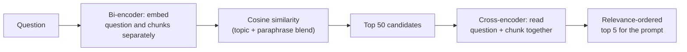

Every embedding-based retriever rests on one promise: texts that are *semantically similar* get vectors that score highly against each other. The previous lessons showed what an embedding is and the [vector space](/learn/embedding-fundamentals/vector-spaces) it lives in. This lesson examines the promise itself. What does "semantically similar" actually mean? It turns out to be several different relations wearing one name: paraphrase, topical relatedness, relevance of an answer to a question, agreement or contradiction. An embedding model measures a blend of these that its training decided, and a RAG engineer has to know which blend, because the failures live in the gaps.

You will grade sentence pairs by hand, measure how well a real model's scores agree with your grades, and watch it give its highest score of all to two sentences that mean different things. Then you will see the difference between "similar to the question" and "answers the question", which is the difference that matters most for retrieval.

## Learning objectives

- Distinguish paraphrase similarity, relatedness, relevance and entailment, and give an example pair where they disagree.
- Measure agreement between model scores and human judgements with Spearman rank correlation, by hand and in Python.
- Identify the systematic blind spots of embedding similarity (negation, changed numbers, swapped roles) and test a model for them.
- Explain why a cosine score has no fixed meaning across models, and why thresholds must be set per model from data.
- Explain why the best match for a question by similarity may be another question, and what retrieval-trained models and cross-encoders do about it.

## Prerequisites

- [What are embeddings?](/learn/embedding-fundamentals/what-are-embeddings): embeddings as learned functions whose notion of "close" comes from training.
- [Vector spaces](/learn/embedding-fundamentals/vector-spaces): why only geometry is meaningful, and why unrelated texts often score above zero.
- [Query-document matching](/learn/rag-architecture-fundamentals/query-document-matching): the asymmetry between a short question and the passage that answers it.

## Why this matters

When AskMeridian retrieves the wrong chunk, it is usually not because the embedding failed to detect similarity. It is because it detected the wrong *kind* of similarity. A question about whether contractors get the home-office budget retrieves the chunk that says employees do, because the two are about the same thing. A question about the leave allowance retrieves an FAQ entry that asks the same question but never answers it. A handbook revision that changed "4 years" to "3 years" is indexed next to the old version, and both score almost identically against any question about laptops.

Each of these is the embedding doing exactly what it was trained to do. If you think of the score as "how much this chunk answers the question", every one of them is baffling. If you know that it measures a learned mixture of topic overlap and paraphrase, each is predictable, and you know which tool fixes it: better chunk metadata, a [cross-encoder](/learn/reranking-fundamentals/cross-encoders) reranker, a different embedding model, or a check in the generation step.

## The intuition

Ask three Meridian colleagues whether two sentences are "similar".

The **editor** checks whether one could replace the other in a document without changing what it says. "Staff get 25 days of holiday" and "Annual leave is 25 days per year": yes. "Annual leave is 25 days" and "Annual leave is 30 days": no, those are different policies.

The **librarian** checks whether they belong on the same shelf. Both leave sentences: yes, obviously, and so is "Unused leave must be used by 31 March", which the editor would say means something else entirely.

The **help-desk agent** is asked a different question: does this sentence *answer* that question? For "How many days of leave do I get?", the sentence "Annual leave is 25 days" is a perfect answer. Another copy of the question, "How many leave days do I get each year?", is useless to her, though the editor and the librarian would both call it very similar.

All three are judging similarity. They disagree because they are doing different jobs. An embedding model is a fourth colleague whose job description was written by its training data, and RAG needs the help-desk agent's judgement most of all.

## How it works

### Four relations under one name

It helps to name the relations precisely.

| Relation | Question it answers | Symmetric? | Example pair that scores high |
| --- | --- | --- | --- |
| **Paraphrase** (semantic equivalence) | Do these say the same thing? | Yes | "Work remotely up to 3 days a week" / "Work from home three days per week" |
| **Relatedness** (topical similarity) | Are these about the same subject? | Yes | "Annual leave is 25 days" / "Unused leave must be used by 31 March" |
| **Relevance** | Does B help answer A? | No | "How much leave do I get?" / "Annual leave is 25 days" |
| **Entailment** | If A is true, must B be true? | No | "Leave is 25 days" / "Leave is more than 20 days" |

Relevance and entailment are **asymmetric**: swapping the two texts changes the answer. Cosine similarity is symmetric by construction: $\cos(\mathbf{a}, \mathbf{b}) = \cos(\mathbf{b}, \mathbf{a})$. A single symmetric score can only approximate an asymmetric relation, and how well it does depends on how the model was trained. Some models handle the asymmetry by encoding the two sides differently, for example with the `query: ` and `passage: ` prefixes that the E5 family expects (see [E5 models](/learn/embedding-models/e5-models)), so that the question and the answer pass through slightly different paths before the symmetric comparison.

Contradiction is the relation embeddings handle worst. Two sentences that contradict each other are almost always about the same topic and share most of their words, so on relatedness and surface form they are near-identical. Nothing in the vector distinguishes "these agree" from "these disagree" unless the training data deliberately taught it to.

### How similarity is measured: graded human judgements

Researchers make "similarity" measurable by asking people to grade pairs. The **Semantic Textual Similarity (STS)** benchmarks, from a series of SemEval shared tasks, ask annotators to rate sentence pairs on a scale from 0 (completely dissimilar) to 5 (completely equivalent), with intermediate grades for "mostly equivalent but some details differ" and "on the same topic". A model is then judged by how well its scores *rank* the pairs in the same order as the human grades, measured with Spearman rank correlation (defined in the mathematics section).

Notice the choice of statistic. Nobody expects a cosine of 0.8 to mean "grade 4". The model is judged only on ordering, because its scores live on its own arbitrary scale. That same fact governs how you should use scores in production.

Broad benchmarks such as **MTEB** (the Massive Text Embedding Benchmark, Muennighoff and colleagues, 2022) bundle STS with retrieval, clustering, classification and other tasks, because a model that is good at one notion of similarity is not necessarily good at another. When you choose a model for RAG, the retrieval portion is the part that matters, and [Embedding evaluation](/learn/embedding-optimisation/embedding-evaluation) shows how to run the same kind of measurement on your own data.

### Systematic blind spots

Because a sentence embedding compresses the whole text into one vector, and because training pushes topic and wording to dominate that vector, some small textual changes with large consequences barely move it:

1. **Negation.** "Contractors are eligible" and "contractors are not eligible" differ by one word. Most of the vector reflects the shared topic.
2. **Changed numbers and dates.** "25 days" versus "30 days", "every 3 years" versus "every 4 years". Numbers are a small part of the text and models often represent them coarsely.
3. **Swapped roles.** "The manager approves before finance" versus "finance approves before the manager". Same words, same topic, different meaning. Averaging token vectors into one, the usual way of producing a sentence vector, keeps only part of the information about order, as [Sentence embeddings](/learn/embedding-fundamentals/sentence-embeddings) explains.
4. **Exact identifiers.** Error codes such as E-4021 and E-4012, version numbers and product SKUs, as [Query-document matching](/learn/rag-architecture-fundamentals/query-document-matching) showed.

These are not rare edge cases in enterprise documents. Policies, runbooks and contracts are full of numbers, conditions and exceptions, and the exception is often exactly what a user is asking about.

### What a score means, and what it does not

A cosine score is a number between −1 and 1 whose meaning depends on the model. Three consequences follow.

- **Baselines differ.** As [Vector spaces](/learn/embedding-fundamentals/vector-spaces) showed, unrelated sentences from `all-MiniLM-L6-v2` averaged a cosine of about 0.19, not 0. Other models have higher or lower baselines and wider or narrower spreads. [Similarity distributions](/learn/embedding-mathematics/similarity-distributions) looks at these shapes.
- **Thresholds do not transfer.** "Discard chunks below 0.5" might cut most good results with one model and let junk through with another. A threshold is a property of a (model, corpus, query type) combination and must be chosen from labelled examples; [Retrieval thresholding](/learn/advanced-retrieval-optimisation/retrieval-thresholding) covers how.
- **Scores rank; they do not judge.** Within one model and one query, a higher score is better evidence of a match than a lower one. Across queries, a 0.6 for one question and a 0.6 for another need not mean the same thing.

### Similarity versus relevance in retrieval

The help-desk problem from the intuition is real. A corpus that contains FAQ pages, ticket titles or headings full of questions will often contain texts that are *more similar* to a user's question than the passage that answers it, because a question paraphrases a question better than an answer does. Several things counteract this:

1. **Retrieval-trained embedding models** learn from (question, answer passage) pairs, so the training signal is relevance rather than paraphrase. They reduce the problem but, as the code below shows, do not eliminate it.
2. **Chunking and indexing choices**: keep questions together with their answers in one chunk rather than letting a bare question stand as its own chunk.
3. **Cross-encoders** read the question and the candidate together, in one pass through a Transformer, and output a relevance score. They see both texts at once, so they can notice that one text answers the other. They are too slow to run against a whole corpus, which is why they are used to [rerank](/learn/reranking-fundamentals/why-reranking-is-needed) a short list produced by embeddings.



Relevance is still not truth. A cross-encoder will rate both "contractors are eligible" and "contractors are not eligible" as highly relevant to "are contractors eligible?", because both address the question. Deciding which is correct is a matter for document metadata (which version is current?) and for the generator, not for any similarity score.

## The mathematics

### Spearman rank correlation

**Intuition.** We want to know whether the model puts pairs in the same order as the humans did, ignoring the actual numbers. So replace each score by its rank, replace each grade by its rank, and measure how well the two lists of ranks agree.

When there are no ties:

$$
\rho = 1 - \frac{6 \sum_{i=1}^{n} \delta_i^2}{n(n^2 - 1)}
$$

- $n$ is the number of pairs.
- For pair $i$, $\delta_i$ is the difference between its rank by model score and its rank by human grade.
- $\rho$ (rho) is $+1$ when the orders agree perfectly, $-1$ when one is the reverse of the other, and near 0 when they are unrelated.

When there are ties (several pairs with grade 5, for example), each tied item gets the average of the ranks it spans, and $\rho$ is computed as the ordinary Pearson correlation of the two rank lists. `scipy.stats.spearmanr` does this automatically.

**By hand.** Five pairs with model cosines $(0.9, 0.7, 0.8, 0.3, 0.1)$ and human grades $(5, 4, 3, 1, 0)$.

- Ranks of the cosines, smallest = 1: $0.1 \to 1$, $0.3 \to 2$, $0.7 \to 3$, $0.8 \to 4$, $0.9 \to 5$, so in pair order the ranks are $(5, 3, 4, 2, 1)$.
- Ranks of the grades: $(5, 4, 3, 2, 1)$.
- Differences $\delta$: $(0, -1, 1, 0, 0)$; squares sum to $\sum \delta_i^2 = 2$.
- $\rho = 1 - \dfrac{6 \times 2}{5 \times (25 - 1)} = 1 - \dfrac{12}{120} = 0.9$.

The model swapped the order of two middle pairs and was otherwise right, and $\rho$ dropped from 1 to 0.9.

```python
from scipy.stats import spearmanr

cosines = [0.9, 0.7, 0.8, 0.3, 0.1]
grades = [5, 4, 3, 1, 0]
print(f"rho = {spearmanr(cosines, grades).statistic:.3f}")
```

```output
rho = 0.900
```

### Why the order, not the value

Spearman's $\rho$ is unchanged by any strictly increasing transformation of the scores: squaring positive cosines, rescaling them to 0–5, or passing them through a logistic function leaves every rank, and therefore $\rho$, the same. That matches retrieval exactly, which also uses only the order. It also means a high $\rho$ tells you nothing about where to put a threshold: a model can rank perfectly and still have all its scores squeezed between 0.6 and 0.8.

## In code

**The problem.** Measure how well a real embedding model's notion of similarity agrees with "means the same thing" on Meridian sentences, find where it disagrees, and test whether similarity to a question equals relevance to it.

**Dependencies.** sentence-transformers, NumPy and SciPy.

```bash
pip install sentence-transformers numpy scipy
```

The grades below were assigned by the author of this lesson on a 0–5 scale for "does B say the same thing as A?". They are a teaching set, not a benchmark, and three pairs (a changed number, a negation and a role swap) are deliberate traps.

```python
import numpy as np
from scipy.stats import spearmanr
from sentence_transformers import SentenceTransformer

# (sentence A, sentence B, grade 0-5: "does B say the same thing as A?")
pairs = [
    ("Annual leave is 25 days per year.", "Staff get 25 days of holiday each year.", 5),
    ("Lost laptops must be reported to the support desk at once.",
     "Report a missing laptop to the support desk immediately.", 5),
    ("Staff may work remotely up to 3 days a week.", "Employees can work from home three days per week.", 5),
    ("Passwords must be rotated every 90 days.", "You have to change your password every three months.", 4),
    ("Annual leave is 25 days per year.", "Unused leave days must be used by 31 March.", 2),
    ("Annual leave is 25 days per year.", "Annual leave is 30 days per year.", 1),
    ("Contractors are eligible for the home-office equipment budget.",
     "Contractors are not eligible for the home-office equipment budget.", 0),
    ("The manager approves the expense before finance does.",
     "Finance approves the expense before the manager does.", 1),
    ("Up to 5 unused leave days carry over.", "Remote work is allowed up to 3 days a week.", 0),
    ("VPN is required on public Wi-Fi.", "Expenses over £75 need a receipt.", 0),
]
model = SentenceTransformer("sentence-transformers/all-MiniLM-L6-v2")
A = model.encode([a for a, _, _ in pairs], normalize_embeddings=True)
B = model.encode([b for _, b, _ in pairs], normalize_embeddings=True)
cos = (A * B).sum(axis=1)                      # row-wise dot product = cosine
grades = np.array([g for _, _, g in pairs])

rho, _ = spearmanr(cos, grades)
traps = [5, 6, 7]                              # number change, negation, role swap
keep = [i for i in range(len(pairs)) if i not in traps]
rho_easy, _ = spearmanr(cos[keep], grades[keep])
print(f"Spearman, all 10 pairs:   {rho:.3f}")
print(f"Spearman, without traps:  {rho_easy:.3f}\n")
print(" cosine grade  pair")
for i in np.argsort(-cos):
    a, b, g = pairs[i]
    print(f"  {cos[i]:.3f}   {g}    {a[:38]:<38} | {b[:38]}")

# Similarity is not relevance
query = "How many days of annual leave do I get?"
cands = ["How many days of annual leave do I get each year?",   # another question
         "Annual leave is 25 days per year.",                    # the answer
         "Annual leave requests are not approved in December."]  # same topic, no answer
q = model.encode([query], normalize_embeddings=True)[0]
C = model.encode(cands, normalize_embeddings=True)
print(f"\nquery: {query}")
for s, c in sorted(zip(C @ q, cands), reverse=True):
    print(f"  {s:.3f}  {c}")
```

```output
Spearman, all 10 pairs:   0.100
Spearman, without traps:  0.767

 cosine grade  pair
  0.982   1    The manager approves the expense befor | Finance approves the expense before th
  0.928   1    Annual leave is 25 days per year.      | Annual leave is 30 days per year.
  0.832   0    Contractors are eligible for the home- | Contractors are not eligible for the h
  0.785   5    Lost laptops must be reported to the s | Report a missing laptop to the support
  0.760   5    Staff may work remotely up to 3 days a | Employees can work from home three day
  0.736   4    Passwords must be rotated every 90 day | You have to change your password every
  0.670   2    Annual leave is 25 days per year.      | Unused leave days must be used by 31 M
  0.655   5    Annual leave is 25 days per year.      | Staff get 25 days of holiday each year
  0.396   0    Up to 5 unused leave days carry over.  | Remote work is allowed up to 3 days a 
  0.013   0    VPN is required on public Wi-Fi.       | Expenses over £75 need a receipt.

query: How many days of annual leave do I get?
  0.963  How many days of annual leave do I get each year?
  0.856  Annual leave is 25 days per year.
  0.515  Annual leave requests are not approved in December.
```

**The important lines.**

- `(A * B).sum(axis=1)` multiplies matching rows element by element and sums each row: the cosine of each pair, since every vector has length 1. It is cheaper than `A @ B.T`, which would compute all 100 cross-pairs when we need only the 10 diagonal ones.
- `spearmanr(cos, grades)` returns the correlation and a p-value. With 10 pairs the p-value is not worth reading; the point is the correlation.
- `np.argsort(-cos)` sorts pairs from most to least similar, so the trap pairs' positions are easy to see.

**What the output means.**

The three highest cosines in the whole set belong to the three traps. The role swap scores 0.982, higher than any genuine paraphrase; the 25-versus-30-day pair scores 0.928; the negation pair 0.832. With them included, the agreement with "means the same thing" collapses to $\rho = 0.100$. Remove them and $\rho = 0.767$: on ordinary pairs the model's ordering is broadly sensible, though it still ranks the true paraphrase "25 days of holiday each year" (0.655) below the merely related carry-over sentence (0.670).

So the model is measuring, mostly, *how much the two texts share in topic and wording*, with paraphrase knowledge layered on top. That is a fine signal for finding candidate chunks, and a poor one for deciding whether two policies agree.

The second part shows the relevance problem. The best match for the leave question is another question (0.963), above the actual answer (0.856). The model does rank the answer far above the same-topic distractor about December, so it has learned something about relevance, but similarity to the question still wins.

**A peek at the fix.** A cross-encoder, which the [Reranking fundamentals](/learn/reranking-fundamentals) module covers properly, scores each (question, candidate) pair jointly. With `cross-encoder/ms-marco-MiniLM-L-6-v2`, a relevance model trained on search queries and passages:

```python
from sentence_transformers import CrossEncoder

ce = CrossEncoder("cross-encoder/ms-marco-MiniLM-L-6-v2")
query = "How many days of annual leave do I get?"
cands = ["How many days of annual leave do I get each year?",
         "Annual leave is 25 days per year.",
         "Annual leave requests are not approved in December."]
for s, c in sorted(zip(ce.predict([(query, c) for c in cands]), cands), reverse=True):
    print(f"  {s:+.2f}  {c}")
```

```output
  +8.85  Annual leave is 25 days per year.
  +4.11  How many days of annual leave do I get each year?
  -4.36  Annual leave requests are not approved in December.
```

The answer now comes first. The scores are unbounded logits, not cosines, so do not compare them with the numbers above. Asked "Are contractors eligible for the home-office equipment budget?", the same cross-encoder scores the "eligible" and "not eligible" sentences almost identically (about 10.4 and 10.3 in our run), confirming that relevance is not truth.

**Common errors.**

- Using `A @ B.T` and then reading the whole matrix instead of its diagonal; the off-diagonal entries compare unrelated pairs.
- Judging a model on a handful of hand-picked examples and generalising. Ten pairs show you *kinds* of failure; measuring *rates* needs a labelled set of hundreds.
- Comparing cross-encoder scores with bi-encoder cosines or with each other across models; each lives on its own scale.

**Extending it.** Add pairs for the other blind spots (two error codes, two product names, "before" versus "after") and pairs that test useful robustness: typos ("pasword rotaion"), abbreviations ("WFH"), and British versus American spelling. You will have the start of a regression test that you can run whenever you consider a new model.

## A real-world example

Meridian's HR team published the 2024 handbook alongside the superseded 2023 edition, which stayed in the index for staff who needed to check old entitlements. The 2023 edition gave a 4-year laptop refresh cycle and 09:00 to 17:00 support hours; the current one says 3 years and 08:00 to 18:00.

A member of staff asked AskMeridian when their laptop would be replaced and was told "every 4 years". The Platform team traced the retrieval: both laptop chunks were in the top three, with cosines that differed in the third decimal place, and the 2023 chunk happened to come first. The generator, given two contradictory statements, used the first. As the code above demonstrates, the embedding could not have separated them: the two chunks differ only in a number.

The team considered and rejected two quick fixes. Raising the similarity threshold would have removed neither chunk, because both scored well. Switching to a bigger embedding model would have kept the two chunks just as close, since they are near-paraphrases by any reasonable measure.

The fix had three parts, none of which involved similarity:

- Each chunk carries an `effective_from` and a `superseded` field in its metadata, and the default search filters out superseded chunks unless the question asks about the past.
- The context passed to the generator includes each chunk's edition, and the system prompt tells the model to prefer the current edition and to mention a conflict if it sees one.
- A nightly job looks for pairs of chunks from different editions with cosine above a chosen threshold, which reliably surfaces near-duplicates, and lists them for HR to confirm which is current. Here high similarity is exactly the right signal: it finds candidates for a human to review.

## Common mistakes

- **Treating a high cosine as "means the same".** Consequence: contradictory policies, old and new versions, and negated statements are retrieved together and treated as agreeing.
- **Assuming the most similar chunk answers the question.** Consequence: FAQ headings, ticket titles and restated questions crowd out the passages that contain the answer.
- **Copying a similarity threshold from a blog post or another model.** Consequence: either most good chunks are discarded or noise passes, because thresholds are model- and corpus-specific.
- **Evaluating with symmetric similarity data when the task is asymmetric retrieval.** Consequence: choosing a model that excels at paraphrase detection and ranks answers below questions.
- **Expecting embeddings to resolve contradictions.** Consequence: no mechanism in the pipeline ever decides which of two conflicting chunks is current; the generator picks one by position.

## Best practices

- Write down which relation you need (paraphrase, relatedness or relevance) before choosing a model or a threshold.
- Build a small labelled set from your own corpus, including trap pairs for negation, numbers, identifiers and versions, and measure each candidate model on it with Spearman correlation and with retrieval metrics.
- Use embeddings to generate candidates and a cross-encoder to order them when relevance matters more than recall speed.
- Handle versioning and validity with metadata and filters, not with similarity.
- Keep questions and their answers in the same chunk when indexing FAQ-style content.
- Choose thresholds from the score distribution of labelled relevant and irrelevant examples for the specific model, and re-choose them after any model change.

## Performance considerations

A bi-encoder computes one vector per text, so comparing a query with $N$ chunks costs one query embedding plus $N$ dot products of length $d$: for 50,000 chunks at $d = 384$, about 19 million multiply-adds, a few milliseconds even without an index. A cross-encoder must run the full Transformer once for every (query, chunk) pair. If a single pair takes, as an assumption, 5 ms on a CPU, scoring 50,000 chunks would take $50{,}000 \times 5 = 250{,}000$ ms, over four minutes per query. Scoring the top 50 candidates takes $50 \times 5 = 250$ ms, which is acceptable, and batching on a GPU reduces it further. That arithmetic is why the two are combined in stages rather than one replacing the other.

Building an evaluation set is mostly human time: grading a few hundred pairs takes hours, not days, and is repaid the first time it stops you from shipping a model that ranks questions above answers.

## Security considerations

- **Similarity can be gamed.** If untrusted content enters the index (customer tickets, wiki pages anyone can edit), an attacker can write text that is highly similar to common questions so that it is retrieved, carrying instructions or false information into the prompt. High similarity says nothing about trustworthiness; track the source of each chunk and treat untrusted sources accordingly.
- **Contradiction is a safety issue, not only a quality one.** If a retracted security instruction (an old VPN rule, say) remains in the index, it will be retrieved alongside the current one. Remove or flag superseded security guidance explicitly.

## Summary

- "Semantic similarity" covers paraphrase, relatedness, relevance and entailment; they disagree on important pairs, and an embedding model measures a blend fixed by its training.
- Models are evaluated by rank agreement with human grades (Spearman's $\rho$), because their raw scores live on model-specific scales.
- Embedding similarity is systematically weak at negation, changed numbers, swapped roles and exact identifiers: such pairs often score higher than true paraphrases.
- Similarity to a question is not relevance: another question can outscore the answer. Retrieval-trained models reduce this; cross-encoders reduce it further on a short list.
- Relevance is not truth: deciding between contradictory chunks needs metadata and generation-time handling, not a better score.

## Exercises

1. **Spearman by hand.** Model cosines $(0.2, 0.9, 0.5, 0.6)$, human grades $(0, 4, 3, 1)$. Compute $\rho$.

<details><summary>Show solution</summary>

Cosine ranks (smallest = 1): $0.2 \to 1$, $0.5 \to 2$, $0.6 \to 3$, $0.9 \to 4$, so in order $(1, 4, 2, 3)$. Grade ranks: $(1, 4, 3, 2)$. Differences $(0, 0, -1, 1)$, $\sum \delta^2 = 2$. $\rho = 1 - \frac{6 \times 2}{4 \times 15} = 1 - 0.2 = 0.8$.

</details>

2. **Classify the relation.** For each pair, say which of paraphrase, relatedness, relevance and contradiction applies (more than one may): (a) "Is VPN needed on hotel Wi-Fi?" / "VPN is required on public Wi-Fi."; (b) "Support desk hours are 08:00 to 18:00" / "Support desk hours are 09:00 to 17:00"; (c) "Expenses must be submitted within 30 days" / "Claims older than a month are rejected".

<details><summary>Show solution</summary>

(a) Relevance (the second answers the first, given that hotel Wi-Fi is public Wi-Fi) and relatedness. Not a paraphrase: one is a question. (b) Relatedness and contradiction: same topic, incompatible facts; an embedding will score them very highly. (c) Approximately a paraphrase, assuming "a month" means 30 days and "rejected" follows from "must be submitted": relatedness, and arguably entailment from the first to the second.

</details>

3. **Find a threshold, honestly.** Using the ten pairs from the code, suppose you wanted a cosine threshold that marks pairs as "same meaning" (grade 4 or 5). Is there any threshold that separates the grades 4–5 from the grades 0–2 in this data? What does this tell you?

<details><summary>Show solution</summary>

No. The grade 4–5 pairs score 0.655, 0.736, 0.760 and 0.785. The three trap pairs (grades 0–1) score 0.832, 0.928 and 0.982, all above every true paraphrase, and the related pair (grade 2) scores 0.670, above one paraphrase. Any threshold low enough to accept all four paraphrases (at most 0.655) also accepts all four of those lower-graded pairs. The lesson: for "same meaning" this model's cosine is not a sufficient signal at any threshold, which is why version conflicts need metadata and why paraphrase decisions need a model trained for them.

</details>

4. **Design: an FAQ corpus.** Meridian wants to add 300 FAQ entries, each a question and a short answer, to AskMeridian. Propose how to chunk and embed them so that user questions retrieve answers, and say how you would check it worked.

<details><summary>Show solution</summary>

Index each FAQ entry as a single chunk containing both the question and the answer, so the chunk is similar to the user's question (through the question text) and contains the answer. Optionally store the question separately as metadata for display. Do not index bare questions as their own chunks. Check with a set of real or realistic user questions paired with the FAQ entry that should answer them: measure Recall@5 and confirm that the retrieved chunk contains the answer, not just a matching question. If question-only chunks from other sources (ticket titles, headings) still crowd out answers, add a cross-encoder reranker on the top candidates and re-measure.

</details>

## Check your understanding

```quiz
[
  {
    "q": "Which relation is asymmetric, so that a single cosine score can only approximate it?",
    "options": ["Paraphrase", "Topical relatedness", "Relevance of a passage to a question", "Exact string equality"],
    "answer": 2,
    "why": "Whether B answers A is not the same as whether A answers B. Cosine is symmetric, so it cannot represent this directly."
  },
  {
    "q": "Why are embedding models evaluated on STS data with Spearman correlation rather than by checking whether cosine equals grade divided by 5?",
    "options": [
      "Because Spearman is faster to compute",
      "Because only the order of scores is meaningful; each model's scores sit on its own scale",
      "Because human grades are not numbers",
      "Because cosine can be negative"
    ],
    "answer": 1,
    "why": "Spearman compares rankings and is unaffected by any increasing transformation of the scores, matching how retrieval uses scores."
  },
  {
    "q": "In the lesson's run, which pair received the highest cosine of all ten?",
    "options": [
      "A true paraphrase about remote work",
      "The negation pair about contractors",
      "The changed-number pair about annual leave",
      "The role-swap pair about who approves expenses"
    ],
    "answer": 3,
    "why": "The role swap scored 0.982. It uses the same words on the same topic, and a mean-pooled embedding largely ignores order."
  },
  {
    "q": "A user asks 'Are contractors eligible for the home-office budget?'. Which tool can reliably decide which of two contradictory chunks is correct?",
    "options": [
      "A larger embedding model",
      "A cross-encoder reranker",
      "Metadata about which document is current, plus generation-time handling",
      "A higher similarity threshold"
    ],
    "answer": 2,
    "why": "Both chunks are relevant and similar; similarity and relevance scores cannot express truth. Version metadata and the generator's instructions must handle it."
  },
  {
    "q": "A bi-encoder ranks another copy of the user's question above the passage that answers it. What is the most direct remedy at query time?",
    "options": [
      "Rerank the top candidates with a cross-encoder",
      "Lower the similarity threshold",
      "Normalise the embeddings",
      "Increase the embedding dimension"
    ],
    "answer": 0,
    "why": "A cross-encoder reads question and candidate together and is trained for relevance; in the lesson it put the answer first."
  }
]
```

## Further reading

- Cer, D., Diab, M., Agirre, E., Lopez-Gazpio, I. and Specia, L. (2017). "SemEval-2017 Task 1: Semantic Textual Similarity Multilingual and Cross-lingual Focused Evaluation". [arXiv:1708.00055](https://arxiv.org/abs/1708.00055). Defines the STS grading scale and the STS benchmark.
- Muennighoff, N., Tazi, N., Magne, L. and Reimers, N. (2022). "MTEB: Massive Text Embedding Benchmark". [arXiv:2210.07316](https://arxiv.org/abs/2210.07316).
- Thakur, N., Reimers, N., Rücklé, A., Srivastava, A. and Gurevych, I. (2021). "BEIR: A Heterogeneous Benchmark for Zero-shot Evaluation of Information Retrieval Models". [arXiv:2104.08663](https://arxiv.org/abs/2104.08663). Shows how retrieval quality varies across domains.
- Reimers, N. and Gurevych, I. (2019). "Sentence-BERT: Sentence Embeddings using Siamese BERT-Networks". [arXiv:1908.10084](https://arxiv.org/abs/1908.10084). Introduces bi-encoder sentence embeddings evaluated on STS.
- Sentence Transformers documentation on semantic textual similarity and cross-encoders: [sbert.net](https://www.sbert.net/).
- SciPy `spearmanr` reference: [docs.scipy.org](https://docs.scipy.org/doc/scipy/reference/generated/scipy.stats.spearmanr.html).
