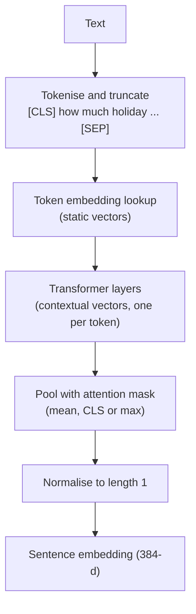

[Word embeddings](/learn/embedding-fundamentals/word-embeddings) gave every word one vector and left two problems unsolved: a word with two meanings gets one blurred vector, and there is no good way to combine word vectors into a vector for a whole sentence. Retrieval needs exactly that combined vector. A question and a handbook passage must each become one point in space, so that one comparison tells you whether they belong together.

A **sentence embedding** is that point. This lesson takes the mechanism apart: how a Transformer encoder turns a sentence into one contextual vector per token, how **pooling** squeezes those into a single vector, and, most importantly, why the encoder must be *trained for the purpose* before the result is any good for search. You will reproduce the library's output for `all-MiniLM-L6-v2` by hand, line by line, and see what goes wrong when one of those lines is wrong.

## Learning objectives

- Describe the bi-encoder pipeline from text to sentence vector: tokenise, encode with a Transformer, pool, normalise.
- Implement masked mean pooling with Hugging Face `transformers` and reproduce the `sentence-transformers` output exactly.
- Explain why an off-the-shelf language model gives poor sentence embeddings and how siamese, contrastive training with in-batch negatives fixes this.
- Compute an in-batch contrastive loss by hand and explain the role of the scale (temperature).
- Compare averaged static vectors with contextual sentence embeddings on word order and topical separation, and state the limits that remain.

## Prerequisites

- [Word embeddings](/learn/embedding-fundamentals/word-embeddings): static vectors, polysemy, negative sampling.
- [Semantic similarity](/learn/embedding-fundamentals/semantic-similarity): paraphrase versus relevance, and the blind spots of embedding similarity.
- [Attention mechanisms](/learn/understanding-large-language-models/attention-mechanisms) and [Transformer architecture](/learn/understanding-large-language-models/transformer-architecture): how each token's vector comes to reflect the tokens around it.

## Why this matters

Every query AskMeridian answers passes through a sentence-embedding model, and so does every chunk in its index. The quality of that model sets the ceiling for dense retrieval, and the details of how it is run decide whether you get that quality at all. The details are small and unforgiving. Pool with the wrong strategy, include padding in an average, omit a prefix the model was trained with, or let text run past the model's input limit, and the vectors change, often without any error, and often differently for queries (embedded one at a time) and for chunks (embedded in batches).

Understanding the mechanism also explains the remaining failures. A sentence embedding is far better than averaged word vectors, but it still has one vector per text, and that bottleneck is why role swaps and negations score as near-paraphrases, why reranking exists, and why the [Document embeddings](/learn/embedding-fundamentals/document-embeddings) lesson has to deal with long text separately.

## The intuition

Picture a committee reading a sentence. Each member is responsible for one word. In the first round each member knows only their own word, like a static word vector. Then the committee talks: every member listens to every other and updates their notes. After several rounds the member holding "leave" in "annual leave is 25 days" has notes that say *time off, an entitlement, a number of days*, while the member holding "leave" in "leave the building by the fire door" has notes about *departing* and *exits*. Same word, different notes, because the conversation was different. That is what a Transformer encoder does, layer by layer.

Now you need one summary for the whole sentence. The simplest fair method is to average everyone's notes. That is **mean pooling**.

But a committee of language-model readers, trained to fill in missing words, takes notes useful for filling in words, not for deciding whether two sentences belong together. To get notes that are good for comparison, you must train the committee on that job: show it pairs that belong together and pairs that do not, and reward summaries that put the right pairs close. That second step is what turns a language model into a sentence-embedding model.

## How it works

### The bi-encoder pipeline

A **bi-encoder** embeds each text independently with the same network, so that any two texts can be compared afterwards with a cheap similarity score. For one text:

1. **Tokenise** with the model's own tokeniser into subword ids, adding the special tokens the model expects (for BERT-style models, `[CLS]` at the start and `[SEP]` at the end). Truncate to the model's maximum length.
2. **Look up** each id in the token embedding table: one static vector per token.
3. **Encode** with a stack of Transformer layers. Self-attention lets every token's vector absorb information from every other token, so the output is one **contextual** vector per token. For `all-MiniLM-L6-v2` that is six layers and 384 numbers per token.
4. **Pool** the token vectors into one vector.
5. **Normalise** it to unit length, so that the dot product equals the cosine.

When several texts are encoded together as a batch, shorter ones are **padded** with a padding token so all rows have equal length, and an **attention mask** of 1s and 0s records which positions are real. The mask matters twice: inside the Transformer (so real tokens do not attend to padding) and at pooling (so padding does not enter the average).



### Pooling strategies

Three strategies are common, and a given model is trained with one of them. **Use the one the model was trained with**; the others give different, usually worse, vectors.

| Strategy | What it does | Used by |
| --- | --- | --- |
| Mean pooling | Average the token vectors, counting only real tokens | Many Sentence Transformers models, including `all-MiniLM-L6-v2` |
| CLS pooling | Take the output vector of the first (`[CLS]`) token | Some BERT-derived models, including the BGE family according to their model cards |
| Max pooling | Take the largest value in each dimension across tokens | Rarer; available in Sentence Transformers |

With Sentence Transformers the pooling choice is stored in the model's configuration and applied automatically; you can see it by printing the model, which for `all-MiniLM-L6-v2` shows a `Pooling` module with `pooling_mode` set to `mean`, followed by a `Normalize` module. It is when you reimplement the pipeline yourself, for example to serve the model with plain `transformers`, ONNX or a different runtime, that you must reproduce the choice exactly.

### Why a raw language model is not enough

It is tempting to take any pre-trained BERT, mean-pool its outputs and call the result a sentence embedding. Reimers and Gurevych, introducing Sentence-BERT in 2019, tested this and found it worked badly: on their semantic textual similarity benchmarks, mean-pooled BERT outputs and the `[CLS]` vector both scored below simply averaging GloVe word vectors. A language model's internal vectors are shaped by its pre-training objective (predicting masked or next tokens), which does not require that whole-sentence averages of similar sentences lie close together. The vectors also tend to be anisotropic, crowded into a narrow cone, as noted in [Vector spaces](/learn/embedding-fundamentals/vector-spaces), so all sentences look somewhat similar.

The fix is **fine-tuning for similarity**, and the structure that makes it possible is the **siamese network**: the same encoder, with shared weights, applied to both sentences of a pair, with a loss computed on the two pooled vectors.

### Training a sentence encoder

Sentence-BERT's original recipe fine-tuned BERT on natural-language-inference data (pairs labelled entailment, neutral or contradiction) and on STS data. Most retrieval-oriented models since then are trained **contrastively** on very large collections of related pairs: questions and their answers, search queries and clicked passages, titles and bodies, duplicate questions from forums. According to its model card, `all-MiniLM-L6-v2` was fine-tuned on over a billion such pairs.

The dominant loss uses **in-batch negatives**:

1. Take a batch of $B$ pairs $(q_i, p_i)$, for example a question and the passage that answers it.
2. Embed all questions and all passages with the shared encoder.
3. Compute the $B \times B$ matrix of cosines between every question and every passage.
4. For question $i$, treat $p_i$ as the correct answer and the other $B - 1$ passages in the batch as wrong answers. Apply a softmax across row $i$ and penalise a low probability for the correct one (cross-entropy).
5. Average over the batch and update the encoder.

This is the sentence-level version of word2vec's negative sampling, and it gets its negatives for free: every other pair in the batch supplies them. Larger batches mean more negatives per step, which is one reason these models are trained with large batches. In Sentence Transformers this loss is `MultipleNegativesRankingLoss`. [Contrastive learning](/learn/embedding-optimisation/contrastive-learning) covers the family in depth and [Hard negative mining](/learn/embedding-optimisation/hard-negative-mining) covers how to add negatives that are harder than random ones.

The training data defines the behaviour. A model trained mainly on duplicate-question pairs learns paraphrase; one trained on query-passage pairs learns relevance. That is the concrete mechanism behind the observation in [What are embeddings?](/learn/embedding-fundamentals/what-are-embeddings) that the objective decides what "close" means.

### Symmetric and asymmetric use

When queries and documents are different kinds of text, some models are trained to process them differently, usually by prepending an instruction or prefix (for example `query: ` and `passage: ` for E5 models). The encoder is the same; the prefix tells it which role the text plays. Recent versions of Sentence Transformers provide `encode_query` and `encode_document` methods that apply the prompts a model is configured with, which removes one opportunity for mistakes. The rule is simple: follow the model card, and use the same convention at indexing time and at query time. [Embedding models](/learn/embedding-fundamentals/embedding-models) and the individual model lessons, such as [E5 models](/learn/embedding-models/e5-models), give the specifics.

### What one vector cannot hold

Contextual encoding fixes the polysemy of static vectors and recovers some word order, but the whole sentence still passes through a single fixed-size vector. Consequences you have already seen and will see again in the code:

- **Order and roles are only weakly represented.** "The manager approves before finance" and its role-swapped version score 0.982 with `all-MiniLM-L6-v2`.
- **Small decisive words are diluted.** One "not" among fifteen tokens moves the mean only a little.
- **Inputs are truncated.** `all-MiniLM-L6-v2` reads at most 256 tokens (its `max_seq_length`); anything beyond that is cut off without warning. Long passages are the subject of [Document embeddings](/learn/embedding-fundamentals/document-embeddings).

Two families of method relax the single-vector bottleneck: **cross-encoders**, which read query and passage together (see [Bi-encoders](/learn/reranking-fundamentals/bi-encoders) and [Cross-encoders](/learn/reranking-fundamentals/cross-encoders)), and **late-interaction** models such as ColBERT, which keep one vector per token (see [ColBERT](/learn/reranking-models/colbert)).

## The mathematics

### Masked mean pooling

**Intuition.** Average the token vectors, but only over positions that hold real tokens.

$$
\mathbf{s} = \frac{\sum_{t=1}^{T} m_t\, \mathbf{h}_t}{\sum_{t=1}^{T} m_t}, \qquad \hat{\mathbf{s}} = \frac{\mathbf{s}}{\lVert \mathbf{s} \rVert}
$$

- $T$ is the padded sequence length; $\mathbf{h}_t$ is the encoder's output vector at position $t$.
- $m_t$ is the attention mask: 1 for a real token (including `[CLS]` and `[SEP]`), 0 for padding.
- $\mathbf{s}$ is the pooled vector and $\hat{\mathbf{s}}$ its normalised version, the sentence embedding.

**By hand.** Two real tokens $\mathbf{h}_1 = (1, 3)$, $\mathbf{h}_2 = (3, 1)$ and one padding position $\mathbf{h}_3 = (0.5, 0.5)$, so $m = (1, 1, 0)$. Masked mean: $((1 + 3)/2,\; (3 + 1)/2) = (2, 2)$. If you forget the mask: $((1 + 3 + 0.5)/3,\; (3 + 1 + 0.5)/3) = (1.5, 1.5)$. In this two-dimensional example the direction happens to survive, but in 384 dimensions the padding vector points somewhere of its own, and the direction changes too. How much it changes depends on how much padding the batch adds, so the same text gets different vectors in different batches.

### The in-batch contrastive loss

**Intuition.** For each question, the batch is a multiple-choice test: pick the right passage out of $B$. The loss is low when the model gives the right passage a much higher score than the others.

$$
\mathcal{L} = -\frac{1}{B} \sum_{i=1}^{B} \ln \frac{\exp\big(\lambda \cos(\mathbf{q}_i, \mathbf{p}_i)\big)}{\sum_{j=1}^{B} \exp\big(\lambda \cos(\mathbf{q}_i, \mathbf{p}_j)\big)}
$$

- $B$ is the batch size; $\mathbf{q}_i$ and $\mathbf{p}_i$ are the embeddings of the $i$-th question and its correct passage.
- $\cos(\mathbf{q}_i, \mathbf{p}_j)$ is the cosine between question $i$ and passage $j$; the terms with $j \neq i$ are the in-batch negatives.
- $\lambda$ is the **scale**, the inverse of what is often called the temperature. Cosines lie between −1 and 1, which is too narrow a range for a softmax to express confidence, so they are multiplied by $\lambda$ first. Sentence Transformers' `MultipleNegativesRankingLoss` uses 20 by default.
- The fraction is the softmax probability the model assigns to the correct passage.

**By hand**, with $B = 2$, $\lambda = 5$ (a small scale, so the numbers stay readable), and cosines $\cos(q_1, p_1) = 0.8$, $\cos(q_1, p_2) = 0.3$, $\cos(q_2, p_1) = 0.2$, $\cos(q_2, p_2) = 0.6$:

- Question 1: scaled scores 4.0 and 1.5. Probability of the correct passage $= e^{4} / (e^{4} + e^{1.5}) = 1 / (1 + e^{-2.5}) = 1 / 1.0821 = 0.9241$. Loss $= -\ln 0.9241 = 0.0789$.
- Question 2: scaled scores 1.0 and 3.0. Probability $= 1 / (1 + e^{-2}) = 1 / 1.1353 = 0.8808$. Loss $= -\ln 0.8808 = 0.1269$.
- Mean loss $= (0.0789 + 0.1269) / 2 = 0.1029$.

At the default scale of 20, the same cosines give probabilities of nearly 1 and a loss near 0: a larger scale makes the model very confident about margins that are modest in cosine terms, which sharpens training.

```python
import numpy as np

# Masked mean pooling: two real tokens and one padding position
H = np.array([[1.0, 3.0], [3.0, 1.0], [0.5, 0.5]])   # hidden states, last row is padding
m = np.array([1.0, 1.0, 0.0])                         # attention mask
print("masked mean:", (H * m[:, None]).sum(0) / m.sum(), " naive mean:", H.mean(0).round(3))

# In-batch contrastive loss for a batch of two (question, answer) pairs
S = np.array([[0.8, 0.3], [0.2, 0.6]])                # cosine of question i with answer j
for scale in (5.0, 20.0):
    logits = scale * S
    log_probs = logits - np.log(np.exp(logits).sum(axis=1, keepdims=True))
    loss = -np.diag(log_probs)
    print(f"scale {scale:>4}: p(correct) {np.exp(-loss).round(4)}  loss {loss.round(4)}  mean {loss.mean():.4f}")
```

```output
masked mean: [2. 2.]  naive mean: [1.5 1.5]
scale  5.0: p(correct) [0.9241 0.8808]  loss [0.0789 0.1269]  mean 0.1029
scale 20.0: p(correct) [1.     0.9997]  loss [0.     0.0003]  mean 0.0002
```

`np.diag(log_probs)` picks the log-probability of the correct passage for each question, which sits on the diagonal because question $i$ is paired with passage $i$.

## In code

**The problem.** Rebuild the sentence-embedding pipeline from its parts with Hugging Face `transformers`, confirm it matches `sentence-transformers` exactly, measure how far the two common mistakes (including padding, using the wrong pooling) move the vectors, and compare contextual embeddings with an average of the same model's static token vectors.

**Dependencies.** sentence-transformers, which installs `transformers` and PyTorch, plus NumPy. The model is downloaded and cached on first use.

```bash
pip install sentence-transformers numpy
```

```python
import numpy as np
import torch
from transformers import AutoModel, AutoTokenizer
from sentence_transformers import SentenceTransformer

name = "sentence-transformers/all-MiniLM-L6-v2"
tok = AutoTokenizer.from_pretrained(name)
enc = AutoModel.from_pretrained(name).eval()

texts = ["Annual leave is 25 days per year.",
         "How much holiday do I get?",
         "The manager approves the expense before finance does.",
         "Finance approves the expense before the manager does.",
         "VPN is required on public Wi-Fi."]

batch = tok(texts, padding=True, truncation=True, max_length=256, return_tensors="pt")
with torch.no_grad():
    H = enc(**batch).last_hidden_state                  # (batch, tokens, 384)
mask = batch["attention_mask"].unsqueeze(-1).float()     # 1 for real tokens, 0 for padding
print("token ids, row 1:", batch["input_ids"][1].tolist())
print("hidden states:", tuple(H.shape))

def unit(x):
    x = x.numpy()
    return x / np.linalg.norm(x, axis=1, keepdims=True)

pooled = {
    "mean (masked)": unit((H * mask).sum(1) / mask.sum(1)),
    "mean (padding included)": unit(H.mean(1)),
    "CLS token": unit(H[:, 0]),
}
reference = SentenceTransformer(name).encode(texts, normalize_embeddings=True)
for k, v in pooled.items():
    print(f"{k:<24} max diff from library: {np.abs(v - reference).max():.1e}")

# Context-free baseline: average the input (static) token embeddings
static = enc.get_input_embeddings().weight.detach()      # (vocab, 384)
avg_static = unit(((static[batch["input_ids"]]) * mask).sum(1) / mask.sum(1))

for label, V in [("static average", avg_static), ("contextual mean", pooled["mean (masked)"])]:
    print(f"\n{label}:")
    print(f"  leave fact ~ holiday question     {V[0] @ V[1]:.3f}")
    print(f"  leave fact ~ VPN rule (unrelated) {V[0] @ V[4]:.3f}")
    print(f"  manager-first ~ finance-first     {V[2] @ V[3]:.3f}")
```

```output
token ids, row 1: [101, 2129, 2172, 6209, 2079, 1045, 2131, 1029, 102, 0, 0, 0]
hidden states: (5, 12, 384)
mean (masked)            max diff from library: 1.5e-07
mean (padding included)  max diff from library: 2.1e-01
CLS token                max diff from library: 7.7e-01

static average:
  leave fact ~ holiday question     0.573
  leave fact ~ VPN rule (unrelated) 0.490
  manager-first ~ finance-first     1.000

contextual mean:
  leave fact ~ holiday question     0.357
  leave fact ~ VPN rule (unrelated) 0.002
  manager-first ~ finance-first     0.982
```

**The important lines.**

- `tok(texts, padding=True, truncation=True, max_length=256, return_tensors="pt")` tokenises the batch, pads every row to the longest text (12 tokens here) and cuts anything longer than 256 tokens, the limit this model was trained with.
- Row 1 of `input_ids` shows the structure: `101` is `[CLS]`, `102` is `[SEP]`, and the three `0`s are padding added because this question is shorter than the longest sentence in the batch.
- `enc(**batch).last_hidden_state` is the encoder's output: one 384-number contextual vector for each of the 12 positions of each of the 5 texts. `torch.no_grad()` turns off gradient tracking, which is not needed for inference and costs memory.
- `(H * mask).sum(1) / mask.sum(1)` is masked mean pooling, the formula above, applied to the whole batch at once. `unsqueeze(-1)` reshapes the mask from (5, 12) to (5, 12, 1) so it multiplies every one of the 384 numbers at each position.
- `enc.get_input_embeddings().weight` is the model's token embedding table, the static vectors that enter the first layer. Averaging them gives a word-vector style sentence embedding from the same model, a fair baseline for what context adds.

**What the output means.**

- Masked mean pooling matches the library to within $1.5 \times 10^{-7}$, rounding error. This *is* the model's sentence embedding: tokenise, encode, masked mean, normalise.
- Including padding in the mean changes some components by 0.21, a large error for unit vectors with 384 components. Only rows that were padded are affected, so the vector for a text depends on what else happened to be in its batch. Using the `[CLS]` vector differs by up to 0.77: it is a perfectly good vector, but not the one this model was trained to produce.
- The static average scores the holiday question 0.573 against the leave fact and 0.490 against the unrelated VPN rule: a margin of only 0.08, because averages of context-free token vectors share a large common component. The contextual embedding scores 0.357 against 0.002, a margin of 0.355. Its absolute scores are lower, but its *separation* is over four times larger, and separation is what ranking needs.
- On the role swap, the static average gives exactly 1.000: the two sentences contain the same tokens, and an average ignores order. The contextual embedding gives 0.982: context has made the vectors differ, but only slightly. Order is represented, weakly, as [Semantic similarity](/learn/embedding-fundamentals/semantic-similarity) found.

**Common errors.**

- **Pooling without the mask**, as shown. Symptom: a text's vector changes depending on its batch, and single-query embeddings disagree with batch-embedded documents.
- **Using `AutoModel` with the wrong pooling** because a tutorial for a different model used `[CLS]`. Check the model's `modules.json` and pooling configuration, or simply print the `SentenceTransformer` object.
- **Forgetting `truncation=True`.** Inputs longer than the model's position limit then fail with an indexing error, or, with some setups, are handled differently from the library.
- **Forgetting `.eval()`.** In training mode dropout is active and the same text produces different vectors on each call. `AutoModel.from_pretrained` returns the model in evaluation mode already, but calling `.eval()` explicitly protects you if training code ran earlier in the process.

**Extending it.** Encode the same question alone and inside a batch with a much longer sentence, using the unmasked pooling, and measure the cosine between the two results; then repeat with masked pooling and confirm the results agree to rounding error.

## A real-world example

To reduce container size, Meridian's Platform team replaced the `sentence-transformers` dependency in AskMeridian's query service with a few lines of plain `transformers` code, and exported the encoder to ONNX for faster CPU inference. The indexing job, owned by a different engineer, kept using `sentence-transformers`. Offline tests compared the new query vectors with the library's on a list of questions encoded one at a time, and they matched.

In production, retrieval quality dropped noticeably for one group of users: the support desk, whose integration sent questions in batches of up to 32, padded to the longest. The reimplementation averaged over all positions, padding included. A question encoded alone had no padding and came out correct; the same question in a batch with a long one was diluted by padding vectors and moved towards a generic direction. The offline test had missed it because it never batched.

The team made three changes:

- The pooling code applies the attention mask, and a unit test encodes a short text alone and inside a batch with a long text, requiring a cosine of at least 0.9999 between the two.
- A parity test runs at build time: fifty handbook and runbook sentences are encoded by the service's code path and by `sentence-transformers`, and the build fails if any component differs by more than $10^{-4}$, a tolerance that allows for ONNX numerical differences.
- The embedding contract recorded with the index (see [What are embeddings?](/learn/embedding-fundamentals/what-are-embeddings)) now includes the pooling mode and maximum sequence length, not only the model name.

## Common mistakes

- **Using a raw pre-trained language model as a sentence embedder.** Consequence: vectors that are crowded together and rank poorly; fine-tuning for similarity is what makes them useful.
- **Pooling over padding.** Consequence: embeddings depend on batch composition, so queries and documents drift apart unpredictably.
- **Choosing a pooling strategy different from the model's training.** Consequence: a valid-looking vector that is not the one the model's similarity behaviour was trained on.
- **Omitting the query or passage prefix a model requires.** Consequence: a silent drop in retrieval quality with no error.
- **Exceeding the maximum sequence length.** Consequence: the end of each long chunk is ignored, and facts stated there cannot be retrieved.
- **Expecting a bi-encoder to resolve word order, negation or exact values.** Consequence: near-identical scores for texts with opposite meanings; these cases need reranking, metadata or exact matching.

## Best practices

- Use a model trained for sentence similarity or retrieval, and read its model card for pooling, prefixes, maximum length and recommended similarity function.
- Prefer the `sentence-transformers` loading path, which applies the model's own pooling and normalisation; if you reimplement, add a parity test against it.
- Always apply the attention mask when pooling, and test that a text embeds identically alone and in a padded batch.
- Record pooling mode, normalisation, prefixes and maximum length in the embedding contract alongside the model name and revision.
- Keep chunks within the model's maximum length, measured in the model's own tokens rather than in words or characters.

## Performance considerations

The cost of encoding is dominated by the Transformer, and it grows with sequence length in two ways. The feed-forward layers cost roughly in proportion to the number of tokens $T$, while self-attention compares every token with every other, costing roughly in proportion to $T^2$. For short inputs the linear part dominates; as $T$ approaches a model's limit the quadratic part grows. Doubling a chunk from 128 to 256 tokens therefore at least doubles its encoding cost.

Padding wastes compute: every padded position is processed by every layer. A batch of 32 texts padded to the longest member, where one text has 256 tokens and the rest about 30, processes $32 \times 256 = 8{,}192$ positions to encode about $256 + 31 \times 30 = 1{,}186$ real tokens, roughly seven times more work than needed. Sorting texts by length before batching, which `sentence-transformers` does internally in `encode`, keeps similar lengths together and recovers most of that waste.

Model size sets the base cost. `all-MiniLM-L6-v2` has six layers and 384-dimensional hidden states and is small enough to run on a CPU; models with 12 or 24 layers and 768 or 1,024 dimensions cost proportionally more per token, and output larger vectors to store. Measure throughput on your own hardware with realistic chunk lengths before estimating a re-indexing job.

## Security considerations

- **Loading a model can run code.** Some models on public hubs ship custom Python code that runs only if you pass `trust_remote_code=True`; older checkpoints may use pickle-based weight files, which can execute code when loaded. Prefer models with `safetensors` weights, pin a specific revision, review any remote code before trusting it, and mirror approved models internally rather than downloading at runtime.
- **The tokeniser and encoder see raw user input.** Queries can be arbitrarily long or crafted; enforce a length limit before encoding so that a single request cannot monopolise the encoder.

## Summary

- A bi-encoder turns each text into one vector: tokenise, encode with a Transformer into contextual token vectors, pool (usually masked mean), normalise.
- Contextual token vectors fix the polysemy of static word vectors and give far better separation between related and unrelated texts than averaging static vectors.
- An off-the-shelf language model gives poor sentence embeddings; siamese fine-tuning, today mostly contrastive training with in-batch negatives, is what makes cosine similarity track relatedness or relevance.
- The pooling mode, attention mask, prefixes and maximum length are part of the model's contract; getting any of them wrong changes vectors silently.
- One vector per text remains a bottleneck: word order, negation and exact values are weakly represented, which is why cross-encoders, late interaction and metadata exist.

## Exercises

1. **Pooling by hand.** Token vectors $(2, 0)$, $(0, 2)$, $(4, 4)$ with mask $(1, 1, 0)$. Compute the masked mean, the naive mean, and the normalised version of each. Do they point the same way?

<details><summary>Show solution</summary>

Masked mean: $((2 + 0)/2, (0 + 2)/2) = (1, 1)$, normalised $(0.7071, 0.7071)$. Naive mean: $((2 + 0 + 4)/3, (0 + 2 + 4)/3) = (2, 2)$, normalised $(0.7071, 0.7071)$. In this case they point the same way, because the padding vector happens to lie on the same diagonal; in general it does not, as the code's 0.21 difference shows. A test case that happens to pass is a weak test, which is why the parity test uses real batches.

</details>

2. **Contrastive loss by hand.** With $\lambda = 5$, a batch of two has cosines $\cos(q_1, p_1) = 0.5$, $\cos(q_1, p_2) = 0.5$. What is the loss for question 1, and what does it mean?

<details><summary>Show solution</summary>

Scaled scores are equal (2.5 and 2.5), so the probability of the correct passage is $1/2$ and the loss is $-\ln 0.5 = 0.6931$. The model cannot tell the correct passage from the negative; the gradient will push $\cos(q_1, p_1)$ up and $\cos(q_1, p_2)$ down.

</details>

3. **Batch invariance test.** Write a test that encodes "How much holiday do I get?" alone and in a batch with a 200-word text, using the masked pooling from the lesson's code, and asserts that the cosine between the two vectors exceeds 0.9999. Then show that the unmasked version fails it.

<details><summary>Show solution</summary>

```python
import numpy as np
import torch
from transformers import AutoModel, AutoTokenizer

name = "sentence-transformers/all-MiniLM-L6-v2"
tok = AutoTokenizer.from_pretrained(name)
enc = AutoModel.from_pretrained(name).eval()

def embed(texts, masked=True):
    b = tok(texts, padding=True, truncation=True, max_length=256, return_tensors="pt")
    with torch.no_grad():
        H = enc(**b).last_hidden_state
    m = b["attention_mask"].unsqueeze(-1).float()
    v = ((H * m).sum(1) / m.sum(1) if masked else H.mean(1)).numpy()
    return v / np.linalg.norm(v, axis=1, keepdims=True)

q = "How much holiday do I get?"
long_text = " ".join(["Staff may work remotely up to 3 days a week."] * 20)  # 200 words
for masked in (True, False):
    alone, in_batch = embed([q], masked)[0], embed([q, long_text], masked)[0]
    print(f"masked={masked}: cosine alone vs in batch = {alone @ in_batch:.6f}")
```

```output
masked=True: cosine alone vs in batch = 1.000000
masked=False: cosine alone vs in batch = 0.521590
```

In a real test suite, replace the prints with `assert alone @ in_batch > 0.9999`. Without the mask, the 9-token question is padded to the long text's 222 tokens, so its average includes 213 padding positions, and its cosine with its own unbatched vector falls to 0.52.

</details>

4. **Design: choosing a pooling path for ONNX.** Meridian wants to serve the encoder through ONNX Runtime for speed. Describe what must be exported, what must be reimplemented outside the ONNX graph, and how you would prove the result is equivalent.

<details><summary>Show solution</summary>

Export the Transformer encoder (token ids and attention mask in, last hidden state out), or export it with pooling included if the export tool supports it. Anything outside the graph must be reimplemented exactly: tokenisation with the same tokeniser files, the same truncation length (256) and special tokens; masked mean pooling; L2 normalisation; and any query or passage prefix. Prove equivalence with a parity test against `sentence-transformers` on a representative sample, including batches with mixed lengths and texts longer than the limit, with a small tolerance for numerical differences, plus a retrieval-level check that top-k results on an evaluation set are unchanged.

</details>

## Check your understanding

```quiz
[
  {
    "q": "In masked mean pooling, which positions are included in the average?",
    "options": [
      "Only the [CLS] token",
      "All positions including padding",
      "All real tokens, including [CLS] and [SEP], but not padding",
      "Only content words"
    ],
    "answer": 2,
    "why": "The attention mask is 1 for every real token, special tokens included, and 0 for padding; only masked-in positions are averaged."
  },
  {
    "q": "Why did Sentence-BERT need fine-tuning rather than just mean-pooling a pre-trained BERT?",
    "options": [
      "BERT cannot output vectors",
      "BERT's vectors are too large to store",
      "Pre-training on word prediction does not make sentence averages of similar sentences close; raw pooled BERT ranked below averaged GloVe on STS in their tests",
      "Mean pooling is mathematically invalid for BERT"
    ],
    "answer": 2,
    "why": "The objective shapes the geometry. Siamese fine-tuning on pairs is what makes cosine track similarity."
  },
  {
    "q": "In an in-batch contrastive loss with batch size 64, how many negatives does each question get?",
    "options": ["1", "63", "64", "It depends on the scale"],
    "answer": 1,
    "why": "Every other passage in the batch serves as a negative for each question: 64 minus the correct one."
  },
  {
    "q": "A team pools without the attention mask. What symptom appears?",
    "options": [
      "A text's vector changes depending on what else is in its batch",
      "All vectors become zero",
      "The model raises a shape error",
      "Vectors are no longer 384-dimensional"
    ],
    "answer": 0,
    "why": "The amount of padding depends on the longest text in the batch, so the average, and the resulting direction, varies with batch composition."
  },
  {
    "q": "In the lesson's output, the static-average baseline scored the two role-swapped sentences exactly 1.000. Why?",
    "options": [
      "The model memorised the sentences",
      "Normalisation forced it to 1",
      "Static vectors are always identical",
      "Both sentences contain the same tokens, and an average of context-free vectors ignores order"
    ],
    "answer": 3,
    "why": "Without context, the average of a multiset of token vectors is the same whatever the order of the tokens."
  }
]
```

## Further reading

- Reimers, N. and Gurevych, I. (2019). "Sentence-BERT: Sentence Embeddings using Siamese BERT-Networks". EMNLP 2019. [arXiv:1908.10084](https://arxiv.org/abs/1908.10084).
- Devlin, J., Chang, M.-W., Lee, K. and Toutanova, K. (2019). "BERT: Pre-training of Deep Bidirectional Transformers for Language Understanding". [arXiv:1810.04805](https://arxiv.org/abs/1810.04805).
- Henderson, M. and colleagues (2017). "Efficient Natural Language Response Suggestion for Smart Reply". [arXiv:1705.00652](https://arxiv.org/abs/1705.00652). An early description of training with in-batch negatives.
- Gao, T., Yao, X. and Chen, D. (2021). "SimCSE: Simple Contrastive Learning of Sentence Embeddings". [arXiv:2104.08821](https://arxiv.org/abs/2104.08821).
- Sentence Transformers documentation, including pooling, losses and `encode_query` / `encode_document`: [sbert.net](https://www.sbert.net/).
- Hugging Face Transformers documentation: [huggingface.co/docs/transformers](https://huggingface.co/docs/transformers/index).
