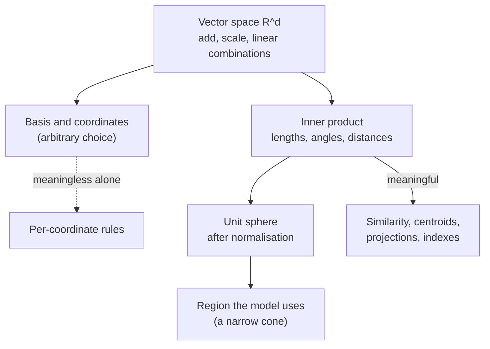

The [previous lesson](/learn/embedding-fundamentals/what-are-embeddings) defined an embedding as a function that sends text to a point in $\mathbb{R}^d$. This lesson is about that $\mathbb{R}^d$: the **vector space** the points live in. "Vector space" is a precise mathematical idea, and knowing exactly what it gives you, and what it does not, answers practical questions that otherwise turn into folklore. Can you read meaning off coordinate 17? Why are two models' vectors incomparable even when they have the same length? Is it legitimate to average a set of chunk vectors, or subtract one from another? Why do random vectors in 384 dimensions almost never point the same way?

We build the structure in layers: first the bare operations of adding and scaling, then bases and coordinates, then lengths and angles, and finally the special geometry of an embedding model's space. Each layer comes with the RAG consequence that follows from it.

## Learning objectives

- State what makes a set a vector space, and define basis, coordinates, dimension, span and subspace with examples in $\mathbb{R}^2$ and $\mathbb{R}^d$.
- Explain why an orthogonal transformation leaves every dot product and cosine unchanged, and conclude why individual embedding coordinates carry no fixed meaning.
- Compute a vector's coordinates in a new basis and its projection onto a direction, by hand and in NumPy.
- Decide which vector operations (averaging, differencing, projecting) are meaningful on embeddings and which are not.
- Describe how the region a model actually uses differs from the whole of $\mathbb{R}^d$, and why random high-dimensional directions are nearly perpendicular.

## Prerequisites

- [What are embeddings?](/learn/embedding-fundamentals/what-are-embeddings): an embedding as a learned function into $\mathbb{R}^d$, and the embedding contract.
- [Embeddings](/learn/understanding-large-language-models/embeddings): the dot product and cosine similarity, worked by hand.
- Comfort with NumPy arrays and matrix multiplication (`@`).

## Why this matters

Every operation a retrieval system performs on embeddings is an operation in a vector space: computing a similarity, averaging chunk vectors into a document vector, normalising to unit length, rotating or compressing vectors for storage, building an index that partitions the space. If you know which properties of the space those operations rely on, you can predict which are safe.

Without that knowledge, teams make two opposite errors. Some treat embeddings as opaque blobs and never use the geometry, missing cheap and robust tools such as topic centroids. Others over-read the geometry: they inspect individual dimensions, hand-tune weights on "the dimension that seems to mean IT", or try to compare vectors across models because the shapes match. Both errors come from not knowing what a vector space guarantees.

## The intuition

Think about how you would tell a friend where a café is in a city. You might say "300 metres north and 200 metres east of the station". Someone else might say "360 metres along the high street from the station". Both are correct. The café has one position, but its *description* depends on where you start and which directions you choose as your reference: north and east, or along and across the high street.

Three things in this picture carry over to embeddings.

1. **Positions are real; coordinates are conventions.** Distances between cafés do not change if you describe them with a different pair of reference directions.
2. **You can only compare descriptions given in the same convention.** "300 north, 200 east" and "360 along the high street" cannot be compared number by number. Two embedding models are two people who set up their reference directions independently, and never told each other how.
3. **Some combinations of positions mean something.** The midpoint of three cafés is a sensible place to meet. Halfway between a café and the station is a meaningful point. Adding the coordinates of two cafés gives a point that refers to nothing in particular.

## How it works

### Layer 1: adding and scaling

A **vector space** is a set of objects, called vectors, that you can add together and multiply by numbers (called **scalars**), where those two operations behave the way arithmetic leads you to expect: addition is commutative and associative, there is a zero vector, every vector has a negative, and scaling distributes over addition. The space we use throughout is $\mathbb{R}^d$, the set of all lists of $d$ real numbers, with addition and scaling done position by position:

$$
(a_1, \dots, a_d) + (b_1, \dots, b_d) = (a_1 + b_1, \dots, a_d + b_d), \qquad \lambda (a_1, \dots, a_d) = (\lambda a_1, \dots, \lambda a_d)
$$

From these two operations come **linear combinations**: $\lambda_1 \mathbf{v}_1 + \lambda_2 \mathbf{v}_2 + \dots + \lambda_k \mathbf{v}_k$. An average of vectors is a linear combination with every weight equal to $1/k$. A difference is one with weights $+1$ and $-1$. Nothing more exotic than this is ever done to embeddings in a RAG pipeline.

### Layer 2: bases, coordinates and dimension

A **basis** is a set of vectors from which every vector in the space can be built as a linear combination in exactly one way. In $\mathbb{R}^2$ the obvious basis is $(1, 0)$ and $(0, 1)$, and the vector $(3, 2)$ is $3 \times (1, 0) + 2 \times (0, 1)$. The numbers 3 and 2 are the vector's **coordinates** in that basis.

Any two vectors in $\mathbb{R}^2$ that do not point along the same line also form a basis. With $\mathbf{b}_1 = (1, 1)$ and $\mathbf{b}_2 = (1, -1)$, the same vector $(3, 2)$ is $2.5\,\mathbf{b}_1 + 0.5\,\mathbf{b}_2$, so its coordinates in that basis are $(2.5, 0.5)$. Same vector, different numbers.

Every basis of a given space has the same number of vectors; that number is the **dimension**. $\mathbb{R}^{384}$ has dimension 384, so every embedding from `all-MiniLM-L6-v2` is described by 384 coordinates, and those coordinates are relative to a basis the model's training happened to settle on.

Two more terms you will meet in later lessons:

- The **span** of a set of vectors is everything you can build from them by linear combinations. The span of two non-parallel vectors in $\mathbb{R}^{384}$ is a flat two-dimensional plane through the origin.
- A **subspace** is a subset that is itself a vector space (closed under addition and scaling). Spans are subspaces. Dimensionality reduction, covered in [Dimensionality reduction](/learn/embedding-mathematics/dimensionality-reduction), projects embeddings onto a well-chosen subspace of lower dimension.

### Layer 3: lengths, angles and the dot product

A bare vector space has no notion of length or angle. Those come from adding an **inner product**, which on $\mathbb{R}^d$ is the familiar dot product $\mathbf{a} \cdot \mathbf{b} = \sum_i a_i b_i$. From it you get:

- **Length** (norm): $\lVert \mathbf{a} \rVert = \sqrt{\mathbf{a} \cdot \mathbf{a}}$.
- **Angle**: $\cos\theta = \dfrac{\mathbf{a} \cdot \mathbf{b}}{\lVert \mathbf{a} \rVert \lVert \mathbf{b} \rVert}$, which is cosine similarity.
- **Distance**: $\lVert \mathbf{a} - \mathbf{b} \rVert$, the Euclidean distance.
- **Projection**: how far $\mathbf{a}$ extends along a direction.

The [Embedding mathematics](/learn/embedding-mathematics) module compares these measures in detail: [Dot product](/learn/embedding-mathematics/dot-product), [Cosine similarity](/learn/embedding-mathematics/cosine-similarity), [Euclidean distance](/learn/embedding-mathematics/euclidean-distance). Here we need one structural fact about them.

### Rotations change coordinates and nothing else

An **orthogonal transformation** is a change of coordinates that preserves every inner product: rotations and reflections. In matrix form it is multiplication by a square matrix $Q$ with $Q^\top Q = I$, the identity. Under such a transformation:

- every vector's coordinates change, usually completely;
- every dot product, length, angle and distance stays exactly the same;
- so every cosine, every nearest neighbour and every ranking stays exactly the same.

This has a striking consequence. Suppose a model were trained twice from identical data, and the second run produced exactly the first run's vectors rotated by some $Q$. The two models would be equally good at retrieval in every respect, yet coordinate 17 would mean something different in each. The training objective (rank related texts higher) depends only on inner products, so it **cannot prefer one rotation over another**. Which basis a model ends up with is an accident of initialisation and optimisation. Practical consequences:

1. **Individual coordinates have no guaranteed meaning.** Some dimensions do correlate with recognisable properties in practice, but that is not something the training objective guarantees, and it does not survive a retrain or an upgrade.
2. **Two models' spaces are incomparable even at equal dimension.** At the very least they differ by an unknown rotation; in reality the relationship is more complicated than any rotation.
3. **Anything built on geometry transfers; anything built on coordinates does not.** A similarity threshold, a centroid or a nearest-neighbour index uses geometry. A rule such as "if dimension 211 is above 0.1, treat as IT" uses coordinates and is fragile.

> [!KEY]
> In an embedding space only the geometry is meaningful: lengths, angles, distances and directions defined by other embeddings. The coordinates are an arbitrary description of that geometry.

### Directions that mean something

If single coordinates do not carry meaning, what does? **Directions defined by the data.** Take the mean of the embeddings of the leave-policy chunks (a **centroid**) and the mean of the IT chunks. The difference between the two centroids is a vector pointing "from IT towards leave". Projecting any new text onto that direction tells you which side it leans to. The direction is defined by embeddings in the same space, so it rotates along with them and is unaffected by the arbitrariness of the basis.

This idea is behind several practical tools:

- **Centroid classifiers and routers:** assign a query to the topic whose centroid is nearest.
- **Topic profiles:** a single vector summarising a set of documents, for example a document vector built by averaging its chunk vectors (one of the strategies in [Document embeddings](/learn/embedding-fundamentals/document-embeddings)).
- **Query steering:** nudging a query vector towards a centroid, a technique related to classic relevance feedback.

There is also a research thread, often called the **linear representation hypothesis**, which proposes that many concepts are represented by directions in a model's internal spaces. The famous word-vector analogy, "king minus man plus woman is near queen", is the best-known example, and the [Word embeddings](/learn/embedding-fundamentals/word-embeddings) lesson examines how far it really holds. Treat it as a useful lens with real limits, not as a law.

### The space a model actually uses

A model's output space is $\mathbb{R}^d$, but its embeddings do not fill that space evenly.

- **Normalised embeddings live on the unit sphere**, the set of vectors with length 1. Adding or averaging two of them gives a vector shorter than 1, off the sphere, so re-normalise after averaging.
- **Real embeddings cluster in a narrow region.** In the code below, six unrelated Meridian sentences have an average pairwise cosine of about 0.19, whereas random directions in the same space average 0. Many embedding models produce vectors that share a common component and occupy a cone rather than the whole sphere, a property usually called **anisotropy**. It is one reason absolute scores are hard to interpret, as [Semantic similarity](/learn/embedding-fundamentals/semantic-similarity) explains.
- **Most points in $\mathbb{R}^d$ are not the embedding of any text.** Sums and differences of embeddings are legitimate vectors, but the result of "embedding A plus embedding B" is generally *not* the embedding of A and B concatenated, nor of any real text. Use such vectors for comparison, not as if a text produced them.

### High dimensions behave differently

Intuition built in two and three dimensions misleads in 384. The most useful fact to carry around is this: **two random directions in a high-dimensional space are almost always nearly perpendicular.** The cosine between two random unit vectors in $\mathbb{R}^d$ has mean 0 and a standard deviation of roughly $1/\sqrt{d}$, so at $d = 384$ about 0.05. The code below confirms this. For embeddings this means a cosine of 0.2 between two texts is far from random, even though it looks small, and that the space has room for a huge number of nearly independent directions. [Dimensionality](/learn/embedding-fundamentals/dimensionality) takes up what else changes as $d$ grows.

The layers stack like this:



## The mathematics

### Coordinates in a new basis

**Intuition.** Finding coordinates means asking: how much of each basis vector do I need to build this vector?

Stack the basis vectors as the columns of a matrix $B$. The coordinates $\mathbf{c}$ of a vector $\mathbf{v}$ satisfy

$$
B\mathbf{c} = \mathbf{v} \quad\Longleftrightarrow\quad \mathbf{c} = B^{-1}\mathbf{v}
$$

where $B$ is a $d \times d$ matrix whose columns are the basis vectors, $\mathbf{c}$ is the list of $d$ coordinates and $\mathbf{v}$ is the vector in standard coordinates. $B^{-1}$ exists precisely because the columns form a basis.

**By hand.** $\mathbf{b}_1 = (1, 1)$, $\mathbf{b}_2 = (1, -1)$, $\mathbf{v} = (3, 2)$. We need $c_1 + c_2 = 3$ (first component) and $c_1 - c_2 = 2$ (second). Adding the equations gives $2c_1 = 5$, so $c_1 = 2.5$; then $c_2 = 0.5$. Check: $2.5 \times (1, 1) + 0.5 \times (1, -1) = (2.5 + 0.5,\; 2.5 - 0.5) = (3, 2)$.

### Orthogonal transformations preserve the dot product

**Intuition.** A rotation moves every arrow but keeps every angle and every length.

For a matrix $Q$ with $Q^\top Q = I$:

$$
(Q\mathbf{a}) \cdot (Q\mathbf{b}) = (Q\mathbf{a})^\top (Q\mathbf{b}) = \mathbf{a}^\top Q^\top Q\, \mathbf{b} = \mathbf{a}^\top \mathbf{b} = \mathbf{a} \cdot \mathbf{b}
$$

$\mathbf{a}$ and $\mathbf{b}$ are any two vectors, $Q$ is the orthogonal matrix and $I$ the identity. Since lengths are square roots of dot products and cosines are ratios of them, these are preserved too.

**By hand.** The 90-degree rotation in $\mathbb{R}^2$ is $Q = \begin{bmatrix} 0 & -1 \\ 1 & 0 \end{bmatrix}$, which sends $(x, y)$ to $(-y, x)$. Take $\mathbf{a} = (1, 2)$ and $\mathbf{b} = (3, 1)$: $\mathbf{a} \cdot \mathbf{b} = 3 + 2 = 5$. After rotation, $Q\mathbf{a} = (-2, 1)$ and $Q\mathbf{b} = (-1, 3)$, and $(-2)(-1) + (1)(3) = 2 + 3 = 5$. Every coordinate changed; the dot product did not.

### Projection onto a direction

**Intuition.** The projection of $\mathbf{x}$ onto a direction is its shadow along that direction: how much of $\mathbf{x}$ points that way.

For a unit vector $\mathbf{u}$ ($\lVert \mathbf{u} \rVert = 1$):

$$
s = \mathbf{x} \cdot \mathbf{u}, \qquad \text{proj}_{\mathbf{u}}(\mathbf{x}) = s\,\mathbf{u}, \qquad \mathbf{r} = \mathbf{x} - s\,\mathbf{u}
$$

$s$ is the **scalar projection** (a signed number: positive if $\mathbf{x}$ leans towards $\mathbf{u}$), $s\mathbf{u}$ is the projected vector, and $\mathbf{r}$ is the remainder, which is perpendicular to $\mathbf{u}$.

**By hand.** $\mathbf{u} = (0.6, 0.8)$ has length $\sqrt{0.36 + 0.64} = 1$. With $\mathbf{x} = (2, 1)$: $s = 1.2 + 0.8 = 2.0$; projection $= 2.0 \times (0.6, 0.8) = (1.2, 1.6)$; remainder $= (0.8, -0.6)$. Check perpendicularity: $(0.8)(0.6) + (-0.6)(0.8) = 0$.

**In NumPy:**

```python
import numpy as np

# Coordinates in a different basis: solve B c = v
B = np.array([[1.0, 1.0], [1.0, -1.0]]).T        # columns are b1 = (1, 1), b2 = (1, -1)
v = np.array([3.0, 2.0])
print("coordinates in basis (b1, b2):", np.linalg.solve(B, v))

# Rotation by 90 degrees preserves the dot product
R = np.array([[0.0, -1.0], [1.0, 0.0]])
a, b = np.array([1.0, 2.0]), np.array([3.0, 1.0])
print("a.b =", a @ b, " Ra =", R @ a, " Rb =", R @ b, " Ra.Rb =", (R @ a) @ (R @ b))

# Projection onto a unit direction
u = np.array([0.6, 0.8])
x = np.array([2.0, 1.0])
s = x @ u
print("scalar projection:", round(s, 2), " projection:", s * u, " remainder:", x - s * u)
```

```output
coordinates in basis (b1, b2): [2.5 0.5]
a.b = 5.0  Ra = [-2.  1.]  Rb = [-1.  3.]  Ra.Rb = 5.0
scalar projection: 2.0  projection: [1.2 1.6]  remainder: [ 0.8 -0.6]
```

`np.linalg.solve(B, v)` solves $B\mathbf{c} = \mathbf{v}$ directly, which is faster and more accurate than computing $B^{-1}$ and multiplying.

## In code

**The problem.** Verify on real embeddings the three claims of this lesson: a rotation changes every coordinate but no similarity; a direction built from embeddings carries meaning that a single coordinate does not; and random directions in 384 dimensions are nearly perpendicular while real sentence embeddings are not.

**Dependencies.** sentence-transformers and NumPy; the model is downloaded and cached on first use.

```bash
pip install sentence-transformers numpy
```

```python
import numpy as np
from sentence_transformers import SentenceTransformer

docs = [
    "Annual leave is 25 days per year.",                                   # leave
    "Up to 5 unused leave days carry over and must be used by 31 March.",  # leave
    "Passwords must be rotated every 90 days.",                            # IT
    "VPN is required on public Wi-Fi.",                                    # IT
    "Laptops are refreshed every 3 years.",                                # IT
    "Expenses over £75 need a receipt.",                                   # money
]
model = SentenceTransformer("sentence-transformers/all-MiniLM-L6-v2")
X = model.encode(docs, normalize_embeddings=True)          # shape (6, 384)
d = X.shape[1]

# 1. A random rotation: an orthogonal matrix from the QR decomposition
rng = np.random.default_rng(seed=0)
Q, _ = np.linalg.qr(rng.normal(size=(d, d)))
print("Q is orthogonal:", np.allclose(Q.T @ Q, np.eye(d), atol=1e-8))
Xr = X @ Q                                                  # every vector rotated

print("coordinate 0 before:", np.round(X[:3, 0], 3), " after:", np.round(Xr[:3, 0], 3))
print("lengths after rotation:", np.round(np.linalg.norm(Xr, axis=1), 4))
print(f"max change in any cosine: {np.abs(X @ X.T - Xr @ Xr.T).max():.1e}")

# 2. A direction: the difference between two topic centroids
leave_c = X[[0, 1]].mean(axis=0)
it_c = X[[2, 3, 4]].mean(axis=0)
u = leave_c - it_c
u /= np.linalg.norm(u)                                      # unit "leave minus IT" direction

probes = ["How many days of holiday do I get?",
          "My VPN keeps disconnecting.",
          "Can I claim a taxi fare?"]
P_ = model.encode(probes, normalize_embeddings=True)
print("\nposition along the leave-vs-IT direction:")
for text, p in zip(probes, P_):
    print(f"  {p @ u:+.3f}  {text}")

# 3. Random directions in 384-d space are nearly perpendicular
R = rng.normal(size=(2000, d))
R /= np.linalg.norm(R, axis=1, keepdims=True)
c = (R[:1000] * R[1000:]).sum(axis=1)                       # 1,000 random pairs
print(f"\nrandom pairs: mean cosine {c.mean():+.3f}, std {c.std():.3f}, 1/sqrt(d) = {1/np.sqrt(d):.3f}")
S = X @ X.T
print(f"real sentence pairs: mean cosine {S[np.triu_indices(6, 1)].mean():+.3f}")
```

```output
Q is orthogonal: True
coordinate 0 before: [ 0.096  0.035 -0.054]  after: [-0.05  -0.015 -0.098]
lengths after rotation: [1. 1. 1. 1. 1. 1.]
max change in any cosine: 2.3e-07

position along the leave-vs-IT direction:
  +0.354  How many days of holiday do I get?
  -0.224  My VPN keeps disconnecting.
  +0.098  Can I claim a taxi fare?

random pairs: mean cosine -0.000, std 0.051, 1/sqrt(d) = 0.051
real sentence pairs: mean cosine +0.189
```

**The important lines.**

- `np.linalg.qr(rng.normal(size=(d, d)))` is a standard way to obtain a random orthogonal matrix: the QR decomposition factors any square matrix into an orthogonal $Q$ times an upper-triangular $R$, and we keep $Q$.
- `Xr = X @ Q` rotates every row vector. Because rows are vectors here, the rotation multiplies on the right; the algebra in the previous section is the same with transposes.
- `X @ X.T - Xr @ Xr.T` compares all 36 pairwise cosines before and after. The largest difference, about $2 \times 10^{-7}$, is floating-point rounding from 32-bit inputs: the similarities are identical in exact arithmetic.
- `u = leave_c - it_c` builds a direction from data. `p @ u` is the scalar projection of each probe onto it, positive towards leave, negative towards IT.
- `S[np.triu_indices(6, 1)]` picks the 15 distinct pairs above the diagonal, ignoring each vector's similarity with itself.

**What the output means.**

1. After rotation, coordinate 0 of the first three documents changed from (0.096, 0.035, −0.054) to entirely different values, yet every length stayed 1 and every cosine stayed the same. Any rule written against coordinate 0 would now behave differently; any rule written against similarities would not.
2. The holiday question projects to +0.354 on the leave-versus-IT direction and the VPN complaint to −0.224, even though neither probe was used to build the direction. The taxi-fare question, which is about expenses, is neither, and sits near the middle at +0.098. One data-defined direction captured a meaningful contrast that no single coordinate is guaranteed to.
3. Random unit vectors in 384 dimensions have cosines centred on 0 with standard deviation 0.051, matching $1/\sqrt{d}$. Real sentence embeddings of unrelated Meridian policies average +0.189: well outside the random spread. The model's vectors share common structure, and that shifts the baseline of "unrelated".

**Common errors.**

- Rotating with a matrix that is not orthogonal, such as `rng.normal(size=(d, d))` used directly. That distorts angles and changes rankings. Check with `np.allclose(Q.T @ Q, np.eye(d))`.
- Averaging normalised vectors and forgetting to re-normalise. The mean of unit vectors is shorter than 1, so its dot products are no longer cosines.
- Building a direction from one example per side. A single leave sentence minus a single IT sentence mixes the topic contrast with every incidental difference between the two sentences; average several examples per side.

**Extending it.** Use the centroids as a router: compute the centroid of each topic (leave, IT, money) and assign each of 20 test questions to the nearest centroid. This is a nearest-centroid classifier, and with a few labelled examples per class it is a strong, cheap baseline for routing questions to the right index.

## A real-world example

An analyst on Meridian's Platform team was exploring AskMeridian's query logs and noticed that, in the 384-dimensional vectors, one coordinate was consistently higher for IT questions than for HR questions. She wrote a quick router: if that coordinate exceeded a threshold, the question went to the IT-runbooks index; otherwise to the handbook. On the logs she had, it routed about as well as anything else she tried, and it cost nothing to compute.

Months later the team re-trained their embedding model on Meridian's own question-answer pairs to improve retrieval on product documentation. Retrieval improved as planned. Routing quietly collapsed: IT questions went to the handbook and vice versa, because in the new model that coordinate meant something else. Nothing in the re-training had been designed to preserve it, and nothing could have; as this lesson showed, the training objective is indifferent to rotations of the space.

The replacement router used only geometry. For each index, the team kept a centroid computed from a few hundred labelled example questions, embedded with the *current* model. Routing assigned each query to the index with the most similar centroid, and the centroids were recomputed as part of every re-embedding job, alongside the documents. The new router survived the next model upgrade without a code change, and its decisions could be explained: "this question is closer to the typical IT question than to the typical HR question".

## Common mistakes

- **Interpreting single embedding dimensions.** Consequence: rules and dashboards built on coordinate values break at the next model version, because the basis is arbitrary.
- **Comparing vectors from different models because they have the same dimension.** Consequence: meaningless scores; at minimum the spaces differ by an unknown transformation.
- **Averaging normalised embeddings without re-normalising.** Consequence: dot products of the centroid with other vectors are scaled down, so thresholds and cosine-based comparisons are off.
- **Treating a sum or difference of embeddings as the embedding of some text.** Consequence: surprise when "embedding(A) + embedding(B)" behaves nothing like embedding("A B").
- **Judging similarity with two- or three-dimensional intuition.** Consequence: dismissing a cosine of 0.2 as "near zero" when in 384 dimensions random pairs sit at 0 plus or minus 0.05.

## Best practices

- Build every rule on geometry (similarities, centroids, projections onto data-defined directions), never on raw coordinates.
- Recompute any stored centroid, direction or threshold whenever you re-embed with a new model.
- Re-normalise after averaging unit vectors, and keep one convention (unit length) for everything in an index.
- Build directions and centroids from several examples per class to average away incidental differences.
- When you need to visualise the space, use a projection method from [Dimensionality reduction](/learn/embedding-mathematics/dimensionality-reduction) and remember it distorts distances.

## Performance considerations

The operations in this lesson are cheap compared with embedding text. Projecting $N$ vectors of dimension $d$ onto one direction costs $N \times d$ multiplications: for 50,000 chunks at $d = 384$ that is about 19 million, a few milliseconds in NumPy. A nearest-centroid router with $k$ topics costs $k \times d$ multiplications per query: negligible.

Rotations are another matter. Multiplying $N$ vectors by a $d \times d$ matrix costs $N \times d^2$ multiplications: $50{,}000 \times 384^2 \approx 7.4$ billion, still only seconds on a CPU, but a cost to pay deliberately. Some compression schemes rotate vectors before quantising them, so that information is spread more evenly across coordinates; that is the territory of [Product quantisation](/learn/vector-indexing-algorithms/product-quantisation). A random rotation also needs $d^2$ numbers of storage, about 590 KB for $d = 384$ in 32-bit floats.

Centroids are tiny to store, one $d$-dimensional vector per topic, and they let you avoid running a separate classification model at query time.

## Summary

- A vector space is a set with addition and scaling; $\mathbb{R}^d$ with the dot product adds lengths, angles and distances, which are what retrieval uses.
- Coordinates depend on the choice of basis. Orthogonal transformations change every coordinate and preserve every dot product, so training cannot fix a meaning for any single dimension.
- Meaningful structure in an embedding space lies in its geometry: similarities, centroids and directions defined by other embeddings.
- Normalised embeddings live on the unit sphere, and in practice occupy a narrow region of it, so "unrelated" texts typically score above zero.
- In high dimensions random directions are nearly perpendicular (cosine about $0 \pm 1/\sqrt{d}$), which is why modest-looking cosines can still be significant.

## Exercises

1. **Coordinates by hand.** Find the coordinates of $\mathbf{v} = (4, 0)$ in the basis $\mathbf{b}_1 = (1, 1)$, $\mathbf{b}_2 = (1, -1)$, and check your answer.

<details><summary>Show solution</summary>

We need $c_1 + c_2 = 4$ and $c_1 - c_2 = 0$, so $c_1 = c_2 = 2$. Check: $2 \times (1, 1) + 2 \times (1, -1) = (4, 0)$.

</details>

2. **Which operations are safe?** For each, say whether it depends on the basis (fragile) or only on geometry (robust): (a) ranking chunks by cosine to a query; (b) storing only the first 50 coordinates of each embedding to save space; (c) flagging near-duplicates whose cosine exceeds 0.95; (d) averaging chunk vectors to get a document vector.

<details><summary>Show solution</summary>

(a) Robust: cosine is preserved by rotations. (b) Fragile: which 50 coordinates carry most information depends on the basis; for a typical model it simply throws information away. (Models trained with Matryoshka objectives are deliberately built so that leading coordinates carry the most information; see [Matryoshka embeddings](/learn/embedding-optimisation/matryoshka-embeddings).) (c) Robust, though the threshold must be re-chosen for each model. (d) Robust: an average is a linear combination, and rotations commute with linear combinations.

</details>

3. **Nearest-centroid router.** Using the code above as a starting point, build centroids for three topics (leave, IT, expenses) from at least two Meridian sentences each, and route these questions: "Can I carry over unused holiday?", "Is VPN needed in a café?", "Do I need a receipt for a £90 hotel bill?". Print the cosine to each centroid.

<details><summary>Show solution</summary>

```python
import numpy as np
from sentence_transformers import SentenceTransformer

model = SentenceTransformer("sentence-transformers/all-MiniLM-L6-v2")
topics = {
    "leave": ["Annual leave is 25 days per year.",
              "Up to 5 unused leave days carry over and must be used by 31 March."],
    "IT": ["Passwords must be rotated every 90 days.",
           "VPN is required on public Wi-Fi.", "Laptops are refreshed every 3 years."],
    "expenses": ["Expenses must be submitted within 30 days.",
                 "Anything over £75 needs a receipt."],
}
names = list(topics)
C = np.stack([model.encode(topics[n], normalize_embeddings=True).mean(axis=0) for n in names])
C /= np.linalg.norm(C, axis=1, keepdims=True)          # re-normalise the centroids

questions = ["Can I carry over unused holiday?", "Is VPN needed in a café?",
             "Do I need a receipt for a £90 hotel bill?"]
for q, row in zip(questions, model.encode(questions, normalize_embeddings=True) @ C.T):
    print(f"{names[int(row.argmax())]:<9} {np.round(row, 3)}  {q}")
```

```output
leave     [0.509 0.161 0.387]  Can I carry over unused holiday?
IT        [0.051 0.393 0.059]  Is VPN needed in a café?
expenses  [0.163 0.109 0.652]  Do I need a receipt for a £90 hotel bill?
```

All three route correctly. The carry-over question is less decisive (0.509 against 0.387 for expenses), probably because the expenses centroid also involves deadlines measured in days; more example sentences per topic would sharpen the centroids. The centroids are re-normalised, so the scores are true cosines.

</details>

4. **Design: migrating a router.** Meridian will move from a 384-dimensional model to a 768-dimensional one. List what in the router and the retrieval system must be recomputed, and what can be kept.

<details><summary>Show solution</summary>

Recompute: every chunk embedding (new index), every centroid, any data-defined direction, and every similarity threshold (the new model's score distribution differs). Keep: the labelled example questions used to build centroids, the chunk texts and metadata, the routing logic itself (nearest centroid), and the evaluation set used to validate the migration. Nothing numerical carries over between the two spaces; everything textual does.

</details>

## Check your understanding

```quiz
[
  {
    "q": "A matrix Q satisfies Q^T Q = I. After replacing every embedding x with Qx, what happens to the top-5 retrieval results for a query (also transformed)?",
    "options": [
      "They change, because every coordinate changed",
      "They stay exactly the same, because all dot products are preserved",
      "They stay the same only if the vectors were normalised",
      "They reverse order"
    ],
    "answer": 1,
    "why": "An orthogonal transformation preserves every inner product, hence every cosine and every ranking, even though coordinates change."
  },
  {
    "q": "Why can't you rely on 'dimension 211 means IT-related' in an embedding model?",
    "options": [
      "Because dimensions are sorted by importance",
      "Because embeddings are normalised",
      "Because the training objective depends only on inner products, which are unchanged by rotations, so no fixed meaning per coordinate is enforced",
      "Because 384 dimensions is too few to hold meaning"
    ],
    "answer": 2,
    "why": "Any rotation of a trained model's space is an equally good solution, so which basis it ends with is arbitrary and may change on retraining."
  },
  {
    "q": "What is the approximate standard deviation of the cosine between two random unit vectors in 384 dimensions?",
    "options": ["0.5", "0.2", "0.01", "0.05"],
    "answer": 3,
    "why": "It is roughly 1 divided by the square root of d: 1/sqrt(384) is about 0.051, as the lesson's simulation confirmed."
  },
  {
    "q": "You average the unit-length embeddings of three chunks to make a centroid. What should you do before using it for cosine comparisons via a dot product?",
    "options": [
      "Re-normalise it to unit length",
      "Multiply it by 3",
      "Nothing; the average of unit vectors is a unit vector",
      "Subtract the global mean"
    ],
    "answer": 0,
    "why": "The mean of unit vectors is shorter than 1 unless they are identical, so its dot products are no longer cosines until it is re-normalised."
  },
  {
    "q": "Which statement about embedding(A) + embedding(B) is correct?",
    "options": [
      "It equals embedding of A and B concatenated",
      "It is not a valid vector",
      "It is a valid vector, useful for comparison, but generally not the embedding of any text",
      "It is always orthogonal to both"
    ],
    "answer": 2,
    "why": "The space is closed under addition, so the sum is a vector, but the model is not linear in its input text, so the sum corresponds to no particular text."
  }
]
```

## Further reading

- Axler, S. *Linear Algebra Done Right* (4th edition, 2024), chapters on vector spaces and inner product spaces. Rigorous and readable; the author provides a free electronic edition at [linear.axler.net](https://linear.axler.net/).
- Strang, G. *Introduction to Linear Algebra*, chapters on vector spaces, orthogonality and orthogonal matrices. Accompanied by MIT OpenCourseWare course 18.06.
- Ethayarajh, K. (2019). "How Contextual are Contextualized Word Representations? Comparing the Geometry of BERT, ELMo, and GPT-2 Embeddings". EMNLP 2019. [arXiv:1909.00512](https://arxiv.org/abs/1909.00512). Documents anisotropy in contextual embeddings.
- Park, K., Choe, Y. J. and Veitch, V. (2023). "The Linear Representation Hypothesis and the Geometry of Large Language Models". [arXiv:2311.03658](https://arxiv.org/abs/2311.03658). A careful statement of the hypothesis.
- NumPy linear algebra documentation: [numpy.org/doc/stable/reference/routines.linalg.html](https://numpy.org/doc/stable/reference/routines.linalg.html).
