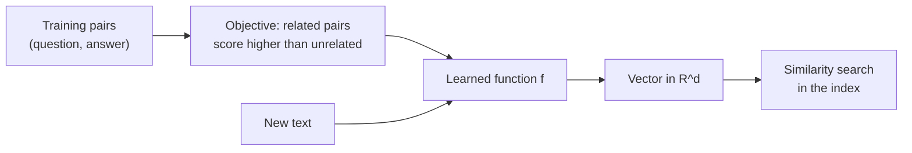

You met embeddings in Phase 1, in the lesson [Embeddings](/learn/understanding-large-language-models/embeddings), which separated the token vectors inside a language model from the single vector an embedding model produces for a whole passage. This phase is about the second kind, because it is what a RAG system indexes and searches. Before we look at how such vectors are built and compared, this lesson steps back and asks a more basic question: what exactly *is* an embedding, as an engineering object? What problem does it solve that earlier text representations could not, what does it promise, and what does it not promise?

The answer shapes every later decision in this phase. An embedding is not "the meaning of the text". It is the output of a particular learned function, trained for a particular purpose, and it is only meaningful relative to that function. Once you see embeddings that way, a long list of production failures (mixed model versions, misplaced trust in scores, vectors leaking private data) becomes predictable rather than mysterious.

## Learning objectives

- Define an embedding as a learned function from text to a fixed-length vector, and state the property that makes it useful for retrieval.
- Contrast one-hot and bag-of-words representations with learned dense embeddings, and show by calculation why the former cannot relate synonyms.
- Explain the distributional hypothesis and how a training objective decides which texts end up close together.
- List the parts of an "embedding contract" (model, version, preprocessing, dimensionality, normalisation) and explain why breaking any of them silently corrupts retrieval.
- Embed a small corpus with a local model and interpret the shape, length and scores of the vectors it returns.

## Prerequisites

- [Embeddings](/learn/understanding-large-language-models/embeddings): token embeddings versus text embeddings, cosine similarity and mean pooling.
- [Query-document matching](/learn/rag-architecture-fundamentals/query-document-matching): lexical versus semantic scoring and the vocabulary-mismatch problem.
- [Indexing pipeline](/learn/rag-architecture-fundamentals/indexing-pipeline): where embedding sits among the offline stages.

## Why this matters

A RAG system's retriever can only find what its representation of text lets it find. If the representation records which words appear, the retriever can match words and nothing else. If it records something closer to what the text is about, the retriever can match a question to an answer that uses entirely different vocabulary. The choice of representation sets the ceiling on retrieval quality, and no amount of prompt engineering downstream raises that ceiling.

Embeddings are also the most opaque component in the pipeline: a chunk is readable, its 384 numbers are not. Engineers who think of embeddings as "meaning" reach for vague fixes when retrieval fails. Engineers who think of them as the output of a specific function, with a specific training objective and contract, ask sharper questions. Was the query embedded with the same model as the documents? Was the text truncated? Was the model trained on anything like this domain? Does a high score here mean "answers the question" or only "is about the same topic"? This lesson gives you that second way of thinking.

## The intuition

Imagine Meridian's HR team asks you to file every page of the employee handbook in a big room so that related pages sit near each other. You could file them alphabetically by first word. That is easy and perfectly repeatable, but "Annual leave is 25 days" and "Holiday entitlement" would end up at opposite ends of the room. Alphabetical order records the *spelling* of the text, not its subject.

So instead you read each page and place it on the floor: leave policies in one corner, IT security in another, expenses near the door, with pages about leave carry-over placed between leave and deadlines because they are a bit of both. Now anyone looking for "holiday" can walk to the leave corner and find the right page, whatever words it uses. The position of each page on the floor is its **embedding**: two coordinates that encode what it is about.

Three features of this room carry over directly to real embeddings:

1. **The positions are relative.** Nobody cares that the leave corner is in the north-east. What matters is which pages are near which. Rotate the whole room and nothing useful changes.
2. **Someone decided what "related" means.** You chose to group by topic. A different filer might group by department, by date, or by who has to act. The arrangement reflects the filer's purpose, and so does an embedding model's.
3. **The floor is too small.** Two coordinates cannot keep every distinction. Pages about the 25-day leave allowance and the 5-day carry-over sit almost on top of each other. Real embeddings use hundreds of coordinates, but the same compression happens: fine details can be lost.

An embedding model is a filer that has learned from vast amounts of text where to put any new piece of it.

## How it works

### From symbols to vectors

A computer receives text as a sequence of symbols. The oldest way to turn it into numbers keeps the symbols as they are:

- **One-hot encoding** gives each word in a vocabulary of $V$ words its own position in a vector of length $V$. The word "leave" is all zeros except a 1 in the "leave" position.
- **Bag of words** represents a whole text by adding the one-hot vectors of its words, so each position counts how often that word occurs. TF-IDF, which you met in [Query-document matching](/learn/rag-architecture-fundamentals/query-document-matching), reweights those counts.

These are **sparse, symbolic** representations. Each position stands for one word; nearly all positions are zero; and, crucially, two different words occupy different positions that have nothing to do with each other. "Holiday" and "leave" are as unrelated in this representation as "holiday" and "firewall". Similarity can only come from shared words.

An **embedding** replaces this with a short, **dense** vector (nearly every entry non-zero) whose positions do not stand for individual words. Instead, the whole vector is placed so that related texts get nearby vectors. Formally, an embedding model is a function

$$
f : \text{text} \rightarrow \mathbb{R}^d
$$

that maps any input text to a list of $d$ real numbers, where $d$ is fixed for the model (384 for `all-MiniLM-L6-v2`, the default model in this course), whatever the length of the text. A function like this is useful for retrieval if and only if it is **similarity-preserving** for the task at hand: texts you would want retrieved together receive vectors that a simple measure, such as the cosine, scores as close.

### Where the similarity comes from: the distributional hypothesis

How can a function learn that "holiday" and "leave" are related without a human telling it? The answer is an idea from linguistics known as the **distributional hypothesis**: words that occur in similar contexts tend to have similar meanings. Zellig Harris put it formally in 1954, and J. R. Firth's 1957 line "You shall know a word by the company it keeps" is the usual summary. "Holiday" and "leave" both appear near "days", "book", "entitlement", "approve" and "summer". A model that learns to predict a word's context will be pushed to give these two words similar internal representations, because their contexts are interchangeable.

Every embedding method in this module exploits the same principle at different scales:

- [Word embeddings](/learn/embedding-fundamentals/word-embeddings) learn one vector per word from which words co-occur with which.
- [Sentence embeddings](/learn/embedding-fundamentals/sentence-embeddings) learn one vector per sentence, often from pairs of sentences known to belong together (a question and its answer, a title and its body).
- [Document embeddings](/learn/embedding-fundamentals/document-embeddings) extend this to longer passages and face the problem of squeezing a lot of text into one vector.

### The training objective decides what "close" means

This is the most important idea in the lesson. An embedding model does not discover a single true geometry of meaning. It learns whatever geometry its **training objective** rewards.

Consider three sentences:

- A: "Annual leave is 25 days."
- B: "Annual leave is 30 days."
- C: "How much holiday do I get?"

Which pairs should be close? A model trained to detect paraphrases might put A and B close together, since they differ by one number. A model trained for question answering should put C close to A (it answers the question) and arguably also close to B. A model trained to detect contradictions should put A and B *far* apart, because they cannot both be true. None of these models is wrong. They were trained to serve different purposes.

Modern text embedding models used for RAG are trained mostly with [contrastive learning](/learn/embedding-optimisation/contrastive-learning): they are shown pairs that should be close (a query and the passage that answers it, a sentence and its paraphrase) and pushed to score them higher than pairs that should not. The data those pairs come from defines what the model treats as similar. That is why a model trained on web search pairs can be excellent on general questions and mediocre on Meridian's internal error codes: nothing in its training told it that E-4021 and E-4012 are different problems.



### What an embedding is not

- **Not a summary.** You cannot read text back from a vector by any simple procedure, and the vector does not reliably retain specific facts such as numbers, names or negations. It keeps what the training objective needed.
- **Not a universal coordinate system.** Two models with the same dimensionality produce unrelated spaces. Coordinate 17 in one model has nothing to do with coordinate 17 in another. The [Vector spaces](/learn/embedding-fundamentals/vector-spaces) lesson shows why.
- **Not a probability or a relevance judgement.** A cosine of 0.46 between a query and a chunk is a position on that model's private scale, not "46% relevant". [Semantic similarity](/learn/embedding-fundamentals/semantic-similarity) looks at what scores do and do not tell you.
- **Not interpretable dimension by dimension.** Individual coordinates of a learned embedding rarely correspond to a nameable feature. Meaning lives in directions and distances, not in single numbers.

### The embedding contract

Because a vector is only meaningful relative to the function that produced it, every stored vector carries an implicit **contract**: the set of conditions under which it can be compared with another vector. In practice the contract has five parts.

| Part | Example | What breaks if it changes |
| --- | --- | --- |
| Model and version | `all-MiniLM-L6-v2`, a specific revision | Every comparison between old and new vectors |
| Input preprocessing | Lower-casing, whitespace cleaning, any required prefix such as `query: ` | Queries drift away from documents |
| Maximum input length | 256 tokens for this model; longer text is cut off | Content after the limit is silently ignored |
| Dimensionality | 384 | Vectors cannot even be compared; some databases reject them, others fail later |
| Normalisation | Unit length, so dot product equals cosine | Scores and rankings change if one side is normalised and the other is not |

The mechanism of a RAG embedding step, with the contract in mind, is:

1. Fix the contract and record it next to the index: model identifier and revision, preprocessing, prefixes, dimensionality, normalisation.
2. Offline, apply the preprocessing to each chunk and embed it, in batches, with the recorded model.
3. Store each vector with its chunk identifier and the contract version.
4. Online, apply the *query-side* preprocessing to the question and embed it with the same model.
5. Before searching, check that the query's contract matches the index's; refuse to search a mismatched index rather than returning confident nonsense.
6. When any part of the contract changes, re-embed the whole corpus into a new index and switch over, rather than mixing vectors.

Step 5 is rarely implemented and almost always worth it: a mismatched contract raises no error, and the results are close to random.

## The mathematics

### One-hot vectors cannot express similarity

**Intuition.** If every word owns its own axis, every pair of different words is at right angles, so every pair is equally unrelated.

The one-hot vector for word number $i$ in a vocabulary of size $V$ is $\mathbf{e}_i \in \mathbb{R}^V$, with $(\mathbf{e}_i)_k = 1$ if $k = i$ and $0$ otherwise. For two different words $i \neq j$:

$$
\mathbf{e}_i \cdot \mathbf{e}_j = \sum_{k=1}^{V} (\mathbf{e}_i)_k (\mathbf{e}_j)_k = 0, \qquad \cos(\mathbf{e}_i, \mathbf{e}_j) = \frac{0}{1 \times 1} = 0
$$

Here $V$ is the vocabulary size, $k$ runs over positions, and both vectors have length 1. In every position at least one of the two vectors has a zero, so every product is zero.

**By hand.** Vocabulary: (leave, holiday, firewall), so $V = 3$. Then leave $= (1, 0, 0)$, holiday $= (0, 1, 0)$, firewall $= (0, 0, 1)$. The dot product of leave and holiday is $1 \times 0 + 0 \times 1 + 0 \times 0 = 0$, and so is the dot product of leave and firewall. Both cosines are 0. The representation has no way to say that leave is nearer holiday than firewall.

Now give the same words learned 2-dimensional embeddings, with the axes roughly "time off" and "IT": leave $= (0.9, 0.1)$, holiday $= (0.8, 0.2)$, firewall $= (0.1, 0.9)$.

- leave · holiday $= 0.72 + 0.02 = 0.74$; lengths $\sqrt{0.82} = 0.9055$ and $\sqrt{0.68} = 0.8246$; cosine $= 0.74 / 0.7467 = 0.991$.
- leave · firewall $= 0.09 + 0.09 = 0.18$; lengths $0.9055$ and $0.9055$; cosine $= 0.18 / 0.82 = 0.220$.

Fewer dimensions, and yet more information: the dense vectors encode a relationship that the one-hot vectors could not.

### What "similarity-preserving" means for retrieval

**Intuition.** Retrieval only uses the *order* of scores. An embedding is good for a query if the relevant chunk outranks the irrelevant ones.

For a query $q$, a relevant chunk $d^{+}$ and an irrelevant chunk $d^{-}$, with similarity function $s$ (usually the cosine):

$$
s\big(f(q), f(d^{+})\big) > s\big(f(q), f(d^{-})\big)
$$

$f$ is the embedding model, $f(q)$ the query vector, and $f(d^{+})$, $f(d^{-})$ the chunk vectors. The **margin** is the difference between the two sides. Contrastive training tries to make this inequality hold, with a healthy margin, across millions of training triples.

**By hand.** Using the real scores from the code below for the query "How much holiday do I get?": the leave chunk scores 0.357 and the remote-work chunk 0.184, a margin of $0.357 - 0.184 = 0.173$. Against the expenses chunk, which scores 0.319, the margin is only $0.038$. The inequality holds for both, but the second margin is thin; a slightly different phrasing could reverse it.

**In NumPy:**

```python
import numpy as np

V = np.eye(3)                       # one-hot: leave, holiday, firewall
print("one-hot leave.holiday:", V[0] @ V[1], " leave.firewall:", V[0] @ V[2])

E = {"leave": np.array([0.9, 0.1]), "holiday": np.array([0.8, 0.2]), "firewall": np.array([0.1, 0.9])}
cos = lambda a, b: float(a @ b / (np.linalg.norm(a) * np.linalg.norm(b)))
print("dense leave~holiday:", round(cos(E["leave"], E["holiday"]), 3))
print("dense leave~firewall:", round(cos(E["leave"], E["firewall"]), 3))

scores = {"leave": 0.357, "remote work": 0.184, "expenses": 0.319}
for name in ["remote work", "expenses"]:
    print(f"margin over {name}: {scores['leave'] - scores[name]:.3f}")
```

```output
one-hot leave.holiday: 0.0  leave.firewall: 0.0
dense leave~holiday: 0.991
dense leave~firewall: 0.22
margin over remote work: 0.173
margin over expenses: 0.038
```

## In code

**The problem.** See, on real text, what a learned embedding gives you that a bag of words does not, and look at the object itself: its shape, its length, whether it is repeatable, and what its scores look like.

**Dependencies.** sentence-transformers (which brings PyTorch), NumPy and scikit-learn. The first run downloads the `all-MiniLM-L6-v2` model, roughly 90 MB, and caches it.

```bash
pip install sentence-transformers numpy scikit-learn
```

```python
import numpy as np
from sentence_transformers import SentenceTransformer
from sklearn.feature_extraction.text import CountVectorizer

docs = [
    "Annual leave is 25 days per year.",
    "Up to 5 unused leave days carry over and must be used by 31 March.",
    "Staff may work remotely up to 3 days a week.",
    "Expenses must be submitted within 30 days; anything over £75 needs a receipt.",
    "Passwords must be rotated every 90 days.",
    "Laptops are refreshed every 3 years.",
]
queries = ["How much holiday do I get?", "When do I need to change my login credentials?"]

# 1. Bag of words: one position per vocabulary word, counts as values
bow = CountVectorizer().fit(docs)
D_bow = bow.transform(docs).toarray().astype(float)
Q_bow = bow.transform(queries).toarray().astype(float)
print("bag-of-words dimensions:", D_bow.shape[1])

def cosine_rows(Q, D):
    qn = np.linalg.norm(Q, axis=1, keepdims=True)
    dn = np.linalg.norm(D, axis=1, keepdims=True)
    qn[qn == 0] = 1.0  # avoid 0/0 for queries that share no vocabulary
    return (Q / qn) @ (D / dn).T

# 2. A learned embedding model
model = SentenceTransformer("sentence-transformers/all-MiniLM-L6-v2")
D_emb = model.encode(docs, normalize_embeddings=True)
Q_emb = model.encode(queries, normalize_embeddings=True)
print("embedding shape:", D_emb.shape, D_emb.dtype)
print("first 5 numbers of doc 0:", np.round(D_emb[0, :5], 4))
print("vector lengths:", np.round(np.linalg.norm(D_emb, axis=1), 4))
again = model.encode(docs[:1], normalize_embeddings=True)
print("same text, same vector:", np.allclose(again[0], D_emb[0], atol=1e-6))

for name, S in [("bag-of-words", cosine_rows(Q_bow, D_bow)), ("embedding", Q_emb @ D_emb.T)]:
    print(f"\n{name}")
    for qi, q in enumerate(queries):
        best = int(np.argmax(S[qi]))
        print(f"  {q!r}")
        print(f"    scores: {np.round(S[qi], 3)}")
        print(f"    top: [{best}] {docs[best]}")
```

```output
bag-of-words dimensions: 40
embedding shape: (6, 384) float32
first 5 numbers of doc 0: [0.0957 0.0259 0.0629 0.0272 0.0285]
vector lengths: [1. 1. 1. 1. 1. 1.]
same text, same vector: True

bag-of-words
  'How much holiday do I get?'
    scores: [0. 0. 0. 0. 0. 0.]
    top: [0] Annual leave is 25 days per year.
  'When do I need to change my login credentials?'
    scores: [0.    0.267 0.354 0.    0.    0.   ]
    top: [2] Staff may work remotely up to 3 days a week.

embedding
  'How much holiday do I get?'
    scores: [0.357 0.319 0.184 0.319 0.051 0.056]
    top: [0] Annual leave is 25 days per year.
  'When do I need to change my login credentials?'
    scores: [0.074 0.092 0.078 0.05  0.46  0.106]
    top: [4] Passwords must be rotated every 90 days.
```

**The important lines.**

- `CountVectorizer().fit(docs)` builds a 40-word vocabulary, so 40 dimensions; it grows with the corpus, while the embedding's 384 does not.
- `cosine_rows` divides each row by its length before the matrix product. The guard `qn[qn == 0] = 1.0` matters: a query whose words are all outside the vocabulary has a zero vector, and dividing by zero would produce `nan` scores.
- `model.encode(..., normalize_embeddings=True)` returns a NumPy array of shape `(number of texts, 384)` in 32-bit floats, each row scaled to length 1. Because of that, `Q_emb @ D_emb.T` is directly the matrix of cosine similarities.
- `np.allclose(..., atol=1e-6)` checks repeatability with a tolerance rather than exact equality. On the same hardware and library versions the output is usually bit-identical, but batch composition and hardware can change the last few digits, so never use exact float equality to compare vectors.

**What the output means.** The bag-of-words matcher scores the holiday question 0 against every document, because the query's words (how, much, holiday, do, get) appear in none of them. Its "top" result is simply index 0, the first of six tied zeros; it found the leave chunk by luck of ordering. On the credentials question it is worse than useless: the top result is about remote work, chosen because both texts contain the word "to". The embedding finds the right chunk for both questions with no shared vocabulary at all: "holiday" reaches "annual leave", and "change my login credentials" reaches "passwords must be rotated".

Look at the scores, too. The best match for the holiday question is 0.357, with the expenses chunk close behind at 0.319. Correct rankings with modest scores and thin margins are normal for this model, and a reason to evaluate on your own queries rather than trust any single number.

**Common errors.**

- Forgetting `normalize_embeddings=True` and then using a dot product as if it were the cosine. For this particular model it would make no difference, because the model's last layer already normalises, but many models do not, and the habit causes bugs when you switch.
- Comparing vectors produced by two different models, or by the same model before and after an upgrade. Nothing fails; the scores are meaningless.
- Feeding very long text and assuming all of it was embedded. This model reads at most 256 tokens (`model.max_seq_length`) and silently ignores the rest. [Document embeddings](/learn/embedding-fundamentals/document-embeddings) deals with this.

**Extending it.** Add two Atlas error-code documents that differ only in the code and query for "error E-4021": the embedding often cannot tell them apart, the lexical-versus-semantic trade-off in miniature.

## A real-world example

Meridian's Platform team ran AskMeridian on `all-MiniLM-L6-v2` for its first year. Later, an engineer evaluated a larger multilingual embedding model with the same output size, liked the results on a test set, and changed the model name in the shared configuration file. The query service picked up the new configuration at its next deployment. The indexing job, which ran weekly, had not run yet.

For four days every query was embedded with the new model and compared against vectors from the old one. The dimensionality matched, so the Qdrant cluster returned the usual five results with ordinary-looking scores and nothing in the logs flagged a problem. Staff noticed only that answers had become strange: a password question came back with context about laptop refresh, and the generator, correctly following its instructions, said it did not know.

The team found the cause by embedding a handbook sentence with the current configuration and searching for it: a text should be its own nearest neighbour with a cosine near 1.0, and it was not even in the top 50.

The changes they made all come from treating the embedding as a contract:

- The index stores a small metadata record with the model name, revision, dimensionality, normalisation and prefix convention, written by the indexing job.
- The query service reads that record at start-up and refuses to serve if its own configuration differs.
- A model change now means building a new collection with the new model, evaluating it, and switching an alias, never changing a setting under a live index.
- A canary check runs after each deployment: embed five known chunks, search for them, and require each to come back first.

None of this is specific to that model or to Qdrant.

## Common mistakes

- **Treating an embedding as "the meaning" of a text.** Consequence: surprise when the model ignores a negation, a number or a product version that mattered. It keeps what its training needed, not everything you care about.
- **Mixing vectors from different models or model versions in one index.** Consequence: retrieval quality collapses with no error, because the shapes still match.
- **Reading a cosine score as a probability of relevance.** Consequence: badly chosen thresholds that discard good results or let bad ones through; scores are only comparable within one model.
- **Embedding text longer than the model's input limit.** Consequence: the end of every long chunk is silently ignored.
- **Choosing a model trained for a different notion of similarity.** Consequence: a paraphrase-detection model used for question answering, or a general model used on heavy internal jargon, ranks topically related but unhelpful chunks first.

## Best practices

- Record the full embedding contract (model, revision, preprocessing, prefixes, dimensionality, normalisation) alongside every index, and check it at query time.
- Normalise vectors to unit length at write time and at query time, so dot product and cosine agree and every score lies between −1 and 1.
- Re-embed the whole corpus into a fresh index when any part of the contract changes; switch with an alias so you can roll back.
- Keep a small canary set of known chunks and confirm after each deployment that each is its own nearest neighbour.
- Evaluate a model on your own queries and documents before trusting it; general benchmarks do not know your vocabulary.
- Keep the source text next to its vector; you will need it to re-embed.

## Performance considerations

Embedding has two costs: computing the vectors and storing them.

**Storage** is simple arithmetic. A 32-bit float takes 4 bytes, so a 384-dimensional vector takes $384 \times 4 = 1{,}536$ bytes. Meridian's handbook and runbooks might produce, as an assumption, 50,000 chunks: $50{,}000 \times 1{,}536 \approx 77$ MB of raw vectors, which fits in memory on any server. A 1,024-dimensional model would need $50{,}000 \times 4{,}096 \approx 205$ MB, and a corpus of 10 million chunks at that size would need about 41 GB before any index overhead. [Dimensionality](/learn/embedding-fundamentals/dimensionality) and [Embedding quantisation](/learn/embedding-optimisation/embedding-quantisation) cover how to shrink this.

**Compute** scales with the number of tokens embedded. Offline, the corpus is embedded once per contract version, in batches that parallelise easily. Online, each query is one short text, so query embedding usually costs far less than generation; measure it on your own hardware. A hosted embedding API adds a network round trip to every query and a per-token charge to every re-index; check the provider's current pricing rather than relying on remembered figures.

The expensive event is a **full re-embed**, because it happens whenever the contract changes. Budget for it from the start: the cost is roughly the total tokens in the corpus times the per-token cost of the model, and the time is that token count divided by your embedding throughput.

## Security considerations

- **Embeddings are not anonymised data.** Research has shown that text can be reconstructed to a substantial degree from its embedding: Morris and colleagues (2023, "Text Embeddings Reveal (Almost) As Much As Text") recovered many short inputs exactly by iteratively inverting embeddings. Treat a vector store with the same access controls and retention rules as the documents it was built from.
- **Hosted embedding APIs see your text.** Embedding the employee handbook through a third-party service sends every chunk, and every staff query, to that provider. Check its data-retention terms, or use a local model for sensitive corpora.
- **Access control must survive embedding.** A chunk from a restricted HR document is still restricted after it becomes a vector. Store access metadata with each vector and filter on it at query time, as later modules on [metadata filtering](/learn/advanced-vector-database-engineering/metadata-filtering) describe.

## Summary

- An embedding is the output of a learned function $f$ that maps text to a fixed-length vector of real numbers; it is useful for retrieval when related texts receive vectors with high similarity.
- One-hot and bag-of-words representations put every word on its own axis, so they cannot relate synonyms; learned dense embeddings can, because training places words and texts by the contexts they appear in.
- What counts as "close" is set by the training objective and data, so different models embody different notions of similarity.
- A vector is only meaningful relative to its embedding contract: model and version, preprocessing, input limit, dimensionality and normalisation. Breaking the contract corrupts retrieval silently.
- Embedding scores are model-specific positions, not probabilities, and embeddings themselves can leak the text they encode.

## Exercises

1. **One-hot by hand.** In a vocabulary of 5,000 words, how many dimensions does a one-hot vector have, how many of them are non-zero, and what is the cosine between the one-hot vectors of "laptop" and "notebook"?

<details><summary>Show solution</summary>

5,000 dimensions, exactly one of which is non-zero. The cosine between any two different words' one-hot vectors is 0, because in every position at least one of them is 0. The representation treats "laptop" and "notebook" as exactly as unrelated as "laptop" and "receipt".

</details>

2. **Storage arithmetic.** Meridian plans to add the product documentation for Meridian Sync, Meridian Relay and Meridian Reports, bringing the corpus to an assumed 400,000 chunks. Estimate the raw vector storage at 384 dimensions and at 1,024 dimensions with 32-bit floats.

<details><summary>Show solution</summary>

384 dimensions: $400{,}000 \times 384 \times 4 = 614{,}400{,}000$ bytes, about 614 MB. 1,024 dimensions: $400{,}000 \times 1{,}024 \times 4 = 1{,}638{,}400{,}000$ bytes, about 1.64 GB. Both exclude index structures (such as an HNSW graph) and payloads, which add more.

</details>

3. **A contract check.** Write a function `check_contract(index_meta: dict, query_meta: dict) -> None` that raises `ValueError` naming every field that differs among `model`, `revision`, `dimension`, `normalised` and `query_prefix`. Test it with one matching and one mismatched pair.

<details><summary>Show solution</summary>

```python
FIELDS = ("model", "revision", "dimension", "normalised", "query_prefix")

def check_contract(index_meta: dict, query_meta: dict) -> None:
    diffs = [f"{k}: index={index_meta.get(k)!r} query={query_meta.get(k)!r}"
             for k in FIELDS if index_meta.get(k) != query_meta.get(k)]
    if diffs:
        raise ValueError("embedding contract mismatch; " + "; ".join(diffs))

meta = {"model": "sentence-transformers/all-MiniLM-L6-v2", "revision": "abc123",
        "dimension": 384, "normalised": True, "query_prefix": ""}
check_contract(meta, dict(meta))  # passes silently
try:
    check_contract(meta, {**meta, "model": "other-model", "revision": "def456"})
except ValueError as e:
    print(e)
```

```output
embedding contract mismatch; model: index='sentence-transformers/all-MiniLM-L6-v2' query='other-model'; revision: index='abc123' query='def456'
```

`.get` reports a missing field as a mismatch instead of crashing.

</details>

4. **Design: what should be close?** For each of these AskMeridian tasks, say which pairs should score as similar and whether a general question-answering embedding model is likely to get it right: (a) finding the handbook chunk that answers "can I carry leave over?"; (b) detecting that a 2023 handbook chunk and a current chunk give conflicting laptop refresh cycles; (c) routing a question to the IT runbooks or the handbook.

<details><summary>Show solution</summary>

(a) The question should be close to the carry-over chunk. This is exactly what retrieval-trained models are built for; likely to work. (b) Here you want the two chunks recognised as being about the same topic *and* as disagreeing. An embedding model will rate them as very similar (same topic, nearly the same wording) and cannot express the conflict; similarity can find candidate pairs, but deciding they conflict needs a comparison of the facts themselves, for example by an LLM or by structured metadata such as version dates. (c) Questions should cluster by source; a general model usually separates IT topics from HR topics well, and a small classifier trained on embeddings of labelled questions would make the routing explicit and testable.

</details>

## Check your understanding

```quiz
[
  {
    "q": "Why can a bag-of-words representation never match the query 'holiday' to a chunk that only says 'annual leave'?",
    "options": [
      "Because the vectors are not normalised",
      "Because each word has its own dimension, so the query and chunk share no non-zero positions",
      "Because bag-of-words vectors are too short",
      "Because stop words dominate the counts"
    ],
    "answer": 1,
    "why": "Different words occupy different, unrelated positions. With no shared words, the dot product is zero whatever the weighting."
  },
  {
    "q": "Two embedding models both output 768-dimensional vectors. What can you conclude about comparing a query vector from one with document vectors from the other?",
    "options": [
      "The comparison is meaningless, because the two models learned unrelated coordinate systems",
      "It works if both are normalised",
      "It works but with slightly lower accuracy",
      "It works if both models use the same tokeniser"
    ],
    "answer": 0,
    "why": "Equal dimensionality only means the shapes match. Each model's coordinates are its own; nothing aligns coordinate i in one with coordinate i in the other."
  },
  {
    "q": "What mainly determines which texts an embedding model places close together?",
    "options": [
      "The number of dimensions",
      "Whether the vectors are normalised",
      "The training objective and the pairs it was trained on",
      "The similarity function used at query time"
    ],
    "answer": 2,
    "why": "A model learns the geometry its training rewards. Paraphrase data, question-answer data and contradiction data produce different notions of 'close'."
  },
  {
    "q": "A query against a chunk scores a cosine of 0.46 with all-MiniLM-L6-v2. Which statement is correct?",
    "options": [
      "There is a 46% chance the chunk is relevant",
      "The chunk is irrelevant because the score is below 0.5",
      "The score would be the same with any other embedding model",
      "The score is meaningful only relative to other scores from the same model"
    ],
    "answer": 3,
    "why": "Cosine scores are positions on a model's own scale, not probabilities. In the lesson's example 0.46 was the clearly best match."
  },
  {
    "q": "Which of these is NOT part of an embedding contract that must match between indexing and querying?",
    "options": [
      "The model name and revision",
      "The number of chunks in the index",
      "The required input prefix, if any",
      "Whether vectors are normalised"
    ],
    "answer": 1,
    "why": "The corpus can grow freely. The contract is about how each vector is produced, so that any two vectors are comparable."
  }
]
```

## Further reading

- Jurafsky, D. and Martin, J. H., *Speech and Language Processing* (3rd edition draft), chapter "Vector Semantics and Embeddings". A clear textbook treatment of sparse and dense representations: [web.stanford.edu/~jurafsky/slp3](https://web.stanford.edu/~jurafsky/slp3/).
- Harris, Z. S. (1954). "Distributional Structure". *Word* 10(2–3). The origin of the distributional hypothesis.
- Bengio, Y., Ducharme, R., Vincent, P. and Jauvin, C. (2003). "A Neural Probabilistic Language Model". *Journal of Machine Learning Research* 3. Learned word vectors as part of a neural language model.
- Reimers, N. and Gurevych, I. (2019). "Sentence-BERT: Sentence Embeddings using Siamese BERT-Networks". [arXiv:1908.10084](https://arxiv.org/abs/1908.10084).
- Morris, J. X., Kuleshov, V., Shmatikov, V. and Rush, A. M. (2023). "Text Embeddings Reveal (Almost) As Much As Text". [arXiv:2310.06816](https://arxiv.org/abs/2310.06816).
- Sentence Transformers documentation: [sbert.net](https://www.sbert.net/).
