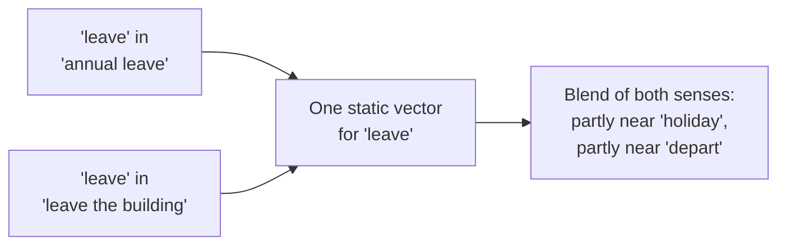

Before anyone embedded a sentence, people learned to embed words. Word embeddings, one fixed vector per word in a vocabulary, were the breakthrough that made "meaning as geometry" practical, and almost every idea in modern text embeddings first appeared in them: learning from co-occurrence, training with negative examples, subword units for unseen words, and the uncomfortable discovery that vectors absorb whatever biases their text contains.

RAG systems today rarely search with word vectors directly. They use [sentence embeddings](/learn/embedding-fundamentals/sentence-embeddings), which the next lesson builds from the material here. But word embeddings are where the mechanism is small enough to see whole. In this lesson you will build word vectors from scratch, from a co-occurrence count to a dense vector, in about forty lines of NumPy, and watch both their power (synonyms land together without anyone saying they are synonyms) and their central flaw (one vector per word, however many meanings it has).

## Learning objectives

- Explain the distributional hypothesis in terms of a word-context co-occurrence matrix.
- Compute pointwise mutual information (PMI) by hand and explain why positive PMI and dimensionality reduction turn counts into useful dense vectors.
- Describe how word2vec's skip-gram with negative sampling, GloVe and fastText learn word vectors, and compute one skip-gram training loss by hand.
- Build PPMI-SVD word vectors in NumPy and interpret their nearest neighbours.
- Explain the limits of static word vectors (polysemy, out-of-vocabulary words, analogy over-reading, bias) and where word vectors still appear in RAG systems.

## Prerequisites

- [What are embeddings?](/learn/embedding-fundamentals/what-are-embeddings): the distributional hypothesis and why one-hot vectors cannot relate synonyms.
- [Vector spaces](/learn/embedding-fundamentals/vector-spaces): bases, projections, and why only geometry is meaningful.
- [Tokens and tokenisation](/learn/understanding-large-language-models/tokens-and-tokenisation): words versus subword tokens.

## Why this matters

Three practical reasons justify a lesson on a technique most RAG systems no longer use for retrieval.

First, the vocabulary-mismatch problem from [Query-document matching](/learn/rag-architecture-fundamentals/query-document-matching) (the user says "holiday", the handbook says "annual leave") was first attacked at scale with word vectors, and the same thinking still drives query expansion for keyword search. Second, the *failure modes* of word vectors (a word with two meanings gets one blurred vector; a word never seen in training gets nothing) are exactly the problems that contextual and subword models were invented to solve. You cannot judge whether a modern model has solved them without knowing what they are. Third, the training ideas carry straight through: [contrastive learning](/learn/embedding-optimisation/contrastive-learning) for sentence embeddings is a direct descendant of word2vec's negative sampling, and [hard negative mining](/learn/embedding-optimisation/hard-negative-mining) refines how those negatives are chosen.

## The intuition

Suppose you have never seen the word "vacation", and you read these three sentences in Meridian's ticket system:

- "I booked vacation for August."
- "My vacation request was approved."
- "How many days of vacation do I have?"

You would conclude that "vacation" means much the same as "holiday" and "leave", because it sits in the same slots: after "booked", before "request", after "days of". Nobody defined it. Its company defined it.

Now imagine writing this down systematically: a huge table with one row per word and one column per possible neighbouring word, counting how often each pair appears close together. The rows for "holiday", "leave" and "vacation" would look alike, because they have the same neighbours. That table already *is* a set of word vectors, just enormous and noisy. Every word-embedding method is a way of compressing that table into short, dense rows that keep the resemblances and throw away the noise.

## How it works

### Step 1: the co-occurrence matrix

Choose a **context window**, say two words either side. Slide it across a large body of text, and for every occurrence of a word $w$ count each word $c$ that appears inside its window. The result is a $V \times V$ matrix of counts, where $V$ is the vocabulary size. Row $w$ is a vector that describes $w$ by its neighbours. These are **count-based** vectors.

Raw counts have two problems. Very frequent words ("the", "my", "of") dominate every row, and the vectors are as long as the vocabulary: 100,000 or more dimensions, nearly all zero.

### Step 2: reweight with pointwise mutual information

What we care about is not how often "holiday" appears near "booked", but whether it appears near "booked" *more often than chance*. **Pointwise mutual information** (PMI) measures exactly that: the log of how much more often the pair occurs together than it would if the words were independent. Positive PMI means "attracted", zero means "indifferent", negative means "avoid each other". Because negative values estimated from small counts are unreliable, common practice keeps only the positive part, giving **positive PMI** (PPMI). Function words, which co-occur with everything about as often as chance predicts, get low weights automatically.

### Step 3: compress to a few hundred dimensions

A PPMI matrix is still $V \times V$. **Truncated singular value decomposition** (SVD) finds the $k$ directions along which the rows vary most and re-describes each row by its coordinates along those directions only. With $k$ of a few hundred, the result is a dense $V \times k$ matrix of word vectors. Compression helps rather than hurts: "holiday" and "vacation" may share few *exact* neighbours in a finite corpus, but they share neighbours that are themselves similar, and the low-dimensional directions capture that second-order resemblance. This counting-and-compressing approach is the family known as **latent semantic analysis** when applied to term-document matrices; you will build a small version in the code.

### Step 4 (alternative): learn the vectors by prediction

In 2013, Mikolov and colleagues at Google introduced **word2vec**, which skips the matrix and learns vectors directly with a shallow neural network. Its **skip-gram** variant works like this:

1. Give every word two random vectors: a *word* vector $\mathbf{w}$ and a *context* vector $\mathbf{c}$.
2. Slide a window over the text. For each word and each neighbour inside its window, form a **positive pair** (holiday, booked).
3. For each positive pair, draw a few random words from the vocabulary as **negative samples**: (holiday, firewall), (holiday, receipt). They are probably not real neighbours.
4. Adjust the vectors so that the dot product $\mathbf{w} \cdot \mathbf{c}$ is high for the positive pair and low for each negative pair (the loss is written out in the mathematics section).
5. Repeat over billions of words. Keep the word vectors; discard the context vectors (or average the two).

This recipe, **skip-gram with negative sampling** (SGNS), is the ancestor of the contrastive training used for modern sentence embeddings: pull true pairs together, push sampled false pairs apart. The companion **CBOW** (continuous bag of words) variant predicts a word from the average of its neighbours instead.

Are prediction and counting really different? Levy and Goldberg (2014) showed that SGNS implicitly factorises a word-context matrix whose entries are the PMI shifted by a constant (the log of the number of negative samples). The two families optimise closely related objectives, and with careful tuning their quality is much closer than early comparisons suggested. Prediction-based training scales more easily to huge corpora, because it never builds the $V \times V$ matrix.

### GloVe and fastText

Two refinements became standard.

- **GloVe** (Pennington, Socher and Manning, 2014) fits word vectors so that the dot product of two words' vectors (plus bias terms) approximates the logarithm of their co-occurrence count, with a weighting that limits the influence of very frequent and very rare pairs. It is explicitly count-based but trained by gradient descent, a bridge between the two families.
- **fastText** (Bojanowski and colleagues, 2017) represents each word as the sum of vectors for its character n-grams, by default sequences of 3 to 6 characters with boundary markers: "leave" includes `<le`, `lea`, `eav`, `ave`, `ve>` and longer pieces. A word never seen in training, such as a misspelling "leaev" or a rare inflection, still gets a vector from the n-grams it shares with known words. This is the same insight that led to the subword tokenisers used by every modern model.

### What the geometry captures

Trained on enough text, word vectors show regularities that made them famous:

- **Neighbours are near-synonyms and co-hyponyms.** The nearest neighbours of "holiday" are "vacation" and "leave", but often also "weekend" or "christmas": words used in the same slots, not strictly words with the same meaning. Antonyms are a classic trap: "hot" and "cold" appear in the same contexts, so they are close.
- **Offsets can encode relations.** Mikolov and colleagues reported that $\text{vec}(\text{king}) - \text{vec}(\text{man}) + \text{vec}(\text{woman})$ lands near $\text{vec}(\text{queen})$, and similar offsets for capitals and verb tenses. This is the clearest example of the linear-direction idea from [Vector spaces](/learn/embedding-fundamentals/vector-spaces).

Treat analogies with care. The standard evaluation excludes the three input words from the candidate answers; without that rule, the nearest vector to "king − man + woman" is often "king" itself. Later analyses (for example Linzen, 2016, and Nissim and colleagues, 2020) argued that analogy results overstate how cleanly relations are encoded. Offsets are a real but noisy phenomenon, not a reliable reasoning engine.

### The limits of one vector per word



1. **Polysemy.** A static vector is the average over every use of the word. "Leave" as time off and "leave" as depart get one vector that sits between the two senses and represents neither well. The code below shows this directly.
2. **No context at all.** "Not eligible" and "eligible" differ by one vector; word order is invisible once you average word vectors into a sentence.
3. **Out-of-vocabulary words.** word2vec and GloVe have nothing for words absent from training: internal names such as "Meridian Relay" or codes such as "E-4021". fastText mitigates this for spelling variants, not for genuinely new concepts.
4. **Bias.** Vectors learned from human text encode its stereotypes. Bolukbasi and colleagues (2016) showed that analogy arithmetic on widely used vectors produced gendered occupational associations. Any system that ranks or groups people's text with learned vectors inherits such associations, and contextual models are not immune.

These limits are why the field moved to **contextual embeddings**: vectors computed by a Transformer for each token *in its sentence*, so that "leave" gets a different vector in "annual leave" and "leave the building". [Sentence embeddings](/learn/embedding-fundamentals/sentence-embeddings) picks up the story there.

### Where word vectors still appear in RAG

- **Query expansion for keyword search:** adding near neighbours of query terms ("holiday" → "leave", "vacation") before running BM25. Effective for synonyms, risky for polysemous words, as the real-world example shows.
- **Static embedding models:** some very fast sentence embedders are essentially learned word (or token) vectors averaged per sentence; Sentence Transformers includes a `StaticEmbedding` module for this. They trade quality for speed on CPU-only or very high-volume workloads; [Local embedding models](/learn/embedding-models/local-embedding-models) discusses the trade-off.
- **Inside every Transformer:** the token embedding table described in [Embeddings](/learn/understanding-large-language-models/embeddings) is a static vector per token, learned jointly with the rest of the model. Contextual meaning is built on top of it.

## The mathematics

### Pointwise mutual information

**Intuition.** Compare how often two words actually appear together with how often they would if they had nothing to do with each other.

$$
\text{PMI}(w, c) = \ln \frac{P(w, c)}{P(w)\,P(c)}, \qquad \text{PPMI}(w, c) = \max\big(\text{PMI}(w, c),\, 0\big)
$$

- $P(w, c)$ is the probability that a randomly chosen (word, context) pair from the co-occurrence counts is exactly $(w, c)$: its count divided by the total number of pairs.
- $P(w)$ is the fraction of all pairs whose word is $w$ (the row total over the grand total); $P(c)$ is the fraction whose context is $c$ (the column total over the grand total).
- If $w$ and $c$ were independent, $P(w, c)$ would equal $P(w)P(c)$, the ratio would be 1 and the PMI 0.

**By hand.** Out of 100 counted pairs, (holiday, booked) occurs 4 times; "holiday" is the word in 10 pairs, and "booked" is the context in 8. Then $P(w, c) = 0.04$, $P(w) = 0.10$, $P(c) = 0.08$, and

$$
\text{PMI} = \ln \frac{0.04}{0.10 \times 0.08} = \ln \frac{0.04}{0.008} = \ln 5 = 1.609
$$

The pair occurs five times more often than chance, a strong association.

### The skip-gram negative-sampling loss

**Intuition.** For a real (word, context) pair, we want the model to say "yes, these go together" with high confidence; for each random pair, "no". The sigmoid turns a dot product into a confidence between 0 and 1.

$$
\mathcal{L} = -\ln \sigma(\mathbf{w} \cdot \mathbf{c}) - \sum_{i=1}^{k} \ln \sigma(-\mathbf{w} \cdot \mathbf{n}_i), \qquad \sigma(x) = \frac{1}{1 + e^{-x}}
$$

- $\mathbf{w}$ is the word vector, $\mathbf{c}$ the context vector of a true neighbour, and $\mathbf{n}_1, \dots, \mathbf{n}_k$ the context vectors of $k$ sampled negative words.
- $\sigma(\mathbf{w} \cdot \mathbf{c})$ is the model's confidence that the true pair belongs together; $\sigma(-\mathbf{w} \cdot \mathbf{n}_i) = 1 - \sigma(\mathbf{w} \cdot \mathbf{n}_i)$ is its confidence that a negative pair does not.
- $\mathcal{L}$ is small when true pairs have large positive dot products and negative pairs have large negative ones. Gradient descent on $\mathcal{L}$ updates $\mathbf{w}$, $\mathbf{c}$ and the $\mathbf{n}_i$.

**By hand.** One true pair with $\mathbf{w} \cdot \mathbf{c} = 2.0$ and one negative ($k = 1$) with $\mathbf{w} \cdot \mathbf{n} = 0.5$.

- $\sigma(2.0) = 1 / (1 + e^{-2}) = 1 / 1.1353 = 0.8808$, so the first term is $-\ln 0.8808 = 0.1269$.
- $\sigma(-0.5) = 1 / (1 + e^{0.5}) = 1 / 2.6487 = 0.3775$, so the second term is $-\ln 0.3775 = 0.9741$.
- $\mathcal{L} = 0.1269 + 0.9741 = 1.1010$.

Most of the loss comes from the negative pair: its dot product is positive, so the model wrongly leans towards "these go together", and the gradient will push $\mathbf{w}$ and $\mathbf{n}$ apart.

```python
import numpy as np

# PMI of (holiday, booked) from counts
total, n_wc, n_w, n_c = 100, 4, 10, 8
p_wc, p_w, p_c = n_wc / total, n_w / total, n_c / total
print(f"PMI = ln({p_wc:.2f} / ({p_w:.2f} x {p_c:.2f})) = {np.log(p_wc / (p_w * p_c)):.3f}")

# Skip-gram with negative sampling: loss for one positive and one negative context
sigmoid = lambda x: 1 / (1 + np.exp(-x))
pos, neg = 2.0, 0.5                     # w.c for the true context and for a sampled one
loss_pos = -np.log(sigmoid(pos))
loss_neg = -np.log(sigmoid(-neg))
print(f"positive term {loss_pos:.4f}, negative term {loss_neg:.4f}, total {loss_pos + loss_neg:.4f}")
```

```output
PMI = ln(0.04 / (0.10 x 0.08)) = 1.609
positive term 0.1269, negative term 0.9741, total 1.1010
```

## In code

**The problem.** Build word vectors from raw text with no pre-trained model, using the count, reweight and compress recipe, and check whether synonyms end up together and what happens to a word with two meanings.

**Dependencies.** NumPy only.

```bash
pip install numpy
```

Real word vectors are trained on billions of words. To keep the example small and reproducible, the corpus is 3,000 short sentences generated from templates with a fixed seed. The templates use "holiday", "leave" and "vacation" interchangeably in time-off sentences, "password", "passcode" and "pin" in IT sentences, and "leave", "exit" and "depart" in movement sentences. Nothing in the code is told which words are synonyms.

```python
import numpy as np

rng = np.random.default_rng(seed=42)
templates = [
    "i booked {L} for {m}", "my {L} request was approved", "how many days of {L} do i have",
    "unused {L} days carry over until march", "my manager approved my {L}",
    "i forgot my {P}", "please reset my {P} today", "the {P} must be rotated every 90 days",
    "never share your {P} with anyone",
    "submit the {E} within 30 days", "the {E} over 75 pounds needs a receipt",
    "finance approved my {E}",
    "i {X} the office at six", "please {X} the building by the fire door",
    "we {X} for the airport after lunch",
]
fill = {"L": ["holiday", "leave", "vacation"], "P": ["password", "passcode", "pin"],
        "E": ["expense", "claim"], "X": ["leave", "exit", "depart"],
        "m": ["june", "july", "august", "december"]}
corpus = []
for _ in range(3000):
    t = templates[rng.integers(len(templates))]
    corpus.append(t.format(**{k: v[rng.integers(len(v))] for k, v in fill.items()}).split())

# 1. Count co-occurrences within a window of 2 words either side
vocab = sorted({w for s in corpus for w in s})
idx = {w: i for i, w in enumerate(vocab)}
C = np.zeros((len(vocab), len(vocab)))
for s in corpus:
    for i, w in enumerate(s):
        for j in range(max(0, i - 2), min(len(s), i + 3)):
            if j != i:
                C[idx[w], idx[s[j]]] += 1

# 2. Positive pointwise mutual information
total = C.sum()
p_w = C.sum(axis=1) / total
p_c = C.sum(axis=0) / total
with np.errstate(divide="ignore"):
    pmi = np.log((C / total) / np.outer(p_w, p_c))
ppmi = np.maximum(pmi, 0)                      # log(0) = -inf becomes 0

# 3. Truncated SVD: keep the 10 strongest directions
U, S, Vt = np.linalg.svd(ppmi)
k = 10
W = U[:, :k] * np.sqrt(S[:k])                  # one 10-d vector per word
W /= np.linalg.norm(W, axis=1, keepdims=True)
print(f"vocabulary {len(vocab)} words, count vectors {C.shape[1]}-d, word vectors {k}-d")

def neighbours(word, n=4):
    sims = W @ W[idx[word]]
    order = [i for i in np.argsort(-sims) if vocab[i] != word][:n]
    return ", ".join(f"{vocab[i]} {sims[i]:.2f}" for i in order)

for w in ["holiday", "password", "expense", "depart", "leave"]:
    print(f"{w:<9} -> {neighbours(w)}")

# 4. One vector per word, whatever the sense
cos = lambda a, b: float(W[idx[a]] @ W[idx[b]])
print(f"\nleave~holiday {cos('leave', 'holiday'):.2f}   leave~depart {cos('leave', 'depart'):.2f}   "
      f"holiday~depart {cos('holiday', 'depart'):.2f}")
```

```output
vocabulary 68 words, count vectors 68-d, word vectors 10-d
holiday   -> vacation 1.00, leave 0.90, have 0.82, for 0.74
password  -> pin 1.00, passcode 0.99, never 0.75, with 0.45
expense   -> claim 1.00, submit 0.93, within 0.92, 30 0.92
depart    -> exit 1.00, by 0.90, six 0.86, airport 0.81
leave     -> vacation 0.91, have 0.90, holiday 0.90, for 0.72

leave~holiday 0.90   leave~depart 0.49   holiday~depart 0.08
```

**The important lines.**

- The triple loop builds the co-occurrence matrix: for every position `i`, every other position `j` within two words adds one to `C[word, neighbour]`. The matrix is symmetric because the window is symmetric.
- `np.log((C / total) / np.outer(p_w, p_c))` computes PMI for every cell at once; `np.outer` forms the matrix of $P(w)P(c)$ products. Cells with zero count give $\ln 0 = -\infty$, hence the `errstate` guard, and `np.maximum(pmi, 0)` turns both negative values and $-\infty$ into 0: that is PPMI.
- `U[:, :k] * np.sqrt(S[:k])` keeps the first $k$ singular directions and weights them by the square root of their singular values, a common choice in the count-based literature. Using `U[:, :k] * S[:k]` also works; how much weight the top directions get is a tunable choice.
- The rows are normalised so that `W @ W[idx[word]]` gives cosines.

**What the output means.**

- With no supervision, each word's nearest neighbour is one of its interchangeable partners: holiday → vacation, password → pin and passcode, expense → claim, depart → exit. Scores of 1.00 appear because the synthetic corpus uses these words in *identical* contexts; real text is messier and real neighbours score lower.
- Further down the lists come words such as "have", "for", "submit" and "within". These are not synonyms; they are words that fill the *same templates*. With only 68 words and 10 dimensions, topic and synonymy are blended. Real corpora with many more contexts separate them better, but "same slot" rather than "same meaning" remains what distributional vectors measure.
- The final line is the polysemy problem in numbers. "Leave" scores 0.90 with "holiday" and 0.49 with "depart", while "holiday" and "depart" score 0.08 with each other. The one vector for "leave" sits between its two senses. It leans towards time off because five templates use that sense against three for departing: a static vector is a frequency-weighted blend.

**Common errors.**

- Computing PMI on very rare pairs without smoothing or a minimum count. One chance co-occurrence of two rare words gives a huge PMI; real implementations raise context probabilities to a power below 1 (word2vec's negative sampling uses 0.75) or discard rare words.
- Forgetting to normalise rows before using dot products as similarities. Frequent words get longer vectors and dominate every neighbour list.
- Running a full SVD on a large vocabulary. `np.linalg.svd` on a 100,000 × 100,000 matrix is infeasible; real systems use sparse matrices and truncated solvers such as `sklearn.decomposition.TruncatedSVD`, or prediction-based training.

**Extending it.** Add templates in which "pin" means a map pin ("drop a pin on the map") and watch its similarity to "password" fall. Then try $k = 2$ and $k = 30$: very small $k$ merges unrelated topics, while $k$ close to the vocabulary size reproduces the noisy count matrix.

## A real-world example

Meridian's Platform team ran BM25 keyword search alongside dense retrieval in AskMeridian, and wanted the keyword side to cope better with synonyms. An engineer trained fastText vectors on the handbook, the IT runbooks and two years of support tickets, then expanded each query term with its three nearest neighbours before running BM25.

On the HR questions it was tested on, expansion helped: "holiday" brought in "leave" and "annual", and questions phrased in everyday words started matching the handbook's formal vocabulary. Then the runbook questions went wrong. "How do I leave the VPN connected overnight?" expanded "leave" with "holiday" and "annual", and BM25 returned the annual-leave policy above the VPN runbook. "Can I claim my laptop charger?" expanded "claim" towards "ticket" and "request", which the support tickets used for raising incidents, and pulled in an unrelated incident procedure.

Both failures are the static-vector problem from this lesson: one vector per word, built from every use of that word in the corpus. The team made three changes:

- Expansion was restricted to a reviewed synonym list, generated by proposing word-vector neighbours and having the HR and IT teams accept or reject each one, so the vectors served as a suggestion tool rather than an unreviewed rule.
- Expanded terms received a lower weight than the user's own words, so they could break ties but not override the original query.
- For meaning-level matching the team relied on the dense retriever, whose contextual sentence embeddings distinguish "leave the VPN connected" from "annual leave" because they see the whole sentence.

## Common mistakes

- **Treating nearest neighbours as synonyms.** Consequence: antonyms, co-hyponyms ("June", "July") and same-slot words are used as if interchangeable, for example in query expansion.
- **Ignoring polysemy.** Consequence: expanding or matching a word in the wrong sense pulls in documents from an unrelated topic.
- **Expecting vectors for words never seen in training.** Consequence: internal product names and error codes get no vector (word2vec, GloVe) or a vector based only on spelling (fastText), so they match poorly.
- **Averaging word vectors and calling it a sentence embedding for retrieval.** Consequence: word order and negation are lost entirely; it can serve as a fast baseline, but not as a modern retriever.
- **Taking analogy arithmetic as proof of understanding.** Consequence: building features on offsets that hold only approximately and partly reflect evaluation conventions.
- **Using pre-trained vectors in decisions about people without checking for bias.** Consequence: stereotyped associations from the training text influence rankings or groupings.

## Best practices

- Use word vectors as a *suggestion* tool (candidate synonyms, vocabulary exploration) and have domain owners review what they suggest.
- Train or fine-tune on in-domain text when your vocabulary is specialised; general web-trained vectors do not know Meridian's product names.
- Prefer subword-aware methods (fastText) when misspellings and rare inflections matter.
- Down-weight expanded terms relative to the user's original terms in keyword search.
- Use contextual sentence embeddings, not averaged word vectors, for dense retrieval.

## Performance considerations

Word vectors are cheap at query time: a lookup per word. A vocabulary of 100,000 words at 300 dimensions in 32-bit floats needs $100{,}000 \times 300 \times 4 = 120$ MB. fastText also stores vectors for hashed character n-grams; its n-gram table is sized by a bucket count (on the order of millions of buckets in the reference implementation), so its models are larger.

Training costs differ by family. The count-based route needs the co-occurrence matrix: a dense $V \times V$ matrix at $V = 100{,}000$ would be $10^{10}$ cells, 40 GB in 32-bit floats, which is why it is always stored sparsely and factorised with a truncated solver. Prediction-based training (word2vec, fastText) streams through the text and touches only a handful of vectors per update: for each word, its context words and $k$ negatives. It scales roughly linearly with corpus size and is the practical choice for large corpora.

The co-occurrence loop in this lesson's code costs about (number of tokens) × (window width) updates: the corpus has 18,282 tokens and the loop made 55,128 updates, trivial. On a billion-word corpus the same loop in pure Python would be far too slow, which is why production tools are written in C or C++.

## Summary

- Word embeddings give each vocabulary word one dense vector learned from the contexts it appears in, putting the distributional hypothesis into practice.
- Count-based methods build a co-occurrence matrix, reweight it with PPMI and compress it with SVD; prediction-based methods (word2vec skip-gram with negative sampling) learn vectors by distinguishing real neighbours from random ones, and the two optimise closely related objectives.
- GloVe fits vectors to log co-occurrence counts; fastText builds words from character n-grams so that unseen spellings still get vectors.
- Static vectors capture "used in the same slot", which includes synonyms but also antonyms and co-hyponyms; analogy arithmetic is real but noisy.
- One vector per word cannot separate senses, ignores context and order, and inherits bias from its text; these limits motivated the contextual sentence embeddings used in RAG today.

## Exercises

1. **PMI by hand.** In 1,000 counted pairs, ("receipt", "expense") occurs 6 times; "receipt" is the word in 20 pairs and "expense" is the context in 50. Compute the PMI. Is the pair attracted or independent?

<details><summary>Show solution</summary>

$P(w, c) = 0.006$, $P(w) = 0.02$, $P(c) = 0.05$, so $P(w)P(c) = 0.001$. $\text{PMI} = \ln(0.006 / 0.001) = \ln 6 = 1.792$. Strongly attracted: six times more often than chance.

</details>

2. **Skip-gram gradient direction.** In the worked loss example, the negative pair had $\mathbf{w} \cdot \mathbf{n} = 0.5$. Compute the negative term if training had pushed this dot product to $-2.0$. What does the change tell you?

<details><summary>Show solution</summary>

$\sigma(2.0) = 0.8808$, so the term is $-\ln 0.8808 = 0.1269$, down from 0.9741. Training reduces the loss by making the word and the negative sample's context vector point in opposite directions, which is what "push apart" means geometrically.

</details>

3. **Polysemy experiment.** Modify the code so that "leave" appears in the movement templates far more often (for example, by adding three more movement templates). Predict, then measure, how `leave~holiday` and `leave~depart` change.

<details><summary>Show solution</summary>

Prediction: a static vector is a frequency-weighted blend of senses, so more movement uses should pull "leave" towards "depart" and away from "holiday". Add the templates `"they {X} work early on friday"`, `"i will {X} the meeting now"` and `"do not {X} the door open"` after the airport template and rerun. With the same seed the last line becomes:

```output
leave~holiday 0.75   leave~depart 0.67   holiday~depart 0.02
```

"Leave" moved from 0.90 to 0.75 with "holiday" and from 0.49 to 0.67 with "depart", while "holiday" and "depart" stayed unrelated. The vector moves towards the more frequent sense; it never splits into two.

</details>

4. **Design: query expansion for Atlas errors.** The Atlas error-code catalogue is indexed for keyword search. Would you use word-vector expansion on queries such as "what does E-4021 mean?"? Justify your answer and propose an alternative for helping users who describe the error rather than quoting the code.

<details><summary>Show solution</summary>

No for the code itself. "E-4021" is either out of vocabulary or has a vector built from scarce, noisy contexts; its neighbours are likely to be other error codes, and expanding to them (E-4012, E-4022) would actively retrieve the wrong entries. Exact identifiers should match exactly. For users who describe symptoms ("VPN drops after login"), index each catalogue entry's description and resolution text with a dense sentence-embedding model, and combine dense and keyword results ([hybrid search](/learn/hybrid-search/dense-versus-sparse-retrieval)) so that queries containing a code match lexically and queries describing symptoms match semantically.

</details>

## Check your understanding

```quiz
[
  {
    "q": "Why do PPMI word vectors give low weight to very common words such as 'my' and 'the'?",
    "options": [
      "They are removed from the vocabulary",
      "They co-occur with most words about as often as chance predicts, so their PMI is near zero or negative",
      "The SVD step discards them",
      "They have the shortest vectors"
    ],
    "answer": 1,
    "why": "PMI compares observed co-occurrence with what independence predicts. Words that appear everywhere are not specifically associated with anything."
  },
  {
    "q": "In skip-gram with negative sampling, what is a negative sample?",
    "options": [
      "A word with a negative sentiment",
      "A word that appears before the target rather than after it",
      "A randomly drawn word paired with the target, which training pushes away",
      "A vector with negative components"
    ],
    "answer": 2,
    "why": "Negative samples are random (word, context) pairs that are probably not real neighbours; the loss rewards a low dot product for them."
  },
  {
    "q": "What does fastText do that word2vec and GloVe do not?",
    "options": [
      "Builds word vectors from character n-grams, so unseen spellings still get a vector",
      "Gives each sense of a word its own vector",
      "Uses a Transformer to read context",
      "Uses cosine instead of the dot product"
    ],
    "answer": 0,
    "why": "fastText sums vectors of character n-grams (3 to 6 characters by default), so a misspelling shares most of its pieces with the correct word."
  },
  {
    "q": "In the lesson's output, 'leave' scored 0.90 with 'holiday' and 0.49 with 'depart'. What explains the intermediate 0.49?",
    "options": [
      "The SVD used too few dimensions",
      "'depart' is out of vocabulary",
      "Cosine similarity is unreliable below 0.5",
      "One static vector blends both senses of 'leave', weighted by how often each occurs"
    ],
    "answer": 3,
    "why": "Static embeddings average over all uses of a word, so a polysemous word sits between its senses, closer to the more frequent one."
  },
  {
    "q": "Why is the analogy 'king - man + woman = queen' weaker evidence than it first appears?",
    "options": [
      "It only works in 2 dimensions",
      "The standard evaluation excludes the input words from the answers; otherwise the nearest vector is often one of the inputs",
      "GloVe vectors cannot represent royalty",
      "Vector subtraction is not defined for word embeddings"
    ],
    "answer": 1,
    "why": "Excluding the inputs is a convention that flatters the method; later analyses found analogy results overstate how cleanly relations are encoded."
  }
]
```

## Further reading

- Mikolov, T., Chen, K., Corrado, G. and Dean, J. (2013). "Efficient Estimation of Word Representations in Vector Space". [arXiv:1301.3781](https://arxiv.org/abs/1301.3781).
- Mikolov, T., Sutskever, I., Chen, K., Corrado, G. and Dean, J. (2013). "Distributed Representations of Words and Phrases and their Compositionality". [arXiv:1310.4546](https://arxiv.org/abs/1310.4546). Negative sampling.
- Pennington, J., Socher, R. and Manning, C. D. (2014). "GloVe: Global Vectors for Word Representation". EMNLP 2014. Project page: [nlp.stanford.edu/projects/glove](https://nlp.stanford.edu/projects/glove/).
- Levy, O. and Goldberg, Y. (2014). "Neural Word Embedding as Implicit Matrix Factorization". NeurIPS 2014.
- Bojanowski, P., Grave, E., Joulin, A. and Mikolov, T. (2017). "Enriching Word Vectors with Subword Information". [arXiv:1607.04606](https://arxiv.org/abs/1607.04606).
- Jurafsky, D. and Martin, J. H., *Speech and Language Processing* (3rd edition draft), chapter "Vector Semantics and Embeddings": [web.stanford.edu/~jurafsky/slp3](https://web.stanford.edu/~jurafsky/slp3/).
