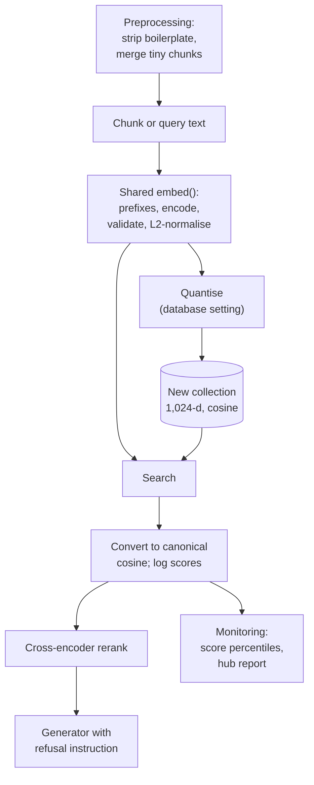

This assessment covers all eight lessons of **Embedding Mathematics**: the dot product, cosine similarity, Euclidean distance, vector normalisation, the behaviour of high-dimensional spaces, similarity score distributions, embedding space geometry and dimensionality reduction. The multiple-choice section has 18 questions and the pass mark is 70% (13 correct). The written sections that follow are not scored automatically: attempt each one before opening its solution, then compare your reasoning with the model answer. The coding solutions use only NumPy and FAISS and run without downloading a model.

```quiz
[
  {
    "q": "What does this print?\n```python\nimport numpy as np\na = np.array([1, 2, 3]); b = np.array([4, 0, -1])\nprint(a @ b)\n```",
    "options": ["1", "7", "-1", "[4 0 -3]"],
    "answer": 0,
    "why": "The dot product multiplies matching coordinates and adds them: 4 + 0 - 3 = 1. The elementwise product would be [4 0 -3], but @ sums it."
  },
  {
    "q": "Two chunk vectors point in exactly the same direction as each other; chunk B is twice as long as chunk A. Under which measure does B score better than A against a query?",
    "options": ["Cosine similarity", "Dot product", "Euclidean distance on unit vectors", "None: all measures treat them identically"],
    "answer": 1,
    "why": "The dot product equals the product of the lengths and the cosine, so doubling the length doubles the score. Cosine ignores length, and after normalisation the two vectors are identical."
  },
  {
    "q": "A model card says the model was trained with cosine similarity. Which index setup gives correct rankings at the lowest query cost?",
    "options": ["Inner product on raw vectors", "L2-normalise vectors at write and query time, then use inner product", "Euclidean distance on raw vectors", "Mean-centre the vectors, then use dot product without normalising"],
    "answer": 1,
    "why": "On unit vectors the inner product equals the cosine, so one dot product per comparison suffices. Raw inner product or raw L2 reintroduce length effects the model was not trained with."
  },
  {
    "q": "What does this print?\n```python\nimport numpy as np\nu = np.array([3.0, 4.0])\nprint(np.linalg.norm(10 * u / np.linalg.norm(u)))\n```",
    "options": ["1.0", "5.0", "10.0", "50.0"],
    "answer": 2,
    "why": "u / |u| is a unit vector; multiplying it by 10 gives a vector of length 10."
  },
  {
    "q": "With all-MiniLM-L6-v2, 'VPN is required on public Wi-Fi.' and 'VPN is not required on public Wi-Fi.' have a cosine of about 0.96. What is the right conclusion?",
    "options": ["The two sentences mean the same thing", "Cosine similarity mainly reflects shared topic and wording, so it cannot be used alone to decide whether two chunks state the same fact", "The model is broken and should be replaced", "Negation always produces a cosine of exactly 1"],
    "answer": 1,
    "why": "The embedding direction encodes topic and wording far more than polarity. Deduplication, caching or contradiction checks need a stricter second test."
  },
  {
    "q": "Why is cosine distance (1 minus cosine) not a true metric?",
    "options": ["It can be negative", "It is not symmetric", "It can violate the triangle inequality", "It is undefined for unit vectors"],
    "answer": 2,
    "why": "For (1,0), (1,1) and (0,1), the direct cosine distance is 1 but the detour via (1,1) is about 0.586. The angle and the Euclidean distance between unit vectors are true metrics."
  },
  {
    "q": "A FAISS IndexFlatL2 over unit vectors returns 0.50 for the best match. What is its cosine similarity?",
    "options": ["0.50", "0.75", "0.875", "0.29"],
    "answer": 1,
    "why": "IndexFlatL2 returns squared distances, and for unit vectors squared distance = 2 - 2cos, so cos = 1 - 0.50/2 = 0.75."
  },
  {
    "q": "What does this print?\n```python\nimport numpy as np\nq = np.array([1.0, 0.0])\nD = np.array([[0.6, 0.8], [2.0, 0.5], [0.9, 0.1]])\nprint(np.argmax(D @ q), np.argmax(D @ q / np.linalg.norm(D, axis=1)))\n```",
    "options": ["1 1", "2 2", "1 2", "0 2"],
    "answer": 2,
    "why": "Dot products are 0.6, 2.0 and 0.9, so row 1 (the long vector) wins. Dividing by the lengths gives cosines of 0.6, about 0.970 and about 0.994, so row 2 wins."
  },
  {
    "q": "On unnormalised vectors, how does Euclidean distance treat a chunk's length compared with the dot product?",
    "options": ["Both reward long chunks", "Both ignore length", "The dot product rewards length; Euclidean distance penalises it", "The dot product penalises length; Euclidean distance rewards it"],
    "answer": 2,
    "why": "Ranking by squared distance is ranking by |d|^2 - 2 q.d: the q.d term rewards agreement, the |d|^2 term penalises length. The dot product only has the q.d term."
  },
  {
    "q": "What does this print?\n```python\nimport numpy as np\nX = np.array([[1.0, 0.0], [0.0, 1.0]])\nprint(round(float(np.linalg.norm(X.mean(axis=0))), 3))\n```",
    "options": ["1.0", "0.5", "0.707", "0.0"],
    "answer": 2,
    "why": "The mean is (0.5, 0.5), of length sqrt(0.5). Equivalently, the squared length of a mean of unit vectors is the average of their full cosine matrix, (1 + 0 + 0 + 1)/4 = 0.5."
  },
  {
    "q": "You truncate unit-length embeddings from 768 to 256 dimensions to save memory and keep an inner-product index. What else must you do?",
    "options": ["Nothing: truncated unit vectors are still unit vectors", "Re-normalise the truncated vectors (and the truncated queries)", "Switch to Euclidean distance", "Multiply every vector by 3"],
    "answer": 1,
    "why": "Truncation leaves vectors shorter than 1 by varying amounts, which reintroduces length bias. Re-normalise after truncation. Truncation is only sensible for models trained for it."
  },
  {
    "q": "Which statement about mean-centring embeddings is correct?",
    "options": ["Each query should be centred with its own mean", "It is applied per vector and needs no corpus statistics", "The corpus mean must be stored and applied identically to documents and queries, and any score thresholds must be re-calibrated", "It always improves retrieval quality"],
    "answer": 2,
    "why": "Centring is a corpus-level transformation that shifts all scores; it must be applied consistently and its benefit measured, not assumed."
  },
  {
    "q": "For two random unit vectors in 1,024 dimensions, what is the approximate standard deviation of their cosine?",
    "options": ["0.31", "0.1", "0.031", "0.001"],
    "answer": 2,
    "why": "The standard deviation is 1 over the square root of d, and the square root of 1,024 is 32."
  },
  {
    "q": "Why do k-d trees give little speed-up for exact search over 768-dimensional embeddings?",
    "options": ["They only support integer coordinates", "Distances concentrate, so almost no region of the tree can be ruled out and most points are visited", "They require vectors to be sorted", "They cannot store more than 1,000 points"],
    "answer": 1,
    "why": "Tree pruning relies on some regions being provably farther than the best match so far. In high dimensions, distances bunch together and such proofs are rare."
  },
  {
    "q": "A refusal threshold of 0.5 on the top-1 cosine was tuned on a test corpus of 800 chunks. The production corpus has 3 million chunks. What should you expect for questions the corpus cannot answer?",
    "options": ["Their top-1 scores will be lower, so more will be refused", "Their top-1 scores will be higher, because the best irrelevant score is a maximum over many more chunks, so more will pass the threshold", "Their scores will not change", "They will all score 0"],
    "answer": 1,
    "why": "Maxima grow with the number of draws, roughly with the square root of 2 ln N for near-normal scores. Thresholds must be tuned at production scale."
  },
  {
    "q": "A labelled evaluation gives an AUC of 0.99 between relevant and irrelevant query-chunk pairs. Which conclusion is justified?",
    "options": ["A global score threshold will cleanly separate answerable from unanswerable questions", "A random relevant pair almost always outscores a random irrelevant pair", "Scores are calibrated probabilities of relevance", "Every query ranks its relevant chunk first"],
    "answer": 1,
    "why": "AUC is exactly that pairwise probability. It does not guarantee per-query ranking, calibration, or a usable threshold for near-miss questions."
  },
  {
    "q": "Logs show that the footer 'For more information, contact the support desk' appears in the top 5 for a large share of unrelated questions. What is this, and what is the most reliable fix?",
    "options": ["Anisotropy; switch to Euclidean distance", "Hubness; strip boilerplate during preprocessing and move document-level facts into metadata", "A dimension mismatch; re-create the collection", "Normal behaviour; increase top-k"],
    "answer": 1,
    "why": "Generic, repeated text sits near the centre of the space and becomes a hub. Removing it from the indexed text fixes the cause; geometric post-processing is an experiment."
  },
  {
    "q": "A colleague wants to index 2-D t-SNE coordinates of every chunk for fast retrieval. What is the main problem?",
    "options": ["t-SNE coordinates are too large to store", "t-SNE preserves only local neighbourhoods approximately, distorts global distances, and cannot place new queries on an existing map", "t-SNE requires Euclidean distance", "t-SNE increases dimensionality"],
    "answer": 1,
    "why": "t-SNE is a visualisation method. For compression with consistent query handling, use PCA, random projection, truncation of a Matryoshka-trained model, or quantisation, and measure neighbour recall."
  }
]
```

## Conceptual questions

**1.** Explain why the dot product, cosine similarity and Euclidean distance return identical rankings on unit-length vectors, and describe how each ranks chunks differently when vector lengths vary. Under what circumstances is it correct *not* to normalise?

<details><summary>Show model answer</summary>

For unit vectors, $\lVert \mathbf{a} \rVert = \lVert \mathbf{b} \rVert = 1$, so the dot product equals $\cos\theta$, and the squared Euclidean distance is $\lVert \mathbf{a} \rVert^2 + \lVert \mathbf{b} \rVert^2 - 2\,\mathbf{a} \cdot \mathbf{b} = 2 - 2\cos\theta$, a decreasing function of the cosine. All three are monotone functions of the same quantity, so they produce the same order (with distance sorted ascending).

When lengths vary, the geometric form $\mathbf{q} \cdot \mathbf{d} = \lVert \mathbf{q} \rVert \lVert \mathbf{d} \rVert \cos\theta$ shows that the dot product rewards a long chunk; cosine looks only at the angle; and ranking by squared distance is ranking by $\lVert \mathbf{d} \rVert^2 - 2\,\mathbf{q} \cdot \mathbf{d}$, which penalises a long chunk. Three measures, three attitudes to length.

It is correct not to normalise when the model was trained with dot-product similarity, as its documentation will say: such a model may encode useful information (for example, how informative a passage is) in vector length. Normalising would discard a signal the model was trained to produce. The rule is to match the index metric to the model's training objective.

</details>

**2.** A deduplication job merges chunks whose cosine similarity exceeds 0.95. After running it on a corpus containing both the current handbook and the superseded 2023 edition, AskMeridian starts reporting a 4-year laptop cycle. Explain the mechanism and redesign the job.

<details><summary>Show model answer</summary>

Cosine similarity measures direction, and the embedding model places texts with the same topic and nearly the same words in nearly the same direction. "Laptops are refreshed every 3 years" and "Laptops are refreshed every 4 years" differ by one token, so their cosine is well above 0.95 (0.954 with `all-MiniLM-L6-v2`). The job judged them duplicates and kept one arbitrarily; where it kept the 2023 version, the current fact was discarded before indexing.

Redesign: use cosine only to find **candidate** pairs (same topic), then decide "same content" with a stricter test, such as exact comparison of normalised text, or a check that numbers, dates and negations match, or a cross-encoder trained for equivalence. Separately, stop indexing superseded documents: record `effective_from` and a `superseded` flag in document metadata and index only current versions. Add a regression test with known near-duplicate pairs that differ in a fact.

</details>

**3.** Why is the cosine between two random unit vectors in 384 dimensions almost always close to zero, and how can that fact be used, and misused, when interpreting a real model's scores?

<details><summary>Show model answer</summary>

Fix one vector along the first axis; the cosine with a random unit vector is then that vector's first coordinate. A uniformly random unit vector shares its squared length of 1 equally among $d$ coordinates on average, so the first coordinate has mean 0 and variance $1/d$: a standard deviation of $1/\sqrt{384} \approx 0.051$. In high dimensions, random directions are nearly orthogonal.

Use: it is a noise floor for a perfectly spread space. It tells you that a cosine of 0.2 between random directions would be about four standard deviations out, and it is the baseline against which to measure a model's anisotropy (for example, the length of the mean vector against $1/\sqrt{N}$).

Misuse: treating it as the expected score for unrelated texts under a real model. Real models are anisotropic; unrelated Meridian chunks averaged about 0.16 with MiniLM. Thresholds must come from the model's own measured distributions, not from the random baseline.

</details>

**4.** Explain why the best score among irrelevant chunks tends to rise as a corpus grows, and list the operational consequences for a RAG system that uses score thresholds.

<details><summary>Show model answer</summary>

For a question with no relevant chunk, the top-1 score is the maximum of $N$ irrelevant scores. Maxima increase with the number of draws: if irrelevant scores were roughly normal with mean $m$ and standard deviation $\sigma$, the maximum would sit near $m + \sigma\sqrt{2 \ln N}$, moving from about $2.4\sigma$ above the mean at $N = 16$ to about $5.3\sigma$ at $N = 10^6$. Real distributions are not exactly normal, and near-duplicates make it worse, but the direction is reliable.

Consequences: a refusal or context-inclusion threshold tuned on a small test corpus will let more irrelevant chunks through at production scale; thresholds must be tuned on a corpus of production size and re-checked as it grows; score-based monitoring needs baselines that are reset when the corpus changes substantially; and stronger signals (cross-encoders, calibrated classifiers, generator refusal) should carry the "is there an answer?" decision.

</details>

**5.** Compare PCA, random projection and t-SNE. For each, say what it preserves, whether it can be used for retrieval, and what operational burden it adds.

<details><summary>Show model answer</summary>

**PCA** projects onto the orthogonal directions of maximum variance, fitted on the corpus. It approximately preserves global geometry and, in the module's measurement, preserved nearest neighbours better than the other linear methods at equal size (68% neighbour recall@10 at 32 dimensions, 88% at 128). It can be used for retrieval provided the same mean and matrix are applied to queries and the results are re-normalised. Burden: a fitted, versioned artefact in every query path, and a refit-and-reindex when the corpus shifts.

**Random projection** multiplies by a random matrix. The Johnson–Lindenstrauss lemma guarantees distance preservation with enough dimensions, though the bound is loose for dense embeddings (5,844 dimensions for 915 points at 10% distortion). It can be used for retrieval, needs no fitting and no refit, but preserved fewer neighbours than PCA at equal size.

**t-SNE** builds a 2-D or 3-D layout that preserves local neighbourhoods (52% of 10-nearest neighbours in 2-D in the measurement, against 13% for 2-D PCA) while distorting global distances and cluster sizes. It cannot place new queries and varies between runs. Use it only for visualisation.

</details>

## Coding exercises

**1. Canonical scores.** Write `canonical_cosine(raw_scores, metric)` that converts FAISS search scores on unit vectors into cosine similarities, for `IndexFlatIP` (`"ip"`) and `IndexFlatL2` (`"l2"`). Verify that both indexes return the same ids and the same converted scores.

<details><summary>Show solution</summary>

```python
import numpy as np
import faiss

def canonical_cosine(raw_scores, metric):
    """Convert FAISS scores on unit vectors into cosine similarity."""
    raw = np.asarray(raw_scores, dtype=np.float64)
    if metric == "ip":                 # IndexFlatIP: inner product = cosine
        return raw
    if metric == "l2":                 # IndexFlatL2: squared distance = 2 - 2cos
        return 1.0 - raw / 2.0
    raise ValueError(f"unknown metric {metric!r}")

rng = np.random.default_rng(3)
D = rng.standard_normal((5000, 64)).astype("float32")
D /= np.linalg.norm(D, axis=1, keepdims=True)
q = D[:1] + 0.1 * rng.standard_normal((1, 64)).astype("float32")
q /= np.linalg.norm(q)

ip, l2 = faiss.IndexFlatIP(64), faiss.IndexFlatL2(64)
ip.add(D); l2.add(D)
s_ip, i_ip = ip.search(q, 5)
s_l2, i_l2 = l2.search(q, 5)
print("same ids:", i_ip[0].tolist() == i_l2[0].tolist(), i_ip[0].tolist())
print("cosine from IP:", np.round(canonical_cosine(s_ip[0], "ip"), 4).tolist())
print("cosine from L2:", np.round(canonical_cosine(s_l2[0], "l2"), 4).tolist())
```

```output
same ids: True [0, 4185, 3473, 4378, 3074]
cosine from IP: [0.7701, 0.5432, 0.4005, 0.3922, 0.3875]
cosine from L2: [0.7701, 0.5432, 0.4005, 0.3922, 0.3875]
```

The conversion uses $\cos\theta = 1 - \tfrac{1}{2}\lVert \mathbf{a} - \mathbf{b} \rVert^2$, valid only for unit vectors, and relies on `IndexFlatL2` returning squared distances. Doing this conversion once, at the boundary of the retrieval layer, means every threshold elsewhere can be expressed in a single unit.

</details>

**2. Document vectors.** Write `document_vectors(chunk_vecs, doc_ids)` that builds one vector per document as the mean of its unit chunk vectors, re-normalised, and also returns each document's **focus** (the mean's length before re-normalisation). Test it on a synthetic "policy" document whose chunks share one topic and a "handbook" whose chunks span three.

<details><summary>Show solution</summary>

```python
import numpy as np

def document_vectors(chunk_vecs, doc_ids):
    """Mean of each document's unit chunk vectors, re-normalised; also returns the focus (pre-normalisation length)."""
    doc_ids = np.asarray(doc_ids)
    docs = sorted(set(doc_ids.tolist()))
    vecs, focus = [], []
    for d in docs:
        m = chunk_vecs[doc_ids == d].mean(axis=0)
        n = np.linalg.norm(m)
        vecs.append(m / n)
        focus.append(n)
    return docs, np.array(vecs), np.array(focus)

rng = np.random.default_rng(5)
topics = rng.standard_normal((3, 128))
topics /= np.linalg.norm(topics, axis=1, keepdims=True)
chunks, ids = [], []
# "policy": 6 chunks on one topic; "handbook": 6 chunks spread over three topics
for i in range(6):
    chunks.append(topics[0] + 0.3 * rng.standard_normal(128) / np.sqrt(128)); ids.append("policy")
    chunks.append(topics[i % 3] + 0.3 * rng.standard_normal(128) / np.sqrt(128)); ids.append("handbook")
C = np.array(chunks); C /= np.linalg.norm(C, axis=1, keepdims=True)

docs, V, focus = document_vectors(C, ids)
for d, f, v in zip(docs, focus, V):
    print(f"{d:<9} focus {f:.3f}  length after normalising {np.linalg.norm(v):.3f}")
```

```output
handbook  focus 0.582  length after normalising 1.000
policy    focus 0.969  length after normalising 1.000
```

The focused policy's mean is nearly unit length (0.969); the multi-topic handbook's is 0.582, because its chunks point in different directions and partly cancel. Under an unnormalised dot product, the handbook would be handicapped by about 40% on every query. Re-normalising removes the handicap; keeping the focus as metadata preserves the information for other uses.

</details>

**3. Geometry report.** Write `geometry_report(E, Q, k=5, top=3)` that reports the average pairwise cosine, the length of the mean vector, the random baseline $1/\sqrt{N}$, the fair share of k-occurrence and the top hubs. Test it on synthetic anisotropic data containing one chunk placed at the centre of the cloud.

<details><summary>Show solution</summary>

```python
import numpy as np

def geometry_report(E, Q, k=5, top=3):
    """Anisotropy against the random baseline, and the chunks with the highest k-occurrence."""
    N = len(E)
    S = E @ E.T
    mean_cos = S[~np.eye(N, dtype=bool)].mean()
    mean_len = np.linalg.norm(E.mean(axis=0))
    counts = np.bincount(np.argsort(-(Q @ E.T), axis=1)[:, :k].ravel(), minlength=N)
    hubs = np.argsort(-counts)[:top]
    return {"mean_cos": round(float(mean_cos), 3), "mean_len": round(float(mean_len), 3),
            "random_len": round(float(1 / np.sqrt(N)), 3), "fair_share": len(Q) * k / N,
            "hubs": [(int(h), int(counts[h])) for h in hubs]}

rng = np.random.default_rng(11)
d, N = 64, 200
common = rng.standard_normal(d); common /= np.linalg.norm(common)
E = rng.standard_normal((N, d)) / np.sqrt(d) + 0.8 * common     # a shared direction: anisotropy
E[7] = common + 0.05 * rng.standard_normal(d)                   # a chunk sitting at the centre
E /= np.linalg.norm(E, axis=1, keepdims=True)
Q = rng.standard_normal((300, d)) / np.sqrt(d) + 0.8 * common
Q /= np.linalg.norm(Q, axis=1, keepdims=True)
print(geometry_report(E, Q))
```

```output
{'mean_cos': 0.386, 'mean_len': 0.624, 'random_len': 0.071, 'fair_share': 7.5, 'hubs': [(7, 194), (77, 68), (144, 35)]}
```

The mean vector (0.624) is nearly nine times the random baseline (0.071): a strongly anisotropic cloud. Chunk 7, placed at the centre, appears in the top 5 of 194 of the 300 queries, against a fair share of 7.5. That is a hub in its purest form: close to everything because it is close to the centre, and relevant to nothing in particular. In a real corpus, the same report run over logged queries surfaces boilerplate and tiny chunks.

</details>

## Architecture design challenge

Meridian is replacing AskMeridian's embedding model with a new 1,024-dimensional model and, at the same time, ingesting product documentation and release notes, which will roughly quadruple the corpus. The current system has: a Qdrant collection with the `Dot` metric; a refusal threshold of 0.5 on top-1 score; a semantic cache that reuses answers when a new question has cosine at least 0.92 with a cached one; a deduplication step at 0.95; and a request from finance to keep vector memory no larger than today's.

Design the similarity layer for the new system: how vectors are produced, normalised, stored and scored; how every score-based rule is re-derived; how memory is controlled; and what is monitored. State the trade-offs.

<details><summary>Show reference design</summary>

**Vector production.** Read the new model's card for its training similarity and any query or document prefixes. Assume it is cosine-trained. One shared `embed()` function, used by both the indexer and the query service, applies the prefixes, encodes, validates (dimension 1,024, all values finite, length above epsilon) and L2-normalises. The model name, version, prefixes and similarity function are stored in configuration and asserted at startup against the collection's metric.

**Storage and scoring.** Create a new collection rather than mutating the old one. On normalised vectors, `Cosine` and `Dot` rank identically; choose either, but record the choice, and convert every raw score to cosine at the retrieval boundary so the rest of the code uses one unit.

**Memory.** Four times the chunks at 1,024 instead of the current dimension in `float32` would far exceed today's footprint. Evaluate options in order of operational simplicity: scalar quantisation inside the database (about 4 times smaller); Matryoshka truncation if the model supports it, with re-normalisation; PCA only if neither suffices, because it adds a fitted transform to the query path. Choose using labelled Recall@10 plus neighbour recall against the full-precision index.

**Re-deriving rules.** Every threshold is invalid after a model change and a fourfold corpus increase. Build a labelled set of real questions including paraphrases, near-misses and out-of-scope questions; compute relevant and irrelevant score distributions and the top-1 distributions of answerable and unanswerable questions on the **full new corpus**. Replace the raw-score refusal threshold with a reranker score plus a grounded refusal instruction. Re-tune the semantic cache threshold from labelled question pairs, add an exact entity and number check, and key the cache on access scope and index version. Turn deduplication into candidate generation by cosine followed by an exact normalised-text comparison.

**Geometry and data hygiene.** Before go-live, run a geometry check on a sample: anisotropy against the random baseline, and a hub report over logged questions. Strip repeated release-note disclaimers and footers before chunking, merge tiny chunks, and move ownership and legal flags into metadata.

**Monitoring.** Log top-k scores and margins per query; chart daily p5, p50 and p95 of top-1 cosine against the new baseline; run the weekly hub report; alert on shifts.



**Trade-offs.** A new collection doubles storage during migration but allows side-by-side comparison and instant rollback. Quantisation saves memory with no query-path changes but may cost a little recall; the labelled evaluation decides whether that is acceptable. Moving the refusal decision from raw similarity to a reranker adds latency (one cross-encoder pass over the candidates) in exchange for a signal that separates near-misses far better. A stricter cache lowers the hit rate but removes the risk of serving the answer to a negated or differently scoped question.

</details>

## Troubleshooting scenarios

**1.** After a refactor of the ingestion service, staff report that AskMeridian keeps citing the same few long runbook checklists for unrelated questions. No errors are logged. The model was not changed. The new code calls `model.encode(texts)` where the old code called `model.encode(texts, normalize_embeddings=True)`, and the collection uses the `Dot` metric. The current model does not include a normalisation layer.

<details><summary>Show diagnosis and fix</summary>

**Diagnosis.** Without normalisation, chunk vectors have varying lengths, and under the dot product each chunk's score is multiplied by its length. Long, content-dense checklists produce longer mean-pooled vectors and climb the rankings regardless of topic. Confirm by computing the norm of every stored vector and comparing the norms of the most frequently retrieved chunks with the rest; they will sit at the top of the range.

**Fix.** Re-encode with normalisation (or switch to a `Cosine` collection, which normalises on upload), re-index, and add a startup assertion that the model's similarity function matches the collection metric, plus an ingestion check that stored vectors have unit length within a tolerance. Add the norm distribution to the ingestion report so a regression shows up immediately.

</details>

**2.** After product documentation and release notes were ingested, the corpus grew eightfold. The rate of "I couldn't find that" answers fell sharply, which the team first celebrated, but complaints about confident, irrelevant answers rose. Retrieval for HR questions is unchanged in the labelled evaluation.

<details><summary>Show diagnosis and fix</summary>

**Diagnosis.** The refusal rule is a fixed threshold on top-1 similarity. With eight times as many chunks, the best irrelevant score for an out-of-scope question is a maximum over many more draws and has risen, so more out-of-scope questions now clear the threshold. Release notes may also have added boilerplate hubs (repeated disclaimers) that sit near the centre of the space and score moderately against everything. Confirm by comparing the top-1 score distribution of a set of unanswerable questions before and after ingestion, and by running a hub report on recent queries.

**Fix.** Strip repeated disclaimers and merge very short notes before re-indexing. Stop using raw dense similarity as the refusal signal: rerank candidates with a cross-encoder and rely on a grounded refusal instruction, re-calibrated on a labelled set with near-miss and out-of-scope questions measured on the full current corpus. Add monitoring of top-1 percentiles so future corpus growth is visible as a shift rather than as complaints.

</details>

**3.** To cut memory, the team reduced vectors from 768 to 192 dimensions with PCA, fitted on the HR handbook and IT runbooks. Offline evaluation on HR questions was fine. Three months later, after product documentation was added, product questions retrieve poorly, and a new query service written by another team returns nonsense for every question.

<details><summary>Show diagnosis and fix</summary>

**Diagnosis.** Two separate problems. First, PCA was fitted on HR and IT text; the principal directions that distinguish product documentation, such as error codes, plans and features, may lie largely in the discarded components, so product chunks and questions lose exactly the information that separates them. Second, the new query service almost certainly does not apply the stored PCA transform (subtract the fitted mean, multiply by the fitted matrix, re-normalise), so its queries live in a different space from the stored vectors, and similarities are meaningless.

**Fix.** Move the transform into the shared embedding library so no service can skip it, and version the PCA artefact with the model. Refit PCA on a representative sample of the whole current corpus, re-transform and re-index, and evaluate with labelled questions from every source, product included, using both Recall@K and neighbour recall against the full-dimensional index. Consider replacing PCA with quantisation or a Matryoshka-trained model, which do not depend on the corpus and need no refit when new sources arrive.

</details>
