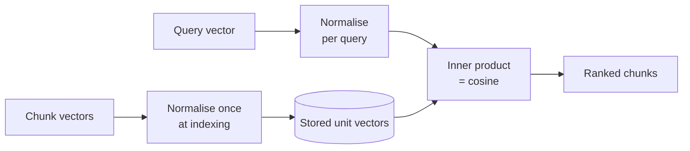

Cosine similarity is the default way to compare text embeddings. You have computed it twice already: once in [Embeddings](/learn/understanding-large-language-models/embeddings), as a formula, and once in [Dot product](/learn/embedding-mathematics/dot-product), as "the dot product with the lengths divided out". This lesson takes it apart properly. What exactly does it measure, and what does it ignore? Why do embedding models train with it? Why is "cosine distance" not really a distance? How does it relate to statistical correlation? And, most important for a RAG engineer, what does a cosine of 0.95 between two chunks actually tell you, and what does it not?

The short answer to that last question surprises most people. On Meridian's handbook, "VPN is required on public Wi-Fi" and "VPN is **not** required on public Wi-Fi" score 0.962. Two sentences that genuinely mean the same thing score 0.691. By the end of this lesson you will understand why, and what to do about it.

## Learning objectives

- State what cosine similarity measures and prove that it is unchanged by rescaling either vector.
- Compute a matrix of cosine similarities efficiently and safely, including for zero vectors.
- Show with a counter-example that cosine distance violates the triangle inequality, and name a measure that does not.
- Relate cosine similarity to Pearson correlation and to the temperature-scaled softmax used to train embedding models.
- Explain why a high cosine indicates shared topic and wording rather than equivalent meaning, and design around it.

## Prerequisites

- [Dot product](/learn/embedding-mathematics/dot-product): the algebraic and geometric definitions, and the length bias.
- [What are embeddings?](/learn/embedding-fundamentals/what-are-embeddings): the training objective decides what "close" means.
- [Query-document matching](/learn/rag-architecture-fundamentals/query-document-matching): scoring functions and ranking.

## Why this matters

Cosine similarity is everywhere in a RAG system, and not only in retrieval. It is used to rank chunks, to set "no good answer" thresholds, to detect near-duplicate chunks before indexing, to place boundaries in [semantic chunking](/learn/advanced-chunking-strategies/semantic-chunking), to cache answers to similar questions, and to diversify results with [MMR](/learn/advanced-retrieval-optimisation/mmr). Each of these uses quietly assumes something about what a cosine means.

When those assumptions are wrong, the failures are hard to spot. A deduplication step with a cosine threshold of 0.95 will merge a current policy with the superseded version it replaced, because the two differ by one number. A semantic cache will return the answer for "Is VPN required?" to someone who asked whether it is not required. A threshold tuned on one model will reject everything when the model is upgraded, because the new model's cosines live in a different range. None of these is a bug in the formula. They are misreadings of it.

## The intuition

Picture two people giving directions from the same starting point by pointing. One points towards the train station; the other points slightly to the left of it. Whether they are pointing with a finger or a long walking stick makes no difference to whether they agree. What matters is the angle between their arms.

Cosine similarity is that comparison. Each embedding is an arrow from the origin; the cosine looks only at the angle between two arrows. Arrows pointing the same way score 1; at right angles, 0; in opposite directions, $-1$. The arrows' lengths are ignored completely.

Now the important part. An embedding model decides which direction each text points, and it decides on the basis of its training. A model trained on huge numbers of "these two texts belong together" pairs learns to point texts with the same topic and much the same words in nearly the same direction. "VPN is required on public Wi-Fi" and "VPN is not required on public Wi-Fi" are about the same topic and share nearly every word, so they point almost the same way. The arrow records **what a text is about** much more faithfully than **what it asserts**.

## How it works

### The definition, and what it removes

Cosine similarity divides the dot product by the two lengths:

$$
\cos(\mathbf{a}, \mathbf{b}) = \frac{\mathbf{a} \cdot \mathbf{b}}{\lVert \mathbf{a} \rVert \, \lVert \mathbf{b} \rVert}
$$

From the [geometric form of the dot product](/learn/embedding-mathematics/dot-product), $\mathbf{a} \cdot \mathbf{b} = \lVert \mathbf{a} \rVert \lVert \mathbf{b} \rVert \cos\theta$, this leaves exactly $\cos\theta$, the cosine of the angle between the vectors. Two properties follow directly and are worth stating precisely:

- **Scale invariance.** For any positive numbers $\alpha$ and $\beta$, $\cos(\alpha\mathbf{a}, \beta\mathbf{b}) = \cos(\mathbf{a}, \mathbf{b})$. Doubling a vector, or shrinking it to length 1, does not change any cosine. Multiplying by a negative number flips the sign.
- **Boundedness.** By the Cauchy–Schwarz inequality, the result always lies in $[-1, 1]$. That makes cosines look comparable across pairs, which is useful and also a source of overconfidence.

A third property is a hazard: the cosine is **undefined for the zero vector**, which has no direction. Real embedding models rarely output an exact zero vector, but zero rows appear in practice from padding, from failed embedding calls filled with `np.zeros`, or from sparse vectors of texts with no known terms. Libraries differ in how they handle it; scikit-learn's `cosine_similarity` returns 0 for a zero row, and a hand-written formula returns `nan` with a division warning.

### Computing it efficiently

The naive approach computes each pair's dot product and two norms separately. The efficient approach rearranges the work:

1. Compute the length of every row of the query matrix and of the chunk matrix once.
2. Divide each row by its length, producing **unit vectors**. Guard against division by zero.
3. Multiply the two unit matrices: $\hat{Q}\hat{D}^{\top}$. Every entry is a cosine.

Step 2 is called **L2 normalisation**, and in a retrieval system you do it once per chunk at indexing time and once per query, after which cosine similarity is a plain dot product. This is why vector databases implement "cosine" as normalise-then-inner-product, and why [Vector normalisation](/learn/embedding-mathematics/vector-normalisation) is a lesson of its own.



### Cosine distance and the triangle inequality

Many tools want a **distance** (smaller is closer) rather than a similarity, so they report **cosine distance**, defined as $1 - \cos(\mathbf{a}, \mathbf{b})$. It runs from 0 (same direction) to 2 (opposite). pgvector's `<=>` operator, for example, returns cosine distance.

Despite its name, cosine distance is not a **metric** in the mathematical sense. A metric must satisfy the **triangle inequality**: going from $a$ to $c$ directly is never longer than going via $b$, $d(a, c) \le d(a, b) + d(b, c)$. Cosine distance can break it, as The mathematics section shows with three two-dimensional vectors. The angle itself, $\theta = \arccos(\cos(\mathbf{a}, \mathbf{b}))$, is a true metric on directions, called the **angular distance**. So is the Euclidean distance between unit vectors, which is a monotone function of the angle, as [Euclidean distance](/learn/embedding-mathematics/euclidean-distance) shows.

Does this matter in practice? For ranking, no: $1 - \cos$, the angle and the unit-vector Euclidean distance all produce the same order. It matters when an algorithm uses the triangle inequality to skip work (some tree-based and pruning methods do) or when you reason "A is close to B and B is close to C, so A is close to C". With cosine distance that reasoning can fail.

### Why embedding models are trained with cosine

Most modern sentence-embedding models are trained with a **contrastive** objective, covered fully in [Contrastive learning](/learn/embedding-optimisation/contrastive-learning). In outline:

1. Take a batch of pairs that belong together: a question and its answer passage, a title and its body.
2. Embed everything and compute the cosine of each question with every passage in the batch.
3. Divide those cosines by a small **temperature** $\tau$ and apply a softmax, turning each question's row of scores into probabilities.
4. Adjust the model to make the probability of the correct passage high.

Using cosine here, rather than the raw dot product, stops the model from "cheating" by growing vector lengths to inflate scores, and keeps training numerically stable. Dividing by a small temperature compensates for the cosine's narrow $[-1, 1]$ range: a difference of 0.2 in cosine becomes a difference of 4 in the softmax's input when $\tau = 0.05$. The Sentence Transformers `MultipleNegativesRankingLoss` uses cosine similarity with a default scale of 20, which is exactly $1/\tau$ for $\tau = 0.05$.

The consequence for you: the model learned to make the **correct** passage's cosine higher than the **other passages in the batch**. It did not learn to put relevant pairs above any particular absolute value, and it did not learn to distinguish a passage from its own negation unless training data contained such pairs. Cosine scores are therefore excellent for ranking and unreliable as absolute judgements of equivalence.

### What a high cosine does and does not mean

Put the pieces together and you can read a cosine correctly:

- **High cosine** means the model places the two texts in nearly the same direction: shared topic, and usually shared vocabulary and structure. It does **not** guarantee the same facts, the same polarity or the same numbers.
- **The scale is model-specific.** For `all-MiniLM-L6-v2`, pairs of different handbook sentences mostly score between about 0.05 and 0.4; other models compress all scores into a narrow band high above zero. The distribution of scores, not a universal threshold, is what you calibrate against, the subject of [Similarity distributions](/learn/embedding-mathematics/similarity-distributions).
- **Negative cosines are rare** for many text models, because their vectors do not spread evenly in all directions. [Embedding space geometry](/learn/embedding-mathematics/embedding-space-geometry) explains this.

Drag the vectors in the visualiser and watch the cosine respond to the angle while ignoring the lengths.

```playground
cosine-similarity
```

## The mathematics

### Scale invariance

**Intuition.** Stretching an arrow does not change where it points.

For $\alpha, \beta > 0$:

$$
\cos(\alpha\mathbf{a}, \beta\mathbf{b}) = \frac{\alpha\beta\,(\mathbf{a} \cdot \mathbf{b})}{\alpha\lVert \mathbf{a} \rVert \, \beta\lVert \mathbf{b} \rVert} = \cos(\mathbf{a}, \mathbf{b})
$$

$\alpha$ and $\beta$ are the scaling factors; they come out of the dot product and out of the lengths, and cancel. If $\alpha < 0$, then $\lVert \alpha\mathbf{a} \rVert = |\alpha| \lVert \mathbf{a} \rVert$ and the sign flips.

### The triangle inequality fails for cosine distance

**Intuition.** Cosine distance grows slowly for small angles and quickly for large ones, so two small steps can add up to less than one big one.

Let $d_c(\mathbf{a}, \mathbf{b}) = 1 - \cos(\mathbf{a}, \mathbf{b})$ and $d_\theta(\mathbf{a}, \mathbf{b}) = \arccos(\cos(\mathbf{a}, \mathbf{b}))$.

**By hand.** Take $\mathbf{a} = (1, 0)$, $\mathbf{b} = (1, 1)$, $\mathbf{c} = (0, 1)$.

- $\cos(\mathbf{a}, \mathbf{c}) = 0$, so $d_c(\mathbf{a}, \mathbf{c}) = 1$.
- $\cos(\mathbf{a}, \mathbf{b}) = 1 / (1 \times \sqrt{2}) \approx 0.7071$, so $d_c(\mathbf{a}, \mathbf{b}) \approx 0.2929$; by symmetry $d_c(\mathbf{b}, \mathbf{c}) \approx 0.2929$ too.
- The detour via $\mathbf{b}$ has length $0.5858$, which is **less** than the direct distance 1. The triangle inequality is violated.
- In angles: 45° + 45° = 90°, exactly the direct angle. Angular distance satisfies the inequality (here with equality, because $\mathbf{b}$ lies between the other two).

### Cosine and Pearson correlation

**Intuition.** Correlation asks whether two lists of numbers rise and fall together around their own averages. Subtract the averages and that is exactly a question about direction.

$$
r(\mathbf{x}, \mathbf{y}) = \frac{\sum_{i}(x_i - \bar{x})(y_i - \bar{y})}{\sqrt{\sum_i (x_i - \bar{x})^2}\,\sqrt{\sum_i (y_i - \bar{y})^2}} = \cos(\mathbf{x} - \bar{x}\mathbf{1},\; \mathbf{y} - \bar{y}\mathbf{1})
$$

$\bar{x}$ and $\bar{y}$ are the means of the coordinates, $\mathbf{1}$ is the vector of ones, and $r$ is the **Pearson correlation coefficient**. So Pearson correlation is the cosine of **mean-centred** vectors. This link explains a technique you will meet in [Vector normalisation](/learn/embedding-mathematics/vector-normalisation): subtracting a common mean before taking cosines can spread out scores that were all bunched together.

**By hand.** $\mathbf{x} = (1, 2, 3)$, $\mathbf{y} = (2, 4, 7)$.

- Raw cosine: $\mathbf{x} \cdot \mathbf{y} = 2 + 8 + 21 = 31$; $\lVert \mathbf{x} \rVert = \sqrt{14} \approx 3.7417$; $\lVert \mathbf{y} \rVert = \sqrt{69} \approx 8.3066$; cosine $= 31 / 31.081 \approx 0.9974$.
- Means: $\bar{x} = 2$, $\bar{y} = 13/3 \approx 4.333$. Centred: $(-1, 0, 1)$ and $(-2.333, -0.333, 2.667)$.
- Centred dot product: $2.333 + 0 + 2.667 = 5.0$. Lengths: $\sqrt{2} \approx 1.4142$ and $\sqrt{12.667} \approx 3.5590$. Correlation $= 5.0 / 5.0332 \approx 0.9934$.

### Temperature-scaled softmax

**Intuition.** Cosines between a question and a batch of passages all lie in a narrow range. Dividing by a small temperature stretches the gaps so the training signal is strong.

$$
p_j = \frac{\exp(s_j / \tau)}{\sum_{k} \exp(s_k / \tau)}
$$

$s_j$ is the cosine of the question with passage $j$, $\tau$ is the temperature, and $p_j$ is the probability the model assigns to passage $j$ being the right one. With cosines $(0.8, 0.6, 0.3)$ and $\tau = 1$, the probabilities are nearly flat; with $\tau = 0.05$ the inputs become $(16, 12, 6)$, and since $e^{4} \approx 55$, the first passage takes about 98% of the probability.

**In NumPy:**

```python
import numpy as np

def cos(a, b):
    return float(a @ b / (np.linalg.norm(a) * np.linalg.norm(b)))

# Cosine distance breaks the triangle inequality; angular distance does not
a, b, c = np.array([1.0, 0.0]), np.array([1.0, 1.0]), np.array([0.0, 1.0])
cd = lambda u, v: 1 - cos(u, v)
ang = lambda u, v: np.degrees(np.arccos(np.clip(cos(u, v), -1, 1)))
print(f"cosine distance: d(a,c)={cd(a,c):.4f}  d(a,b)+d(b,c)={cd(a,b)+cd(b,c):.4f}")
print(f"angle:           a-c={ang(a,c):.1f}  a-b + b-c={ang(a,b)+ang(b,c):.1f}")

# Pearson correlation is the cosine of mean-centred vectors
x, y = np.array([1.0, 2.0, 3.0]), np.array([2.0, 4.0, 7.0])
print(f"cosine(x, y)            = {cos(x, y):.4f}")
print(f"cosine(x - mean, y - mean) = {cos(x - x.mean(), y - y.mean()):.4f}")
print(f"np.corrcoef             = {np.corrcoef(x, y)[0, 1]:.4f}")

# Temperature-scaled softmax over cosine scores, as in contrastive training
s = np.array([0.8, 0.6, 0.3])
for tau in [1.0, 0.05]:
    p = np.exp(s / tau) / np.exp(s / tau).sum()
    print(f"tau={tau}: probabilities {np.round(p, 4)}")
```

```output
cosine distance: d(a,c)=1.0000  d(a,b)+d(b,c)=0.5858
angle:           a-c=90.0  a-b + b-c=90.0
cosine(x, y)            = 0.9974
cosine(x - mean, y - mean) = 0.9934
np.corrcoef             = 0.9934
tau=1.0: probabilities [0.4123 0.3376 0.2501]
tau=0.05: probabilities [0.982 0.018 0.   ]
```

`np.clip` before `np.arccos` is not decoration: rounding can produce a cosine of `1.0000001`, and `arccos` of anything above 1 is `nan`.

## In code

**The problem.** Build a safe, vectorised cosine-similarity function, check it against scikit-learn, and use it on real embeddings to see what high and low cosines correspond to on Meridian's documents.

**Dependencies.** NumPy, scikit-learn and Sentence Transformers (the model downloads once, about 90 MB; no API key).

```bash
pip install numpy scikit-learn sentence-transformers
```

The pairs are chosen to probe the edges: a current policy against the superseded 2023 version, a genuine paraphrase, a negation, and an unrelated pair.

```python
import numpy as np
from sklearn.metrics.pairwise import cosine_similarity
from sentence_transformers import SentenceTransformer

def cosine_matrix(A, B, eps=1e-12):
    """Cosine similarity of every row of A with every row of B."""
    A_norm = np.linalg.norm(A, axis=1, keepdims=True)
    B_norm = np.linalg.norm(B, axis=1, keepdims=True)
    A_unit = A / np.maximum(A_norm, eps)      # a zero row stays zero
    B_unit = B / np.maximum(B_norm, eps)
    return A_unit @ B_unit.T

pairs = [
    ("Laptops are refreshed every 3 years.", "Laptops are refreshed every 4 years."),
    ("Annual leave is 25 days per year.", "Staff receive 25 days of paid holiday a year."),
    ("Support desk hours are 08:00 to 18:00 UK time.", "Support desk hours are 09:00 to 17:00 UK time."),
    ("VPN is required on public Wi-Fi.", "VPN is not required on public Wi-Fi."),
    ("Annual leave is 25 days per year.", "Passwords must be rotated every 90 days."),
]
model = SentenceTransformer("sentence-transformers/all-MiniLM-L6-v2")
left = model.encode([a for a, _ in pairs], normalize_embeddings=True)
right = model.encode([b for _, b in pairs], normalize_embeddings=True)

ours = np.diag(cosine_matrix(left, right))
sk = np.diag(cosine_similarity(left, right))
print("max difference from scikit-learn:", float(np.abs(ours - sk).max()))
for (a, b), c in zip(pairs, ours):
    print(f"{c:.3f}  {a}  |  {b}")

# Scale invariance and the zero vector
v = left[0]
print("cos(v, 7v) =", round(float(cosine_matrix(v[None], 7 * v[None])[0, 0]), 6))
print("cos(v, -v) =", round(float(cosine_matrix(v[None], -v[None])[0, 0]), 6))
print("cos(v, 0)  =", float(cosine_matrix(v[None], np.zeros((1, 384)))[0, 0]))
```

```output
max difference from scikit-learn: 1.1920928955078125e-07
0.954  Laptops are refreshed every 3 years.  |  Laptops are refreshed every 4 years.
0.691  Annual leave is 25 days per year.  |  Staff receive 25 days of paid holiday a year.
0.991  Support desk hours are 08:00 to 18:00 UK time.  |  Support desk hours are 09:00 to 17:00 UK time.
0.962  VPN is required on public Wi-Fi.  |  VPN is not required on public Wi-Fi.
0.283  Annual leave is 25 days per year.  |  Passwords must be rotated every 90 days.
cos(v, 7v) = 1.0
cos(v, -v) = -1.0
cos(v, 0)  = 0.0
```

**The important lines.**

- `np.linalg.norm(A, axis=1, keepdims=True)` computes one length per row and keeps the result as a column of shape $(N, 1)$, so that `A / A_norm` divides each row by its own length through broadcasting.
- `np.maximum(A_norm, eps)` replaces a zero length with a tiny number. A zero row divided by `eps` is still a zero row, so its cosine with anything is 0 instead of `nan`. This matches scikit-learn's behaviour.
- `A_unit @ B_unit.T` is the whole computation: an $(N, d)$ by $(d, M)$ product gives all $N \times M$ cosines.
- `np.diag(...)` picks out the cosine of each left sentence with its own partner.

**What the output means.** The two implementations agree to about $10^{-7}$, the precision of `float32`. Now read the scores:

- The superseded laptop policy and the current one: **0.954**. One digit differs, and that digit is the entire point of the sentence.
- The support-hours pair, with four changed numbers, scores **0.991**, the highest of all.
- The negation: **0.962**. The sentences assert opposite things.
- The genuine paraphrase, same fact in different words: only **0.691**.
- The unrelated pair: **0.283**, not zero. Unrelated sentences in this model sit at a positive baseline.

Every one of the near-identical-but-contradictory pairs outscores the true paraphrase. That is not a flaw peculiar to this small model; it follows from what the cosine measures (direction) and what the model was trained to put in the direction (topic and wording). Larger models may separate some of these cases better, but you should not assume they do without testing.

The last three lines confirm the properties from the theory: scaling by 7 changes nothing, negating flips the sign, and the zero vector gives 0 rather than an error.

**Common errors.**

- Forgetting `keepdims=True`: the norms have shape $(N,)$, and `A / A_norm` either fails or divides columns instead of rows when $N$ happens to equal $d$.
- Normalising the chunks but not the query, then using the dot product as "cosine". The ranking is still correct (the query's length scales every score equally) but any threshold is wrong.
- Calling `np.arccos` on unclipped cosines and getting `nan`.

**Extending it.** Add your own pairs: a sentence and its translation, a question and its answer, two sentences sharing only a rare word. Predict each cosine before running.

## A real-world example

Meridian's HR team publishes a new handbook each year, and the Platform team's ingestion pipeline removes near-duplicate chunks before indexing so that AskMeridian does not retrieve five copies of the same paragraph. The original rule was: if two chunks have cosine similarity above 0.95, keep only one.

After the current handbook was ingested alongside the archived 2023 edition, staff began receiving answers that the laptop refresh cycle was 4 years and that the support desk closed at 17:00. Both were facts from the superseded 2023 handbook. The investigation found that the deduplication step had compared "Laptops are refreshed every 3 years" with its 2023 counterpart, measured a cosine above 0.95, judged them duplicates, and kept whichever chunk happened to be processed first, which for several policies was the old one. The current chunk was discarded before it was ever indexed.

The team's redesign separated two questions that the cosine had been asked to answer at once:

1. **Are these chunks about the same thing?** Cosine similarity is good at this. It is used to propose candidate pairs.
2. **Do they say the same thing?** Cosine similarity is bad at this. For each candidate pair, the pipeline now compares normalised text exactly, and only merges chunks whose text is identical apart from whitespace and formatting.

Separately, superseded documents are no longer indexed at all: document metadata records an `effective_from` date and a `superseded` flag, and only current versions enter the index. The deduplication fix stopped the silent data loss; the metadata fix removed the reason the conflicting chunks were there in the first place.

## Common mistakes

- **Treating a high cosine as "same meaning".** Negations, changed numbers and swapped entities often score above 0.9. Using cosine alone for deduplication, caching or contradiction detection silently loses or confuses facts.
- **Carrying a threshold across models.** A threshold of 0.75 tuned on one model can admit everything or nothing on another, because each model's cosines occupy a different range.
- **Expecting unrelated text to score 0.** Many models have a positive baseline; unrelated pairs at 0.2 or 0.3 are normal. Treating 0.3 as "somewhat relevant" overstates it.
- **Using cosine distance where a true metric is required.** Algorithms that prune with the triangle inequality can return wrong results with $1 - \cos$; use the angle or the Euclidean distance of unit vectors.
- **Ignoring zero vectors.** A failed embedding call stored as zeros produces `nan` scores in a hand-written formula, and `nan` breaks sorting in confusing ways.
- **Normalising one side only and comparing scores to a threshold.** Rankings survive; thresholds do not.

## Best practices

- Normalise every vector once at write time and every query at read time, then use inner product; you get cosine at dot-product cost.
- Validate embeddings on the way into the index: reject zero vectors, `nan` and `inf` values, and wrong dimensions.
- Use cosine to find **candidates** for "same topic" decisions, and a stricter check (exact text comparison, a cross-encoder, or metadata) to decide "same content".
- Calibrate any threshold on labelled pairs from your own corpus, for your exact model, and re-calibrate whenever the model changes.
- When you need a true metric, use the angle (`arccos` of a clipped cosine) or the Euclidean distance between unit vectors.

## Performance considerations

Computing a cosine from scratch costs three dot products' worth of work: one for $\mathbf{a} \cdot \mathbf{b}$ and one each for the two squared lengths. For a query against $N$ chunks that is roughly $3Nd$ multiply-adds instead of $Nd$, plus $N$ square roots and divisions. Pre-normalising the chunks removes the chunk-length work entirely and the query's length is computed once, so the per-query cost becomes exactly that of a dot-product search.

The memory cost of storing unit vectors is the same as storing raw vectors (normalising changes values, not sizes). There is a subtle precision cost if you later quantise: unit vectors have small coordinates (for a 384-dimensional unit vector, a typical coordinate is around $1/\sqrt{384} \approx 0.05$), which matters when choosing scale factors for integer formats, covered in [Embedding quantisation](/learn/embedding-optimisation/embedding-quantisation).

For pairwise work over a whole corpus, such as deduplication, the full $N \times N$ cosine matrix grows quadratically: 100,000 chunks give $10^{10}$ entries, which at 4 bytes each is 40 GB. Compute it in blocks of rows and keep only pairs above a candidate threshold, or use an approximate nearest-neighbour index to find each chunk's few closest neighbours.

## Security considerations

Semantic caches and "similar question" shortcuts keyed on cosine similarity can return one user's cached answer to a different question that merely looks similar. If cached answers depend on who asked (their department, their access rights), a high cosine between two questions is not a licence to share the answer: include the user's access scope in the cache key, and never let cosine similarity decide authorisation. The negation result above is a reminder that "nearly the same question" can mean the opposite question.

## Summary

- Cosine similarity is the dot product of two vectors divided by their lengths, which leaves only the cosine of the angle between them; it is unchanged by positive rescaling and lies in $[-1, 1]$.
- In practice it is computed by L2-normalising once and taking inner products.
- Cosine distance ($1 - \cos$) ranks like a distance but is not a metric; the angle and the Euclidean distance between unit vectors are.
- Pearson correlation is the cosine of mean-centred vectors; contrastive training uses temperature-scaled cosines.
- A high cosine means "same direction", which for text models largely means same topic and wording. It does not certify the same facts; negations and changed numbers often score above 0.9.

## Exercises

**1. By hand.** Compute the cosine of $(3, 4)$ and $(4, 3)$, and the angle between them. Then compute the cosine of $(3, 4)$ and $(30, 40)$.

<details><summary>Show solution</summary>

Dot product $= 12 + 12 = 24$; both lengths are 5; cosine $= 24 / 25 = 0.96$; angle $= \arccos(0.96) \approx 16.3°$. For $(3, 4)$ and $(30, 40)$: the second is 10 times the first, so the cosine is exactly 1.

</details>

**2. Reasoning.** A colleague proposes an index that answers "nearest chunk" queries by assuming that if chunk A has cosine distance 0.1 to B and B has cosine distance 0.1 to C, then A has cosine distance at most 0.2 to C. Is this safe? What would you use instead?

<details><summary>Show solution</summary>

Not safe in general: cosine distance does not satisfy the triangle inequality. Writing $\cos = 1 - 0.1 = 0.9$ gives an angle of about 25.8° for each step, so A and C can be up to about 51.7° apart, a cosine of about 0.62 and a cosine distance of about 0.38, almost double the assumed bound of 0.2. Use the angular distance (angles do add up correctly) or the Euclidean distance between unit vectors, both of which are true metrics.

</details>

**3. Code.** Write a function that takes a list of texts, embeds them, and returns all pairs with cosine above a threshold, without materialising the full $N \times N$ matrix at once: process the rows in blocks of 256. Each pair should appear once.

<details><summary>Show solution</summary>

```python
import numpy as np

def similar_pairs(E, threshold, block=256):
    """E: (N, d) unit vectors. Returns (i, j, cos) with i < j and cos >= threshold."""
    out = []
    for start in range(0, len(E), block):
        S = E[start:start + block] @ E.T          # (block, N)
        rows, cols = np.nonzero(S >= threshold)
        for r, c in zip(rows, cols):
            i = start + r
            if i < c:                              # each pair once, no self-pairs
                out.append((int(i), int(c), float(S[r, c])))
    return out

rng = np.random.default_rng(0)
E = rng.standard_normal((1000, 32))
E[500] = E[3] + 0.05 * rng.standard_normal(32)    # plant a near-duplicate
E /= np.linalg.norm(E, axis=1, keepdims=True)
print(similar_pairs(E, 0.95))
```

```output
[(3, 500, 0.9987887679514025)]
```

With real text, call `model.encode(texts, normalize_embeddings=True)` to produce `E`. Memory per block is $256 \times N$ scores rather than $N^2$.

</details>

**4. Design.** AskMeridian wants a semantic cache: if a new question has cosine at least 0.9 with a previously answered one, return the cached answer. List three risks shown in this lesson and a mitigation for each.

<details><summary>Show solution</summary>

1. **Negation and changed details.** "Is VPN required on public Wi-Fi?" and "Is VPN not required…?" can exceed 0.9. Mitigation: require a second check (a cross-encoder or an exact match on normalised question text) before serving from cache, or restrict caching to questions with identical extracted entities and numbers.
2. **Model-specific threshold.** 0.9 was not calibrated. Mitigation: build a labelled set of "same question" and "different question" pairs and choose the threshold that meets a target false-hit rate; re-calibrate on any model change.
3. **Stale or scoped answers.** A cached answer may come from a superseded document or be specific to the asker's access rights. Mitigation: key the cache on access scope and index version, and invalidate entries when source documents change.

</details>

## Check your understanding

```quiz
[
  {"q": "Vector a is (2, 0) and vector b is (5, 5). What is their cosine similarity?", "options": ["0.5", "0.7071", "1.0", "10"], "answer": 1, "why": "The dot product is 10, the lengths are 2 and about 7.071, so the cosine is 10 / 14.142, about 0.7071: a 45-degree angle."},
  {"q": "Which statement about cosine distance (1 minus cosine) is true?", "options": ["It always satisfies the triangle inequality", "It ranks chunks in a different order from cosine similarity", "It ranks chunks in the same order as cosine similarity but is not a true metric", "It is only defined for unit vectors"], "answer": 2, "why": "It is a decreasing function of the cosine, so the ranking is the same (reversed direction), but it can violate the triangle inequality."},
  {"q": "With all-MiniLM-L6-v2, 'VPN is required on public Wi-Fi.' and 'VPN is not required on public Wi-Fi.' scored 0.962. What is the best explanation?", "options": ["The model has a bug in its normalisation layer", "Cosine similarity ignores the word 'not' by definition", "The embedding direction mainly encodes topic and wording, which the two sentences share", "Negative statements are always embedded as the zero vector"], "answer": 2, "why": "The model places texts with the same topic and nearly the same words in nearly the same direction; the cosine measures only direction."},
  {"q": "What is the Pearson correlation of two vectors in terms of cosine similarity?", "options": ["The cosine of the two vectors after each is mean-centred", "The cosine of the two vectors after each is L2-normalised", "One minus the cosine", "The square of the cosine"], "answer": 0, "why": "Pearson correlation subtracts each vector's mean and then computes exactly the cosine formula."},
  {"q": "A deduplication job compares all 100,000 chunks with each other using a full cosine matrix in float32. Roughly how much memory does the matrix need?", "options": ["400 KB", "40 MB", "40 GB", "4 TB"], "answer": 2, "why": "100,000 squared is ten billion entries, at 4 bytes each about 40 GB. Process it in row blocks instead."}
]
```

## Further reading

- [scikit-learn documentation: `cosine_similarity`](https://scikit-learn.org/stable/modules/generated/sklearn.metrics.pairwise.cosine_similarity.html).
- [Sentence Transformers documentation](https://www.sbert.net/), including `MultipleNegativesRankingLoss` and the `similarity` functions.
- Reimers, N. and Gurevych, I. (2019). *Sentence-BERT: Sentence Embeddings using Siamese BERT-Networks*. EMNLP 2019. [arXiv:1908.10084](https://arxiv.org/abs/1908.10084).
- Manning, C. D., Raghavan, P. and Schütze, H. (2008). *Introduction to Information Retrieval*, chapter 6 (the vector space model and cosine scoring). Cambridge University Press.
- [pgvector README](https://github.com/pgvector/pgvector), for the distance operators, including cosine distance.
