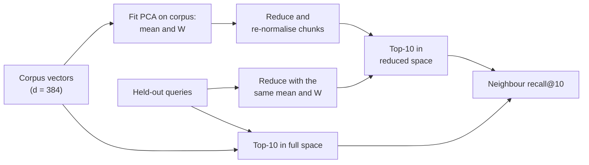

Embeddings have hundreds of dimensions, and there are two reasons you might want fewer. The first is **to look at them**: a person can only see two or three dimensions, and a map of your corpus, with clusters of related chunks, is one of the most useful debugging pictures in RAG. The second is **to store and search them more cheaply**: a 384-dimensional vector reduced to 128 dimensions takes a third of the memory and a third of the arithmetic.

These two goals need different tools, and confusing them is a common and costly mistake. Methods that make beautiful maps, such as t-SNE and UMAP, distort distances in ways that make them useless for retrieval. Methods that are safe for retrieval, such as principal component analysis and random projection, make poor maps. This lesson teaches the main methods from first principles, measures on about a thousand real sentences how well each one preserves nearest neighbours, and shows how to decide whether a reduction is acceptable for your system.

## Learning objectives

- Explain principal component analysis as finding the directions of greatest variance, compute it by hand for a small example, and apply a fitted PCA consistently to documents and queries.
- State the Johnson–Lindenstrauss lemma and explain why random projection works and why its guarantee is often loose in practice.
- Measure the quality of a reduction with neighbour recall against the full-dimensional search.
- Explain why t-SNE and UMAP suit visualisation but not retrieval.
- Choose among PCA, random projection, Matryoshka truncation and quantisation for a given storage or latency goal.

## Prerequisites

- [Vector dimensions](/learn/embedding-mathematics/vector-dimensions): arbitrary bases, rotations and effective dimension.
- [Vector normalisation](/learn/embedding-mathematics/vector-normalisation): centring, and re-normalising after transformations.
- [Embedding space geometry](/learn/embedding-mathematics/embedding-space-geometry): clusters and the shape of the embedding cloud.

## Why this matters

Storage and search costs grow linearly with dimension. At $d = 1{,}024$ in `float32`, every vector takes 4 KB; ten million chunks take about 41 GB before any index overhead, and every brute-force or graph-search step reads all 1,024 numbers. Reducing dimension is one of the main levers for cost, alongside [embedding quantisation](/learn/embedding-optimisation/embedding-quantisation) and models trained to be truncated ([Matryoshka embeddings](/learn/embedding-optimisation/matryoshka-embeddings)). But every reduction throws information away, and the only question that matters for RAG is whether it throws away the information that decides *which chunks come back*. You need a way to measure that.

Visualisation matters for a different reason. When retrieval fails, a 2-D map of chunks and queries shows you things no metric does: a cluster of near-duplicate boilerplate, a set of chunks from a new source sitting apart from everything else, a query landing between two topics. Engineers who know how to read these maps, and who know which of their features are real and which are artefacts of the method, debug faster. Engineers who do not, sometimes draw firm conclusions from the gap between two t-SNE clusters, which can mean nothing at all.

## The intuition

Imagine photographing a three-dimensional sculpture for a catalogue. You must choose the camera angle. From the front, you see the sculpture's width and height and lose its depth. From above, you see width and depth and lose height. A good photographer chooses the angle that shows the most of what varies: if the sculpture is long and thin, they photograph it side-on so its length is visible. That is **principal component analysis**: choose the flat view, or "projection", that preserves as much of the spread of the data as possible.

Now imagine a different job: drawing a map of who sits near whom on every floor of Meridian's office building, on one sheet of paper. You cannot preserve real distances between floors and within them at once. So you give up on global distances and concentrate on keeping each person next to their immediate neighbours, letting the paper stretch and squeeze as needed. The result is a useful map of local neighbourhoods, but the distance between two groups on the paper tells you little about the distance between them in the building. That is **t-SNE** and **UMAP**.

The first kind of picture is a faithful, if partial, view, and it can be applied to anything new you want to photograph. The second is a carefully arranged drawing of one particular set of people, and it cannot be used to measure distances.

## How it works

### Two families of method

| | Linear projection (PCA, random projection) | Nonlinear embedding (t-SNE, UMAP) |
| --- | --- | --- |
| What it preserves | Global geometry, approximately: distances and angles | Local neighbourhoods, at the expense of global distances |
| New points (queries) | Apply the same fixed matrix | t-SNE: no direct way; UMAP: an approximate transform |
| Typical output size | Tens to hundreds of dimensions | 2 or 3 dimensions |
| Use in retrieval | Yes, with measurement | No |
| Use for visualisation | Usable but often cluttered | Yes, its main purpose |

A **linear projection** multiplies every vector by the same matrix $W$ of shape $d \times k$ (after, for PCA, subtracting a mean). Because the same matrix is applied to everything, queries and documents land in the same reduced space, and similarity in that space is a consistent approximation of similarity in the original.

### Principal component analysis

**Principal component analysis (PCA)** finds the orthogonal directions along which the data varies most. The procedure:

1. **Centre** the data: subtract the mean vector $\boldsymbol{\mu}$ of the corpus from every vector.
2. Compute the **covariance matrix** $C$ ($d \times d$), which records how each pair of coordinates varies together.
3. Find the **eigenvectors** of $C$: special directions that $C$ only stretches, without turning. Each comes with an **eigenvalue**, the variance of the data along that direction. Sort them from largest eigenvalue to smallest. These are the **principal components**. (In practice libraries compute them via the singular value decomposition of the centred data, which is equivalent and numerically more stable.)
4. Keep the first $k$ components as the columns of $W$.
5. Reduce any vector, document or query, with $\mathbf{z} = W^{\top}(\mathbf{x} - \boldsymbol{\mu})$.
6. For cosine or inner-product search, **re-normalise** $\mathbf{z}$ to unit length.

The **explained variance ratio** of component $j$ is its eigenvalue divided by the sum of all eigenvalues. The cumulative ratio for the first $k$ components says how much of the data's spread survives. It is a useful guide, but not the final test: what retrieval needs is that nearest neighbours survive, and variance in directions that separate close neighbours can matter more than its share suggests.

Because the principal components are just a rotation of the original basis followed by discarding the least-varying directions, PCA is the best possible linear projection to $k$ dimensions in a precise sense: no other $k$-dimensional linear projection keeps more variance. This connects to [Vector dimensions](/learn/embedding-mathematics/vector-dimensions): coordinates are arbitrary, so before truncating, rotate to a basis where the coordinates are ordered by importance. Truncating raw coordinates, without that rotation, keeps an arbitrary subset of directions.

PCA is fitted on a corpus, so it carries the same operational burden as mean-centring: the fitted $\boldsymbol{\mu}$ and $W$ must be stored, versioned and applied to every query, and if the corpus shifts substantially you must refit and re-index.

### Random projection and the Johnson–Lindenstrauss lemma

**Random projection** skips the fitting: $W$ is a random matrix, for example with independent normal entries scaled by $1/\sqrt{k}$. It sounds too crude to work, but the **Johnson–Lindenstrauss (JL) lemma** says that for any $n$ points, a random projection to

$$
k \;\ge\; \frac{4 \ln n}{\epsilon^2/2 - \epsilon^3/3}
$$

dimensions preserves every pairwise distance to within a factor of $1 \pm \epsilon$, with high probability. Remarkably, $k$ depends on the number of points and the tolerance, not on the original dimension $d$. That makes random projection valuable when $d$ is enormous (sparse vectors with millions of dimensions), cheap to apply, and independent of the data, so nothing needs refitting when the corpus changes.

For dense embeddings with $d$ in the hundreds, the guarantee is usually loose to the point of uselessness: for 915 points and $\epsilon = 0.1$ the formula demands 5,844 dimensions, far more than the 384 we started with. The guarantee is a worst case over all possible data. In practice, random projection preserves neighbours less well than PCA at the same $k$, because it does not exploit the fact that real embeddings vary mostly along a limited number of directions.

### Nonlinear methods for visualisation: t-SNE and UMAP

**t-SNE** (t-distributed stochastic neighbour embedding; van der Maaten and Hinton, 2008) places points in 2-D so that each point's probability distribution over neighbours in the map matches its distribution in the original space. **UMAP** (uniform manifold approximation and projection; McInnes, Healy and Melville, 2018) builds a neighbourhood graph and finds a low-dimensional layout with similar connectivity. Both are very good at keeping **local** neighbourhoods together, which is why their maps show crisp clusters.

What they do not preserve, and what people misread most often:

- **Distances between clusters.** Two clusters far apart on a t-SNE map may be close in the original space, and vice versa.
- **Cluster sizes and densities.** t-SNE tends to equalise the apparent density of clusters; a tight cluster and a diffuse one can look alike.
- **Stability.** Different random seeds or perplexity settings can give different-looking maps of the same data.
- **New points.** scikit-learn's `TSNE` has no `transform` method: a new query cannot be placed on an existing map without recomputing it. UMAP offers an approximate transform, but its geometry is still not suitable for scoring.

So use them to *look*: to find clusters, outliers, duplicates and mislabelled sources. Never use them to *search*, and never measure anything on their maps.

```playground
embeddings-map
```

### Measuring a reduction: neighbour recall

For retrieval, the question is whether the reduced space returns the same chunks. A direct measure:

1. Hold out a set of queries (real ones, or a sample of chunks used as queries).
2. Retrieve each query's top-$k$ chunks in the **full** space. Treat these as the reference.
3. Retrieve the top-$k$ in the **reduced** space.
4. **Neighbour recall@k** is the average fraction of the reference top-$k$ that the reduced search also returns.

This isolates the damage done by the reduction itself. It does not tell you whether the full-dimensional results were relevant; for that, measure Recall@K against human relevance labels, as in [Embedding evaluation](/learn/embedding-optimisation/embedding-evaluation). Use neighbour recall to choose $k$ quickly, then confirm with a labelled evaluation.



## The mathematics

### PCA on a small example

**Intuition.** The first principal component is the direction along which the centred points spread out most; its eigenvalue is how much they spread.

For centred data $X$ ($n$ rows, $d$ columns), the covariance matrix and its eigen-decomposition are

$$
C = \frac{1}{n} X^{\top} X, \qquad C\,\mathbf{w}_j = \lambda_j \mathbf{w}_j, \qquad \text{explained ratio}_j = \frac{\lambda_j}{\sum_i \lambda_i}
$$

$\mathbf{w}_j$ is the $j$-th principal direction (a unit vector), $\lambda_j$ the variance along it, and the projection of a point onto it is $\mathbf{x} \cdot \mathbf{w}_j$. (scikit-learn divides by $n - 1$ instead of $n$; the ratios and directions are the same.) For a $2 \times 2$ symmetric matrix $\begin{pmatrix} a & b \\ b & c \end{pmatrix}$ the eigenvalues are $\frac{a + c}{2} \pm \sqrt{\left(\frac{a - c}{2}\right)^2 + b^2}$.

**By hand.** Four centred points: $(3, 1)$, $(-3, -1)$, $(1, -1)$, $(-1, 1)$.

- $\sum x^2 = 9 + 9 + 1 + 1 = 20$, $\sum y^2 = 4$, $\sum xy = 3 + 3 - 1 - 1 = 4$. Dividing by $n = 4$: $C = \begin{pmatrix} 5 & 1 \\ 1 & 1 \end{pmatrix}$.
- Eigenvalues: $3 \pm \sqrt{4 + 1} = 3 \pm 2.236$, so $5.236$ and $0.764$.
- The first component explains $5.236 / 6 \approx 0.873$ of the variance.
- Its direction solves $(C - 5.236 I)\mathbf{w} = 0$: from the first row, $-0.236\,w_1 + w_2 = 0$, so $\mathbf{w} \propto (1, 0.236)$; normalised, $(0.973, 0.230)$.
- The point $(3, 1)$ projects to $3 \times 0.973 + 1 \times 0.230 \approx 3.149$ on this one dimension.

### The Johnson–Lindenstrauss bound

**Intuition.** Random directions in high dimensions are nearly orthogonal, so a random projection behaves like an approximate rotation followed by a cut; with enough output dimensions, lengths survive with high probability.

$$
k \ge \frac{4 \ln n}{\epsilon^2/2 - \epsilon^3/3}
$$

$n$ is the number of points, $\epsilon$ the allowed relative distortion of pairwise distances and $k$ the target dimension. This is the form scikit-learn's `johnson_lindenstrauss_min_dim` implements.

**By hand.** $n = 915$, $\epsilon = 0.1$: $\ln 915 \approx 6.819$; the denominator is $0.005 - 0.000333 = 0.004667$; $k \ge 4 \times 6.819 / 0.004667 \approx 5{,}845$.

**In NumPy:**

```python
import numpy as np
from sklearn.decomposition import PCA
from sklearn.random_projection import johnson_lindenstrauss_min_dim

X = np.array([[3.0, 1.0], [-3.0, -1.0], [1.0, -1.0], [-1.0, 1.0]])   # already centred
C = X.T @ X / len(X)                                   # covariance (dividing by n)
vals, vecs = np.linalg.eigh(C)                         # ascending order
w = vecs[:, -1] * np.sign(vecs[0, -1])                 # first principal direction
print("covariance:", C.tolist())
print("eigenvalues:", [round(float(v), 3) for v in vals[::-1]])
print("share of variance on PC1:", round(float(vals[-1] / vals.sum()), 3))
print("PC1 direction:", [round(float(v), 3) for v in w], " projection of (3, 1):", round(float(X[0] @ w), 3))
print("sklearn agrees:", round(float(PCA(1).fit(X).explained_variance_ratio_[0]), 3))

n, eps = 915, 0.1
print("JL formula:", round(4 * np.log(n) / (eps**2 / 2 - eps**3 / 3), 1),
      " sklearn:", johnson_lindenstrauss_min_dim(n, eps=eps))
```

```output
covariance: [[5.0, 1.0], [1.0, 1.0]]
eigenvalues: [5.236, 0.764]
share of variance on PC1: 0.873
PC1 direction: [0.973, 0.23]  projection of (3, 1): 3.149
sklearn agrees: 0.873
JL formula: 5844.8  sklearn: 5844
```

`np.linalg.eigh` is the eigen-solver for symmetric matrices and returns eigenvalues in ascending order, so the largest is last. An eigenvector's sign is arbitrary; the code flips it so the first coordinate is positive, which is why your own PCA outputs may differ from someone else's by a sign without anything being wrong.

## In code

**The problem.** Reduce real sentence embeddings from 384 dimensions to 16, 32, 64 and 128 with PCA, random projection and naive truncation, and measure how many of each query's true top-10 neighbours survive. Then make two 2-D maps, with t-SNE and PCA, and measure how well each keeps local neighbourhoods.

A meaningful PCA needs many more points than Meridian's 16 chunks (recall from [Vector dimensions](/learn/embedding-mathematics/vector-dimensions) that $N$ points reveal at most $N - 1$ directions). So this example builds a corpus that is available offline and is realistic technical documentation: the first paragraph of every public function's docstring in NumPy and several SciPy modules. With the library versions used here that yields 1,015 sentences; your count may differ slightly.

**Dependencies.** NumPy, SciPy, scikit-learn and Sentence Transformers. No API key; the model downloads once.

```bash
pip install numpy scipy scikit-learn sentence-transformers
```

```python
# docs_corpus.py
import inspect
import numpy, scipy.linalg, scipy.stats, scipy.signal, scipy.optimize, scipy.sparse

def docstring_sentences(modules, min_words=5):
    """First sentence of every public function or class docstring in the given modules."""
    seen, out = set(), []
    for mod in modules:
        for name, obj in sorted(vars(mod).items()):
            if name.startswith("_") or not callable(obj):
                continue
            doc = inspect.getdoc(obj) or ""
            first = doc.strip().split("\n\n")[0].replace("\n", " ").strip()
            if len(first.split()) >= min_words and first not in seen:
                seen.add(first)
                out.append(first)
    return out

MODULES = [numpy, numpy.linalg, numpy.random, scipy.linalg, scipy.stats,
           scipy.signal, scipy.optimize, scipy.sparse]
```

```python
import numpy as np
from sklearn.decomposition import PCA
from sklearn.random_projection import GaussianRandomProjection, johnson_lindenstrauss_min_dim
from sentence_transformers import SentenceTransformer
from docs_corpus import docstring_sentences, MODULES

texts = docstring_sentences(MODULES)
model = SentenceTransformer("sentence-transformers/all-MiniLM-L6-v2")
E = model.encode(texts, normalize_embeddings=True, batch_size=64)
rng = np.random.default_rng(0)
perm = rng.permutation(len(E))
Q, D = E[perm[:100]], E[perm[100:]]                 # 100 held-out queries, the rest is the corpus
print(f"{len(texts)} sentences -> corpus {D.shape}, queries {Q.shape}")

def unit(X):
    return X / np.linalg.norm(X, axis=1, keepdims=True)

def top_k(Qx, Dx, k=10):
    return np.argsort(-(Qx @ Dx.T), axis=1)[:, :k]

def neighbour_recall(approx, exact):
    """Share of the exact top-k neighbours that the reduced space also returns."""
    return np.mean([len(set(a) & set(e)) / len(e) for a, e in zip(approx, exact)])

exact = top_k(Q, D)

pca_full = PCA().fit(D)
cum = np.cumsum(pca_full.explained_variance_ratio_)
print("variance kept by the first k principal components:",
      {k: round(float(cum[k - 1]), 3) for k in [16, 32, 64, 128, 256]})

print(f"{'k':>4} {'PCA':>6} {'random':>7} {'truncate':>9}")
for k in [16, 32, 64, 128]:
    pca = PCA(n_components=k, svd_solver="full").fit(D)                     # fitted on the corpus only
    rp = GaussianRandomProjection(n_components=k, random_state=0).fit(D)
    r_pca = neighbour_recall(top_k(unit(pca.transform(Q)), unit(pca.transform(D))), exact)
    r_rp = neighbour_recall(top_k(unit(rp.transform(Q)), unit(rp.transform(D))), exact)
    r_tr = neighbour_recall(top_k(unit(Q[:, :k]), unit(D[:, :k])), exact)
    print(f"{k:>4} {r_pca:>6.2f} {r_rp:>7.2f} {r_tr:>9.2f}")

print("JL bound for 915 points, distortion 0.1:", johnson_lindenstrauss_min_dim(915, eps=0.1))

# Visualisation: 2-D maps of the corpus. Which keeps each point's 10 nearest neighbours?
from sklearn.manifold import TSNE
from sklearn.metrics import pairwise_distances

def self_neighbours(X, k=10):
    dist = pairwise_distances(X)
    np.fill_diagonal(dist, np.inf)                       # a point is not its own neighbour
    return np.argsort(dist, axis=1)[:, :k]

exact_self = self_neighbours(D)
Y_tsne = TSNE(n_components=2, perplexity=30, init="pca", random_state=0).fit_transform(D)
Y_pca = PCA(n_components=2, svd_solver="full").fit_transform(D)
print("2-D neighbour recall@10:  t-SNE", round(neighbour_recall(self_neighbours(Y_tsne), exact_self), 2),
      "  PCA", round(neighbour_recall(self_neighbours(Y_pca), exact_self), 2))
```

```output
1015 sentences -> corpus (915, 384), queries (100, 384)
variance kept by the first k principal components: {16: 0.444, 32: 0.584, 64: 0.745, 128: 0.898, 256: 0.989}
   k    PCA  random  truncate
  16   0.56    0.29      0.33
  32   0.68    0.47      0.48
  64   0.79    0.60      0.62
 128   0.88    0.70      0.76
JL bound for 915 points, distortion 0.1: 5844
2-D neighbour recall@10:  t-SNE 0.52   PCA 0.13
```

**The important lines.**

- `PCA(...).fit(D)` learns the mean and principal directions from the **corpus only**; `pca.transform(Q)` applies that same mean and matrix to the queries. Fitting on queries and corpus together would leak information from the evaluation queries into the transform.
- `svd_solver="full"` makes PCA deterministic. For data of this shape, scikit-learn's default may choose a randomised solver, whose results vary slightly between runs unless `random_state` is set.
- `unit(...)` re-normalises after every reduction, as [Vector normalisation](/learn/embedding-mathematics/vector-normalisation) requires, so the inner product is again a cosine.
- `Q[:, :k]` is naive truncation: keep the first $k$ raw coordinates. This model was not trained for truncation; it is here as a baseline.
- `TSNE(...).fit_transform(D)` produces a 2-D layout for the corpus points only. There is no `transform` for queries.

**What the output means.**

1. **Variance is concentrated.** The first 64 of 384 principal components hold 74.5% of the variance, and the first 128 hold 89.8%. The corpus varies along far fewer effective directions than 384.
2. **PCA preserves neighbours best.** At 128 dimensions, PCA keeps 88% of each query's true top-10; random projection keeps 70% and truncation 76%. At 32 dimensions, PCA keeps 68%, random projection only 47%. PCA wins because it keeps the directions in which this corpus actually varies.
3. **The JL bound is loose.** It asks for 5,844 dimensions for a 10% distortion guarantee on 915 points, while PCA at 128 dimensions already retains most neighbours. The lemma is a worst-case guarantee for arbitrary data, not a practical sizing rule for dense embeddings.
4. **t-SNE keeps local structure; 2-D PCA does not.** In two dimensions, t-SNE keeps 52% of each point's 10 nearest neighbours, PCA only 13%. That is why t-SNE maps show meaningful local clusters. It is also no licence to search in t-SNE space: 52% is far below what any of the linear methods achieve at 16 dimensions for retrieval, and there is no way to place a new query.

Note what "88%" means: on average, about one of the ten chunks a full-dimensional search returns is replaced by another. Whether that matters depends on whether the replaced chunks were relevant, which only a labelled evaluation can tell you.

**Common errors.**

- Fitting PCA separately on queries, or refitting it on new data without re-transforming the stored vectors.
- Forgetting to re-normalise after projection, so inner-product scores in the reduced space are no longer cosines.
- Choosing $k$ from explained variance alone. Ninety per cent of variance kept did not mean 90% of neighbours kept here.
- Running t-SNE on tens of thousands of points with default settings and waiting a long time; subsample for visualisation.

**Extending it.** Add Meridian's 16 chunks and 22 questions to a t-SNE map of the docstring corpus and colour them separately. They should form their own island, a picture of a "domain shift" between two sources.

## A real-world example

Meridian's Platform team was asked to cut the memory footprint of AskMeridian's Qdrant cluster, which had grown after product documentation was added. The embedding model in use at the time produced 768-dimensional vectors. Two proposals were on the table: reduce to 256 dimensions with PCA, or store the existing vectors with scalar quantisation.

A team member, Aisha, built the evaluation first. She sampled 2,000 logged questions with their full-dimensional top-10 results, and pulled the team's labelled set of 300 questions with known relevant chunks. For PCA, she fitted the transform on a uniform sample of 200,000 chunks, then measured neighbour recall@10 and the labelled Recall@10 at 128, 192, 256 and 384 dimensions. For quantisation, she measured the same two metrics using the vector database's own quantised search.

The deciding factor was not only quality. PCA added an artefact, the fitted mean and $768 \times 256$ matrix, that every query path had to apply identically, and that would need refitting, with a full re-index, whenever the corpus shifted, as it had when product documentation was added. Quantisation was a database setting, required no change to the query path, and could be switched off. When both met the quality bar, the team chose quantisation for production. They kept the PCA tooling for a different job: a 2-D PCA-then-t-SNE map of a sample of chunks, regenerated weekly, which became the quickest way to spot a new source that did not belong (such as a batch of release notes whose legal disclaimers formed a tight, isolated cluster).

## Common mistakes

- **Searching in a t-SNE or UMAP space.** Their layouts preserve local neighbourhoods only approximately, distort global distances, vary with settings, and (for t-SNE) cannot place new queries.
- **Reading distances between clusters on a t-SNE map.** Gaps and cluster sizes on the map are not reliable evidence about the original space.
- **Truncating raw coordinates of a model not trained for it.** You keep an arbitrary subset of directions; PCA, or a Matryoshka-trained model, keeps the informative ones.
- **Fitting PCA on one corpus and applying it to a different one** without measuring: directions of variance in HR policies may not be those of product documentation.
- **Skipping re-normalisation after projection,** which reintroduces length effects into inner-product search.
- **Using the JL lemma to size a dense-embedding reduction.** Its bound is a worst case and often exceeds the original dimension.

## Best practices

- Decide the goal first: visualisation (t-SNE or UMAP, on a sample, for looking only) or compression (PCA, random projection, Matryoshka truncation, quantisation, for retrieval).
- For compression, measure neighbour recall@k against the full space and Recall@K against labelled relevance at several target dimensions before choosing.
- Fit PCA on a large, representative sample of the corpus; store the mean and matrix as a versioned artefact; apply the same transform and re-normalisation to documents and queries.
- Prefer approaches that do not add a fitted artefact to the query path when they meet the quality bar: models trained for truncation, or quantisation inside the database.
- For visualisation, project with PCA to about 50 dimensions before t-SNE on larger samples (a common practice that speeds it up and reduces noise), fix the random seed, and try more than one perplexity before trusting a structure.

## Performance considerations

Storage and search cost scale with $k$. Reducing 768 dimensions to 256 cuts vector memory by two thirds: for 10 million chunks in `float32`, from about 30.7 GB to about 10.2 GB. Each brute-force or graph-search distance computation shrinks by the same factor.

The transform itself is cheap at query time: one $d \times k$ matrix-vector product, $768 \times 256 \approx 197{,}000$ multiply-adds, negligible next to running the embedding model. Fitting PCA on $n$ vectors costs roughly $n \times d^2$ operations for the covariance (for 200,000 vectors at $d = 768$, about $1.2 \times 10^{11}$ multiply-adds, minutes at most on a CPU) plus an eigen-decomposition of a $768 \times 768$ matrix, which is fast. The expensive part is operational: refitting means re-transforming and re-indexing every stored vector.

Random projection has no fitting cost and can be applied in streaming fashion, but at the same $k$ it preserved fewer neighbours than PCA in our measurement, so it usually needs a larger $k$ for the same quality.

t-SNE's cost grows faster than linearly with the number of points; scikit-learn's default Barnes–Hut method is roughly $n \log n$ per iteration. For visualisation, a sample of a few thousand to a few tens of thousands of points is normally enough.

## Summary

- Dimensionality reduction serves two different goals: visualisation (2-D maps) and compression (cheaper storage and search). Use different tools for each.
- PCA finds orthogonal directions of maximum variance; fit it on the corpus, apply the same mean and matrix to queries, and re-normalise. It preserved neighbours best among the linear methods tested.
- Random projection needs no fitting and comes with the Johnson–Lindenstrauss guarantee, but that guarantee is loose for dense embeddings, and at equal $k$ it preserved fewer neighbours than PCA.
- t-SNE and UMAP keep local neighbourhoods for visualisation but distort global geometry and cannot be used for retrieval.
- Judge any reduction by neighbour recall against the full space and by labelled retrieval metrics, and weigh the operational cost of a fitted transform against alternatives such as quantisation or Matryoshka-trained models.

## Exercises

**1. Explained variance.** A covariance matrix is $\begin{pmatrix} 4 & 0 \\ 0 & 1 \end{pmatrix}$. What are the principal components and the share of variance explained by the first? If you reduce to one dimension, what happens to the point $(1, 3)$?

<details><summary>Show solution</summary>

The matrix is already diagonal, so the principal components are the coordinate axes: first $(1, 0)$ with variance 4, second $(0, 1)$ with variance 1. The first explains $4 / 5 = 80\%$. Reducing to one dimension keeps only the first coordinate: $(1, 3)$ becomes $1$. Most of this point's length was along the low-variance direction and is lost, a reminder that "80% of the variance" is about the data overall, not about every point.

</details>

**2. Reasoning.** A colleague proposes storing 2-D UMAP coordinates for every chunk and using them for "ultra-fast" retrieval, since a 2-D search is trivial. Give three reasons this is a bad idea.

<details><summary>Show solution</summary>

1. Two dimensions cannot hold the neighbourhood structure of a 384-dimensional space; in our measurement even t-SNE in 2-D kept only about half of each point's 10 nearest neighbours.
2. UMAP and t-SNE distort global distances by design, so scores in the map do not approximate similarity, and rankings beyond the immediate neighbourhood are unreliable.
3. Queries must be placed in the same map. t-SNE cannot do this at all; UMAP's transform is approximate and adds a fitted, versioned model to the query path that changes whenever the map is recomputed. Exact search over a few million 384-dimensional vectors, or an HNSW index, is already fast enough that the speed argument is weak.

</details>

**3. Code.** Using the In code script, find the smallest number of PCA dimensions, in steps of 32 from 128, that keeps at least 90% neighbour recall@10.

<details><summary>Show solution</summary>

Append to the script (it already defines `Q`, `D`, `exact`, `top_k`, `unit` and `neighbour_recall`):

```python
def smallest_k(Q, D, exact, target=0.9, candidates=range(128, 385, 32)):
    for k in candidates:
        pca = PCA(n_components=k, svd_solver="full").fit(D)
        r = neighbour_recall(top_k(unit(pca.transform(Q)), unit(pca.transform(D))), exact)
        print(f"  k={k:<4} neighbour recall@10 {r:.2f}")
        if r >= target:
            return k
print("smallest k:", smallest_k(Q, D, exact))
```

```output
  k=128  neighbour recall@10 0.88
  k=160  neighbour recall@10 0.89
  k=192  neighbour recall@10 0.91
smallest k: 192
```

Reaching 90% needs 192 of 384 dimensions, half the original size, even though 128 dimensions already keep 89.8% of the variance. Neighbour recall improves slowly at the top because near-tied neighbours are separated by small differences spread across many directions.

</details>

**4. Design.** Meridian's index holds 20 million chunks at 1,024 dimensions. The team must cut vector memory by at least 70% without losing more than one point of labelled Recall@10. List the candidate approaches from this module and its neighbours, the memory each would achieve, and the order in which you would evaluate them.

<details><summary>Show solution</summary>

Baseline: $20{,}000{,}000 \times 1{,}024 \times 4 \approx 82$ GB.

- **Scalar quantisation to 8-bit integers**: 1 byte per value, about 20.5 GB, a 75% cut. No change to the query path if the database supports it.
- **Matryoshka truncation** (only if the model was trained for it) to 256 dimensions: about 20.5 GB in `float32`, also 75%; can be combined with quantisation for further savings.
- **PCA to 256 dimensions**: the same 75%, but adds a fitted transform to every query path and a refit-and-reindex burden.
- **Random projection to 256**: same memory, no fitting, but likely lower quality than PCA at equal size.

Evaluate in order of operational simplicity: quantisation first (a configuration change), then Matryoshka truncation if available, then PCA, then combinations. For each, measure labelled Recall@10 and neighbour recall on held-out queries, plus latency, and accept the simplest option that meets both the 70% target and the one-point quality limit.

</details>

## Check your understanding

```quiz
[
  {"q": "What does the first principal component of a set of embeddings represent?", "options": ["The coordinate with the largest average value", "The direction along which the centred embeddings vary most", "The embedding closest to the mean", "A random direction chosen by the algorithm"], "answer": 1, "why": "PCA finds orthogonal directions sorted by the variance of the data along them; the first has the most."},
  {"q": "You fit PCA on your corpus. How must queries be reduced?", "options": ["Fit a separate PCA on the queries", "Truncate the query to the first k coordinates", "Subtract the corpus mean, multiply by the same fitted matrix, then re-normalise", "Queries do not need reducing"], "answer": 2, "why": "Queries must land in the same reduced space as the documents, so they use the identical transform."},
  {"q": "In the lesson's measurement at 32 dimensions, which method kept the most of each query's true top-10 neighbours?", "options": ["Random projection", "Naive truncation", "PCA", "They were all equal"], "answer": 2, "why": "PCA kept 68%, against 47% for random projection and 48% for truncation, because it keeps the directions in which the data actually varies."},
  {"q": "Why should you not run retrieval in a t-SNE space?", "options": ["t-SNE only works on images", "It distorts global distances, varies between runs, and cannot place new queries on an existing map", "It increases the number of dimensions", "It requires a GPU"], "answer": 1, "why": "t-SNE is designed for visualising local neighbourhoods, not for consistent similarity scoring of new points."},
  {"q": "The Johnson-Lindenstrauss bound for 915 points at 10% distortion is about 5,844 dimensions, more than the original 384. What should you conclude?", "options": ["Random projection cannot reduce these vectors at all", "The lemma is a worst-case guarantee and is loose for real dense embeddings; measure instead", "PCA also needs at least 5,844 dimensions", "The embeddings must be padded to 5,844 dimensions"], "answer": 1, "why": "The bound holds for any data, so it is pessimistic for structured embeddings; empirical neighbour recall is the practical test."}
]
```

## Further reading

- [scikit-learn user guide: Decomposing signals in components (PCA)](https://scikit-learn.org/stable/modules/decomposition.html) and [Random Projection](https://scikit-learn.org/stable/modules/random_projection.html).
- van der Maaten, L. and Hinton, G. (2008). *Visualizing Data using t-SNE*. Journal of Machine Learning Research 9, 2579–2605.
- McInnes, L., Healy, J. and Melville, J. (2018). *UMAP: Uniform Manifold Approximation and Projection for Dimension Reduction*. [arXiv:1802.03426](https://arxiv.org/abs/1802.03426).
- Wattenberg, M., Viégas, F. and Johnson, I. (2016). *How to Use t-SNE Effectively*. Distill. [distill.pub/2016/misread-tsne](https://distill.pub/2016/misread-tsne/).
- Dasgupta, S. and Gupta, A. (2003). *An Elementary Proof of a Theorem of Johnson and Lindenstrauss*. Random Structures and Algorithms 22(1).
- Jolliffe, I. T. (2002). *Principal Component Analysis*, 2nd edition. Springer.
