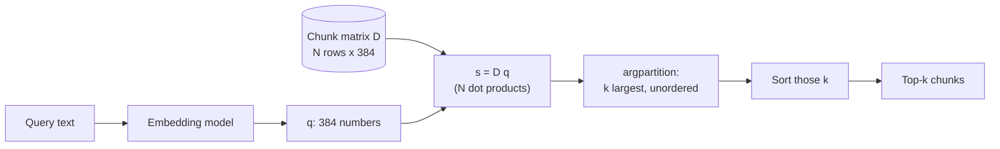

Every dense retriever, whatever it calls its similarity measure, spends almost all of its time doing one operation: multiplying two lists of numbers position by position and adding up the results. That operation is the **dot product** (also called the **inner product**). Cosine similarity is a dot product divided by two lengths. Squared Euclidean distance is three dot products added together. A vector database is, underneath its index, a machine for computing dot products quickly.

You have already used the dot product as a step inside cosine similarity in [Embeddings](/learn/understanding-large-language-models/embeddings). This lesson treats it as a similarity measure in its own right: what it measures geometrically, why it rewards long vectors, when a model is designed to be scored with it, how a whole corpus is scored in one matrix multiplication, and what it costs. The rest of this module builds on it.

## Learning objectives

- Compute a dot product by hand and in NumPy, and state its algebraic and geometric definitions.
- Explain how a vector's length and its direction each contribute to a dot-product score.
- Score a matrix of chunk embeddings against a query in a single matrix-vector product and select the top-k with `argpartition`.
- Decide, from an embedding model's documentation, whether a vector index should use inner product or cosine.
- Estimate the arithmetic and memory traffic of a brute-force dot-product search.

## Prerequisites

- [Embeddings](/learn/understanding-large-language-models/embeddings): text vectors and the cosine formula.
- [What are embeddings?](/learn/embedding-fundamentals/what-are-embeddings): the embedding contract and why scores are positions on a model's private scale.
- [Query-document matching](/learn/rag-architecture-fundamentals/query-document-matching): scoring functions and why only the order of scores matters.

## Why this matters

When you create a collection in a vector database you are asked to choose a metric. Qdrant offers `Dot`, `Cosine`, `Euclid` and `Manhattan`; FAISS has `IndexFlatIP` (inner product) and `IndexFlatL2`; pgvector has a separate operator for each. The choice is not cosmetic. If your model was trained to be scored with cosine similarity but produces vectors of varying length, and you index them with the dot product, the ranking changes: chunks whose vectors happen to be long climb the results for reasons that have nothing to do with the query. Nothing errors. Retrieval just gets quietly different, and possibly worse.

The reverse mistake also happens. Some retrieval models were trained so that the length of a passage vector carries information, and their documentation says to score them with the dot product. Normalising those vectors throws that information away.

The dot product also sets the cost of retrieval. A brute-force search over $N$ chunks of dimension $d$ is $N \times d$ multiply-and-add operations per query, and every byte of the embedding matrix has to be read from memory. Knowing this lets you predict, before you build anything, whether exact search is fast enough or whether you need an approximate index.

## The intuition

Think of a canteen assistant who scores dishes against your preferences. You rate three things: how much you like spice (2), sweetness (1) and crunch (0). Each dish has its own amounts of those three properties. A curry has spice 3, sweetness 0, crunch 1.

The assistant's score for the curry is: your love of spice times its spice, plus your love of sweetness times its sweetness, plus your love of crunch times its crunch, which is $2 \times 3 + 1 \times 0 + 0 \times 1 = 6$. That is a dot product. A property you care about contributes in proportion to how much the dish has of it. A property you do not care about (crunch, weight 0) contributes nothing however much of it the dish has. A property the dish lacks contributes nothing however much you care.

Now notice something. If the kitchen serves a double portion of curry, every property doubles to (6, 0, 2) and the score doubles to 12. The dish did not become a better match for your taste; there is just more of it. The dot product measures **how much of what you want** a vector contains, and "how much" includes sheer size. That is exactly the property that matters for retrieval, sometimes as a feature and sometimes as a bug.

## How it works

### Two definitions of the same number

The **algebraic definition** is the one you compute. For two vectors with $d$ coordinates each, multiply matching coordinates and add:

$$
\mathbf{a} \cdot \mathbf{b} = \sum_{i=1}^{d} a_i b_i
$$

The **geometric definition** is the one you reason with. The dot product equals the product of the two lengths and the cosine of the angle $\theta$ between the vectors:

$$
\mathbf{a} \cdot \mathbf{b} = \lVert \mathbf{a} \rVert \, \lVert \mathbf{b} \rVert \cos\theta
$$

The mathematics section shows why these agree. The second form tells you what the number means through three ingredients:

1. **The query's length** $\lVert \mathbf{q} \rVert$. For a single query this is the same for every chunk, so it scales all scores equally and never changes the ranking.
2. **The chunk's length** $\lVert \mathbf{d} \rVert$. This differs from chunk to chunk, so it **does** change the ranking.
3. **The angle** $\theta$ between them. This is the part that captures "pointing the same way", which for a well-trained embedding model means "about the same thing".

Cosine similarity keeps only the third ingredient. The dot product keeps the second and third. That single difference is the whole of the choice between them.

### Sign and size

Lengths are never negative, so the sign comes from the cosine:

- **Positive**: the angle is less than 90°. The vectors broadly agree.
- **Zero**: exactly 90°. The vectors are **orthogonal**: they share nothing along any direction.
- **Negative**: more than 90°. The vectors point in broadly opposite directions.

The size is unbounded. A dot product of 14.8 is not "better" than one of 0.46 in any absolute sense; it depends on the lengths involved. This is why a similarity threshold such as "discard anything below 0.3" is meaningless for raw dot products unless the vectors' lengths are controlled.

### Projection: the shadow picture

The geometric definition has a second reading. Divide both sides by $\lVert \mathbf{q} \rVert$:

$$
\frac{\mathbf{q} \cdot \mathbf{d}}{\lVert \mathbf{q} \rVert} = \lVert \mathbf{d} \rVert \cos\theta
$$

The right-hand side is the length of the **shadow** that $\mathbf{d}$ casts on the line through $\mathbf{q}$ when light shines perpendicular to that line. This is the **scalar projection** of $\mathbf{d}$ onto $\mathbf{q}$. Since the query's length is fixed during one search, ranking chunks by dot product is the same as ranking them by how far each one reaches along the query's direction. A chunk vector that is long, and points roughly the right way, reaches further than a short one pointing exactly the right way. That is the length bias in one picture.

### Scoring a whole corpus at once

Retrieval needs the score of one query against every chunk. Stack the $N$ chunk embeddings as the rows of a matrix $D$ with shape $N \times d$. Then the vector of all scores is a **matrix-vector product**:

$$
\mathbf{s} = D\,\mathbf{q}, \qquad s_j = \mathbf{d}_j \cdot \mathbf{q}
$$

Row $j$ of $D$ dotted with $\mathbf{q}$ gives score $j$. With a batch of $B$ queries stacked as the rows of $Q$ ($B \times d$), all scores at once are $Q D^{\top}$, a $B \times N$ matrix. This reformulation matters enormously in practice, because matrix products are the most heavily optimised routine in numerical computing. NumPy hands them to a **BLAS** library (Basic Linear Algebra Subprograms), which uses the CPU's vector instructions and several cores; GPUs are built around the same operation.

The brute-force search is:

1. Embed the query with the same model used for the chunks, giving $\mathbf{q}$.
2. Compute $\mathbf{s} = D\mathbf{q}$: one score per chunk.
3. Select the indices of the $k$ largest scores. A full sort costs about $N \log N$ comparisons; a **partial selection** such as NumPy's `argpartition` finds the $k$ largest in time proportional to $N$, and only those $k$ then need sorting.
4. Return the chunks at those indices, highest score first.



Approximate indexes such as [HNSW](/learn/vector-indexing-algorithms/hnsw) skip most of the $N$ scores, but each one they compute is still built from dot products. Exact search, the subject of [Exact nearest neighbour search](/learn/vector-indexing-algorithms/exact-nearest-neighbour-search), is literally steps 1 to 4.

### When the length is meant to matter

Whether the chunk's length should influence ranking depends entirely on how the model was trained. During training, the model's output is fed through a similarity function and a loss that rewards relevant pairs for scoring high. If that similarity function was cosine, the training never constrained the lengths, and whatever the length ends up encoding was not optimised for ranking. If the function was the dot product, the model was free to use length as a signal, and it may have learned to, for example, make vectors of information-rich passages longer.

Both kinds exist. The Dense Passage Retrieval system (Karpukhin and colleagues, 2020) scored questions against passages with the inner product. Many general-purpose sentence-embedding models, including `all-MiniLM-L6-v2`, are trained with cosine similarity and end in a normalisation layer so that every output has length 1. Some providers, OpenAI among them, document that their embeddings are already normalised to length 1. For unit-length vectors the dot product **is** the cosine, and the distinction disappears; that is the subject of [Vector normalisation](/learn/embedding-mathematics/vector-normalisation).

The practical rule is short:

- Read the model card. If it says "dot product", index with inner product and do not normalise.
- If it says "cosine", either normalise once at write time and use inner product (fast), or use the database's cosine metric (which typically normalises for you).
- The Sentence Transformers library records the intended function on the model: `model.similarity_fn_name` is `"cosine"` for `all-MiniLM-L6-v2`.

### Searching for the largest dot product is a different problem

Finding the chunk with the largest dot product is called **maximum inner product search (MIPS)**. It is subtly different from finding the nearest neighbour. Under a true distance, every point is its own nearest neighbour. Under the dot product, a vector need not be its own best match: if $\mathbf{d}$ is short and $\mathbf{e}$ is long and points nearly the same way, then $\mathbf{d} \cdot \mathbf{e}$ can exceed $\mathbf{d} \cdot \mathbf{d}$. The dot product is a **similarity**, not a **distance**, and it does not obey the triangle inequality that many index structures quietly rely on. Libraries either support inner product directly or transform MIPS into ordinary nearest-neighbour search, as [Euclidean distance](/learn/embedding-mathematics/euclidean-distance) shows.

## The mathematics

### Why the two definitions agree

**Intuition.** The length of a vector can be written with a dot product, and the law of cosines from school trigonometry connects lengths to angles. Put those together and the geometric form drops out.

First, the length (the **Euclidean norm**) of a vector is the square root of its dot product with itself:

$$
\lVert \mathbf{a} \rVert = \sqrt{\mathbf{a} \cdot \mathbf{a}} = \sqrt{\sum_{i=1}^{d} a_i^2}
$$

Next, expand the squared length of the difference $\mathbf{a} - \mathbf{b}$ using the algebraic definition. Because the dot product distributes over addition like ordinary multiplication:

$$
\lVert \mathbf{a} - \mathbf{b} \rVert^2 = (\mathbf{a} - \mathbf{b}) \cdot (\mathbf{a} - \mathbf{b}) = \lVert \mathbf{a} \rVert^2 + \lVert \mathbf{b} \rVert^2 - 2\,\mathbf{a} \cdot \mathbf{b}
$$

The **law of cosines** says that in a triangle with sides of length $\lVert \mathbf{a} \rVert$, $\lVert \mathbf{b} \rVert$ and $\lVert \mathbf{a} - \mathbf{b} \rVert$, with angle $\theta$ between the first two:

$$
\lVert \mathbf{a} - \mathbf{b} \rVert^2 = \lVert \mathbf{a} \rVert^2 + \lVert \mathbf{b} \rVert^2 - 2 \lVert \mathbf{a} \rVert \lVert \mathbf{b} \rVert \cos\theta
$$

Compare the two lines: everything matches except the last term, so $\mathbf{a} \cdot \mathbf{b} = \lVert \mathbf{a} \rVert \lVert \mathbf{b} \rVert \cos\theta$. Here $\mathbf{a}, \mathbf{b} \in \mathbb{R}^d$ are any two vectors, $a_i, b_i$ their coordinates, $\lVert \cdot \rVert$ the Euclidean length and $\theta$ the angle between them. Three dimensions or 384, the argument is the same, because any two vectors span a flat plane and the triangle lives in that plane.

The expansion $\lVert \mathbf{a} - \mathbf{b} \rVert^2 = \lVert \mathbf{a} \rVert^2 + \lVert \mathbf{b} \rVert^2 - 2\,\mathbf{a} \cdot \mathbf{b}$ will reappear in [Euclidean distance](/learn/embedding-mathematics/euclidean-distance); it is the bridge between the two families of measure.

### A bound: the Cauchy–Schwarz inequality

Because $|\cos\theta| \le 1$, the geometric form gives at once

$$
|\mathbf{a} \cdot \mathbf{b}| \le \lVert \mathbf{a} \rVert \, \lVert \mathbf{b} \rVert
$$

with equality only when the vectors are parallel. This is the **Cauchy–Schwarz inequality**. Two consequences: for unit-length vectors every dot product lies in $[-1, 1]$; and for vectors of unbounded length no such bound exists, so no fixed score threshold is meaningful.

### A worked example

**By hand.** Query $\mathbf{q} = (2, 1, 0)$; chunk A $= (3, 0, 1)$; chunk B $= (1, 1, 1)$.

- $\mathbf{q} \cdot A = 2 \times 3 + 1 \times 0 + 0 \times 1 = 6$.
- $\mathbf{q} \cdot B = 2 \times 1 + 1 \times 1 + 0 \times 1 = 3$.
- Lengths: $\lVert \mathbf{q} \rVert = \sqrt{4 + 1 + 0} = \sqrt{5} \approx 2.2361$, $\lVert A \rVert = \sqrt{9 + 0 + 1} = \sqrt{10} \approx 3.1623$.
- Cosine between $\mathbf{q}$ and A: $6 / (2.2361 \times 3.1623) = 6 / 7.0711 \approx 0.8485$, an angle of about 31.9°.
- Scalar projection of A onto $\mathbf{q}$: $6 / 2.2361 \approx 2.6833$. Chunk A reaches 2.68 units along the query's direction.
- Doubling A to $(6, 0, 2)$ doubles the score to 12, while the angle, and hence the cosine, is unchanged.

**In NumPy:**

```python
import numpy as np

q = np.array([2.0, 1.0, 0.0])          # query
a = np.array([3.0, 0.0, 1.0])          # chunk A
b = np.array([1.0, 1.0, 1.0])          # chunk B

# Algebraic definition: multiply matching coordinates, then add
print("q.a by loop:", sum(qi * ai for qi, ai in zip(q, a)))
print("q.a by NumPy:", q @ a, " q.b:", q @ b)

# Geometric definition: |q| |a| cos(theta)
cos_qa = (q @ a) / (np.linalg.norm(q) * np.linalg.norm(a))
print(f"|q|={np.linalg.norm(q):.4f} |a|={np.linalg.norm(a):.4f} cos={cos_qa:.4f} angle={np.degrees(np.arccos(cos_qa)):.1f} deg")

# Scalar projection of a onto the direction of q
print(f"projection of a onto q: {(q @ a) / np.linalg.norm(q):.4f}")

# Scaling a chunk scales its score
print("q.(2a):", q @ (2 * a))
```

```output
q.a by loop: 6.0
q.a by NumPy: 6.0  q.b: 3.0
|q|=2.2361 |a|=3.1623 cos=0.8485 angle=31.9 deg
projection of a onto q: 2.6833
q.(2a): 12.0
```

The step-through below shows the loop accumulating the dot product of $\mathbf{q}$ and A one coordinate at a time.

```trace
{"title": "Accumulating q . a", "code": ["q = [2, 1, 0]", "a = [3, 0, 1]", "total = 0", "for i in range(3):", "    total += q[i] * a[i]", "print(total)"], "steps": [{"line": 3, "vars": {"total": "0"}, "note": "Start the running sum at zero."}, {"line": 5, "vars": {"i": "0", "q[i] * a[i]": "6", "total": "6"}, "note": "Both vectors are large in coordinate 0, so it contributes the whole score."}, {"line": 5, "vars": {"i": "1", "q[i] * a[i]": "0", "total": "6"}, "note": "The query cares about coordinate 1 but A has none of it: no contribution."}, {"line": 5, "vars": {"i": "2", "q[i] * a[i]": "0", "total": "6"}, "note": "A has some of coordinate 2 but the query has weight 0 there: no contribution either."}, {"line": 6, "vars": {"total": "6"}, "out": ["6"], "note": "The score is 6. Only coordinates where both vectors are non-zero mattered."}]}
```

## In code

**The problem.** Show, on real embeddings of Meridian handbook sentences, how a brute-force dot-product search works and how a chunk's vector length changes the ranking.

**Dependencies.** NumPy and Sentence Transformers. The first run downloads `all-MiniLM-L6-v2` (about 90 MB); no API key is needed.

```bash
pip install numpy sentence-transformers
```

`all-MiniLM-L6-v2` is built from three modules: a Transformer that produces one vector per token, a pooling layer that averages them, and a `Normalize` layer that scales the result to length 1. By constructing a second model from only the first two modules, we can see the **raw** mean-pooled vectors, whose lengths vary, and compare a dot-product search over those with one over the normalised vectors.

```python
import numpy as np
from sentence_transformers import SentenceTransformer

chunks = [
    "Annual leave is 25 days per year.",
    "Up to 5 unused leave days carry over and must be used by 31 March.",
    "Staff may work remotely up to 3 days a week.",
    "The home-office equipment budget is £400.",
    "Expenses must be submitted within 30 days; anything over £75 needs a receipt.",
    "Passwords must be rotated every 90 days.",
    "VPN is required on public Wi-Fi.",
    "Laptops are refreshed every 3 years.",
]
query = "How many days of holiday do I get?"

full = SentenceTransformer("sentence-transformers/all-MiniLM-L6-v2")
# The same model without its final Normalize module: raw mean-pooled vectors.
raw = SentenceTransformer(modules=[full[0], full[1]])

for name, model in [("raw (unnormalised)", raw), ("normalised", full)]:
    D = model.encode(chunks)            # shape (8, 384)
    q = model.encode(query)             # shape (384,)
    scores = D @ q                      # one dot product per chunk
    k = 3
    top = np.argpartition(-scores, k)[:k]          # unordered top-k
    top = top[np.argsort(-scores[top])]            # order those k
    print(f"\n{name}: query norm {np.linalg.norm(q):.3f}")
    print(f"  chunk norms: min {np.linalg.norm(D, axis=1).min():.3f}  max {np.linalg.norm(D, axis=1).max():.3f}")
    for i in top:
        cos = scores[i] / (np.linalg.norm(D[i]) * np.linalg.norm(q))
        print(f"  dot {scores[i]:7.3f}  cos {cos:.3f}  |d| {np.linalg.norm(D[i]):.3f}  {chunks[i]}")
```

```output

raw (unnormalised): query norm 5.659
  chunk norms: min 4.373  max 6.398
  dot  14.822  cos 0.431  |d| 6.081  Annual leave is 25 days per year.
  dot  11.890  cos 0.459  |d| 4.582  Up to 5 unused leave days carry over and must be used by 31 March.
  dot   8.885  cos 0.312  |d| 5.025  Staff may work remotely up to 3 days a week.

normalised: query norm 1.000
  chunk norms: min 1.000  max 1.000
  dot   0.459  cos 0.459  |d| 1.000  Up to 5 unused leave days carry over and must be used by 31 March.
  dot   0.431  cos 0.431  |d| 1.000  Annual leave is 25 days per year.
  dot   0.312  cos 0.312  |d| 1.000  Staff may work remotely up to 3 days a week.
```

**The important lines.**

- `SentenceTransformer(modules=[full[0], full[1]])` reuses the loaded Transformer and pooling modules and leaves out normalisation. You would not do this in production; it is here to expose what the normalisation layer hides.
- `scores = D @ q` is the entire scoring step: an $8 \times 384$ matrix times a 384-vector gives 8 dot products.
- `np.argpartition(-scores, k)[:k]` returns the indices of the $k$ largest scores in no particular order (negating turns "largest" into "smallest", which is what `argpartition` finds). The next line sorts just those $k$.
- The cosine is computed from the dot product and the two lengths, so we can see both views of each chunk side by side.

**What the output means.** In the raw space, chunk lengths range from 4.37 to 6.40, a spread of nearly 50%. The leave-allowance chunk has a cosine of 0.431 with the query and the carry-over chunk 0.459, so by angle the carry-over chunk is closer. But the allowance chunk's vector is 6.08 long against 4.58, and $6.081 \times 0.431 \times 5.659 \approx 14.8$ beats $4.582 \times 0.459 \times 5.659 \approx 11.9$. The length reversed the order. After normalisation every length is 1, the dot product equals the cosine, and the ranking follows the angle.

Which order is "right"? For this query, arguably the raw one, since the allowance sentence answers more directly. That is the trap: on any single query, length can push the right answer up or down. This model was trained with cosine similarity, so nothing in its training made length track relevance; across a whole corpus the length effect is a bias you did not choose, not a signal you can rely on. The correct choice is the one that matches how the model was trained, and you evaluate it over a test set, never on one query.

**Common errors.**

- Mixing shapes: `q @ D` with `D` of shape $(N, d)$ fails, because the inner dimensions do not match. Use `D @ q` or `q @ D.T`.
- `argpartition` with $k$ equal to the number of rows raises an error, because the partition index must be less than $N$. Guard against tiny corpora (Exercise 3).
- Encoding the query as a list (`model.encode([query])`) returns shape $(1, 384)$, and scores come back as an $(N, 1)$ column. Keep shapes explicit.

**Extending it.** Replace the eight chunks with a few thousand and time `D @ q` against a Python loop of dot products.

## A real-world example

Meridian's Platform team runs AskMeridian on a Qdrant cluster. During a migration to a new ingestion service, an engineer, Priya, rewrote the indexing code and created a new collection. Wanting to "skip unnecessary work", she encoded chunks with `normalize_embeddings=False` and, because a colleague had told her that "dot product is the fast one", created the collection with the `Dot` metric.

The model in use at the time was a cosine-trained model without a built-in normalisation layer, so its raw outputs varied in length. Within a week the support desk noticed that questions about almost anything returned the same handful of long, list-like runbook chunks among the top three: a table of VPN error codes and a checklist for new starters. Those chunks contained many content words, their mean-pooled vectors were longer than average, and under the dot product their length carried them past more relevant, shorter chunks.

The diagnosis took an afternoon. They computed every chunk's vector norm and compared it with how often each chunk appeared in the top three across a week of logged queries; the frequently retrieved chunks sat at the top of the norm range. The fix had two parts: re-encode with normalisation (Qdrant's `Cosine` metric would also have normalised on upload), and add a test to the ingestion pipeline asserting that the collection's metric matched `model.similarity_fn_name`. The lesson they wrote up was not "never use the dot product", but "the metric is part of the model, not a database setting you choose for speed".

## Common mistakes

- **Choosing the metric for speed.** Selecting dot product because it is "faster" without normalising cosine-trained vectors makes chunk length part of the ranking. On normalised vectors the dot product and cosine give identical rankings, so normalise once and get the speed for free.
- **Normalising a dot-product model.** If the model card says to use the dot product, normalising removes a signal the model was trained to produce, and retrieval quality can fall with no visible error.
- **Using fixed thresholds on raw dot products.** Because dot products are unbounded, a cut-off such as 0.5 means different things for different chunks. Thresholds only make sense on bounded, calibrated scores (see [Retrieval thresholding](/learn/advanced-retrieval-optimisation/retrieval-thresholding)).
- **Sorting the whole score vector.** `np.argsort(scores)[::-1][:k]` sorts all $N$ scores to keep $k$. Correct, but wasteful at large $N$; partial selection is linear.
- **Looping in Python.** A Python loop over chunks is typically orders of magnitude slower than one matrix product.

## Best practices

- Record the model's intended similarity function next to the model name in configuration, and assert at startup that the vector index uses the matching metric.
- For cosine-trained models, normalise at write time and at query time, then use inner product. One normalisation per vector buys the cheapest possible scoring.
- Select with `argpartition` and sort only the selected $k$.
- When results look skewed towards a few chunks, check the distribution of vector norms before anything else.

## Performance considerations

Brute-force scoring is easy to reason about with arithmetic.

**Arithmetic.** One dot product in $d$ dimensions is $d$ multiplications and $d$ additions, about $2d$ floating-point operations. For Meridian's corpus, assume 50,000 chunks at $d = 384$: $50{,}000 \times 768 \approx 38$ million operations per query. A modern CPU core with vector instructions performs billions of such operations per second, so the arithmetic itself takes on the order of milliseconds.

**Memory traffic.** The matrix has to be read for every query. At 4 bytes per `float32` value, $50{,}000 \times 384 \times 4 \approx 77$ MB. If main memory delivers, as an assumption, around 20 GB/s to one core, reading it takes about 4 ms. For a single query, brute-force search is usually limited by memory bandwidth, not by arithmetic, which is why storing vectors at half precision (2 bytes) roughly halves the time and why batching queries helps: $Q D^{\top}$ reads $D$ once for the whole batch.

**Scaling.** At 10 million chunks the same matrix is about 15 GB, and each query must read all of it. That is the point at which exact search stops being practical for interactive use and approximate indexes earn their complexity; [Recall versus latency](/learn/vector-indexing-algorithms/recall-versus-latency) covers the trade.

**Precision.** Summing in a different order gives slightly different floating-point results. Scoring 1,000 random 384-dimensional `float32` vectors with NumPy's BLAS and with a Python loop in double precision gave differences up to about $8 \times 10^{-6}$ in our run, and the same top 10. Such differences only matter for near-ties, but they mean two systems computing "the same" scores can order exact ties differently.

## Security considerations

Under an unnormalised dot product, a chunk's score grows with its vector's length. If untrusted parties can add documents to the index (a shared wiki, uploads, scraped pages), text with an unusually long embedding gains a ranking advantage across many unrelated queries, a cheap way to put injected instructions in front of the model. Normalising removes this lever, but not content crafted to sit close to common queries, so treat retrieved text as untrusted input regardless.

## Summary

- The dot product multiplies matching coordinates and adds them; geometrically it equals $\lVert \mathbf{a} \rVert \lVert \mathbf{b} \rVert \cos\theta$.
- Ranking chunks by dot product mixes two things: the angle to the query and each chunk's own length. Cosine similarity keeps only the angle.
- Whether length should count depends on how the model was trained. Read the model card; match the index metric to it.
- A whole corpus is scored by one matrix-vector product, $D\mathbf{q}$, followed by partial selection of the top $k$.
- Brute-force cost is about $2Nd$ operations and $4Nd$ bytes read per query in `float32`; memory bandwidth usually dominates.

## Exercises

**1. By hand.** A query is $\mathbf{q} = (1, 2)$. Chunk X is $(2, 1)$, chunk Y is $(0.5, 1)$, chunk Z is $(-1, 3)$. Rank the chunks by dot product, then by cosine. Explain any difference.

<details><summary>Show solution</summary>

Dot products: X gives $2 + 2 = 4$; Y gives $0.5 + 2 = 2.5$; Z gives $-1 + 6 = 5$. Ranking: Z, X, Y.

Lengths: $\lVert \mathbf{q} \rVert = \sqrt{5} \approx 2.236$; X $= \sqrt{5} \approx 2.236$; Y $= \sqrt{1.25} \approx 1.118$; Z $= \sqrt{10} \approx 3.162$. Cosines: X $= 4/5 = 0.8$; Y $= 2.5/2.5 = 1.0$; Z $= 5/7.071 \approx 0.707$. Ranking: Y, X, Z.

The orders are reversed. Y points exactly along $\mathbf{q}$ but is short; Z is the furthest from the query's direction but the longest. The dot product rewards length; the cosine ignores it.

</details>

**2. Reading a model card.** You are given two embedding models. Model P's card says "normalised output; use cosine similarity". Model Q's card says "trained with dot-product similarity; do not normalise". For each, which FAISS index type (`IndexFlatIP` or `IndexFlatL2`) would you use for exact search, and what do you do to the vectors first?

<details><summary>Show solution</summary>

Model P: its vectors already have length 1, so inner product equals cosine. Use `IndexFlatIP`; re-normalising is harmless and protects against a mistake elsewhere in the pipeline. Model Q: use `IndexFlatIP` on the raw vectors and do not normalise, because the length is part of what the model learned to score with. `IndexFlatL2` would be wrong for Q: Euclidean distance penalises length differences rather than rewarding them, so it produces a different ranking from the dot product the model was trained for.

</details>

**3. Code.** Write `top_k(D, q, k)` that returns the indices and scores of the $k$ largest dot products, highest first. It must work when $k$ is greater than or equal to the number of rows. Check it against a full sort on 10,000 random 64-dimensional vectors.

<details><summary>Show solution</summary>

```python
import numpy as np

def top_k(D, q, k):
    scores = D @ q
    k = min(k, len(scores))
    if k == len(scores):
        idx = np.arange(len(scores))
    else:
        idx = np.argpartition(-scores, k - 1)[:k]
    idx = idx[np.argsort(-scores[idx], kind="stable")]
    return idx, scores[idx]

rng = np.random.default_rng(42)
D = rng.standard_normal((10_000, 64))
q = rng.standard_normal(64)
idx, s = top_k(D, q, 5)
ref = np.argsort(-(D @ q))[:5]
print(idx, np.round(s, 3))
print("matches full sort:", np.array_equal(idx, ref))
print("k larger than N:", top_k(D[:3], q, 10)[0])
```

```output
[6901 8459 4958 6663 1531] [30.107 26.957 26.696 26.036 26.012]
matches full sort: True
k larger than N: [0 1 2]
```

Partitioning at `k - 1` puts the $k$ largest values (after negation, the $k$ smallest) in the first $k$ positions; only those are then sorted.

</details>

**4. Design.** Meridian is considering storing chunk vectors in `float16` to halve memory. Using the arithmetic in Performance considerations, estimate the memory saving and the effect on brute-force query latency for 2 million 768-dimensional chunks, and name one risk you would test before switching.

<details><summary>Show solution</summary>

`float32`: $2{,}000{,}000 \times 768 \times 4 \approx 6.1$ GB. `float16`: about 3.1 GB, saving roughly 3 GB. Because a single brute-force query is mostly limited by reading the matrix, latency should fall roughly in proportion, towards half, provided the scoring code works on half-precision data directly rather than converting it all back to `float32` first. The risk is ranking changes from reduced precision: `float16` keeps about three decimal digits, so near-tied scores may swap. Test by comparing top-10 results for a few hundred real queries in both precisions and measuring the overlap and any change in retrieval metrics on a labelled set.

</details>

## Check your understanding

```quiz
[
  {"q": "Two chunk vectors point in exactly the same direction, but chunk B is three times as long as chunk A. How do their dot-product scores against a query compare?", "options": ["They are equal", "B's score is three times A's", "B's score is one third of A's", "It depends on the query's length"], "answer": 1, "why": "The dot product equals the product of the lengths and the cosine. The angle and query are the same for both, so the score scales with the chunk's length."},
  {"q": "Which of these changes the ranking of chunks for a single query under the dot product?", "options": ["Multiplying the query vector by 5", "Multiplying every chunk vector by 5", "Multiplying one chunk vector by 5", "Adding the same constant to every score"], "answer": 2, "why": "Scaling the query or all chunks scales every score equally and preserves the order. Scaling one chunk changes only its score, so it can move in the ranking."},
  {"q": "What does `D @ q` compute when D has shape (N, d) and q has shape (d,)?", "options": ["One dot product per chunk, shape (N,)", "One dot product per dimension, shape (d,)", "The cosine similarity of each chunk with q", "A single number: the sum of all chunk scores"], "answer": 0, "why": "Each row of D is dotted with q, giving N scores. It is a cosine only if all vectors have length 1."},
  {"q": "A model card says the model was trained with dot-product similarity. What should you do?", "options": ["Normalise all vectors, then use cosine", "Use Euclidean distance, which is equivalent", "Use an inner-product index on the raw vectors", "Normalise only the query vector"], "answer": 2, "why": "The model may encode useful information in vector length; normalising removes it. Normalising only the query is harmless for ranking but pointless."},
  {"q": "Why can a vector fail to be its own best match under the dot product?", "options": ["Because floating-point rounding is unpredictable", "Because a longer vector pointing nearly the same way can have a larger dot product with it", "Because the dot product of a vector with itself is zero", "Because the dot product is only defined for unit vectors"], "answer": 1, "why": "d . d equals the squared length of d, but a longer vector e at a small angle can exceed it. The dot product is a similarity, not a distance."}
]
```

## Further reading

- [NumPy documentation: `numpy.matmul`](https://numpy.org/doc/stable/reference/generated/numpy.matmul.html), the semantics of `@`.
- [Sentence Transformers documentation](https://www.sbert.net/), including the notes on which pretrained models are tuned for cosine similarity and which for dot product.
- Karpukhin, V. et al. (2020). *Dense Passage Retrieval for Open-Domain Question Answering*. EMNLP 2020. [arXiv:2004.04906](https://arxiv.org/abs/2004.04906). A retriever scored with the inner product.
- Shrivastava, A. and Li, P. (2014). *Asymmetric LSH (ALSH) for Sublinear Time Maximum Inner Product Search (MIPS)*. NeurIPS 2014. On why MIPS differs from nearest-neighbour search.
- Strang, G. *Introduction to Linear Algebra*, chapter 1 (vectors, lengths and dot products).
