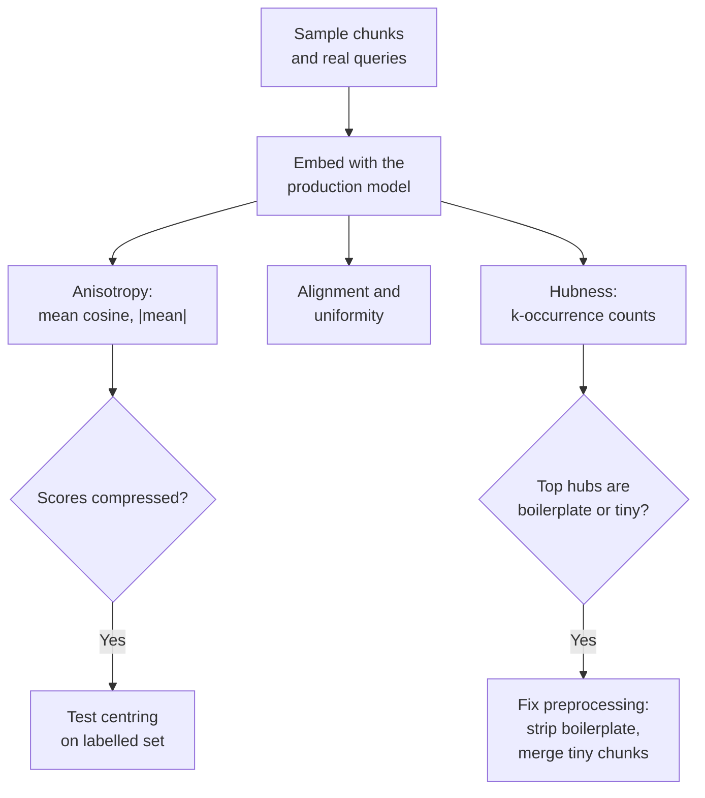

The previous lessons measured pairs of vectors: their dot product, angle and distance. This lesson steps back and looks at the **shape** of the whole cloud of embeddings. Where on the sphere do a model's vectors actually sit? Are they spread out or bunched together? Do some vectors turn up as neighbours of almost everything? Do queries and documents live in the same region?

These are questions about **embedding space geometry**, and they have direct engineering consequences. A model whose vectors crowd into a narrow cone gives every pair a positive score and compresses the range you can threshold on. A space with **hubs** lets a few generic chunks appear in the results of unrelated queries. You will measure each of these properties on real embeddings of Meridian's documents, using metrics from the research literature, and see one of them take first place from a real answer.

## Learning objectives

- Define anisotropy and measure it with the average pairwise cosine and the length of the mean vector, against a random baseline.
- Compute the alignment and uniformity metrics for a set of embeddings and explain what each rewards.
- Explain hubness, measure how often each chunk appears in other queries' top-k, and connect hubs to generic or boilerplate text.
- Describe how query and document embeddings can occupy different regions, and what that implies for similarity scores.
- Choose practical mitigations for anisotropy and hubs in a retrieval pipeline, and say which are established and which experimental.

## Prerequisites

- [Vector normalisation](/learn/embedding-mathematics/vector-normalisation): the mean of unit vectors, and mean-centring.
- [Vector dimensions](/learn/embedding-mathematics/vector-dimensions): the random-direction baseline and concentration of distances.
- [Similarity distributions](/learn/embedding-mathematics/similarity-distributions): relevant and irrelevant score distributions.

## Why this matters

Similarity scores are produced by geometry, and when retrieval behaves strangely the cause is often geometric:

- **Every score is positive and the scores bunch together.** That is anisotropy: the model uses only a narrow region of the sphere, so unrelated texts share a large common component. Thresholds become fragile, because relevant and irrelevant scores sit in a compressed band.
- **The same few chunks appear in the results of unrelated questions.** That is hubness: some points are near-neighbours of a disproportionate share of the space. In RAG, hubs are often short, generic chunks such as boilerplate footers, headings and disclaimers. They take slots in the top-k that real answers should have.
- **Queries score lower against their answers than you expect.** Queries and documents differ in form, and a model may place them in partly different regions, so even a perfect answer does not score near 1.

None of these shows up when you test one query and look at whether the right chunk came first. They show up as patterns across many queries, which is why measuring geometry belongs in your evaluation toolkit.

## The intuition

Think of Meridian's whole workforce as people standing on the surface of a huge globe, each person a chunk of text. A well-designed arrangement uses the whole globe: HR policies in one region, IT runbooks in another, product documentation elsewhere, with space between them. Related people stand together; unrelated people are far apart.

Now imagine instead that everyone has crowded into one country. People who have nothing to do with each other are still only a few hundred miles apart. Distances still tell you something (neighbours in the same town are closer than people in different towns), but the whole range of distances has shrunk, and "far apart" no longer means very far. That is **anisotropy**.

Next, imagine a railway station in the middle of that country. Ask anyone, from anywhere, "who is near you?", and the station keeps appearing in the answers, not because it is related to them but because it is central. That is a **hub**. In a corpus, the station is a chunk like "This policy applies to all Meridian employees": it says nothing specific, so it sits near the middle of everything.

## How it works

### Anisotropy: a narrow cone

A set of embeddings is **isotropic** if its directions are spread evenly around the sphere, with no preferred direction. It is **anisotropic** if the vectors crowd around some common direction, forming a cone. Ethayarajh (2019) found that contextual word representations in BERT, ELMo and GPT-2 were highly anisotropic: two random words had a high cosine simply because all representations pointed broadly the same way. Gao and colleagues (2019) described a related "representation degeneration" in the word embeddings of trained language-generation models. Sentence-embedding models trained contrastively are much less anisotropic than raw language-model states, as the SimCSE work (Gao, Yao and Chen, 2021) analysed, but they are rarely perfectly isotropic.

Two simple measurements expose anisotropy, both of which you have met:

1. **Average pairwise cosine** of unrelated items. For random directions in high dimension it is close to 0; for an anisotropic model it is clearly positive.
2. **Length of the mean vector** of unit-length embeddings. From [Vector normalisation](/learn/embedding-mathematics/vector-normalisation), its square equals the average of the full cosine matrix. For $N$ random unit vectors the expected length is about $1/\sqrt{N}$; a mean much longer than that means a shared direction.

Anisotropy does not, by itself, break ranking: within the cone, related texts can still be nearer to each other than unrelated ones. What it does is shift and compress the scale, which hurts anything that relies on absolute scores, and it is a precondition for hubs.

### Alignment and uniformity

Wang and Isola (2020) analysed contrastive learning on the unit sphere and proposed two complementary metrics that describe what a good embedding space needs:

- **Alignment**: related pairs (a query and its answer, two paraphrases) should be close. Measured as the average squared distance between the vectors of positive pairs. Lower is better.
- **Uniformity**: the embeddings as a whole should spread out over the sphere, preserving as much information as possible. Measured as the logarithm of the average of $e^{-t\lVert \mathbf{x} - \mathbf{y} \rVert^2}$ over all pairs, usually with $t = 2$. Lower (more negative) is better.

The two pull against each other. Collapsing everything to one point gives perfect alignment and terrible uniformity; scattering points at random gives excellent uniformity and no alignment. Contrastive training balances them: pulling positive pairs together optimises alignment, and pushing apart the other examples in the batch optimises uniformity. These metrics are diagnostic tools from research, not production thresholds, but they give a precise vocabulary for "the space is too crowded" (poor uniformity) or "related things are not close enough" (poor alignment).

### Hubness

In a set of points, define the **k-occurrence** of a point as the number of times it appears among the $k$ nearest neighbours of the other points (or, for retrieval, of the queries). If neighbourhoods were "fair", every point would have roughly the same k-occurrence: with $Q$ queries, top-$k$ results and $N$ chunks, the average is $Qk/N$. Radovanović, Nanopoulos and Ivanović (2010) showed that in high-dimensional data the distribution of k-occurrence becomes strongly **skewed**: a few **hubs** appear in very many neighbour lists, and many **anti-hubs** appear in almost none. They linked this to the concentration of distances: points that happen to lie closer to the centre of the data are slightly closer to everything, and in high dimensions "slightly closer to everything" is enough to win many nearest-neighbour contests.

In a RAG corpus, the chunks most likely to become hubs are those whose embeddings sit near the corpus centre:

- **Boilerplate**: footers, disclaimers, "for more information contact…", "this policy applies to all staff".
- **Very short chunks** such as headings or table-of-contents lines, which carry little specific content.
- **Generic overviews** that mention many topics briefly.

Hubs cost you in two ways. They take slots in the top-k for queries they do not answer, crowding out real candidates. And for questions with no good answer, they are what the retriever returns, giving the generator plausible-looking but empty context.

### Queries and documents in different regions

Queries are short questions; documents are longer statements. Even with a model trained on question-passage pairs, the two kinds of text can occupy partly different regions of the space, and the average query-to-answer cosine is then well below 1 even for perfect matches. An extreme version is well documented in multimodal models: Liang and colleagues (2022) showed that image and text embeddings from contrastive models such as CLIP occupy separate regions, which they called the **modality gap**, a topic for [Cross-modal search](/learn/multimodal-rag/cross-modal-search). For text-only retrieval, the practical lessons are modest: do not expect query-answer scores near 1, follow the model's instructions for query and document prefixes where it has them, and calibrate on real query-chunk pairs, not chunk-chunk pairs.

### Structure you can use: clusters and directions

Geometry also has useful structure. Chunks about the same subject form **clusters**, which is what the visualiser below shows in two dimensions and what IVF indexes exploit by partitioning the space into regions. And some differences correspond, roughly, to **directions**: the well-known word2vec analogies (Mikolov and colleagues, 2013), where the offset from "man" to "woman" resembles the offset from "king" to "queen", are the classic example. Such linear regularities are approximate and inconsistent for sentence embeddings; they are good for exploration and poor as a foundation for production features.

```playground
embeddings-map
```

### A geometry check for a new corpus or model

The measurements above combine into a short diagnostic you can run whenever you adopt a model or ingest a new kind of document:

1. Embed a representative sample of chunks and real queries.
2. **Anisotropy**: compute the average pairwise chunk cosine and the length of the mean vector; compare with the random baseline for the same $N$ and $d$.
3. **Alignment and uniformity** on labelled query-answer pairs and on the chunks.
4. **Hubness**: run the queries (or the chunks themselves as queries), count each chunk's k-occurrence, and read the top of the list.
5. Act on what you find: remove or isolate boilerplate, merge or drop tiny chunks, and test centring if scores are compressed.



## The mathematics

### Alignment and uniformity

**Intuition.** Alignment is "how far apart are things that should be together". Uniformity is "how bunched up is everything", measured with a kernel that is large for close pairs and tiny for distant ones.

$$
\mathcal{L}_{\text{align}} = \mathbb{E}_{(x, y) \sim p_{\text{pos}}} \big\lVert f(x) - f(y) \big\rVert^2, \qquad
\mathcal{L}_{\text{uniform}} = \log \mathbb{E}_{x, y \sim p_{\text{data}}} \, e^{-t \lVert f(x) - f(y) \rVert^2}
$$

$f$ is the embedding model producing unit vectors, $p_{\text{pos}}$ the distribution of positive pairs, $p_{\text{data}}$ the distribution of all texts, and $t > 0$ a scale parameter (Wang and Isola use $t = 2$). With unit vectors, $\lVert f(x) - f(y) \rVert^2 = 2 - 2\cos$, from [Euclidean distance](/learn/embedding-mathematics/euclidean-distance).

**By hand: uniformity.** Three unit vectors in the plane: $(1, 0)$, $(0, 1)$, $(-1, 0)$. Squared distances: $(1,0)$–$(0,1)$ is 2, $(1,0)$–$(-1,0)$ is 4, $(0,1)$–$(-1,0)$ is 2. Kernel values with $t = 2$: $e^{-4} \approx 0.01832$, $e^{-8} \approx 0.00034$, $e^{-4} \approx 0.01832$. Mean $\approx 0.01232$; $\log 0.01232 \approx -4.396$.

**By hand: alignment.** Positive pairs $\big((1, 0), (0.8, 0.6)\big)$ and $\big((0.6, 0.8), (0.6, 0.8)\big)$. Squared distances: $0.2^2 + 0.6^2 = 0.4$ and 0. Mean $= 0.2$.

### The length of the mean of random unit vectors

**Intuition.** Random directions mostly cancel; the leftover shrinks like one over the square root of how many you average.

From the identity in [Vector normalisation](/learn/embedding-mathematics/vector-normalisation), $\lVert \boldsymbol{\mu} \rVert^2 = \frac{1}{N^2}\big(N + \sum_{i \ne j} \cos(\mathbf{x}_i, \mathbf{x}_j)\big)$. For random directions every off-diagonal cosine averages 0, so

$$
\mathbb{E}\,\lVert \boldsymbol{\mu} \rVert^2 = \frac{N}{N^2} = \frac{1}{N}, \qquad \lVert \boldsymbol{\mu} \rVert \approx \frac{1}{\sqrt{N}}
$$

$N$ is the number of vectors and $\boldsymbol{\mu}$ their mean. For $N = 20$: $1/\sqrt{20} \approx 0.224$. A real set of 20 chunks whose mean is much longer than that shares a common direction.

### Hubness

**Intuition.** Count appearances in neighbour lists; compare with the fair share.

$$
N_k(i) = \sum_{q=1}^{Q} \mathbb{1}\big[\, i \in \text{top}_k(q) \,\big], \qquad \frac{1}{N} \sum_{i=1}^{N} N_k(i) = \frac{Qk}{N}
$$

$N_k(i)$ is the k-occurrence of chunk $i$, $Q$ the number of queries, $\text{top}_k(q)$ the $k$ chunks retrieved for query $q$ and $N$ the number of chunks. The mean is fixed, because each query hands out exactly $k$ places; hubness shows up as a long right tail. Radovanović and colleagues measure it by the skewness of the $N_k$ distribution, which needs far more points than our small example, so below we simply list the largest counts.

**By hand.** 22 queries, $k = 3$, 20 chunks: the fair share is $22 \times 3 / 20 = 3.3$ appearances per chunk.

**In NumPy:**

```python
import numpy as np

# Uniformity of three unit vectors in the plane, t = 2
X = np.array([[1.0, 0.0], [0.0, 1.0], [-1.0, 0.0]])
sq = np.array([((X[i] - X[j]) ** 2).sum() for i, j in [(0, 1), (0, 2), (1, 2)]])
print("squared distances:", sq.tolist())
print("uniformity:", round(float(np.log(np.exp(-2 * sq).mean())), 4))

# Alignment of two positive pairs
A = np.array([[1.0, 0.0], [0.6, 0.8]])
B = np.array([[0.8, 0.6], [0.6, 0.8]])
print("alignment:", round(float(((A - B) ** 2).sum(axis=1).mean()), 4))

# Mean of N random unit vectors has length about 1/sqrt(N)
rng = np.random.default_rng(0)
R = rng.standard_normal((20, 384)); R /= np.linalg.norm(R, axis=1, keepdims=True)
print("|mean of 20 random unit vectors|:", round(float(np.linalg.norm(R.mean(0))), 3), " 1/sqrt(20):", round(1 / np.sqrt(20), 3))
```

```output
squared distances: [2.0, 4.0, 2.0]
uniformity: -4.3963
alignment: 0.2
|mean of 20 random unit vectors|: 0.224  1/sqrt(20): 0.224
```

## In code

**The problem.** Run the geometry check on Meridian's 16 content chunks plus four realistic boilerplate chunks, using the 16 labelled and 6 unanswerable questions from [Similarity distributions](/learn/embedding-mathematics/similarity-distributions). Measure anisotropy against a random baseline, alignment and uniformity, the query and chunk regions, and hubness, and check whether boilerplate disturbs retrieval.

**Dependencies.** NumPy and Sentence Transformers; `corpus.py` and `corpus2.py` from the earlier lessons.

```bash
pip install numpy sentence-transformers
```

```python
import numpy as np
from sentence_transformers import SentenceTransformer
from corpus import CHUNKS
from corpus2 import LABELLED, UNANSWERABLE

BOILERPLATE = [
    "For more information, contact the relevant team.",
    "This policy applies to all Meridian employees.",
    "Please read this section carefully before proceeding.",
    "This page was last reviewed by the document owner.",
]
docs = CHUNKS + BOILERPLATE
queries = [q for q, _ in LABELLED] + UNANSWERABLE

model = SentenceTransformer("sentence-transformers/all-MiniLM-L6-v2")
D = model.encode(docs, normalize_embeddings=True)
Q = model.encode(queries, normalize_embeddings=True)
rng = np.random.default_rng(0)
R = rng.standard_normal(D.shape); R /= np.linalg.norm(R, axis=1, keepdims=True)

def mean_offdiag_cos(X):
    S = X @ X.T
    return S[~np.eye(len(X), dtype=bool)].mean()

def uniformity(X, t=2.0):
    sq = 2 - 2 * (X @ X.T)                      # squared distances of unit vectors
    iu = np.triu_indices(len(X), 1)
    return float(np.log(np.exp(-t * sq[iu]).mean()))

def alignment(A, B):
    return float(((A - B) ** 2).sum(axis=1).mean())

print("1. Anisotropy")
for name, X in [("chunks", D), ("random", R)]:
    print(f"   {name:<7} mean cosine {mean_offdiag_cos(X):+.3f}  |mean vector| {np.linalg.norm(X.mean(0)):.3f}")

print("2. Alignment and uniformity (lower is better for both)")
gold = np.array([g for _, g in LABELLED])
print(f"   alignment of (query, answer) pairs: {alignment(Q[:len(gold)], D[gold]):.3f}")
print(f"   uniformity of chunks: {uniformity(D):.3f}   random unit vectors: {uniformity(R):.3f}")

print("3. Queries and chunks occupy different regions")
mq, md = Q.mean(0), D.mean(0)
print(f"   cosine between query centroid and chunk centroid: {mq @ md / (np.linalg.norm(mq) * np.linalg.norm(md)):.3f}")
print(f"   mean query-query cosine {mean_offdiag_cos(Q):+.3f}, mean chunk-chunk cosine {mean_offdiag_cos(D):+.3f}")

print("4. Hubness: how often each chunk lands in a query's top 3")
k = 3
top = np.argsort(-(Q @ D.T), axis=1)[:, :k]
counts = np.bincount(top.ravel(), minlength=len(docs))
for i in np.argsort(-counts)[:5]:
    tag = "boilerplate" if i >= len(CHUNKS) else "content"
    print(f"   {counts[i]:>2} times  [{tag}] {docs[i][:55]}")
print(f"   chunks never in any top {k}: {(counts == 0).sum()} of {len(docs)}")

print("5. Did a boilerplate chunk take first place from a real answer?")
S = Q[:len(gold)] @ D.T
for i in np.flatnonzero(S.argmax(axis=1) != gold):
    print(f"   {queries[i]} -> '{docs[S[i].argmax()]}' ({S[i].max():.3f}) beat the answer ({S[i, gold[i]]:.3f})")
```

```output
1. Anisotropy
   chunks  mean cosine +0.143  |mean vector| 0.431
   random  mean cosine +0.000  |mean vector| 0.224
2. Alignment and uniformity (lower is better for both)
   alignment of (query, answer) pairs: 0.850
   uniformity of chunks: -3.297   random unit vectors: -3.977
3. Queries and chunks occupy different regions
   cosine between query centroid and chunk centroid: 0.745
   mean query-query cosine +0.111, mean chunk-chunk cosine +0.143
4. Hubness: how often each chunk lands in a query's top 3
    7 times  [content] Annual leave is 25 days per year.
    7 times  [content] Up to 5 unused leave days carry over and must be used b
    6 times  [content] Any expense over £75 needs a receipt.
    5 times  [content] The home-office equipment budget is £400.
    5 times  [boilerplate] This policy applies to all Meridian employees.
   chunks never in any top 3: 0 of 20
5. Did a boilerplate chunk take first place from a real answer?
   Does Meridian support SSO with Okta? -> 'This policy applies to all Meridian employees.' (0.426) beat the answer (0.379)
```

**The important lines.**

- `R` is a set of random unit vectors with the same shape as the chunk matrix. Every geometric number is compared against it, because "is 0.43 large?" only has an answer relative to a baseline.
- `uniformity` converts cosines to squared distances with $2 - 2\cos$ and averages the kernel over the upper triangle, so each pair counts once.
- `np.bincount(top.ravel(), minlength=len(docs))` counts how many times each chunk index appears across all queries' top-3 lists: the k-occurrence $N_3$.
- Section 5 compares each labelled query's top-1 with its known answer and prints any query where something else won.

**What the output means.**

1. **The model is anisotropic.** Chunks have an average cosine of $+0.143$ and a mean vector of length 0.431, nearly twice the random baseline of 0.224. Meridian's chunks share a substantial common direction.
2. **Uniformity is worse than random**: $-3.297$ against $-3.977$. That is expected for a set of texts from one company handbook, which *should* be more similar to each other than random directions, but it quantifies the crowding. The alignment of 0.850 corresponds to an average query-answer cosine of $1 - 0.850/2 \approx 0.575$, consistent with the relevant-pair median of 0.60 measured in the previous lesson.
3. **Queries and chunks overlap but are not the same population.** Their centroids have a cosine of 0.745, well short of 1: there is a "question" component that queries share with each other and chunks lack.
4. **A boilerplate sentence is a hub.** The fair share is 3.3 appearances per chunk. "This policy applies to all Meridian employees", which answers nothing, appears in the top 3 for five of the 22 queries, as often as the home-office budget chunk.
5. **And it costs a real answer.** For "Does Meridian support SSO with Okta?", the boilerplate chunk scored 0.426 and the correct chunk, about SAML single sign-on, scored 0.379. Without the boilerplate (as in the previous lesson), this query ranked its answer first. Adding four generic sentences to the corpus made retrieval worse.

**Common errors.**

- Reading geometric numbers without a baseline. Always compare with random vectors of the same $N$ and $d$, and ideally with another model.
- Measuring hubness with too few queries: with 22 queries, a count of 5 versus 3.3 is suggestive, not conclusive. Use hundreds or thousands of real queries, or use all chunks as queries.
- Computing uniformity over a sample dominated by near-duplicates, which makes any model look crowded.

**Extending it.** Remove the four boilerplate chunks, rerun, and confirm that the SSO question recovers its answer. Then try mean-centring from [Vector normalisation](/learn/embedding-mathematics/vector-normalisation) with the boilerplate in place, and check whether it removes the hub. (In our run, centring left the boilerplate chunk's count unchanged; fixing the data was the more effective remedy.)

## A real-world example

Several months after launch, AskMeridian's Platform team noticed a pattern in the logs: the same few chunks appeared in the retrieved context for questions about leave, IT access, product features and travel. They were the footer "For more information, contact the support desk" from the IT runbooks, a line "This document is owned by the HR team" from every handbook page, and several one-line section headings.

The team ran the geometry check above on a sample of 20,000 chunks with 2,000 logged questions. The k-occurrence counts were heavily skewed: the top twenty chunks by $N_{10}$ were all boilerplate or headings, and the most frequent appeared in the top 10 for a large share of all questions. For questions that the corpus could not answer, these hubs were usually the *only* retrieved context, and the generator, instructed to stay grounded, produced answers like "please contact the support desk", which looked helpful but were often wrong.

The fix was in preprocessing, not in the vector space. The ingestion pipeline gained a [header and footer removal](/learn/document-preprocessing/header-and-footer-removal) step that detects lines repeated across many pages of the same source and strips them before chunking; ownership information moved from the text into chunk metadata, where it can be filtered on and shown in citations without being embedded; and chunks shorter than a minimum token count are merged into their neighbours. After re-indexing, the team added the hubness report to their weekly evaluation job, listing the 20 chunks with the highest k-occurrence over the week's queries, so that new sources of boilerplate are caught when they are ingested rather than months later.

## Common mistakes

- **Treating a positive baseline cosine as relevance.** In an anisotropic space every pair scores above zero; 0.2 may mean "unrelated".
- **Embedding boilerplate.** Repeated footers, disclaimers and ownership lines become hubs that occupy top-k slots across unrelated queries.
- **Leaving tiny chunks in the index.** Headings and single short lines sit near the centre of the space and behave like hubs.
- **Assuming geometric fixes beat data fixes.** Centring or whitening may compress or shift problems without removing them; cleaning the text removes the cause.
- **Expecting query-answer cosines near 1.** Queries and passages differ in form and partly occupy different regions; good matches typically score well below 1.
- **Reading single analogies as proof of structure.** Linear regularities in embedding spaces are approximate and inconsistent; do not build production logic on them.

## Best practices

- Run a geometry check (anisotropy, alignment and uniformity, hubness) when adopting a model or adding a new document source, always against a random baseline.
- Track the chunks with the highest k-occurrence over real queries as a standing evaluation report; investigate any non-content chunk near the top.
- Strip boilerplate before chunking and move document-level facts (owner, date, classification) into metadata.
- Enforce a minimum chunk length, merging fragments into their neighbours.
- Treat centring, whitening and hubness-reduction methods as experiments to validate on a labelled set, not as default steps.

## Performance considerations

Each measurement is a matrix computation over a sample. Average cosine, uniformity and alignment on $N$ chunks need the $N \times N$ similarity matrix: for $N = 20{,}000$ that is $4 \times 10^8$ entries, 1.6 GB in `float32`, so compute it in row blocks and accumulate sums, or estimate on a random sample of pairs. The mean vector is a single pass, $N \times d$ additions.

Hubness needs a top-$k$ search for every query: with brute force, $Q \times N \times d$ multiply-adds. For 2,000 queries against 20,000 chunks at $d = 384$, that is about $1.5 \times 10^{10}$ multiply-adds, a few seconds of BLAS time on a modern CPU. On a production-scale corpus, run the queries through the existing vector index instead and count the returned ids; the counting itself is trivial.

Fixing hubs at preprocessing time also saves resources: every boilerplate chunk removed is one fewer vector to store and search, and one fewer wasted slot in the generator's context window.

## Summary

- Embedding space geometry describes the whole cloud of vectors: how spread out it is, where its centre is, and which points dominate neighbourhoods.
- Anisotropy means vectors crowd around a common direction; detect it with the average pairwise cosine and the length of the mean vector, against the $1/\sqrt{N}$ random baseline.
- Alignment (positive pairs close) and uniformity (everything spread out) are complementary metrics from contrastive learning research.
- Hubness is the skew in how often points appear in others' nearest-neighbour lists; in RAG the hubs are typically boilerplate, headings and generic text, and they can displace real answers.
- The most reliable fixes are in the data: strip boilerplate, merge tiny chunks, move document-level facts into metadata. Geometric post-processing is an experiment to validate.

## Exercises

**1. Baselines.** You embed 100 chunks and find their mean vector has length 0.35. How does this compare with random unit vectors, and what does it suggest?

<details><summary>Show solution</summary>

For 100 random unit vectors the expected length is about $1/\sqrt{100} = 0.1$. A length of 0.35 is 3.5 times that. Squaring, $0.35^2 = 0.1225$ is the average of the full cosine matrix: $(100 + 9900\,\bar{c})/10000 = 0.1225$ gives an average off-diagonal cosine $\bar{c} \approx 0.114$. The vectors share a common direction, an anisotropic space.

</details>

**2. Uniformity by hand.** Compute the uniformity ($t = 2$) of two unit vectors at 90° to each other, and of two identical unit vectors. Which is "more uniform"?

<details><summary>Show solution</summary>

At 90°, squared distance $= 2$, kernel $= e^{-4} \approx 0.0183$, uniformity $= \log 0.0183 = -4$. Identical vectors: squared distance 0, kernel $= 1$, uniformity $= \log 1 = 0$. Lower is more uniform, so the perpendicular pair ($-4$) is more uniform than the collapsed pair (0).

</details>

**3. Code.** Write a function `hub_report(Q, D, texts, k=10, top=5)` that returns the `top` chunks with the highest k-occurrence over the query matrix `Q`, with their counts and the fair-share value $Qk/N$. Run it on the lesson's data without the boilerplate and with it.

<details><summary>Show solution</summary>

Append this to the In code script, which already defines `Q`, `D`, `CHUNKS` and `docs`:

```python
def hub_report(Q, D, texts, k=10, top=5):
    idx = np.argsort(-(Q @ D.T), axis=1)[:, :k]
    counts = np.bincount(idx.ravel(), minlength=len(D))
    fair = len(Q) * k / len(D)
    order = np.argsort(-counts)[:top]
    return fair, [(int(counts[i]), texts[i]) for i in order]

for name, (Dx, tx) in {"without boilerplate": (D[:16], CHUNKS), "with boilerplate": (D, docs)}.items():
    fair, rows = hub_report(Q, Dx, tx, k=3, top=3)
    print(f"{name}: fair share {fair:.1f}")
    for c, t in rows:
        print(f"  {c}  {t[:50]}")
```

```output
without boilerplate: fair share 4.1
  7  Annual leave is 25 days per year.
  7  Up to 5 unused leave days carry over and must be u
  6  The home-office equipment budget is £400.
with boilerplate: fair share 3.3
  7  Annual leave is 25 days per year.
  7  Up to 5 unused leave days carry over and must be u
  6  Any expense over £75 needs a receipt.
```

On this tiny set the most frequent chunks are the leave chunks, which several questions legitimately touch (including the parental-leave near-miss). The boilerplate hub shows up just below the top three, as section 4 of the main output showed. In a real corpus, run the report over hundreds of logged queries with $k$ equal to your production top-k, where boilerplate hubs stand out much more clearly.

</details>

**4. Design.** A new data source, Meridian's product release notes, is about to be ingested. Every note ends with the same three-line legal disclaimer, and many notes are only one or two sentences long. Describe the geometric risks and the ingestion changes you would make before indexing it.

<details><summary>Show solution</summary>

Risks: the repeated disclaimer, embedded once per note, creates many near-identical vectors near the centre of the space, which become hubs and fill top-k lists for unrelated product questions; very short notes are themselves hub-prone and carry little context. The new source may also shift the corpus mean and score distributions, invalidating thresholds.

Changes: detect and strip the disclaimer (it is repeated verbatim across documents) before chunking, keeping a flag in metadata if the legal text must be shown; group short notes by product and release into larger chunks, or attach the product name and version as context; deduplicate exact repeats. Then rerun the geometry check (hub report, mean cosine) on a sample with real product questions, and re-check score distributions and any thresholds before switching the new index on.

</details>

## Check your understanding

```quiz
[
  {"q": "What does it mean for an embedding space to be anisotropic?", "options": ["Its vectors have different dimensions", "Its vectors crowd around a common direction instead of spreading evenly", "Its vectors are all orthogonal", "It uses Euclidean distance instead of cosine"], "answer": 1, "why": "Anisotropy is the lack of directional uniformity; in embeddings it shows up as a positive average cosine and a long mean vector."},
  {"q": "Which pair of properties do the alignment and uniformity metrics capture?", "options": ["Speed and memory", "Positive pairs being close, and all embeddings being spread over the sphere", "Query length and document length", "Dimensionality and precision"], "answer": 1, "why": "Alignment measures closeness of positive pairs; uniformity measures how evenly the whole set is spread."},
  {"q": "With 500 queries, top-10 retrieval and 1,000 chunks, what is the average k-occurrence per chunk?", "options": ["0.5", "5", "10", "50"], "answer": 1, "why": "Each query hands out 10 places, 5,000 in total, shared among 1,000 chunks: 5 each on average. Hubs are chunks far above this."},
  {"q": "Which chunk is most likely to become a hub in a RAG index?", "options": ["A detailed paragraph about VPN error E-4021", "A table of leave entitlements", "A repeated footer such as 'For more information, contact the support desk'", "A long product specification"], "answer": 2, "why": "Generic, repeated text sits near the centre of the space and is slightly close to everything, so it appears in many neighbour lists."},
  {"q": "In the lesson's run, adding four boilerplate sentences caused what?", "options": ["No change at all", "The SSO question to rank a boilerplate sentence above its real answer", "All scores to become negative", "The model to change dimension"], "answer": 1, "why": "'This policy applies to all Meridian employees' scored 0.426 against the SSO question, above the SAML chunk's 0.379."}
]
```

## Further reading

- Ethayarajh, K. (2019). *How Contextual are Contextualized Word Representations? Comparing the Geometry of BERT, ELMo, and GPT-2 Embeddings*. EMNLP 2019. [arXiv:1909.00512](https://arxiv.org/abs/1909.00512).
- Wang, T. and Isola, P. (2020). *Understanding Contrastive Representation Learning through Alignment and Uniformity on the Hypersphere*. ICML 2020. [arXiv:2005.10242](https://arxiv.org/abs/2005.10242).
- Radovanović, M., Nanopoulos, A. and Ivanović, M. (2010). *Hubs in Space: Popular Nearest Neighbors in High-Dimensional Data*. Journal of Machine Learning Research 11.
- Gao, T., Yao, X. and Chen, D. (2021). *SimCSE: Simple Contrastive Learning of Sentence Embeddings*. EMNLP 2021. [arXiv:2104.08821](https://arxiv.org/abs/2104.08821).
- Liang, W. et al. (2022). *Mind the Gap: Understanding the Modality Gap in Multi-modal Contrastive Representation Learning*. NeurIPS 2022.
