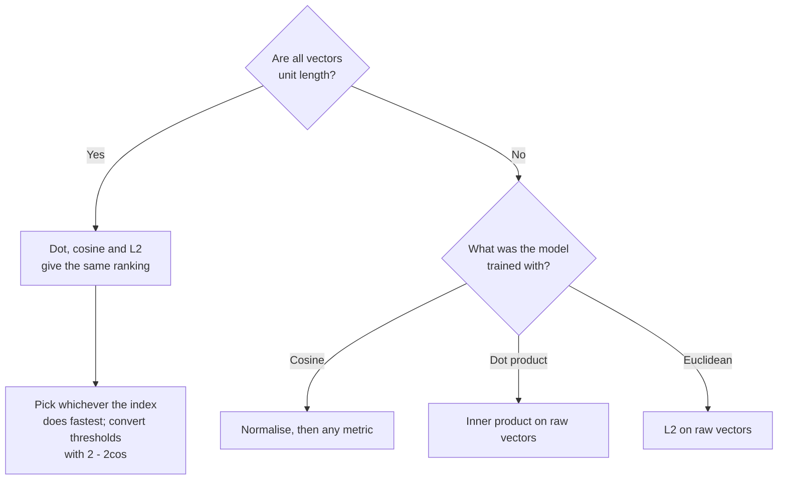

Cosine similarity and the dot product measure how much two vectors **agree**. Euclidean distance measures something that sounds different: how far apart two points are, as the crow flies. It is the measure most people picture when they hear "nearest neighbour", it is the default in FAISS and in the k-means clustering that many vector indexes are built on, and it is the native language of compression schemes such as product quantisation. So even if your model was trained with cosine similarity, Euclidean distance is somewhere in your retrieval stack.

This lesson shows that the three measures are closely related: squared Euclidean distance is made of dot products, and on unit-length vectors it ranks results exactly as cosine similarity does. On vectors of varying length all three disagree, and you will see why. You will also meet two practical details that cause real bugs: FAISS reports **squared** distances, and the fast formula for computing distances can lose almost all its precision.

## Learning objectives

- Compute Euclidean and squared Euclidean distance by hand and in NumPy, and state the properties that make it a metric.
- Derive $\lVert \mathbf{a} - \mathbf{b} \rVert^2 = 2 - 2\cos\theta$ for unit vectors and use it to convert thresholds between the two measures.
- Predict how dot product, cosine and Euclidean rankings differ when vector lengths vary.
- Compute pairwise distances with the expansion formula while avoiding its precision trap.
- Transform a maximum-inner-product search into a nearest-neighbour search under Euclidean distance.

## Prerequisites

- [Dot product](/learn/embedding-mathematics/dot-product): the expansion $\lVert \mathbf{a} - \mathbf{b} \rVert^2 = \lVert \mathbf{a} \rVert^2 + \lVert \mathbf{b} \rVert^2 - 2\,\mathbf{a} \cdot \mathbf{b}$ and maximum inner product search.
- [Cosine similarity](/learn/embedding-mathematics/cosine-similarity): angles, unit vectors, and why cosine distance is not a metric.

## Why this matters

When you call `index.search` on a FAISS `IndexFlatL2`, the numbers that come back are not the Euclidean distances you might expect; they are their squares. A threshold written as "keep results closer than 0.7" means something completely different depending on which you have. Teams discover this when a threshold that "should" keep the top few results keeps almost everything or almost nothing.

The second reason is choice of metric. Vector databases offer Euclidean distance alongside cosine and dot product, and engineers reasonably wonder which is "most accurate". The honest answer is that, on normalised vectors, it makes no difference to the ranking at all, and on unnormalised vectors it makes a large difference that has nothing to do with accuracy and everything to do with how the model was trained. Knowing the relationship lets you make the choice in seconds and convert any threshold from one measure to another.

Third, Euclidean distance underpins much of the machinery in later modules: [IVF](/learn/vector-indexing-algorithms/ivf) partitions vectors with k-means, which minimises squared Euclidean distance, and [Product quantisation](/learn/vector-indexing-algorithms/product-quantisation) approximates vectors by minimising it too. If your vectors are not normalised, those algorithms are optimising a different notion of closeness from the one your model was trained for.

## The intuition

Meridian's London office has two maps of the building. One shows where each team sits. Ask "who sits nearest the support desk?" and you measure straight lines on the floor plan: that is Euclidean distance. It cares about everything that makes two points different, in every direction.

Now imagine every desk is replaced by an arrow drawn from the building's central lift. Cosine similarity asks only whether two arrows point the same way; a desk right next to the lift and one at the far end of the same corridor point identically. Euclidean distance asks how far apart the **tips** of the arrows are, so those two desks are far apart even though their arrows agree.

Now put every desk on a circular walkway around the lift, all at the same distance from the centre. Every arrow has the same length. Two desks whose arrows point nearly the same way are also close along the walkway, and two whose arrows point apart are far apart. When every arrow has the same length, "pointing the same way" and "being close together" become the same question. That is the whole relationship between cosine similarity and Euclidean distance on normalised embeddings.

## How it works

### The definition

The **Euclidean distance** (also called the **L2 distance**) between two vectors is the length of their difference:

$$
d(\mathbf{a}, \mathbf{b}) = \lVert \mathbf{a} - \mathbf{b} \rVert = \sqrt{\sum_{i=1}^{d} (a_i - b_i)^2}
$$

It is Pythagoras's theorem applied in $d$ dimensions. Unlike cosine distance, it is a true **metric**:

1. **Non-negative**, and zero only when $\mathbf{a} = \mathbf{b}$.
2. **Symmetric**: $d(\mathbf{a}, \mathbf{b}) = d(\mathbf{b}, \mathbf{a})$.
3. **Triangle inequality**: $d(\mathbf{a}, \mathbf{c}) \le d(\mathbf{a}, \mathbf{b}) + d(\mathbf{b}, \mathbf{c})$.

The **squared Euclidean distance** $\lVert \mathbf{a} - \mathbf{b} \rVert^2$ drops the square root. Because the square root is increasing, squared distance produces exactly the same ranking, and it is cheaper, so search libraries compute it and many report it. It is not itself a metric (it breaks the triangle inequality), but for ranking that does not matter.

### Distance is made of dot products

Expanding the squared distance, as [Dot product](/learn/embedding-mathematics/dot-product) did, gives

$$
\lVert \mathbf{a} - \mathbf{b} \rVert^2 = \lVert \mathbf{a} \rVert^2 + \lVert \mathbf{b} \rVert^2 - 2\,\mathbf{a} \cdot \mathbf{b}
$$

For one query $\mathbf{q}$ ranked against chunks $\mathbf{d}_j$, the term $\lVert \mathbf{q} \rVert^2$ is the same for every chunk and cannot change the order. So ranking by Euclidean distance is the same as ranking by

$$
\lVert \mathbf{d}_j \rVert^2 - 2\,\mathbf{q} \cdot \mathbf{d}_j \quad \text{(smaller is better)}
$$

Read that carefully. Euclidean distance rewards a large dot product, like the dot product does, but **penalises** the chunk's squared length. The dot product rewards length; Euclidean distance punishes it; cosine ignores it. Three measures, three attitudes to length.

### On unit vectors, three measures become one

If every vector has length 1, then $\lVert \mathbf{a} \rVert^2 = \lVert \mathbf{b} \rVert^2 = 1$ and $\mathbf{a} \cdot \mathbf{b} = \cos\theta$, so

$$
\lVert \mathbf{a} - \mathbf{b} \rVert^2 = 2 - 2\cos\theta
$$

Squared distance is a decreasing linear function of cosine similarity. Larger cosine means smaller distance, always, so the dot product, cosine similarity and Euclidean distance all return **identical rankings**. On unit vectors, the Euclidean distance is the length of the **chord** joining two points on the unit sphere, which runs from 0 (same point) to 2 (opposite points).

The formula converts thresholds in both directions:

| Cosine | Squared L2 ($2 - 2\cos$) | L2 |
| --- | --- | --- |
| 1.00 | 0.00 | 0.000 |
| 0.90 | 0.20 | 0.447 |
| 0.75 | 0.50 | 0.707 |
| 0.50 | 1.00 | 1.000 |
| 0.00 | 2.00 | 1.414 |



### On unnormalised vectors, they disagree

When lengths vary, the three measures prefer different chunks:

- **Dot product** prefers long chunks that point roughly the right way.
- **Cosine** looks only at direction.
- **Euclidean** prefers chunks whose tip lands near the query's tip. For a chunk at angle $\theta$ to a query of length $\lVert \mathbf{q} \rVert$, the distance is smallest when the chunk's length is $\lVert \mathbf{q} \rVert \cos\theta$, the length of the query's shadow along the chunk's direction. Chunks that are much longer than that are pushed down the ranking.

The In code section shows all three orders differing on real, unnormalised embeddings. Which is right? The one the model was trained with. A small number of models are trained with Euclidean distance (some older triplet-loss models were); most current text models are trained with cosine, so normalising and then using any of the three is correct.

### Computing many distances quickly

To compute the distances between every row of $A$ ($M \times d$) and every row of $B$ ($N \times d$), there are two approaches:

1. **Direct.** Form each difference and sum its squares. Accurate, but it creates an $M \times N \times d$ amount of work with no matrix product to accelerate it.
2. **Expansion.** Compute the squared norms of all rows once, compute $AB^{\top}$ with one fast matrix product, and combine: $\lVert \mathbf{a}_i \rVert^2 + \lVert \mathbf{b}_j \rVert^2 - 2\,(AB^{\top})_{ij}$. This is how scikit-learn's `euclidean_distances` and most search libraries work, because it turns the job into a BLAS matrix multiplication.

The expansion has a precision trap. When two vectors are nearly identical, it subtracts two large, nearly equal numbers to get a tiny one, and rounding errors in the large numbers swamp the answer. This is called **catastrophic cancellation**. The result can even be slightly negative, and the square root of a negative number is `nan`. Two defences are standard: clip the squared distance at zero before taking the square root, and, where small distances matter (deduplication, for instance), recompute the shortlisted pairs directly.

### Turning inner-product search into nearest-neighbour search

Some index structures support only Euclidean distance. If your model needs the dot product, you can still use them, through a transformation that turns [maximum inner product search](/learn/embedding-mathematics/dot-product) into ordinary nearest-neighbour search:

1. Find $M$, the largest chunk length in the collection.
2. Give every chunk one extra coordinate, $\sqrt{M^2 - \lVert \mathbf{d} \rVert^2}$. Every augmented chunk now has length exactly $M$.
3. Give the query an extra coordinate of 0.
4. Search the augmented vectors with Euclidean distance.

Because all augmented chunks have the same length, the length penalty is the same for all of them and only the dot product is left to rank them. This idea appears in work on fast inner-product search, such as Bachrach and colleagues (2014). Its weakness is that new chunks longer than $M$ break it, so $M$ must be chosen with headroom.

## The mathematics

### From Euclidean distance to cosine

**Intuition.** Distance squared is "length of a, plus length of b, minus twice their agreement". Fix the lengths at 1 and only the agreement is left.

$$
\lVert \mathbf{a} - \mathbf{b} \rVert^2 = \lVert \mathbf{a} \rVert^2 + \lVert \mathbf{b} \rVert^2 - 2\,\mathbf{a} \cdot \mathbf{b} \;\;\xrightarrow{\;\lVert \mathbf{a} \rVert = \lVert \mathbf{b} \rVert = 1\;}\;\; 2 - 2\cos\theta
$$

$\mathbf{a}, \mathbf{b}$ are vectors in $\mathbb{R}^d$, $\lVert \cdot \rVert$ is the Euclidean length and $\theta$ the angle between them. Rearranged, $\cos\theta = 1 - \tfrac{1}{2}\lVert \mathbf{a} - \mathbf{b} \rVert^2$.

**By hand.** $\mathbf{a} = (1, 2, 2)$, $\mathbf{b} = (2, 0, 1)$.

- Direct: $\mathbf{a} - \mathbf{b} = (-1, 2, 1)$; squared distance $= 1 + 4 + 1 = 6$; distance $= \sqrt{6} \approx 2.4495$.
- Expansion: $\lVert \mathbf{a} \rVert^2 = 9$, $\lVert \mathbf{b} \rVert^2 = 5$, $\mathbf{a} \cdot \mathbf{b} = 2 + 0 + 2 = 4$; $9 + 5 - 8 = 6$. The same.
- Normalise: $\lVert \mathbf{a} \rVert = 3$, $\lVert \mathbf{b} \rVert = \sqrt{5} \approx 2.2361$, so $\cos\theta = 4 / 6.7082 \approx 0.5963$ and $2 - 2\cos\theta \approx 0.8074$, the squared distance between the unit vectors.

### The MIPS transformation

**Intuition.** Pad every chunk out to the same length with an extra coordinate, so length can no longer influence the distance.

For chunks $\mathbf{d}_j$ with $\lVert \mathbf{d}_j \rVert \le M$, define $\tilde{\mathbf{d}}_j = \big(\mathbf{d}_j,\ \sqrt{M^2 - \lVert \mathbf{d}_j \rVert^2}\big)$ and $\tilde{\mathbf{q}} = (\mathbf{q}, 0)$. Then

$$
\lVert \tilde{\mathbf{q}} - \tilde{\mathbf{d}}_j \rVert^2 = \lVert \mathbf{q} \rVert^2 + M^2 - 2\,\mathbf{q} \cdot \mathbf{d}_j
$$

because $\lVert \tilde{\mathbf{d}}_j \rVert^2 = M^2$ and the extra coordinate contributes nothing to the dot product with $\tilde{\mathbf{q}}$. The first two terms are the same for every chunk, so the smallest distance belongs to the largest dot product.

**By hand.** Chunks $(1, 0)$, $(3, 3)$, $(0.5, 2)$; query $(1, 1)$. Inner products: 1, 6, 2.5, so chunk 1 (counting from 0) wins. Lengths squared: 1, 18, 4.25, so $M^2 = 18$. Augmented squared distances: $2 + 18 - 2 \times 1 = 18$, $2 + 18 - 12 = 8$ and $2 + 18 - 5 = 15$; distances $4.2426$, $2.8284$, $3.8730$. Chunk 1 is nearest.

**In NumPy:**

```python
import numpy as np

a = np.array([1.0, 2.0, 2.0])
b = np.array([2.0, 0.0, 1.0])
print("L2 by definition:", round(float(np.sqrt(((a - b) ** 2).sum())), 4))
print("L2 via expansion:", round(float(np.sqrt(a @ a + b @ b - 2 * a @ b)), 4))

# Unit vectors: squared distance = 2 - 2 cos
ua, ub = a / np.linalg.norm(a), b / np.linalg.norm(b)
print("unit: |ua-ub|^2 =", round(float(((ua - ub) ** 2).sum()), 4), " 2-2cos =", round(float(2 - 2 * ua @ ub), 4))

# MIPS -> nearest neighbour: append sqrt(M^2 - |x|^2) to each chunk, 0 to the query
D = np.array([[1.0, 0.0], [3.0, 3.0], [0.5, 2.0]])
q = np.array([1.0, 1.0])
M = np.linalg.norm(D, axis=1).max()
D_aug = np.hstack([D, np.sqrt(np.maximum(M**2 - (D**2).sum(axis=1), 0.0))[:, None]])
q_aug = np.append(q, 0.0)
print("inner products:      ", (D @ q).tolist(), "-> best", int(np.argmax(D @ q)))
l2 = np.linalg.norm(D_aug - q_aug, axis=1)
print("augmented distances: ", [round(float(x), 4) for x in l2], "-> nearest", int(np.argmin(l2)))

# Cancellation: the expansion loses precision for nearly identical vectors
rng = np.random.default_rng(0)
x = rng.standard_normal(384).astype(np.float32) * 10
y = x + np.float32(1e-3)                      # differs by 0.001 in every coordinate
direct = float(((x - y) ** 2).sum())
expanded = float(x @ x + y @ y - 2 * (x @ y))
print(f"squared distance: direct {direct:.6f}  expansion {expanded:.6f}")
```

```output
L2 by definition: 2.4495
L2 via expansion: 2.4495
unit: |ua-ub|^2 = 0.8074  2-2cos = 0.8074
inner products:       [1.0, 6.0, 2.5] -> best 1
augmented distances:  [4.2426, 2.8284, 3.873] -> nearest 1
squared distance: direct 0.000384  expansion 0.015625
```

The last line is the cancellation trap in action. The true squared distance is $384 \times 0.001^2 = 0.000384$. The expansion, in `float32`, returns 0.015625, about forty times too large, because each of $\lVert \mathbf{x} \rVert^2$ and $\lVert \mathbf{y} \rVert^2$ is around 38,000 and `float32` holds only about seven significant digits. Note also the `np.maximum(..., 0.0)` in the augmentation: for the longest chunk, $M^2 - \lVert \mathbf{d} \rVert^2$ should be exactly zero, but rounding can make it a tiny negative number.

## In code

**The problem.** Rank the same Meridian chunks against one query by dot product, cosine and Euclidean distance, first on raw (unnormalised) embeddings and then on unit vectors; then confirm the $2 - 2\cos$ identity and see what FAISS actually returns.

**Dependencies.** NumPy, Sentence Transformers and FAISS (CPU build). No API key.

```bash
pip install numpy sentence-transformers faiss-cpu
```

As in [Dot product](/learn/embedding-mathematics/dot-product), we build a second model from the first two modules of `all-MiniLM-L6-v2` to get raw mean-pooled vectors whose lengths vary.

```python
import numpy as np
import faiss
from sentence_transformers import SentenceTransformer

chunks = [
    "Annual leave is 25 days per year.",
    "Up to 5 unused leave days carry over and must be used by 31 March.",
    "Staff may work remotely up to 3 days a week.",
    "Expenses must be submitted within 30 days; anything over £75 needs a receipt.",
    "Passwords must be rotated every 90 days.",
    "VPN is required on public Wi-Fi.",
]
query = "How many days of holiday do I get?"

full = SentenceTransformer("sentence-transformers/all-MiniLM-L6-v2")
raw = SentenceTransformer(modules=[full[0], full[1]])   # no Normalize layer

def rankings(D, q):
    dot = D @ q
    cos = dot / (np.linalg.norm(D, axis=1) * np.linalg.norm(q))
    l2 = np.linalg.norm(D - q, axis=1)
    return {"dot (high first)": np.argsort(-dot),
            "cosine (high first)": np.argsort(-cos),
            "L2 (low first)": np.argsort(l2)}

for name, model in [("raw", raw), ("unit", full)]:
    D, q = model.encode(chunks), model.encode(query)
    print(f"{name} vectors: chunk norms {[round(float(n), 2) for n in np.linalg.norm(D, axis=1)]}, query norm {np.linalg.norm(q):.2f}")
    for metric, order in rankings(D, q).items():
        print(f"  {metric:<20} {order.tolist()}")

# On unit vectors: squared L2 = 2 - 2 cos, and FAISS agrees
D, q = full.encode(chunks), full.encode(query)
cos = D @ q
sq_l2 = ((D - q) ** 2).sum(axis=1)
print("max |sq_l2 - (2 - 2cos)|:", float(np.abs(sq_l2 - (2 - 2 * cos)).max()))

index = faiss.IndexFlatL2(D.shape[1])
index.add(D)
dist, ids = index.search(q[None, :], 3)
print("FAISS ids:      ", ids[0].tolist())
print("FAISS distances:", [round(float(x), 4) for x in dist[0]])
print("2 - 2cos:       ", [round(float(x), 4) for x in 2 - 2 * cos[ids[0]]])
print("true L2:        ", [round(float(x), 4) for x in np.sqrt(dist[0])])
```

```output
raw vectors: chunk norms [6.08, 4.58, 5.03, 4.37, 5.71, 6.4], query norm 5.66
  dot (high first)     [0, 1, 2, 4, 3, 5]
  cosine (high first)  [1, 0, 2, 3, 4, 5]
  L2 (low first)       [1, 3, 0, 2, 4, 5]
unit vectors: chunk norms [1.0, 1.0, 1.0, 1.0, 1.0, 1.0], query norm 1.00
  dot (high first)     [1, 0, 2, 3, 4, 5]
  cosine (high first)  [1, 0, 2, 3, 4, 5]
  L2 (low first)       [1, 0, 2, 3, 4, 5]
max |sq_l2 - (2 - 2cos)|: 2.384185791015625e-07
FAISS ids:       [1, 0, 2]
FAISS distances: [1.0829, 1.1385, 1.3751]
2 - 2cos:        [1.0829, 1.1385, 1.3751]
true L2:         [1.0406, 1.067, 1.1727]
```

**The important lines.**

- `np.linalg.norm(D - q, axis=1)` broadcasts the query against every row and takes the length of each difference: the direct formula, fine for a handful of chunks.
- `np.argsort(-dot)` and `np.argsort(l2)` sort in opposite directions, because similarity is "higher is better" and distance is "lower is better". Mixing these up is a classic bug.
- `faiss.IndexFlatL2(D.shape[1])` creates an exact (brute-force) index that compares by squared Euclidean distance. `index.add` copies the vectors in; `index.search` takes a 2-D array of queries, here one row.

**What the output means.** On raw vectors the three measures give three different rankings. The dot product puts chunk 0 (norm 6.08, the longest leave chunk) first. Cosine puts chunk 1 first. Euclidean distance also puts chunk 1 first, but then promotes chunk 3, the expenses chunk, from fourth to second: at 4.37 it is the shortest vector, and Euclidean distance penalises length. On unit vectors all three orders are identical, exactly as the theory says.

The FAISS line confirms two things. Its "distances" are squared ($1.0829 = 2 - 2 \times 0.4586$), and they equal $2 - 2\cos$ to the printed precision. The real Euclidean distances are their square roots.

**Common errors.**

- Treating FAISS `IndexFlatL2` output as plain distances and comparing it with a threshold derived for unsquared distances.
- Passing a 1-D query to `index.search`: FAISS expects shape (number of queries, $d$). Use `q[None, :]` or `q.reshape(1, -1)`.
- Passing `float64` arrays to FAISS: it works with `float32`. Sentence Transformers returns `float32` already, but arrays built with NumPy defaults are `float64`; convert with `.astype("float32")`.

**Extending it.** Add `faiss.IndexFlatIP` on the same unit vectors and confirm it returns the same ids with scores equal to the cosines.

## A real-world example

Meridian's Platform team prototyped a "no relevant answer" check for AskMeridian. The rule, agreed with the HR team after reviewing labelled examples, was: if the best chunk's cosine similarity with the question is below 0.75, the assistant should say it cannot find the answer rather than guess.

The prototype used a FAISS `IndexFlatL2` over normalised vectors. An engineer, Tom, converted the threshold to a distance by remembering that distance on unit vectors is $\sqrt{2 - 2\cos}$, which for 0.75 gives 0.707, and wrote `if dist[0][0] > 0.707: refuse()`. In testing, the assistant answered several questions it should have declined, citing chunks that were only loosely related.

The cause was that FAISS returns squared distances. Tom's 0.707, applied to a squared distance, corresponds to a cosine of $1 - 0.707/2 \approx 0.65$, not 0.75. Every match with cosine between about 0.65 and 0.75, exactly the band the HR team had judged too weak, was being accepted. Worse, a second code path that displayed "match quality" in the admin console took a square root before comparing, so the two parts of the system disagreed about the same result.

The fix was not just a square root. The team stopped passing raw index scores around: the retrieval layer now converts every score to cosine similarity immediately after search (for unit vectors, $1 - \tfrac{1}{2}\,\text{squared distance}$), and every threshold in the codebase is expressed in that one unit, with the metric and the model recorded alongside it. A unit test feeds a known pair of vectors through the index and asserts the converted score.

## Common mistakes

- **Assuming FAISS L2 distances are unsquared.** Thresholds and score displays are off by a square root, usually unnoticed for weeks.
- **Sorting distances in the wrong direction.** Treating a distance as a similarity returns the *worst* matches first. Every function that returns scores should say which direction is better.
- **Using Euclidean distance on unnormalised vectors from a cosine-trained model.** The ranking is biased towards shorter vectors, a preference the model never learned.
- **Running k-means for IVF partitioning on unnormalised vectors** when search uses cosine. The partitions are built for a different notion of closeness, which can lower recall.
- **Trusting the expansion formula for tiny distances.** Near-duplicates can get distances that are wildly wrong or `nan`.
- **Mixing similarity and distance in score fusion.** Adding a cosine (higher is better) to a distance (lower is better) produces nonsense; convert first.

## Best practices

- Normalise vectors from cosine-trained models, after which the choice of metric affects only speed.
- Convert every raw index score to one canonical unit at the boundary of your retrieval layer, and express thresholds only in that unit.
- Use the table or the formula $\lVert \mathbf{a} - \mathbf{b} \rVert^2 = 2 - 2\cos\theta$ to translate thresholds; never eyeball them.
- Clip squared distances at zero before taking square roots, and recompute shortlisted near-duplicate pairs directly.
- When an index supports only L2 but your model needs inner product, use the augmentation transformation and choose $M$ with headroom for future chunks.

## Performance considerations

Squared Euclidean distance via the expansion costs one dot product per pair plus two additions, given precomputed squared norms. Storing one extra float per chunk (its squared norm, 4 bytes) beside a 384-dimensional vector (1,536 bytes) adds about 0.3% to memory and makes L2 search as fast as inner-product search. On unit vectors even that is unnecessary, since every squared norm is 1.

The direct formula is slower for many pairs because it cannot use a matrix multiplication: for 1,000 queries against 100,000 chunks at $d = 384$, it performs about $3.8 \times 10^{10}$ subtractions and as many multiply-adds through generic array code, while the expansion does the same multiply-adds inside one highly optimised BLAS call. Use the expansion for bulk work and the direct formula for verifying a short list.

Skipping the square root saves little time per pair, but at hundreds of millions of comparisons per second it is worth it, which is why libraries return squared values. Convert only the $k$ results you return.

## Summary

- Euclidean distance is the length of the difference between two vectors; it is a true metric, and its square ranks identically and is cheaper.
- $\lVert \mathbf{a} - \mathbf{b} \rVert^2 = \lVert \mathbf{a} \rVert^2 + \lVert \mathbf{b} \rVert^2 - 2\,\mathbf{a} \cdot \mathbf{b}$: distance rewards agreement and penalises length, where the dot product rewards length and cosine ignores it.
- On unit vectors, squared distance equals $2 - 2\cos\theta$, so dot product, cosine and Euclidean distance give the same ranking, and thresholds convert exactly.
- FAISS `IndexFlatL2` returns squared distances; the fast expansion formula suffers catastrophic cancellation for near-identical vectors.
- Maximum inner product search can be turned into nearest-neighbour search by padding every chunk to the same length.

## Exercises

**1. Converting thresholds.** A team's rule is "accept a match if cosine is at least 0.8". Express it as a squared Euclidean distance threshold and as a Euclidean distance threshold, for unit vectors.

<details><summary>Show solution</summary>

Squared distance $= 2 - 2 \times 0.8 = 0.4$, so accept if squared distance is at most 0.4. Distance $= \sqrt{0.4} \approx 0.632$, so accept if distance is at most 0.632. The direction flips: "cosine at least" becomes "distance at most".

</details>

**2. Predicting rankings.** A query has length 2. Chunk A has length 1 and cosine 0.9 with the query; chunk B has length 4 and cosine 0.8. Rank them by dot product, cosine and Euclidean distance.

<details><summary>Show solution</summary>

Dot product: A $= 2 \times 1 \times 0.9 = 1.8$; B $= 2 \times 4 \times 0.8 = 6.4$. B first.

Cosine: A (0.9) before B (0.8).

Squared Euclidean: A $= 4 + 1 - 3.6 = 1.4$; B $= 4 + 16 - 12.8 = 7.2$. A is closer, so A first.

Only the dot product prefers B, because B is long.

</details>

**3. Code.** Implement `pairwise_l2(A, B)` with the expansion formula, guarded against negative squared values, and check it against `scipy.spatial.distance.cdist` on random `float32` data.

<details><summary>Show solution</summary>

```python
import numpy as np
from scipy.spatial.distance import cdist

def pairwise_l2(A, B):
    sq = (A**2).sum(1)[:, None] + (B**2).sum(1)[None, :] - 2 * A @ B.T
    return np.sqrt(np.maximum(sq, 0.0))      # clip tiny negatives from rounding

rng = np.random.default_rng(1)
A = rng.standard_normal((500, 384)).astype(np.float32)
B = rng.standard_normal((800, 384)).astype(np.float32)
ours, ref = pairwise_l2(A, B), cdist(A, B)
print("shape:", ours.shape, " max abs error:", float(np.abs(ours - ref).max()))
print("same nearest neighbour for every row:", bool((ours.argmin(1) == ref.argmin(1)).all()))
```

```output
shape: (500, 800)  max abs error: 3.7465763362831694e-06
same nearest neighbour for every row: True
```

For random vectors the distances are large (around 27), so cancellation is mild. The error grows when pairs are nearly identical, as The mathematics section showed.

</details>

**4. Design.** A legacy search service supports only Euclidean distance. Meridian wants to serve a model whose card says "use dot product". New documents arrive daily. Describe how you would use the augmentation transformation, and what happens if a new chunk is longer than $M$.

<details><summary>Show solution</summary>

Compute the lengths of all current chunk vectors, set $M$ to the maximum plus a safety margin (for example 20% more, chosen after looking at the length distribution), append $\sqrt{M^2 - \lVert \mathbf{d} \rVert^2}$ to each chunk, and append 0 to each query. Store $M$ with the index configuration.

A new chunk longer than $M$ would need the square root of a negative number. Clipping its extra coordinate to zero leaves its augmented length above $M$, so its distance is no longer exactly a function of the dot product and its ranking is slightly wrong (it is penalised too much). Monitor chunk lengths at ingestion; if any exceeds $M$, choose a new $M$ and re-augment the whole collection, which is a full re-index. The margin makes this rare.

</details>

## Check your understanding

```quiz
[
  {"q": "For two unit vectors with cosine similarity 0.5, what is the squared Euclidean distance between them?", "options": ["0.5", "1.0", "1.5", "0.25"], "answer": 1, "why": "Squared distance equals 2 - 2cos = 2 - 1 = 1."},
  {"q": "A FAISS IndexFlatL2 search returns a distance of 0.36 for the best match on unit vectors. What is the cosine similarity?", "options": ["0.64", "0.82", "0.40", "0.18"], "answer": 1, "why": "FAISS returns squared distances, so cos = 1 - 0.36 / 2 = 0.82."},
  {"q": "On unnormalised vectors, which measure penalises a chunk for being long?", "options": ["Dot product", "Cosine similarity", "Euclidean distance", "None of them"], "answer": 2, "why": "Ranking by squared distance is ranking by |d|^2 - 2 q.d, which grows with the chunk's length. The dot product rewards length and cosine ignores it."},
  {"q": "Why does the expansion formula for squared distance give inaccurate results for near-identical vectors?", "options": ["It uses the wrong sign for the dot product", "It subtracts two large nearly equal numbers, so rounding error dominates", "It ignores dimensions where both vectors are zero", "It only works for unit vectors"], "answer": 1, "why": "Catastrophic cancellation: the squared norms are large and the true difference tiny, and float32 keeps only about seven significant digits."},
  {"q": "What does appending sqrt(M^2 - |d|^2) to every chunk vector (and 0 to the query) achieve?", "options": ["It normalises every vector to length 1", "It makes Euclidean nearest-neighbour search return the maximum-inner-product chunk", "It converts cosine similarity into Euclidean distance", "It reduces the dimensionality by one"], "answer": 1, "why": "Every augmented chunk has length M, so the length term is constant and the distance depends only on the dot product with the query."}
]
```

## Further reading

- [FAISS wiki: MetricType and distances](https://github.com/facebookresearch/faiss/wiki/MetricType-and-distances), which documents that L2 indexes return squared distances and how to search by inner product or cosine.
- [scikit-learn documentation: `euclidean_distances`](https://scikit-learn.org/stable/modules/generated/sklearn.metrics.pairwise.euclidean_distances.html), including its note on precision.
- Bachrach, Y. et al. (2014). *Speeding Up the Xbox Recommender System Using a Euclidean Transformation for Inner-Product Spaces*. RecSys 2014.
- Higham, N. J. (2002). *Accuracy and Stability of Numerical Algorithms*, 2nd edition. SIAM. The standard reference on rounding error and cancellation.
- Strang, G. *Introduction to Linear Algebra*, chapter 1 (lengths, dot products and the law of cosines).
