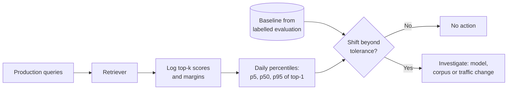

A single similarity score tells you almost nothing. Is 0.48 good? For one model it is a strong match; for another it is the score of any two English sentences; for the same model on a different query it may be the best of a bad lot. Scores only acquire meaning when you know the **distribution** they come from: what scores relevant pairs typically get, what irrelevant pairs get, how much the two overlap, and how the best score for a query behaves as the corpus grows.

This lesson teaches you to measure and read those distributions. You will compute them for Meridian's corpus with a real model, quantify how well scores separate relevant from irrelevant chunks, and test the idea every RAG team has sooner or later: "if the best score is below some threshold, say you don't know". The result is instructive, and it sets up the dedicated treatments of [Score calibration](/learn/advanced-retrieval-optimisation/score-calibration) and [Retrieval thresholding](/learn/advanced-retrieval-optimisation/retrieval-thresholding) in Phase 8.

## Learning objectives

- Collect and summarise the score distributions of relevant and irrelevant query-chunk pairs with percentiles.
- Compute and interpret the AUC as the probability that a relevant pair outscores an irrelevant one.
- Explain why the best score for a query rises with corpus size, and estimate the effect.
- Evaluate a global score threshold and a per-query z-score as tests for "no good answer", using labelled data.
- Design monitoring that detects shifts in score distributions after model or corpus changes.

## Prerequisites

- [Cosine similarity](/learn/embedding-mathematics/cosine-similarity): what a high cosine does and does not mean.
- [Vector dimensions](/learn/embedding-mathematics/vector-dimensions): the random-direction baseline and concentration.
- [Vector normalisation](/learn/embedding-mathematics/vector-normalisation): how centring shifts scores.
- Basic statistics: mean, standard deviation, percentiles.

## Why this matters

RAG systems use raw similarity scores in more places than ranking:

- **Refusal.** "If the best chunk scores below 0.5, answer that the information is not available."
- **Context size.** "Include every chunk scoring above 0.4, up to ten."
- **Fusion.** Combining dense scores with keyword scores in [weighted score fusion](/learn/hybrid-search/weighted-score-fusion).
- **Dashboards and alerts.** "Average top-1 score fell this week."

Every one of these treats a score as if it had a stable, absolute meaning. Each breaks in a characteristic way. A threshold that works for one query fails for another because queries differ in how well they match anything. A threshold tuned on a few hundred chunks fails on a million, because the best irrelevant score climbs with corpus size. A threshold tuned for one model fails after an upgrade, because the new model's scores occupy a different range. And a question that is *almost* in scope, such as "what is the parental leave policy?" against a handbook that only covers annual leave, scores like an answerable one, because cosine measures topic.

You cannot fix these without looking at distributions. Ranking only needs scores to be in the right order; thresholds need you to know what the numbers mean.

## The intuition

Imagine two classes sitting the same exam. The marks of the class that studied cluster around 70; the marks of the class that did not cluster around 40. If you had to guess whether a student studied from their mark alone, a cut-off at 55 would be right most of the time. But the two clouds of marks overlap: some who studied scored 50, some who did not scored 60. Where the clouds overlap, no cut-off can be right for everyone. The size of the overlap is the honest measure of how informative a mark is.

Similarity scores work the same way. Relevant query-chunk pairs form one cloud, irrelevant pairs another. A model is good for ranking if the relevant cloud sits well above the irrelevant one *for each query*. A score is usable as an absolute signal only if the clouds stay in the same place *across* queries, and that is a much stronger requirement.

There is a second, subtler effect. Suppose you look only at the single highest mark among the students who did not study. With five such students, it might be 55. With five thousand, someone will have scored 75 by luck. The best irrelevant score behaves like that: the more chunks you have, the higher the best irrelevant one scores. A threshold that sits comfortably above the irrelevant cloud for a small corpus can be beaten by chance in a large one.

## How it works

### Two distributions, collected from labels

To see the distributions you need **labelled pairs**: queries for which you know the relevant chunk or chunks. Then:

1. Embed every chunk and every query with the production model and normalisation.
2. Compute the full query-by-chunk score matrix.
3. Split the scores into **positive** (relevant pairs) and **negative** (all other pairs).
4. Summarise each with percentiles (5th, 25th, median, 75th, 95th) rather than just a mean, because the tails are what thresholds act on.
5. Measure separation with the **AUC**, defined below, and count how many negatives score above the weakest positives.

Labelled sets do not need to be large to be useful; dozens of queries reveal the shape. They must, however, look like real traffic, including the awkward queries: short ones, misspelt ones, and questions that the corpus cannot answer.

### Separation: the AUC

The **AUC** (area under the ROC curve) has a simple meaning: pick one relevant pair and one irrelevant pair at random; the AUC is the probability that the relevant one scores higher. An AUC of 0.5 is chance; 1.0 is perfect separation. It depends only on the order of scores, not their values, so it is unaffected by any monotone rescaling, and it describes the pooled distributions across all queries.

A high pooled AUC is good news for ranking but does not guarantee that a global threshold works, as the In code section shows. AUC counts comparisons between *any* relevant and *any* irrelevant pair, including pairs from different queries, and a threshold faces exactly those cross-query comparisons. Ranking, by contrast, only ever compares chunks for the same query.

### Per-query variation

Queries differ in how well they can match anything. A query that copies the corpus's wording ("password rotation every 90 days") may score 0.8 against its chunk; a paraphrased, colloquial query ("how much holiday do I get?") may score 0.36 against the chunk that answers it perfectly. Both may rank the right chunk first. Any fixed threshold treats them differently for reasons that have nothing to do with whether an answer exists.

Two per-query quantities are often more informative than the raw top score:

- **The margin**: top-1 score minus top-2 score. A large margin means one chunk stands out; a tiny margin means the retriever was nearly indifferent.
- **The z-score** of the top result within the query's own score list: how many standard deviations the best chunk sits above the query's average chunk. It adjusts for queries that score everything high or everything low.

Neither is a reliable "answerable" detector on its own, as you will see, but both are useful features for the calibration methods of Phase 8.

### The best score rises with corpus size

For a query with no relevant chunk, the top-1 score is the **maximum** of many irrelevant scores. Maxima grow with the number of draws. If irrelevant scores for a query were roughly normal with mean $m$ and standard deviation $\sigma$, the largest of $N$ would sit roughly $\sigma\sqrt{2\ln N}$ above the mean. Going from 16 chunks to a million raises that from about $2.4\sigma$ to about $5.3\sigma$. With $\sigma = 0.1$, the best irrelevant score climbs by nearly 0.3, enough to cross most thresholds a team would choose on a small test corpus.

Real score distributions are not exactly normal and real corpora contain near-duplicates, so treat this as a qualitative law: **thresholds must be tuned on a corpus of production size**, and re-checked as the corpus grows.

### Distributions shift

Score distributions move whenever anything upstream changes:

- **A new embedding model** has its own scale. Some models place unrelated texts around 0.1, others around 0.5 or higher. A threshold does not survive a model change.
- **A normalisation change**, such as the mean-centring in [Vector normalisation](/learn/embedding-mathematics/vector-normalisation), shifts every score.
- **Corpus growth** raises top-1 scores, as above.
- **Changes in user behaviour**, such as a new team starting to use the assistant, shift the query side.

The practical consequence is that score distributions should be **monitored**, not just measured once.



## The mathematics

### The AUC as a probability

**Intuition.** Count, over every (relevant, irrelevant) pair of scores, how often the relevant one wins.

$$
\text{AUC} = \frac{1}{|P|\,|N|} \sum_{p \in P} \sum_{n \in N} \Big( \mathbb{1}[s_p > s_n] + \tfrac{1}{2}\,\mathbb{1}[s_p = s_n] \Big)
$$

$P$ is the set of relevant pairs and $N$ the set of irrelevant ones, $s_p$ and $s_n$ their scores, $|P|$ and $|N|$ their counts, and $\mathbb{1}[\cdot]$ is 1 when the condition holds and 0 otherwise. Ties count half. This is the Mann–Whitney U statistic divided by $|P|\,|N|$.

**By hand.** Relevant scores $\{0.6, 0.4\}$, irrelevant $\{0.5, 0.2, 0.1\}$. 0.6 beats all three; 0.4 beats 0.2 and 0.1 but not 0.5. Wins $= 5$ of $2 \times 3 = 6$, so AUC $= 0.833$.

### The per-query z-score

**Intuition.** Measure the top score in units of the query's own spread.

$$
z = \frac{s_{(1)} - \bar{s}}{\sigma_s}
$$

$s_{(1)}$ is the query's best score, $\bar{s}$ the mean of its scores over all chunks and $\sigma_s$ their standard deviation.

**By hand.** Scores $(0.6, 0.3, 0.2, 0.1)$: mean $= 0.3$; deviations $0.3, 0, -0.1, -0.2$; variance $= (0.09 + 0 + 0.01 + 0.04)/4 = 0.035$; $\sigma_s \approx 0.1871$; $z = 0.3 / 0.1871 \approx 1.604$.

### How the maximum grows

**Intuition.** Each extra irrelevant chunk is another chance of a lucky high score.

For $N$ independent standard normal values, the expected maximum is approximately

$$
\mathbb{E}\big[\max_{i \le N} X_i\big] \approx \sqrt{2 \ln N}
$$

so for scores with mean $m$ and standard deviation $\sigma$, the best irrelevant score is roughly $m + \sigma\sqrt{2\ln N}$. The approximation is asymptotic and overestimates slightly for small $N$.

**By hand.** $\sqrt{2 \ln 16} = \sqrt{5.545} \approx 2.35$; $\sqrt{2 \ln 10^6} = \sqrt{27.63} \approx 5.26$.

**In NumPy:**

```python
import numpy as np
from sklearn.metrics import roc_auc_score

pos, neg = np.array([0.6, 0.4]), np.array([0.5, 0.2, 0.1])
wins = sum(p > n for p in pos for n in neg)
print("pairwise wins:", wins, "of", len(pos) * len(neg), "=", round(wins / (len(pos) * len(neg)), 3))
labels = np.r_[np.ones(len(pos)), np.zeros(len(neg))]
print("roc_auc_score:", round(roc_auc_score(labels, np.r_[pos, neg]), 3))

s = np.array([0.6, 0.3, 0.2, 0.1])
print("z of top score:", round(float((s[0] - s.mean()) / s.std()), 3))

for n in [16, 10_000, 1_000_000]:
    print(f"expected max of {n:>9,} standard normals ~ sqrt(2 ln N) = {np.sqrt(2 * np.log(n)):.2f}")
```

```output
pairwise wins: 5 of 6 = 0.833
roc_auc_score: 0.833
z of top score: 1.604
expected max of        16 standard normals ~ sqrt(2 ln N) = 2.35
expected max of    10,000 standard normals ~ sqrt(2 ln N) = 4.29
expected max of 1,000,000 standard normals ~ sqrt(2 ln N) = 5.26
```

## In code

**The problem.** Using Meridian's 16 chunks, 16 labelled answerable questions (one per chunk, mostly paraphrased) and 6 questions the corpus cannot answer, measure the score distributions of `all-MiniLM-L6-v2` and test whether a threshold or a z-score can tell answerable questions from unanswerable ones.

**Dependencies.** NumPy, scikit-learn and Sentence Transformers; `corpus.py` from [Vector normalisation](/learn/embedding-mathematics/vector-normalisation).

```bash
pip install numpy scikit-learn sentence-transformers
```

```python
# corpus2.py
from corpus import CHUNKS

LABELLED = [
    ("How much holiday do I get?", 0),
    ("Can I carry unused leave into next year?", 1),
    ("How many days a week can I work from home?", 2),
    ("How much can I spend on a desk and chair for home?", 3),
    ("Do freelancers get the home equipment allowance?", 4),
    ("What is the deadline for claiming expenses?", 5),
    ("Do I need a receipt for a £90 taxi?", 6),
    ("Which team deals with expense claims?", 7),
    ("How often do I have to change my password?", 8),
    ("Do I need the VPN in a coffee shop?", 9),
    ("When will my laptop be replaced?", 10),
    ("I left my laptop on the train, what should I do?", 11),
    ("What time does the IT helpdesk open?", 12),
    ("Can I download a report as a spreadsheet?", 13),
    ("Does Meridian support SSO with Okta?", 14),
    ("What does E-4021 mean?", 15),
]
UNANSWERABLE = [
    "What is the parental leave policy?",
    "How do I book a meeting room?",
    "What is the dress code?",
    "Who is the CEO of Meridian?",
    "How do I reset my Atlas API key?",
    "What is the capital of France?",
]
```

```python
import numpy as np
from sklearn.metrics import roc_auc_score
from sentence_transformers import SentenceTransformer
from corpus import CHUNKS
from corpus2 import LABELLED, UNANSWERABLE

model = SentenceTransformer("sentence-transformers/all-MiniLM-L6-v2")
D = model.encode(CHUNKS, normalize_embeddings=True)
Q = model.encode([q for q, _ in LABELLED], normalize_embeddings=True)
U = model.encode(UNANSWERABLE, normalize_embeddings=True)
gold = np.array([g for _, g in LABELLED])

S = Q @ D.T                                    # (16 queries, 16 chunks)
is_pos = np.zeros_like(S, dtype=bool)
is_pos[np.arange(len(gold)), gold] = True
pos, neg = S[is_pos], S[~is_pos]

def summary(name, x):
    p = np.percentile(x, [5, 25, 50, 75, 95])
    print(f"{name:<22} n={len(x):<4} " + "  ".join(f"p{k}={v:.2f}" for k, v in zip([5, 25, 50, 75, 95], p)))

print("1. Score distributions")
summary("relevant pairs", pos)
summary("irrelevant pairs", neg)
print(f"   AUC (chance a relevant pair outscores an irrelevant one): {roc_auc_score(is_pos.ravel(), S.ravel()):.3f}")
print(f"   irrelevant pairs scoring above the lowest relevant one: {(neg > pos.min()).sum()} of {len(neg)}")

print("2. Per query: is the right chunk first, and by what margin?")
order = np.argsort(-S, axis=1)
top1, top2 = S[np.arange(len(S)), order[:, 0]], S[np.arange(len(S)), order[:, 1]]
correct = order[:, 0] == gold
print(f"   top-1 correct for {correct.sum()} of {len(correct)} queries")
print(f"   top-1 score ranges from {top1.min():.2f} to {top1.max():.2f}")
for i in np.argsort(top1)[:3]:
    print(f"   lowest: {top1[i]:.2f} (margin {top1[i]-top2[i]:.2f}, correct={correct[i]})  {LABELLED[i][0]}")

print("3. Can one threshold separate answerable from unanswerable questions?")
Su = U @ D.T
u_top1, u_best = Su.max(axis=1), Su.argmax(axis=1)
for i in np.argsort(-u_top1):
    print(f"   {u_top1[i]:.2f}  {UNANSWERABLE[i]:<36} -> {CHUNKS[u_best[i]][:40]}")
for t in [0.35, 0.45, 0.55]:
    kept = (top1 >= t).sum()
    blocked = (u_top1 < t).sum()
    print(f"   threshold {t:.2f}: answers {kept}/{len(top1)} answerable, refuses {blocked}/{len(u_top1)} unanswerable")

print("4. Per-query z-scores of the top result")
z = (top1 - S.mean(axis=1)) / S.std(axis=1)
zu = (Su.max(axis=1) - Su.mean(axis=1)) / Su.std(axis=1)
print(f"   answerable:   min z {z.min():.2f}  median z {np.median(z):.2f}")
print(f"   unanswerable: max z {zu.max():.2f}  median z {np.median(zu):.2f}")
```

```output
1. Score distributions
relevant pairs         n=16   p5=0.37  p25=0.52  p50=0.60  p75=0.64  p95=0.75
irrelevant pairs       n=240  p5=-0.01  p25=0.04  p50=0.11  p75=0.19  p95=0.33
   AUC (chance a relevant pair outscores an irrelevant one): 0.994
   irrelevant pairs scoring above the lowest relevant one: 7 of 240
2. Per query: is the right chunk first, and by what margin?
   top-1 correct for 16 of 16 queries
   top-1 score ranges from 0.36 to 0.77
   lowest: 0.36 (margin 0.03, correct=True)  How much holiday do I get?
   lowest: 0.38 (margin 0.09, correct=True)  Does Meridian support SSO with Okta?
   lowest: 0.44 (margin 0.21, correct=True)  What time does the IT helpdesk open?
3. Can one threshold separate answerable from unanswerable questions?
   0.61  How do I reset my Atlas API key?     -> Error E-4021 means the Atlas client is o
   0.48  What is the parental leave policy?   -> Annual leave is 25 days per year.
   0.25  Who is the CEO of Meridian?          -> Meridian Reports can export dashboards t
   0.17  How do I book a meeting room?        -> The home-office equipment budget is £400
   0.16  What is the dress code?              -> Up to 5 unused leave days carry over and
   0.10  What is the capital of France?       -> Annual leave is 25 days per year.
   threshold 0.35: answers 16/16 answerable, refuses 4/6 unanswerable
   threshold 0.45: answers 13/16 answerable, refuses 4/6 unanswerable
   threshold 0.55: answers 11/16 answerable, refuses 5/6 unanswerable
4. Per-query z-scores of the top result
   answerable:   min z 1.66  median z 3.01
   unanswerable: max z 3.53  median z 2.14
```

**The important lines.**

- `S = Q @ D.T` is the complete score matrix: row $i$ holds query $i$'s score against every chunk.
- `is_pos` marks the 16 labelled relevant pairs; everything else (240 pairs) is treated as irrelevant. With a richer corpus some "irrelevant" pairs might be partially relevant; labelling them properly is part of building an evaluation set.
- `roc_auc_score(is_pos.ravel(), S.ravel())` pools all 256 pairs, so it measures cross-query separation.
- `np.argsort(-S, axis=1)` ranks chunks for each query; columns 0 and 1 give the top two.
- `zu` uses the unanswerable queries' own score rows, so both groups are z-scored the same way.

**What the output means.**

1. **The clouds are well separated overall.** Relevant pairs have a median of 0.60, irrelevant pairs 0.11, and the AUC is 0.994. Still, 7 irrelevant pairs score above the weakest relevant one. Note the irrelevant median of 0.11, not 0: the positive baseline from [Vector dimensions](/learn/embedding-mathematics/vector-dimensions).
2. **Ranking is perfect, scores are not uniform.** Every query ranks its answer first, yet top-1 scores range from 0.36 to 0.77. The holiday question, answered perfectly by "Annual leave is 25 days per year", has the *lowest* top score and a margin of only 0.03. Paraphrase costs score.
3. **The threshold test fails on the questions that matter.** The two highest-scoring unanswerable questions are the dangerous ones: "parental leave" (0.48) lands on the annual-leave chunk, and "reset my Atlas API key" (0.61) lands on the Atlas error-code chunk. Both are *near-misses*: same topic, different question. A threshold of 0.55 refuses five of six unanswerable questions but also refuses 5 of the 16 answerable ones; a threshold of 0.35 answers everything answerable and lets the two near-misses through. No threshold separates them, because cosine measures topic, and near-misses share the topic.
4. **The z-score does not rescue it.** The most extreme unanswerable z-score (3.53) is higher than the median answerable one (3.01). A near-miss question stands out from the rest of the corpus just as an answerable one does.

Raw similarity is excellent for choosing *which* chunk, and weak for deciding *whether* any chunk answers the question. That second decision needs stronger evidence, such as a [cross-encoder](/learn/reranking-fundamentals/cross-encoders) score, a calibrated model, or the generator's own judgement under a [refusal instruction](/learn/prompt-engineering-for-rag/refusal-behaviour).

**Common errors.**

- Computing percentiles on a handful of pairs and trusting the tails: with 16 relevant pairs, the 5th percentile is essentially the minimum.
- Building the labelled set from queries that copy the corpus's wording, which inflates relevant scores and makes thresholds look easy.
- Leaving unanswerable questions out of the evaluation set entirely, then being surprised by them in production.

**Extending it.** Add twenty near-miss questions (in-domain but unanswerable) and twenty far-off ones, and plot both top-1 distributions. The near-miss cloud is the one that decides whether a threshold is viable.

## A real-world example

Before AskMeridian's launch, the Platform team added a refusal rule: if the best chunk scored below 0.5, the assistant replied "I couldn't find that in Meridian's documents". They chose 0.5 by trying twenty questions written by the team, all of which scored above 0.6.

In the first week, two complaints came in, from opposite directions. Staff asking colloquial questions ("how much holiday do I get?") were told the assistant could not find the answer, even though the answer was in the handbook. And a member of staff asking about parental leave received a confident answer about annual leave carry-over, because the near-miss scored above the threshold and the generator, given a chunk about leave, answered about leave.

The team's post-mortem identified three causes, each visible in a distribution plot they had not drawn. Their test questions copied handbook wording, so relevant scores were higher than real traffic produced. The test corpus was a few hundred chunks, while production held the full handbook, runbooks and product documentation, raising every top-1 score. And they had tested no unanswerable questions at all.

The redesign stopped using raw similarity as the refusal signal. Retrieval kept a generous top-k with no threshold; a cross-encoder rescored the candidates; and the system prompt instructed the generator to say it did not know when the provided context did not answer the question. The team built an evaluation set of 300 logged real questions, labelled by HR, including 60 the corpus could not answer, and began logging daily percentiles of top-1 dense scores so that a model or corpus change would show up as a shift on a chart rather than as a complaint.

## Common mistakes

- **Choosing a threshold from a few hand-picked examples.** The examples rarely include paraphrased, colloquial or near-miss questions, so the threshold is wrong in both directions.
- **Tuning thresholds on a small corpus.** The best irrelevant score rises with corpus size; a threshold that cleanly rejects noise on 500 chunks may not on 500,000.
- **Carrying a threshold across a model upgrade.** Each model has its own scale; re-measure the distributions and re-tune.
- **Reading a high pooled AUC as permission to threshold.** AUC near 1 can coexist with heavy overlap between queries' top scores, which is what a global threshold must cope with.
- **Expecting embedding similarity to detect "unanswerable".** Near-miss questions share topic with real chunks and score like answerable ones.
- **Monitoring only the mean score.** Shifts often show up first in the tails (the 5th and 95th percentiles).

## Best practices

- Build a labelled evaluation set from real or realistic queries, including paraphrases, misspellings, near-misses and out-of-scope questions.
- Report relevant and irrelevant distributions with percentiles and AUC, per model, whenever you evaluate an embedding model.
- Tune any score-based rule on a corpus of production size, choose thresholds from explicit costs of the two kinds of error, and re-tune after any change to model, normalisation or corpus.
- Prefer rank-based decisions (top-k) for retrieval and stronger signals (cross-encoders, calibrated classifiers, generator refusals) for "is there an answer?".
- Log top-1 score, top-1 to top-2 margin and top-k scores in production, and alert on shifts in their percentiles.

## Performance considerations

Collecting the distributions is cheap. For $Q$ labelled queries against $N$ chunks, the score matrix needs $Q \times N \times d$ multiply-adds and $4QN$ bytes in `float32`. For 300 queries against 1 million chunks, that is $1.2 \times 10^{9}$ bytes, about 1.2 GB, so compute it in blocks and keep only what you need: the relevant pairs' scores, a random sample of irrelevant scores, and each query's top-k.

In production, logging costs a few numbers per query: the top-k scores (for $k = 10$, 40 bytes) plus identifiers. At 50,000 queries a day, that is a few megabytes, trivial to retain for months, and computing daily percentiles over it takes milliseconds. The expensive part of distribution-based decisions is not the arithmetic but the labelled data: budget human time for labelling, because no amount of computation substitutes for knowing which chunks are actually relevant.

## Summary

- Similarity scores only have meaning relative to distributions: relevant pairs, irrelevant pairs, and the top-1 scores of answerable and unanswerable queries.
- The AUC is the probability that a relevant pair outscores an irrelevant one; a high AUC means good ranking but does not make a global threshold reliable.
- Top-1 scores vary widely across queries, especially between corpus-like and colloquial phrasing; margins and z-scores describe a query's result list but do not reliably detect unanswerable questions.
- The best irrelevant score grows roughly like $\sigma\sqrt{2\ln N}$ with corpus size $N$, so thresholds must be tuned at production scale.
- Near-miss questions score like answerable ones because cosine measures topic; use stronger signals for refusal, and monitor score percentiles over time.

## Exercises

**1. AUC by hand.** Relevant scores are $\{0.7, 0.5, 0.45\}$ and irrelevant scores are $\{0.5, 0.3\}$. Compute the AUC, counting ties as half.

<details><summary>Show solution</summary>

0.7 beats both (2 wins). 0.5 ties 0.5 (half) and beats 0.3 (1), total 1.5. 0.45 loses to 0.5 and beats 0.3 (1). Total $= 4.5$ out of $3 \times 2 = 6$, so AUC $= 0.75$.

</details>

**2. Corpus growth.** On a test corpus of 1,000 chunks, the best irrelevant score for typical out-of-scope questions is around 0.40. Irrelevant scores for such questions have a standard deviation of about 0.08. Using the $\sqrt{2\ln N}$ approximation, roughly where would the best irrelevant score sit with 1,000,000 chunks?

<details><summary>Show solution</summary>

$\sqrt{2 \ln 1000} \approx 3.72$ and $\sqrt{2 \ln 10^6} \approx 5.26$. The difference is about $1.54$ standard deviations, $1.54 \times 0.08 \approx 0.12$. So the best irrelevant score would rise to roughly 0.52. A threshold of 0.45, safe at 1,000 chunks, would then admit most out-of-scope questions. This is an approximation; measure on the real corpus.

</details>

**3. Code.** Given the top-1 scores of answerable and unanswerable questions from this lesson's output, write a function that chooses the threshold minimising a cost in which answering an unanswerable question costs three times as much as refusing an answerable one. What does the result tell you?

<details><summary>Show solution</summary>

```python
import numpy as np

answerable = np.array([0.36, 0.38, 0.44, 0.46, 0.54, 0.55, 0.56, 0.59,
                       0.60, 0.62, 0.62, 0.64, 0.64, 0.67, 0.75, 0.77])
unanswerable = np.array([0.10, 0.16, 0.17, 0.25, 0.48, 0.61])

def choose_threshold(ans, unans, cost_wrong_answer=3.0, cost_refusal=1.0):
    candidates = np.unique(np.r_[ans, unans])
    best = None
    for t in candidates:
        refused = (ans < t).mean()          # answerable questions we would refuse
        answered = (unans >= t).mean()      # unanswerable questions we would answer
        cost = cost_refusal * refused + cost_wrong_answer * answered
        if best is None or cost < best[1]:
            best = (t, cost, refused, answered)
    return best

t, cost, refused, answered = choose_threshold(answerable, unanswerable)
print(f"threshold {t:.2f}: refuses {refused:.0%} of answerable, answers {answered:.0%} of unanswerable, cost {cost:.3f}")
```

```output
threshold 0.62: refuses 56% of answerable, answers 0% of unanswerable, cost 0.562
```

To avoid ever answering the "Atlas API key" near-miss (0.61), the threshold must exceed it, which refuses more than half of the answerable questions. With these costs, that is still "optimal", which shows that no threshold on this signal is good: the signal itself is too weak for the decision. (With only six unanswerable questions, each one moves the rates by 17 percentage points, so a real decision needs far more data.)

</details>

**4. Design.** Meridian plans to upgrade its embedding model. Describe what you would measure before and after, and which thresholds or dashboards would need to change.

<details><summary>Show solution</summary>

Before switching, run both models over the same labelled evaluation set and the full production corpus. For each, record: percentiles of relevant and irrelevant scores, AUC, Recall@K and MRR, and the distributions of top-1 score and margin for answerable, near-miss and out-of-scope questions. Compare ranking quality first; that decides whether to upgrade. Then re-derive every score-based rule from the new model's distributions: context-inclusion cut-offs, any refusal or "low confidence" thresholds, weights in score fusion, and semantic-cache or deduplication thresholds. Reset the monitoring baselines for top-1 percentiles, since the old ones would fire false alerts immediately. Roll out with both indexes available so you can compare live score distributions on a share of traffic before retiring the old one.

</details>

## Check your understanding

```quiz
[
  {"q": "A model's relevant and irrelevant score distributions give an AUC of 0.99. What can you conclude?", "options": ["A single global threshold will separate relevant from irrelevant chunks for every query", "A randomly chosen relevant pair almost always outscores a randomly chosen irrelevant pair", "Every query ranks its relevant chunk first", "Scores are calibrated probabilities"], "answer": 1, "why": "AUC is exactly that probability. It does not guarantee per-query ranking, a usable global threshold, or calibration."},
  {"q": "Why did 'What is the parental leave policy?' score 0.48 against Meridian's corpus?", "options": ["The model was trained on Meridian's handbook", "It shares the topic of leave with the annual leave chunk, and cosine measures topic", "Short questions always score near 0.5", "The corpus mean was not subtracted"], "answer": 1, "why": "Near-miss questions share topic and vocabulary with real chunks, so they score like answerable questions."},
  {"q": "A threshold tuned on a 500-chunk test corpus is deployed on a 2-million-chunk corpus. What is most likely to happen to out-of-scope questions?", "options": ["They will score lower and be refused more often", "Their best scores will rise and more of them will pass the threshold", "Nothing, because scores do not depend on corpus size", "They will all score exactly 0"], "answer": 1, "why": "The best irrelevant score is a maximum over more chunks, and maxima grow with the number of draws."},
  {"q": "What is the z-score of the top result for a query whose scores are 0.9, 0.5, 0.5 and 0.5?", "options": ["0.4", "1.0", "about 1.73", "3.0"], "answer": 2, "why": "Mean 0.6; deviations 0.3, -0.1, -0.1, -0.1; variance 0.12/4 = 0.03; standard deviation about 0.173; z = 0.3 / 0.173, about 1.73."},
  {"q": "Which monitoring signal is most likely to reveal that an embedding model was swapped without re-tuning thresholds?", "options": ["The number of chunks in the index", "A sudden shift in the daily percentiles of top-1 similarity scores", "The average query length", "The generator's token usage"], "answer": 1, "why": "Each model has its own score scale, so the distribution of top-1 scores shifts immediately when the model changes."}
]
```

## Further reading

- Fawcett, T. (2006). *An introduction to ROC analysis*. Pattern Recognition Letters 27(8), 861–874.
- [scikit-learn documentation: `roc_auc_score`](https://scikit-learn.org/stable/modules/generated/sklearn.metrics.roc_auc_score.html).
- Manning, C. D., Raghavan, P. and Schütze, H. (2008). *Introduction to Information Retrieval*, chapter 8 (evaluation in information retrieval). Cambridge University Press.
- Thakur, N. et al. (2021). *BEIR: A Heterogeneous Benchmark for Zero-shot Evaluation of Information Retrieval Models*. NeurIPS 2021 Datasets and Benchmarks. [arXiv:2104.08663](https://arxiv.org/abs/2104.08663). For how retrieval quality varies across domains.
