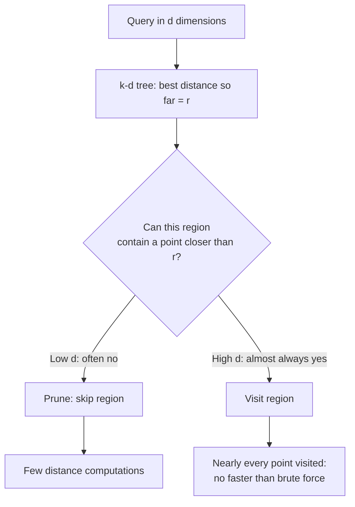

An embedding from `all-MiniLM-L6-v2` has 384 numbers; other models produce 768, 1,024 or several thousand. [Dimensionality](/learn/embedding-fundamentals/dimensionality) discussed the practical side of that number: what more dimensions buy, and what they cost in storage and speed. This lesson is about the stranger side. Spaces with hundreds of dimensions do not behave like the two- and three-dimensional spaces our intuition was built in. Random directions are almost always nearly perpendicular. Distances between random points become almost all the same. Nearly all the volume of a ball sits in a thin skin at its surface. And no single coordinate of an embedding means anything on its own.

These are not mathematical curiosities. They explain why a cosine of 0.2 can be meaningful in one space and noise in another, why tree-based search structures that work beautifully on maps fail on embeddings, why you cannot interpret "dimension 149", and why vector indexes are built the way later modules describe.

## Learning objectives

- Explain what a dimension of an embedding is, and show that individual coordinates are not meaningful by applying a rotation that leaves all similarities unchanged.
- Derive the typical cosine between random unit vectors in $d$ dimensions and use it as a noise baseline.
- Demonstrate distance concentration numerically and explain its consequence for nearest-neighbour search.
- Compute how volume concentrates near the surface of a high-dimensional ball.
- Distinguish a space's ambient dimension from the effective dimension that real embeddings occupy.

## Prerequisites

- [Cosine similarity](/learn/embedding-mathematics/cosine-similarity) and [Euclidean distance](/learn/embedding-mathematics/euclidean-distance).
- [Vector normalisation](/learn/embedding-mathematics/vector-normalisation): unit vectors and the corpus mean.
- [Dimensionality](/learn/embedding-fundamentals/dimensionality): the practical trade-offs of embedding size.

## Why this matters

Engineers carry two-dimensional pictures in their heads: a scatter plot with clusters, a query point, a circle around it. Those pictures are useful but mislead in specific, predictable ways when $d$ is 384:

- **"A cosine of 0.2 is low."** In 3 dimensions, two random directions routinely have a cosine of 0.5 or more, so 0.2 means nothing. In 384 dimensions, random directions almost never exceed 0.2, so the same value can signal a real relationship. Whether a score is noise depends on the dimension.
- **"The nearest neighbour is clearly nearer."** In high dimensions, the nearest and farthest of many random points can be almost the same distance away. Algorithms that rely on some points being obviously far away, such as k-d trees, lose their advantage.
- **"Dimension 149 must encode something."** Analysts and well-meaning colleagues sometimes try to read, filter or drop individual coordinates. Rotate the space and every coordinate changes while every similarity stays exactly the same, so a single coordinate has no meaning that retrieval depends on.
- **"Vectors from two models with the same dimension are compatible."** Two 384-dimensional models produce unrelated coordinate systems. Equal dimension is necessary for comparing vectors, never sufficient.

## The intuition

Stand in a room and hold out sticks from one point. You can hold three sticks at exactly right angles to each other (along the floor's length, its width, and straight up), and no more: a fourth must lean towards one of the others. Now relax the rule. How many sticks can you hold so that every pair is *roughly* perpendicular, say between 80° and 100°? In three dimensions, still only a handful.

In 384 dimensions, the answer is astronomically large. There are 384 exactly perpendicular directions, but the number of directions that are all *nearly* perpendicular to each other grows exponentially with the dimension. So if you point sticks in random directions, they will almost all be nearly perpendicular to each other. Random means "unrelated", and in high dimensions unrelated means "at about 90°".

That is good news for embedding models. They have room to give thousands of different topics their own roughly separate directions without crowding. It is also why the *baseline* cosine between unrelated things, for a well-spread space, should be near zero, and why any consistent departure from zero, like the positive cosines [Vector normalisation](/learn/embedding-mathematics/vector-normalisation) measured between unrelated Meridian chunks, tells you something about the model rather than about the texts.

## How it works

### What a dimension is

A $d$-dimensional vector is a list of $d$ coordinates, and each coordinate measures how far the vector extends along one **basis direction**. The standard basis is the set of $d$ unit vectors $\mathbf{e}_1 = (1, 0, \dots, 0)$, $\mathbf{e}_2 = (0, 1, 0, \dots)$ and so on. Coordinate $i$ of $\mathbf{x}$ is simply $\mathbf{x} \cdot \mathbf{e}_i$.

Nothing forces an embedding model to align meaningful properties with the standard basis. During training, only dot products between vectors enter the loss. Any **rotation** of the whole space, applied to every vector, preserves all dot products, so the training objective cannot tell a space from its rotated copy. The model ends up with some arbitrary orientation, and the meaning, such as it is, lives in **directions** and **relative positions**, which may be any mixture of coordinates.

A rotation is represented by an **orthogonal matrix** $R$, one whose columns are unit vectors at right angles to each other, so that $R^{\top}R = I$. Then for any $\mathbf{a}$ and $\mathbf{b}$:

$$
(R\mathbf{a}) \cdot (R\mathbf{b}) = \mathbf{a}^{\top} R^{\top} R\, \mathbf{b} = \mathbf{a} \cdot \mathbf{b}
$$

Every dot product, cosine and distance is unchanged, while individual coordinates are shuffled and mixed completely. The In code section does exactly this to real embeddings.

Two practical corollaries:

1. **Never compare vectors from different models**, even if they have the same $d$. Their bases are unrelated, as if one were rotated by an unknown matrix (and usually worse).
2. **Do not interpret or drop single coordinates.** If you need fewer dimensions, use a method that finds informative *directions*, such as principal component analysis, covered in [Dimensionality reduction](/learn/embedding-mathematics/dimensionality-reduction), or a model trained to be truncated.

There is one nuance. Research on the hidden states of Transformer language models has found that a few coordinates can have consistently huge magnitudes and dominate cosine similarity; Timkey and van Schijndel (2021) called these **rogue dimensions**. This is a property of particular models' representations, not a meaning attached to those coordinates, and it is one motivation for the centring and whitening techniques in the previous lesson.

### Random directions are nearly orthogonal

Take two unit vectors pointing in independent, uniformly random directions in $d$ dimensions. Their cosine has mean 0 and standard deviation almost exactly $1/\sqrt{d}$ (The mathematics section derives it). That gives a **noise baseline**:

| $d$ | Typical random cosine (one standard deviation) |
| --- | --- |
| 3 | 0.577 |
| 30 | 0.183 |
| 384 | 0.051 |
| 1,536 | 0.026 |

In 384 dimensions, a cosine of 0.2 between two random directions is about four standard deviations out, rare enough to be meaningful. In 3 dimensions it is unremarkable.

Real embedding models are **not** random: their vectors cluster in a limited region of the sphere, so unrelated texts score well above 0 (about 0.16 on average for Meridian's chunks, against about 0 for random vectors). The random baseline is still useful. It is the score you would see if the model spread its vectors evenly, so the gap between your model's typical unrelated score and the random baseline is a measure of how unevenly it uses the space; [Embedding space geometry](/learn/embedding-mathematics/embedding-space-geometry) takes this further.

### Distances concentrate

For points scattered randomly through a high-dimensional region, the distance from a query to its nearest point and to its farthest point become nearly equal, relative to their size. One standard way to measure this is the **relative contrast**:

$$
\text{contrast} = \frac{\text{dist}_{\max} - \text{dist}_{\min}}{\text{dist}_{\min}}
$$

In two dimensions with 10,000 random points, the nearest is typically hundreds of times closer than the farthest. In 1,000 dimensions the contrast falls to about 0.15: the farthest point is only about 15% further away than the nearest. Beyer and colleagues (1999) proved that, under broad conditions on how the data is generated, this contrast tends to zero as dimension grows, and asked whether "nearest neighbour" is even meaningful in that regime.

Two clarifications keep this in proportion:

1. The theorem is about data with no structure, where every coordinate is independent noise. Real embeddings have structure: related texts really are much closer than unrelated ones, which is why dense retrieval works at all. Concentration still compresses the range of scores, which is one reason similarity scores for relevant and irrelevant chunks sit closer together than intuition expects.
2. Concentration is what defeats **space-partitioning trees**. A k-d tree splits the space along one coordinate at a time and, at query time, skips any region that cannot contain a point closer than the best found so far. When all distances are nearly equal, almost no region can be ruled out, so the search visits most of the tree and ends up no faster than brute force, with extra overhead. This is the **curse of dimensionality** in its practical form, and the reason vector databases use graph-based and clustering-based approximate indexes instead, starting in [Approximate nearest neighbour search](/learn/vector-indexing-algorithms/approximate-nearest-neighbour-search).



### Volume lives at the surface

The fraction of a $d$-dimensional ball's volume that lies within the outer shell of thickness $\epsilon$ (as a fraction of the radius) is $1 - (1 - \epsilon)^d$. In 384 dimensions, the outer 1% shell holds about 98% of the volume. Similarly, a random Gaussian vector in high dimensions almost always has length close to $\sqrt{d}$ times its per-coordinate standard deviation; lengths concentrate just as distances do.

One consequence for embeddings: if a model's raw outputs were spread like a Gaussian cloud, normalising them to the unit sphere would move every point only a little in relative terms, because they were all near the same radius anyway. Real models are not that tidy, as the varying raw lengths in [Dot product](/learn/embedding-mathematics/dot-product) showed (from 4.4 to 6.4), but the geometry explains why "the sphere" is the natural home for high-dimensional embeddings.

### Ambient and effective dimension

The **ambient dimension** is $d$, the length of the vector. The **effective** or **intrinsic dimension** is, informally, how many independent directions the data actually varies along. A set of 384-dimensional embeddings of Meridian's HR policies might vary mostly along a few dozen directions: topic, document type, tone, length. The rest of the 384 directions carry little variation for this corpus, even if they matter for other text.

You can estimate effective dimension by looking at how variance is distributed across principal directions, which is the subject of [Dimensionality reduction](/learn/embedding-mathematics/dimensionality-reduction). One constraint is worth knowing now: $N$ points span at most $N - 1$ directions after centring. Sixteen chunks cannot reveal more than 15 dimensions of structure, whatever $d$ is, so any analysis of effective dimension needs a corpus much larger than $d$.

## The mathematics

### The cosine between random unit vectors

**Intuition.** By symmetry, fix one vector along the first axis. The cosine with a random unit vector is then that vector's first coordinate, and a random unit vector has to share its total squared length of 1 equally among $d$ coordinates.

Let $\mathbf{u}$ be uniformly distributed on the unit sphere in $\mathbb{R}^d$ and fix $\mathbf{a} = \mathbf{e}_1$. Then $\cos(\mathbf{a}, \mathbf{u}) = u_1$. Because $\sum_{i=1}^{d} u_i^2 = 1$ and, by symmetry, every coordinate has the same distribution:

$$
\mathbb{E}[u_1] = 0, \qquad \mathbb{E}[u_1^2] = \frac{1}{d}\,\mathbb{E}\Big[\sum_{i=1}^{d} u_i^2\Big] = \frac{1}{d}, \qquad \text{sd}(\cos) = \frac{1}{\sqrt{d}}
$$

$\mathbb{E}$ denotes the average over random draws, $u_i$ is coordinate $i$ of the random unit vector and sd the standard deviation. For large $d$, the distribution of the cosine is close to a normal distribution with this spread.

**By hand.** For $d = 384$: $1/\sqrt{384} = 1/19.6 \approx 0.051$. For $d = 1{,}024$: $1/32 \approx 0.031$.

### Concentration of distances

**Intuition.** A squared distance is a sum of $d$ independent squared differences. Sums of many independent terms grow in proportion to $d$, but their random fluctuations grow only like $\sqrt{d}$, so relative fluctuation shrinks like $1/\sqrt{d}$.

For $\mathbf{x}, \mathbf{y}$ with independent coordinates uniform on $[0, 1]$, each squared difference $(x_i - y_i)^2$ has mean $1/6$, so

$$
\mathbb{E}\big[\lVert \mathbf{x} - \mathbf{y} \rVert^2\big] = \frac{d}{6}, \qquad \lVert \mathbf{x} - \mathbf{y} \rVert \approx \sqrt{d/6}
$$

with relative spread proportional to $1/\sqrt{d}$.

**By hand.** For $d = 1{,}000$: $\sqrt{1000/6} = \sqrt{166.7} \approx 12.9$. The code below finds the nearest of 10,000 points at 12.0 and the farthest at 13.8, both close to 12.9.

### Volume near the surface

**Intuition.** Shrinking a ball's radius by 1% shrinks its volume by a factor of $0.99^d$, which is tiny when $d$ is large.

$$
\frac{\text{Vol}(\text{shell of thickness } \epsilon)}{\text{Vol}(\text{ball})} = 1 - (1 - \epsilon)^d
$$

because the volume of a ball of radius $r$ in $d$ dimensions is proportional to $r^d$. Here $\epsilon$ is the shell's thickness as a fraction of the radius.

**By hand.** $d = 384$, $\epsilon = 0.01$: $0.99^{384} = e^{384 \ln 0.99} = e^{-3.86} \approx 0.021$, so the shell holds about 97.9%.

**In NumPy:**

```python
import numpy as np
d = 384
print("sd of random cosine, 1/sqrt(d):", round(1 / np.sqrt(d), 4))
print("expected distance in the unit cube, sqrt(d/6):", round(float(np.sqrt(1000 / 6)), 2))
print("share of ball volume in the outer 1% shell:", round(1 - 0.99 ** d, 4))
```

```output
sd of random cosine, 1/sqrt(d): 0.051
expected distance in the unit cube, sqrt(d/6): 12.91
share of ball volume in the outer 1% shell: 0.9789
```

## In code

**The problem.** Verify each high-dimensional effect numerically, then check two of them on real embeddings: that coordinates are arbitrary (rotation invariance), and that real embeddings are far from randomly spread.

**Dependencies.** NumPy and Sentence Transformers, plus the `corpus.py` module from [Vector normalisation](/learn/embedding-mathematics/vector-normalisation) (16 Meridian chunks and 8 queries).

```bash
pip install numpy sentence-transformers
```

```python
import numpy as np
from sentence_transformers import SentenceTransformer
from corpus import CHUNKS, QUERIES

rng = np.random.default_rng(0)

def random_unit(n, d):
    X = rng.standard_normal((n, d))
    return X / np.linalg.norm(X, axis=1, keepdims=True)

# 1. Random directions become nearly orthogonal as d grows
print("cosine between random unit vectors (2,000 pairs)")
for d in [3, 30, 384, 1536]:
    A, B = random_unit(2000, d), random_unit(2000, d)
    c = (A * B).sum(axis=1)
    print(f"  d={d:<5} mean {c.mean():+.3f}  sd {c.std():.3f}  1/sqrt(d) {1/np.sqrt(d):.3f}  max |cos| {np.abs(c).max():.3f}")

# 2. Distances concentrate: nearest and farthest become similar
print("relative contrast (farthest - nearest) / nearest, 10,000 random points")
for d in [2, 10, 100, 1000]:
    X, q = rng.random((10_000, d)), rng.random(d)
    dist = np.linalg.norm(X - q, axis=1)
    print(f"  d={d:<5} nearest {dist.min():7.3f}  farthest {dist.max():7.3f}  contrast {(dist.max() - dist.min()) / dist.min():7.3f}")

# 3. Coordinates are arbitrary: a random rotation changes every coordinate, no cosine
model = SentenceTransformer("sentence-transformers/all-MiniLM-L6-v2")
E = model.encode(CHUNKS + list(QUERIES), normalize_embeddings=True)
R, _ = np.linalg.qr(rng.standard_normal((384, 384)))     # random orthogonal matrix
E_rot = E @ R
print("largest coordinate change:", round(float(np.abs(E_rot - E).max()), 3),
      "| largest cosine change:", float(np.abs(E_rot @ E_rot.T - E @ E.T).max()))

# 4. Real embeddings are far from random directions
off = ~np.eye(len(CHUNKS), dtype=bool)
S_real = (E[:len(CHUNKS)] @ E[:len(CHUNKS)].T)[off]
S_rand = (lambda X: (X @ X.T)[off])(random_unit(len(CHUNKS), 384))
print(f"chunk-chunk cosines, real model: mean {S_real.mean():+.3f} sd {S_real.std():.3f}")
print(f"same count of random 384-d unit vectors: mean {S_rand.mean():+.3f} sd {S_rand.std():.3f}")
```

```output
cosine between random unit vectors (2,000 pairs)
  d=3     mean +0.011  sd 0.584  1/sqrt(d) 0.577  max |cos| 1.000
  d=30    mean -0.001  sd 0.178  1/sqrt(d) 0.183  max |cos| 0.638
  d=384   mean +0.002  sd 0.051  1/sqrt(d) 0.051  max |cos| 0.170
  d=1536  mean +0.000  sd 0.026  1/sqrt(d) 0.026  max |cos| 0.114
relative contrast (farthest - nearest) / nearest, 10,000 random points
  d=2     nearest   0.002  farthest   1.117  contrast 517.814
  d=10    nearest   0.403  farthest   1.893  contrast   3.694
  d=100   nearest   3.258  farthest   4.977  contrast   0.528
  d=1000  nearest  11.987  farthest  13.779  contrast   0.149
largest coordinate change: 0.268 | largest cosine change: 2.028090810846095e-07
chunk-chunk cosines, real model: mean +0.161 sd 0.129
same count of random 384-d unit vectors: mean +0.007 sd 0.054
```

**The important lines.**

- `rng.standard_normal((n, d))` followed by normalisation gives uniformly random directions. This works because the standard multivariate normal distribution looks the same in every direction, so its directions are uniform on the sphere. (Uniform random numbers in a cube would *not* give uniform directions: they favour the cube's corners.)
- `(A * B).sum(axis=1)` computes 2,000 row-wise dot products, one per pair, without forming a $2000 \times 2000$ matrix.
- `np.linalg.qr(...)` factorises a random matrix into an orthogonal matrix $R$ and a triangular one; the orthogonal factor is a random rotation (possibly combined with a reflection, which also preserves dot products).
- `E @ R` rotates every embedding at once, since each row is multiplied by the same matrix.

**What the output means.**

1. The measured standard deviation of random cosines matches $1/\sqrt{d}$ to three decimal places at every dimension. At $d = 384$, the largest cosine among 2,000 random pairs is only 0.170.
2. The relative contrast falls from over 500 at $d = 2$ to 0.15 at $d = 1{,}000$. In 1,000 dimensions the farthest of 10,000 random points is just 15% further away than the nearest.
3. Rotation changed individual coordinates by up to 0.268, which is huge for unit vectors whose coordinates are typically around 0.05, yet no cosine changed by more than $2 \times 10^{-7}$. Every similarity-based operation, retrieval included, gives identical results in the rotated space.
4. Different Meridian chunks have an average cosine of $+0.161$; random directions average $+0.007$. The model places all its handbook sentences in a shared region of the sphere, far from the random-direction picture. The spread of real scores (0.129) is also wider than random noise (0.054), because real differences in topic exist.

**Common errors.**

- Generating "random vectors" with `rng.random` (uniform on $[0, 1)$) and normalising: all coordinates are positive, so every cosine is large and positive. Use a standard normal.
- Inserting vectors of the wrong dimension into an index. Most databases reject them, but a NumPy pipeline that pads or truncates silently will not.
- Generalising from the random baselines to real data: they bound what noise looks like; they are not predictions of real scores.

**Extending it.** Repeat step 2 with points drawn from a few tight clusters in 1,000 dimensions instead of uniformly. The contrast for a query inside a cluster stays large: structure defeats concentration, which is why retrieval works.

## A real-world example

A data scientist on Meridian's Platform team, building an internal tool for exploring which handbook passages are similar, needed nearest neighbours for 200,000 chunk embeddings. Remembering that a k-d tree made a 2-D geographic lookup thousands of times faster than brute force, she used scikit-learn's `NearestNeighbors(algorithm="kd_tree")` on the 384-dimensional vectors.

It was no faster than `algorithm="brute"`, and on larger batches it was slower. Profiling showed the tree search visiting almost every leaf. That is distance concentration at work: with distances between embeddings bunched together relative to their size, the bounding-box test in each node almost never proves that a region can be skipped.

At the same time, a product manager reviewing the tool asked whether coordinate 149, which had the largest average value across the corpus, could be used as a "policy-ness" score. The team demonstrated the rotation argument from this lesson: multiply every vector by a random orthogonal matrix and the tool's results do not change at all, while coordinate 149 becomes a different number for every chunk. The coordinate carries no meaning of its own that the system depends on. If a "policy-ness" direction exists, it has to be found as a direction (for example, the difference between the mean of policy chunks and the mean of runbook chunks), not read off an axis.

The team switched the tool to a brute-force matrix product for exact results on small selections and to the HNSW index already used by AskMeridian's Qdrant cluster for the full corpus.

## Common mistakes

- **Using one cosine threshold across models of different dimension and training.** The noise level of a score depends on $d$ and on how the model spreads its vectors; calibrate per model.
- **Interpreting or filtering on single coordinates.** Coordinates are an arbitrary basis; only directions and relative positions carry meaning for retrieval.
- **Comparing vectors from different models of the same dimension.** Identical $d$ does not mean a shared coordinate system.
- **Expecting tree indexes to accelerate high-dimensional search.** k-d trees and similar partitioning structures degrade towards brute force; use approximate indexes designed for high dimensions.
- **Generating test vectors with uniform $[0, 1)$ coordinates.** They are all in one corner of the space and produce unrealistic, high cosines.
- **Estimating effective dimension from too few samples.** $N$ points reveal at most $N - 1$ dimensions of variation.

## Best practices

- Record each model's dimension and check every vector's dimension at write and query time.
- Use the random baseline $1/\sqrt{d}$ as a sanity check for "is this score distinguishable from noise", and the model's own score distribution (next lesson) for real thresholds.
- Treat embeddings as rotation-invariant objects: build features, filters and analyses on directions and similarities, not on raw coordinates.
- For exact search on small sets, use a brute-force matrix product; for large sets, use approximate indexes. Skip classical space-partitioning trees above a few dozen dimensions.
- To find a meaningful direction (such as "policy versus runbook"), compute it from labelled examples, for example as a difference of class means, and project onto it.

## Performance considerations

Dimension enters every cost linearly. A brute-force query does $N \times d$ multiply-adds and reads $N \times d \times b$ bytes, where $b$ is bytes per value: moving from 384 to 1,536 dimensions multiplies both by four. For 1 million chunks in `float32`, that is roughly 1.5 GB per full scan at $d = 384$ and 6.1 GB at $d = 1{,}536$. Graph indexes such as HNSW also compute full $d$-dimensional distances at every step, so their per-query cost scales with $d$ in the same way, though over far fewer vectors.

Concentration affects approximate indexes indirectly. When distances bunch together, an index must examine more candidates to separate the true nearest neighbours from many almost-as-near ones, which raises the work needed for a given recall. This is one reason the same index settings give different recall on different embedding models, and why [Recall versus latency](/learn/vector-indexing-algorithms/recall-versus-latency) has to be measured on your own data.

## Summary

- A coordinate measures extent along an arbitrary basis direction; rotations change all coordinates and no similarity, so meaning lives in directions, not axes.
- Random unit vectors in $d$ dimensions have cosines with mean 0 and standard deviation $1/\sqrt{d}$: about 0.05 at $d = 384$. That is the noise floor for a perfectly spread space.
- Distances between random points concentrate: in 1,000 dimensions the farthest of 10,000 points was only 15% further than the nearest. This defeats tree-based exact search.
- Nearly all the volume of a high-dimensional ball lies near its surface; lengths concentrate as well.
- Real embeddings are structured: they occupy a limited region (average unrelated cosine 0.16 here, against 0 for random) and vary along fewer effective dimensions than $d$.

## Exercises

**1. Noise floor.** For $d = 1{,}024$, what is the standard deviation of the cosine between two random unit vectors? Would a cosine of 0.1 between two such vectors be surprising?

<details><summary>Show solution</summary>

$1/\sqrt{1024} = 1/32 \approx 0.031$. A cosine of 0.1 is about 3.2 standard deviations from zero, which for a near-normal distribution happens in roughly 1 pair in 700. Surprising for a single random pair; unremarkable as the largest value among thousands of pairs.

</details>

**2. Shells.** In $d = 1{,}536$, what fraction of a ball's volume lies in the outer 0.5% shell?

<details><summary>Show solution</summary>

$1 - 0.995^{1536} = 1 - e^{1536 \ln 0.995} = 1 - e^{-7.70} \approx 1 - 0.00045 \approx 0.9995$. More than 99.9% of the volume is in the outer half-percent.

</details>

**3. Code.** Draw 3,000 random unit vectors in 32, 128 and 384 dimensions. For each, report the largest absolute cosine among all pairs and the share of pairs above 0.3. What does this say about how many "separate topics" each space can hold?

<details><summary>Show solution</summary>

```python
import numpy as np
rng = np.random.default_rng(7)
for d in [32, 128, 384]:
    X = rng.standard_normal((3000, d))
    X /= np.linalg.norm(X, axis=1, keepdims=True)
    S = np.abs(X @ X.T)
    np.fill_diagonal(S, 0)
    print(f"d={d:<4} 3,000 random directions: largest |cos| {S.max():.3f}, share of pairs above 0.3: {(S > 0.3).sum() / (3000 * 2999):.4f}")
```

```output
d=32   3,000 random directions: largest |cos| 0.798, share of pairs above 0.3: 0.0898
d=128  3,000 random directions: largest |cos| 0.415, share of pairs above 0.3: 0.0005
d=384  3,000 random directions: largest |cos| 0.270, share of pairs above 0.3: 0.0000
```

In 384 dimensions, 3,000 random directions (far more than 384) are all within about 74° to 106° of each other: none has an absolute cosine above 0.27. In 32 dimensions, about 9% of pairs exceed 0.3. A higher-dimensional space can give many more topics their own nearly separate directions, which is part of why larger embeddings can represent finer distinctions.

</details>

**4. Design.** A colleague proposes saving 25% of storage by deleting the 96 coordinates of a 384-dimensional embedding that have the smallest average absolute value across the corpus. Evaluate the proposal and suggest a better approach.

<details><summary>Show solution</summary>

The proposal treats coordinates as if they had individual importance, but the basis is arbitrary: information is spread across mixtures of coordinates, and the dot products the model was trained on involve all of them. A small average absolute value does not mean a coordinate contributes little to the differences between chunks, and deleting coordinates without re-normalising also breaks unit length. Better options: apply principal component analysis fitted on a large sample and keep the top directions (then re-normalise), use a model trained for truncation ([Matryoshka embeddings](/learn/embedding-optimisation/matryoshka-embeddings)), or reduce bytes per value with [Embedding quantisation](/learn/embedding-optimisation/embedding-quantisation). Whichever you choose, measure retrieval quality on a labelled set before and after.

</details>

## Check your understanding

```quiz
[
  {"q": "What is the approximate standard deviation of the cosine between two random unit vectors in 400 dimensions?", "options": ["0.5", "0.05", "0.0025", "0.2"], "answer": 1, "why": "It is 1 divided by the square root of d, and the square root of 400 is 20."},
  {"q": "You multiply every embedding in your index and every query by the same random orthogonal matrix. What happens to retrieval results?", "options": ["They become random", "They are unchanged", "They improve, because coordinates are decorrelated", "They change only for long chunks"], "answer": 1, "why": "Orthogonal matrices preserve every dot product, so every cosine and distance, and therefore every ranking, is unchanged."},
  {"q": "Why does a k-d tree give little speed-up on 384-dimensional embeddings?", "options": ["It cannot store floating-point values", "Distances concentrate, so few regions can be ruled out and most of the tree is visited", "It only supports Euclidean distance", "It needs vectors to be normalised"], "answer": 1, "why": "Pruning depends on regions being provably farther than the best match found; in high dimensions that is rarely provable."},
  {"q": "Different Meridian chunks have an average cosine of 0.16 with MiniLM, while random 384-d directions average about 0. What does this show?", "options": ["The model is broken", "The chunks are near-duplicates", "The model places its outputs in a limited region of the sphere rather than spreading them evenly", "Cosine similarity is biased upwards in high dimensions"], "answer": 2, "why": "Random directions would give about 0. A consistently positive baseline is a property of how the model uses the space, explored in the geometry lesson."},
  {"q": "You have 50 embeddings of dimension 768 and want to estimate how many dimensions the data really varies along. What is the most you can detect?", "options": ["768", "384", "49", "50 squared"], "answer": 2, "why": "After subtracting the mean, N points span at most N - 1 directions, whatever the ambient dimension."}
]
```

## Further reading

- Beyer, K., Goldstein, J., Ramakrishnan, R. and Shaft, U. (1999). *When Is "Nearest Neighbor" Meaningful?* ICDT 1999.
- Aggarwal, C. C., Hinneburg, A. and Keim, D. A. (2001). *On the Surprising Behavior of Distance Metrics in High Dimensional Space*. ICDT 2001.
- Timkey, W. and van Schijndel, M. (2021). *All Bark and No Bite: Rogue Dimensions in Transformer Language Models Obscure Representational Quality*. EMNLP 2021.
- Vershynin, R. (2018). *High-Dimensional Probability: An Introduction with Applications in Data Science*. Cambridge University Press, chapters 2 and 3.
- [scikit-learn documentation: Nearest Neighbors](https://scikit-learn.org/stable/modules/neighbors.html), including its discussion of when tree-based algorithms help and when brute force is better.
