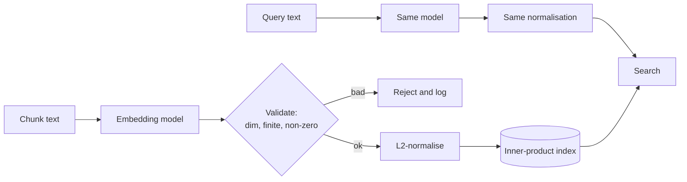

The previous three lessons kept arriving at the same conclusion: once every vector has length 1, the dot product, cosine similarity and Euclidean distance all rank results identically, and the cheapest of them, the dot product, can do the work of all three. The operation that gets vectors to length 1 is **L2 normalisation**, and it is so routine that most pipelines do it without anyone deciding to: the model has a normalisation layer, or `normalize_embeddings=True` is set, or the database's cosine metric does it quietly on upload.

Routine operations are where silent bugs live. This lesson treats normalisation as a deliberate engineering step. You will see exactly what it keeps and what it throws away, where in a pipeline it must happen, the operations that silently undo it (truncating, averaging, quantising), and a second, more powerful family of normalisations, **mean-centring** and **whitening**, that change the geometry of the whole space rather than single vectors.

## Learning objectives

- L2-normalise vectors safely in NumPy, and state precisely what information normalisation removes.
- Identify the operations (truncation, averaging, quantisation, mixing sources) that break unit length, and restore it correctly.
- Prove that the length of the mean of unit vectors equals the square root of their average pairwise cosine, and use this to reason about centroids.
- Apply mean-centring consistently to documents and queries, and explain what it does to the scale and spread of similarity scores.
- Decide where normalisation belongs in an indexing and query pipeline, and when it must not be applied.

## Prerequisites

- [Dot product](/learn/embedding-mathematics/dot-product): length bias and when length is meant to matter.
- [Cosine similarity](/learn/embedding-mathematics/cosine-similarity): scale invariance and Pearson correlation as centred cosine.
- [Euclidean distance](/learn/embedding-mathematics/euclidean-distance): $\lVert \mathbf{a} - \mathbf{b} \rVert^2 = 2 - 2\cos\theta$ on unit vectors.

## Why this matters

Normalisation decides whether your index's metric means what you think it means. Three failure patterns recur in real systems:

1. **Normalised on one side only.** Chunks are normalised at indexing time, but a new query path forgets to normalise queries. Rankings survive (the query's length scales every score equally), but every threshold, every score shown in a dashboard and every score fused with another retriever is now wrong by a factor that varies per query.
2. **Normalisation silently undone.** Someone truncates vectors to save memory, or stores per-document vectors made by averaging chunk vectors, and keeps using an inner-product index. Neither truncated nor averaged vectors have length 1, so length bias returns.
3. **Normalisation applied where it does harm.** A model trained with dot-product similarity is normalised "for safety", removing the signal it was trained to put in the length.

There is also an opportunity. Many embedding models place all their vectors in a narrow cone, so every cosine is positive and scores are bunched together. Centring the space can spread them out, which matters when you rely on thresholds. Whether it improves retrieval is an empirical question for your corpus, and this lesson shows you how to ask it.

## The intuition

Think of Meridian's staff survey, where each department reports a list of numbers: how many people mentioned workload, pay, the office, tooling and so on. The engineering department has 120 people and reports large counts; the legal team has 6 and reports small ones. If you compare departments by raw counts, every comparison is dominated by department size. Convert each department's counts into **proportions** and you compare what each department cares about, regardless of size. That is L2 normalisation: it keeps the *mix* and discards the *amount*.

Now suppose every department mentions "the office" a lot, because the survey happened during a move. That common theme makes all departments look similar to each other. To see what distinguishes them, subtract the company-wide average from each department's profile and compare the **deviations**. That is mean-centring: it removes what everything has in common so that differences stand out.

Both operations are legitimate, and both lose information. After normalising, you cannot tell engineering from legal by size. After centring, you cannot see that everyone cares about the office. Whether that loss matters depends on the question you are asking.

## How it works

### L2 normalisation

To **L2-normalise** a vector, divide it by its Euclidean length:

$$
\hat{\mathbf{x}} = \frac{\mathbf{x}}{\lVert \mathbf{x} \rVert}
$$

Geometrically this slides every point along the line from the origin until it sits on the **unit sphere**, the set of points at distance 1 from the origin. Four facts follow:

- **It keeps direction and discards length.** $\hat{\mathbf{x}}$ points exactly where $\mathbf{x}$ did; every vector on the same ray ($2\mathbf{x}$, $0.1\mathbf{x}$) maps to the same unit vector. The length is gone and cannot be recovered unless you store it separately.
- **It is idempotent.** Normalising a unit vector returns it unchanged (up to rounding), so normalising twice is harmless. This makes "normalise defensively at the boundary" a safe habit.
- **It is undefined for the zero vector.** Guard against it, as [Cosine similarity](/learn/embedding-mathematics/cosine-similarity) showed.
- **It is per-vector.** Each vector is normalised using only its own coordinates, so it can be applied to one query at a time with no knowledge of the corpus.

Other per-vector normalisations exist. **L1 normalisation** divides by the sum of absolute values, so coordinates sum to 1 in absolute value; it suits probability-like vectors and some sparse representations. **Max normalisation** divides by the largest coordinate. Neither makes the dot product equal the cosine, so for dense embeddings L2 is the one that matters.

### Where normalisation happens

There are four places in a typical stack where vectors may be normalised, and you need to know which ones are active:

1. **Inside the model.** `all-MiniLM-L6-v2` ends with a `Normalize` module, so its output is unit length whether or not you ask. Many models do not.
2. **In the encoding call.** `model.encode(texts, normalize_embeddings=True)` in Sentence Transformers normalises after the model runs.
3. **In the database.** Qdrant documents that a collection using the `Cosine` metric normalises vectors when they are uploaded and then searches by dot product. Other systems compute cosine at query time without changing stored vectors.
4. **In your own code**, at the boundary between embedding and storage.

The rule that prevents most bugs: **queries and documents must pass through the same normalisation**, and you should be able to name the step that does it.



### Operations that break unit length

Several innocent-looking operations take unit vectors and return vectors that are not:

- **Truncation.** Keeping only the first $k$ coordinates of a unit vector gives a vector of length at most 1, usually less. Models trained with Matryoshka representation learning are designed so that truncated prefixes remain useful ([Matryoshka embeddings](/learn/embedding-optimisation/matryoshka-embeddings) covers this), but even for those the truncated vector must be **re-normalised** before inner-product search.
- **Averaging.** The mean of several unit vectors is shorter than 1 unless they are identical. The more the vectors disagree, the shorter the mean. A document vector made by averaging its chunk vectors (one approach from [Document embeddings](/learn/embedding-fundamentals/document-embeddings)) has a length that reflects how varied the document is.
- **Quantisation.** Rounding coordinates to 8-bit integers or to `float16` perturbs the length slightly. For ranking this is usually negligible; for exact thresholds it may not be.
- **Arithmetic on vectors.** Adding a "query expansion" vector, subtracting a mean, or interpolating between two vectors all produce vectors of arbitrary length.

The fix in every case is the same: re-normalise after the operation, and only then use inner product as cosine.

### Mean-centring: normalising the space

L2 normalisation treats each vector alone. **Mean-centring** uses the whole corpus: compute the mean vector $\boldsymbol{\mu}$ of all chunk embeddings, subtract it from every chunk and every query, then L2-normalise again.

Why would you? Many embedding models do not spread their vectors evenly over the sphere; they crowd into a region around some common direction, a property called **anisotropy** that [Embedding space geometry](/learn/embedding-mathematics/embedding-space-geometry) examines in depth. When that happens, every pair of vectors shares the common component, so every cosine is lifted above zero and scores are squeezed into a narrow band. Subtracting the mean removes the shared component. From the [Pearson connection](/learn/embedding-mathematics/cosine-similarity), the cosine of centred vectors is a correlation: it measures how two texts deviate *together* from the typical text.

The effect on ranking for a single query is easy to see by expanding the centred dot product:

$$
(\mathbf{q} - \boldsymbol{\mu}) \cdot (\mathbf{d} - \boldsymbol{\mu}) = \mathbf{q} \cdot \mathbf{d} - \boldsymbol{\mu} \cdot \mathbf{d} - \mathbf{q} \cdot \boldsymbol{\mu} + \lVert \boldsymbol{\mu} \rVert^2
$$

The last two terms are the same for every chunk. What changes the ranking is $-\boldsymbol{\mu} \cdot \mathbf{d}$: chunks that lie close to the corpus's average direction, generic chunks that resemble everything, are pushed down. (The re-normalisation afterwards also has an effect, because centred vectors have different lengths.)

Three cautions make this a technique to evaluate, not a default:

1. **The mean is a property of the corpus.** It must be computed once, stored, and applied identically to every query. When the corpus changes substantially, the mean drifts and every stored vector would need recomputing for consistency.
2. **It changes what scores mean.** Thresholds calibrated before centring are invalid after.
3. **Modern contrastive models already spread their outputs** to a degree, and centring may change little. Measure it.

### Whitening

**Whitening** goes further than centring. It also rescales the space so that every direction has the same variance and no two coordinates are correlated. It is computed from the covariance matrix of the corpus embeddings and amounts to rotating the space onto its principal axes and stretching each axis to unit variance. Su and colleagues (2021) reported that whitening sentence embeddings from BERT-style models improved results on semantic similarity benchmarks and allowed reducing dimensions at the same time. A related, earlier technique for word vectors, Mu and Viswanath's "all-but-the-top" (2018), subtracts the mean and removes the few dominant principal directions.

Treat these as research techniques to test, not established practice for current retrieval models. Whitening needs many more vectors than dimensions to estimate the covariance reliably (with 16 vectors in 384 dimensions it is impossible: the covariance matrix has rank at most 15), it amplifies noise in low-variance directions, and it must be refitted and the whole index rebuilt when the corpus shifts. Principal directions are covered in [Dimensionality reduction](/learn/embedding-mathematics/dimensionality-reduction).

### When not to normalise

If a model's documentation says to score it with the dot product, its vector lengths carry information it was trained to produce. Do not L2-normalise its outputs, do not choose a cosine metric for it, and be careful with any operation (such as mean-centring) that changes lengths. Normalisation is a property of how a model is meant to be used, not a universal hygiene step.

## The mathematics

### L2 normalisation

**Intuition.** Divide by the length and the length becomes 1.

$$
\hat{\mathbf{x}} = \frac{\mathbf{x}}{\lVert \mathbf{x} \rVert}, \qquad \lVert \hat{\mathbf{x}} \rVert = \frac{\lVert \mathbf{x} \rVert}{\lVert \mathbf{x} \rVert} = 1
$$

$\mathbf{x} \in \mathbb{R}^d$ is any non-zero vector, $\lVert \mathbf{x} \rVert = \sqrt{\sum_i x_i^2}$ its length, and $\hat{\mathbf{x}}$ its unit vector. For unit vectors, $\hat{\mathbf{a}} \cdot \hat{\mathbf{b}} = \cos(\mathbf{a}, \mathbf{b})$.

**By hand.** $\mathbf{x} = (3, 4)$ has length $\sqrt{9 + 16} = 5$, so $\hat{\mathbf{x}} = (0.6, 0.8)$, and $0.36 + 0.64 = 1$. Truncating the unit vector $(0.6, 0, 0.8)$ to its first two coordinates gives $(0.6, 0)$, of length 0.6; re-normalising gives $(1, 0)$.

### The length of a mean of unit vectors

**Intuition.** If the vectors agree, their average is nearly as long as each of them. If they disagree, they partly cancel and the average is short. The precise amount of cancellation is the average cosine.

For unit vectors $\mathbf{x}_1, \dots, \mathbf{x}_N$ with mean $\boldsymbol{\mu} = \frac{1}{N}\sum_i \mathbf{x}_i$:

$$
\lVert \boldsymbol{\mu} \rVert^2 = \frac{1}{N^2} \sum_{i=1}^{N} \sum_{j=1}^{N} \mathbf{x}_i \cdot \mathbf{x}_j = \frac{1}{N^2} \Big( N + \sum_{i \ne j} \cos(\mathbf{x}_i, \mathbf{x}_j) \Big)
$$

The double sum runs over all ordered pairs, including each vector with itself ($i = j$), which contributes $\mathbf{x}_i \cdot \mathbf{x}_i = 1$. So the squared length of the mean is the average of the full cosine matrix, diagonal included.

**By hand.** Two unit vectors at 90°: $(1, 0)$ and $(0, 1)$. The cosine matrix is $\begin{pmatrix} 1 & 0 \\ 0 & 1 \end{pmatrix}$, whose average entry is $2/4 = 0.5$. So $\lVert \boldsymbol{\mu} \rVert = \sqrt{0.5} \approx 0.7071$. Directly: $\boldsymbol{\mu} = (0.5, 0.5)$, of length $\sqrt{0.5}$. At 60° the cosine is 0.5, the matrix average is $(1 + 0.5 + 0.5 + 1)/4 = 0.75$ and the mean has length $\approx 0.866$.

The identity has a striking corollary. After mean-centring, the centred vectors sum to zero, so the sum of all their pairwise dot products, diagonal included, is zero. If their lengths were equal, the average off-diagonal cosine would be exactly $-1/(N-1)$. You will see this number appear in the code below.

**In NumPy:**

```python
import numpy as np

x = np.array([3.0, 4.0])
u = x / np.linalg.norm(x)
print("unit vector:", u.tolist(), " length:", float(np.linalg.norm(u)))

# The mean of unit vectors: its squared length is the average of all pairwise cosines
X = np.array([[1.0, 0.0], [0.0, 1.0]])           # two unit vectors at 90 degrees
mu = X.mean(axis=0)
S = X @ X.T                                     # all cosines, including the diagonal
print("mean:", mu.tolist(), " length:", round(float(np.linalg.norm(mu)), 4),
      " sqrt(mean of S):", round(float(np.sqrt(S.mean())), 4))

# Truncation: keep the first k coordinates and re-normalise
v = np.array([0.6, 0.0, 0.8])
t = v[:2]
print("truncated:", t.tolist(), " length:", float(np.linalg.norm(t)),
      " re-normalised:", (t / np.linalg.norm(t)).tolist())
```

```output
unit vector: [0.6, 0.8]  length: 1.0
mean: [0.5, 0.5]  length: 0.7071  sqrt(mean of S): 0.7071
truncated: [0.6, 0.0]  length: 0.6  re-normalised: [1.0, 0.0]
```

## In code

**The problem.** On real embeddings of a 16-chunk Meridian corpus, check normalisation behaviour, measure how truncation and averaging break unit length, and test what mean-centring does to scores and to retrieval for eight labelled queries.

**Dependencies.** NumPy and Sentence Transformers; no API key.

```bash
pip install numpy sentence-transformers
```

The corpus and queries are kept in a small module so later lessons can reuse them. Each query is paired with the index of the chunk that answers it.

```python
# corpus.py
CHUNKS = [
    "Annual leave is 25 days per year.",
    "Up to 5 unused leave days carry over and must be used by 31 March.",
    "Staff may work remotely up to 3 days a week.",
    "The home-office equipment budget is £400.",
    "Contractors are not eligible for the home-office equipment budget.",
    "Expenses must be submitted within 30 days.",
    "Any expense over £75 needs a receipt.",
    "Expenses are handled by the finance department.",
    "Passwords must be rotated every 90 days.",
    "VPN is required on public Wi-Fi.",
    "Laptops are refreshed every 3 years.",
    "Report a lost laptop to the support desk at once.",
    "Support desk hours are 08:00 to 18:00 UK time.",
    "Meridian Reports can export dashboards to PDF or CSV.",
    "SAML single sign-on is available on the Enterprise plan.",
    "Error E-4021 means the Atlas client is out of date.",
]
QUERIES = {
    "How much holiday do I get?": 0,
    "Can I carry unused leave into next year?": 1,
    "How many days a week can I work from home?": 2,
    "Do I need a receipt for a £90 taxi?": 6,
    "How often do I have to change my password?": 8,
    "When will my laptop be replaced?": 10,
    "What time does the IT helpdesk open?": 12,
    "Can I download a report as a spreadsheet?": 13,
}
```

```python
import numpy as np
from sentence_transformers import SentenceTransformer
from corpus import CHUNKS, QUERIES

def l2_normalise(X, eps=1e-12):
    X = np.asarray(X, dtype=np.float32)
    norms = np.linalg.norm(X, axis=-1, keepdims=True)
    return X / np.maximum(norms, eps)

def off_diagonal(S):
    return S[~np.eye(len(S), dtype=bool)]

model = SentenceTransformer("sentence-transformers/all-MiniLM-L6-v2")
D = model.encode(CHUNKS, normalize_embeddings=True)
Q = model.encode(list(QUERIES), normalize_embeddings=True)
gold = np.array(list(QUERIES.values()))

# 1. Idempotence: normalising twice changes nothing
print("re-normalising changes values by at most", float(np.abs(l2_normalise(D) - D).max()))

# 2. Truncation breaks unit length
D128 = D[:, :128]
n = np.linalg.norm(D128, axis=1)
print(f"after truncating to 128 dims: norms from {n.min():.3f} to {n.max():.3f}")

# 3. The mean of unit vectors is not a unit vector
mu = D.mean(axis=0)
print(f"length of the corpus mean vector: {np.linalg.norm(mu):.3f}")

# 4. Mean-centring, then re-normalising
Dc = l2_normalise(D - mu)
Qc = l2_normalise(Q - mu)          # the SAME corpus mean is subtracted from queries
for name, A, B in [("plain", D, Q), ("centred", Dc, Qc)]:
    S_dd = off_diagonal(A @ A.T)
    S_qd = B @ A.T
    top1 = (S_qd.argmax(axis=1) == gold).mean()
    print(f"{name:>8}: chunk-chunk cosine mean {S_dd.mean():+.3f} sd {S_dd.std():.3f} | "
          f"top-1 accuracy {top1:.2f} | gold score {S_qd[np.arange(len(gold)), gold].mean():.3f}")
```

```output
re-normalising changes values by at most 1.4901161193847656e-08
after truncating to 128 dims: norms from 0.479 to 0.656
length of the corpus mean vector: 0.462
   plain: chunk-chunk cosine mean +0.161 sd 0.129 | top-1 accuracy 1.00 | gold score 0.583
 centred: chunk-chunk cosine mean -0.066 sd 0.142 | top-1 accuracy 1.00 | gold score 0.503
```

**The important lines.**

- `np.maximum(norms, eps)` avoids dividing by zero; `axis=-1` makes the function work for a single vector or a matrix.
- `D[:, :128]` keeps the first 128 of 384 coordinates. This model was **not** trained for truncation, so we use it only to observe lengths, not to judge retrieval quality.
- `D.mean(axis=0)` is the corpus mean $\boldsymbol{\mu}$. The queries are centred with this same vector; computing a separate mean for the queries would put them in a different space.
- `top1` is the fraction of queries whose highest-scoring chunk is the labelled answer.

**What the output means.**

- Re-normalising already-normalised vectors changes nothing beyond `float32` rounding ($1.5 \times 10^{-8}$): normalisation is idempotent, so defensive re-normalisation is safe.
- Truncated vectors have lengths from 0.48 to 0.66, varying by chunk. Inner-product search on them would reintroduce length bias. Re-normalise after truncating.
- The corpus mean has length 0.462. By the identity above, $0.462^2 \approx 0.213$ is the average of the full $16 \times 16$ cosine matrix: $(16 + 240 \times 0.161)/256 \approx 0.213$. A mean that long says the vectors share a substantial common direction.
- Before centring, two different chunks have an average cosine of $+0.161$. After centring it is $-0.066$, almost exactly $-1/(N-1) = -1/15 \approx -0.067$, as the theory predicts. The spread (standard deviation) of chunk-to-chunk scores grows slightly, from 0.129 to 0.142.
- Retrieval is unchanged on this tiny set (8 of 8 correct either way), but the scores of the correct chunks drop from an average of 0.583 to 0.503. Any threshold tuned on the plain scores would now be wrong.

The honest conclusion is the general one: centring re-scales scores reliably, and whether it improves rankings must be measured on a realistic labelled set.

**Common errors.**

- Computing the mean over the queries, or over a different corpus, and applying it to the chunks.
- Forgetting to re-normalise after subtracting the mean, so inner products are no longer cosines.
- Storing centred vectors but recomputing the mean later from new data, so stored and new vectors are centred differently.

**Extending it.** Add 50 more chunks from a different domain (for example, product documentation) and recompute the mean. How much do the centred scores of the original queries change? This is the drift problem in miniature.

## A real-world example

Meridian's Platform team added document-level retrieval to AskMeridian: alongside its chunks, each document got one vector, computed as the average of its chunk vectors, so that a question like "which policy covers equipment?" could return whole documents. To keep things simple, the document vectors were added to the existing Qdrant collection, which used the `Dot` metric because the chunk vectors were already normalised.

Document results almost never appeared. When they did, they were always short, single-topic documents such as the one-page password policy, never the long employee handbook chapters that staff most often needed.

The identity from this lesson explains both symptoms. A document vector is a mean of unit vectors, so its length is the square root of the average cosine among its chunks. A focused one-page policy has chunks that agree with each other, and a mean of length around 0.8 to 0.9; a long handbook chapter covering leave, remote work and expenses has chunks that point in different directions, and a mean of length perhaps 0.5. Under the dot product, every document vector competed against unit-length chunk vectors with a handicap, and the most varied documents had the biggest handicap.

The team made two changes. They re-normalised every document vector, which removed the handicap. And they moved document vectors to a separate collection, because even when normalised, a whole chapter averaged into one direction is a different kind of object from a single chunk, and mixing the two in one ranking made scores hard to interpret. They kept each document's pre-normalisation length as a payload field, since it turned out to be a useful indicator of how focused a document is.

## Common mistakes

- **Normalising chunks but not queries.** Rankings survive; thresholds, displayed scores and score fusion do not.
- **Truncating without re-normalising.** Truncated unit vectors are shorter than 1 by varying amounts, so inner-product search reintroduces length bias.
- **Averaging unit vectors and treating the result as a unit vector.** Centroids are shorter, by an amount that depends on how varied the members are.
- **Normalising a dot-product model.** Removes information the model was trained to encode; retrieval quality can drop silently.
- **Fitting mean-centring or whitening on one dataset and applying it to another,** or refitting without re-encoding stored vectors. Stored and new vectors end up in different spaces.
- **Assuming the database normalises.** Some do on upload for a cosine metric, some compute cosine on the fly, and an inner-product metric normalises nothing. Check the documentation for your exact metric.

## Best practices

- Decide on one place where normalisation happens, write it down beside the model name, and normalise defensively at the storage boundary as well (it is idempotent).
- Validate before normalising: correct dimension, all values finite, length above a small epsilon. Reject and log failures rather than storing zeros.
- After any operation that creates or modifies vectors (truncation, averaging, interpolation, centring), re-normalise.
- Treat any corpus-level transformation (centring, whitening) as part of the model: version it, store its parameters, apply it to queries, and re-index when it changes.
- Test normalisation changes with a labelled query set, comparing both ranking metrics and score distributions.

## Performance considerations

Normalising one vector costs $d$ multiply-adds for the squared length, one square root and $d$ divisions (or one reciprocal and $d$ multiplications): for $d = 384$, about a thousand operations, negligible next to running the embedding model. Normalising a whole corpus once at indexing time costs the same per chunk and never needs repeating.

The pay-off is at query time. On unit vectors, an inner-product index computes cosine with one dot product per comparison instead of a dot product plus a division by stored lengths, and needs no stored norms.

Mean-centring adds one stored vector ($\boldsymbol{\mu}$, 1,536 bytes at $d = 384$) and one subtraction per query. Its real cost is operational: if the mean must be refitted, every stored vector must be re-centred and re-normalised, which for 10 million chunks means rewriting about 15 GB of vectors and rebuilding the index. Whitening adds a $d \times d$ matrix multiply per vector ($384^2 \approx 147{,}000$ multiply-adds), still small, with the same re-indexing cost on refit.

## Summary

- L2 normalisation divides a vector by its length, keeping direction and discarding length; it is idempotent and undefined for zero vectors.
- Queries and documents must pass through the same normalisation; know which component (model, encode call, database or your code) does it.
- Truncation, averaging, quantisation and vector arithmetic break unit length; re-normalise afterwards. The mean of unit vectors has length equal to the square root of their average pairwise cosine.
- Mean-centring subtracts the corpus mean, lowering and spreading cosine scores and penalising generic chunks; whitening also equalises variance. Both are corpus-dependent transformations to measure, not defaults.
- Do not normalise outputs of models trained for dot-product similarity.

## Exercises

**1. By hand.** Normalise $(1, 2, 2)$. Then truncate the result to its first two coordinates, give its length, and re-normalise it.

<details><summary>Show solution</summary>

Length $= \sqrt{1 + 4 + 4} = 3$, so the unit vector is $(1/3, 2/3, 2/3) \approx (0.333, 0.667, 0.667)$. Truncated: $(1/3, 2/3)$, length $\sqrt{1/9 + 4/9} = \sqrt{5}/3 \approx 0.745$. Re-normalised: $(1, 2)/\sqrt{5} \approx (0.447, 0.894)$.

</details>

**2. Reasoning about centroids.** A document has four chunks whose unit vectors have an average pairwise cosine (over the 12 ordered pairs with $i \ne j$) of 0.4. What is the length of the mean vector? A second document's chunks have average pairwise cosine 0.9. Which document's centroid would win more often under an unnormalised dot product, all else equal?

<details><summary>Show solution</summary>

$\lVert \boldsymbol{\mu} \rVert^2 = (4 + 12 \times 0.4) / 16 = 8.8/16 = 0.55$, so the length is about 0.742. For the second, $(4 + 12 \times 0.9)/16 = 14.8/16 = 0.925$, length about 0.962. The second, more focused document has the longer centroid, so it is favoured by about 30% in every dot-product score before direction is even considered. Re-normalising both removes this.

</details>

**3. Code.** Write `prepare_for_index(E, expected_dim)` that checks shape, rejects rows that contain non-finite values or have near-zero length, and returns unit vectors plus a mask of rejected rows.

<details><summary>Show solution</summary>

```python
import numpy as np

def prepare_for_index(E, expected_dim):
    """Validate a batch of embeddings and return unit vectors plus a mask of rejected rows."""
    E = np.asarray(E, dtype=np.float32)
    if E.ndim != 2 or E.shape[1] != expected_dim:
        raise ValueError(f"expected shape (n, {expected_dim}), got {E.shape}")
    norms = np.linalg.norm(E, axis=1)
    bad = ~np.isfinite(E).all(axis=1) | (norms < 1e-6)
    out = np.zeros_like(E)
    out[~bad] = E[~bad] / norms[~bad, None]
    return out, bad

E = np.array([[3, 4, 0], [0, 0, 0], [1, np.nan, 2], [0, 5, 12]], dtype=np.float32)
U, bad = prepare_for_index(E, 3)
print([[round(float(v), 4) for v in row] for row in U])
print("rejected rows:", np.flatnonzero(bad).tolist())
```

```output
[[0.6, 0.8, 0.0], [0.0, 0.0, 0.0], [0.0, 0.0, 0.0], [0.0, 0.3846, 0.9231]]
rejected rows: [1, 2]
```

A row containing `nan` has a `nan` norm, and `nan < 1e-6` is `False`, which is why the finiteness check must be separate. In a pipeline, rejected rows are logged with their chunk ids and never written to the index.

</details>

**4. Design.** Meridian wants to try mean-centring in production. Write a short rollout plan covering: where $\boldsymbol{\mu}$ comes from, how it is stored and applied, how you decide whether to keep it, and what happens when 20% new documents are added.

<details><summary>Show solution</summary>

Compute $\boldsymbol{\mu}$ from the full current chunk set (not queries), save it as a versioned artefact next to the model identifier, and apply it in one shared function used by both the indexer and the query service, followed by L2 normalisation. Build the centred index as a new collection alongside the old one. Compare the two on a labelled evaluation set (Recall@K, MRR) and on the score distributions; re-calibrate any thresholds. Keep centring only if ranking metrics improve meaningfully.

When 20% new documents arrive, compute the new mean and measure how far it moved (for example, the cosine between old and new $\boldsymbol{\mu}$, and the change in evaluation metrics if the old mean is kept). If the drift is small, keep the old $\boldsymbol{\mu}$ and centre new chunks with it, so all vectors stay consistent. If it is large, re-centre everything into a new collection and switch over, never mixing the two means in one index.

</details>

## Check your understanding

```quiz
[
  {"q": "You L2-normalise a vector that is already unit length. What happens?", "options": ["Its length becomes 0.5", "It is unchanged apart from rounding", "Its direction reverses", "It becomes the zero vector"], "answer": 1, "why": "Normalisation is idempotent: dividing a unit vector by its length, 1, leaves it unchanged."},
  {"q": "Chunk vectors are unit length, but query vectors are not normalised. Which of these is broken?", "options": ["The order of results for a single query", "Fixed score thresholds", "The dimension of the vectors", "Nothing, because the dot product is scale invariant"], "answer": 1, "why": "The query's length multiplies every score by the same factor, so ranking survives, but absolute scores and thresholds are wrong by a factor that varies per query."},
  {"q": "Two unit vectors have cosine 0. What is the length of their mean?", "options": ["0", "0.5", "about 0.707", "1"], "answer": 2, "why": "The squared length of the mean is the average of the full cosine matrix, (1 + 0 + 0 + 1)/4 = 0.5, so the length is the square root of 0.5."},
  {"q": "After mean-centring a set of N vectors, which chunk gets pushed down the ranking for a query?", "options": ["Chunks that are very different from the corpus average", "Chunks that point close to the corpus mean direction", "The longest chunks", "Chunks added most recently"], "answer": 1, "why": "Expanding (q - mu).(d - mu) leaves q.d - mu.d varying per chunk, so chunks with a large component along the mean are penalised."},
  {"q": "A model card says 'use dot product; embeddings are not normalised'. What should you do?", "options": ["L2-normalise everything for safety", "Use a cosine metric", "Use inner product on the raw vectors", "Mean-centre and whiten the vectors"], "answer": 2, "why": "The vector length carries information the model was trained to use; normalising or changing lengths would remove it."}
]
```

## Further reading

- [Sentence Transformers documentation](https://www.sbert.net/): `encode` and its `normalize_embeddings` option, and the `Normalize` module.
- [Qdrant documentation: collections and distance metrics](https://qdrant.tech/documentation/concepts/collections/), including how the cosine metric normalises on upload.
- Su, J., Cao, J., Liu, W. and Ou, Y. (2021). *Whitening Sentence Representations for Better Semantics and Faster Retrieval*. [arXiv:2103.15316](https://arxiv.org/abs/2103.15316).
- Mu, J. and Viswanath, P. (2018). *All-but-the-Top: Simple and Effective Postprocessing for Word Representations*. ICLR 2018. [arXiv:1702.01417](https://arxiv.org/abs/1702.01417).
- Kusupati, A. et al. (2022). *Matryoshka Representation Learning*. NeurIPS 2022. [arXiv:2205.13147](https://arxiv.org/abs/2205.13147).
