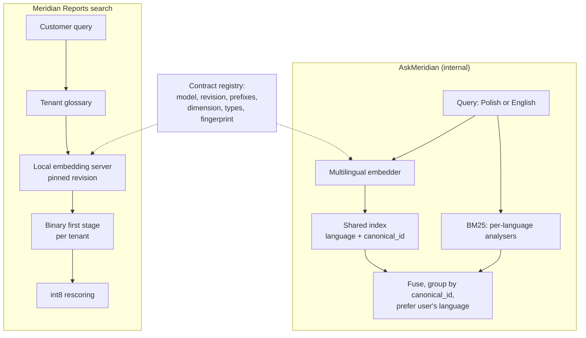

This assessment covers the whole Embedding Models module: hosted APIs from OpenAI and Cohere, the Sentence Transformers library, the BGE, E5, Nomic and Jina model families, multilingual and domain-specific models, and running models on your own hardware. The quiz mixes beginner, intermediate and advanced questions; aim for at least 80 per cent (15 of 18) before moving on. The open sections that follow have hidden model answers: write your own answer first, then compare.

```quiz
[
  {
    "q": "You index Meridian's handbook with an E5 model, encoding every chunk with the prefix \"passage: \". Which is correct for user queries?",
    "options": [
      "Encode them with \"passage: \" so both sides match",
      "Encode them with \"query: \"",
      "Encode them with no prefix",
      "Encode them with \"search_query: \""
    ],
    "answer": 1,
    "why": "E5 models were trained with \"query: \" on queries and \"passage: \" on passages for asymmetric retrieval. \"search_query: \" is Nomic's convention."
  },
  {
    "q": "Which statement about the OpenAI text-embedding-3 models' dimensions parameter is correct?",
    "options": [
      "It pads vectors with zeros to the requested size",
      "It switches to a different, smaller model behind the scenes",
      "It returns a shortened embedding, which works because the models were trained so that leading dimensions carry the most information",
      "It is only available for text-embedding-ada-002"
    ],
    "answer": 2,
    "why": "The text-embedding-3 models support shortening through the dimensions parameter, a Matryoshka-style property of their training."
  },
  {
    "q": "A chunk of 400 tokens is embedded with all-MiniLM-L6-v2 through Sentence Transformers. What happens to tokens beyond the window?",
    "options": [
      "They are discarded silently before the model sees them",
      "They are averaged into the last position",
      "Sentence Transformers raises a ValueError",
      "They are embedded as a second vector and averaged"
    ],
    "answer": 0,
    "why": "Inputs longer than max_seq_length (256 for this model) are truncated without an error."
  },
  {
    "q": "Which Nomic prefix pair is correct for retrieval with nomic-embed-text?",
    "options": [
      "\"query: \" and \"passage: \"",
      "\"Represent this sentence for searching relevant passages: \" and no prefix",
      "\"retrieval.query\" and \"retrieval.passage\"",
      "\"search_query: \" and \"search_document: \""
    ],
    "answer": 3,
    "why": "Nomic's task prefixes are search_query and search_document (plus clustering and classification). The other options belong to E5, BGE and Jina v3 respectively."
  },
  {
    "q": "For BGE English v1.5 models, what does the documented query instruction do?",
    "options": [
      "It is prepended to short queries in retrieval to mark them as queries; passages are encoded without it",
      "It must be prepended to every passage at indexing time",
      "It switches the model into multilingual mode",
      "It enables sparse output"
    ],
    "answer": 0,
    "why": "BGE's instruction (\"Represent this sentence for searching relevant passages: \") is added to queries for short-query-to-passage retrieval; passages are encoded as they are."
  },
  {
    "q": "jina-embeddings-v3 selects a task-specific LoRA adapter per request. Which pairing is correct for a search index?",
    "options": [
      "text-matching for chunks, retrieval.query for queries",
      "retrieval.passage for chunks, retrieval.query for queries",
      "classification for both",
      "retrieval.query for both, so the vectors are comparable"
    ],
    "answer": 1,
    "why": "The retrieval adapters are trained as a pair: passages with retrieval.passage, queries with retrieval.query."
  },
  {
    "q": "A Cohere query service sends questions with input_type=\"search_document\". What do you observe?",
    "options": [
      "A 400 error on every request",
      "Vectors of a different dimension that the database rejects",
      "Valid vectors and normal-looking results, but lower retrieval quality",
      "Identical results, because input_type only affects billing"
    ],
    "answer": 2,
    "why": "The request is valid; the mismatch shows up only as worse rankings, which is why a test of the query path is needed."
  },
  {
    "q": "What does this print?\n```python\nimport numpy as np\nv = np.array([0.3, -0.2, 0.0, 0.7, -0.1, 0.4, 0.2, -0.5, 0.1, 0.6, -0.3, 0.2, 0.05, -0.05, 0.9, -0.9])\nprint(np.packbits(v > 0).nbytes)\n```",
    "options": ["16", "4", "1", "2"],
    "answer": 3,
    "why": "Sixteen dimensions become sixteen bits, packed eight to a byte: 2 bytes."
  },
  {
    "q": "In the Cohere lesson's measurement, binary search alone kept about 70 per cent of the float top 10, and binary with rescoring of 40 candidates kept 99 per cent. Why does rescoring help so much?",
    "options": [
      "Most true neighbours are still among the binary top 40, and a finer score re-sorts them",
      "Rescoring converts binary vectors back into exact floats",
      "Hamming distance equals cosine distance for unit vectors",
      "Rescoring searches a second, float index"
    ],
    "answer": 0,
    "why": "Binary distance is coarse but correlated with cosine; widening the candidate set captures the true neighbours and int8 scores re-order them."
  },
  {
    "q": "An English-only model ranks the right English chunk first for most German questions, but with scores near 0.08 compared with about 0.53 for English questions. What should you conclude?",
    "options": [
      "German is supported, because the rankings are correct",
      "The model is matching shared strings, not meaning, and German support should not be trusted",
      "The scores need recalibrating with a temperature",
      "German needs a higher-dimensional model"
    ],
    "answer": 1,
    "why": "Near-zero scores mean no real semantic match; borrowed words and digits produced the correct rankings by luck."
  },
  {
    "q": "In multilingual knowledge distillation, the student model is trained to...",
    "options": [
      "translate each sentence into English before embedding it",
      "reproduce the teacher's vector for an English sentence from both that sentence and its translation",
      "predict the language of each sentence",
      "maximise the distance between languages"
    ],
    "answer": 1,
    "why": "The loss pulls the student's vectors for the source and its translation onto the teacher's vector for the source."
  },
  {
    "q": "A team plans to use a domain language model trained only with masked-language modelling on legal text as its retriever. What is the main risk?",
    "options": [
      "It cannot be loaded on a CPU",
      "Its vocabulary has no legal terms",
      "Without contrastive retrieval training, mean-pooled outputs may retrieve worse than a general-purpose retriever",
      "It produces sparse rather than dense vectors"
    ],
    "answer": 2,
    "why": "A domain language model learns domain usage, not the query-to-passage geometry retrieval needs."
  },
  {
    "q": "Engineers ask AskMeridian about \"the bus\", their nickname for Meridian Relay, and get the wrong runbook. What is the cheapest effective remedy?",
    "options": [
      "A glossary that expands \"the bus\" to \"Meridian Relay\" at query or index time",
      "Fine-tuning a 7-billion-parameter embedding model",
      "Switching to a biomedical domain model",
      "Increasing top-k from 5 to 50"
    ],
    "answer": 0,
    "why": "Company dialect is unknown to every public model; a glossary connects the alias to the documents' vocabulary."
  },
  {
    "q": "A 335-million-parameter model is loaded in float32 in each of 8 worker processes on one host. Roughly how much memory do the weights use in total?",
    "options": ["1.3 GB", "2.7 GB", "5.4 GB", "10.7 GB"],
    "answer": 3,
    "why": "335 million times 4 bytes is about 1.34 GB per copy; eight copies are about 10.7 GB."
  },
  {
    "q": "A batch contains texts of 20, 20, 20, 20 and 220 tokens. What is its padding efficiency?",
    "options": ["27.3 per cent", "20 per cent", "50 per cent", "36.4 per cent"],
    "answer": 0,
    "why": "Useful tokens are 300; computed positions are 5 times 220, which is 1,100; 300 / 1,100 is about 27.3 per cent."
  },
  {
    "q": "Why should a production service load a Hugging Face model with a pinned revision and offline mode?",
    "options": [
      "Pinned revisions run faster on GPUs",
      "So that repository updates cannot change the vectors, and start-up does not depend on reaching the Hub",
      "Offline mode enables float16 automatically",
      "Hugging Face requires it for commercial use"
    ],
    "answer": 1,
    "why": "An unpinned name tracks the latest files, which can change query vectors against an old index; offline loading removes a network dependency."
  },
  {
    "q": "Meridian's index was built with embed-english-v3.0. A developer proposes switching queries to embed-v4.0 at 1,024 dimensions \"since the dimensions match\". What is the correct response?",
    "options": [
      "Agree; equal dimensions make the vectors comparable",
      "Agree, provided both are normalised",
      "Disagree; vectors from different models live in different spaces, so the corpus must be re-embedded with the new model",
      "Disagree; v4 only produces 1,536 dimensions"
    ],
    "answer": 2,
    "why": "Dimension count is not compatibility. Queries and documents must come from the same model and version."
  },
  {
    "q": "You must choose between an 8,192-token model embedding whole 5,000-token manuals and a 512-token model with 300-token chunks. Which queries favour the chunked design?",
    "options": [
      "Broad questions about what a manual covers",
      "Narrow questions whose answer is one sentence in a long manual",
      "Queries in the manual's own language",
      "Queries that contain the manual's title"
    ],
    "answer": 1,
    "why": "Mean pooling over thousands of tokens dilutes a narrow fact; smaller chunks keep it prominent in its vector."
  }
]
```

## Conceptual questions

**1.** Several model families in this module distinguish queries from documents: E5 and Nomic with text prefixes, BGE with a query instruction, Jina v3 with task adapters, Cohere with `input_type`. Why does asymmetric encoding help retrieval, and what single failure do all these mechanisms share?

<details><summary>Show model answer</summary>

Queries and documents differ in form: a query is short, often a question, and describes what is wanted; a passage is longer, declarative, and contains the answer. A single symmetric encoder must put a question near its answer even though the two look nothing alike. Marking which side a text is on lets the model learn two slightly different mappings that meet in the middle, which is what its contrastive training optimised.

The shared failure is silent mismatch. In every mechanism, encoding with the wrong marker (or none) still returns a valid vector of the right size, so nothing fails, and retrieval quality drops. The defence is the same for all of them: centralise embedding calls behind one interface where the side is a required argument, store the convention with the index, and keep a small known-answer test on the query path.

</details>

**2.** Explain the difference between truncation and dilution, and why a long-context embedding model fixes one but not the other.

<details><summary>Show model answer</summary>

Truncation happens when an input exceeds the model's window: the excess tokens are discarded before the model runs, so information in them has no effect on the vector. Dilution happens when a text fits but is long: mean pooling averages all token vectors, so a fact expressed in a few tokens contributes a small share of the result. In the simplified model from the Jina lesson, $f$ fact tokens among $n$ others give a cosine of $f/\sqrt{f^2+n^2}$ with the fact's direction.

A long-context model removes truncation by raising the window (to 8,192 tokens for Jina v2 and v3, Nomic and BGE-M3), but averaging over more tokens makes dilution worse, not better. Chunk size therefore still matters. Late chunking uses the long window differently: it encodes the whole document once and pools per chunk, so each chunk's vector reflects document context without being diluted by the whole document.

</details>

**3.** Compare the economics of a hosted embedding API and a local model for a corpus that is re-embedded often. Which numbers would you collect to decide?

<details><summary>Show model answer</summary>

A hosted API costs (tokens embedded) × (price per token) on every pass, including every full re-embedding when chunking, model or metadata changes, plus a per-query cost. It needs no hardware or operations, scales without planning, and may retire models on its own schedule. A local model costs hardware whether busy or idle, plus engineering time for serving, pinning, monitoring and upgrades, but its marginal cost per pass is small.

Collect: corpus size in tokens (with your tokeniser), expected re-embedding frequency, query volume, the current price per token, measured local throughput on candidate hardware, hardware cost per hour, and the retrieval quality of the hosted and local candidates on your own evaluation set. Data-control requirements can override the arithmetic: if text may not leave your infrastructure, only local or private-deployment options remain.

</details>

**4.** A colleague says, "We serve users in English, Polish and Japanese, so we just need a multilingual model." What else must the design decide?

<details><summary>Show model answer</summary>

Whether the task is multilingual retrieval (each language searching its own documents) or cross-lingual (queries in one language, answers in another), because models differ in each. Whether to use one shared index or per-language indexes, and how to handle language bias in a shared index (for example, a `language` field and a translation-group identifier so the user's language version is preferred and stale translations are detected). How lexical search will work, since BM25 needs per-language analysers (Japanese needs segmentation). How proper nouns and codes, which translation and embeddings both handle poorly, stay findable. Which language the generator answers in. And how evaluation is reported: per language, with native-speaker queries, since an average dominated by English hides failures.

</details>

**5.** When is a domain-specific embedding model the right answer, and what would you try first?

<details><summary>Show model answer</summary>

It is the right answer when per-type evaluation shows that a strong general model fails specifically on domain terminology and relationships (for example, clinical abbreviations or drug synonyms), and the failure persists after adding a lexical channel and trying a larger general model. Before that, try the cheaper remedies matched to the gap: a lexical channel for identifiers and codes, a glossary for company dialect, and a stronger general model. A domain model must also be a trained retriever (contrastive training on in-domain pairs), not just a domain language model, and its licence must fit. If no off-the-shelf model closes the gap, fine-tuning on your own query-passage pairs is the next step.

</details>

## Coding exercises

**1.** Write `audit_window(chunks, model)`, which returns the model's window, the number of chunks that exceed it, the longest chunk in tokens, and the share of all tokens that would be lost to truncation. Count tokens with the model's own tokeniser. Test it on four chunks made of 1, 3, 6 and 10 repetitions of a two-sentence Meridian policy.

<details><summary>Show solution</summary>

```python
import numpy as np
from sentence_transformers import SentenceTransformer

def audit_window(chunks, model):
    """Report how many chunks exceed the model's window and how many tokens are lost."""
    limit = model.max_seq_length
    lengths = np.array([len(model.tokenizer(c)["input_ids"]) for c in chunks])  # includes special tokens
    over = lengths > limit
    lost = np.clip(lengths - limit, 0, None).sum()
    return {
        "window": limit,
        "chunks": len(chunks),
        "over_window": int(over.sum()),
        "max_tokens": int(lengths.max()),
        "share_of_tokens_lost": round(float(lost / lengths.sum()), 3),
    }

model = SentenceTransformer("sentence-transformers/all-MiniLM-L6-v2")
policy = ("Annual leave is 25 days; up to 5 unused days carry over and must be used by 31 March. "
          "Staff may work remotely up to 3 days a week; the home-office equipment budget is £400. ")
chunks = [policy * n for n in (1, 3, 6, 10)]
print(audit_window(chunks, model))
```

```output
{'window': 256, 'chunks': 4, 'over_window': 1, 'max_tokens': 422, 'share_of_tokens_lost': 0.196}
```

One chunk of four exceeds the 256-token window, and about a fifth of all tokens in this sample would never reach the model. In a real pipeline, run the audit on a sample of every new corpus and fail the build if `over_window` is above zero.

</details>

**2.** An index is only valid while its embedding contract holds. Write `contract(...)`, which records the model name, revision, prefix, normalisation flag, dimension, window and the first eight components of the vector of a fixed probe sentence, and `check(stored, current)`, which lists every difference (with a tolerance for the probe). Show that it catches an added prefix and a changed window.

<details><summary>Show solution</summary>

```python
import json
import numpy as np
from sentence_transformers import SentenceTransformer

PROBE = "Laptops are refreshed every 3 years."

def contract(model_name, revision, prefix, normalise, model):
    vec = model.encode([prefix + PROBE], normalize_embeddings=normalise)[0]
    return {
        "model": model_name, "revision": revision, "prefix": prefix,
        "normalise": normalise, "dim": int(vec.shape[0]),
        "max_seq_length": model.max_seq_length,
        "probe": [round(float(x), 4) for x in vec[:8]],
    }

def check(stored, current, tol=1e-3):
    problems = [k for k in ("model", "revision", "prefix", "normalise", "dim", "max_seq_length")
                if stored[k] != current[k]]
    drift = float(np.abs(np.array(stored["probe"]) - np.array(current["probe"])).max())
    if drift > tol:
        problems.append(f"probe drift {drift:.4f}")
    return problems or ["ok"]

name, rev = "sentence-transformers/all-MiniLM-L6-v2", "1110a243fdf4706b3f48f1d95db1a4f5529b4d41"
model = SentenceTransformer(name, revision=rev)
stored = contract(name, rev, "", True, model)              # saved with the index at build time
print(json.dumps(stored)[:120] + "...")

print("same config:      ", check(stored, contract(name, rev, "", True, model)))
print("prefix added:     ", check(stored, contract(name, rev, "query: ", True, model)))
model.max_seq_length = 128
print("window changed:   ", check(stored, contract(name, rev, "", True, model)))
model.max_seq_length = 256
print("not normalised:   ", check(stored, contract(name, rev, "", False, model)))
```

```output
{"model": "sentence-transformers/all-MiniLM-L6-v2", "revision": "1110a243fdf4706b3f48f1d95db1a4f5529b4d41", "prefix": ""...
same config:       ['ok']
prefix added:      ['prefix', 'probe drift 0.0373']
window changed:    ['max_seq_length']
not normalised:    ['normalise']
```

The prefix change is caught twice: by the configuration comparison and by the probe vector moving. The window change is caught by configuration only, because the short probe sentence fits either window; that is why the check records settings as well as a fingerprint. The last line is instructive: this model ends with its own normalisation layer, so turning off `normalize_embeddings` does not change its vectors, yet the contract still flags it, because the same setting would matter for a model without that layer. Store the contract as JSON next to the index and run `check` at service start-up.

</details>

## Architecture design challenge

Meridian is extending AskMeridian in two directions at once. Staff in the Kraków office will ask in Polish and English about the employee handbook (owned by HR, partly translated into Polish) and the IT runbooks (English only). Separately, Meridian Reports will offer search over each customer's own exported reports; some customers are hospitals whose data may not leave Meridian's cloud account. The internal corpus is about 300,000 chunks; customer corpora total about 40 million chunks and grow daily. Design the embedding layer: model choices, hosted or local, compression, index layout, versioning and evaluation. State your trade-offs.

<details><summary>Show reference design</summary>

**Two workloads, two decisions.** The internal assistant is small and multilingual; the customer product is large, growing and has a hard data-residency constraint. Treating them as one problem would force the strictest constraint on both.

**Internal assistant.** Use one multilingual retriever (open weights such as multilingual E5 or BGE-M3, or a hosted multilingual model if policy allows) over a single shared index. Each chunk carries `language`, `canonical_id` (linking translations) and `source`. Retrieval groups by `canonical_id` and prefers the user's language version, falling back to English, which counters language bias and covers the English-only runbooks. A BM25 channel with Polish and English analysers handles runbook numbers and Atlas error codes, and a glossary handles internal aliases. At 300,000 chunks, float32 at 1,024 dimensions is about 1.2 GB, so no compression is needed.

**Customer search.** Data may not leave Meridian's account, so run a local model behind an embedding server (TEI or similar) with a pinned revision baked into the image. Forty million chunks at 1,024 float32 dimensions is about 164 GB of raw vectors; int8 brings that to about 41 GB, and a binary first stage (about 5 GB) with int8 rescoring keeps the hot path in memory. Tenants are isolated by collection or by a mandatory tenant filter. Hospitals may need domain fit: a per-tenant glossary is the first remedy, and a biomedical retriever is evaluated for clinical tenants only if per-type evaluation shows a terminology gap.



**Versioning.** Each index stores its embedding contract and a probe fingerprint; services refuse to start if theirs differs. A model change means building a new index alongside the old and switching over (see [index versioning](/learn/ci-cd-and-mlops/index-versioning)), never mixing vectors from two models.

**Evaluation.** Internal: labelled Polish and English queries reported separately, including Polish questions whose answer exists only in English. Product: a small labelled set per large tenant at onboarding, reported per query type (plain, codes, clinical terminology, dialect), plus overlap of binary-plus-rescoring with float search on a sample.

**Trade-offs.** One multilingual model is simpler than query translation but may be weaker in Polish than a translated English pipeline; measure both. Local hosting satisfies residency but makes Meridian responsible for throughput: at a measured 800 chunks per second per GPU, the 40 million chunks take about 14 hours on one GPU, so a full re-embed needs several GPUs or a longer window. Binary compression saves memory at a small, measurable cost in ranking, recovered mostly by rescoring.

</details>

## Troubleshooting scenarios

**1.** The Platform team switched AskMeridian from all-MiniLM-L6-v2 to a Nomic model, re-embedded the corpus, and saw retrieval quality *fall* on the evaluation set, although the new model scores much higher on public benchmarks. Normalisation and dimensions are correct.

<details><summary>Show diagnosis and fix</summary>

The most likely cause is missing task prefixes. Nomic's models expect `search_document: ` on chunks and `search_query: ` on queries; MiniLM needed none, so the migration copied prefix-free code. Inspect the exact strings sent to the model on both paths. Fix by adding the prefixes, re-embedding the corpus, and adding the prefix to the stored embedding contract so that a future change is caught. Also check the second most likely cause: chunk size tuned for MiniLM's 256-token window may no longer be optimal for an 8,192-token model, which is worth re-testing once the prefixes are fixed.

</details>

**2.** Support staff report that AskMeridian explains what Atlas errors mean but almost never how to fix them. The runbooks contain the fixes, and they are in the index.

<details><summary>Show diagnosis and fix</summary>

Suspect truncation. Run the window audit from the coding exercises on the runbook chunks. If many chunks exceed the model's window and the fix steps sit late in each chunk (diagnosis first, fix later is a typical runbook layout), the fixes were never embedded. Fixes, in order of cost: shrink chunks to fit the window, ideally splitting at headings so diagnosis and fix become separate retrievable units; or move to a long-context model with moderate chunks and late chunking. Add the audit to the ingestion pipeline so it fails on over-long chunks. Error codes also deserve a lexical channel, since dense retrieval confuses near-identical codes such as E-4021 and E-4012.

</details>

**3.** After a routine redeploy of the query service, retrieval quality dropped slightly: most results are the same, but rankings near the cut-off have changed. No code changed, and the index was not rebuilt.

<details><summary>Show diagnosis and fix</summary>

The query vectors probably changed while the index stayed the same. Typical causes: the model was loaded by name without a pinned revision and the repository had been updated, so the new container downloaded different weights or configuration; or a dependency upgrade changed tokenisation, pooling or default maximum length. Compare the probe fingerprint and configuration of the running service with those stored at index build time; a difference confirms it. Fix by pinning the revision to the one the index was built with, baking model files into the image, setting `HF_HUB_OFFLINE=1`, and adding a start-up check that refuses to serve when the contract differs. If the new model version is wanted, re-embed the corpus into a new index and switch over.

</details>
