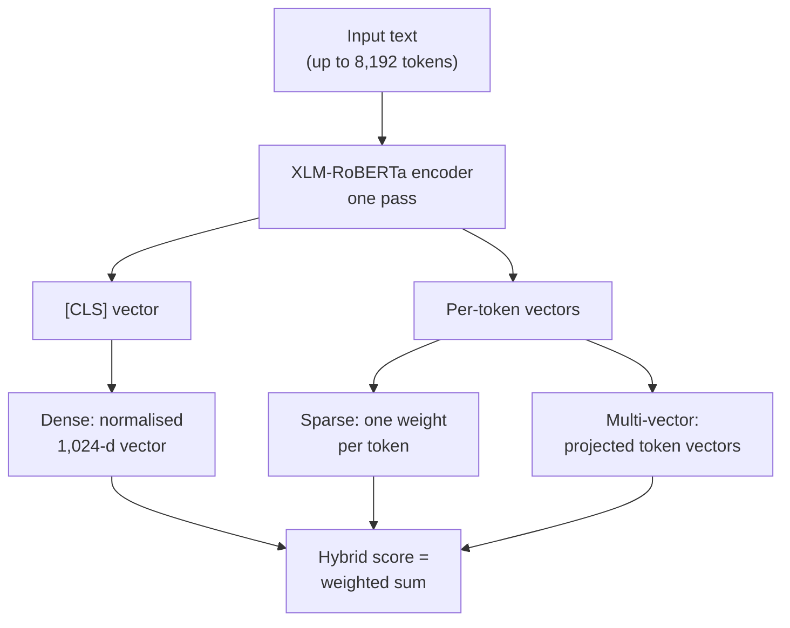

BGE ("BAAI General Embedding") is a family of open embedding models from the Beijing Academy of Artificial Intelligence. Since the first release in 2023, BGE models have been among the most widely deployed open embedders in RAG systems: they are small enough to run on a CPU, published under permissive licences, loadable with [Sentence Transformers](/learn/embedding-models/sentence-transformers), and competitive on public retrieval benchmarks. The family has grown from English and Chinese text encoders into multilingual, long-context and multi-function models, plus a set of rerankers.

This lesson explains what makes BGE models behave as they do: how they were trained, why they use CLS pooling, what the query instruction is for and when it helps, and how BGE-M3 produces dense, sparse and multi-vector representations from a single pass. The main code example is a real measurement on a public benchmark, so you will see by how much each of these choices actually moves retrieval quality, and why the answer is "less than you might think" for some of them and "a lot" for others.

## Learning objectives

- Describe BGE's three-stage training recipe and explain how it shapes the models' behaviour.
- Use a BGE v1.5 model correctly: CLS pooling, normalisation, and the query instruction applied to queries only.
- Measure the effect of the instruction and of pooling on a benchmark with nDCG@10 and Recall@10, and interpret the result.
- Explain BGE-M3's dense, sparse (lexical) and multi-vector outputs, and compute a lexical-matching score and a hybrid score by hand.
- Choose between BGE variants for a given corpus, language mix and latency budget.

## Prerequisites

- [Sentence Transformers](/learn/embedding-models/sentence-transformers): modules, pooling and `encode`.
- [OpenAI embeddings](/learn/embedding-models/openai-embeddings): the hosted alternative and the idea of one vector space per model.
- [Dense versus sparse retrieval](/learn/hybrid-search/dense-versus-sparse-retrieval): why exact terms and meaning are complementary signals.
- [NDCG](/learn/retrieval-evaluation/ndcg): the ranking metric used in the experiment.

## Why this matters

Open models are where RAG teams have the most control and the most rope. A hosted API makes the pooling, normalisation and input handling decisions for you; an open model hands them to you, together with a model card full of advice that may or may not apply to your data. BGE is a good family to learn this on because its model cards are explicit about how it should be used (pooling, instruction, similarity ranges) and because it has variants for most situations a RAG team meets.

Three practical problems recur with BGE in production:

- **The instruction is applied in the wrong place.** It belongs on queries only. Teams that add it to passages, or to both sides, or forget it on one service but not another, get vectors that are subtly off.
- **Score thresholds are copied from another model.** BGE cosine scores live in a narrow, high band. A "relevance threshold" of 0.5 tuned on MiniLM accepts almost everything from BGE.
- **The variant is chosen by leaderboard rank alone.** `bge-large` is three times the compute of `bge-base` and ten times that of `bge-small`. On many corpora the gain does not justify it; on some it does. Only a measurement on your own data tells you which.

## The intuition

Think of training a BGE model as training a new librarian in three stages.

First, the trainee **reads widely** and practises reconstructing damaged pages from a brief summary of each. This forces them to compress a whole page into a short summary that keeps what matters, which is exactly the skill an embedding needs.

Second, the trainee is shown **hundreds of millions of matched pairs**, such as a question and its answer or a title and its article, and is drilled on picking the true partner out of a large crowd of wrong ones. The larger the crowd, the finer the distinctions they learn.

Third, the trainee is coached on **specific jobs** with labelled examples and deliberately confusing wrong answers, and is told which job they are doing by a short spoken instruction: "this is a search question; find the passage that answers it." That instruction is the query instruction you will see in the code.

BGE-M3 adds one more skill: the librarian learns to give three kinds of answer at once (a general gist, a list of important keywords with weights, and a word-by-word fingerprint), and the three are trained to agree with one another.

## How it works

### The model family

| Model | Dimensions | Max tokens | Notes |
| --- | --- | --- | --- |
| `bge-small-en-v1.5` | 384 | 512 | About 33 million parameters; CPU-friendly |
| `bge-base-en-v1.5` | 768 | 512 | About 110 million parameters |
| `bge-large-en-v1.5` | 1,024 | 512 | About 335 million parameters |
| `bge-m3` | 1,024 | 8,192 | Multilingual; dense, sparse and multi-vector outputs |

There are matching Chinese models (`bge-*-zh-v1.5`, with a Chinese-language query instruction), rerankers covered in [BGE rerankers](/learn/reranking-models/bge-rerankers), and newer LLM-based embedders that are much larger. Licences and parameter counts are as stated on the model cards at the time of writing; check the card for the exact model you deploy.

### Training: three stages

The C-Pack paper (Xiao and colleagues, 2023), which introduced the BGE models alongside a Chinese benchmark and training corpus, describes a recipe in three stages:

1. **Retrieval-oriented pre-training.** The encoder is pre-trained on plain text with a RetroMAE-style objective: the sentence vector (from the `[CLS]` position) must carry enough information for a weak decoder to reconstruct a heavily masked copy of the input. Because the decoder is deliberately weak, the burden falls on the sentence vector, which is trained to be a good summary.
2. **General contrastive fine-tuning.** The model is trained on a very large collection of weakly related text pairs with an in-batch-negatives contrastive loss: for each query, its own partner is the positive and every other partner in the batch is a negative. Large batches, and therefore many negatives per step, are a distinguishing feature of this stage. [Contrastive learning](/learn/embedding-optimisation/contrastive-learning) explains the loss.
3. **Task-specific fine-tuning.** Smaller, labelled datasets for retrieval, similarity and other tasks, with [hard negatives](/learn/embedding-optimisation/hard-negative-mining) and with an instruction prepended to the query for retrieval tasks, so that the model learns to adapt its query representation to the task.

Two behaviours follow from this recipe. Because the pre-training puts the summary in the `[CLS]` vector, **BGE uses CLS pooling**: the sentence embedding is the transformer's output at the first position, then L2-normalised. And because retrieval fine-tuning used an instruction on queries, the model **can** benefit from it on short-query retrieval.

### The query instruction

For the English v1.5 models the instruction is:

```text
Represent this sentence for searching relevant passages: 
```

It is prepended to the **query only**, for retrieval tasks where a short query looks for longer passages. Passages are always encoded without it. The v1.5 release was specifically intended to work well **without** the instruction too; the model card describes the v1.5 models as improving retrieval when no instruction is used, and recommends trying both. That advice is the right one: the instruction's effect depends on how much your queries look like the short search questions it was trained on.

The instruction matters for two reasons beyond quality. It changes every query vector, so a mix of instructed and uninstructed queries against one index gives inconsistent scores. And it shifts score levels, so a threshold tuned with the instruction must be retuned without it.

### Score distribution

BGE's cosine similarities occupy a compressed, high range. The v1 model card noted that scores mostly fell between about 0.6 and 1 and said v1.5 alleviated this. Even so, for v1.5, unrelated texts still often score around 0.4 to 0.6, as you will see in the code output. This is a property of how contrastive training with a low temperature shapes the space (the mathematics is in [E5 models](/learn/embedding-models/e5-models)), and it has a direct consequence: **a cosine of 0.6 means nothing on its own.** Ranking is unaffected; any absolute threshold must be calibrated for this model on your data.

### BGE-M3: three outputs from one pass

BGE-M3 (Chen and colleagues, 2024) is the family's multi-everything model: **multi-lingual** (over 100 languages), **multi-granularity** (inputs up to 8,192 tokens) and **multi-functional**. One forward pass of its XLM-RoBERTa-based encoder produces three representations:

1. **Dense.** The normalised `[CLS]` vector, 1,024 dimensions, used like any other embedding.
2. **Sparse (lexical weights).** For each input token, a small learned layer outputs a non-negative weight. The result is a bag of tokens with weights, like a learned version of BM25's term weights. The lexical score of a query and a document is the sum, over tokens they share, of the product of their weights.
3. **Multi-vector.** The per-token output vectors are kept (after a projection) and scored ColBERT-style: each query token finds its best-matching document token, and the scores are averaged. [Late interaction](/learn/reranking-models/late-interaction) explains this.



The three heads are trained jointly with **self-knowledge distillation**: the combined score of all three acts as a teacher signal for each head individually, so that they learn from one another. In practice teams often use the dense output in their vector database and the sparse output either in a search engine that supports weighted terms or in a reranking step. Storing multi-vector outputs for every document is expensive (one vector per token), so they are usually reserved for reranking a short candidate list.

BGE-M3 does not use a query instruction. Its main cost is size: it has roughly 568 million parameters, about seventeen times `bge-small`.

The FlagEmbedding library from the same team exposes all three outputs. The block below follows the project's documented interface; it needs the `FlagEmbedding` package and a 2 GB model download, and was not executed here.

```python
from FlagEmbedding import BGEM3FlagModel

model = BGEM3FlagModel("BAAI/bge-m3", use_fp16=True)
query = ["What does Atlas error E-4021 mean?"]
docs = ["Atlas error E-4021 means the VPN client is out of date; update it from the IT portal.",
        "Meridian Sync keeps files up to date across devices."]

q = model.encode(query, return_dense=True, return_sparse=True, return_colbert_vecs=True)
d = model.encode(docs, return_dense=True, return_sparse=True, return_colbert_vecs=True)

dense = q["dense_vecs"] @ d["dense_vecs"].T
lexical = [model.compute_lexical_matching_score(q["lexical_weights"][0], w) for w in d["lexical_weights"]]
multi = [model.colbert_score(q["colbert_vecs"][0], v) for v in d["colbert_vecs"]]
print(dense, lexical, multi)
```

## The mathematics

### Lexical-matching score

**Intuition.** A sparse representation says how important each token is to a text. Two texts match lexically to the extent that they share important tokens.

$$
s_{\text{lex}}(q, d) = \sum_{t \in q \cap d} w_{q,t} \, w_{d,t}
$$

$q \cap d$ is the set of tokens present in both the query and the document, and $w_{q,t}$ and $w_{d,t}$ are the learned non-negative weights of token $t$ in each. Tokens in only one of the two contribute nothing.

**By hand.** Query weights: vpn 0.30, e 0.05, 4021 0.40. Document weights: vpn 0.20, 4021 0.35, client 0.25, update 0.15.

- Shared tokens: vpn and 4021 ("e" is not in the document).
- $s_{\text{lex}} = 0.30 \times 0.20 + 0.40 \times 0.35 = 0.06 + 0.14 = 0.20$.

### Hybrid score

**Intuition.** The three scores capture different evidence, so combine them with weights that reflect how much you trust each.

$$
s(q, d) = w_1 \, s_{\text{dense}} + w_2 \, s_{\text{lex}} + w_3 \, s_{\text{multi}}
$$

$s_{\text{dense}}$ is the cosine of the dense vectors, $s_{\text{lex}}$ the lexical score above, $s_{\text{multi}}$ the multi-vector score, and $w_1, w_2, w_3$ non-negative weights chosen on validation data. The three scores have different ranges, so the weights also act as scale corrections; [Weighted score fusion](/learn/hybrid-search/weighted-score-fusion) discusses this.

**By hand.** With $s_{\text{dense}} = 0.62$, $s_{\text{lex}} = 0.20$, $s_{\text{multi}} = 0.70$ and weights $0.4, 0.2, 0.4$: $0.248 + 0.040 + 0.280 = 0.568$.

```python
# Lexical-matching score: sum over shared tokens of query weight times document weight
q_w = {"vpn": 0.30, "e": 0.05, "4021": 0.40}
d_w = {"vpn": 0.20, "4021": 0.35, "client": 0.25, "update": 0.15}
shared = q_w.keys() & d_w.keys()
s_lex = sum(q_w[t] * d_w[t] for t in shared)
print("shared tokens:", sorted(shared), "| s_lex =", round(s_lex, 4))

# Hybrid score: weighted sum of the dense, sparse and multi-vector scores
s_dense, s_multi = 0.62, 0.70
w_dense, w_lex, w_multi = 0.4, 0.2, 0.4
s_hybrid = w_dense * s_dense + w_lex * s_lex + w_multi * s_multi
print("hybrid =", round(s_hybrid, 4))
```

```output
shared tokens: ['4021', 'vpn'] | s_lex = 0.2
hybrid = 0.568
```

## In code

**The problem.** Before adopting `bge-small-en-v1.5`, the AskMeridian team wants evidence, not model-card claims: does BGE beat the MiniLM model they already run, does the query instruction help, and how much does using the wrong pooling cost? Their own evaluation set is still being labelled, so they rehearse the method on SciFact, a public benchmark from the BEIR collection: 5,183 scientific abstracts and 300 test claims, each with known relevant abstracts.

**Dependencies.** About 220 MB of model and data downloads on first run; the script takes a few minutes on a laptop CPU.

```bash
pip install sentence-transformers pandas pyarrow huggingface_hub
```

**The source.**

```python
import numpy as np
import pandas as pd
import torch
from huggingface_hub import hf_hub_download
from sentence_transformers import SentenceTransformer

INSTRUCTION = "Represent this sentence for searching relevant passages: "

# --- SciFact from the BEIR benchmark: 5,183 abstracts, 300 test claims ---
def get(repo, path):
    return hf_hub_download(repo, path, repo_type="dataset")

corpus = pd.read_parquet(get("BeIR/scifact", "corpus/corpus-00000-of-00001.parquet"))
queries = pd.read_parquet(get("BeIR/scifact", "queries/queries-00000-of-00001.parquet"))
qrels = pd.read_csv(get("BeIR/scifact-qrels", "test.tsv"), sep="\t", dtype=str)
relevant = qrels.groupby("query-id")["corpus-id"].apply(set).to_dict()
queries = queries[queries["_id"].isin(relevant)].reset_index(drop=True)
doc_ids = corpus["_id"].to_numpy()
doc_texts = (corpus["title"] + ". " + corpus["text"]).tolist()


def ndcg_recall_at_10(Q, D):
    top = np.argsort(-(Q @ D.T), axis=1)[:, :10]
    ndcg, recall = [], []
    for i, qid in enumerate(queries["_id"]):
        rel = relevant[qid]
        hits = [doc_ids[j] in rel for j in top[i]]
        dcg = sum(h / np.log2(r + 2) for r, h in enumerate(hits))
        ideal = sum(1 / np.log2(r + 2) for r in range(min(len(rel), 10)))
        ndcg.append(dcg / ideal)
        recall.append(sum(hits) / len(rel))
    return np.mean(ndcg), np.mean(recall)


def mean_pooled(model, texts):
    """Deliberately wrong for BGE: average token vectors instead of taking [CLS]."""
    tokens = model.encode(texts, output_value="token_embeddings")
    v = torch.stack([t.mean(dim=0) for t in tokens]).numpy()
    return v / np.linalg.norm(v, axis=1, keepdims=True)


bge = SentenceTransformer("BAAI/bge-small-en-v1.5", device="cpu")
mini = SentenceTransformer("sentence-transformers/all-MiniLM-L6-v2", device="cpu")
for m in (bge, mini):
    m.max_seq_length = 256          # keeps CPU time down; BGE itself accepts 512
print("BGE pooling:", bge[1].get_config_dict()["pooling_mode"])

claims = queries["text"].tolist()
D_bge = bge.encode(doc_texts, normalize_embeddings=True)         # passages never get the instruction
D_mini = mini.encode(doc_texts, normalize_embeddings=True)

runs = {
    "MiniLM baseline": (mini.encode(claims, normalize_embeddings=True), D_mini),
    "BGE, no instruction": (bge.encode(claims, normalize_embeddings=True), D_bge),
    "BGE, with instruction": (bge.encode([INSTRUCTION + c for c in claims], normalize_embeddings=True), D_bge),
    "BGE, mean pooling (wrong)": (mean_pooled(bge, [INSTRUCTION + c for c in claims]),
                                  mean_pooled(bge, doc_texts)),
}
for name, (Q, D) in runs.items():
    ndcg, recall = ndcg_recall_at_10(Q, D)
    S = Q @ D.T
    print(f"{name:<27} nDCG@10 {ndcg:.3f}  Recall@10 {recall:.3f}  "
          f"cosine median {np.median(S):.2f}  99th pct {np.percentile(S, 99):.2f}")
```

The output below is from a CPU run with sentence-transformers 6.3. Exact figures can differ slightly across library versions and hardware.

```output
BGE pooling: cls
MiniLM baseline             nDCG@10 0.648  Recall@10 0.788  cosine median 0.10  99th pct 0.39
BGE, no instruction         nDCG@10 0.709  Recall@10 0.828  cosine median 0.58  99th pct 0.72
BGE, with instruction       nDCG@10 0.703  Recall@10 0.816  cosine median 0.56  99th pct 0.69
BGE, mean pooling (wrong)   nDCG@10 0.699  Recall@10 0.815  cosine median 0.49  99th pct 0.63
```

**The important lines.**

- `bge[1].get_config_dict()["pooling_mode"]` reads the pooling module's configuration: `cls`, as the training recipe predicts.
- `D_bge` is encoded once, without any prefix. Only the queries change between the instructed and uninstructed runs, which is exactly how the instruction is meant to be used.
- `mean_pooled` takes the token vectors (`output_value="token_embeddings"`) and averages them, simulating someone who reimplements the pipeline and assumes mean pooling.
- `ndcg_recall_at_10` computes nDCG@10 (rewarding relevant abstracts near the top) and Recall@10 (the share of relevant abstracts found in the top 10), the two most common retrieval metrics. [Recall@K](/learn/retrieval-evaluation/recall-k) and [NDCG](/learn/retrieval-evaluation/ndcg) define them carefully.

**What the output means.**

- **Model choice is the big effect.** BGE-small beats MiniLM by about 6 points of nDCG@10 (0.709 against 0.648) at the same 384 dimensions. On this benchmark, changing model mattered far more than any setting.
- **The instruction did not help here.** Without it BGE scored 0.709; with it, 0.703. SciFact's queries are full declarative claims ("0-dimensional biomaterials lack inductive properties"), not the short search questions the instruction was trained for, and v1.5 was built to work without it. On short keyword-style questions the result can go the other way. This is the reason to measure rather than follow a rule.
- **Wrong pooling cost a little.** Mean pooling dropped nDCG@10 to 0.699. The damage is small here because mean and CLS vectors from the same network are correlated; it is still a free loss, and on other data it can be larger.
- **Scores live in different bands.** MiniLM's median query-abstract cosine is 0.10 and its 99th percentile 0.39; BGE's are 0.58 and 0.72. A threshold of 0.45 is strict for MiniLM and meaningless for BGE. Even the instruction moves BGE's band (median 0.58 to 0.56), so a threshold must be tuned for the exact configuration you deploy.
- A difference of 0.006 between two runs over 300 queries is within the range that a different query sample could reverse. Treat small gaps as "no clear difference", and use a larger evaluation set or a significance test before acting on them.

**Common errors.**

- `KeyError` in `relevant[qid]`: the query and qrel identifiers were read with different types. Reading the qrels with `dtype=str` avoids it.
- Very slow encoding: the corpus is encoded on CPU at up to 256 tokens per abstract. Use a GPU (`device="cuda"`) or a smaller sample while experimenting.

**Extending it.** Replace SciFact with your own question set and chunks; add `bge-base-en-v1.5` to see whether the larger model earns its cost on your data; and set `max_seq_length` to 512 to measure what truncation at 256 was costing.

## A real-world example

The AskMeridian team ran the same experiment on their own evaluation set of 300 staff questions labelled against the handbook and IT runbooks. `bge-small-en-v1.5` beat their MiniLM model clearly on the runbook questions, which use technical vocabulary, and modestly on the handbook questions. The instruction helped slightly on short questions such as "VPN on hotel Wi-Fi?" and made no measurable difference on long, fully phrased ones, so they kept it, applied in one place: the function that embeds queries, shared by the API service and the evaluation job.

The surprise came from the "no relevant answer" check. AskMeridian refused to answer when the best chunk's cosine was below 0.45, a threshold tuned on MiniLM. With BGE, almost every query cleared 0.45, including "What is the company's policy on pet insurance?", which nothing in the corpus covers, so the assistant stopped refusing and started improvising. The team re-derived the threshold from BGE's score distribution on their labelled set, then moved to a better design: a [cross-encoder reranker](/learn/reranking-fundamentals/cross-encoders) whose scores are more informative about absolute relevance, with the threshold applied to those ([Retrieval thresholding](/learn/advanced-retrieval-optimisation/retrieval-thresholding)).

Later, when Meridian's support desk started taking questions in French and German, the team evaluated `bge-m3` for the multilingual collection. Its dense output handled cross-language queries well, and its lexical weights let error codes such as E-4021 match exactly, but its encoding cost was many times that of `bge-small`. They kept `bge-small` for the English collection and used `bge-m3` only for the multilingual one; [Multilingual embeddings](/learn/embedding-models/multilingual-embeddings) covers that choice in general.

## Common mistakes

- **Adding the instruction to passages.** It is for queries only; instructed passages are encoded as if they were search questions, and matching degrades.
- **Applying the instruction inconsistently.** If the indexing job, the API and the evaluation harness each build query strings separately, one of them will eventually differ. Centralise query encoding in one function.
- **Reimplementing with mean pooling.** BGE expects CLS pooling. The damage may be small on one dataset and larger on another; there is no reason to accept it.
- **Copying score thresholds between models.** BGE's scores sit in a narrow, high band; thresholds must be calibrated per model.
- **Assuming the largest model is best for you.** Larger variants cost several times more compute per query and per document; measure whether the gain on your data is worth it.
- **Using BGE-M3's multi-vector output for the whole corpus without doing the arithmetic.** One 1,024-dimension vector per token multiplies storage by the average chunk length.

## Best practices

- Load BGE through Sentence Transformers so that pooling and normalisation come from the model's own configuration.
- Decide on the instruction by measurement on your own queries, then apply it in one shared query-encoding function and record the decision with the index.
- Start with `bge-small-en-v1.5` for English and move up a size only when an evaluation justifies it.
- Calibrate any absolute threshold on BGE's score distribution for your data, or apply thresholds to reranker scores instead.
- Consider BGE-M3 when you need many languages, long inputs, or learned sparse weights from the same model as your dense vectors.

## Performance considerations

**Compute per token** scales roughly with parameter count: taking small, base and large as about 33, 110 and 335 million parameters, base is about 3.3 times the work of small and large about 10 times. On a CPU, encoding a query of 20 tokens is fast for any of them; re-embedding a corpus of millions of chunks is where the multiplier hurts.

**Memory per vector** in `float32` is 1,536 bytes at 384 dimensions, 3,072 at 768 and 4,096 at 1,024. For 5 million chunks: about 7.7 GB, 15.4 GB and 20.5 GB respectively, before index overhead.

**BGE-M3 multi-vector storage** is per token: a 300-token chunk stores 300 vectors. At 1,024 dimensions in 16-bit floats that is $300 \times 1{,}024 \times 2 = 614{,}400$ bytes, about 0.6 MB per chunk, against 4 KB for one dense `float32` vector: 150 times more. That is why multi-vector scoring is usually reserved for reranking.

**Sequence length** matters more than model size for long inputs, because attention cost grows with the square of the sequence length. An 8,192-token input to BGE-M3 is far more expensive than sixteen separate 512-token inputs.

## Summary

- BGE models come from a three-stage recipe (retrieval-oriented pre-training, large-batch contrastive training, instruction-tuned task fine-tuning) that makes the `[CLS]` vector the sentence summary; use CLS pooling and normalise.
- The query instruction is for queries only and its benefit depends on your queries; v1.5 was designed to work without it. Measure, then apply it consistently.
- BGE cosine scores occupy a narrow high band; ranking is unaffected but thresholds must be calibrated per model.
- BGE-M3 produces dense, sparse and multi-vector outputs in one pass across 100+ languages and up to 8,192 tokens, at roughly seventeen times the size of `bge-small`.
- Choose the variant by measured retrieval quality against compute, memory and language needs, not by leaderboard rank.

## Exercises

1. A colleague encodes both passages and queries with the BGE instruction "to be consistent". Explain why this is wrong and how you would detect the problem with an evaluation set.

<details><summary>Show solution</summary>

The instruction tells the model "this text is a search query looking for passages". The model was trained with instructed queries against uninstructed passages, so instructed passages are represented as if they were queries, and the query-passage matching the model learned no longer applies cleanly. To detect it, run the evaluation harness with passages encoded both ways (queries instructed in both runs) and compare nDCG@10 and Recall@10; the uninstructed-passage run is the configuration the model was trained for and should be used unless your measurement says otherwise.

</details>

2. Compute the BGE-M3 lexical score for query weights {meridian: 0.2, reports: 0.5, csv: 0.6} and document weights {reports: 0.4, export: 0.3, csv: 0.5, pdf: 0.4}, then the hybrid score with $s_{\text{dense}} = 0.55$, $s_{\text{multi}} = 0.60$ and weights 0.5, 0.3, 0.2.

<details><summary>Show solution</summary>

Shared tokens: reports and csv. $s_{\text{lex}} = 0.5 \times 0.4 + 0.6 \times 0.5 = 0.20 + 0.30 = 0.50$. Hybrid: $0.5 \times 0.55 + 0.3 \times 0.50 + 0.2 \times 0.60 = 0.275 + 0.150 + 0.120 = 0.545$.

</details>

3. Modify the experiment to add `bge-base-en-v1.5` without the instruction, and report nDCG@10 for small and base. Then compute how many times more compute per token the base model needs, and say what quality gain would justify switching for AskMeridian.

<details><summary>Show solution</summary>

Add `base = SentenceTransformer("BAAI/bge-base-en-v1.5", device="cpu")`, set its `max_seq_length` to 256, encode `doc_texts` and `claims` with `normalize_embeddings=True`, and add a `runs` entry. Expect base to score somewhat higher than small on SciFact; your exact figure depends on library version and settings, so report what you measure. Compute ratio: about 110 / 33, so roughly 3.3 times per token, and the vectors are twice as large (768 against 384 dimensions). Whether that is justified depends on what a gain means for users: if the gain lands on the questions AskMeridian currently fails, and query latency stays within budget, it may be worth it; a gain of a point or two of nDCG spread evenly across easy questions usually is not. State the threshold before running the experiment so the result decides, not the preference.

</details>

4. Design decision: the AskMeridian team wants exact matching for Atlas error codes and semantic matching for policy questions. Compare (a) `bge-small-en-v1.5` plus BM25, and (b) BGE-M3 dense plus its own sparse output.

<details><summary>Show solution</summary>

(a) Uses a small, fast dense model and a mature lexical engine; BM25 matches codes such as E-4021 exactly and needs no GPU, but it is a second system to run and its scores must be fused with the dense ones ([Reciprocal Rank Fusion](/learn/hybrid-search/reciprocal-rank-fusion)). (b) Produces both signals from one model in one pass, with learned term weights that may handle variants better than BM25, and adds multilingual support; but the model is much larger, its sparse output needs a store that supports weighted sparse vectors, and how its tokeniser splits codes like "E-4021" must be checked. For an English-only corpus with a CPU budget, (a) is the safer starting point; (b) becomes attractive when multilingual support is also needed.

</details>

## Check your understanding

```quiz
[
  {
    "q": "Which pooling does `bge-small-en-v1.5` use, and why?",
    "options": ["Mean pooling, because it is the Sentence Transformers default", "Max pooling, to capture keywords", "CLS pooling, because its pre-training trained the [CLS] vector to summarise the input", "Last-token pooling, because it is a decoder model"],
    "answer": 2,
    "why": "BGE's retrieval-oriented pre-training puts the summary in the [CLS] position, and the model's pooling configuration is cls."
  },
  {
    "q": "Where should the BGE v1.5 query instruction be applied?",
    "options": ["To queries in short-query retrieval, never to passages", "To passages only", "To both queries and passages", "Only during fine-tuning"],
    "answer": 0,
    "why": "The model was trained with instructed queries and plain passages; passages are always encoded without it."
  },
  {
    "q": "A system refuses to answer when the top cosine is below 0.45. After switching from MiniLM to BGE it almost never refuses. What is the most likely cause?",
    "options": ["BGE has better recall", "BGE's cosine scores sit in a higher, narrower band, so the old threshold no longer separates relevant from irrelevant", "The instruction was not applied", "BGE vectors are not normalised"],
    "answer": 1,
    "why": "Score distributions are model-specific; thresholds must be recalibrated for each model."
  },
  {
    "q": "BGE-M3's lexical score for a query and document is computed how?",
    "options": ["Cosine of the dense vectors", "Average over query tokens of the best-matching document token", "BM25 over the raw text", "Sum over shared tokens of the product of their learned weights"],
    "answer": 3,
    "why": "The sparse head assigns each token a weight; matching sums query weight times document weight over tokens present in both."
  },
  {
    "q": "Why is BGE-M3's multi-vector output usually reserved for reranking?",
    "options": ["It is less accurate than dense retrieval", "It stores one vector per token, multiplying storage by the chunk length", "It only works for Chinese", "It cannot be computed for queries"],
    "answer": 1,
    "why": "Storing a 1,024-dimension vector per token for every chunk is very expensive; scoring a short candidate list avoids that."
  }
]
```

## Further reading

- Xiao, S., Liu, Z., Zhang, P., Muennighoff, N., Lian, D. and Nie, J.-Y. (2023). "C-Pack: Packaged Resources To Advance General Chinese Embedding." [arXiv:2309.07597](https://arxiv.org/abs/2309.07597).
- Chen, J., Xiao, S., Zhang, P., Luo, K., Lian, D. and Liu, Z. (2024). "BGE M3-Embedding: Multi-Lingual, Multi-Functionality, Multi-Granularity Text Embeddings Through Self-Knowledge Distillation." [arXiv:2402.03216](https://arxiv.org/abs/2402.03216).
- Xiao, S., Liu, Z., Shao, Y. and Cao, Z. (2022). "RetroMAE: Pre-Training Retrieval-oriented Language Models Via Masked Auto-Encoder." EMNLP 2022.
- Thakur, N., Reimers, N., Rücklé, A., Srivastava, A. and Gurevych, I. (2021). "BEIR: A Heterogeneous Benchmark for Zero-shot Evaluation of Information Retrieval Models." NeurIPS 2021 Datasets and Benchmarks. [arXiv:2104.08663](https://arxiv.org/abs/2104.08663).
- The FlagEmbedding project's model cards on the Hugging Face Hub (organisation `BAAI`) for usage, instructions and licences.
