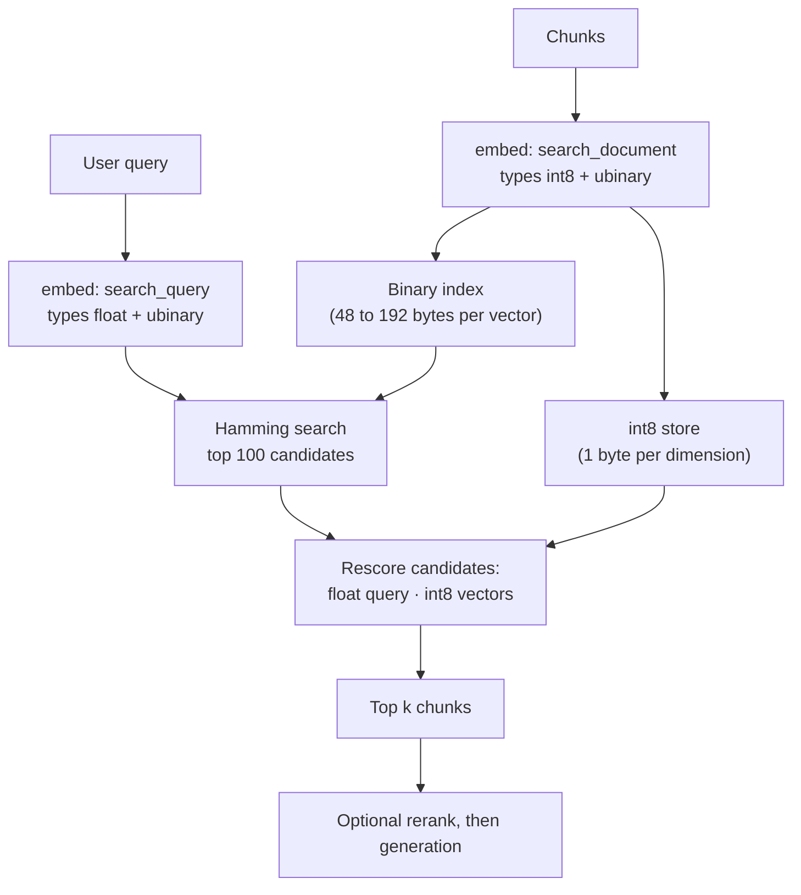

Cohere is an enterprise-focused model company whose Embed models are one of the main hosted alternatives to [OpenAI embeddings](/learn/embedding-models/openai-embeddings). Two design choices set its API apart, and both change how you build a RAG system. First, every request must say what the text is *for*, through a required `input_type`: a document to be searched, a search query, text for classification, or text for clustering. Second, the API can return vectors already compressed to 8-bit integers or single bits, through `embedding_types`, which can cut index storage by a factor of 4 or 32. This lesson explains both, works through the compression arithmetic by hand, measures what compression does to a ranking on a corpus you can run locally, and shows the request shapes for the hosted API.

## Learning objectives

- Choose the correct `input_type` for each call in an indexing and a query pipeline, and explain what goes wrong when the two sides do not match.
- Compute an int8 and a binary representation of a vector by hand, and the storage each needs per million vectors.
- Measure how far int8 and binary rankings agree with float rankings, and explain why a binary first stage followed by rescoring recovers most of the difference.
- Write a batched, retrying client for Cohere's embed endpoint that keeps the model, input type, dimension and embedding type consistent.
- Compare Cohere's model generations and deployment routes for a given set of language, modality, latency and data-residency constraints.

## Prerequisites

- [OpenAI embeddings](/learn/embedding-models/openai-embeddings): calling a hosted embedding API, batching and per-token billing.
- [E5 models](/learn/embedding-models/e5-models): why queries and passages are encoded asymmetrically.
- [Dense representations](/learn/embedding-fundamentals/dense-representations): what each number in a dense vector is, and why storage scales with dimension.
- [Working with APIs](/learn/python-for-rag-engineering/working-with-apis): HTTP requests, timeouts and retries in Python.

## Why this matters

A hosted embedding model is a dependency you cannot inspect. You send text, numbers come back, and nothing in the numbers tells you whether you called the model correctly. Cohere's required `input_type` makes one kind of mistake harder (you cannot forget to say which side a text is on), but it creates another: code that embeds documents with `search_query`, or queries with `search_document`, runs perfectly and retrieves worse. The failure appears only in evaluation numbers, if you have them, or in user complaints, if you do not.

Compression matters for a different reason: money and memory. A 1,024-dimensional float32 vector takes 4 KB. Ten million chunks take about 41 GB before any index structure, and a vector database that keeps vectors in RAM charges for every gigabyte. The same vectors as int8 take about 10 GB; as single bits, about 1.3 GB. Whether that compression costs you retrieval quality, and how to win most of it back, is something you can measure rather than guess.

## The intuition

Think of the two ends of a library enquiry. A visitor walks up and asks, "Anything on carrying holiday over?" A librarian files a new book under "Annual leave: entitlement, carry-over rules, deadlines". The question and the catalogue entry describe the same thing in very different forms: one short and conversational, the other a structured description of contents. A good catalogue system is built to match questions *to* catalogue entries, not questions to questions.

`input_type` is you telling Cohere which of those two forms a text is. Label the book as if it were a question and it is filed in the wrong part of the catalogue: still somewhere sensible, never where the system expects to find it.

Compression is like replacing a detailed map with a sketch. An int8 vector is a map with slightly rounded coordinates: almost every journey comes out the same. A binary vector records only which side of the road each landmark is on. It still gets you to the right neighbourhood, and once you are there, you can take out the detailed map for the last few streets. That second step is **rescoring**.

## How it works

### The models

Cohere's generations, at the time of writing (check the [Cohere documentation](https://docs.cohere.com) for current names and limits):

| Model | Languages | Dimensions | Input limit | Notes |
| --- | --- | --- | --- | --- |
| `embed-english-v3.0` | English | 1,024 | 512 tokens | `input_type` required from this generation on |
| `embed-english-light-v3.0` | English | 384 | 512 tokens | Smaller, faster, lower quality |
| `embed-multilingual-v3.0` | 100+ | 1,024 | 512 tokens | One space for all languages |
| `embed-multilingual-light-v3.0` | 100+ | 384 | 512 tokens | |
| `embed-v4.0` | Multilingual | 256, 512, 1,024 or 1,536 (chosen with `output_dimension`) | Far longer than v3 | Text, images and mixed text-and-image documents |

The v3 models are text models with a short window: chunk accordingly (see [Jina embeddings](/learn/embedding-models/jina-embeddings) for what happens past a window). Embed v4 adds image input, so a screenshot of a slide or a scanned page can be embedded into the same space as text, and Matryoshka-style dimension choice (see [Matryoshka embeddings](/learn/embedding-optimisation/matryoshka-embeddings)). It also accepts much longer inputs; treat the exact limit as something to look up.

Cohere models are also offered through cloud platforms, such as Amazon Bedrock, Microsoft Azure and Oracle Cloud, and through private deployments. The request shape on those platforms is similar but not identical, so read the platform's own documentation if you use one.

### The input types

The `input_type` values are:

- `search_document`: a chunk that will be stored in the index and searched;
- `search_query`: a user's query at search time;
- `classification`: text whose embedding will be fed to a classifier;
- `clustering`: text to be grouped with similar texts;
- `image`: used when the input is an image.

Cohere does not publish exactly what the model does with this value. What matters for engineering is the contract: documents with `search_document`, queries with `search_query`, and the same model version on both sides. Retrieval with the two types set correctly is what the model was trained and evaluated for; any other pairing is unsupported territory.

### The embedding types

`embedding_types` takes a list, so one call can return several representations of the same text:

- `float`: ordinary 32-bit floating-point numbers;
- `int8` and `uint8`: one byte per dimension, signed (−128 to 127) or unsigned (0 to 255);
- `binary` and `ubinary`: one bit per dimension, packed eight to a byte (signed or unsigned bytes).

Cohere states that its v3 and later models were trained with compression in mind, so their compressed vectors lose less than you would get by naively compressing an arbitrary model's output. The code below measures the naive case on a small open model, which gives a pessimistic baseline you can reproduce. The theory of quantisation, including how to choose calibration ranges, belongs to [embedding quantisation](/learn/embedding-optimisation/embedding-quantisation).

### Request flow

A complete indexing and query cycle with compressed vectors looks like this:

1. Split documents into chunks that fit the model's input limit.
2. Send chunks in batches (the documented maximum is 96 texts per request at the time of writing) with `input_type="search_document"` and, say, `embedding_types=["int8", "ubinary"]`.
3. Store the binary vectors in a fast first-stage index and the int8 vectors alongside, keyed by chunk ID.
4. At query time, embed the query once with `input_type="search_query"`, asking for `float` and `ubinary`.
5. Find the top few hundred candidates by Hamming distance between binary vectors.
6. Rescore those candidates with the float query against their int8 vectors, and keep the top k.
7. Optionally [rerank](/learn/reranking-models/cohere-rerank) the top k with a cross-encoder before generation.



## The mathematics

### Scalar quantisation to int8

**Intuition.** For each dimension, find the smallest and largest value it takes across the corpus, divide that range into 256 equal steps, and store the number of the step each value falls in.

$$
s_j = \frac{\text{hi}_j - \text{lo}_j}{255}, \qquad
q_j = \operatorname{round}\!\left(\frac{x_j - \text{lo}_j}{s_j}\right) - 128, \qquad
\hat{x}_j = (q_j + 128)\, s_j + \text{lo}_j
$$

- $x_j$ is dimension $j$ of the original vector.
- $\text{lo}_j$ and $\text{hi}_j$ are the minimum and maximum of dimension $j$ over a calibration set (here, the corpus).
- $s_j$ is the step size; $q_j$ is the stored integer between −128 and 127.
- $\hat{x}_j$ is the value recovered from $q_j$, which differs from $x_j$ by at most half a step.

**Worked example.** Dimension 3 of a vector has $x_3 = 0.05$, with $\text{lo}_3 = -0.20$ and $\text{hi}_3 = 0.20$. The step is $s_3 = 0.40 / 255 \approx 0.001569$. Then $(0.05 + 0.20) / 0.001569 \approx 159.4$, which rounds to 159, and $q_3 = 159 - 128 = 31$. Recovering it gives $(31 + 128) \times 0.001569 - 0.20 \approx 0.0494$, an error of about 0.0006.

### Binary vectors and Hamming distance

**Intuition.** Keep only the sign of each dimension. Two vectors pointing in similar directions agree on most signs, so counting the dimensions where the signs differ is a cheap stand-in for their angle.

$$
b_j = \begin{cases} 1 & x_j > 0 \\ 0 & \text{otherwise} \end{cases}
\qquad
\text{Hamming}(\mathbf{a}, \mathbf{b}) = \sum_{j=1}^{d} [a_j \neq b_j]
$$

- $b_j$ is the bit stored for dimension $j$, and $d$ is the number of dimensions.
- $[a_j \neq b_j]$ is 1 when the bits differ and 0 otherwise. Smaller Hamming distance means more similar.

On hardware, the sum is an XOR of the packed bytes followed by a population count, two very fast instructions.

**Worked example.** Take two eight-dimensional vectors, $\mathbf{a} = (0.3, -0.1, 0.2, 0.5, -0.4, 0.1, -0.2, 0.6)$ and $\mathbf{b} = (0.2, 0.1, -0.3, 0.4, -0.5, 0.2, -0.1, 0.1)$. Their bits are $10110101$ and $11010101$. They differ in positions 2 and 3, so the Hamming distance is 2.

```python
import numpy as np

x = np.array([0.12, -0.40, 0.05])          # one vector, three dimensions
lo = np.array([-0.30, -0.50, -0.20])       # per-dimension minimum over the corpus
hi = np.array([0.30, 0.10, 0.20])          # per-dimension maximum
s = (hi - lo) / 255
q = np.clip(np.round((x - lo) / s) - 128, -128, 127).astype(np.int8)
x_back = (q.astype(np.float32) + 128) * s + lo
print("int8:", q, " dequantised:", x_back.round(4))

a = np.packbits(np.array([0.3, -0.1, 0.2, 0.5, -0.4, 0.1, -0.2, 0.6]) > 0)
b = np.packbits(np.array([0.2, 0.1, -0.3, 0.4, -0.5, 0.2, -0.1, 0.1]) > 0)
print("bits a:", np.unpackbits(a), " bits b:", np.unpackbits(b))
print("Hamming distance:", int(np.unpackbits(a ^ b).sum()))
```

```output
int8: [ 50 -86  31]  dequantised: [ 0.1188 -0.4012  0.0494]
bits a: [1 0 1 1 0 1 0 1]  bits b: [1 1 0 1 0 1 0 1]
Hamming distance: 2
```

The third int8 value is the 31 computed by hand.

## In code

### Measuring what compression costs

**The problem.** Before paying for, or switching on, compressed vectors, you want to know how much they change your rankings. The script below builds a corpus of 1,080 short support-ticket summaries from Meridian's products, embeds it with the local all-MiniLM-L6-v2 model, compresses the vectors to int8 and to binary with the formulas above, and measures, for ten queries, how many of the float top 10 each method also returns. It runs with no API key; the model downloads once.

```bash
pip install sentence-transformers numpy
```

```python
import itertools
import numpy as np
from sentence_transformers import SentenceTransformer

# 1. A synthetic corpus of 1,080 support-ticket summaries
products = ["Meridian Sync", "Meridian Relay", "Meridian Reports", "the Atlas platform", "the VPN client", "the HR portal"]
problems = ["fails to start", "is very slow", "rejects my password", "shows error E-4021",
            "loses data after an update", "cannot connect on hotel Wi-Fi"]
contexts = ["on a new laptop", "after the latest release", "for one user only", "every Monday morning",
            "when exporting a PDF", "for contractors", "behind the office proxy", "on macOS",
            "on Windows", "since the password change", "in the London office", "over the VPN",
            "with SAML single sign-on", "on the Enterprise plan", "for large CSV files",
            "after a laptop refresh", "during month-end", "on a slow connection",
            "for the finance team", "for new starters", "when working remotely",
            "with two monitors", "after a reboot", "in the browser", "from the mobile app",
            "for shared folders", "after a timeout", "on public Wi-Fi", "for a manager", "intermittently"]
corpus = [f"{p} {pr} {c}." for p, pr, c in itertools.product(products, problems, contexts)]
queries = ["Sync will not launch on my laptop", "Reports export to PDF is broken",
           "password not accepted by the VPN", "Atlas E-4021 error after release",
           "Relay drops the connection in a hotel", "HR portal really slow for new joiners",
           "files vanished after updating Sync", "SSO login fails on Enterprise",
           "VPN keeps disconnecting on train Wi-Fi", "month-end Reports are very slow"]

model = SentenceTransformer("sentence-transformers/all-MiniLM-L6-v2")
D = model.encode(corpus, normalize_embeddings=True, batch_size=64)   # float32
Q = model.encode(queries, normalize_embeddings=True)
print("corpus:", D.shape, D.dtype)

# 2. int8: map each dimension's [min, max] (from the corpus) onto -128..127
lo, hi = D.min(axis=0), D.max(axis=0)
scale = (hi - lo) / 255.0
D_int8 = np.clip(np.round((D - lo) / scale) - 128, -128, 127).astype(np.int8)

# 3. binary: one bit per dimension (positive or not), packed 8 to a byte
D_bin = np.packbits(D > 0, axis=1)                       # uint8, 384 / 8 = 48 bytes
Q_bin = np.packbits(Q > 0, axis=1)

for name, arr in [("float32", D), ("int8", D_int8), ("binary", D_bin)]:
    per_vec = arr.nbytes // len(arr)
    print(f"{name:8s} {per_vec:5d} bytes/vector   {per_vec * 1_000_000 / 1e9:6.3f} GB per million")

def top(scores, k):
    return set(np.argsort(-scores)[:k])

def hamming(qb, Db):
    return np.unpackbits(qb ^ Db, axis=1).sum(axis=1)

k = 10
rows = {"int8": [], "binary": [], "binary + rescore": []}
for qi in range(len(queries)):
    exact = top(D @ Q[qi], k)
    # int8: dequantise the corpus side and score with the float query
    approx = (D_int8.astype(np.float32) + 128) * scale + lo
    rows["int8"].append(len(exact & top(approx @ Q[qi], k)) / k)
    # binary: rank by Hamming distance (smaller is closer)
    ham = hamming(Q_bin[qi], D_bin)
    rows["binary"].append(len(exact & top(-ham.astype(float), k)) / k)
    # binary first stage (top 40), then rescore those with the int8 vectors
    cand = np.argsort(ham)[:4 * k]
    rescored = cand[np.argsort(-(approx[cand] @ Q[qi]))[:k]]
    rows["binary + rescore"].append(len(exact & set(rescored)) / k)

for name, vals in rows.items():
    print(f"overlap@{k} with float32 top-{k}, {name:17s}: {np.mean(vals):.2f}")
```

```output
corpus: (1080, 384) float32
float32   1536 bytes/vector    1.536 GB per million
int8       384 bytes/vector    0.384 GB per million
binary      48 bytes/vector    0.048 GB per million
overlap@10 with float32 top-10, int8             : 1.00
overlap@10 with float32 top-10, binary           : 0.69
overlap@10 with float32 top-10, binary + rescore : 0.99
```

**The important lines.** `lo` and `hi` are computed per dimension from the corpus, which is the calibration step; a hosted API does its own calibration and simply returns the integers. `np.packbits(D > 0, axis=1)` turns 384 booleans into 48 bytes. `hamming` XORs the packed bytes and counts the set bits. The rescoring step takes the 40 nearest candidates by Hamming distance and re-sorts them with the more precise int8 vectors and the float query, which is the asymmetric pattern from the flow diagram: the query is cheap to keep in full precision because there is only one.

**What the output means.** The overlap metric asks: of the ten chunks exact float search returns, how many does the cheaper method also return? int8 kept all ten for every query, at a quarter of the storage. Binary alone kept about seven in ten, at a thirty-second of the storage. Binary with a 40-candidate rescoring stage recovered almost all of the difference (0.99) while still keeping the large first-stage index in binary form. Note what this metric does not say: agreement with float search is not relevance. If float search was wrong, agreeing with it is no virtue. For a real decision, measure recall against labelled relevant chunks, as in [embedding evaluation](/learn/embedding-optimisation/embedding-evaluation).

The corpus is synthetic and repetitive, and MiniLM was not trained for compression, so treat these as a demonstration of the method rather than a prediction for Cohere's models.

**Common errors.** Computing `lo` and `hi` from a handful of vectors (or from the query) gives ranges that real data falls outside, so values clip at −128 or 127. Comparing an int8 *query* with int8 documents by raw integer dot product also works poorly unless both use the same ranges. Forgetting `axis=1` in `packbits` flattens the whole matrix into one long bit string.

**Extending it.** Vary the candidate multiplier (`4 * k`) from 1 to 10 and plot overlap against it to see the cost-quality curve of the rescoring stage. Replace the synthetic corpus with a sample of your own chunks.

### A production client for the hosted API

The client below was **not executed** for this lesson, because it needs a Cohere API key. It calls the documented v2 embed endpoint over HTTP: a POST with `model`, `texts`, `input_type` and `embedding_types`, returning an `embeddings` object with one list per requested type. The official `cohere` Python SDK (`cohere.ClientV2().embed(...)`) takes the same parameters; the raw HTTP version is shown so every field is visible. The client fixes the model, dimension and types once, so the indexing and query sides cannot drift apart, and it validates `input_type`.

```bash
pip install httpx numpy
export CO_API_KEY=...   # from the Cohere dashboard
```

```python
import os
import time
import httpx
import numpy as np

class CohereEmbedder:
    URL = "https://api.cohere.com/v2/embed"
    BATCH = 96  # documented per-request maximum at the time of writing; check the docs

    def __init__(self, model="embed-v4.0", dimension=1024, types=("float",)):
        self.model, self.dimension, self.types = model, dimension, list(types)
        self.http = httpx.Client(
            headers={"Authorization": f"Bearer {os.environ['CO_API_KEY']}"}, timeout=60
        )

    def _call(self, texts, input_type):
        body = {"model": self.model, "texts": texts, "input_type": input_type,
                "embedding_types": self.types, "output_dimension": self.dimension}
        for attempt in range(5):
            r = self.http.post(self.URL, json=body)
            if r.status_code == 429 or r.status_code >= 500:   # rate limit or server error
                time.sleep(2 ** attempt)
                continue
            r.raise_for_status()
            return r.json()["embeddings"]
        raise RuntimeError("Cohere embed failed after 5 attempts")

    def embed(self, texts, input_type):
        if input_type not in ("search_document", "search_query"):
            raise ValueError("use search_document for chunks and search_query for queries")
        out = {t: [] for t in self.types}
        for i in range(0, len(texts), self.BATCH):
            result = self._call(texts[i:i + self.BATCH], input_type)
            for t in self.types:
                out[t].extend(result[t])
        return {t: np.array(v) for t, v in out.items()}

docs = CohereEmbedder(types=("int8", "ubinary"))
vectors = docs.embed(["Annual leave is 25 days.", "VPN is required on public Wi-Fi."], "search_document")
print({t: (a.shape, a.dtype) for t, a in vectors.items()})
```

Your exact output depends on the model and dimension; for 1,024 dimensions it looks like this:

```output
{'int8': ((2, 1024), dtype('int64')), 'ubinary': ((2, 128), dtype('int64'))}
```

Two details in that illustrative output are worth noticing. The binary vector has 128 entries, not 1,024, because the bits arrive packed eight to a byte. And JSON has no byte type, so NumPy builds 64-bit integers by default; cast with `.astype(np.int8)` or `.astype(np.uint8)` before storing, or you lose the saving you asked for.

`output_dimension` applies to Embed v4; omit it for the v3 models, which have fixed sizes. Some vector databases accept int8 or binary vectors natively; others need floats, in which case you store the int8 values as floats and keep the storage saving only on disk.

## A real-world example

Meridian's Platform team moved AskMeridian's IT-runbook index to Cohere so that the support desk in the Kraków office could ask questions in Polish (the subject of [multilingual embeddings](/learn/embedding-models/multilingual-embeddings)). The migration script, written by Ana, re-embedded every chunk. The query service was changed by a different engineer, Jon, who copied the embedding helper from the migration script.

Retrieval quality in the weekly evaluation dropped noticeably, though every query returned plausible-looking chunks. Nobody suspected embeddings at first, because the model name, dimension and normalisation all matched. Ana found the cause by logging the full request body on both sides: the copied helper sent queries with `input_type="search_document"`. Fixing that one string restored the evaluation scores.

The team made two changes so it could not recur. They wrapped all embedding calls in one class, like the client above, where the input type is a required argument checked against an allowed list. And they added a test that embeds three known questions and asserts that the expected chunk is the top result, which fails within seconds if anyone breaks the contract again.

## Common mistakes

- **Using one helper with a hard-coded `input_type` for both indexing and querying.** Everything runs, and retrieval quality falls with no error.
- **Mixing v3 and v4 vectors, or different `output_dimension` values, in one index.** Vectors from different models or sizes are not comparable; the database may reject them or, worse, accept them.
- **Storing compressed vectors in a 64-bit integer column.** JSON integers parse as 64-bit by default, which makes an "int8" index eight times larger than intended.
- **Using binary vectors alone for final ranking.** Sign bits are a coarse approximation; without rescoring, about a third of the top 10 changed in the measurement above.
- **Treating overlap with float search as proof of quality.** It measures agreement, not relevance.
- **Sending more texts per request than the documented limit, or ignoring 429 responses.** Batches fail and, without retry logic, chunks silently go unindexed.

## Best practices

- Fix the model, version, dimension and embedding types in configuration, store them with the index, and check them at query time.
- Make `input_type` a required argument everywhere, and test that the query path uses `search_query`.
- Request several embedding types in one indexing pass if you might need them; re-embedding a large corpus later costs a full pass of API calls.
- Start with int8; move to binary plus rescoring only when storage or memory is the binding constraint, and measure recall on labelled queries when you do.
- Pair Cohere embeddings with a reranker for precision-critical applications (see [Cohere rerank](/learn/reranking-models/cohere-rerank)), and keep the two concerns separate in code.
- Count tokens before sending and chunk to the model's limit; do not rely on server-side truncation.

## Performance considerations

**Storage, per million vectors.** At 1,024 dimensions: float32 is $1{,}024 \times 4 = 4{,}096$ bytes, about 4.1 GB per million; int8 is 1,024 bytes, about 1 GB; binary is $1{,}024 / 8 = 128$ bytes, about 0.13 GB. Index structures such as HNSW graphs add their own overhead on top (see [vector indexing algorithms](/learn/vector-indexing-algorithms)).

**Search compute.** A float dot product at 1,024 dimensions is 1,024 multiply-adds. A Hamming distance on 128 bytes is 16 XORs of 64-bit words plus 16 population counts. Even before SIMD, that is far less arithmetic and memory traffic, which is why binary first stages scale to very large collections.

**Rescoring cost.** Rescoring 100 candidates at 1,024 dimensions is about 100,000 multiply-adds per query, negligible next to the network call to embed the query.

**API throughput.** With 96 texts per request, embedding 1 million chunks needs about 10,400 requests. If your rate limit allows, say, 10 requests in flight at once and each takes half a second (both assumptions; check your account's limits), that is roughly 10 minutes. The real limit is usually your rate-limit tier, so read it before planning a re-index window.

**Cost.** Embedding is billed per token, so a full re-embed costs roughly (total tokens in the corpus) × (price per token). Prices change; compute with the current figure from Cohere's pricing page rather than a remembered one.

## Security considerations

Every chunk sent to a hosted API leaves your network. Before indexing personal data, contracts or source code, check Cohere's data-use and retention terms for your plan, and consider the cloud-platform or private-deployment routes if data must stay inside your own account or region. Keep `CO_API_KEY` in a secret manager, inject it as an environment variable, and never log request bodies, which contain your documents.

Compressed vectors are not anonymised data. Embeddings can leak information about the text they came from, so apply the same access controls to int8 and binary vectors as to the chunks themselves.

## Summary

- Cohere Embed requires an `input_type` on every request: `search_document` for chunks, `search_query` for queries. A mismatch causes no error, only worse retrieval.
- `embedding_types` returns float, int8, uint8, binary or ubinary vectors directly, cutting storage by 4 or 32 times relative to float32.
- int8 quantisation divides each dimension's range into 256 steps; binary keeps the sign and compares vectors by Hamming distance.
- In a reproducible test, int8 kept the float top 10 unchanged, binary alone kept about 70 per cent of it, and binary with rescoring of 40 candidates kept 99 per cent.
- Embed v3 models are fixed-size text models with a 512-token input; Embed v4 adds images, longer inputs and a choice of output dimension.

## Exercises

**1.** A corpus has 25 million chunks. Compute the raw vector storage at 1,536 dimensions for float32, int8 and binary.

<details><summary>Show solution</summary>

Float32: $1{,}536 \times 4 = 6{,}144$ bytes per vector, times 25 million is about 153.6 GB. Int8: 1,536 bytes, about 38.4 GB. Binary: $1{,}536 / 8 = 192$ bytes, about 4.8 GB. A common design keeps the binary vectors in memory for the first stage and the int8 vectors on fast disk for rescoring.

</details>

**2.** In the code example, change the rescoring candidate count from `4 * k` to `k` and to `10 * k`. Predict the result before running it, then explain what the three numbers tell you about choosing the multiplier.

<details><summary>Show solution</summary>

Running it gives 0.69 for `k`, 0.99 for `4 * k` and 1.00 for `10 * k`. With `k` candidates, rescoring can only reorder the binary top 10, so the overlap equals the binary-only figure: reordering does not change which ten chunks are in the set. A larger candidate set is a superset of a smaller one, so overlap can only stay level or rise. The multiplier is a dial between first-stage recall and rescoring cost: increase it until overlap (or, better, labelled recall) stops improving.

</details>

**3.** Write a unit test for `CohereEmbedder` that runs without an API key, by replacing its HTTP client with `httpx.Client(transport=httpx.MockTransport(handler))`, and asserts that a 200-text call makes three requests, all with the same `input_type`.

<details><summary>Show solution</summary>

```python
import json, os, httpx

def test_batches_and_input_type():
    os.environ.setdefault("CO_API_KEY", "test")
    seen = []
    def handler(request):
        body = json.loads(request.content)
        seen.append(body)
        n = len(body["texts"])
        return httpx.Response(200, json={"embeddings": {"float": [[0.0] * 4] * n}})
    e = CohereEmbedder(types=("float",))
    e.http = httpx.Client(transport=httpx.MockTransport(handler))
    out = e.embed([f"text {i}" for i in range(200)], "search_document")
    assert [len(b["texts"]) for b in seen] == [96, 96, 8]
    assert {b["input_type"] for b in seen} == {"search_document"}
    assert out["float"].shape == (200, 4)
```

`httpx.MockTransport` calls `handler` instead of the network, so the real batching and parsing code runs. The test pins the two properties that matter: batch sizes and a single, correct input type.

</details>

**4.** Design decision. Meridian Reports' customers upload scanned invoices and slide decks, and want to search them alongside text help articles. The data must stay in Meridian's AWS account. Which Cohere route and model would you evaluate, which embedding types would you store, and what would you measure first?

<details><summary>Show solution</summary>

Evaluate Embed v4 through the cloud platform available in Meridian's AWS account (Amazon Bedrock), confirming that v4 and its image support are offered there and in the required region, since platform availability lags or differs from Cohere's own API. v4 embeds images and text into one space, which avoids an OCR-only pipeline for slides. Store int8 (for rescoring or as the main index) and, if the corpus is large, binary for a first stage. Measure first: recall on a labelled set of queries whose answers live in images versus in text, comparing v4 image embeddings with an OCR-then-text-embedding baseline (see [multimodal document representation](/learn/multimodal-ingestion/multimodal-document-representation)). If image embeddings do not beat OCR on your own data, the simpler pipeline wins.

</details>

## Check your understanding

```quiz
[
  {
    "q": "A query service sends user questions to Cohere with input_type=\"search_document\". What happens?",
    "options": [
      "The API returns a 400 error",
      "Vectors are returned and searches run, but retrieval quality is lower than with search_query",
      "The query is automatically re-labelled as a query",
      "The returned vectors have a different dimension"
    ],
    "answer": 1,
    "why": "The request is valid, so nothing fails. The mismatch only shows up as worse rankings."
  },
  {
    "q": "How many bytes does one 1,024-dimensional binary (ubinary) embedding occupy?",
    "options": ["1,024", "4,096", "64", "128"],
    "answer": 3,
    "why": "One bit per dimension, packed eight per byte: 1,024 / 8 = 128 bytes."
  },
  {
    "q": "What does this print?\n```python\nimport numpy as np\na = np.packbits(np.array([0.5, -0.2, 0.1, -0.3]) > 0)\nb = np.packbits(np.array([0.4, 0.2, -0.1, -0.6]) > 0)\nprint(int(np.unpackbits(a ^ b).sum()))\n```",
    "options": ["0", "1", "2", "4"],
    "answer": 2,
    "why": "The sign bits are 1010 and 1100 (padded with zeros); they differ in positions 2 and 3, so the Hamming distance is 2."
  },
  {
    "q": "Why does a binary first stage followed by rescoring recover most of the quality lost by binary search alone?",
    "options": [
      "Most of the float top-k is still among the binary top few-dozen candidates, and rescoring with finer vectors puts them back in order",
      "Rescoring converts binary vectors back into exact floats",
      "Hamming distance is identical to cosine similarity for normalised vectors",
      "Rescoring retrieves new documents from the float index"
    ],
    "answer": 0,
    "why": "Binary distance is a coarse but correlated proxy; widening the candidate set captures the true neighbours and the precise score re-sorts them."
  },
  {
    "q": "An index built with embed-english-v3.0 must be searched with queries embedded by embed-v4.0 at 1,024 dimensions. What is the correct plan?",
    "options": [
      "Nothing; both produce 1,024 dimensions",
      "Normalise both sets of vectors and search as usual",
      "Re-embed the corpus with embed-v4.0, because vectors from different models are not comparable",
      "Use input_type=\"clustering\" to bridge the two models"
    ],
    "answer": 2,
    "why": "Matching dimension counts do not make two models' spaces compatible; the corpus and queries must come from the same model."
  }
]
```

## Further reading

- Cohere documentation, [docs.cohere.com](https://docs.cohere.com): the Embed API reference, input types, embedding types and model list.
- Shakir, Aarsen and Lee (2024), "Binary and Scalar Embedding Quantization for Significantly Faster and Cheaper Retrieval", Hugging Face blog; the Sentence Transformers documentation, [sbert.net](https://www.sbert.net), covers the same methods under "Embedding Quantization".
- Jégou, Douze and Schmid (2011), "Product Quantization for Nearest Neighbor Search", *IEEE Transactions on Pattern Analysis and Machine Intelligence* 33(1), for the wider family of vector compression methods.
- Charikar (2002), "Similarity Estimation Techniques from Rounding Algorithms", *STOC*, the theory behind sign bits as an estimate of angular similarity.
- Muennighoff et al. (2022), "MTEB: Massive Text Embedding Benchmark", [arXiv:2210.07316](https://arxiv.org/abs/2210.07316).
