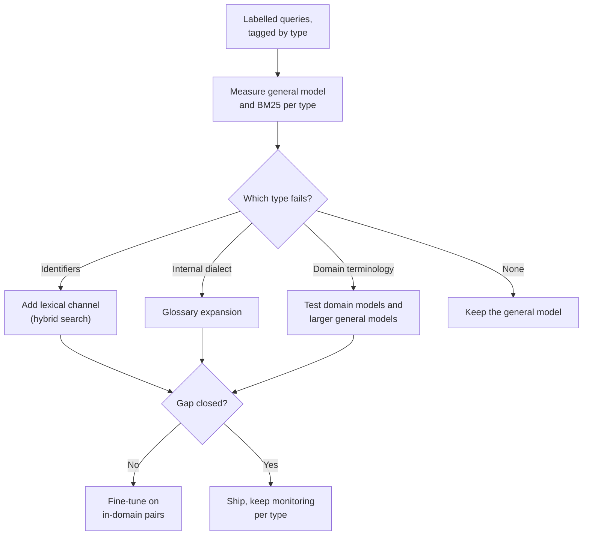

General-purpose embedding models are trained on web pages, encyclopaedias, question-answer sites and similar broad text. Medicine, law, finance, source code and your own company's internal language each have vocabulary and relationships that broad text covers thinly. **Domain-specific embedding models** are trained, at least in part, on text from one field so that they place its terms and documents more sensibly. This lesson explains what "domain" means for an embedding model, how domain models are built, which families exist, and, most importantly, how to decide whether you need one. The answer is often "not yet": a general model plus a lexical channel and a glossary can close much of the gap, and only measurement on your own queries can tell you which case you are in.

## Learning objectives

- Distinguish three kinds of domain gap (vocabulary, relationships between concepts, and private company dialect) and say which remedies address each.
- Explain how domain models are built: continued pre-training, pre-training from scratch with a domain vocabulary, and contrastive training on in-domain pairs.
- Name representative domain model families for biomedicine, science, law, finance and code, and explain why a domain language model is not automatically a good retriever.
- Build a per-query-type evaluation that compares a general embedding model with BM25 on your own corpus, and interpret it.
- Choose between a domain model, a larger general model, hybrid search, glossary expansion and fine-tuning for a given scenario.

## Prerequisites

- [Sentence Transformers](/learn/embedding-models/sentence-transformers): encoding text with a local model.
- [BGE models](/learn/embedding-models/bge-models) and [E5 models](/learn/embedding-models/e5-models): what a strong general-purpose retriever looks like.
- [BM25](/learn/sparse-retrieval/bm25): lexical scoring by term frequency and rarity.
- [Recall@K](/learn/retrieval-fundamentals/recall-k): measuring whether the right chunk is retrieved.

## Why this matters

When a general model meets specialised text, three things can go wrong.

- **Vocabulary.** The tokeniser splits domain terms into meaningless fragments: *pembrolizumab* becomes six pieces, and the model has seen those pieces in unrelated words. The vector for the term is built from noise.
- **Relationships.** Even when the words tokenise sensibly, the model may not know how concepts relate in the field: that a brand-name drug and its generic name are the same thing, that "consideration" in a contract is not "thoughtfulness", or that two clauses differ in the one word that decides liability.
- **Dialect.** Every organisation has words no public model knows: product code names, team nicknames, abbreviations. At Meridian, engineers call Meridian Relay "the bus". No domain model trained on public text will ever learn that.

A retrieval failure caused by any of these looks the same from outside: plausible but wrong chunks. Teams that do not diagnose which kind of gap they have often reach for the most expensive remedy (a new model, or fine-tuning) when a cheaper one (a glossary, or adding BM25) would have fixed it, or the reverse.

## The intuition

Imagine hiring a temporary receptionist for a hospital. A bright generalist will handle "where is the café?" and "I have an appointment at ten" perfectly. Ask them for "the cath lab" or to tell "hypo" from "hyper" in a message, and they guess. A receptionist who has worked in hospitals before knows the vocabulary and how departments relate. But even the experienced one does not know that at *this* hospital, "the annex" means the outpatient building across the road. Someone has to tell them, or they have to learn on the job.

Those are the three remedies in miniature: hire a specialist (a domain model), hand over a glossary (query or document expansion), or train on the job (fine-tuning on your own data). And the first question is always whether the generalist is actually struggling with *your* visitors, which you only learn by watching them work.

## How it works

### How domain models are built

Domain models differ in which training stage sees domain text.

1. **Continued pre-training.** Start from a general language model such as BERT and keep training it with masked-language modelling on domain text. BioBERT (Lee and colleagues, 2020) did this on PubMed abstracts and articles. The model learns domain usage, but it keeps the general vocabulary, so domain terms remain fragmented.
2. **Pre-training from scratch with a domain vocabulary.** Build a new subword vocabulary from domain text, so that frequent domain terms become single tokens, and pre-train on domain text only. PubMedBERT (Gu and colleagues, 2021) did this for biomedicine and reported that it outperformed continued pre-training on their biomedical benchmark. The cost is the full price of pre-training.
3. **Contrastive training on in-domain pairs.** A masked-language model, domain or not, is not by itself a good sentence embedder: its raw outputs are not trained to put a question near its answer. A retriever needs a further stage of contrastive training on pairs such as (query, relevant passage) from the domain. MedCPT (Jin and colleagues, 2023) trained biomedical retrievers on query-article pairs from PubMed search logs. SPECTER (Cohan and colleagues, 2020) used citations as the training signal for scientific papers: a paper should be close to the papers it cites.

The third point is the one that most often trips people up. A model named "LegalBERT" or "FinBERT" may be a domain *language* model, built for classification or tagging after fine-tuning, not a domain *embedding* model. Loading it into Sentence Transformers silently adds mean pooling and returns vectors, which may retrieve worse than a general retriever. Read the model card for what the model was trained to do.

### Representative families

The landscape changes quickly, so treat this as a map of kinds rather than a leaderboard, and check current model cards.

| Domain | Examples | Training signal |
| --- | --- | --- |
| Biomedicine | MedCPT; biomedical language models such as BioBERT and PubMedBERT (need retrieval training before use as embedders) | PubMed search logs; masked-language modelling on PubMed |
| Science | SPECTER and SPECTER2 | Citation links between papers |
| Law | LEGAL-BERT (a language model); commercial legal embedding models such as Voyage AI's legal model | Legislation, contracts, case law |
| Finance | Commercial finance-tuned embedding models (Voyage AI has offered one) | Filings, reports, financial news |
| Code | CodeBERT (a language model); code embedding models such as jina-embeddings-v2-base-code and commercial code models | Code paired with docstrings and natural-language descriptions, as in CodeSearchNet |

Alongside these sit large general models that accept a task instruction (for example, an instruction such as "Given a clinical question, retrieve relevant abstracts"), which lets one model shift its behaviour per domain without a separate checkpoint. Whether a domain model beats a strong, larger general model on your data is an empirical question; neither always wins.

### Diagnosing your gap

The remedies differ by gap:

| Gap | Symptom | Cheapest effective remedies |
| --- | --- | --- |
| Exact identifiers (codes, SKUs, runbook numbers) | Right subject, wrong neighbour (E-4012 for E-4021) | Lexical channel ([hybrid search](/learn/hybrid-search)) |
| Domain vocabulary and relationships | Specialist queries miss; everyday ones are fine | Domain model or larger general model; fine-tuning |
| Company dialect | Internal nicknames and abbreviations miss | Glossary expansion; fine-tuning on internal pairs |

The decision procedure that follows is the main practical content of this lesson:

1. Collect real queries from logs (or from users, if you have no logs) and label the chunk that answers each.
2. Tag each query by type: plain language, identifier, domain terminology, internal dialect.
3. Measure a strong general model and BM25 on every type separately.
4. If the weak type is identifiers, add lexical search. If it is dialect, add a glossary. If it is domain terminology, shortlist domain and larger general models and test them on the same set.
5. If no off-the-shelf option closes the gap, fine-tune on your own pairs (see [fine-tuning embeddings](/learn/embedding-optimisation/fine-tuning-embeddings) and [domain adaptation](/learn/embedding-optimisation/domain-adaptation)).



## In code

### A per-type domain evaluation

**The problem.** Meridian's Platform team must decide whether AskMeridian's IT and product search needs a specialised model. The script below does three things: shows how the general model's tokeniser treats domain vocabulary; measures a general model (all-MiniLM-L6-v2) and BM25 on twelve labelled queries split into plain language, identifiers and internal dialect, reporting hit@1 and mean reciprocal rank (MRR, the average of 1 divided by the rank of the right document) per type; and tests a glossary on the worst query. It runs locally with no API key.

```bash
pip install sentence-transformers rank-bm25 numpy
```

```python
import numpy as np
from rank_bm25 import BM25Okapi
from sentence_transformers import SentenceTransformer

model = SentenceTransformer("sentence-transformers/all-MiniLM-L6-v2")
tok = model.tokenizer

# 1. How the general model's tokeniser sees domain vocabulary
terms = ["holiday", "laptop", "pembrolizumab", "myocardial infarction", "indemnification",
         "EBITDA", "Kubernetes", "SAML", "E-4021", "MeridianRelay"]
for t in terms:
    print(f"{t:22s} {tok.tokenize(t)}")

# 2. Retrieval on Meridian's technical corpus, split by query type
docs = [
    "Atlas error E-4021 means the VPN client is out of date; update it from the IT portal.",
    "Atlas error E-5120 means the upload exceeded the size limit; split the file and retry.",
    "Meridian Reports can export any dashboard to PDF or CSV from the share menu.",
    "SAML single sign-on for Meridian Reports is available on the Enterprise plan only.",
    "Meridian Relay applies backpressure when a consumer falls behind, pausing the producer.",
    "Meridian Sync resolves conflicting edits by keeping both versions and flagging the file.",
    "Runbook NET-114: if the VPN client reports a TLS handshake failure, reinstall the certificate bundle.",
    "Runbook NET-117: if the VPN client cannot resolve internal hostnames, flush the DNS cache.",
]
queries = [  # (query, index of the relevant doc, type)
    ("my data upload says the file is too big", 1, "plain"),
    ("how do I download a dashboard as a spreadsheet", 2, "plain"),
    ("two people edited the same file at once, what happens", 5, "plain"),
    ("E-4021", 0, "code"),
    ("NET-114 steps", 6, "code"),
    ("NET-117", 7, "code"),
    ("the bus keeps throttling my publisher", 4, "dialect"),
    ("tunnel app is stale, needs a bump", 0, "dialect"),
    ("tunnel cert broken", 6, "dialect"),
    ("can't reach intranet names over the tunnel", 7, "dialect"),
    ("Relay BP kicking in", 4, "dialect"),
    ("Sync clash copies", 5, "dialect"),
]

def tokenise(text):
    return [w.strip(".,:;?").lower() for w in text.split()]

bm25 = BM25Okapi([tokenise(d) for d in docs])
D = model.encode(docs, normalize_embeddings=True)

def rank_of(scores, target):
    return int((np.argsort(-scores) == target).nonzero()[0][0]) + 1

results = {}
for q, target, kind in queries:
    dense = D @ model.encode(q, normalize_embeddings=True)
    sparse = bm25.get_scores(tokenise(q))
    for name, scores in (("dense", dense), ("bm25", sparse)):
        results.setdefault((name, kind), []).append(rank_of(scores, target))
    print(f"{kind:6s} {q[:45]:45s} dense rank {rank_of(dense, target)}  bm25 rank {rank_of(sparse, target)}")

for (name, kind), ranks in sorted(results.items()):
    ranks = np.array(ranks)
    print(f"{name:5s} {kind:6s} hit@1 {np.mean(ranks == 1):.2f}  MRR {np.mean(1 / ranks):.2f}")

# 3. A company glossary maps internal aliases to the words the documents use
glossary = {"the bus": "Meridian Relay", "tunnel": "VPN client", "BP": "backpressure"}

def expand(q):
    for alias, canonical in glossary.items():
        if alias in q:
            q = f"{q} ({canonical})"
    return q

q = "the bus keeps throttling my publisher"
for text in (q, expand(q)):
    s = D @ model.encode(text, normalize_embeddings=True)
    top2 = np.argsort(-s)[:2]
    print(f"{text:55s} -> doc {top2[0]} ({s[top2[0]]:.3f}), runner-up doc {top2[1]} ({s[top2[1]]:.3f})")
```

```output
holiday                ['holiday']
laptop                 ['laptop']
pembrolizumab          ['pe', '##mb', '##rol', '##iz', '##uma', '##b']
myocardial infarction  ['my', '##oca', '##rdial', 'in', '##far', '##ction']
indemnification        ['ind', '##em', '##ni', '##fication']
EBITDA                 ['e', '##bit', '##da']
Kubernetes             ['ku', '##ber', '##net', '##es']
SAML                   ['sam', '##l']
E-4021                 ['e', '-', '402', '##1']
MeridianRelay          ['meridian', '##rel', '##ay']
plain  my data upload says the file is too big       dense rank 1  bm25 rank 1
plain  how do I download a dashboard as a spreadshee dense rank 1  bm25 rank 3
plain  two people edited the same file at once, what dense rank 1  bm25 rank 2
code   E-4021                                        dense rank 1  bm25 rank 1
code   NET-114 steps                                 dense rank 1  bm25 rank 1
code   NET-117                                       dense rank 1  bm25 rank 1
dialect the bus keeps throttling my publisher         dense rank 3  bm25 rank 5
dialect tunnel app is stale, needs a bump             dense rank 1  bm25 rank 4
dialect tunnel cert broken                            dense rank 1  bm25 rank 7
dialect can't reach intranet names over the tunnel    dense rank 1  bm25 rank 2
dialect Relay BP kicking in                           dense rank 1  bm25 rank 1
dialect Sync clash copies                             dense rank 1  bm25 rank 1
bm25  code   hit@1 1.00  MRR 1.00
bm25  dialect hit@1 0.33  MRR 0.52
bm25  plain  hit@1 0.33  MRR 0.61
dense code   hit@1 1.00  MRR 1.00
dense dialect hit@1 0.83  MRR 0.89
dense plain  hit@1 1.00  MRR 1.00
the bus keeps throttling my publisher                   -> doc 0 (0.243), runner-up doc 1 (0.234)
the bus keeps throttling my publisher (Meridian Relay)  -> doc 4 (0.470), runner-up doc 0 (0.277)
```

**The important lines.** `rank_of` returns where the right document landed (1 is best), which is more informative than a yes/no hit. Results are grouped by `(name, kind)`, so every metric is reported per query type; an overall average would have hidden the differences. `tokenise` for BM25 is deliberately crude (lower-case, split on spaces, strip punctuation), which is a fair baseline but not a production analyser. `expand` appends the canonical name in brackets rather than replacing the alias, so the user's own words still count.

**What the output means.** Start with the tokeniser. Everyday words such as "holiday" are single tokens; *pembrolizumab*, *myocardial infarction*, *EBITDA* and *Kubernetes* become fragments. The uncased tokeniser also lowercases "SAML" into `sam ##l`, and "E-4021" into `e - 402 ##1`. Fragmentation does not automatically mean failure, because the model may have learned useful combinations of fragments, but it is a warning sign worth checking on your own vocabulary.

The retrieval results are more interesting, and less dramatic than you might expect. The general model ranks the right document first for every plain-language query and every identifier query, and for five of six dialect queries. BM25 handles identifiers perfectly but fails on paraphrase ("spreadsheet" versus "CSV") and on most dialect ("tunnel" does not occur in the runbook, so it ranked 7th). The one dense failure is "the bus keeps throttling my publisher": nothing in the documents says "bus", and "publisher" is only a synonym of "producer" in messaging jargon. The right document ranks only third, behind two documents that are scored 0.243 and 0.234, so the model is effectively guessing. The glossary lifts the right document to first place with a clear margin (0.470 against 0.277).

The conclusion for this corpus is that Meridian does not need a domain model: the general model plus a glossary for internal aliases covers its queries. Two caveats keep that conclusion honest. Eight documents make ranking easy; in a corpus of thousands of runbooks with many near-neighbours, the identifier results would be harder for the dense model (which is why the codes still deserve a lexical channel). And twelve queries are enough to show the method, not to make a production decision; aim for at least a few dozen per type.

**Common errors.** Writing evaluation queries by copying phrases out of the documents, which makes every model look perfect. Mixing query types in one average. Matching glossary aliases as raw substrings, as this example does: "BP" would also match inside "BPM". Use word-boundary regular expressions in production.

**Extending it.** Add a candidate domain or larger general model as a third scorer and compare per type. Move the glossary from query time to index time by appending aliases to the chunks they describe; that helps BM25 as well as the dense model, and only needs re-indexing when the glossary changes.

### Loading a domain model

Domain retrievers load like any other Sentence Transformers model when they are packaged for it, and some need a specific query and document format. As an illustration, SPECTER2's documentation describes loading through its own adapter setup rather than plain Sentence Transformers, and MedCPT ships separate query and article encoders. Because loading conventions differ this much between domain models, this lesson does not show a generic snippet: follow each model card exactly, and check that query and document encoding follow the card's asymmetry (separate encoders, prefixes or instructions), because getting it wrong produces vectors without errors.

## A real-world example

Meridian's Finance team (owners of expenses) asked for AskMeridian to cover the accounting policy manual. Raj, a Platform engineer, assumed accounting language would need a finance-specialised model, and the team began a procurement conversation with a vendor offering one.

Before signing, Raj ran the per-type evaluation above on 90 real questions from the finance inbox, labelled by a finance analyst. The general model was fine on plain questions ("can I claim a taxi home after working late?") and on most terminology ("accrual", "cost centre"). It failed on two clusters. The first was ledger account codes ("what goes in 6120?"), which BM25 answered correctly every time. The second was internal shorthand: the finance team writes "T&E" and "the close" in its documents, while staff ask about "expenses" and "month-end". The finance-specialised model, tested on the same set, improved the terminology questions slightly but did no better on account codes and no better on shorthand, because neither was finance knowledge in the general sense. Both were Meridian's own conventions.

The team shipped hybrid search for the account codes and a 40-entry glossary maintained by the Finance team, and recorded the per-type results so the domain-model question could be reopened if a new kind of failure appeared. The decision rested on measurements per query type, which is what made it defensible to the people who had asked for the specialist model.

## Common mistakes

- **Using a domain language model as an embedding model.** A masked-language model with mean pooling added is not a trained retriever; it can underperform a general retriever on its own domain.
- **Assuming "specialised" beats "general" without testing.** Large general retrievers are trained on so much varied data that they often handle domain text well; the only way to know is to measure.
- **Expecting a domain model to know your company.** Public domain models learn the field, not your product names, team nicknames or ledger codes.
- **Evaluating with queries copied from the documents.** Lexical overlap flatters every model and hides the vocabulary gap real users create.
- **Ignoring the licence and provenance of domain models.** Some are research-only, and some were trained on data you would not be allowed to use.
- **Reporting a single average.** A good average can conceal a query type that fails almost every time.

## Best practices

- Build the labelled, type-tagged evaluation set first; it outlives any model choice.
- Pair any dense model with a lexical channel when queries contain identifiers.
- Keep a glossary of internal aliases, owned by the team that writes the documents, and apply it at query time or index time.
- When testing a domain model, also test a larger general model and the general model you already have, on the same queries.
- Follow each domain model's card exactly for pooling, query and document encoders, prefixes and maximum length.
- Re-run the evaluation when the corpus grows substantially; a small corpus makes every model look good.

## Performance considerations

**Running two models.** Domain models are often small (BERT-base scale, around 110 million parameters), so latency is rarely the obstacle. The cost appears when a system needs a domain model for one collection and a general model for another: two models to host, two indexes, and a router to decide which to query.

**Re-embedding.** Switching models means re-embedding the whole corpus. At, say, 200 chunks per second on your hardware (an assumption; measure it as in [local embedding models](/learn/embedding-models/local-embedding-models)), 2 million chunks take 10,000 seconds, nearly three hours, before index build time. A glossary applied at query time costs nothing to deploy; applied at index time it costs one re-embedding.

**Glossary expansion at query time.** Expansion adds a few tokens to each query: negligible compute, but it changes the query vector, so cached query embeddings must be keyed on the expanded text.

**Evaluation cost.** Labelling is the real expense: a few hundred labelled queries take an expert days. It is still far cheaper than a wrong model decision.

## Security considerations

Domain corpora are often the most sensitive data an organisation has: patient records, contracts, financial filings, unreleased source code. Sending them to a hosted domain model moves that data to a third party, so check the provider's terms and data-residency options, or prefer self-hosted models. Some domain models are trained on data with its own restrictions (for example, clinical notes); check the licence before use in a product. Glossaries and evaluation sets built from real user queries can contain personal data, so store them with the same controls as logs.

## Summary

- A general model can fail on specialised text through vocabulary, conceptual relationships or company-specific dialect; each needs a different remedy.
- Domain models come from continued pre-training, from-scratch pre-training with a domain vocabulary, and, essential for retrieval, contrastive training on in-domain pairs.
- A domain language model is not a domain embedding model; check what the model was trained to do before using it for search.
- In a per-type evaluation on Meridian's corpus, a small general model handled plain and identifier queries and most dialect; a glossary fixed the alias it could not know.
- Measure per query type on your own labelled queries before buying, adopting or fine-tuning a domain model.

## Exercises

**1.** For each failure, name the gap (identifier, domain terminology or company dialect) and the cheapest remedy: (a) "What is Project Heron?" returns nothing useful, and Heron is Meridian's internal name for its data-centre migration; (b) "NET-114" returns the runbook for NET-117; (c) a clinical question using "MI" fails to find documents that say "myocardial infarction".

<details><summary>Show solution</summary>

(a) Company dialect: add a glossary entry ("Project Heron" to "data-centre migration") or append the alias to the relevant documents at index time. (b) Identifier: add a lexical channel so that the exact code dominates. (c) Domain terminology: a biomedical retriever or a larger general model may know the abbreviation; a glossary of standard abbreviations is a cheap first step, and the evaluation decides whether a domain model is needed.

</details>

**2.** In the code example, move the glossary from query time to index time: append each alias to the documents that use its canonical term, re-run the evaluation, and report whether BM25's dialect results change. Explain why.

<details><summary>Show solution</summary>

```python
def expand_doc(d):
    aliases = [a for a, canonical in glossary.items() if canonical.lower() in d.lower()]
    return d + (" Also known as: " + ", ".join(aliases) + "." if aliases else "")

docs = [expand_doc(d) for d in docs]
# then rebuild bm25 and D, and re-run the evaluation loop
```

Running it moves BM25's dialect results from hit@1 0.33 (MRR 0.52) to 0.67 (MRR 0.83): "the bus keeps throttling my publisher" goes from rank 5 to rank 1, "tunnel cert broken" from 7 to 2 and "tunnel app is stale, needs a bump" from 4 to 2. The documents now contain the users' words, so BM25 can match them. The dense model's dialect results reach 1.00 as well.

There is a side effect worth noticing. "VPN client" occurs in both runbooks and in the E-4021 entry, so all three gained "tunnel", and the dense model now ranks NET-117 second for the bare query "NET-117" (code hit@1 falls from 1.00 to 0.67): appended text shifts every vector it touches, including for queries that never used the alias. Index-time expansion therefore needs the same per-type regression check as any model change, and it requires re-indexing whenever the glossary changes.

</details>

**3.** A colleague proposes adopting a legal language model from Hugging Face for contract search because "it was trained on 12 GB of legal text". What two questions do you ask before testing it, and what do you compare it with?

<details><summary>Show solution</summary>

First, was it trained as a retriever (contrastively, on query-passage or similar pairs), or only with masked-language modelling? If the latter, it is not ready for embedding-based search without further training. Second, what is its licence and maximum input length, given that contract clauses can be long? Compare it, on a labelled and type-tagged set of real contract questions, against the general retriever you already use, a larger general retriever, and BM25, reporting results per query type.

</details>

**4.** Design decision. Meridian Reports' customers include hospitals, which want to search their own clinical reports through the product. Each customer's vocabulary differs. Sketch how you would handle domain fit across many customers without one model per customer.

<details><summary>Show solution</summary>

Start with one strong general retriever (or a biomedical retriever if the evaluation shows clinical terminology is the weak type) shared by all customers, plus a lexical channel for codes and drug names. Give each customer a glossary, editable by their administrators, applied at index time to their own documents and at query time to their own users' queries, stored in their tenant's configuration. Evaluate per customer with a small labelled set provided at onboarding. Fine-tune only if a large customer shows a persistent gap, and even then consider one shared clinical fine-tune rather than per-customer models, because each extra model multiplies hosting, re-indexing and evaluation cost. Keep tenant data isolated throughout (see [multi-tenant RAG](/learn/production-architecture/multi-tenant-rag)).

</details>

## Check your understanding

```quiz
[
  {
    "q": "Which statement about domain language models such as BioBERT is correct?",
    "options": [
      "They are always better retrievers than general embedding models in their domain",
      "They need contrastive training on query-passage pairs before they work well as embedding models for search",
      "They cannot be loaded into Sentence Transformers",
      "They have no vocabulary limitations because they use characters"
    ],
    "answer": 1,
    "why": "Masked-language pre-training teaches domain language, not the geometry retrieval needs; a retrieval-specific contrastive stage is required."
  },
  {
    "q": "Meridian engineers call Meridian Relay \"the bus\". Which remedy addresses this most directly?",
    "options": [
      "A glossary that maps \"the bus\" to \"Meridian Relay\"",
      "A biomedical embedding model",
      "A model with a longer input window",
      "Lowering the similarity threshold"
    ],
    "answer": 0,
    "why": "An internal alias is company dialect; no public model can know it, but a glossary connects it to the document vocabulary."
  },
  {
    "q": "In the per-type evaluation, BM25 ranked the right runbook 7th for \"tunnel cert broken\". Why?",
    "options": [
      "BM25 cannot handle short queries",
      "The query was too long for BM25",
      "The runbook does not contain the words \"tunnel\", \"cert\" or \"broken\", so BM25 had no matching terms to score",
      "BM25 penalises queries containing abbreviations"
    ],
    "answer": 2,
    "why": "BM25 scores shared terms only. The runbook says \"VPN client\" and \"certificate\", so the query shares nothing with it."
  },
  {
    "q": "A team's overall hit@1 is 0.85 on 200 queries. Why might that be misleading?",
    "options": [
      "hit@1 is always lower than recall@10",
      "It is computed on too many queries",
      "hit@1 only applies to dense retrieval",
      "A type making up a small share of queries, such as identifiers, could be failing almost every time and be hidden by the average"
    ],
    "answer": 3,
    "why": "Averages hide minorities; per-type reporting reveals which kind of query needs a remedy."
  },
  {
    "q": "What did PubMedBERT change compared with BioBERT?",
    "options": [
      "It was pre-trained from scratch on biomedical text with a biomedical vocabulary, rather than continuing from BERT's general vocabulary",
      "It was trained only on clinical notes",
      "It produced 4,096-dimensional embeddings",
      "It used ALiBi to extend its input window"
    ],
    "answer": 0,
    "why": "Building the vocabulary from domain text makes frequent domain terms single tokens instead of fragments."
  }
]
```

## Further reading

- Gu et al. (2021), "Domain-Specific Language Model Pretraining for Biomedical Natural Language Processing", [arXiv:2007.15779](https://arxiv.org/abs/2007.15779).
- Lee et al. (2020), "BioBERT: a pre-trained biomedical language representation model for biomedical text mining", *Bioinformatics* 36(4).
- Jin et al. (2023), "MedCPT: Contrastive Pre-trained Transformers with Large-scale PubMed Search Logs for Zero-shot Biomedical Information Retrieval", [arXiv:2307.00589](https://arxiv.org/abs/2307.00589).
- Cohan et al. (2020), "SPECTER: Document-level Representation Learning using Citation-informed Transformers", [arXiv:2004.07180](https://arxiv.org/abs/2004.07180).
- Thakur et al. (2021), "BEIR: A Heterogeneous Benchmark for Zero-shot Evaluation of Information Retrieval Models", [arXiv:2104.08663](https://arxiv.org/abs/2104.08663), for how retrievers trained on one domain transfer to others.
- Husain et al. (2019), "CodeSearchNet Challenge: Evaluating the State of Semantic Code Search", [arXiv:1909.09436](https://arxiv.org/abs/1909.09436).
