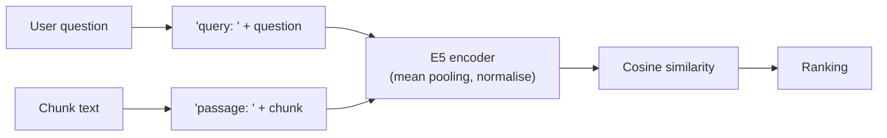

E5 is a family of embedding models from Microsoft Research, introduced in 2022 with a paper whose central claim was new at the time: an embedding model trained only on pairs harvested from the web, with no human relevance labels, could beat BM25 on a broad zero-shot retrieval benchmark. The name stands for **E**mb**E**ddings from bidir**E**ctional **E**ncoder r**E**presentations. The family has since grown to multilingual models and to a 7-billion-parameter model built on a large language model.

For a RAG engineer, E5 is the clearest case study of two ideas that apply to many modern embedders. The first is **weak supervision at scale**: where the training pairs come from and why filtering them matters. The second is **input prefixes**: E5 models expect every input to start with `query: ` or `passage: `, and getting this wrong costs quality without raising any error. This lesson explains both, works through the contrastive loss and its temperature (which explains E5's unusual score range), and measures the effect of each prefix choice on a public benchmark.

## Learning objectives

- Explain how E5's CCPairs training data was gathered and filtered, and why consistency filtering improves weakly supervised training.
- Apply E5's prefix rules correctly for asymmetric retrieval, symmetric similarity and feature extraction.
- Compute the InfoNCE loss at different temperatures and use it to explain why E5 cosine scores cluster between about 0.7 and 1.0.
- Measure the effect of prefix choices on nDCG@10 with a benchmark harness, and interpret small and large differences.
- Distinguish the E5 variants (v2, multilingual, instruct, Mistral-based) and their input formats.

## Prerequisites

- [Sentence Transformers](/learn/embedding-models/sentence-transformers): models, pooling and `encode`.
- [BGE models](/learn/embedding-models/bge-models): another open family with a query instruction, and the benchmark harness used here.
- [Query-document matching](/learn/rag-architecture-fundamentals/query-document-matching): the asymmetry between a short query and the passage that answers it.
- [Contrastive learning](/learn/embedding-optimisation/contrastive-learning): the general training objective, which this lesson applies.

## Why this matters

A query and the passage that answers it are different kinds of text: one is short and lacks the answer, the other is longer and contains it. An embedding model must learn to put them close together even though they are not paraphrases. E5's answer is to tell the model which kind of text it is reading, with a prefix, and to train it that way. The model then learns different "readings" for the two roles.

That design is powerful and fragile. The prefix is part of the input text, so nothing in the software checks it. A team that copies a generic Sentence Transformers snippet, embeds raw chunks and raw queries, and ships, gets vectors that are a little worse than they should be. Nobody notices, because the system still returns plausible results. The same applies to the many models that adopted the idea (Nomic, the multilingual E5 models, instruction-tuned models), each with its own prefix strings.

E5 also shows why absolute similarity scores are unreliable. Its cosines are almost all between 0.7 and 1.0, a direct result of the training temperature. A team that treats 0.8 as "fairly similar" will be confused when unrelated texts score 0.75. Understanding where the range comes from turns that confusion into a calibration task.

## The intuition

Imagine teaching someone to match exam questions to textbook paragraphs by giving them millions of examples scraped from the internet: forum questions and the answers people upvoted, article titles and their first paragraphs, paper titles and abstracts. Most pairs are genuinely related; some are noise (a joke reply, a clickbait title). If you teach from everything, the learner absorbs the noise. So you first train a rough learner, then use it to throw out pairs that even it finds implausible, and train the real learner on what remains. That is **consistency filtering**.

Now imagine the learner wears a badge that says either "I am a question" or "I am a passage" when they read each text. They learn that a question-reader should summarise *what is being asked* and a passage-reader should summarise *what is being stated*, in a way that makes the two meet. If you later hand them a text without a badge, they are not sure which reading to use. That is what a missing prefix does.

Finally, imagine the learner was graded harshly: any time the right paragraph was not clearly ahead of all the wrong ones, they lost marks, and "clearly" meant by a tiny margin. They learned to put the right answer just ahead, without bothering to push wrong answers far away. Their similarity scale is therefore squeezed: everything is "fairly similar", and the right answer is a little more similar. That is the low **temperature**.

## How it works

### Training data: CCPairs

The E5 paper (Wang and colleagues, 2022) built a dataset it called **CCPairs** (Colossal Clean text Pairs) from sources where related texts naturally come in pairs:

| Source | Query side | Passage side |
| --- | --- | --- |
| Reddit | Post | Comment |
| Stack Exchange | Question | Upvoted answer |
| Wikipedia | Entity and section title | Passage |
| Scientific papers | Title | Abstract |
| Common Crawl and news | Title | Passage |

The raw collection held on the order of a billion pairs. **Consistency-based filtering** then reduced it: a model was trained on the noisy data, and a pair was kept only if, among a large random set of candidate passages, that model ranked the pair's own passage near the top. The idea is that neural models tend to fit clean examples first, so a model trained on noisy data can still identify which pairs are self-consistent. The filtered set had roughly 270 million pairs.

### Training: two stages

1. **Contrastive pre-training** on CCPairs with the InfoNCE loss (explained in the mathematics section). Each query's own passage is the positive; every other passage in the batch is a negative. The paper used very large batches (tens of thousands of pairs), because more in-batch negatives give a harder, more informative training signal. The temperature was set to 0.01.
2. **Fine-tuning** on labelled data (MS MARCO passage ranking, Natural Questions and natural-language-inference pairs), with mined [hard negatives](/learn/embedding-optimisation/hard-negative-mining) and knowledge distillation from a cross-encoder, which supplies soft relevance scores that are richer than binary labels.

The paper reported that the pre-trained model alone, without any labelled data, was the first to outperform BM25 on the BEIR zero-shot retrieval benchmark, and that fine-tuning improved it further. The models use **mean pooling** over the final token vectors and are used with normalised vectors and cosine similarity.

### The prefix rules

Every input to an E5 model (v1, v2 and the multilingual models) must start with one of two prefixes. The model card's rules are:

1. **Asymmetric tasks** (passage retrieval, open-domain question answering, ad-hoc search): queries get `query: `, passages get `passage: `.
2. **Symmetric tasks** (semantic similarity, paraphrase detection, bitext mining): both sides get `query: `.
3. **Using embeddings as features** (classification, clustering): use `query: `.

A RAG retriever is the first case. The rules are strict about one point that people often miss: **passages need a prefix too**. It is not enough to mark queries.



When you load an E5 model with Sentence Transformers you can configure the prefixes as prompts, `SentenceTransformer(name, prompts={"query": "query: ", "document": "passage: "})`, and then call `encode_query` and `encode_document`, so that the strings live in one place.

### The variants

| Model | Size | Input format | Notes |
| --- | --- | --- | --- |
| `e5-small-v2`, `e5-base-v2`, `e5-large-v2` | 33M to 335M | `query: ` / `passage: ` | English, 512 tokens, 384 to 1,024 dimensions |
| `multilingual-e5-small` / `-base` / `-large` | 118M to 560M | `query: ` / `passage: ` | Around 100 languages, XLM-RoBERTa based |
| `multilingual-e5-large-instruct` | 560M | Instruction on queries, nothing on passages | Query: `Instruct: {task}\nQuery: {text}` |
| `e5-mistral-7b-instruct` | 7B | Instruction on queries, nothing on passages | Decoder LLM, last-token pooling, 4,096 dimensions |

Parameter counts are approximate and taken from the model cards at the time of writing.

The instruction-tuned models replace the two fixed prefixes with a one-sentence task description on the query side, for example `Instruct: Given a web search query, retrieve relevant passages that answer the query\nQuery: how much annual leave do I get`, and leave passages unprefixed. `e5-mistral-7b-instruct` came from a follow-up paper (Wang and colleagues, 2024, "Improving Text Embeddings with Large Language Models") that fine-tuned a decoder-only LLM on a mixture of labelled data and synthetic training pairs generated by proprietary LLMs across many tasks and languages. It is much stronger on benchmarks than the small models and roughly two hundred times larger than `e5-small-v2`, which puts it in a different deployment class: a GPU is needed for any real corpus. [Local embedding models](/learn/embedding-models/local-embedding-models) covers what serving such a model involves.

## The mathematics

### InfoNCE and temperature

**Intuition.** For each query, the loss asks the model to pick the right passage out of a batch, like a multiple-choice question. Similarities are turned into probabilities with a softmax, and the temperature decides how sharply small differences in similarity become large differences in probability.

$$
\mathcal{L} = -\log \frac{\exp\big(s(q, p^{+}) / \tau\big)}{\exp\big(s(q, p^{+}) / \tau\big) + \sum_{j=1}^{n} \exp\big(s(q, p^{-}_j) / \tau\big)}
$$

$q$ is the query, $p^{+}$ its positive passage, $p^{-}_1, \dots, p^{-}_n$ the negatives (in E5, the other passages in the batch), $s(\cdot,\cdot)$ the cosine similarity and $\tau$ the temperature. The fraction is the probability the model assigns to the right answer; the loss is near zero when that probability is near 1.

**By hand.** Let the positive have cosine 0.85 and three negatives have 0.80, 0.78 and 0.75.

- With $\tau = 0.01$, the logits are $85, 80, 78, 75$. Subtracting the largest (which does not change a softmax): $0, -5, -7, -10$. Exponentials: $1$, $0.006738$, $0.000912$, $0.0000454$; their sum is $1.007695$. Probability of the positive: $1 / 1.007695 = 0.9924$. Loss: $-\ln 0.9924 = 0.0077$.
- With $\tau = 1$, the exponentials of $0.85, 0.80, 0.78, 0.75$ are $2.3396, 2.2255, 2.1815, 2.1170$, summing to $8.8636$. Probability: $2.3396 / 8.8636 = 0.2640$. Loss: $-\ln 0.2640 = 1.3320$.

At $\tau = 0.01$ a cosine margin of only 0.05 already gives almost zero loss, so training exerts almost no pressure to push negatives further away. The model settles into a space where nearly everything has a high cosine and the right answer is slightly higher. That is why the E5 model card says scores distribute around 0.7 to 1.0 and calls it expected behaviour. Rankings are what the loss optimised; absolute values were never constrained.

```python
import numpy as np

cos = np.array([0.85, 0.80, 0.78, 0.75])     # positive first, then three negatives

for tau in (1.0, 0.1, 0.01):
    logits = cos / tau
    p = np.exp(logits - logits.max())
    p /= p.sum()
    print(f"tau={tau:<5} p(positive)={p[0]:.4f}  loss={-np.log(p[0]):.4f}")
```

```output
tau=1.0   p(positive)=0.2640  loss=1.3320
tau=0.1   p(positive)=0.4047  loss=0.9046
tau=0.01  p(positive)=0.9924  loss=0.0077
```

## In code

**The problem.** The AskMeridian team is evaluating `e5-small-v2` as an alternative to their current model. Before trusting it, they want to know how much the prefixes matter, and what happens with the common mistakes: no prefixes at all, `query: ` on both sides, `passage: ` on both sides. They use the same SciFact harness as in [BGE models](/learn/embedding-models/bge-models): 5,183 abstracts and 300 claims with relevance labels from the BEIR benchmark.

**Dependencies.** Roughly 130 MB of model and a few MB of data are downloaded on first run; the script takes several minutes on a laptop CPU, because the corpus is encoded once for each passage prefix.

```bash
pip install sentence-transformers pandas pyarrow huggingface_hub
```

**The source.**

```python
import numpy as np
import pandas as pd
from huggingface_hub import hf_hub_download
from sentence_transformers import SentenceTransformer

# --- SciFact (BEIR): 5,183 abstracts, 300 test claims with relevance labels ---
def get(repo, path):
    return hf_hub_download(repo, path, repo_type="dataset")

corpus = pd.read_parquet(get("BeIR/scifact", "corpus/corpus-00000-of-00001.parquet"))
queries = pd.read_parquet(get("BeIR/scifact", "queries/queries-00000-of-00001.parquet"))
qrels = pd.read_csv(get("BeIR/scifact-qrels", "test.tsv"), sep="\t", dtype=str)
relevant = qrels.groupby("query-id")["corpus-id"].apply(set).to_dict()
queries = queries[queries["_id"].isin(relevant)].reset_index(drop=True)
doc_ids = corpus["_id"].to_numpy()
docs = (corpus["title"] + ". " + corpus["text"]).tolist()
claims = queries["text"].tolist()


def ndcg_at_10(S):
    top = np.argsort(-S, axis=1)[:, :10]
    scores = []
    for i, qid in enumerate(queries["_id"]):
        rel = relevant[qid]
        dcg = sum((doc_ids[j] in rel) / np.log2(r + 2) for r, j in enumerate(top[i]))
        ideal = sum(1 / np.log2(r + 2) for r in range(min(len(rel), 10)))
        scores.append(dcg / ideal)
    return np.mean(scores)


model = SentenceTransformer("intfloat/e5-small-v2", device="cpu")
model.max_seq_length = 256                      # CPU budget; the model accepts 512
print(model[1].get_config_dict()["pooling_mode"], "pooling |", model.get_embedding_dimension(), "dims")

doc_cache = {}
def doc_vectors(prefix):
    if prefix not in doc_cache:
        doc_cache[prefix] = model.encode([prefix + d for d in docs], normalize_embeddings=True)
    return doc_cache[prefix]

settings = [("", ""), ("query: ", "passage: "), ("query: ", "query: "), ("passage: ", "passage: ")]
for q_prefix, d_prefix in settings:
    Q = model.encode([q_prefix + c for c in claims], normalize_embeddings=True)
    S = Q @ doc_vectors(d_prefix).T
    lo, med, hi = np.percentile(S, [1, 50, 99])
    print(f"query={q_prefix!r:<11} doc={d_prefix!r:<11} nDCG@10 {ndcg_at_10(S):.3f}"
          f"   cosines: 1st pct {lo:.2f}, median {med:.2f}, 99th pct {hi:.2f}")
```

The output is from a CPU run with sentence-transformers 6.3; exact figures can vary slightly with library versions and hardware.

```output
mean pooling | 384 dims
query=''          doc=''          nDCG@10 0.668   cosines: 1st pct 0.71, median 0.79, 99th pct 0.84
query='query: '   doc='passage: ' nDCG@10 0.677   cosines: 1st pct 0.71, median 0.77, 99th pct 0.83
query='query: '   doc='query: '   nDCG@10 0.661   cosines: 1st pct 0.72, median 0.79, 99th pct 0.85
query='passage: ' doc='passage: ' nDCG@10 0.637   cosines: 1st pct 0.69, median 0.78, 99th pct 0.84
```

**The important lines.**

- `model[1].get_config_dict()["pooling_mode"]` confirms **mean** pooling; contrast BGE's `cls`.
- `doc_vectors` caches the corpus vectors per passage prefix, so the corpus is encoded three times (no prefix, `passage: `, `query: `) rather than four.
- `np.percentile(S, [1, 50, 99])` summarises all 300 × 5,183 query-passage cosines, most of which are between unrelated texts.

**What the output means.**

- **The documented setting wins.** `query: ` on claims and `passage: ` on abstracts gives the best nDCG@10, 0.677. Leaving out both prefixes gives 0.668; using the symmetric setting (`query: ` on both) gives 0.661; putting `passage: ` on the queries gives 0.637, four points below the correct setting.
- **The worst mistake is the most instructive.** Marking claims as passages tells the model to read them as statements to be found, not as requests to find something, and that costs the most. On SciFact the claims are themselves declarative sentences, so the gap between settings is smaller than it may be for short questions; on your data, measure it.
- **The differences are modest but systematic, and free to avoid.** Nothing in the output warned that three of the four configurations were wrong; only the labelled evaluation revealed it.
- **The scores are squeezed exactly as the temperature analysis predicts.** In every configuration, 98% of all query-abstract cosines fall between about 0.70 and 0.85, although almost every pair is unrelated (each claim has one or two relevant abstracts among 5,183). A cosine of 0.80 from this model says very little on its own; its rank says a lot. Compare MiniLM in the BGE lesson, whose median was 0.10.
- With 300 queries, gaps of under a point (0.668 against 0.661) could be reversed by a different sample; the four-point gap is more robust. Use larger evaluation sets before acting on small differences.

**Common errors.**

- Writing the prefix without its trailing space (`"query:"`): the tokens differ from training. Copy the exact strings from the model card.
- Prefixing queries in the API service but not in the evaluation job (or the reverse), so that offline numbers do not describe production. Configure the prefixes once, as prompts on the model object.
- Using a `multilingual-e5-*-instruct` model with `query: ` prefixes: the instruct variants use the `Instruct: ...\nQuery: ...` format instead.

**Extending it.** Run the same harness on your own question set; add `multilingual-e5-small` if your users write in several languages; and try `SentenceTransformer("intfloat/e5-small-v2", prompts={"query": "query: ", "document": "passage: "})` with `encode_query` and `encode_document` to confirm it reproduces the prefixed result.

## A real-world example

Meridian's Platform team adopted `e5-base-v2` for a second index covering product documentation for Meridian Sync, Meridian Relay and Meridian Reports. The indexing job was written by one engineer and the query path by another. The indexing job followed the model card and embedded `passage: ` + chunk. The query service had been copied from the handbook assistant, which used a model without prefixes, and embedded raw queries.

The result was not a failure but a quiet underperformance: product questions were answered correctly most of the time, so nobody raised an alarm. It surfaced when the team ran their monthly evaluation with a harness that encoded queries itself, correctly prefixed, and saw better numbers offline than the support desk was seeing in production. Tracing the difference led to the missing prefix in the query service.

The fix was structural. The team created one small internal package that owns "how to embed a query" and "how to embed a document" for each model, configured through Sentence Transformers prompts, and made both the indexing jobs and the query services depend on it. They also added a test that encodes a fixed query through the production code path and compares the vector with one produced by the evaluation harness, failing the build if they differ beyond floating-point tolerance. Finally, they replaced their absolute "low confidence" cosine threshold, which had been 0.5 and therefore never triggered on E5's 0.7-and-above scores, with a threshold calibrated on labelled data.

## Common mistakes

- **Omitting the `passage: ` prefix on documents.** The model card's rules prefix both sides; prefixing only queries is a different, untested configuration.
- **Using `query: ` on both sides for retrieval.** That is the symmetric-task setting. Reserve it for similarity and clustering.
- **Interpreting cosine values as if they spanned −1 to 1.** E5's scores mostly lie between 0.7 and 1.0; a cosine of 0.75 can mean "unrelated". Calibrate thresholds on your data.
- **Inconsistent prefixes between indexing and querying.** Vectors produced under different prefix conventions do not match as well as the model can. Centralise the prefix logic.
- **Mixing up E5 generations.** v1/v2 and multilingual models use `query: `/`passage: `; the instruct models use an instruction on queries and nothing on passages.
- **Choosing the 7B model without doing the cost arithmetic.** Its vectors are 4,096-dimensional and every query needs an LLM-sized forward pass.

## Best practices

- Store the prefix strings in model configuration (Sentence Transformers `prompts`) and call `encode_query` and `encode_document` everywhere.
- Add a test that the production query path and the evaluation harness produce identical vectors for a fixed input.
- Measure prefix and model choices on your own labelled questions; treat public benchmark gains as hypotheses.
- Calibrate any absolute threshold per model, or move thresholding to a reranker's scores.
- Record the model name, prefix convention and pooling with the index, so that a later change is detectable.

## Performance considerations

**Prefixes are nearly free.** `query: ` and `passage: ` add about three tokens each. For a 200-token chunk that is 1.5% more tokens to process; for a 12-token query, 25%, which is still negligible in absolute terms.

**Instruction prefixes are longer.** A 20-token instruction on a 12-token query nearly triples the query's length; query encoding is still cheap for small models, but for a 7B model it is a measurable part of latency.

**Model size dominates.** As a rough guide, compute per token scales with parameter count: `e5-base-v2` is about 3.3 times `e5-small-v2`, `e5-large-v2` about 10 times, and `e5-mistral-7b-instruct` about 200 times. Re-embedding a 5-million-chunk corpus at 200 tokens per chunk is a billion tokens; that is an overnight job on a CPU for the small model and a multi-GPU job for the 7B model.

**Vector size** follows the model: 384 dimensions for small (1,536 bytes in `float32`), 1,024 for large (4 KB) and 4,096 for the Mistral-based model (16 KB, ten times small's). For 5 million chunks that is roughly 7.7 GB against 82 GB.

## Summary

- E5 showed that contrastive pre-training on about 270 million consistency-filtered web pairs, without human labels, could beat BM25 zero-shot on BEIR; supervised fine-tuning then improves it.
- E5 v1, v2 and the multilingual models require `query: ` on queries and `passage: ` on passages for retrieval; `query: ` on both sides for symmetric tasks.
- The InfoNCE loss with temperature 0.01 rewards tiny margins, so E5 cosines cluster between about 0.7 and 1.0; rankings are meaningful, absolute values are not.
- Prefix mistakes fail silently; measure them with a benchmark harness and prevent them by configuring prefixes once, as prompts.
- The instruct and Mistral-based variants use task instructions on queries only and sit in a much higher cost class.

## Exercises

1. Compute the InfoNCE probability of the positive and the loss for cosines 0.90 (positive), 0.88 and 0.70 with $\tau = 0.05$.

<details><summary>Show solution</summary>

Logits: $18, 17.6, 14$. Subtract 18: $0, -0.4, -4$. Exponentials: $1, 0.6703, 0.0183$; sum $1.6886$. Probability: $1 / 1.6886 = 0.5922$. Loss: $-\ln 0.5922 = 0.524$. The close negative (0.88) dominates the loss; the distant one (0.70) contributes almost nothing. This is why hard negatives are more informative than random ones.

</details>

2. A colleague's retrieval code embeds chunks with `passage: ` and queries with no prefix. List two ways to detect this from the outside, without reading the code.

<details><summary>Show solution</summary>

First, compare the production query vector for a fixed question with vectors computed offline for that question with and without `query: `; the one it matches (to floating-point tolerance) reveals the convention. Second, run the labelled evaluation set through the production endpoint and through a harness with correct prefixes; a consistent quality gap points to a mismatch in query handling. Logging the exact string passed to the encoder, including prefixes, makes the first check trivial.

</details>

3. Extend the harness to compare `e5-small-v2` with correct prefixes against `all-MiniLM-L6-v2` (no prefixes) on SciFact, and state what result would justify switching AskMeridian's model.

<details><summary>Show solution</summary>

Load `mini = SentenceTransformer("sentence-transformers/all-MiniLM-L6-v2", device="cpu")`, set `max_seq_length = 256`, encode `claims` and `docs` without prefixes and `normalize_embeddings=True`, and call `ndcg_at_10(Q @ D.T)`. In our run of the same harness in the BGE lesson, MiniLM scored 0.648 nDCG@10, so E5 with prefixes is ahead on SciFact. But SciFact is scientific claims, not staff questions. The switch is justified if the same comparison on AskMeridian's own labelled questions shows a gain the team agreed in advance was worth it (for example, more questions answered correctly in the top 5), and if the cost is acceptable: both models are 384-dimensional, and `e5-small-v2` has roughly 1.5 times MiniLM's parameters.

</details>

4. Design decision: AskMeridian needs one model for both retrieval (questions to chunks) and duplicate detection between chunks. How would you use E5's prefixes for each task with one index?

<details><summary>Show solution</summary>

The prefix rules give different encodings per task: retrieval wants `query: ` on questions and `passage: ` on chunks; duplicate detection between chunks is symmetric and wants `query: ` on both. You therefore either store two vectors per chunk (`passage: ` for retrieval and `query: ` for de-duplication), doubling storage, or accept the retrieval encoding (`passage: ` on both chunks) for de-duplication, which is an untested configuration whose quality you should measure. A common compromise is to run de-duplication in the ingestion pipeline with freshly computed `query: ` vectors that are not stored, so the index holds only the retrieval vectors.

</details>

## Check your understanding

```quiz
[
  {
    "q": "For a RAG retriever using `e5-base-v2`, which input format is correct?",
    "options": ["`query: ` on questions and no prefix on chunks", "`query: ` on questions and `passage: ` on chunks", "`passage: ` on both", "No prefixes; they are optional"],
    "answer": 1,
    "why": "Asymmetric retrieval uses `query: ` for queries and `passage: ` for passages; both sides need their prefix."
  },
  {
    "q": "Why do E5 cosine similarities mostly fall between about 0.7 and 1.0?",
    "options": ["The vectors are not normalised", "Mean pooling compresses the range", "The prefixes add a constant to every vector", "Training used InfoNCE with temperature 0.01, which rewards small margins and never pushes negatives far away"],
    "answer": 3,
    "why": "With a low temperature, a tiny cosine margin already yields near-zero loss, so the space is not spread out."
  },
  {
    "q": "What does consistency-based filtering do in building CCPairs?",
    "options": ["Keeps pairs that a model trained on the noisy data ranks highly among many random candidates", "Removes pairs with spelling mistakes", "Keeps only pairs labelled by humans", "Removes non-English pairs"],
    "answer": 0,
    "why": "Models fit clean examples first, so a model trained on the noisy pairs can identify which pairs are self-consistent."
  },
  {
    "q": "In the InfoNCE loss, what happens as the temperature decreases?",
    "options": ["All negatives get equal weight", "The loss stops depending on the positive", "Small differences in cosine become large differences in probability", "Cosine scores are rescaled to the range 0 to 1"],
    "answer": 2,
    "why": "Dividing by a small temperature magnifies differences between logits before the softmax."
  },
  {
    "q": "Which input format does `multilingual-e5-large-instruct` expect for a retrieval query?",
    "options": ["`query: ` + text", "`passage: ` + text", "No prefix", "`Instruct: {task}` followed by a newline and `Query: ` + text"],
    "answer": 3,
    "why": "The instruct variants put a task instruction on queries and leave passages unprefixed."
  }
]
```

## Further reading

- Wang, L., Yang, N., Huang, X., Jiao, B., Yang, L., Jiang, D., Majumder, R. and Wei, F. (2022). "Text Embeddings by Weakly-Supervised Contrastive Pre-training." [arXiv:2212.03533](https://arxiv.org/abs/2212.03533).
- Wang, L., Yang, N., Huang, X., Yang, L., Majumder, R. and Wei, F. (2024). "Improving Text Embeddings with Large Language Models." ACL 2024. [arXiv:2401.00368](https://arxiv.org/abs/2401.00368).
- Wang, L. and colleagues (2024). "Multilingual E5 Text Embeddings: A Technical Report." [arXiv:2402.05672](https://arxiv.org/abs/2402.05672).
- van den Oord, A., Li, Y. and Vinyals, O. (2018). "Representation Learning with Contrastive Predictive Coding." (The InfoNCE loss.) [arXiv:1807.03748](https://arxiv.org/abs/1807.03748).
- The `intfloat` model cards on the Hugging Face Hub, including the FAQ on prefixes and score ranges.
