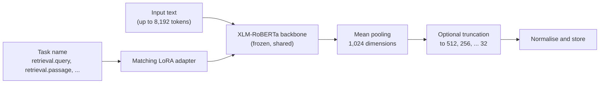

Jina AI's embedding models are worth a lesson of their own because each generation introduced an idea that later spread across the field. The v2 family was among the first open models to accept inputs of 8,192 tokens instead of the usual 512. The v3 model added **task adapters**, so one set of weights produces different embeddings for queries, passages, classification and similarity, and it was trained so that its vectors can be shortened without retraining. Later releases added multimodal and multi-vector output. This lesson explains how those features work, what they buy a RAG system, and where they quietly do not help. You will also prove, with a model on your own machine, what happens to text that does not fit in an embedding model's window.

## Learning objectives

- Explain how ALiBi and rotary position encodings let an encoder accept inputs far longer than its training length, and compute an ALiBi bias by hand.
- Show, with a running example, that a short-window model silently ignores text past its limit, and that a long window does not remove the dilution caused by mean pooling.
- Describe how jina-embeddings-v3 uses task-specific LoRA adapters, and choose the correct task for indexing and for querying.
- Call the Jina embeddings API with an explicit task and output dimension, and load the open weights with `trust_remote_code` safely.
- Decide, for a given corpus and licence situation, whether a long-context Jina model, a short-window model with smaller chunks, or late chunking is the better choice.

## Prerequisites

- [Sentence Transformers](/learn/embedding-models/sentence-transformers): loading a model, `encode`, normalisation and pooling.
- [E5 models](/learn/embedding-models/e5-models): why queries and passages are encoded differently.
- [Chunk size](/learn/chunking-fundamentals/chunk-size): how chunk length trades context against precision.
- [Sentence embeddings](/learn/embedding-fundamentals/sentence-embeddings): how token vectors are pooled into one vector.

## Why this matters

Every embedding model has a maximum input length in tokens. Text beyond it is not summarised; it is thrown away before the model sees it, usually without an error. Pair 600-token chunks with a 256-token model and more than half of every chunk is invisible. Retrieval still works on the first part, so nothing looks broken; queries about the rest simply never find their chunk.

Long-context models remove that trap, which is the first reason Jina's models are popular. The second is that one set of weights serves several jobs (retrieval, clustering, classification), each tuned for its purpose. The third is cost control: v3 vectors can be cut from 1,024 numbers to 256 or fewer, shrinking the index by the same factor.

Each feature has a catch: a long window does not make a long chunk retrievable, an adapter helps only if chosen correctly on both sides, shortened vectors lose some quality, and some weights carry a non-commercial licence.

## The intuition

Imagine summarising a book by writing one sentence on an index card, and imagine two rules for how much of the book you may read first.

Under the first rule you may read only the first ten pages. Your card is a good summary of chapter one. If someone later searches the card catalogue for a topic that appears in chapter nine, your card will not lead them there, because you never saw chapter nine. That is a short-window model meeting a long chunk.

Under the second rule you may read the whole book. Now nothing is unseen, but you still have only one sentence. A topic that fills two pages of a three-hundred-page book will barely register in it. That is a long-window model meeting a long chunk: no truncation, but **dilution**.

Jina's long-context models change the first rule, not the second, which is why chunking still matters with them. The more interesting idea, also popularised by Jina, is to read the whole book and then write one card per chapter with the whole book in mind: [late chunking](/learn/chunking-optimisation/late-chunking).

## How it works

### The model families

Jina has released several generations. Details change, so check the model cards and Jina's documentation before relying on any number.

| Model | Backbone and size | Output | Notable feature | Licence of the open weights |
| --- | --- | --- | --- | --- |
| jina-embeddings-v2 (small, base; English, bilingual German, Spanish and Chinese variants, and a code variant) | BERT-style encoder with ALiBi; roughly 33 million (small) and 137 million (base) parameters | 512 (small) or 768 (base) dimensions | 8,192-token input | Apache 2.0 |
| jina-embeddings-v3 | XLM-RoBERTa, about 570 million parameters | 1,024 dimensions, truncatable down to 32 | Task LoRA adapters, multilingual, rotary positions, 8,192 tokens | CC BY-NC 4.0 (non-commercial) |
| jina-embeddings-v4 | Built on a vision-language model (Qwen2.5-VL), about 3.8 billion parameters | Single-vector or multi-vector | Text and images (including screenshots of documents) in one space | Restrictive; read the model card |

Jina also publishes [rerankers](/learn/reranking-models/jina-rerankers), ColBERT-style [late-interaction](/learn/reranking-models/colbert) models and CLIP-style image-text models. This lesson covers the text embedding models.

The non-commercial licence on v3 deserves emphasis: production use in a business generally means the hosted API, a cloud-marketplace listing or a negotiated licence. That is a procurement decision, and it is easy to discover too late.

### Long inputs: why most encoders stop at 512 tokens

A transformer's attention has no built-in sense of order: it compares every token with every other token, and without extra information "dog bites man" and "man bites dog" look the same. The original BERT solved this with **learned absolute position embeddings**: a table with one learned vector per position, 0 to 511, added to each token's embedding. Position 600 has no row in the table, so the model cannot accept it. That is the root of the 512-token limit (all-MiniLM-L6-v2, a BERT derivative, is configured even lower, at 256).

Two alternatives remove the table.

**ALiBi** (Attention with Linear Biases, Press, Smith and Lewis, 2021), used in jina-embeddings-v2, adds no position vectors at all. Instead, when a token decides how much attention to pay to another token, a penalty proportional to the distance between them is subtracted from the attention score. Nearby tokens are penalised a little; distant ones a lot. Because the penalty is a formula rather than a lookup table, it is defined for any distance, so a model trained on 512-token sequences can be run on 8,192-token ones. The original ALiBi was designed for left-to-right decoders; Jina's encoder uses a symmetric version that penalises distance in both directions.

**Rotary position embeddings** (RoPE, Su and colleagues, 2021), used in v3, rotate the query and key vectors by an angle that depends on position, so that their dot product depends on the relative distance between tokens. Rotations are also defined for any position. In practice, models using either scheme are still trained or fine-tuned on progressively longer inputs, because being *able* to process position 8,000 is not the same as having *learned* to use it well.

### What long inputs cost

Attention compares every token with every other, so its cost grows with the square of the input length. An 8,192-token input has 16 times as many tokens as a 512-token one and needs roughly 256 times as many attention comparisons per layer, with memory growing similarly. Indexing pays this once and queries are short, but it is a reason not to send 8,000-token inputs when you do not need to.

### Task adapters in v3

Different jobs want different geometry. For retrieval, a short question must land near the passage that answers it, though the two look nothing alike; for duplicate detection, texts should be close only if they say the same thing; for clustering, texts on one topic should gather. One embedding cannot be ideal for all three.

E5 and Nomic handle the query-passage difference with text prefixes (see [E5 models](/learn/embedding-models/e5-models) and [Nomic embeddings](/learn/embedding-models/nomic-embeddings)). jina-embeddings-v3 goes further: one large frozen backbone plus five small **LoRA adapters**, one per task. LoRA (low-rank adaptation, Hu and colleagues, 2021) adds to selected weight matrices a correction made of two thin matrices whose product has low rank. Each adapter is a tiny fraction of the model's size, and switching task means choosing which correction to apply.

The five tasks, as named in the API and the model card, are:

- `retrieval.query` for search queries;
- `retrieval.passage` for the documents or chunks being searched;
- `text-matching` for symmetric similarity, such as duplicate detection or comparing two passages;
- `classification` for embeddings fed to a classifier;
- `separation` for clustering and reranking-style separation of topics.

For one input:

1. The text is tokenised (up to 8,192 tokens).
2. The task name selects one LoRA adapter, which modifies the backbone's weights for this forward pass.
3. The backbone produces one vector per token.
4. The token vectors are mean-pooled into one 1,024-dimensional vector.
5. Optionally, the vector is truncated to its first $d$ dimensions and renormalised.



The rule that follows is the same as for prefixes: **index passages with `retrieval.passage` and embed queries with `retrieval.query`.** Mixing them up does not raise an error. It produces vectors from two different adapters that were trained to work together in one specific pairing, and retrieval quality drops without any visible failure.

### Shortened vectors

v3 was trained with **Matryoshka representation learning**: the training loss is applied not only to the full 1,024-dimensional vector but also to its first 512, 256, 128 and so on dimensions, so that the leading dimensions carry the most important information. You can keep only the first 256 numbers, renormalise, and still get useful retrieval, at a quarter of the storage. Quality falls as you cut deeper, and how much it falls depends on your data, so measure it. The training method and its trade-offs belong to [Matryoshka embeddings](/learn/embedding-optimisation/matryoshka-embeddings).

### Late chunking

Because a v2 or v3 model reads up to 8,192 tokens at once, you can feed a whole document through the model, keep the per-token vectors, and only then pool them into one vector per chunk. Each chunk's vector is built from token vectors that "saw" the rest of the document, so a chunk that says "it must be reported at once" still carries the information that "it" is a lost laptop. Jina's API exposes this as a `late_chunking` option. The method and its evaluation are covered in [late chunking](/learn/chunking-optimisation/late-chunking); what matters here is that it is the main way a long window improves retrieval rather than merely avoiding truncation.

## The mathematics

### The ALiBi penalty

**Intuition.** Each attention head gets its own fixed slope. A steep slope makes the head look only at its neighbours; a shallow one lets it look far. Together the heads cover several ranges.

$$
s_{ij} = \frac{\mathbf{q}_i \cdot \mathbf{k}_j}{\sqrt{d}} - m_h \, |i - j|,
\qquad
m_h = 2^{-8h/H}
$$

- $s_{ij}$ is the attention score of token $i$ for token $j$, before the softmax.
- $\mathbf{q}_i$ and $\mathbf{k}_j$ are the query and key vectors of the two tokens, and $d$ is their dimension.
- $|i - j|$ is the distance between the tokens in positions.
- $m_h$ is the slope of head $h$, for $h = 1, \dots, H$, where $H$ is the number of heads.

**Worked example.** With $H = 8$ heads, head 1 has slope $2^{-1} = 0.5$ and head 8 has slope $2^{-8} = 0.0039$. For two tokens 100 positions apart, head 1 subtracts $0.5 \times 100 = 50$ from the score. After the softmax, a penalty of 50 multiplies the attention weight by $e^{-50}$, which is effectively zero: head 1 ignores tokens that far away. Head 8 subtracts only $0.0039 \times 100 = 0.39$, a factor of $e^{-0.39} \approx 0.68$, so it still attends to them.

```python
import numpy as np

H = 8
slopes = 2.0 ** (-8 * np.arange(1, H + 1) / H)
print("slopes:", slopes)
for dist in [10, 100, 1000]:
    print(f"distance {dist:4d}: head 1 bias {-slopes[0] * dist:7.1f}, head 8 bias {-slopes[-1] * dist:6.2f}")
```

```output
slopes: [0.5        0.25       0.125      0.0625     0.03125    0.015625
 0.0078125  0.00390625]
distance   10: head 1 bias    -5.0, head 8 bias  -0.04
distance  100: head 1 bias   -50.0, head 8 bias  -0.39
distance 1000: head 1 bias  -500.0, head 8 bias  -3.91
```

### Dilution under mean pooling

**Intuition.** A mean-pooled embedding is an average. A fact that occupies a small share of the tokens contributes a small share of the average, however many tokens the model can read.

Take a simplified model: $f$ token vectors point along a unit direction $\mathbf{u}$ (the fact), and $n$ other token vectors point along a unit direction $\mathbf{v}$ orthogonal to it (the rest of the document). The pooled vector is $\mathbf{p} = (f\mathbf{u} + n\mathbf{v}) / (f + n)$, and its cosine similarity with the fact's direction is

$$
\cos(\mathbf{p}, \mathbf{u}) = \frac{f}{\sqrt{f^2 + n^2}}
$$

- $f$ is the number of tokens expressing the fact.
- $n$ is the number of other tokens.

**Worked example.** A 20-token fact alone gives $20/\sqrt{400} = 1$. The same fact in a 100-token chunk ($n = 80$) gives $20/\sqrt{400 + 6400} = 20/82.5 \approx 0.24$. In an 8,020-token document ($n = 8000$) it gives about $0.0025$. Real token vectors are not orthogonal, so real similarities fall less sharply, but the direction of the effect is the same.

```python
u, v = np.array([1.0, 0.0]), np.array([0.0, 1.0])
f = 20
for n in [0, 80, 380, 8000]:
    pooled = (f * u + n * v) / (f + n)
    cos = pooled @ u / np.linalg.norm(pooled)
    print(f"f={f}, n={n:4d}: cos(pooled, u) = {cos:.3f}   formula f/sqrt(f^2+n^2) = {f / np.hypot(f, n):.3f}")
```

```output
f=20, n=   0: cos(pooled, u) = 1.000   formula f/sqrt(f^2+n^2) = 1.000
f=20, n=  80: cos(pooled, u) = 0.243   formula f/sqrt(f^2+n^2) = 0.243
f=20, n= 380: cos(pooled, u) = 0.053   formula f/sqrt(f^2+n^2) = 0.053
f=20, n=8000: cos(pooled, u) = 0.002   formula f/sqrt(f^2+n^2) = 0.002
```

## In code

### Proving truncation with a local model

**The problem.** Before choosing a long-context model, show that the problem it solves is real. The script below builds a 19-sentence Meridian laptop runbook in which one sentence answers the question "What should I do if I lose my work laptop?". It embeds the runbook with that sentence first, with it last, and without it, using all-MiniLM-L6-v2, whose window is 256 tokens. No API key is needed; the model is downloaded once (about 90 MB) and then cached.

```bash
pip install sentence-transformers
```

```python
from sentence_transformers import SentenceTransformer

model = SentenceTransformer("sentence-transformers/all-MiniLM-L6-v2")
print("max_seq_length:", model.max_seq_length)

runbook = [
    "Meridian laptops are refreshed every three years by the IT team.",
    "New starters collect their laptop from the support desk on their first day.",
    "Every laptop ships with full-disk encryption and a managed antivirus agent.",
    "Software is installed through the self-service portal rather than by hand.",
    "Operating system updates are pushed automatically and may be postponed for a week at most.",
    "Staff may connect one external monitor and one docking station supplied by IT.",
    "Personal software that is not on the approved list must not be installed.",
    "Laptops must be locked whenever they are left unattended in the office.",
    "Home folders are backed up nightly while the laptop is on the corporate network.",
    "Battery faults are handled under warranty and need a ticket with the serial number.",
    "When staff leave Meridian, the laptop is returned to the support desk and wiped.",
    "Stickers that cover the asset tag are not allowed.",
    "The VPN client must be connected before using public Wi-Fi in cafes, hotels or trains.",
    "Passwords are rotated every 90 days and the laptop prompts a week in advance.",
    "Printers on each floor are added automatically the first time the laptop joins the network.",
    "Screen brightness and power settings are managed centrally to protect battery life.",
    "Spare chargers can be borrowed from the support desk for up to one week.",
    "Support desk hours are 08:00 to 18:00 UK time on working days.",
]
key = "If a laptop is lost or stolen, report it to the support desk at once so it can be locked remotely."
query = "What should I do if I lose my work laptop?"

def n_tokens(text):
    return len(model.tokenizer(text)["input_ids"])

def embed(texts):
    return model.encode(texts, normalize_embeddings=True)

q = embed(query)
fact_first = " ".join([key] + runbook)
fact_last = " ".join(runbook + [key])
no_fact = " ".join(runbook)
e_first, e_last, e_none = embed([fact_first, fact_last, no_fact])

print(f"document tokens: {n_tokens(fact_last)}")
print(f"cos(query, fact first) = {q @ e_first:.3f}")
print(f"cos(query, fact last)  = {q @ e_last:.3f}")
print(f"cos(query, no fact)    = {q @ e_none:.3f}")
print(f"cos(fact last, no fact) = {e_last @ e_none:.4f}")
print(f"cos(query, key sentence alone) = {q @ embed(key):.3f}")
```

```output
max_seq_length: 256
document tokens: 300
cos(query, fact first) = 0.455
cos(query, fact last)  = 0.403
cos(query, no fact)    = 0.403
cos(fact last, no fact) = 1.0000
cos(query, key sentence alone) = 0.619
```

**The important lines.** `model.max_seq_length` is the window `encode` enforces. `n_tokens` counts with the model's own tokeniser, special tokens included; a word count or another tokeniser's count would be wrong.

**What the output means.** The document is 300 tokens, so the last 44 are cut. With the answer last, the embedding is *identical* to the embedding of the runbook without the answer (cosine 1.0000): the model never saw the sentence. Its score against the query, 0.403, is just the score of a generic laptop document. With the answer first it is seen, and the score rises to 0.455. But that is still far below the 0.619 the answer earns on its own, which is the dilution effect from the mathematics section, measured on a real model.

A long-context model would fix the first problem but not the second. Smaller chunks fix dilution; late chunking tries to fix it while keeping document context.

**Common errors.** Calling the tokeniser directly on long text prints a warning ("Token indices sequence length is longer than the specified maximum sequence length for this model (300 > 256)"). It comes from the counting call; `encode` itself truncates silently.

**Extending it.** Run your own chunker over a sample of your corpus and compute the share of chunks whose token count exceeds the model's `max_seq_length`. If the share is above zero, either shrink the chunks or change the model.

### Calling the Jina API

The hosted API is the simplest route to v3 for commercial use. The code below was **not executed** for this lesson, because it needs a Jina API key. It follows the documented request shape: a POST to the embeddings endpoint with a model name, a task, an optional output dimension, and a list of inputs. The response mirrors the OpenAI format, with one object per input in `data`.

```bash
pip install httpx numpy
export JINA_API_KEY=...   # from your Jina account
```

```python
import os
import httpx
import numpy as np

URL = "https://api.jina.ai/v1/embeddings"
HEADERS = {"Authorization": f"Bearer {os.environ['JINA_API_KEY']}"}

def jina_embed(texts: list[str], task: str, dimensions: int = 1024) -> np.ndarray:
    payload = {
        "model": "jina-embeddings-v3",
        "task": task,              # "retrieval.passage" for chunks, "retrieval.query" for queries
        "dimensions": dimensions,  # Matryoshka truncation, done server-side
        "input": texts,
    }
    r = httpx.post(URL, headers=HEADERS, json=payload, timeout=60)
    r.raise_for_status()
    data = sorted(r.json()["data"], key=lambda item: item["index"])
    vectors = np.array([item["embedding"] for item in data], dtype=np.float32)
    return vectors / np.linalg.norm(vectors, axis=1, keepdims=True)

chunks = [
    "Annual leave is 25 days; up to 5 unused days carry over and must be used by 31 March.",
    "If a laptop is lost or stolen, report it to the support desk at once.",
]
doc_vecs = jina_embed(chunks, task="retrieval.passage", dimensions=256)
q_vec = jina_embed(["I left my laptop on the train"], task="retrieval.query", dimensions=256)[0]
print(doc_vecs.shape, (doc_vecs @ q_vec).round(3))
```

Your exact numbers will differ; the output looks like this:

```output
(2, 256)
[0.18 0.61]
```

The two `task` values are the point: the same function is called with different adapters for the two sides. Renormalising makes a dot product a cosine whatever the server returns, and sorting by `index` avoids relying on response order.

### Running the open weights

For research, or with a commercial licence, the weights load through Sentence Transformers. The model ships its own Python code for the adapters, so it needs `trust_remote_code=True`; following the model card, the task is passed as both `task` and `prompt_name`. This was **not executed** here (the weights, over 1 GB, were not downloaded).

```python
from sentence_transformers import SentenceTransformer

model = SentenceTransformer(
    "jinaai/jina-embeddings-v3",
    trust_remote_code=True,
    revision="<a specific commit hash from the model page>",
)
passages = model.encode(chunks, task="retrieval.passage", prompt_name="retrieval.passage")
queries = model.encode(["I left my laptop on the train"], task="retrieval.query", prompt_name="retrieval.query")
```

Pinning `revision` matters twice over here: it keeps your vectors reproducible, and it fixes which version of the remote code runs on your machine (see Security considerations).

## A real-world example

Meridian's Platform team indexes the IT runbooks for AskMeridian. Runbooks are long, procedural and full of cross-references: a page about "Atlas error E-4021" may run to several thousand tokens, with the diagnosis on page one and the fix four sections later.

Tomasz, the engineer who built the first index, used a 256-token model with 800-token chunks, because the chunks "read well". Support staff reported that AskMeridian could explain what an error meant but rarely how to fix it. He measured: about two-thirds of the chunks were longer than the model's window, and the fix steps were usually in the truncated tail. The diagnosis text was always at the start of a section, so it was always seen.

He tested two remedies on 60 labelled support questions: the same model with 200-token chunks, and jina-embeddings-v3 through the API (the licence ruled out the open weights) with 800-token chunks. Both fixed the "never finds the fix" pattern, confirming the diagnosis. The large chunks were weaker on narrow questions ("which port does Relay use?") because of dilution; the small chunks were weaker on questions needing two steps of a procedure together. The team chose the long-context model with 300-token chunks and late chunking, which kept chunks narrow while letting each chunk's vector reflect the surrounding procedure, and added a check to the ingestion pipeline that fails the build if any chunk exceeds the model's window.

The note in their design log was not "use the longer model" but "count tokens with the model's tokeniser before choosing a chunk size".

## Common mistakes

- **Assuming the library will complain about long inputs.** Sentence Transformers truncates silently (some APIs return an error instead), leaving an index with blind spots.
- **Treating an 8,192-token window as a reason to embed whole documents.** Mean pooling dilutes narrow facts; long chunks retrieve well for broad questions and badly for specific ones.
- **Indexing with `retrieval.query` or querying with `retrieval.passage`.** The adapters are a matched pair. A mismatch degrades retrieval without any error.
- **Truncating Matryoshka vectors without renormalising.** The first 256 numbers of a unit vector are not a unit vector; a dot product on them is no longer a cosine.
- **Shipping open v3 weights in a commercial product without checking the licence.** CC BY-NC 4.0 does not permit commercial use.
- **Loading remote-code models without pinning a revision.** The next `from_pretrained` may fetch and execute different code.

## Best practices

- Record the model name, task, dimension, revision and maximum input length together as part of your index metadata, and refuse to query an index with a different combination.
- Count tokens with the embedding model's own tokeniser in the chunking stage and enforce the limit there.
- Choose chunk size by experiment, even with a long-context model; see [chunk size experiments](/learn/chunking-optimisation/chunk-size-experiments).
- Use `text-matching` for deduplication and near-duplicate detection, and the retrieval pair for search; do not reuse one set of vectors for both jobs.
- Evaluate reduced dimensions on your own queries before adopting them, and keep the option to re-embed at full size.

## Performance considerations

**Storage.** A 1,024-dimensional float32 vector takes 4,096 bytes. One million chunks take about 4.1 GB before any index overhead. Truncating to 256 dimensions takes that to about 1 GB. The arithmetic is linear in dimensions, so halving dimensions halves storage and roughly halves the time of each exact similarity computation.

**Throughput on your own hardware.** A 570-million-parameter model is several times slower per token than a 33-million or 137-million one. On a CPU, v3 is practical for small corpora and for queries, but indexing millions of chunks calls for a GPU or the API. [Local embedding models](/learn/embedding-models/local-embedding-models) covers how to measure this.

**API latency.** A hosted call adds a network round trip to every query; batch on the indexing side, and keep the query call small.

## Security considerations

`trust_remote_code=True` runs Python code downloaded from the model repository on your machine, with your process's permissions. Treat it like installing a package: read the code, pin a specific commit with `revision`, mirror the files into your own artefact store, and run ingestion with least privilege. An unpinned load means whoever controls the repository can change what executes on your servers.

With the API, every chunk you embed leaves your network: check the provider's data-retention terms before sending personal or confidential data, keep the key in a secret manager, and never log request bodies.

## Summary

- Learned absolute position tables cap BERT-style encoders at 512 tokens or fewer; ALiBi (v2) and rotary embeddings (v3) remove the table and let Jina's models read 8,192 tokens.
- Text beyond a model's window is discarded silently; the experiment above showed an embedding identical to that of the document without its answer.
- A long window removes truncation but not dilution: a mean-pooled vector of a long text barely reflects a narrow fact. Chunk size still matters, and late chunking is the main way to benefit from the window.
- jina-embeddings-v3 switches LoRA adapters by task; use `retrieval.passage` for indexing and `retrieval.query` for searching.
- v3 vectors can be truncated (Matryoshka) and must be renormalised afterwards; the open v3 weights are non-commercial, so production use usually means the API.

## Exercises

**1.** A chunk is 1,200 tokens long. How many attention comparisons per head per layer does a model make on it, compared with a 300-token chunk? Ignore special tokens.

<details><summary>Show solution</summary>

Attention compares every token with every token: $1200^2 = 1{,}440{,}000$ comparisons against $300^2 = 90{,}000$, a factor of 16. Four times the length costs sixteen times the attention work, which is why four 300-token chunks are cheaper to embed than one 1,200-token chunk even though they contain the same text.

</details>

**2.** In the code example, split the 19 sentences into consecutive chunks of three sentences, then of four, and print each chunk's token count and cosine with the query. Does the chunk containing the answer rank first in both cases? What does this tell you?

<details><summary>Show solution</summary>

```python
sents = runbook + [key]
for size in (3, 4):
    chunks = [" ".join(sents[i:i + size]) for i in range(0, len(sents), size)]
    scores = embed(chunks) @ q
    print("size", size)
    for c, s in zip(chunks, scores):
        print(" ", n_tokens(c), round(float(s), 3), c[:50])
```

```output
size 3
  46 0.348 Meridian laptops are refreshed every three years b
  46 0.167 Software is installed through the self-service por
  48 0.439 Personal software that is not on the approved list
  45 0.395 Battery faults are handled under warranty and need
  55 0.189 The VPN client must be connected before using publ
  47 0.26 Screen brightness and power settings are managed c
  25 0.619 If a laptop is lost or stolen, report it to the su
size 4
  60 0.32 Meridian laptops are refreshed every three years b
  62 0.357 Operating system updates are pushed automatically 
  61 0.447 Home folders are backed up nightly while the lapto
  68 0.227 The VPN client must be connected before using publ
  57 0.398 Spare chargers can be borrowed from the support de
```

Every chunk now fits the window. With three-sentence chunks the answer sits alone in the last chunk (0.619, first). With four it shares a chunk with the charger and support-hours sentences, falls to 0.398 and ranks second. Boundaries, not only length, decide how diluted a fact is: the motivation for [boundary preservation](/learn/chunking-optimisation/boundary-preservation).

</details>

**3.** A colleague proposes embedding each 6,000-token product manual as a single vector with jina-embeddings-v3, "since it fits". Give one query type for which this will work well and one for which it will fail, and explain both with the dilution formula.

<details><summary>Show solution</summary>

It will work for broad questions about the whole manual, such as "is there documentation for Meridian Reports?", because the question matches what most of the tokens are about. It will fail for narrow ones, such as "does Reports support SAML single sign-on?", if the answer occupies a few dozen tokens. With $f = 40$ and $n \approx 5{,}960$, the simplified formula gives $40/\sqrt{40^2 + 5960^2} \approx 0.007$: the fact barely moves the vector. A better design chunks the manual (perhaps with late chunking) and optionally keeps a document-level vector for broad routing, as in [hierarchical RAG](/learn/hierarchical-rag/summary-indexes).

</details>

**4.** Design decision. Meridian wants a multilingual, long-context embedding model for a commercial product, must run it inside its own cloud account (no third-party API), and has a modest GPU budget. Lay out the options this lesson gives you and how you would decide.

<details><summary>Show solution</summary>

The hosted API is ruled out by the "own account" requirement, and the open v3 weights need a commercial licence (negotiated, or bundled in a cloud-marketplace deployment). The options are: (a) licence v3; (b) an Apache-licensed v2 model, long-context but English-only or bilingual, so it qualifies only if a bilingual variant covers the needed languages; (c) another permissively licensed multilingual long-context model, such as BGE-M3 (see [BGE models](/learn/embedding-models/bge-models)). Build a labelled test set in each required language, run the candidates with Meridian's real chunk sizes, and compare the best permissive option's recall with v3's. A small gap makes the licence question disappear; a large one justifies the fee with evidence.

</details>

## Check your understanding

```quiz
[
  {
    "q": "A model has a 256-token window. A 400-token chunk ends with the only sentence that answers a user's question. What happens when the chunk is embedded with Sentence Transformers?",
    "options": [
      "An exception is raised and the chunk is skipped",
      "The model compresses the whole chunk into the vector at lower quality",
      "The last 144 or so tokens are discarded silently, so the answer has no effect on the vector",
      "The library automatically splits the chunk into two vectors"
    ],
    "answer": 2,
    "why": "Inputs beyond max_seq_length are truncated inside encode without an error; the truncated text never reaches the model."
  },
  {
    "q": "Why can jina-embeddings-v2 accept inputs much longer than the 512 tokens it was mainly pre-trained on?",
    "options": [
      "ALiBi penalises attention by distance with a formula, so no position table limits the length",
      "It splits inputs into 512-token windows and averages them",
      "It uses a learned position table with 8,192 rows",
      "It compresses the input with a summarisation model first"
    ],
    "answer": 0,
    "why": "ALiBi replaces learned absolute positions with a linear distance penalty that is defined for any distance."
  },
  {
    "q": "You index Meridian's handbook with jina-embeddings-v3. Which task settings are correct?",
    "options": [
      "text-matching for both chunks and queries",
      "retrieval.query for chunks and retrieval.passage for queries",
      "classification for chunks and retrieval.query for queries",
      "retrieval.passage for chunks and retrieval.query for queries"
    ],
    "answer": 3,
    "why": "The retrieval adapters are trained as a pair: passages with retrieval.passage, queries with retrieval.query."
  },
  {
    "q": "You keep the first 256 of 1,024 Matryoshka dimensions and compare vectors with a dot product. What step must not be skipped?",
    "options": [
      "Sorting the dimensions by variance",
      "Renormalising the truncated vectors to unit length",
      "Multiplying the vectors by 4",
      "Re-embedding the queries at 1,024 dimensions"
    ],
    "answer": 1,
    "why": "A prefix of a unit vector is shorter than 1, so the dot product would no longer equal the cosine unless you renormalise."
  },
  {
    "q": "A team moves from a 512-token model to an 8,192-token model and starts embedding whole 5,000-token documents. Which queries are most likely to get worse?",
    "options": [
      "Broad questions about a document's overall subject",
      "Queries in a language the model supports",
      "Narrow questions whose answer is one sentence inside a long document",
      "Queries shorter than ten tokens about the document title"
    ],
    "answer": 2,
    "why": "Mean pooling over thousands of tokens dilutes a short fact, so narrow questions match long documents poorly."
  }
]
```

## Further reading

- Günther et al. (2023), "Jina Embeddings 2: 8192-Token General-Purpose Text Embeddings for Long Documents", [arXiv:2310.19923](https://arxiv.org/abs/2310.19923).
- Sturua et al. (2024), "jina-embeddings-v3: Multilingual Embeddings With Task LoRA", [arXiv:2409.10173](https://arxiv.org/abs/2409.10173).
- Press, Smith and Lewis (2021), "Train Short, Test Long: Attention with Linear Biases Enables Input Length Extrapolation", [arXiv:2108.12409](https://arxiv.org/abs/2108.12409).
- Günther et al. (2024), "Late Chunking: Contextual Chunk Embeddings Using Long-Context Embedding Models", [arXiv:2409.04701](https://arxiv.org/abs/2409.04701).
- Hu et al. (2021), "LoRA: Low-Rank Adaptation of Large Language Models", [arXiv:2106.09685](https://arxiv.org/abs/2106.09685).
- Jina AI documentation and model cards on Hugging Face (`jinaai/jina-embeddings-v3`), for current models, tasks, limits and licences.
