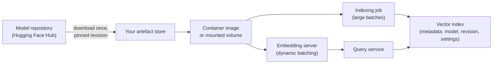

A **local embedding model** runs on hardware you control: a laptop, a server in your data centre, or a GPU instance in your own cloud account. Instead of sending text to a provider and paying per token, you load the weights yourself and pay in hardware, engineering time and operational care. Earlier lessons in this module showed how to *call* open models such as [Sentence Transformers](/learn/embedding-models/sentence-transformers), [BGE](/learn/embedding-models/bge-models), [E5](/learn/embedding-models/e5-models) and [Nomic](/learn/embedding-models/nomic-embeddings). This lesson is about *running* them well: how much memory a model needs, how to measure and raise throughput, how to load models reproducibly and offline, and which serving options exist when one Python process is no longer enough.

## Learning objectives

- Estimate the memory a model's weights need at float32, float16 and int8 precision, and the time a corpus will take to embed at a measured throughput.
- Measure embedding throughput across devices and batch sizes, and explain the shape of the results, including why throughput can fall at large batch sizes.
- Compute the padding efficiency of a batch and explain why sorting inputs by length matters.
- Load a model reproducibly and offline, with a pinned revision, and explain what goes wrong without each safeguard.
- Choose between in-process encoding, a dedicated inference server (such as Text Embeddings Inference), Ollama and an exported ONNX model for a given workload.

## Prerequisites

- [Sentence Transformers](/learn/embedding-models/sentence-transformers): loading a model and calling `encode`.
- [Model inference](/learn/understanding-large-language-models/model-inference): what a forward pass is and what it costs.
- [Virtual environments](/learn/python-for-rag-engineering/virtual-environments) and [dependency management](/learn/python-for-rag-engineering/dependency-management): pinning the software around the model.
- [Dimensionality](/learn/embedding-fundamentals/dimensionality): how vector size drives storage.

## Why this matters

Teams choose local models for four reasons. **Data control**: the text never leaves your infrastructure, which may be a legal requirement for personal, medical or confidential data. **Cost at volume**: a hosted API bills per token for ever, including every full re-embedding when you change chunking; a GPU you already run does not. **Latency and availability**: a model in the same data centre as your retriever has no internet round trip and no third-party outage. **Reproducibility**: a pinned local model gives the same vectors next year, whereas a hosted model may be retired.

The costs are equally real. You must size hardware, keep throughput high enough for re-indexing, keep the query path fast under load, pin and mirror model files, and upgrade deliberately. Teams that treat a local model as "just `SentenceTransformer(name)`" find out in production: an indexing job that takes a weekend instead of an hour, a container that downloads weights on every start and fails when the internet does, or vectors that silently change because the model repository was updated.

## The intuition

Think of an embedding model as a bakery oven. The hosted API is a bakery down the road: you send dough, loaves come back, you pay per loaf, and you never think about the oven. Running locally means buying the oven.

Now the oven's properties are your problem. It has a size (memory): a bigger oven bakes better bread but needs a bigger kitchen. It has a throughput: one loaf at a time wastes the heat, a full tray uses it, and an overstuffed tray bakes unevenly and slowly. Mixing a baguette with a bread roll on one tray means the tray stays in until the baguette is done, and the roll's space is wasted for most of that time (padding). And you want the recipe written down precisely, so that next month's loaves match this month's (pinned revisions), and the flour stored in your own cupboard, so a delivery strike does not stop the bakery (offline loading).

## How it works

### What determines speed

Embedding a batch of texts is one forward pass of a transformer encoder over a padded matrix of tokens. Its cost depends on:

1. **Model size.** Work per token grows with the number of layers and the hidden width. all-MiniLM-L6-v2 has 6 layers and 384 dimensions; a "large" model typically has 24 layers and 1,024 dimensions, and does many times more arithmetic per token.
2. **Sequence length.** The feed-forward work grows linearly with length and attention grows with its square. Longer chunks cost more per chunk.
3. **Padding.** Texts in a batch are padded to the longest one. Padding tokens are masked out of the result but are still computed.
4. **Batch size.** Hardware is efficient on large matrix multiplications. Batch size 1 leaves most of a CPU's vector units or a GPU's cores idle; larger batches fill them, up to the point where memory or cache pressure takes over.
5. **Device and precision.** GPUs (CUDA), Apple-silicon GPUs (MPS) and CPUs differ by an order of magnitude or more. Half precision (float16 or bfloat16) on a GPU roughly halves memory traffic and often speeds inference, usually with negligible change in retrieval quality, but check.

Sentence Transformers already helps with padding: `encode` sorts inputs by length before batching, so each batch contains texts of similar length, and then restores the original order. Your own batching code, or a server that receives one request at a time, may not.

### Serving options

Inside a single Python indexing job, calling `encode` directly is simplest. Once several services need embeddings, or the query path must handle concurrent users, a dedicated server is usually better.

| Option | What it is | Good for | Watch out for |
| --- | --- | --- | --- |
| In-process `encode` | The model inside your application process | Batch indexing jobs; prototypes | Each process loads its own copy of the weights; Python concurrency limits |
| Text Embeddings Inference (TEI) | Hugging Face's dedicated embedding server, shipped as Docker images for CPU and GPU | A shared HTTP embedding service with dynamic batching | Supported architectures are listed in its documentation; pin the image tag |
| Ollama | A local model runner with an HTTP API, popular on laptops and small servers | Development machines; small deployments; one tool for both generation and embedding models | Models are converted builds (often quantised); check they match the original's quality |
| ONNX Runtime or OpenVINO | The model exported to a portable graph, run by an optimised runtime | CPU-only servers, where it can be noticeably faster than PyTorch | Export and quantisation steps must be validated against the original vectors |

**Dynamic batching** deserves a word. A query service receives single queries from many users. A server like TEI collects requests that arrive within a short window into one batch, so the hardware works on full trays even though each caller sent one text. That is how a local model sustains high query throughput without making individual users wait for a large batch to fill.

### Reproducibility and offline operation

Three safeguards keep local vectors stable:

1. **Pin the revision.** A Hugging Face model name refers to whatever the repository's main branch holds today. Passing `revision="<commit hash>"` fixes the exact files. Without it, a repository update (new weights, a changed tokeniser or pooling configuration) changes your query vectors while your index still holds the old ones.
2. **Load offline.** `HF_HUB_OFFLINE=1` in the environment, or `local_files_only=True`, stops the library from contacting the Hub. Production containers should have the weights baked into the image or mounted from your own artefact store, not downloaded at start-up.
3. **Record the whole embedding contract.** Model name, revision, library versions, pooling, normalisation, prefixes and maximum length belong in the index's metadata (see [what are embeddings?](/learn/embedding-fundamentals/what-are-embeddings) for the contract idea).

Different devices produce very slightly different floating-point results. The code below measures that difference on CPU versus an Apple-silicon GPU; it is far too small to change rankings in practice, but it means you should compare vectors with a tolerance, never with exact equality.



## The mathematics

### Weight memory

**Intuition.** Each parameter is a number stored in a fixed number of bytes.

$$
\text{memory}_{\text{weights}} = P \times b
$$

- $P$ is the number of parameters.
- $b$ is bytes per parameter: 4 for float32, 2 for float16 or bfloat16, 1 for int8.

**Worked example.** all-MiniLM-L6-v2 has 22,713,216 parameters. At float32 that is $22{,}713{,}216 \times 4 \approx 91$ MB; at float16, about 45 MB. A model with 335 million parameters (the size class of BERT-large-based embedders) needs about 1.34 GB at float32 and 0.67 GB at float16. Running inference also needs activation memory, which grows with batch size times sequence length; leave generous headroom above the weight figure.

### Padding efficiency

**Intuition.** A batch costs as much as if every text were as long as the longest one.

$$
\text{efficiency} = \frac{\sum_{i=1}^{B} L_i}{B \times \max_i L_i}
$$

- $B$ is the batch size and $L_i$ the token length of text $i$.

**Worked example.** A batch of eight texts with lengths 12, 15, 18, 20, 22, 25, 30 and 250 contains $392$ useful tokens. Padded to 250, the batch computes $8 \times 250 = 2{,}000$ token positions, so efficiency is $392 / 2000 = 19.6$ per cent. Four-fifths of the work is spent on padding, all because of one long text. Sorting by length puts the 250-token text with other long texts.

```python
import numpy as np
from sentence_transformers import SentenceTransformer

model = SentenceTransformer("sentence-transformers/all-MiniLM-L6-v2", local_files_only=True)
params = sum(p.numel() for p in model.parameters())
print(f"parameters: {params:,}")
for name, nbytes in [("float32", 4), ("float16", 2), ("int8", 1)]:
    print(f"{name}: {params * nbytes / 1e6:.0f} MB of weights")

lengths = np.array([12, 15, 18, 20, 22, 25, 30, 250])
useful, padded = lengths.sum(), len(lengths) * lengths.max()
print(f"useful tokens {useful}, computed tokens {padded}, efficiency {useful / padded:.1%}")
```

```output
parameters: 22,713,216
float32: 91 MB of weights
float16: 45 MB of weights
int8: 23 MB of weights
useful tokens 392, computed tokens 2000, efficiency 19.6%
```

### Time to embed a corpus

$$
T = \frac{N}{r}
$$

where $N$ is the number of chunks and $r$ the measured throughput in chunks per second. At $r = 876$ (the best figure in the benchmark below), $N = 2{,}000{,}000$ chunks take $2{,}000{,}000 / 876 \approx 2{,}283$ seconds, about 38 minutes. The same corpus at 102 chunks per second (batch size 1 on CPU) takes about 5.4 hours. Measure $r$ on your own hardware with your own chunk lengths; it is the number that decides whether a re-index fits in a maintenance window.

## In code

### Benchmarking throughput

**The problem.** Before planning an indexing job or sizing a server, measure how fast your model runs on your hardware, with chunks shaped like yours. The script embeds 2,000 synthetic Meridian chunks of one to eight sentences on every available device at several batch sizes, then checks whether CPU and accelerator vectors agree. It needs no API key and no network once the model is cached.

```bash
pip install sentence-transformers torch numpy
```

```python
import random
import time
import numpy as np
import torch
from sentence_transformers import SentenceTransformer

random.seed(0)
torch.manual_seed(0)

base = [
    "Annual leave is 25 days; up to 5 unused days carry over and must be used by 31 March.",
    "Staff may work remotely up to 3 days a week.",
    "Expenses must be submitted within 30 days, and anything over £75 needs a receipt.",
    "Passwords are rotated every 90 days.",
    "If the VPN client reports a TLS handshake failure, reinstall the certificate bundle and restart.",
    "Meridian Relay applies backpressure when a consumer falls behind, pausing the producer until it catches up.",
]
# 2,000 chunks of mixed length: 1 to 8 sentences each
texts = [" ".join(random.choices(base, k=random.randint(1, 8))) for _ in range(2000)]

devices = ["cpu"] + (["mps"] if torch.backends.mps.is_available() else []) + (["cuda"] if torch.cuda.is_available() else [])
for device in devices:
    model = SentenceTransformer("sentence-transformers/all-MiniLM-L6-v2", device=device)
    model.encode(texts[:64], batch_size=32)                 # warm-up: first calls are slow
    for bs in [1, 16, 64, 256]:
        n = 200 if bs == 1 else len(texts)                  # batch size 1 is slow; time fewer texts
        start = time.perf_counter()
        emb = model.encode(texts[:n], batch_size=bs, normalize_embeddings=True)
        rate = n / (time.perf_counter() - start)
        print(f"{device:4s} batch {bs:3d}: {rate:7.0f} texts/s")

# Do CPU and accelerator vectors agree?
if len(devices) > 1:
    a = SentenceTransformer("sentence-transformers/all-MiniLM-L6-v2", device="cpu").encode(texts[:100], normalize_embeddings=True)
    b = SentenceTransformer("sentence-transformers/all-MiniLM-L6-v2", device=devices[1]).encode(texts[:100], normalize_embeddings=True)
    print(f"max |cpu - {devices[1]}| = {np.abs(a - b).max():.2e}, min cosine = {(a * b).sum(axis=1).min():.6f}")
```

Output on an Apple-silicon laptop (your numbers will differ with hardware, background load and library versions, and vary a little from run to run):

```output
cpu  batch   1:     102 texts/s
cpu  batch  16:     305 texts/s
cpu  batch  64:     317 texts/s
cpu  batch 256:     263 texts/s
mps  batch   1:     149 texts/s
mps  batch  16:     679 texts/s
mps  batch  64:     876 texts/s
mps  batch 256:     718 texts/s
max |cpu - mps| = 2.05e-07, min cosine = 1.000000
```

**The important lines.** The warm-up call matters: the first `encode` on a device includes one-off costs (memory allocation, kernel compilation) that would distort the first measurement. `time.perf_counter()` is a monotonic, high-resolution clock suitable for intervals. The device list adapts to the machine, so the same script works on a CUDA server.

**What the output means.** Batching is the biggest lever: on CPU, batch 16 is three times faster than batch 1; on the Apple GPU, batch 64 is almost six times faster. The accelerator's advantage only appears at larger batches, because a single text cannot keep a GPU busy. Throughput *falls* at batch 256 on both devices. With large batches, each batch's longest text sets the padded length for more texts at once, and memory and cache pressure rise; the best batch size is something you find by measurement, not "as large as possible". Finally, CPU and GPU vectors differ by at most about 2 × 10⁻⁷, with cosine 1.000000: floating-point noise, irrelevant to ranking, but enough to fail an exact-equality test.

**Common errors.** Benchmarking without a warm-up, or on a handful of texts, gives misleading numbers. Benchmarking with short sentences when production chunks are 300 tokens overstates throughput badly. On a CUDA machine, forgetting to install a CUDA-enabled PyTorch build silently runs on CPU; print `model.device` to check.

**Extending it.** Add `model.half()` on a CUDA device to test float16; time chunks with your real length distribution; or use `encode`'s `device` argument with a list of devices for multi-process encoding when you have several GPUs.

### Loading reproducibly and offline

This snippet was run for this lesson with Hub access switched off. The revision hash is the commit that was cached locally; use the one you validated.

```python
import os
os.environ["HF_HUB_OFFLINE"] = "1"          # never touch the network

from sentence_transformers import SentenceTransformer

MODEL = "sentence-transformers/all-MiniLM-L6-v2"
REVISION = "1110a243fdf4706b3f48f1d95db1a4f5529b4d41"   # the exact commit you validated

model = SentenceTransformer(MODEL, revision=REVISION, local_files_only=True, device="cpu")
v = model.encode(["Laptops are refreshed every 3 years."], normalize_embeddings=True)
print(model.get_embedding_dimension(), model.max_seq_length, v.shape, round(float(v[0][:3].sum()), 6))
```

```output
384 256 (1, 384) -0.054159
```

The last number is a cheap fingerprint: the sum of the first three components of a fixed sentence's vector. Store it with the index; if a newly deployed service prints a different value (beyond a tiny tolerance), the model or its configuration has changed. The environment variable must be set before the library is imported, which is why it comes first.

### Serving with Text Embeddings Inference and Ollama

These commands were **not executed** for this lesson, because they need Docker or an Ollama installation. They follow the projects' documented usage; check the documentation for the current image tag and supported models.

```bash
# Text Embeddings Inference: CPU image, model files cached in ./tei-data
docker run -p 8080:80 -v "$PWD/tei-data:/data" \
  ghcr.io/huggingface/text-embeddings-inference:cpu-<version> \
  --model-id BAAI/bge-small-en-v1.5 --revision <commit-hash>

curl 127.0.0.1:8080/embed -X POST -H 'Content-Type: application/json' \
  -d '{"inputs": ["Annual leave is 25 days."]}'

# Ollama: pull an embedding model, then call the embed endpoint
ollama pull nomic-embed-text
curl http://localhost:11434/api/embed \
  -d '{"model": "nomic-embed-text", "input": ["search_document: Annual leave is 25 days."]}'
```

TEI returns a JSON array with one vector per input; Ollama returns an object whose `embeddings` field holds the vectors. Note the Nomic prefix in the Ollama request: a server does not add a model's required prefixes for you (see [Nomic embeddings](/learn/embedding-models/nomic-embeddings)).

An ONNX export, which can speed up CPU inference, loads through Sentence Transformers with `SentenceTransformer(name, backend="onnx")` after `pip install "sentence-transformers[onnx]"`. It was not run here because ONNX Runtime was not installed in the environment used for this lesson. Compare its vectors with the PyTorch ones, as the benchmark does across devices, before switching.

## A real-world example

Meridian's Legal team ruled that HR case notes may not be sent to any third-party API, so the Platform team moved AskMeridian's embeddings in-house. Lina, the engineer responsible, started with the obvious design: the query service loaded a Sentence Transformers model in each of its eight worker processes and called `encode` per request.

Three problems appeared within a week. Memory: eight copies of a 335-million-parameter model in float32 used over 10 GB per host before any requests. Throughput: each request encoded one query at batch size 1, so under load the CPU spent most of its time on per-call overhead, and latency rose sharply at peak hours. And a container restart during an internet outage failed, because the model was downloaded at start-up.

The redesign separated concerns. A single TEI container per host, with the model files baked into the image at a pinned revision, served all eight workers over localhost, with dynamic batching filling batches from concurrent queries. The nightly re-index job ran separately on a GPU instance with batch size chosen by the benchmark above. A start-up check compared the fingerprint of a fixed sentence's vector with the value stored in the index metadata and refused to serve if they differed. The fingerprint check paid for itself two months later, when a rebuilt image accidentally picked up a newer revision of the model files and the check stopped the deployment before any mismatched query reached the index.

## Common mistakes

- **Loading the model inside each request handler or each worker.** Load once per process at start-up, or share one server; per-request loading costs seconds and per-worker copies multiply memory.
- **Encoding one text at a time in indexing jobs.** Batch size 1 left most of the hardware idle in the benchmark; batching was a 3 to 6 times speed-up.
- **Not pinning the revision.** A repository update changes your vectors without any change to your code.
- **Downloading weights at container start-up.** Start-up then depends on the Hub's availability and rate limits.
- **Comparing vectors from different devices with exact equality.** Floating-point differences are normal; use a tolerance.
- **Assuming an Ollama or ONNX build equals the original model.** Conversions and quantisation can change vectors; validate on your evaluation set.

## Best practices

- Benchmark on your hardware with your chunk-length distribution, and record the result alongside the model choice.
- Size memory from the weight formula plus headroom for activations, and test the peak batch size under load.
- Bake or mount pinned model files; set `HF_HUB_OFFLINE=1` in production.
- Store the full embedding contract and a vector fingerprint with every index, and check them at service start-up.
- Separate the indexing path (large batches, throughput) from the query path (small batches, latency), even if they use the same model.
- Re-run your retrieval evaluation after any change to precision, runtime, export format or library version.

## Performance considerations

**Query latency.** A single short query through a small model on CPU takes a few milliseconds of compute; queueing and Python overhead often dominate. A dedicated server with dynamic batching keeps per-query latency low under concurrency, because batching amortises overhead without making any single request wait long.

**Indexing throughput.** Use the time formula with measured throughput. If 2 million chunks must re-embed within a 4-hour window (14,400 seconds), you need at least $2{,}000{,}000 / 14{,}400 \approx 139$ chunks per second sustained, plus margin for retries and index building.

**Model size against hardware.** Moving from a 22-million to a 335-million-parameter model multiplies weight memory by about 15 and the arithmetic per token by a similar order. On CPU that can turn a 40-minute re-index into a day; on a GPU it may still be comfortable. Model choice and hardware choice are one decision.

**Precision.** float16 halves weight memory and is commonly faster on GPUs; int8 quantised builds help on CPUs. Both change vectors slightly, so validate retrieval quality rather than assuming.

**Total cost.** A hosted API costs (tokens embedded) × (price per token) for every pass. A local model costs the hardware whether busy or idle, plus engineering time. Local wins when volume is high or re-embedding is frequent; hosted wins for small, stable corpora.

## Security considerations

Model files are code-adjacent artefacts. Pickle-based weight files can execute code when loaded, so prefer models distributed as `safetensors`, and avoid `trust_remote_code=True` unless you have read and pinned the code. Mirror models into your own artefact store so that what runs in production has been reviewed. An embedding server should listen on localhost or a private network only; an exposed TEI or Ollama port lets anyone use your hardware and, through the inputs they send, probe what your system does. Logs on the embedding path contain the text of every query and document, so treat them as sensitive data.

## Summary

- Local models trade per-token fees and data transfer for hardware, operations and engineering responsibility.
- Weight memory is parameters times bytes per parameter; time to embed a corpus is chunks divided by measured throughput.
- Batching is the largest throughput lever, with a best batch size found by measurement; padding wastes work, which is why inputs are sorted by length.
- Pin revisions, load offline, and store the embedding contract and a vector fingerprint with every index.
- Beyond one process, use a dedicated server with dynamic batching (such as TEI) or a runner like Ollama, and validate any converted or quantised build against the original.

## Exercises

**1.** A 560-million-parameter embedding model is to be served in float16 on a GPU with 8 GB of memory. How much memory do the weights take, and roughly what is left for activations?

<details><summary>Show solution</summary>

$560{,}000{,}000 \times 2 = 1.12$ GB for the weights. About 6.9 GB remains, minus runtime overhead (framework, CUDA context), for activations and batching. That comfortably fits typical query batches; very large batches of long chunks should still be tested at peak size.

</details>

**2.** Modify the benchmark to measure the effect of chunk length: build three corpora of 1,000 texts with exactly 1, 4 and 8 sentences each, and measure throughput at batch size 64 on your fastest device. Explain the pattern you see.

<details><summary>Show solution</summary>

```python
for k in (1, 4, 8):
    corpus = [" ".join(random.choices(base, k=k)) for _ in range(1000)]
    start = time.perf_counter()
    model.encode(corpus, batch_size=64)
    print(k, "sentences:", round(1000 / (time.perf_counter() - start)), "texts/s")
```

On the Apple-silicon laptop used for this lesson, this printed about 2,100 texts per second for one-sentence texts (about 19 tokens each), 660 for four sentences (about 69 tokens) and 390 for eight (about 135 tokens); your figures will differ. Throughput in texts per second falls roughly in proportion to length, because each text has more tokens to process (and attention grows faster than linearly with length). Tokens per second, by contrast, stays in the same range (about 40,000 to 52,000 here), which is why tokens, not texts, are the better unit for capacity planning. Plan indexing time with your real chunk lengths, not short test sentences.

</details>

**3.** Your indexing job must embed 6 million chunks in under 3 hours. Your benchmark gives 450 chunks per second per GPU. How many GPUs do you need, assuming linear scaling and a 25 per cent safety margin?

<details><summary>Show solution</summary>

Required rate: $6{,}000{,}000 / 10{,}800 \approx 556$ chunks per second. With a 25 per cent margin: $556 \times 1.25 \approx 694$. At 450 per GPU, $694 / 450 \approx 1.54$, so 2 GPUs. Check the scaling assumption by measuring two GPUs together; data loading or the vector database's write rate can become the bottleneck before the GPUs do.

</details>

**4.** Design decision. AskMeridian's query service runs 8 worker processes per host on CPU-only hosts. Embeddings must stay in-house. Compare loading the model in each worker with running one local embedding server per host, considering memory, latency under load, deployment and failure modes.

<details><summary>Show solution</summary>

In-worker loading uses 8 copies of the weights per host, encodes each query at batch size 1, and couples model upgrades to application deployments; but it has no extra network hop and no separate service to fail. One server per host (TEI or similar) holds one copy of the weights, batches concurrent queries dynamically, and can be upgraded, pinned and fingerprinted independently; the costs are a localhost HTTP hop (well under a millisecond of overhead in typical setups) and a new component whose failure takes down embeddings for the whole host, which calls for a health check and restart policy. For eight workers under real concurrency, the server is usually the better choice; for a single low-traffic worker, in-process loading is simpler.

</details>

## Check your understanding

```quiz
[
  {
    "q": "A model has 110 million parameters. Roughly how much memory do its weights need in float16?",
    "options": ["110 MB", "220 MB", "440 MB", "880 MB"],
    "answer": 1,
    "why": "float16 uses 2 bytes per parameter: 110 million times 2 bytes is about 220 MB."
  },
  {
    "q": "In the benchmark, throughput at batch size 256 was lower than at batch size 64 on both devices. Which explanation fits?",
    "options": [
      "Larger batches skip the length sorting step",
      "Batch size 256 forces float64 arithmetic",
      "Large batches increase memory and cache pressure and padding to each batch's longest text, so the best batch size must be measured",
      "The model refuses batches larger than 128 and retries"
    ],
    "answer": 2,
    "why": "Throughput rises with batch size until memory, cache and padding effects dominate; the optimum is hardware- and data-dependent."
  },
  {
    "q": "A batch contains texts of 10, 10, 10 and 90 tokens. What is its padding efficiency?",
    "options": ["33.3 per cent", "25 per cent", "50 per cent", "75 per cent"],
    "answer": 0,
    "why": "Useful tokens are 120; computed positions are 4 times 90, which is 360; 120 / 360 is 33.3 per cent."
  },
  {
    "q": "Why should a production service pass a pinned revision when loading a Hugging Face model?",
    "options": [
      "It makes loading faster",
      "Without it, an update to the model repository can change query vectors while the index holds vectors from the old version",
      "It enables GPU acceleration",
      "It is required for offline mode"
    ],
    "answer": 1,
    "why": "The model name tracks the repository's latest files; a pinned commit fixes exactly which weights and configuration you run."
  },
  {
    "q": "Why does a dedicated embedding server such as TEI help a query service with many concurrent users?",
    "options": [
      "It caches every possible query in advance",
      "It converts the model to a smaller dimension",
      "It removes the need for a vector database",
      "It combines concurrent single-text requests into batches, using the hardware efficiently without each user waiting for a full batch"
    ],
    "answer": 3,
    "why": "Dynamic batching groups requests that arrive close together, which raises throughput while keeping per-request latency low."
  }
]
```

## Further reading

- Sentence Transformers documentation, [sbert.net](https://www.sbert.net): efficiency guides covering ONNX and OpenVINO backends, multi-process encoding and quantisation.
- Hugging Face Text Embeddings Inference documentation, [huggingface.co/docs/text-embeddings-inference](https://huggingface.co/docs/text-embeddings-inference).
- Ollama documentation and API reference, [ollama.com](https://ollama.com).
- Hugging Face Hub documentation on environment variables (`HF_HUB_OFFLINE`, `HF_HOME`) and revisions, [huggingface.co/docs/huggingface_hub](https://huggingface.co/docs/huggingface_hub).
- Wang et al. (2020), "MiniLM: Deep Self-Attention Distillation for Task-Agnostic Compression of Pre-Trained Transformers", [arXiv:2002.10957](https://arxiv.org/abs/2002.10957).
