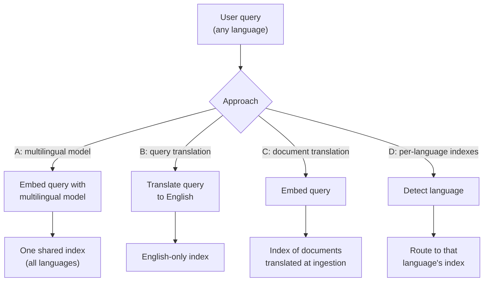

Most of the embedding models you have met so far in this module were trained mainly on English. Put a German, Polish or Japanese question to them and they still return a vector, and your retriever still returns its top five chunks, but the ranking is close to random. A **multilingual embedding model** is trained so that texts with the same meaning land close together *whatever language they are written in*. This lesson shows the failure of an English-only model on questions in four languages, explains how multilingual models are built (shared vocabularies, parallel text, distillation and contrastive training), and sets out the architectural choices a RAG system serving several languages must make: one shared index, translation, or separate indexes per language.

## Learning objectives

- Demonstrate, with a local model, how an English-only embedding model fails on non-English queries, and identify the tokenisation evidence for the failure.
- Explain how a multilingual model is aligned across languages, and compute the multilingual knowledge-distillation loss for a small example.
- Distinguish multilingual retrieval (each language searched in itself) from cross-lingual retrieval (query and document in different languages), and describe language bias in mixed-language indexes.
- Choose between a multilingual embedding model, query translation, document translation and per-language indexes for a given set of languages, corpus and budget.
- Design an evaluation that reports retrieval quality per language rather than as one average.

## Prerequisites

- [Sentence Transformers](/learn/embedding-models/sentence-transformers): loading and calling a local embedding model.
- [E5 models](/learn/embedding-models/e5-models): query and passage prefixes, which multilingual E5 also uses.
- [Tokens and tokenisation](/learn/understanding-large-language-models/tokens-and-tokenisation): subword vocabularies and how text becomes token IDs.
- [Language detection](/learn/document-preprocessing/language-detection): identifying the language of a document or query.

## Why this matters

A company does not have to be global to have a multilingual retrieval problem. A UK firm with an office in Poland, a support desk that receives tickets in Spanish, or a product whose documentation exists in English and Japanese all have one. Users ask in the language they think in, and documents are written in whichever language their authors chose.

The failure is quiet. An English-only model given a Polish question produces a vector built from fragments of words it has no meaning for. Retrieval returns chunks with low but non-zero scores, the generator receives irrelevant context, and the user gets either "I don't know" or a confident answer about the wrong policy. Because English traffic still works, the average quality looks acceptable, and the problem stays invisible until someone reports results per language.

The fix is not always "switch to a multilingual model". Translation, per-language indexes and multilingual models each have costs in latency, money, quality for low-resource languages, and operational complexity. Choosing well requires knowing how these models work and where they are weak.

## The intuition

Imagine a library in which every book has been shelved by subject by a librarian who reads only English. English books are shelved perfectly. A Polish book about annual leave is shelved by what its title *looks like* to an English reader, perhaps next to a book that happens to share a few letters. A visitor who asks in Polish is led, by the same logic, to a shelf that matches the look of their question, not its meaning.

A multilingual librarian shelves the Polish book about annual leave next to the English one, because they are about the same thing. Now a question in either language leads to both. That is what "a shared embedding space" means: one map of meaning, with every language placed on it.

There is a subtlety. Even a multilingual librarian may, all else being equal, put a Polish book slightly closer to other Polish books than to the English book on the same subject. When the shelf holds both, a Polish visitor may be led to the Polish book first even if the English one is a better answer. This is **language bias**, and it matters when an index mixes languages.

## How it works

### Why an English-only model fails

An embedding model can only work with the tokens its tokeniser produces. all-MiniLM-L6-v2 uses an English uncased WordPiece vocabulary of about 30,000 entries, which also strips accents. A Polish word such as *należy* ("must") becomes `na ##lez ##y`: three fragments that, to the model, are pieces of English-looking strings, not a Polish word. Japanese is worse: characters missing from the vocabulary become the unknown token `[UNK]`, so different words collapse to the same meaningless symbol. The code in this lesson shows both effects.

Even where tokenisation survives, the model's training pairs were English, so it never learned that *urlop* and *annual leave* mean the same thing. Some languages get lucky through borrowed words ("Laptop", "Passwort" and "Helpdesk" in German), which can produce correct rankings for the wrong reason.

### How multilingual models are built

Most multilingual embedding models are built in stages, each fixing a weakness of the last.

1. **A multilingual vocabulary and encoder.** Models such as multilingual BERT and XLM-RoBERTa (Conneau and colleagues, 2020) are pre-trained with masked-language modelling on text in about 100 languages, with one shared subword vocabulary (XLM-RoBERTa's has about 250,000 entries). Every language now tokenises into meaningful pieces. But these encoders are not, on their own, good sentence embedders, and sentences in different languages with the same meaning are not reliably close.
2. **Cross-lingual alignment with parallel text.** Parallel text is pairs of sentences that are translations of each other. Training on such pairs pulls translations together. LaBSE (Feng and colleagues, 2020) trained a dual encoder to pick the correct translation of a sentence from a batch of candidates. **Multilingual knowledge distillation** (Reimers and Gurevych, 2020) took a strong English model as a *teacher* and trained a multilingual *student* to produce the teacher's English vector for both the English sentence and its translation (see the mathematics below). The paraphrase-multilingual models in Sentence Transformers were built this way.
3. **Large-scale multilingual contrastive training.** Current general-purpose multilingual models, such as multilingual E5 (Wang and colleagues, 2024), BGE-M3 (Chen and colleagues, 2024), jina-embeddings-v3 and Cohere's multilingual models, are trained contrastively on very large collections of text pairs in many languages (questions and answers, titles and bodies, translations), then fine-tuned on labelled retrieval data. They aim to be good *retrievers* in each language and across languages, not just good translators.

### Multilingual versus cross-lingual retrieval

Two different tasks hide under "multilingual":

- **Multilingual (monolingual) retrieval:** a Polish question searched against Polish documents, a Japanese question against Japanese documents. The model must be good in each language, but no language crosses another.
- **Cross-lingual retrieval:** a Polish question searched against English documents. The model's languages must be aligned.

Benchmarks report these separately. MIRACL (Zhang and colleagues, 2023) covers monolingual retrieval in 18 languages; cross-lingual benchmarks pair queries in one language with documents in another. A model can be strong at one and weaker at the other, and quality varies by language: languages with more training data (English, Chinese, Spanish, German) generally do better than low-resource ones. The multilingual extension of the MTEB benchmark (MMTEB, 2025) lets you see results per language; use it to shortlist, then test on your own data.

### Language bias in a mixed index

In a shared index containing both English and Polish chunks, a Polish query tends to score Polish chunks somewhat higher than English chunks of equal relevance, because shared surface features (words, script, style) add to the similarity. The effect varies by model and is worth measuring. Its consequences:

- If the authoritative document exists only in English, a loosely related Polish document may outrank it.
- If the same policy exists in both languages, results may differ by query language even though the content is the same.
- If one language's version is out of date, language bias can surface stale content to that language's users.

Mitigations include filtering by language using metadata, retrieving per language and merging, or keeping one canonical language for authoritative content.

### Four architectures



| Approach | Strengths | Weaknesses |
| --- | --- | --- |
| A. Multilingual embedding model, one index | One model, one index, no translation step, handles code-switched queries | Weaker in low-resource languages; language bias; usually larger models |
| B. Translate queries to the corpus language | Keeps a strong single-language model and index | Adds a translation call per query (latency, cost); translation errors on names and jargon |
| C. Translate documents at ingestion | Query time stays fast; the corpus becomes uniform | Translation cost scales with corpus size and re-runs on every update; citations point to translated text |
| D. Per-language indexes with routing | Each language uses its best model; no cross-language bias | Only works when the answer exists in the query's language; more indexes to run |

Lexical search adds a further consideration: BM25 needs language-aware analysis (stemming for Polish, word segmentation for Japanese and Chinese), so a hybrid system needs per-language analysers too (see [sparse retrieval](/learn/sparse-retrieval)).

### Which model, and how to call it

Commonly used open multilingual retrievers include `intfloat/multilingual-e5-small`, `-base` and `-large` (which need the `query: ` and `passage: ` prefixes), `BAAI/bge-m3` (dense, sparse and multi-vector outputs from one model; see [BGE models](/learn/embedding-models/bge-models)), and `sentence-transformers/paraphrase-multilingual-MiniLM-L12-v2` (small and fast, but trained for paraphrase similarity rather than question-to-passage retrieval). Hosted options include Cohere's multilingual models ([Cohere embeddings](/learn/embedding-models/cohere-embeddings)), OpenAI's text-embedding-3 models and jina-embeddings-v3. Check each model's documented language list before assuming support.

## The mathematics

### Multilingual knowledge distillation

**Intuition.** A teacher model already places English sentences well. Train a student to put an English sentence exactly where the teacher puts it, *and* to put that sentence's translation in the same place. The student inherits the teacher's geometry and extends it to the new language.

$$
\mathcal{L} = \frac{1}{|B|} \sum_{j \in B} \Big( \big\lVert M(s_j) - \hat{M}(s_j) \big\rVert^2 + \big\lVert M(s_j) - \hat{M}(t_j) \big\rVert^2 \Big)
$$

- $B$ is a batch of translation pairs, and $|B|$ its size.
- $s_j$ is a source (English) sentence and $t_j$ its translation.
- $M$ is the frozen teacher model; $\hat{M}$ is the multilingual student being trained.
- $\lVert \cdot \rVert^2$ is the squared Euclidean distance between two vectors.

The first term keeps the student faithful to the teacher in English; the second pulls the translation onto the same point.

**Worked example.** Take one pair, with two-dimensional vectors for readability. The teacher gives the English sentence $M(s) = (0.6, 0.8)$. The student currently gives $\hat{M}(s) = (0.5, 0.8)$ and, for the Polish translation, $\hat{M}(t) = (0.9, 0.1)$.

- First term: $(0.6 - 0.5)^2 + (0.8 - 0.8)^2 = 0.01$.
- Second term: $(0.6 - 0.9)^2 + (0.8 - 0.1)^2 = 0.09 + 0.49 = 0.58$.
- Loss: $0.01 + 0.58 = 0.59$.

Almost all the loss comes from the translation, which the student places far from its English counterpart: their cosine is $(0.45 + 0.08) / (0.943 \times 0.906) \approx 0.62$. Training moves $\hat{M}(t)$ towards $(0.6, 0.8)$.

```python
import numpy as np

teacher_en = np.array([0.6, 0.8])     # teacher's vector for the English sentence
student_en = np.array([0.5, 0.8])     # student's vector for the English sentence
student_pl = np.array([0.9, 0.1])     # student's vector for the Polish translation

def mse(a, b):
    return float(((a - b) ** 2).sum())

loss = mse(teacher_en, student_en) + mse(teacher_en, student_pl)
print(f"source term {mse(teacher_en, student_en):.2f}, translation term {mse(teacher_en, student_pl):.2f}, loss {loss:.2f}")
cos = student_en @ student_pl / (np.linalg.norm(student_en) * np.linalg.norm(student_pl))
print(f"cosine(student English, student Polish) = {cos:.3f}")
```

```output
source term 0.01, translation term 0.58, loss 0.59
cosine(student English, student Polish) = 0.620
```

## In code

### Measuring the failure of an English-only model

**The problem.** Before adding a multilingual model, measure how badly your current one handles the languages your users write in. The script below asks six questions about Meridian policies in English, German, Polish and Japanese against six English handbook chunks, using all-MiniLM-L6-v2, and reports how many questions find the right chunk first. It runs locally with no API key.

```bash
pip install sentence-transformers numpy tiktoken
```

```python
import numpy as np
from sentence_transformers import SentenceTransformer

model = SentenceTransformer("sentence-transformers/all-MiniLM-L6-v2")

docs = [
    "Annual leave is 25 days; up to 5 unused days carry over and must be used by 31 March.",
    "Staff may work remotely up to 3 days a week; the home-office equipment budget is £400.",
    "Expenses must be submitted within 30 days, and anything over £75 needs a receipt.",
    "Passwords are rotated every 90 days, and the VPN is required on public Wi-Fi.",
    "Laptops are refreshed every 3 years; lost laptops are reported to the support desk at once.",
    "The support desk is open from 08:00 to 18:00 UK time.",
]
# Each question targets the document with the same index, asked in four languages.
questions = {
    "English": ["How many days of holiday do I get?", "How often can I work from home?",
                "How long do I have to claim expenses?", "How often must I change my password?",
                "When do I get a new laptop?", "When is the IT helpdesk open?"],
    "German":  ["Wie viele Urlaubstage habe ich?", "Wie oft darf ich von zu Hause arbeiten?",
                "Wie lange habe ich Zeit, Spesen einzureichen?", "Wie oft muss ich mein Passwort ändern?",
                "Wann bekomme ich einen neuen Laptop?", "Wann ist der IT-Helpdesk geöffnet?"],
    "Polish":  ["Ile dni urlopu mi przysługuje?", "Jak często mogę pracować z domu?",
                "Ile mam czasu na rozliczenie wydatków?", "Jak często muszę zmieniać hasło?",
                "Kiedy dostanę nowy laptop?", "W jakich godzinach działa pomoc techniczna?"],
    "Japanese": ["有給休暇は何日ありますか?", "在宅勤務は週に何日できますか?",
                 "経費精算の期限はいつですか?", "パスワードはどのくらいの頻度で変更する必要がありますか?",
                 "新しいノートパソコンはいつもらえますか?", "ITヘルプデスクの受付時間は?"],
}

D = model.encode(docs, normalize_embeddings=True)
for lang, qs in questions.items():
    S = model.encode(qs, normalize_embeddings=True) @ D.T     # (6 questions, 6 docs)
    hits = int((S.argmax(axis=1) == np.arange(len(qs))).sum())
    print(f"{lang:9s} top-1 correct: {hits}/6   mean score of right doc: {np.diag(S).mean():.3f}"
          f"   mean best score: {S.max(axis=1).mean():.3f}")
```

```output
English   top-1 correct: 6/6   mean score of right doc: 0.532   mean best score: 0.532
German    top-1 correct: 5/6   mean score of right doc: 0.077   mean best score: 0.089
Polish    top-1 correct: 2/6   mean score of right doc: 0.065   mean best score: 0.126
Japanese  top-1 correct: 1/6   mean score of right doc: 0.076   mean best score: 0.121
```

**What the output means.** English is perfect, with the right chunk scoring about 0.53. Polish and Japanese are near chance (one in six would be pure luck). German looks almost fine at 5 out of 6, and this is the trap. Look at the scores: the right chunk scores 0.077 on average, barely above zero and an order of magnitude below English. The German questions are being matched on borrowed and shared strings ("Laptop", "Passwort", "IT-Helpdesk", the digits) rather than meaning. A test set full of such questions would report German as supported; real users phrasing things differently would discover it is not.

**The important lines.** `S = ... @ D.T` computes all question-document scores at once; row $i$ holds question $i$'s score against every chunk. `np.diag(S)` picks each question's score for its correct chunk. Reporting the score of the right document alongside the hit count is what exposes the German result.

### The tokenisation evidence

The next script, which continues from the one above, counts how many tokens each language needs for the same sentence, under MiniLM's tokeniser and under tiktoken's `cl100k_base` (a byte-level tokeniser of the kind OpenAI models use, included for comparison of token costs).

```python
import tiktoken

tok = model.tokenizer
enc = tiktoken.get_encoding("cl100k_base")
sentences = {
    "English":  "Expenses must be submitted within 30 days.",
    "German":   "Spesen müssen innerhalb von 30 Tagen eingereicht werden.",
    "Polish":   "Wydatki należy zgłosić w ciągu 30 dni.",
    "Japanese": "経費は30日以内に提出しなければなりません。",
    "Arabic":   "يجب تقديم النفقات خلال 30 يومًا.",
    "Hindi":    "खर्च 30 दिनों के भीतर जमा करने होंगे।",
}
print(f"{'language':9s} {'MiniLM':>6s} {'[UNK]':>5s} {'cl100k':>6s}")
for lang, s in sentences.items():
    ids = tok(s, add_special_tokens=False)["input_ids"]
    unk = sum(i == tok.unk_token_id for i in ids)
    print(f"{lang:9s} {len(ids):6d} {unk:5d} {len(enc.encode(s)):6d}")
print(tok.tokenize(sentences["Polish"]))
print(tok.tokenize(sentences["Japanese"]))
```

```output
language  MiniLM [UNK] cl100k
English        8     0     10
German        19     0     15
Polish        19     0     17
Japanese      21     4     23
Arabic        25     0     24
Hindi         23     0     36
['w', '##yd', '##at', '##ki', 'na', '##lez', '##y', 'z', '##g', '##ł', '##osi', '##c', 'w', 'cia', '##gu', '30', 'd', '##ni', '.']
['[UNK]', '[UNK]', 'は', '##30', '日', '[UNK]', '内', 'に', '[UNK]', '出', 'し', '##な', '##け', '##れ', '##は', '##な', '##り', '##ま', '##せ', '##ん', '。']
```

**What the output means.** The same short sentence takes 8 MiniLM tokens in English and 19 to 25 in the other languages. The Polish tokens are fragments with accents removed (*zgłosić* becomes `z ##g ##ł ##osi ##c`); the Japanese contains four `[UNK]` tokens, so the characters for "expenses" and "submit" are simply lost. More tokens per sentence has two production costs beyond quality: hosted APIs bill per token, and a fixed token window holds less text. The cl100k column shows that the cost inflation is not unique to small models: Hindi needs more than three times as many tokens as English for the same content.

**Common errors.** Testing a "multilingual" setup only with questions that share words with the documents (as the German set partly did) overstates quality. Language-detection libraries also misclassify very short queries, which matters if you route on detected language.

### Switching to a multilingual model

The fix for approach A is a model change plus the prefixes that model expects. The code below was **not executed** for this lesson, because the multilingual E5 weights were not available in the environment used to write it. It follows the model card's documented usage.

```python
from sentence_transformers import SentenceTransformer

ml = SentenceTransformer("intfloat/multilingual-e5-base")
D = ml.encode([f"passage: {d}" for d in docs], normalize_embeddings=True)
for lang, qs in questions.items():
    S = ml.encode([f"query: {q}" for q in qs], normalize_embeddings=True) @ D.T
    print(lang, int((S.argmax(axis=1) == np.arange(len(qs))).sum()), "/ 6")
```

Your exact numbers will differ; the expected pattern is that all four languages find most or all of the right chunks, and that the right chunk's score is similar across languages rather than an order of magnitude lower outside English. Note that E5-family scores sit in a compressed high range, so compare rankings, not raw scores, with MiniLM's.

**Extending it.** Add a Polish version of two handbook chunks to `docs` and check whether Polish questions now prefer the Polish chunk over the English one with the same content. That is a direct measurement of language bias.

## A real-world example

When Meridian opened its Kraków office, the HR team (owners of the employee handbook) translated the most-used sections into Polish. The Platform team had to decide how AskMeridian should serve the new office, whose staff would ask in Polish and sometimes in English.

The first proposal was approach B: translate every Polish question to English with the generator model and keep the existing English index. It was quick to build and kept the tuned English pipeline. Testing on 40 labelled Polish questions, collected from the Kraków staff themselves, showed two problems. Translation added a full model call to every query, and it sometimes mangled internal names ("Meridian Relay" came back as a generic word for a relay; an Atlas error code was reformatted).

The team then tried approach A: re-embed the whole corpus, English chunks and the new Polish ones, with a multilingual model in one index. Polish questions now found the Polish handbook sections, and English questions were unaffected on their existing test set. But the per-language evaluation exposed language bias: for policies where the Polish translation was still pending, Polish questions sometimes ranked a loosely related *Polish* chunk above the correct *English* one.

The final design combined both ideas. Each chunk carries a `language` field and a `canonical_id` linking translations of the same section. Retrieval runs on the shared multilingual index, then groups results by `canonical_id` and keeps the version in the user's language if one exists, otherwise the English one. The generator is instructed to answer in the language of the question and to cite whichever version it used. The evaluation set is reported per language, and each language must clear its own bar before release.

## Common mistakes

- **Assuming a model is multilingual because it returns vectors for any text.** Every model returns something; English-only models return near-noise for other languages.
- **Reporting one average across languages.** A strong English majority hides a broken minority language.
- **Testing with questions that share words with the documents.** Borrowed words and numbers make an English-only model look functional, as German did above.
- **Forgetting the model's prefixes or instructions.** Multilingual E5 without `query: ` and `passage: ` loses quality in every language.
- **Mixing languages in one index without metadata.** Without a language field you cannot filter, group translations or measure language bias.
- **Translating documents and citing the translation as the source.** Users and auditors need to reach the authoritative original; keep a link to it.

## Best practices

- Inventory the languages of your queries (from logs) and documents (with [language detection](/learn/document-preprocessing/language-detection)) before choosing a model.
- Build a labelled evaluation set per language, written by native speakers in the way real users ask, and report recall per language.
- Store `language` and a translation-group identifier with every chunk.
- Check each candidate model's documented language list and per-language benchmark results, then confirm on your own data.
- Keep proper nouns, product names and error codes reachable through a lexical channel ([hybrid search](/learn/hybrid-search)); they are where translation and multilingual embeddings both slip.
- Tell the generator which language to answer in, and evaluate the answers in that language.

## Performance considerations

**Model size.** Multilingual models carry large vocabularies. XLM-RoBERTa's 250,000-entry vocabulary at 768 dimensions is about 192 million embedding-table parameters before any transformer layer ($250{,}000 \times 768$), which is why multilingual "base" models are much larger on disk than English base models with similar layer counts. The vocabulary table adds memory but little compute per token, because each token only looks up one row.

**Tokens per text.** If a language needs about twice as many tokens as English for the same content, it costs about twice as much per document on a per-token API and fills a token window twice as fast. Measure your own corpus with your model's tokeniser.

**Translation in the query path.** Approach B adds a model call to every query. If the translation call takes, say, 400 ms and retrieval takes 50 ms (both assumptions for illustration), translation dominates query latency. Approach C moves that cost to ingestion, where it is paid once per document version.

**Index size.** Approach C (translate documents) and approach D (per-language indexes with duplicated content) can multiply the number of vectors by the number of languages. Approach A stores each chunk once.

## Security considerations

Translation steps and multilingual retrieval widen the attack surface for prompt injection: instructions hidden in a document in a language your reviewers do not read are easy to miss, and content filters tuned for English may not catch them. Apply injection and content checks to every language you index, and treat translated text as untrusted input exactly like the original (see [indirect prompt injection](/learn/rag-security-fundamentals/indirect-prompt-injection)). Sending documents to a third-party translation service also transfers their content; apply the same data-handling rules as for hosted embedding APIs.

## Summary

- English-only models return vectors for any language, but for others they are close to noise; scores an order of magnitude below English reveal it even when rankings look right.
- Multilingual models start from a shared multilingual vocabulary and encoder, then align languages with parallel text (translation ranking or distillation) and large-scale multilingual contrastive training.
- Multilingual distillation trains a student to map a sentence and its translation to the teacher's vector for the sentence.
- Multilingual and cross-lingual retrieval are different tasks; quality varies by language, and mixed-language indexes show language bias.
- The architectural choice is between a multilingual model, query translation, document translation and per-language indexes; measure per language before deciding.

## Exercises

**1.** Using the distillation loss, compute the loss for one pair when the teacher gives $(1, 0)$, the student gives $(0.9, 0.1)$ for the English sentence and $(0.7, 0.7)$ for its German translation. Which term dominates?

<details><summary>Show solution</summary>

First term: $(1 - 0.9)^2 + (0 - 0.1)^2 = 0.01 + 0.01 = 0.02$. Second term: $(1 - 0.7)^2 + (0 - 0.7)^2 = 0.09 + 0.49 = 0.58$. Loss: $0.60$. The translation term dominates, so training mainly moves the German vector towards $(1, 0)$.

</details>

**2.** In the code example, the German questions found 5 of 6 correct chunks. Write three German questions about the same policies that avoid any word shared with the English chunks (no "Laptop", "Passwort", "IT", digits or product names), run them, and explain the result.

<details><summary>Show solution</summary>

For example, "Wie viel Erholungsurlaub steht mir im Jahr zu?" (leave, target chunk 0), "Bis wann muss ich Belege für Ausgaben abgeben?" (expenses, chunk 2) and "Wann bekomme ich einen neuen Rechner?" (laptop refresh, chunk 4):

```python
ex = ["Wie viel Erholungsurlaub steht mir im Jahr zu?",
      "Bis wann muss ich Belege für Ausgaben abgeben?",
      "Wann bekomme ich einen neuen Rechner?"]
S = model.encode(ex, normalize_embeddings=True) @ D.T
print(np.round(S, 3))
```

```output
[[-0.062 -0.126 -0.037 -0.036 -0.064  0.002]
 [-0.051 -0.053  0.058 -0.109 -0.08   0.036]
 [ 0.014 -0.031  0.028  0.03   0.052 -0.023]]
```

The leave question goes to the support-hours chunk (0.002); the other two happen to rank their target first. But every score lies between −0.13 and 0.06, and the winning margins are 0.02 to 0.06, so these rankings are decided by noise, not meaning. "2 of 3 correct" here would be a misleading statistic. Compare the English questions, whose right chunk scored about 0.53. This is why test questions must be written as real users write them, and why scores should be inspected alongside hit rates.

</details>

**3.** Meridian's corpus is 90 per cent English and 10 per cent Polish, and 15 per cent of queries are in Polish. Most Polish questions concern policies that exist only in English. Which of the four architectures would you start with, and why?

<details><summary>Show solution</summary>

Approach A (one multilingual model, one index) or approach B (query translation) are the natural candidates, because the answers mostly exist only in English, which rules out D (per-language indexes would leave Polish users without answers) and makes C (translating the whole corpus) expensive for little gain. A handles cross-lingual matching without a per-query translation call; B keeps the English pipeline but adds latency and risks mangling product names. A good start is A with a `language` field and a translation-group identifier, so that when a Polish version exists it can be preferred, and per-language evaluation to check that Polish recall approaches English recall. Measure B as a baseline on the same test set.

</details>

**4.** Design an evaluation that detects language bias in a shared index containing parallel English and Polish versions of 50 handbook sections.

<details><summary>Show solution</summary>

Write each test question in both languages (native-speaker phrasing, not machine translation). For every question, the relevant set is both versions of the section. Measure: (a) recall@k per query language, counting either version as a hit; (b) for each query language, the fraction of hits that are in the same language as the query, and the average rank of the same-language and the other-language version. Without bias, a Polish question should rank the English and Polish versions of the right section about equally. A strong same-language preference is bias; it matters most where one version is outdated. Also include questions whose section exists only in English, and check that Polish queries still find it in the top k.

</details>

## Check your understanding

```quiz
[
  {
    "q": "An English-only model ranks the correct English chunk first for 5 of 6 German questions, but the correct chunk scores about 0.08 against about 0.53 for English questions. What is the most likely explanation?",
    "options": [
      "The model is genuinely multilingual but poorly normalised",
      "The model is matching shared strings such as borrowed words and digits, not meaning",
      "German needs a different similarity metric",
      "The German questions were too long for the window"
    ],
    "answer": 1,
    "why": "Scores near zero show the model has no real understanding of the questions; correct rankings come from surface overlap like \"Laptop\" and \"Passwort\"."
  },
  {
    "q": "In multilingual knowledge distillation, what is the student trained to do?",
    "options": [
      "Translate sentences into English before embedding them",
      "Predict masked words in many languages",
      "Classify which language a sentence is in",
      "Map both an English sentence and its translation to the teacher's vector for the English sentence"
    ],
    "answer": 3,
    "why": "The loss pulls the student's vectors for the source sentence and its translation onto the teacher's vector for the source."
  },
  {
    "q": "A shared index holds English and Polish versions of the same policies. Polish questions consistently retrieve the Polish version, even an outdated one, above the current English one. What is this called?",
    "options": [
      "Language bias",
      "Vocabulary mismatch",
      "Dimensional collapse",
      "Tokeniser drift"
    ],
    "answer": 0,
    "why": "Multilingual models tend to score same-language pairs higher, which can surface the wrong version in a mixed index."
  },
  {
    "q": "Which architecture adds a model call to the query path for every non-English question?",
    "options": [
      "A multilingual embedding model with one index",
      "Per-language indexes with routing",
      "Translating queries into the corpus language",
      "Translating documents at ingestion"
    ],
    "answer": 2,
    "why": "Query translation runs at query time; document translation moves the cost to ingestion."
  },
  {
    "q": "Why does a multilingual base model usually take much more disk space than an English base model with the same number of layers?",
    "options": [
      "It stores one copy of the encoder per language",
      "Its much larger shared vocabulary needs a much larger embedding table",
      "It uses 64-bit weights",
      "It keeps a translation dictionary inside the model"
    ],
    "answer": 1,
    "why": "A vocabulary of around 250,000 subwords at 768 dimensions is roughly 192 million parameters in the embedding table alone."
  }
]
```

## Further reading

- Reimers and Gurevych (2020), "Making Monolingual Sentence Embeddings Multilingual using Knowledge Distillation", [arXiv:2004.09813](https://arxiv.org/abs/2004.09813).
- Feng et al. (2020), "Language-agnostic BERT Sentence Embedding" (LaBSE), [arXiv:2007.01852](https://arxiv.org/abs/2007.01852).
- Conneau et al. (2020), "Unsupervised Cross-lingual Representation Learning at Scale" (XLM-RoBERTa), [arXiv:1911.02116](https://arxiv.org/abs/1911.02116).
- Wang et al. (2024), "Multilingual E5 Text Embeddings: A Technical Report", [arXiv:2402.05672](https://arxiv.org/abs/2402.05672).
- Chen et al. (2024), "BGE M3-Embedding: Multi-Lingual, Multi-Functionality, Multi-Granularity Text Embeddings Through Self-Knowledge Distillation", [arXiv:2402.03216](https://arxiv.org/abs/2402.03216).
- Zhang et al. (2023), "MIRACL: A Multilingual Retrieval Dataset Covering 18 Diverse Languages", *Transactions of the ACL*.
