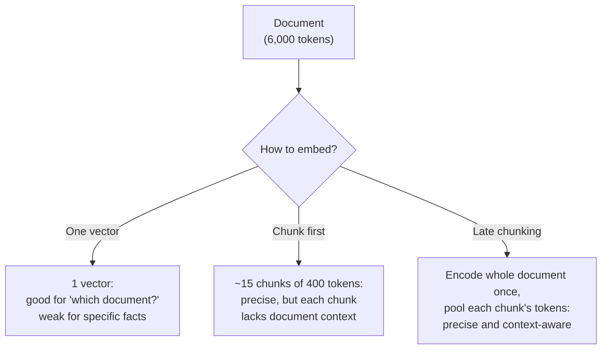

Nomic Embed is a family of open text embedding models from Nomic AI, first released in February 2024. Three properties set it apart from the families you have met so far. It was the first widely used embedder whose **weights, training code and training data were all released**, so its training can be inspected and reproduced. It reads **long inputs**, up to 8,192 tokens, where BGE v1.5 and E5 stop at 512. And from version 1.5 its vectors are **Matryoshka-trained**, so they can be shortened to a fraction of their size with a controlled loss of quality. Like E5, it requires a **task prefix** on every input.

This lesson covers each of those properties as an engineering decision. You will see what makes long context possible in an encoder and what it costs, when an 8,192-token window helps retrieval and when it hurts, how to shorten Matryoshka vectors correctly, and how much quality a shortened vector actually gives up, measured on a public benchmark with a Nomic model that runs on a laptop.

## Learning objectives

- Describe the Nomic Embed models (v1, v1.5, ModernBERT Embed and later variants) and what distinguishes each.
- Apply Nomic's task prefixes (`search_query: `, `search_document: `, `classification: `, `clustering: `) correctly.
- Explain how rotary position embeddings let an encoder read long inputs, and compute how attention cost grows with input length.
- Shorten Matryoshka embeddings correctly and measure the quality and memory trade-off on a benchmark.
- Decide when a long-context embedder should change your chunking strategy, and when it should not.

## Prerequisites

- [E5 models](/learn/embedding-models/e5-models): input prefixes and why missing ones fail silently.
- [OpenAI embeddings](/learn/embedding-models/openai-embeddings): the `dimensions` parameter and renormalising truncated vectors.
- [Sentence Transformers](/learn/embedding-models/sentence-transformers): loading models, pooling and `max_seq_length`.
- [Chunk size](/learn/chunking-fundamentals/chunk-size): the trade-off between small, precise chunks and large, context-rich ones.

## Why this matters

Three decisions in a RAG system depend on the properties Nomic Embed is known for.

**Memory.** Vector storage often dominates the cost of the retrieval tier, and it scales linearly with dimensions. A model whose vectors can be cut from 768 to 256 dimensions with a small, measurable loss gives you a dial between quality and memory that an ordinary model does not.

**Chunking.** An embedder that reads only 512 tokens forces small chunks or silently ignores the rest of a large one. An 8,192-token window removes that constraint, which tempts teams to embed whole documents. Whether that helps depends on the questions; often it does not, and knowing why is part of using long-context models well.

**Governance.** Some organisations must be able to say what data their models were trained on, or must be able to retrain them. With most models, including hosted ones, that question has no answer. With Nomic Embed v1 and v1.5, the training data and code are public.

## The intuition

Think about three kinds of reader.

The first can only read one page at a time. Hand them a chapter and they read the first page and guess the rest. That is a 512-token embedder given a long chunk.

The second can read a whole chapter and write a one-line summary of it. That is useful when someone asks "which chapter is about remote working?", and much less useful when someone asks "what is the home-office budget?", because a one-line summary of a chapter rarely mentions a specific figure. That is a long-context embedder producing **one vector for a long text**: the window is wider, but the summary is still one vector.

The third writes summaries as Russian nesting dolls: the first sentence is a complete summary on its own, the first paragraph is a fuller one, and the whole page is the fullest. You can keep as much as you have room for. That is a **Matryoshka** embedding: the first 64 numbers are a coarse but usable vector, the first 256 a better one, and all 768 the best.

## How it works

### The family

| Model | Released | Dimensions | Max tokens | Notes |
| --- | --- | --- | --- | --- |
| `nomic-embed-text-v1` | Feb 2024 | 768 | 8,192 | About 137M parameters; open weights, code and data |
| `nomic-embed-text-v1.5` | Feb 2024 | 768, shortenable to 512, 256, 128, 64 | 8,192 | Matryoshka training |
| `modernbert-embed-base` | Late 2024 | 768, shortenable to 256 | 8,192 | Trained on Nomic Embed data from a ModernBERT base |
| `nomic-embed-vision-v1.5` | 2024 | 768 | (images) | Image encoder aligned to the text v1.5 space |

Nomic has since released further models, including a multilingual mixture-of-experts text model (`nomic-embed-text-v2-moe`) and a code embedder; check their model cards for context length and prefixes, which differ from v1.5. As with every table in this module, details are as published on the model cards at the time of writing.

The v1 and v1.5 models use a custom architecture, so loading them with Sentence Transformers requires `trust_remote_code=True` (see Security considerations). `modernbert-embed-base` is built on ModernBERT, which the `transformers` library supports natively, so it loads without remote code; that is why the runnable example below uses it.

### Training: an open, three-stage recipe

The Nomic Embed technical report (Nussbaum and colleagues, 2024) follows a recipe you will recognise from [BGE](/learn/embedding-models/bge-models) and [E5](/learn/embedding-models/e5-models):

1. **Pre-train a long-context encoder** with masked language modelling. Nomic trained its own BERT variant (`nomic-bert-2048`) with sequences of 2,048 tokens, using rotary position embeddings, SwiGLU activations and Flash Attention.
2. **Weakly supervised contrastive training** on a large set of naturally occurring text pairs (titles and bodies, questions and answers and so on), filtered for consistency, with in-batch negatives.
3. **Supervised contrastive fine-tuning** on labelled retrieval and similarity datasets with mined hard negatives.

The report states that the resulting model outperformed OpenAI's `text-embedding-ada-002` and `text-embedding-3-small` on the MTEB benchmark and on long-context retrieval benchmarks at the time of release. What distinguishes it is not the recipe but its openness: the curated pairs, the training code and the weights were published under the Apache 2.0 licence.

### Long context: how an encoder reads 8,192 tokens

A transformer must know the order of its tokens. Original BERT learns one **absolute position vector** per position, up to 512; there is simply no vector for position 513, which is why BERT-based embedders stop there.

**Rotary position embeddings** (RoPE) instead encode position by rotating parts of each query and key vector by an angle proportional to the token's position. The attention score between two tokens then depends on their *relative* distance, and the scheme is defined for any position, not just those seen in training. Nomic's v1 encoder was trained at 2,048 tokens and, according to the report, extended to 8,192 at inference by rescaling the rotary frequencies, a technique that stretches the angles so that longer sequences map onto the range the model knows. ModernBERT was trained natively with 8,192-token sequences and alternates local attention (each token attends to a nearby window) with global attention every few layers, to keep the cost of long inputs down.

Two consequences follow:

1. **Cost grows quickly with length.** Full attention compares every token with every other, so its work grows with the square of the length (the mathematics section works an example). A 4,000-token chunk is far more than eight times the work of a 500-token one in the attention layers.
2. **One vector still summarises everything.** An 8,192-token chunk becomes one 768-dimension vector. The longer and more varied the text, the more each specific fact is averaged away. A question about one sentence in a long chunk competes with every other topic in that chunk.

So long context is best used for **removing truncation risk** (no chunk is silently cut) and for **documents that are genuinely about one thing**, not as a licence to stop chunking. It also enables [late chunking](/learn/chunking-optimisation/late-chunking): run the long-context model once over a whole document and pool the token vectors of each chunk separately, so every chunk's vector is computed with the full document in view.



### Task prefixes

Like E5, Nomic Embed is trained with a prefix that names the task, and the model card says the prefix is required. The four documented prefixes are:

| Prefix | Use for |
| --- | --- |
| `search_query: ` | Queries in retrieval |
| `search_document: ` | Documents and chunks in retrieval |
| `classification: ` | Texts whose embeddings feed a classifier |
| `clustering: ` | Texts to be grouped by topic |

Note the different strings from E5 (`search_document: `, not `passage: `). Prefixes are model-specific, and copying one model's into another's pipeline is a silent error. When you run Nomic through a server such as Ollama, the server passes your text to the model as is; adding the prefix is still your job.

### Matryoshka vectors

`nomic-embed-text-v1.5` and `modernbert-embed-base` were trained with **Matryoshka Representation Learning**: during training, the loss is computed not only on the full 768-dimension vector but also on its leading slices, so the model learns to put the most useful information first. [Matryoshka embeddings](/learn/embedding-optimisation/matryoshka-embeddings) covers the training objective. For using them:

1. **Encode** at full size.
2. **Keep the first $k$ dimensions**, choosing $k$ among the sizes the model was trained for.
3. **Renormalise** to unit length.

The model cards give the exact recipe, and it is not identical across models: the v1.5 card applies a layer normalisation to the full vector before slicing, while the `modernbert-embed-base` card slices the pooled vector and renormalises, and Sentence Transformers' `truncate_dim` does the latter. Follow the card of the model you deploy, and apply the same recipe to queries and documents.

### Ways to run it

- **Sentence Transformers**, locally, as in the code below.
- **Nomic's hosted API**, through the `nomic` Python client, whose `embed.text` function takes a `task_type` (which applies the prefix for you) and a `dimensionality` for Matryoshka shortening.
- **Local model servers** such as Ollama, which distributes `nomic-embed-text`. Check the server's configured context length, which may be lower than the model's 8,192, and add the prefixes yourself.

The two snippets below follow the documented interfaces; they need an API key or a running Ollama server and were not executed here.

```python
from nomic import embed  # pip install nomic; authenticate with `nomic login`

out = embed.text(
    texts=["Laptops are refreshed every 3 years."],
    model="nomic-embed-text-v1.5",
    task_type="search_document",   # the client adds the prefix
    dimensionality=256,            # Matryoshka shortening
)
print(len(out["embeddings"][0]))
```

```python
import httpx

r = httpx.post("http://localhost:11434/api/embed", json={
    "model": "nomic-embed-text",
    "input": ["search_query: When will I get a new laptop?"],   # prefix added by hand
})
print(len(r.json()["embeddings"][0]))
```

## The mathematics

### Attention cost and input length

**Intuition.** Self-attention scores every pair of tokens, so doubling the length quadruples the number of scores. Splitting one long input into several short ones makes the total much smaller, at the price of each piece not seeing the others.

$$
A(n) = n^2, \qquad \frac{A(n)}{m \cdot A(n/m)} = \frac{n^2}{m \cdot (n/m)^2} = m
$$

$n$ is the input length in tokens, $A(n)$ the number of attention scores per layer and head, and $m$ the number of equal pieces the input is split into. Splitting into $m$ pieces divides attention work by $m$. (Feed-forward layers, the other major cost, grow linearly with $n$ and are unaffected by splitting.)

**By hand.** One input of 8,192 tokens: $8{,}192^2 = 67{,}108{,}864$ scores. Sixteen inputs of 512 tokens: $16 \times 512^2 = 16 \times 262{,}144 = 4{,}194{,}304$. The ratio is $16$, which is $m$.

### Matryoshka storage

**Intuition.** Raw vector memory is proportional to the dimensions you keep.

$$
S(k) = N \cdot k \cdot b
$$

$N$ is the number of chunks, $k$ the dimensions kept and $b$ the bytes per dimension (4 for `float32`).

**By hand.** For 3,000,000 chunks: at $k = 768$, $3{,}000{,}000 \times 768 \times 4 = 9{,}216{,}000{,}000$ bytes, about 9.2 GB; at $k = 256$, a third of that, about 3.1 GB; at $k = 64$, about 0.77 GB.

```python
# Attention work grows with the square of the sequence length
one_long = 8192 ** 2
many_short = 16 * 512 ** 2
print(f"one 8,192-token input : {one_long:,} attention scores per layer and head")
print(f"16 x 512-token inputs : {many_short:,}")
print(f"ratio: {one_long / many_short:.0f}x")

# Matryoshka storage for 3 million chunks in float32
N = 3_000_000
for k in (768, 256, 64):
    print(f"{k:>3} dims: {N * k * 4 / 1e9:.2f} GB")
```

```output
one 8,192-token input : 67,108,864 attention scores per layer and head
16 x 512-token inputs : 4,194,304
ratio: 16x
768 dims: 9.22 GB
256 dims: 3.07 GB
 64 dims: 0.77 GB
```

## In code

**The problem.** AskMeridian's vector memory is growing with every new document collection, and the team wants to know how small they can make the vectors. They measure two things on SciFact (5,183 scientific abstracts and 300 claims with relevance labels, from the BEIR benchmark): how much a Matryoshka-trained Nomic model loses as its vectors are shortened, compared with an ordinary model shortened the same way; and how much the task prefixes are worth.

**Dependencies.** The model is `nomic-ai/modernbert-embed-base`, a Nomic model that loads without remote code; it needs `transformers` 4.48 or later. Downloads total roughly 700 MB, and the script takes several minutes on a laptop CPU.

```bash
pip install "sentence-transformers>=3" "transformers>=4.48" pandas pyarrow huggingface_hub
```

**The source.**

```python
import numpy as np
import pandas as pd
from huggingface_hub import hf_hub_download
from sentence_transformers import SentenceTransformer

# --- SciFact (BEIR): 5,183 abstracts, 300 test claims with relevance labels ---
def get(repo, path):
    return hf_hub_download(repo, path, repo_type="dataset")

corpus = pd.read_parquet(get("BeIR/scifact", "corpus/corpus-00000-of-00001.parquet"))
queries = pd.read_parquet(get("BeIR/scifact", "queries/queries-00000-of-00001.parquet"))
qrels = pd.read_csv(get("BeIR/scifact-qrels", "test.tsv"), sep="\t", dtype=str)
relevant = qrels.groupby("query-id")["corpus-id"].apply(set).to_dict()
queries = queries[queries["_id"].isin(relevant)].reset_index(drop=True)
doc_ids = corpus["_id"].to_numpy()
docs = (corpus["title"] + ". " + corpus["text"]).tolist()
claims = queries["text"].tolist()


def ndcg_at_10(Q, D):
    top = np.argsort(-(Q @ D.T), axis=1)[:, :10]
    scores = []
    for i, qid in enumerate(queries["_id"]):
        rel = relevant[qid]
        dcg = sum((doc_ids[j] in rel) / np.log2(r + 2) for r, j in enumerate(top[i]))
        ideal = sum(1 / np.log2(r + 2) for r in range(min(len(rel), 10)))
        scores.append(dcg / ideal)
    return np.mean(scores)


def shorten(X, k):
    """Matryoshka truncation: keep the first k dimensions, then renormalise."""
    Xk = X[:, :k]
    return Xk / np.linalg.norm(Xk, axis=1, keepdims=True)


nomic = SentenceTransformer("nomic-ai/modernbert-embed-base", device="cpu")
mini = SentenceTransformer("sentence-transformers/all-MiniLM-L6-v2", device="cpu")
for m in (nomic, mini):
    m.max_seq_length = 256                      # CPU budget; the Nomic model accepts 8,192

# Nomic with its task prefixes, and without them
Qp = nomic.encode(["search_query: " + c for c in claims], normalize_embeddings=True)
Dp = nomic.encode(["search_document: " + d for d in docs], normalize_embeddings=True)
Qn = nomic.encode(claims, normalize_embeddings=True)
Dn = nomic.encode(docs, normalize_embeddings=True)
# MiniLM: not Matryoshka-trained
Qm = mini.encode(claims, normalize_embeddings=True)
Dm = mini.encode(docs, normalize_embeddings=True)

print("Nomic, no prefixes,   768 dims:", f"{ndcg_at_10(Qn, Dn):.3f}")
for k in (768, 512, 256, 128, 64):
    print(f"Nomic, with prefixes, {k:>3} dims: {ndcg_at_10(shorten(Qp, k), shorten(Dp, k)):.3f}"
          f"   ({k * 4:>5} bytes per vector)")
for k in (384, 192, 96):
    print(f"MiniLM,               {k:>3} dims: {ndcg_at_10(shorten(Qm, k), shorten(Dm, k)):.3f}")
```

The output is from a CPU run with sentence-transformers 6.3; exact figures can vary slightly with library versions and hardware.

```output
Nomic, no prefixes,   768 dims: 0.675
Nomic, with prefixes, 768 dims: 0.680   ( 3072 bytes per vector)
Nomic, with prefixes, 512 dims: 0.676   ( 2048 bytes per vector)
Nomic, with prefixes, 256 dims: 0.660   ( 1024 bytes per vector)
Nomic, with prefixes, 128 dims: 0.617   (  512 bytes per vector)
Nomic, with prefixes,  64 dims: 0.493   (  256 bytes per vector)
MiniLM,               384 dims: 0.648
MiniLM,               192 dims: 0.616
MiniLM,                96 dims: 0.557
```

**The important lines.**

- `shorten` is the whole Matryoshka recipe for this model: slice the first `k` dimensions, then renormalise. The full vectors are encoded once and shortened afterwards, so trying several sizes costs nothing extra.
- `"search_query: "` and `"search_document: "` are prepended by hand. With Sentence Transformers you could instead pass `prompts={"query": "search_query: ", "document": "search_document: "}` when loading and call `encode_query` and `encode_document`.
- `m.max_seq_length = 256` caps the input to keep the CPU run short. It truncates some abstracts, for both models equally; it does not reflect the Nomic model's real 8,192-token window.

**What the output means.**

- **Prefixes help a little here.** With prefixes, nDCG@10 at full size is 0.680; without, 0.675. As with E5, SciFact's claims are full sentences, so the gap is small; it costs nothing to get right.
- **Shortening to the trained size is cheap.** At 256 dimensions, the size the model card says the model was trained for, the score falls from 0.680 to 0.660: two points for a two-thirds cut in memory. At 512 the loss is under half a point. The 256-dimension Nomic vectors (1,024 bytes) still beat full MiniLM vectors (384 dimensions, 1,536 bytes, 0.648).
- **Below the trained sizes, quality falls quickly.** At 128 dimensions the score is 0.617, and at 64 it collapses to 0.493. `modernbert-embed-base` was trained for 256; the v1.5 model's card lists 64 and 128 as trained sizes, so its curve would differ. Use only the sizes a model's card lists, and measure them.
- **The ordinary model degrades steadily.** MiniLM loses 3.2 points when halved (384 to 192) and 9.1 when quartered (to 96). Nomic loses 2.0 points at a third of its size. Matryoshka training does not make shortening free; it moves useful information to the front so that the loss at the trained sizes is small.
- These are 300 queries on one scientific corpus. The shape of the curve (flat to the trained size, then falling) is the transferable lesson; the exact numbers for your corpus come from running the same loop on your own questions.

**Common errors.**

- `ValueError` or an unrecognised `modernbert` architecture: your `transformers` is older than 4.48.
- Loading `nomic-embed-text-v1.5` without `trust_remote_code=True` fails; with it, you run code from the model repository (see Security considerations).
- Shortening without renormalising: the scores are no longer cosines, and comparisons across differently shortened vectors break.

**Extending it.** Raise `max_seq_length` to 512 or 1,024 and see whether longer inputs help on this corpus; repeat the experiment on your own question set; and combine shortening with [int8 or binary quantisation](/learn/embedding-optimisation/embedding-quantisation) to see how far memory can fall before quality does.

## A real-world example

Meridian's Atlas runbooks are long: a typical page has a scope section, a table of error codes such as E-4021 with causes and fixes, and an escalation procedure, often 5,000 tokens or more in total. When the Platform team moved AskMeridian's runbook index to `nomic-embed-text-v1.5`, an engineer proposed using the full 8,192-token window to embed each runbook page as a single chunk: fewer vectors, no splitting logic, no truncation.

The team tested it against their existing 400-token chunks on their labelled runbook questions. The one-vector-per-page index did well on broad questions ("which runbook covers VPN problems?") and badly on specific ones ("what does E-4021 mean?"), because a page-level vector summarises the page's topic, not each row of its error table. They kept 400-token chunks and adopted late chunking for runbook pages, so each chunk's vector was computed with the whole page in context, which helped questions that depended on the page's scope section. The long window's main benefit turned out to be the one they had not planned for: no chunk was ever silently truncated again.

They then turned to memory. Running the shortening experiment on their own questions, they found that 256 dimensions lost little against 768 for their queries and 64 lost noticeably, so they chose 256, cutting vector memory to a third. The decision was recorded with the collection: model name, the `search_document: ` prefix and the 256-dimension Matryoshka recipe, so that the query service would shorten its query vectors in exactly the same way.

## Common mistakes

- **Using another model's prefixes.** `passage: ` is E5's; Nomic expects `search_document: `. Copying prefixes between models is a silent error.
- **Forgetting prefixes behind a model server.** Servers pass text through unchanged; the prefix is your responsibility.
- **Embedding whole documents because the window allows it.** One vector for a long, varied text answers "which document?" well and "what exactly does it say?" poorly.
- **Shortening queries and documents differently.** Both must use the same dimension count and the same recipe, or their vectors are not comparable.
- **Shortening a model that was not Matryoshka-trained.** Ordinary models lose quality much faster when truncated.
- **Assuming the server uses the full context length.** A local server configured with a shorter context truncates silently, exactly like a 512-token model.

## Best practices

- Configure prefixes once (as prompts or in a shared embedding module) and test that production and evaluation produce identical vectors.
- Choose the Matryoshka size by measuring retrieval quality on your own questions at each trained size, then record the size and recipe with the index.
- Keep chunking for fact-level retrieval; use the long window to avoid truncation, for documents that are about one thing, and for late chunking.
- Prefer models that load without remote code where they meet your quality bar; if you need one that does not, pin the revision and review the code.
- Store full-size vectors in cold storage if you can afford it, so you can change the Matryoshka size later without re-embedding.

## Performance considerations

**Encoding cost.** At 137 to 149 million parameters, Nomic's text models are base-sized: per token, roughly four to five times the work of a 33-million-parameter small model. Attention adds a term that grows with the square of length, so very long inputs cost disproportionately: by the arithmetic above, one 8,192-token input needs 16 times the attention work of the same text split into 512-token pieces.

**Memory.** Matryoshka shortening is the cheapest memory lever available: 768 to 256 dimensions cuts raw vector memory by a factor of 3, and also cuts the arithmetic per similarity computation by 3. It combines with quantisation: 256 dimensions in int8 is 256 bytes per vector, a twelfth of 768 dimensions in `float32`.

**Two-stage search.** Because a Matryoshka vector's prefix is itself a usable vector, a system can search a large index with short vectors and then re-score the top candidates with the full vectors. This keeps most of the memory saving and recovers some of the quality; it requires storing or fetching the full vectors for the candidates.

## Security considerations

- **Remote code.** `nomic-embed-text-v1` and `v1.5` require `trust_remote_code=True` in Sentence Transformers and `transformers`, which downloads and executes Python from the model repository. Review that code, pin the model `revision` to a commit you have reviewed, and mirror it internally. Models that the library supports natively, such as `modernbert-embed-base`, avoid this.
- **Hosted API.** Nomic's API sends your text to Nomic's servers; the same data-handling review applies as for any hosted embedder.
- **Local servers.** An Ollama or similar server exposes an HTTP endpoint; bind it to localhost or protect it, since anyone who can reach it can use your compute and probe what it returns.

## Summary

- Nomic Embed v1 and v1.5 are open in weights, training code and data, read up to 8,192 tokens, and are trained with the familiar three-stage contrastive recipe.
- Long context comes from rotary position embeddings and careful attention design; it removes truncation risk but does not make one vector a good summary of a long, varied text.
- Every input needs its task prefix (`search_query: `, `search_document: `, `classification: `, `clustering: `), and model servers do not add it for you.
- Matryoshka training lets you keep the leading dimensions and renormalise, trading a measured amount of quality for a proportional cut in memory; ordinary models degrade much faster when shortened.
- Choose dimension count and chunking by measurement on your own questions, and record the prefix and shortening recipe with the index.

## Exercises

1. Compute the attention scores per layer and head for one 4,096-token input and for the same text split into eight 512-token chunks. What is the ratio, and what does the split lose?

<details><summary>Show solution</summary>

$4{,}096^2 = 16{,}777{,}216$; $8 \times 512^2 = 2{,}097{,}152$; ratio $8$, equal to the number of pieces. The split loses cross-chunk context: tokens in one chunk cannot attend to tokens in another, so a chunk that says "this limit" cannot see which limit was defined in the previous chunk. Late chunking recovers that context while still producing one vector per chunk.

</details>

2. A team stores `nomic-embed-text-v1.5` document vectors shortened to 256 dimensions, but the query service sends full 768-dimension query vectors and the database truncates them to 256 without renormalising. What goes wrong, and how big is the effect on ranking for a single query?

<details><summary>Show solution</summary>

For a single query, dividing the query vector by a constant does not change the ranking of documents, because every document's score is scaled by the same factor. So the ranking for one query is unchanged. What breaks is anything that relies on absolute scores: thresholds, score fusion with other retrievers, and comparisons across queries, because each query's scores are scaled by a different factor (its truncated norm). There is also a recipe mismatch if the documents were shortened after a layer normalisation (as in the v1.5 card) and the queries were not. Fix: shorten queries with exactly the same recipe as documents, including renormalisation.

</details>

3. Using the code above, add a two-stage search: retrieve the top 50 abstracts with 64-dimension vectors, then re-score those 50 with the full 768-dimension vectors and keep the top 10. Report nDCG@10 and compare it with the 64- and 768-dimension single-stage results.

<details><summary>Show solution</summary>

```python
def ndcg_from_scores(S):
    top = np.argsort(-S, axis=1)[:, :10]
    out = []
    for i, qid in enumerate(queries["_id"]):
        rel = relevant[qid]
        dcg = sum((doc_ids[j] in rel) / np.log2(r + 2) for r, j in enumerate(top[i]))
        out.append(dcg / sum(1 / np.log2(r + 2) for r in range(min(len(rel), 10))))
    return np.mean(out)

def two_stage(Q, D, k_small=64, candidates=50):
    S_small = shorten(Q, k_small) @ shorten(D, k_small).T
    cand = np.argsort(-S_small, axis=1)[:, :candidates]
    S = np.full(S_small.shape, -np.inf)
    for i in range(len(Q)):
        S[i, cand[i]] = D[cand[i]] @ Q[i]          # full vectors for the candidates only
    return S

print(f"64 dims only : {ndcg_from_scores(shorten(Qp, 64) @ shorten(Dp, 64).T):.3f}")
print(f"64 -> 768    : {ndcg_from_scores(two_stage(Qp, Dp)):.3f}")
print(f"768 dims only: {ndcg_from_scores(Qp @ Dp.T):.3f}")
```

```output
64 dims only : 0.493
64 -> 768    : 0.626
768 dims only: 0.680
```

Re-scoring recovers most of the loss (0.493 to 0.626) but not all of it: whenever a relevant abstract falls outside the 64-dimension top 50, no amount of re-scoring can bring it back. The remaining gap to 0.680 measures how often the coarse stage missed. With this model, 64 dimensions is below its trained size, so a 256-dimension first stage, or more candidates, would close more of the gap.

</details>

4. Design decision: AskMeridian has 3 million chunks and a memory budget of 2 GB for raw vectors. Using the storage formula, which Matryoshka sizes fit in `float32`, and what would you do if the measured quality at those sizes were not acceptable?

<details><summary>Show solution</summary>

$S(k) = 3{,}000{,}000 \times k \times 4$ bytes $\le 2 \times 10^9$ gives $k \le 166$. Of the trained sizes, 128 and 64 fit (1.54 GB and 0.77 GB); 256 does not (3.07 GB). If quality at 128 is not acceptable: store 256 dimensions in int8 (768 MB, which fits) and measure that; or use a two-stage search with short vectors in memory and full vectors on disk for re-scoring the candidates; or reduce $N$ by removing duplicate and obsolete chunks, such as superseded handbook versions. Measure each option on the labelled questions.

</details>

## Check your understanding

```quiz
[
  {
    "q": "Which prefixes should a Nomic Embed retrieval pipeline use?",
    "options": ["`query: ` and `passage: `", "`search_query: ` on queries and `search_document: ` on documents", "No prefixes; they are optional", "`Represent this sentence for searching relevant passages: ` on queries"],
    "answer": 1,
    "why": "Nomic's documented retrieval prefixes are `search_query: ` and `search_document: `; the others belong to E5 and BGE."
  },
  {
    "q": "Why can an encoder with rotary position embeddings read inputs longer than the 512 positions of original BERT?",
    "options": ["It does not use attention", "It compresses the input before encoding", "Position is encoded as a rotation that depends on relative distance and is defined for any position, rather than a learned vector per absolute position", "It reads only every second token"],
    "answer": 2,
    "why": "RoPE has no fixed table of position vectors, so it is defined beyond the training length and can be rescaled to extend it."
  },
  {
    "q": "A team embeds each 6,000-token runbook page as one vector with an 8,192-token model. What is the most likely effect?",
    "options": ["Better results for broad 'which page?' questions, worse for specific facts within a page", "Better results for every kind of question", "The model truncates each page to 512 tokens", "No change, because the model reads the whole page"],
    "answer": 0,
    "why": "One vector summarises the whole page's topic; specific facts are averaged together with everything else on the page."
  },
  {
    "q": "What is the correct way to shorten Matryoshka-trained vectors from 768 to 256 dimensions?",
    "options": ["Take every third dimension", "Apply PCA to each vector separately", "Keep the last 256 dimensions", "Keep the first 256 dimensions, following the model card's recipe, and renormalise; do the same to queries and documents"],
    "answer": 3,
    "why": "Matryoshka training puts the most information in the leading dimensions; renormalising restores unit length for cosine scoring."
  },
  {
    "q": "Splitting one 8,192-token input into sixteen 512-token pieces changes attention work by what factor?",
    "options": ["No change", "Divides it by 16", "Divides it by 256", "Multiplies it by 16"],
    "answer": 1,
    "why": "8,192 squared divided by 16 times 512 squared equals 16: splitting into m pieces divides quadratic attention work by m."
  }
]
```

## Further reading

- Nussbaum, Z., Morris, J. X., Duderstadt, B. and Mulyar, A. (2024). "Nomic Embed: Training a Reproducible Long Context Text Embedder." [arXiv:2402.01613](https://arxiv.org/abs/2402.01613).
- Kusupati, A. and colleagues (2022). "Matryoshka Representation Learning." NeurIPS 2022. [arXiv:2205.13147](https://arxiv.org/abs/2205.13147).
- Su, J., Lu, Y., Pan, S., Murtadha, A., Wen, B. and Liu, Y. (2021). "RoFormer: Enhanced Transformer with Rotary Position Embedding." [arXiv:2104.09864](https://arxiv.org/abs/2104.09864).
- Warner, B. and colleagues (2024). "Smarter, Better, Faster, Longer: A Modern Bidirectional Encoder for Fast, Memory Efficient, and Long Context Finetuning and Inference." (ModernBERT.) [arXiv:2412.13663](https://arxiv.org/abs/2412.13663).
- The `nomic-ai` model cards on the Hugging Face Hub, for prefixes, Matryoshka recipes and licences.
