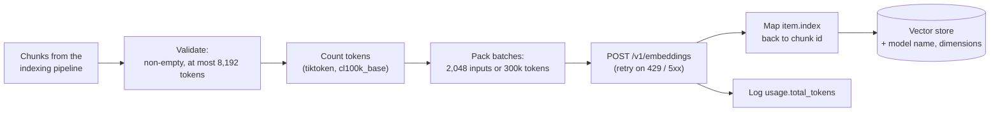

OpenAI's embedding endpoint is, for many teams, the first embedding model they ever use: one HTTPS call, no GPU, no model files, and a vector comes back. That convenience hides a set of engineering decisions that matter a great deal once the corpus is larger than a demo: which of the models to call, how many dimensions to ask for, how to batch requests inside the API's limits, what it costs to embed and to store the result, and what it means to tie your index to a model you do not control.

This lesson treats the OpenAI embedding API as a production component: what the models promise, how the `dimensions` parameter works, how to batch within the request limits, and how to reason about cost, storage and lock-in. The code runs against a faithful stand-in for the API, so it executes without a key; the real call is shown alongside.

## Learning objectives

- Describe the current OpenAI embedding models, their default dimensions and input limits, and where to check them before relying on them.
- Call the embeddings endpoint correctly from Python, including batching, ordering, token counting and the `dimensions` parameter.
- Explain why shortened OpenAI embeddings must be renormalised if you truncate them yourself, and compute a cosine before and after truncation by hand.
- Estimate the cost and storage of embedding a corpus for a given model and dimension count.
- Identify the operational risks of a hosted embedding model (rate limits, deprecation, data handling, re-embedding) and plan for each.

## Prerequisites

- [Embedding models](/learn/embedding-fundamentals/embedding-models): what an embedding model is and how it is trained to place related texts near each other.
- [Sentence embeddings](/learn/embedding-fundamentals/sentence-embeddings): one vector per passage rather than per word.
- [Tokens and tokenisation](/learn/understanding-large-language-models/tokens-and-tokenisation): how text is counted in tokens, which is how hosted APIs bill and limit you.
- [Working with APIs](/learn/python-for-rag-engineering/working-with-apis): HTTP clients, retries and rate limits in Python.

## Why this matters

The embedding model decides what "similar" means for your whole retrieval system; every chunk and every query passes through it. Choosing a hosted model is a long-lived architectural decision with consequences that are easy to miss in a prototype:

- **Every vector in the index is tied to one model.** Vectors from `text-embedding-3-small` and `text-embedding-3-large` live in different spaces; so do vectors from the same model at different dimension counts. Comparing across them returns numbers, not similarities. Changing model later means re-embedding the whole corpus.
- **Batching is not optional at scale.** One chunk per request is slow and hits rate limits; too much in one request is rejected. A correct client respects several limits at once and keeps outputs in input order.
- **Dimensions drive the bill you pay every month.** The embedding call is paid once per chunk, but the vector database stores and searches every dimension of every vector, permanently. A 3,072-dimension vector takes twelve times the memory of a 256-dimension one.
- **Your documents leave your network.** For an assistant indexing HR policies, someone must sign that off.

Teams that skip these points usually meet them as incidents: a silent model mismatch, a backfill that takes days, or a security review that arrives after the index is built.

## The intuition

Think of the embedding API as a **map-making service**. You send it a description of a place, and it returns a pin position on a map that only that service can draw. Two pins can be compared for distance only if they were placed on the same map.

The service sells maps at different resolutions. A large-scale map (3,072 dimensions) records fine detail; a smaller one (1,536 or 256) records the major roads and loses some side streets. The OpenAI v3 models have a useful property: the coarser map is not a different map, it is the detailed one with the fine print removed. The first 256 numbers of a 3,072-number vector already carry the broad position; the remaining numbers refine it. That is why the API can offer a `dimensions` parameter: it gives you the opening part of the vector, rescaled so its length is one again.

Two consequences follow. If the service redraws its map (a new model), every earlier pin must be placed again. And you pay twice: once to the service per pin, and continuously for your own storage of every coordinate.

## How it works

### The models

At the time of writing, OpenAI offers two current embedding models and one older one. Treat every number below as a snapshot; model names, limits and prices change, so confirm them in the [OpenAI embeddings guide](https://platform.openai.com/docs/guides/embeddings) before you design around them.

| Model | Default dimensions | Shortenable with `dimensions` | Notes |
| --- | --- | --- | --- |
| `text-embedding-3-small` | 1,536 | Yes | Cheap, fast; the usual default for RAG |
| `text-embedding-3-large` | 3,072 | Yes | Higher quality, several times the price |
| `text-embedding-ada-002` | 1,536 | No | The 2022 model; keep only for existing indexes |

All three accept up to 8,192 tokens per input, counted with the `cl100k_base` tokeniser (the installed SDK's own documentation states this limit). The v3 models were released in January 2024; OpenAI's launch announcement reported that both improved on `ada-002` on the MTEB and MIRACL benchmarks, and that `text-embedding-3-large` shortened to 256 dimensions still outperformed the full 1,536-dimension `ada-002` on MTEB. Public benchmarks are a starting point, not a verdict: [Model selection](/learn/embedding-optimisation/model-selection) covers how to test models on your own queries.

Three properties of these models shape everything downstream:

1. **The vectors are normalised.** OpenAI documents that its embeddings are scaled to length 1. For unit vectors, the dot product equals the cosine similarity, and Euclidean distance produces the same ranking. You can therefore use the cheapest operation, the dot product, in your vector database. ([Vector normalisation](/learn/embedding-mathematics/vector-normalisation) proves why.)
2. **There are no task prefixes.** Some open models expect you to mark text as a query or a passage (you will meet this in [E5 models](/learn/embedding-models/e5-models)). The OpenAI endpoint has a single mode: queries and documents are embedded with exactly the same call. Whatever query-passage asymmetry the model handles, it learned in training.
3. **The model is opaque.** Architecture, training data and weights are unpublished; you cannot fine-tune, run offline, or pin a version beyond the model name.

### The request and the response

A request names the model and passes `input`, which is either a single string or a list of strings (token arrays are also accepted). The response contains one embedding per input and a usage record:

```python
from openai import OpenAI

client = OpenAI()  # reads OPENAI_API_KEY from the environment

response = client.embeddings.create(
    model="text-embedding-3-small",
    input=["How many days of annual leave do I get?",
           "Annual leave is 25 days per year."],
    dimensions=512,           # optional; v3 models only
)
for item in response.data:
    print(item.index, len(item.embedding), item.embedding[:3])
print(response.usage.prompt_tokens, response.usage.total_tokens)
```

This block needs an API key and was not executed here. Your exact numbers will differ; the output looks like this:

```output
0 512 [0.0213, -0.0467, 0.0081]
1 512 [0.0352, -0.0219, 0.0144]
19 19
```

About the response:

- `response.data[i].index` is the position of that input **within this request**. Each item carries it so that you never have to rely on list order; a robust client maps results back by `index`.
- `usage.total_tokens` is what you are billed for. For embeddings it equals `prompt_tokens`, because nothing is generated.
- Over the wire, vectors can come back as JSON floats or as base64-encoded `float32` bytes (`encoding_format`). The current Python SDK asks for base64 by default when you do not specify a format and decodes it for you, which roughly quarters the response size; you still receive a list of floats.

### Limits and how a batching client respects them

The endpoint enforces limits per request, and your account enforces limits per minute:

- **Per input:** at most 8,192 tokens, and the string must not be empty.
- **Per request:** at most 2,048 inputs, and at most 300,000 tokens summed across them (both figures from the SDK's documentation at the time of writing).
- **Per minute:** requests (RPM) and tokens (TPM) per minute, set by your usage tier; exceeding them returns HTTP 429.

A batching client therefore does the following for a corpus of chunks:

1. **Validate each text.** Reject empty strings and texts over the per-input token limit. A text that is too long is a chunking bug; fix it upstream with [token-based chunking](/learn/chunking-fundamentals/token-based-chunking) rather than truncating silently.
2. **Count tokens locally** with `tiktoken` and the `cl100k_base` encoding, so that batches are sized before anything is sent.
3. **Pack texts into batches greedily**, closing a batch when adding the next text would exceed either the input count or the token budget.
4. **Send each batch**, letting the client library retry on 429 and transient 5xx errors with exponential backoff. (The official SDK retries twice by default; set `max_retries` on the client for long backfills.)
5. **Reassemble in order** using each item's `index` plus the batch's offset into the original list.
6. **Record usage** from `response.usage` for cost tracking, and record the model name and dimension count next to the vectors.



For a large one-off backfill, OpenAI's **Batch API** accepts a file of embedding requests, processes it asynchronously within a completion window (24 hours at the time of writing) and charges a discounted rate (half price at the time of writing). It suits re-embedding a whole corpus; it does not suit query embedding, which must happen within the user's request.

### The `dimensions` parameter and Matryoshka training

The v3 models were trained so that the leading dimensions of a vector carry the most information and each later block of dimensions refines it. The technique is known as **Matryoshka Representation Learning** (Kusupati and colleagues, 2022), after the Russian nesting dolls: smaller representations sit inside the larger one. [Matryoshka embeddings](/learn/embedding-optimisation/matryoshka-embeddings) explains the training objective; here you only need its consequence. When you pass `dimensions=256`, the API returns the first 256 components, rescaled to unit length.

You can also do this yourself: request the full vector once, store it, and truncate later. If you do, you must **renormalise** after truncating, because the first $k$ components of a unit vector have a length below 1. Skip that step and your dot products are no longer cosines, and rankings across vectors with different lost tails become inconsistent. The mathematics section works an example by hand.

Shortening is not free: each cut discards information, by an amount that depends on task and corpus. Measure retrieval quality at several dimension counts and pick the smallest you can accept.

### Hosted-model operations

A hosted model brings operational facts that a local model does not:

- **Deprecation.** Older models are eventually retired. When that happens, the only path is re-embedding every chunk with a new model. Keep the original chunk text (not only the vectors) so you can.
- **No version pinning beyond the name.** You trust that a given model name keeps producing compatible vectors. Do not depend on bit-exact repeatability either: identical inputs can produce vectors that differ in the last decimal places between calls, so compare with a tolerance, never with `==`.
- **Compatible endpoints.** Azure OpenAI serves the same models through the `AzureOpenAI` client, where `model` names your deployment. Other providers and local servers expose OpenAI-compatible `/embeddings` routes; the client code works with a different `base_url`, but the vectors come from a different model and are not interchangeable.

## The mathematics

### Truncation and renormalisation

**Intuition.** A unit vector's squared components add up to 1. Keep only the first $k$ of them and the sum is less than 1, so the shortened vector is shorter than one unit. Dividing by its new length restores unit length, and only then does the dot product equal the cosine again.

$$
\mathbf{v}_{1:k} = (v_1, \dots, v_k), \qquad
\hat{\mathbf{v}}_{1:k} = \frac{\mathbf{v}_{1:k}}{\lVert \mathbf{v}_{1:k} \rVert}, \qquad
\lVert \mathbf{v}_{1:k} \rVert = \sqrt{\sum_{i=1}^{k} v_i^2} \le 1
$$

$\mathbf{v}$ is the full unit-length embedding with $n$ components, $k < n$ is the number of dimensions kept, $\mathbf{v}_{1:k}$ is the truncated vector and $\hat{\mathbf{v}}_{1:k}$ is its renormalised version.

**By hand.** Take two unit vectors with $n = 8$:

$\mathbf{v} = (0.6, 0.4, 0.4, 0.2, 0.4, 0.2, 0.2, 0.2)$ and $\mathbf{w} = (0.2, 0.6, 0.2, 0.4, 0.2, 0.4, 0.2, 0.4)$.

- Check the lengths: $0.36 + 0.16 + 0.16 + 0.04 + 0.16 + 0.04 + 0.04 + 0.04 = 1.00$, and likewise $1.00$ for $\mathbf{w}$.
- Full cosine (a plain dot product, since both are unit length): $0.12 + 0.24 + 0.08 + 0.08 + 0.08 + 0.08 + 0.04 + 0.08 = 0.80$.
- Keep $k = 4$. Truncated lengths: $\sqrt{0.36 + 0.16 + 0.16 + 0.04} = \sqrt{0.72} = 0.8485$ and $\sqrt{0.04 + 0.36 + 0.04 + 0.16} = \sqrt{0.60} = 0.7746$.
- Raw dot product of the truncated vectors: $0.12 + 0.24 + 0.08 + 0.08 = 0.52$.
- Cosine of the truncated vectors: $0.52 / (0.8485 \times 0.7746) = 0.52 / 0.6573 = 0.7912$.

The renormalised cosine (0.79) is close to the full one (0.80). The un-renormalised dot product (0.52) is not a cosine at all; a system that compared it with a threshold tuned on full vectors would reject almost everything.

### Embedding cost and storage

**Intuition.** You pay the provider per token once, and you pay your own infrastructure per stored number for as long as the index exists.

$$
C_{\text{embed}} = \frac{N \cdot \bar{t} \cdot p}{10^6}, \qquad
S = N \cdot d \cdot b
$$

$N$ is the number of chunks, $\bar{t}$ the average tokens per chunk, $p$ the price per million tokens, $d$ the number of dimensions and $b$ the bytes per component (4 for `float32`). $C_{\text{embed}}$ is the one-off embedding cost and $S$ the raw vector storage, before any index overhead.

**By hand.** Suppose 2,000,000 chunks averaging 400 tokens, so 800 million tokens. Assume a price of 0.02 US dollars per million tokens for `text-embedding-3-small` and 0.13 for `text-embedding-3-large`; these are assumptions to check against the current price list.

- Small: $800 \times 0.02 = 16$ dollars. Large: $800 \times 0.13 = 104$ dollars.
- Storage at 1,536 dimensions: $2{,}000{,}000 \times 1{,}536 \times 4 = 12{,}288{,}000{,}000$ bytes, about 12.3 GB.
- At 3,072 dimensions: about 24.6 GB. At 256 dimensions: about 2.0 GB.

The embedding bill is small and paid once. The storage is paid in RAM on every replica of the vector database, every month, and a graph index such as [HNSW](/learn/vector-indexing-algorithms/hnsw) adds overhead on top. For most RAG systems, dimension count is the bigger cost lever.

```python
import numpy as np

v = np.array([0.6, 0.4, 0.4, 0.2, 0.4, 0.2, 0.2, 0.2])
w = np.array([0.2, 0.6, 0.2, 0.4, 0.2, 0.4, 0.2, 0.4])
print("norms:", np.linalg.norm(v), np.linalg.norm(w))
print("full cosine:", round(float(v @ w), 4))

k = 4
vk, wk = v[:k], w[:k]
print("truncated norms:", round(float(np.linalg.norm(vk)), 4), round(float(np.linalg.norm(wk)), 4))
print("raw dot after truncation:", round(float(vk @ wk), 4))
vk_hat, wk_hat = vk / np.linalg.norm(vk), wk / np.linalg.norm(wk)
print("cosine after renormalising:", round(float(vk_hat @ wk_hat), 4))

N, t_avg = 2_000_000, 400
for name, price in [("3-small", 0.02), ("3-large", 0.13)]:   # assumed USD per 1M tokens
    print(f"{name}: embed cost = {N * t_avg * price / 1e6:.2f} USD")
for d in (3072, 1536, 256):
    print(f"d={d}: storage = {N * d * 4 / 1e9:.1f} GB")
```

```output
norms: 1.0 1.0
full cosine: 0.8
truncated norms: 0.8485 0.7746
raw dot after truncation: 0.52
cosine after renormalising: 0.7912
3-small: embed cost = 16.00 USD
3-large: embed cost = 104.00 USD
d=3072: storage = 24.6 GB
d=1536: storage = 12.3 GB
d=256: storage = 2.0 GB
```

## In code

**The problem.** AskMeridian's indexing pipeline needs to embed every chunk of the handbook and runbooks through the OpenAI API: validated, batched within the request limits, reassembled in the right order, with tokens counted for cost tracking. The code must be testable without a key, because the team's continuous-integration jobs do not have one.

**Dependencies.** The official SDK, `tiktoken` for counting tokens and NumPy:

```bash
pip install openai tiktoken numpy
```

**The source.** `embed_all` is the production function. `FakeClient` stands in for `openai.OpenAI()` in tests: it builds genuine SDK response objects (`CreateEmbeddingResponse`, `Embedding`, `Usage`) with deterministic unit vectors, returns them in reverse order to prove the client does not depend on order, and counts requests.

```python
import hashlib

import numpy as np
import tiktoken
from openai.types import CreateEmbeddingResponse, Embedding
from openai.types.create_embedding_response import Usage

MODEL = "text-embedding-3-small"
MAX_TOKENS_PER_INPUT = 8192        # per input; check the current API reference
MAX_INPUTS_PER_REQUEST = 2048      # array length per request
MAX_TOKENS_PER_REQUEST = 300_000   # summed over all inputs in one request

enc = tiktoken.get_encoding("cl100k_base")  # the v3 embedding models' tokeniser


def make_batches(texts, max_inputs=MAX_INPUTS_PER_REQUEST, max_tokens=MAX_TOKENS_PER_REQUEST):
    """Group texts into requests that respect both per-request limits."""
    batches, current, current_tokens = [], [], 0
    for i, text in enumerate(texts):
        if not text.strip():
            raise ValueError(f"text {i} is empty; the API rejects empty strings")
        n = len(enc.encode(text))
        if n > MAX_TOKENS_PER_INPUT:
            raise ValueError(f"text {i} has {n} tokens; chunk it before embedding")
        if current and (len(current) == max_inputs or current_tokens + n > max_tokens):
            batches.append(current)
            current, current_tokens = [], 0
        current.append(i)
        current_tokens += n
    if current:
        batches.append(current)
    return batches


def embed_all(client, texts, dimensions=None, **batch_limits):
    """Embed texts in order; return a float32 matrix and the tokens billed."""
    kwargs = {"model": MODEL}
    if dimensions is not None:
        kwargs["dimensions"] = dimensions
    vectors = [None] * len(texts)
    billed = 0
    for batch in make_batches(texts, **batch_limits):
        response = client.embeddings.create(input=[texts[i] for i in batch], **kwargs)
        for item in response.data:                 # item.index is the position in *this* request
            vectors[batch[item.index]] = item.embedding
        billed += response.usage.total_tokens
    return np.asarray(vectors, dtype=np.float32), billed


class FakeEmbeddings:
    """Mimics client.embeddings.create, returning real SDK response objects."""

    def __init__(self):
        self.calls = 0

    def create(self, *, model, input, dimensions=1536):
        self.calls += 1
        data = []
        for i, text in enumerate(input):
            seed = int(hashlib.sha256(text.encode()).hexdigest()[:8], 16)
            v = np.random.default_rng(seed).normal(size=1536)[:dimensions]
            v /= np.linalg.norm(v)                     # the real API returns unit vectors
            data.append(Embedding(embedding=v.tolist(), index=i, object="embedding"))
        tokens = sum(len(enc.encode(t)) for t in input)
        return CreateEmbeddingResponse(
            data=data[::-1],                           # out of order on purpose
            model=model, object="list",
            usage=Usage(prompt_tokens=tokens, total_tokens=tokens),
        )


class FakeClient:
    def __init__(self):
        self.embeddings = FakeEmbeddings()


corpus = [
    "Annual leave is 25 days per year.",
    "Up to 5 unused leave days carry over and must be used by 31 March.",
    "Staff may work remotely up to 3 days a week.",
    "The home-office equipment budget is £400; contractors are not eligible.",
    "Expenses must be submitted within 30 days; anything over £75 needs a receipt.",
    "Passwords must be rotated every 90 days.",
    "VPN is required on public Wi-Fi.",
]

client = FakeClient()
print("tokens per text:", [len(enc.encode(t)) for t in corpus])
print("batches (max 3 inputs or 40 tokens):", make_batches(corpus, max_inputs=3, max_tokens=40))

X, billed = embed_all(client, corpus, max_inputs=3, max_tokens=40)
print("matrix:", X.shape, X.dtype, "| requests:", client.embeddings.calls, "| tokens billed:", billed)
print("row norms:", np.round(np.linalg.norm(X, axis=1), 4))

again, _ = embed_all(FakeClient(), corpus[::-1])        # same texts, reversed order
print("order preserved:", np.allclose(X, again[::-1]))

X256, _ = embed_all(FakeClient(), corpus, dimensions=256)
print("with dimensions=256:", X256.shape, "| bytes per vector:", X.shape[1] * 4, "->", X256.shape[1] * 4)

try:
    embed_all(FakeClient(), corpus + ["   "])
except ValueError as e:
    print("rejected:", e)
```

```output
tokens per text: [9, 18, 12, 14, 18, 9, 8]
batches (max 3 inputs or 40 tokens): [[0, 1, 2], [3, 4], [5, 6]]
matrix: (7, 1536) float32 | requests: 3 | tokens billed: 88
row norms: [1. 1. 1. 1. 1. 1. 1.]
order preserved: True
with dimensions=256: (7, 256) | bytes per vector: 6144 -> 1024
rejected: text 7 is empty; the API rejects empty strings
```

**The important lines.**

- `tiktoken.get_encoding("cl100k_base")` gives the same token counts the API uses for these models, so batches are sized before any network call. In the output, the 88 tokens billed equal the sum of the local counts.
- In `make_batches`, a batch is closed when **either** limit would be exceeded. The demo shrinks the limits to 3 inputs and 40 tokens so you can see it: texts 3 and 4 total 32 tokens, and adding text 5 (9 tokens) would reach 41, so a new batch starts.
- `vectors[batch[item.index]] = item.embedding` is the ordering guarantee. `item.index` is relative to the request; `batch[...]` turns it back into a position in the corpus. The fake deliberately reverses the response, and "order preserved: True" confirms the client does not care.
- `dimensions` is only added to the request when asked for. Sending it to `text-embedding-ada-002` is an error, so the client should never send it by default.

**What the output means.** Seven chunks took three requests; every vector has unit length; 256 dimensions cut bytes per vector from 6,144 to 1,024. The empty chunk was rejected locally, by name, instead of by a 400 error halfway through a backfill.

**Running it for real.** Replace `FakeClient()` with `OpenAI()` from the `openai` package (with `OPENAI_API_KEY` set) and remove the small batch limits. That version was not executed here, because it needs a key and network access.

**Common errors.**

- `openai.BadRequestError` about maximum context length: a chunk exceeded the per-input limit. Fix the chunker.
- `openai.RateLimitError` (429) that persists after retries: your tokens per minute are exhausted. Reduce concurrency, add a token-bucket limiter sized to your tier, or move backfills to the Batch API.
- A matrix of `None` values or a shape error in `np.asarray`: a batch failed and the loop carried on. In production, wrap each batch so that failure stops the job or is retried, never skipped.

**Extending it.** Add a cache keyed by model, dimensions and text (exercise 3), run batches concurrently with `AsyncOpenAI` and a semaphore, and write the model and dimension count into the collection's metadata.

## A real-world example

Meridian's Platform team built the first version of AskMeridian on `text-embedding-3-small` at its default 1,536 dimensions, storing the vectors in their Qdrant cluster. Six months later, two changes arrived at once. The product documentation for Meridian Sync, Meridian Relay and Meridian Reports was to be added to the index, multiplying the corpus several times over, and an engineer proposed switching to `text-embedding-3-large` "for better quality".

The engineer changed the `MODEL` constant and redeployed the query service. Nothing visibly failed. But queries were now 3,072-dimension large-model vectors and the index held 1,536-dimension small-model vectors, so Qdrant rejected every search, and the service's "search unavailable" fallback quietly answered from the language model's own knowledge. A colleague noticed only when AskMeridian said the support desk opened at 09:00, the hours from the superseded 2023 handbook.

The review produced three rules. The collection's metadata records model and dimensions, and the query service refuses to start if its configuration disagrees. A model change is a re-index: a new collection built from stored chunk text, evaluated, and switched over in one step ([Reindexing](/learn/ci-cd-and-mlops/reindexing)). And small versus large is decided by measurement: both models at 256, 512 and full dimensions, recall on the team's question set, set against the memory each needs across replicas.

## Common mistakes

- **Mixing models or dimension counts in one index.** Similarity scores between vectors from different spaces are meaningless, and when the dimension counts happen to match, nothing errors. Record model and dimensions with the collection and check them.
- **Truncating stored vectors without renormalising.** Dot products stop being cosines and thresholds stop working. Either use the API's `dimensions` parameter or divide by the new length.
- **One request per chunk.** A million-chunk backfill becomes a million round trips and hits RPM limits. Batch.
- **Silent truncation of long chunks.** Cutting text to 8,192 tokens to make an error go away throws away content nobody will ever retrieve. Over-long inputs are a chunking defect.
- **Comparing raw scores to fixed thresholds borrowed from elsewhere.** Each model has its own score distribution; a threshold tuned for one is wrong for another. Calibrate on your own data ([Retrieval thresholding](/learn/advanced-retrieval-optimisation/retrieval-thresholding)).

## Best practices

- Start with `text-embedding-3-small` and move to `-large` only when an evaluation on your own questions shows a gain worth its cost.
- Choose the dimension count by measurement: embed an evaluation set at several values and pick the smallest acceptable one.
- Count tokens locally with `tiktoken` and enforce the input limit in the chunker, not in the embedding client.
- Store model name, dimension count and an embedding-pipeline version alongside every collection, and check them at query time.
- Cache embeddings by a hash of model, dimensions and text so that re-ingesting unchanged documents costs nothing.
- Use the Batch API for large backfills and the synchronous endpoint for queries and small incremental updates.

## Performance considerations

**Query latency.** Embedding a query is an HTTPS round trip on the critical path of every question, typically tens to hundreds of milliseconds depending on region and load. Caching frequent queries' embeddings avoids the call ([Query caching](/learn/performance-optimisation/query-caching)).

**Backfill throughput.** Throughput is bounded by your TPM limit, not by your code. If your tier allows, say, 1,000,000 tokens per minute (an assumption for the arithmetic), an 800-million-token corpus needs at least $800{,}000{,}000 / 1{,}000{,}000 = 800$ minutes, a little over 13 hours, however many workers you run. Plan backfills around that number, or use the Batch API.

**Memory.** Raw vectors cost $d \times 4$ bytes each in `float32`: 6 KiB at 1,536 dimensions, 12 KiB at 3,072. Multiply by chunks and by replicas. Halving dimensions roughly halves memory and the arithmetic per similarity computation; [Embedding quantisation](/learn/embedding-optimisation/embedding-quantisation) shows how to go further by storing fewer bits per component.

**Cost.** The embedding bill is usually small next to generation costs: 16 dollars for 800 million tokens in the worked example, under the assumed price. [Embedding costs](/learn/cost-engineering/embedding-costs) treats the whole picture.

## Security considerations

- **Data leaves your boundary.** Every chunk you embed is sent to OpenAI. Check the provider's current data-use and retention terms (at the time of writing, OpenAI states that API data is not used for training by default), and get approval before sending personal data, HR cases or customer content. Detect and redact personal data before embedding where policy requires it ([PII detection](/learn/access-control-and-privacy/pii-detection)).
- **Embeddings are not anonymised text.** Research has shown that text can be reconstructed from embeddings to a surprising degree (Morris and colleagues, 2023, "Text Embeddings Reveal (Almost) As Much As Text"). Protect the vector store with the same access controls as the documents themselves.
- **Keys.** Read `OPENAI_API_KEY` from the environment or a secrets manager, never from code; use separate keys per environment so that a leaked development key cannot run up production spend.
- **Access control still applies at retrieval.** Embedding a document does not carry its permissions. Store the document's access labels as metadata and filter on them at query time ([Document-level permissions](/learn/access-control-and-privacy/document-level-permissions)).

## Summary

- OpenAI's current embedding models, `text-embedding-3-small` and `text-embedding-3-large`, return unit-length vectors of 1,536 and 3,072 dimensions by default, accept up to 8,192 tokens per input, and need no query or passage prefixes.
- The `dimensions` parameter returns a shorter vector that remains useful because the models were trained Matryoshka-style; if you truncate yourself, renormalise.
- A production client validates inputs, counts tokens with `tiktoken`, batches within the per-request limits, maps results back by `index`, and records usage.
- Embedding cost is small and paid once; storage scales with dimensions and is paid continuously, so dimension count is usually the larger lever.
- A hosted model ties your index to a model you cannot pin, inspect or fine-tune: record model and dimensions with the vectors, keep the source text, and treat a model change as a full re-index.

## Exercises

1. A colleague stores full 3,072-dimension vectors from `text-embedding-3-large`, then truncates them to 1,024 in the database layer and ranks by dot product. Explain what goes wrong and give two ways to fix it.

<details><summary>Show solution</summary>

The truncated vectors are shorter than unit length, and by different amounts for different documents, because each document loses a different tail. Dot products are then no longer cosines: documents whose information sits more in the first 1,024 components get an unearned boost, and any score threshold tuned on full vectors becomes wrong. Fix one: divide each truncated vector by its new L2 norm before storing it (and do the same to the query). Fix two: request `dimensions=1024` from the API for both documents and queries, which returns already renormalised vectors.

</details>

2. Using the formulas in this lesson, estimate the one-off embedding cost and the raw `float32` storage for 500,000 chunks of 300 tokens each with `text-embedding-3-small` at 512 dimensions, assuming 0.02 US dollars per million tokens. Then compute the storage at 1,536 dimensions.

<details><summary>Show solution</summary>

Tokens: $500{,}000 \times 300 = 150$ million, so cost $= 150 \times 0.02 = 3$ dollars. Storage at 512 dimensions: $500{,}000 \times 512 \times 4 = 1{,}024{,}000{,}000$ bytes, about 1.0 GB. At 1,536 dimensions: three times that, about 3.1 GB. The embedding cost is trivial; the storage difference is what matters, multiplied by every replica.

</details>

3. Extend `embed_all` with a cache: a dictionary keyed by the SHA-256 of `f"{MODEL}|{dimensions}|{text}"`. Only texts missing from the cache are sent to the API. Show with `FakeClient` that embedding the same corpus twice makes requests only the first time.

<details><summary>Show solution</summary>

```python
import hashlib
import numpy as np

cache = {}

def key(text, dimensions):
    return hashlib.sha256(f"{MODEL}|{dimensions}|{text}".encode()).hexdigest()

def embed_cached(client, texts, dimensions=None, **limits):
    missing = [t for t in dict.fromkeys(texts) if key(t, dimensions) not in cache]
    if missing:
        vecs, _ = embed_all(client, missing, dimensions=dimensions, **limits)
        for t, v in zip(missing, vecs):
            cache[key(t, dimensions)] = v
    return np.stack([cache[key(t, dimensions)] for t in texts])

c = FakeClient()
embed_cached(c, corpus)
embed_cached(c, corpus)
print("requests:", c.embeddings.calls)   # 1: the second call is served from the cache
```

`dict.fromkeys` also removes duplicate texts within one call. Including the model and dimensions in the key means a configuration change cannot return stale vectors from another space. In production the dictionary becomes a table in a database or a key-value store.

</details>

## Check your understanding

```quiz
[
  {
    "q": "You request embeddings from `text-embedding-3-small` with `dimensions=256`. What do you receive?",
    "options": ["A 1,536-dimension vector with all but 256 components set to zero", "A 256-dimension vector from a separately trained small model", "The leading 256 components of the full vector, rescaled to unit length", "A random projection of the full vector to 256 dimensions"],
    "answer": 2,
    "why": "The v3 models are trained Matryoshka-style, so the API returns the first components and renormalises them."
  },
  {
    "q": "Why does a robust batching client use `item.index` from each response item?",
    "options": ["To map each vector back to its position in the original corpus, independent of response order", "Because the API bills by index", "Because `index` holds the vector's L2 norm", "To select which dimensions to keep"],
    "answer": 0,
    "why": "`index` is the position of the input within the request; combined with the batch offset it restores the corpus order."
  },
  {
    "q": "OpenAI embeddings are normalised to length 1. Which statement follows?",
    "options": ["Euclidean distance gives a different ranking from cosine similarity", "Scores are probabilities of relevance", "Vectors from different models can be compared", "Dot product and cosine similarity give identical scores"],
    "answer": 3,
    "why": "For unit vectors the cosine's denominator is 1, so cosine equals the dot product; Euclidean distance gives the same ranking."
  },
  {
    "q": "A team switches the query service to `text-embedding-3-large` but leaves the index built with `text-embedding-3-small` at 1,536 dimensions, and asks for `dimensions=1536` on queries. What happens?",
    "options": ["Search errors because the dimension counts differ", "Search runs without error but similarity scores are meaningless, because the vectors come from different spaces", "Quality improves because the query encoder is stronger", "The API refuses to shorten large-model vectors to 1,536"],
    "answer": 1,
    "why": "Matching dimension counts hide the mismatch; the vectors were produced by different models, so their geometry is unrelated."
  },
  {
    "q": "For a corpus of 2 million chunks, which usually costs more over a year: the one-off embedding calls or holding the vectors in RAM across replicas?",
    "options": ["The embedding calls, because they are billed per token", "Neither; both are negligible", "Storage, because it scales with dimensions and replicas and is paid continuously", "They are always equal"],
    "answer": 2,
    "why": "Embedding is paid once and is cheap per token; vector memory is paid for as long as the index runs, on every replica."
  }
]
```

## Further reading

- OpenAI, [Embeddings guide](https://platform.openai.com/docs/guides/embeddings): current models, limits, the `dimensions` parameter and usage examples.
- OpenAI, "New embedding models and API updates" (January 2024): the announcement of the v3 models and native shortening.
- Kusupati, A. and colleagues (2022). "Matryoshka Representation Learning." NeurIPS 2022. [arXiv:2205.13147](https://arxiv.org/abs/2205.13147).
- Muennighoff, N., Tazi, N., Magne, L. and Reimers, N. (2022). "MTEB: Massive Text Embedding Benchmark." [arXiv:2210.07316](https://arxiv.org/abs/2210.07316).
- Morris, J. X., Kuleshov, V., Shmatikov, V. and Rush, A. M. (2023). "Text Embeddings Reveal (Almost) As Much As Text." EMNLP 2023.
