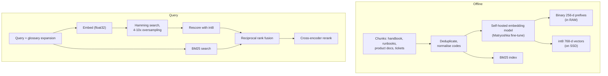

This assessment covers all eight lessons of **Embedding Optimisation**: model selection, embedding evaluation, domain adaptation, fine-tuning, contrastive learning, hard negative mining, Matryoshka embeddings and embedding quantisation. Answer the 18 multiple-choice questions first; the pass mark is 70% (13 of 18). Then work through the open questions, the coding exercises, the design challenge and the troubleshooting scenarios, writing your own answer before opening each model answer. The written parts are not scored, but they show whether you can use the ideas rather than merely recognise them.

```quiz
[
  {
    "q": "Which of these is a hard constraint that should eliminate embedding models before any testing?",
    "options": [
      "Rank on a public retrieval leaderboard",
      "Document text may not leave the company network",
      "Number of downloads on the Hugging Face Hub",
      "Average score across all benchmark task types"
    ],
    "answer": 1,
    "why": "A data-residency requirement rules out every hosted API regardless of quality. Leaderboard ranks are for shortlisting, not elimination."
  },
  {
    "q": "A team evaluates the E5 model without its `query: ` and `passage: ` prefixes and finds it worse than another model. What is the main problem with the evaluation?",
    "options": [
      "E5 cannot be evaluated on a CPU",
      "Prefixes only affect latency",
      "The model was tested in a configuration it was not trained for",
      "E5 requires a cross-encoder"
    ],
    "answer": 2,
    "why": "Asymmetric models are trained with specific prefixes. A fair comparison uses each model as its card documents."
  },
  {
    "q": "Model A beats model B by 0.04 MRR on 50 queries. The paired bootstrap 95% interval for A minus B is [-0.02, +0.10]. What should you conclude?",
    "options": [
      "The evaluation cannot distinguish the two models",
      "A is significantly better",
      "B is significantly better",
      "The bootstrap is not valid for MRR"
    ],
    "answer": 0,
    "why": "The interval contains zero, so a true difference of zero is consistent with the data."
  },
  {
    "q": "What does this code print?\n```python\nrelevant = {\"a\", \"b\", \"c\"}\nranked = [\"x\", \"a\", \"y\", \"c\"]\nprint(round(len(relevant & set(ranked[:3])) / len(relevant), 3))\n```",
    "options": [
      "0.667",
      "0.5",
      "1.0",
      "0.333"
    ],
    "answer": 3,
    "why": "The top 3 contain only \"a\" from the relevant set; \"c\" is at rank 4. Recall@3 = 1/3."
  },
  {
    "q": "Why is pooling used when building relevance judgements for comparing models?",
    "options": [
      "To reduce the number of queries",
      "So that relevant chunks found by any compared model get judged, rather than counted as misses",
      "To remove near-duplicate chunks",
      "To speed up exact search"
    ],
    "answer": 1,
    "why": "Unjudged relevant chunks penalise whichever model finds them. Judging the union of every model's top results removes this bias."
  },
  {
    "q": "A paired evaluation shows MRR 0.97 for plain-English phrasings and 0.74 for the same needs in staff shorthand, mostly acronyms. What is the cheapest sensible next step?",
    "options": [
      "Supervised fine-tuning on thousands of pairs",
      "Switch to a much larger model",
      "A glossary that expands the acronyms, then re-measure",
      "Binary quantisation"
    ],
    "answer": 2,
    "why": "When the gap is concentrated in known shorthand, a glossary is the lowest rung of the adaptation ladder that addresses it."
  },
  {
    "q": "In Generative Pseudo Labeling, what is the training label for a (query, positive, negative) triple?",
    "options": [
      "A cross-encoder's score for the positive minus its score for the negative",
      "1 for the positive and 0 for the negative",
      "The BM25 score of the positive",
      "The cosine similarity between positive and negative"
    ],
    "answer": 0,
    "why": "GPL uses a cross-encoder teacher's margin as a soft label and trains the student with MarginMSE."
  },
  {
    "q": "What does this code print?\n```python\nimport math\npairs, batch_size, epochs = 1000, 64, 3\nprint(math.ceil(pairs / batch_size) * epochs)\n```",
    "options": [
      "45",
      "48",
      "3000",
      "47"
    ],
    "answer": 1,
    "why": "ceil(1000 / 64) = 16 steps per epoch, times 3 epochs = 48 optimiser steps."
  },
  {
    "q": "After fine-tuning an embedding model, which statement about the existing index is correct?",
    "options": [
      "Only chunks that appeared in training pairs need re-embedding",
      "The index can be reused if the dimensionality is unchanged",
      "Only new documents need the new model",
      "Every chunk must be re-embedded, because training moved every vector"
    ],
    "answer": 3,
    "why": "All texts pass through the updated weights. Old and new vectors are not comparable, even at the same dimensionality."
  },
  {
    "q": "In InfoNCE with in-batch negatives and batch size 128, how many negatives does each query see, with no mined negatives added?",
    "options": [
      "1",
      "128",
      "127",
      "16,384"
    ],
    "answer": 2,
    "why": "Each query's own passage is the positive; the other 127 passages in the batch are its negatives."
  },
  {
    "q": "According to the InfoNCE gradient, which negative is pushed hardest away from the query?",
    "options": [
      "The negative with the highest similarity to the query",
      "The negative with the lowest similarity",
      "All negatives equally",
      "A random negative"
    ],
    "answer": 0,
    "why": "The push on negative j is its softmax probability divided by the temperature, which grows exponentially with similarity."
  },
  {
    "q": "Sentence Transformers' MultipleNegativesRankingLoss multiplies similarities by a scale of 20. What would changing it to 100 do?",
    "options": [
      "Nothing; the scale cancels out in the softmax",
      "Concentrate the gradient even more on the hardest negatives, making training more sensitive to false negatives",
      "Spread the gradient evenly across all negatives",
      "Increase the number of negatives"
    ],
    "answer": 1,
    "why": "A larger scale is a lower temperature, which sharpens the softmax so the most similar negatives dominate, including any mislabelled ones."
  },
  {
    "q": "Mining takes the highest-scoring non-positive passage as each query's hard negative. What is the main risk?",
    "options": [
      "The negatives will be too easy",
      "Mining becomes too slow",
      "The negatives will be in another language",
      "That passage is the most likely to be relevant but unlabelled, and it gets the largest gradient"
    ],
    "answer": 3,
    "why": "The passages closest to the query are the likeliest false negatives, and being closest, they receive the strongest push."
  },
  {
    "q": "A cross-encoder used to filter mined negatives returns 6.1, -2.4 and 0.3. You want to drop candidates with relevance probability above 0.5. What should you do first?",
    "options": [
      "Convert the logits to probabilities, for example with a sigmoid",
      "Drop every candidate with a positive score",
      "Divide by the largest score",
      "Nothing; compare the raw scores with 0.5"
    ],
    "answer": 0,
    "why": "Raw logits are unbounded. A probability threshold applies only after a sigmoid, or the threshold must be expressed in logit units."
  },
  {
    "q": "What does this code print?\n```python\nimport numpy as np\nv = np.array([0.6, 0.8]); w = np.array([0.6, 0.0])\nprint(round(float(v[:1] @ w[:1] / (np.linalg.norm(v[:1]) * np.linalg.norm(w[:1]))), 2))\n```",
    "options": [
      "0.36",
      "0.6",
      "1.0",
      "0.0"
    ],
    "answer": 2,
    "why": "After truncation to one dimension and renormalisation, both vectors point the same way, so the cosine is 1.0, although their full cosine is 0.6. Truncation can merge vectors that differ in the discarded dimensions."
  },
  {
    "q": "A model was not trained with Matryoshka Representation Learning. What happens if you keep only the first 64 of its 768 dimensions?",
    "options": [
      "Quality is unchanged because the first dimensions are the most important",
      "Quality usually drops noticeably, because information is spread across all dimensions",
      "The vectors become unusable for cosine similarity",
      "Embedding becomes twelve times faster"
    ],
    "answer": 1,
    "why": "Only Matryoshka training pushes important information into early coordinates. Truncation also never speeds up embedding."
  },
  {
    "q": "Documents are stored as int8 with per-dimension ranges. Which scoring keeps rankings closest to float32?",
    "options": [
      "An int8 query against int8 documents with an integer dot product",
      "Hamming distance between int8 codes",
      "Comparing only the sign of each int8 value",
      "A float32 query against the dequantised documents"
    ],
    "answer": 3,
    "why": "Asymmetric scoring undoes each dimension's shift and scale. The integer dot product ignores them and adds a document-dependent offset."
  },
  {
    "q": "A binary-quantised first stage with 4x oversampling feeds a rescoring stage. Rescoring with -1/+1 vectors gives recall 0.81; rescoring the same shortlist with int8 vectors gives 0.97. What limited the first pipeline?",
    "options": [
      "The precision used to order the shortlist, not the shortlist itself",
      "The shortlist was missing most true results",
      "The oversampling factor was too high",
      "Hamming distance cannot be computed on packed bits"
    ],
    "answer": 0,
    "why": "The same shortlist gave 0.97 with better rescoring vectors, so it already contained most of the true top 10; signs alone ordered it poorly."
  }
]
```

## Conceptual questions

**1.** A colleague proposes adopting the top model on a public retrieval leaderboard for AskMeridian. Explain what the leaderboard does and does not tell you, and describe the procedure you would follow instead.

<details><summary>Show model answer</summary>

A leaderboard such as MTEB reports average quality over public datasets. It tells you which models are strong on general retrieval tasks, which is useful for a shortlist. It does not tell you how a model performs on your corpus and your users' phrasing (Meridian's error codes and shorthand appear in none of the datasets); averages hide per-dataset variation; some models may have trained on data overlapping the benchmark; and it says nothing about latency on your hardware, memory, licence or price.

The procedure: write down hard constraints (residency, languages, maximum input length versus chunk size, licence, hardware) and eliminate models that fail; shortlist three to five survivors of different sizes, including the incumbent; read each model card for prefixes, length limits and similarity function; run a bake-off on a frozen, sliced evaluation set of real queries with pooled judgements; compare with paired intervals and read the misses; then compute storage, latency and cost for the models that are statistically tied; record the decision and the triggers for revisiting it.

</details>

**2.** Explain why the temperature in InfoNCE matters, using the gradient. What goes wrong if it is too high, and what goes wrong if it is too low?

<details><summary>Show model answer</summary>

For a query, the push on negative $j$ is $p_j/\tau$, where $p_j$ is the softmax probability of $s_j/\tau$. The temperature controls both the scale of the logits and how probability is shared among negatives.

Too high (for example $\tau = 1$ with cosines in $[-1, 1]$): the logits span at most 2 units, the softmax cannot become confident, the loss stays high even for well-separated positives, and the push is spread almost evenly across easy and hard negatives, so learning fine distinctions is slow.

Too low (for example $\tau = 0.01$): the softmax becomes nearly a hard maximum. Almost all the gradient goes to the single most similar negative, which makes training sensitive to noise. If that negative is actually relevant (a false negative), it dominates the row's gradient and actively damages the geometry. Training can also become unstable. A common default is $\tau = 0.05$ (scale 20), adjusted only on evidence from a development set.

</details>

**3.** Distinguish easy negatives, hard negatives and false negatives. Why is a false negative more harmful than an easy negative is useless?

<details><summary>Show model answer</summary>

An easy negative is clearly irrelevant and already scored far below the positive; a hard negative is irrelevant but scored close to the positive; a false negative is actually relevant but treated as a negative because it is unlabelled.

An easy negative has a tiny softmax probability, so its gradient is near zero: it wastes computation but does no harm. A false negative is, by construction, highly similar to the query, so it has a large softmax probability and receives the largest push in its row. Training then pushes apart two texts that should be close, with more force than any genuine hard negative receives. That is why mining pipelines combine rank windows, positive-aware margins and cross-encoder filtering, and why deduplicating the corpus first is essential.

</details>

**4.** When would you choose Matryoshka truncation, int8 quantisation or binary quantisation with rescoring to reduce index memory? Can they be combined?

<details><summary>Show model answer</summary>

int8 with asymmetric scoring is usually the first choice: a four-fold saving with very small loss, and it works with any model once ranges are calibrated. float16 is an even safer two-fold saving.

Matryoshka truncation requires a model trained for it. It reduces both memory and per-comparison compute in proportion to the dimensions kept, and lets you pick the size after training; it suits cases where a smaller size meets the quality bar, or a funnel design with short prefixes in memory and full vectors for re-ranking.

Binary quantisation gives a 32-fold saving but loses too much for a final ranking; use it as a first stage with oversampling and rescoring against int8 or float vectors kept on cheaper storage, when RAM is the binding constraint.

They compose: for example, truncate a Matryoshka model to 256 dimensions, binarise for the in-memory index (32 bytes per vector), and rescore with int8 256-dimensional vectors from disk. Measure each step separately and then the combination, on float32 agreement and on labelled queries.

</details>

**5.** Describe the risks of evaluating a fine-tuned model incorrectly, and how a well-designed evaluation avoids each.

<details><summary>Show model answer</summary>

Leakage: test queries that also appear in training, or near-duplicates of them, measure memorisation. Avoid by splitting by query (and by document when the corpus grows), deduplicating after normalisation and by embedding similarity.

Tuning on the test set: choosing epochs, learning rate or prefixes by looking at the test set makes it optimistic. Keep a separate development set and look at the test set once.

Noise mistaken for improvement: report paired intervals and win/loss counts, not just averages.

Hidden regressions: per-slice reporting, including a general-language slice and identifier queries, reveals losses an overall average hides.

Synthetic flattery: if training used synthetic queries, evaluate on real ones. Contract errors: evaluate the model with the same prefixes, normalisation and exact search that production will use, and re-check thresholds, since the score distribution changes.

</details>

## Coding exercises

**1. A paired comparison you can trust.** Write `reciprocal_ranks(scores, relevant)` that returns the reciprocal rank of the first relevant document for each query, and `paired_bootstrap(a, b)` that returns the mean of `a - b` and a 95% percentile interval from 10,000 resamples with a fixed seed. Test them on the simulated scores below, where model B has a slightly stronger signal than A plus extra noise, and report MRR for both, the interval for B minus A, and win/loss/tie counts.

<details><summary>Show solution</summary>

```python
import numpy as np

def reciprocal_ranks(scores, relevant):
    """scores: (n_queries, n_docs); relevant: list of sets of doc indices."""
    order = np.argsort(-scores, axis=1)
    rr = []
    for row, rel in zip(order, relevant):
        rank = next(i for i, d in enumerate(row) if d in rel) + 1
        rr.append(1.0 / rank)
    return np.array(rr)

def paired_bootstrap(a, b, n_resamples=10_000, seed=0):
    rng = np.random.default_rng(seed)
    diff = np.asarray(a) - np.asarray(b)
    idx = rng.integers(0, len(diff), size=(n_resamples, len(diff)))
    lo, hi = np.percentile(diff[idx].mean(axis=1), [2.5, 97.5])
    return diff.mean(), lo, hi

rng = np.random.default_rng(42)
n_queries, n_docs = 60, 40
relevant = [{int(rng.integers(n_docs))} for _ in range(n_queries)]
base = rng.normal(size=(n_queries, n_docs))
signal = np.zeros_like(base)
for i, rel in enumerate(relevant):
    signal[i, list(rel)] = 1.0
scores_a = base + 2.0 * signal                            # model A
scores_b = base + 2.3 * signal + rng.normal(scale=0.3, size=base.shape)   # model B

rr_a, rr_b = reciprocal_ranks(scores_a, relevant), reciprocal_ranks(scores_b, relevant)
mean, lo, hi = paired_bootstrap(rr_b, rr_a)
print(f"MRR A {rr_a.mean():.3f}  MRR B {rr_b.mean():.3f}")
print(f"B - A: {mean:+.3f}, 95% CI [{lo:+.3f}, {hi:+.3f}]")
print(f"B wins {int((rr_b > rr_a).sum())}, A wins {int((rr_a > rr_b).sum())}, ties {int((rr_a == rr_b).sum())}")
```

```output
MRR A 0.514  MRR B 0.597
B - A: +0.083, 95% CI [+0.045, +0.125]
B wins 28, A wins 3, ties 29
```

Here the interval excludes zero and B wins 28 of the 31 queries where the models differ, so B is better on this data. Because both models share the same `base` noise, the paired comparison removes most of the query-to-query variation, which is exactly why paired intervals are narrower than comparing two independent averages.

</details>

**2. InfoNCE and its gradient, checked numerically.** Implement `info_nce(S, tau)` for a $B \times B$ similarity matrix with positives on the diagonal, returning the mean loss and the gradient $\partial \mathcal{L}/\partial S$. Verify one gradient entry by finite differences. Use the matrix below with $\tau = 0.1$ and explain the pattern in the gradient.

<details><summary>Show solution</summary>

```python
import numpy as np
np.set_printoptions(suppress=True)

def info_nce(S, tau):
    """S: (B, B) cosine similarities, positives on the diagonal.
    Returns the mean loss and dL/dS."""
    Z = S / tau
    Z = Z - Z.max(axis=1, keepdims=True)
    P = np.exp(Z) / np.exp(Z).sum(axis=1, keepdims=True)
    B = len(S)
    loss = -np.mean(np.log(np.diag(P)))
    grad = (P - np.eye(B)) / (tau * B)
    return loss, grad

S = np.array([[0.80, 0.50, 0.20],
              [0.30, 0.70, 0.65],
              [0.10, 0.20, 0.90]])
loss, grad = info_nce(S, tau=0.1)
print(f"loss {loss:.4f}")
print("dL/dS =\n", np.round(grad, 3))

# Finite-difference check of one entry
eps = 1e-6
S2 = S.copy(); S2[1, 2] += eps
print(f"numerical dL/dS[1,2] = {(info_nce(S2, 0.1)[0] - loss) / eps:.3f}")
```

```output
loss 0.1792
dL/dS =
 [[-0.166  0.158  0.008]
 [ 0.038 -1.282  1.244]
 [ 0.001  0.003 -0.004]]
numerical dL/dS[1,2] = 1.244
```

The gradient for row $i$ is $(P_{i\cdot} - y_{i\cdot})/(\tau B)$, and the numerical check agrees with the analytic value 1.244. Row 2 dominates: its positive (0.70) barely beats a hard negative (0.65), so the loss pushes that negative down hard and the positive up hard. Row 3 is already solved (0.90 against 0.20), so its gradients are tiny. Within row 1, the hard negative (0.50) gets about twenty times the push of the easy one (0.20). Training effort concentrates on confused rows and hard negatives.

</details>

**3. Compression trade-offs on synthetic embeddings.** Generate 5,000 document and 100 query vectors of dimension 256 from 50 random cluster centres plus noise, normalised to unit length (seed 7). Using float32 exact top 10 as the reference, measure recall@10 for: int8 with per-dimension ranges calibrated on the first 1,000 documents, scored asymmetrically and symmetrically; and plain truncation to 128 and 64 dimensions with renormalisation. Explain the truncation result.

<details><summary>Show solution</summary>

```python
import numpy as np

rng = np.random.default_rng(7)
d, n_docs, n_queries, k = 256, 5000, 100, 10
centres = rng.normal(size=(50, d))
D = centres[rng.integers(50, size=n_docs)] + 0.8 * rng.normal(size=(n_docs, d))
Q = centres[rng.integers(50, size=n_queries)] + 0.8 * rng.normal(size=(n_queries, d))
normalise = lambda X: X / np.linalg.norm(X, axis=1, keepdims=True)
D, Q = normalise(D), normalise(Q)
reference = np.argsort(-(Q @ D.T), axis=1)[:, :k]

def recall(order):
    return np.mean([len(set(o[:k]) & set(r)) / k for o, r in zip(order, reference)])

def calibrate(X):
    lo, hi = X.min(axis=0), X.max(axis=0)
    return lo, (hi - lo) / 255

def quantise(X, lo, step):
    return (np.clip(np.floor((X - lo) / step), 0, 255) - 128).astype(np.int8)

def dequantise(X8, lo, step):
    return (X8.astype(np.float32) + 128.5) * step + lo

lo, step = calibrate(D[:1000])                 # calibrate on a sample, not the whole corpus
D8 = quantise(D, lo, step)
print(f"int8, asymmetric:      recall@10 {recall(np.argsort(-(Q @ dequantise(D8, lo, step).T), axis=1)):.3f}")
sym = quantise(Q, lo, step).astype(np.int32) @ D8.astype(np.int32).T
print(f"int8, symmetric:       recall@10 {recall(np.argsort(-sym, axis=1)):.3f}")
for m in (128, 64):
    Dm, Qm = normalise(D[:, :m]), normalise(Q[:, :m])
    print(f"first {m:>3} dims:        recall@10 {recall(np.argsort(-(Qm @ Dm.T), axis=1)):.3f}")
```

```output
int8, asymmetric:      recall@10 0.953
int8, symmetric:       recall@10 0.717
first 128 dims:        recall@10 0.460
first  64 dims:        recall@10 0.316
```

Asymmetric int8 keeps most of the float32 top 10 (0.953). Calibrating on all 5,000 documents instead of the first 1,000 raises it to 0.981, because a small sample's ranges are narrower and more values clip: calibration samples must be large and representative. Symmetric int8 loses far more, as the lesson derived. Truncation is poor because these synthetic vectors spread information evenly across all 256 dimensions, exactly like a model that was not Matryoshka-trained: dropping half the coordinates drops half the information about which documents are nearest. A Matryoshka-trained model would concentrate it in the leading coordinates.

</details>

## Architecture design challenge

**Brief.** Meridian is extending AskMeridian to cover 6 million chunks: the handbook, IT runbooks, product documentation for Meridian Sync, Relay and Reports, and three years of support tickets. Requirements: documents may not leave Meridian's network; staff use heavy internal shorthand and paste Atlas error codes; the vector index must fit in 32 GB of RAM per replica; p95 retrieval latency (excluding generation) must stay under 150 ms; quality must be measurably no worse than today on the existing slices, and better on the runbook and ticket slices; and the team must be able to retrain as the domain drifts. Design the embedding layer: model choice, adaptation, training data, compression and evaluation.

<details><summary>Show reference design</summary>



**Model and adaptation.** Residency rules out hosted APIs. Shortlist open-weight models that fit the latency budget on the available hardware and support long enough inputs for ticket chunks; run a bake-off on a frozen, sliced evaluation set (policy, runbook codes, product, tickets, general) built from logs with pooled judgements. Fix shorthand with a glossary owned by HR and IT, normalise bare error codes, and add BM25 for identifiers, measuring each step. Fine-tune the chosen model on thumbs-up pairs plus GPL-style synthetic pairs for tickets (generated with a self-hosted LLM), with hard negatives mined from ranks 3 to 30 of dense and BM25 results, a relative margin and a cross-encoder filter. Wrap the loss in `MatryoshkaLoss` so that prefixes are usable.

**Compression arithmetic.** At 768 dimensions in float32, 6 million vectors need $6{,}000{,}000 \times 768 \times 4 \approx 18.4$ GB, plus index overhead and growth: too tight for 32 GB. Binary 256-dimensional prefixes need $6{,}000{,}000 \times 32$ bytes $\approx 0.19$ GB in RAM; int8 768-dimensional vectors for rescoring need about 4.6 GB on SSD. Choose the prefix size and oversampling by measuring recall against float32 and labelled quality per slice; if binary at 256 loses too much on runbooks, use int8 256-dimensional prefixes in RAM (about 1.5 GB) instead.

**Latency.** Query embedding with a small or base model on CPU, Hamming search over 6 million 32-byte codes, reading 40 to 100 int8 vectors from SSD, BM25 and a cross-encoder over perhaps 30 candidates should fit within 150 ms on suitable hardware, but this must be measured; the cross-encoder is usually the largest term, so cap its candidate count.

**Evaluation and operations.** Version the evaluation set, compare every change with paired intervals per slice, record the embedding contract (model version, prefixes, Matryoshka size, quantisation ranges, oversampling), and deploy each new model as a new collection behind an alias with rollback. Retrain quarterly with refreshed hard negatives, and monitor a document-level split of new tickets for drift.

**Trade-offs.** Binary-first search saves the most RAM but adds SSD reads and tuning; int8 prefixes in RAM are simpler and slightly larger. Fine-tuning gives the largest quality gain on shorthand and tickets but adds a model to own and a re-index per release. BM25 and the reranker add latency but protect identifier queries that embeddings handle poorly.

</details>

## Troubleshooting scenarios

**1.** After deploying a fine-tuned embedding model, AskMeridian's "I don't know" rate doubles overnight, although the offline evaluation showed better recall on every slice. Retrieved chunks, when inspected, look relevant. What happened, and how do you fix it?

<details><summary>Show diagnosis and fix</summary>

**Diagnosis.** The system refuses when the top retrieved chunk's similarity falls below a threshold. That threshold was tuned on the old model's score distribution. Fine-tuning changes the distribution: the new model's similarities for relevant chunks can be on a different scale (higher or lower) than before, so a fixed threshold now rejects good results. The offline evaluation measured ranking, which is unaffected by a monotone shift, so it did not catch this.

**Confirm.** Plot the distribution of top-1 similarities for evaluation queries under both models; compare with the threshold. Check the refusal logs: refused queries will have relevant chunks just below the threshold.

**Fix.** Recalibrate the threshold on the new model using the development set (for example choose the value that gives the desired precision of non-refusals), make threshold recalibration a required step in the model release checklist, and store the threshold with the embedding contract.

</details>

**2.** The team switches the vector database to int8 quantisation using a script that quantises both documents and queries and searches by integer dot product. Recall against float32 falls to about 0.86 on the evaluation set, and the policy slice suffers most. A colleague proposes switching back to float32 and buying more RAM. What would you try first?

<details><summary>Show diagnosis and fix</summary>

**Diagnosis.** Symmetric integer scoring. Each dimension's int8 code is a shifted and scaled version of the original value; an integer dot product ignores the per-dimension scales and adds a term that depends only on the document, which changes the ranking.

**Fix.** Keep the documents as int8 but score asymmetrically: a float32 query against dequantised documents, or use the database's built-in int8 quantisation, which handles scaling and can rescore against original vectors. In the lesson's experiment the same stored int8 vectors went from 0.863 to 0.999 recall against float32 simply by changing the scoring. Also check that calibration ranges come from a representative sample and are reused for new vectors. Re-measure on the evaluation set per slice before considering more RAM.

</details>

**3.** A fine-tuning run that added mined hard negatives produced a model that is worse than the one trained without them, especially on policy questions. The mining script takes, for each query, the highest-ranked passage that is not the labelled positive. What is the likely cause and how do you confirm and fix it?

<details><summary>Show diagnosis and fix</summary>

**Diagnosis.** False negatives. The handbook and the HR FAQ state many policies twice, so for policy queries the top non-positive passage is often a restatement of the answer. As the most similar passage it receives the largest gradient in its row, so training pushes apart texts that should be together. Policy questions suffer most because that is where duplication is highest.

**Confirm.** Sample 100 mined negatives and read them; count how many answer the query. Check the cross-encoder probabilities of the mined negatives: false negatives score high.

**Fix.** Deduplicate near-identical chunks across the corpus; mine from a rank window that skips the top few results; apply a positive-aware margin; filter with a cross-encoder converted to probabilities; hand-check a sample and record drop rates; then retrain and compare on the development set per slice. Consider MarginMSE with cross-encoder margins, which tolerates residual false negatives better than hard labels.

</details>
