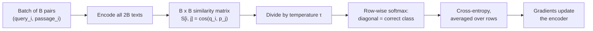

Almost every embedding model used for retrieval today was trained with **contrastive learning**: show the model a text and its correct partner alongside a set of wrong partners, and train it to score the correct one highest. The [Fine-tuning embeddings](/learn/embedding-optimisation/fine-tuning-embeddings) lesson used this objective as a tool. This lesson opens it up: where the loss comes from, what the temperature does, why in-batch negatives work, how the gradient decides which negatives matter, and how to tell from the geometry of the space whether training is doing the right thing. You will implement the loss from scratch and use it to train a tiny embedding model on AskMeridian queries.

## Learning objectives

- Explain the contrastive learning setup: anchors, positives, negatives and a similarity function.
- Write down the InfoNCE loss and compute it, and its gradient, by hand for a small example.
- Explain how the temperature changes which negatives receive the training signal.
- Compare pairwise contrastive loss, triplet loss and InfoNCE with in-batch negatives, and say when each is used.
- Implement InfoNCE in PyTorch, train a small encoder with it, and measure alignment and uniformity.

## Prerequisites

- [What are embeddings?](/learn/embedding-fundamentals/what-are-embeddings): the training objective decides what "close" means.
- [Cosine similarity](/learn/embedding-mathematics/cosine-similarity) and [Vector normalisation](/learn/embedding-mathematics/vector-normalisation).
- [Fine-tuning embeddings](/learn/embedding-optimisation/fine-tuning-embeddings): the practical training workflow this lesson explains from the inside.
- Comfort with the softmax function and logarithms. A little calculus helps with the gradient, but each step is spelt out.

## Why this matters

The loss function is the definition of "similar" that a model learns. If you understand it, a whole set of practical questions becomes answerable instead of folklore:

- Why bigger batches usually train better retrieval models.
- Why duplicates in a batch hurt, and why a passage that is actually relevant but labelled as a negative does so much damage.
- Why a "scale" of 20 appears in the Sentence Transformers loss, and what happens if you change it.
- Why easy negatives stop teaching the model anything, which is the motivation for [Hard negative mining](/learn/embedding-optimisation/hard-negative-mining).
- Why the cosine similarities a trained model produces cluster in a narrow range, which affects how you set thresholds.

Engineers who treat the loss as a black box tend to change hyperparameters at random when training disappoints. Engineers who understand it can read a loss curve, predict the effect of a change and diagnose a failed run.

## The intuition

Imagine teaching someone to match questions with answers using flashcards. You could show one question and one answer and ask, "Do these go together? Rate it from 0 to 10." That is hard to learn from: what counts as a 7?

A better exercise is a line-up. Show the question "PTO rollover" and five answer cards, one correct and four wrong, and ask the learner to point at the right one. Every round teaches two things at once: the correct card should look *more* like the question, and the wrong cards should look *less* like it. The learner never needs an absolute scale; they only need to rank the right card first.

Two refinements follow naturally. First, you do not need to print separate wrong cards: if you are practising five questions at once, each question's correct card is a wrong card for the other four. Second, a line-up of obviously unrelated cards ("PTO rollover" against "Meridian Reports exports to PDF") teaches nothing after the first few rounds. The learning comes from cards that are *almost* right ("Annual leave is 25 days a year"). Contrastive learning is this line-up game, played with vectors.

## How it works

### The setup

Contrastive learning needs four ingredients:

- An **anchor**: the text to be matched, typically a query.
- A **positive**: a text that should be close to the anchor, typically the passage that answers it.
- **Negatives**: texts that should be further from the anchor than the positive is.
- A **similarity function** $s(a, b)$: usually the cosine similarity of the two embeddings.

The encoder (the embedding model) produces vectors for all of them, and the loss rewards configurations where the anchor is more similar to the positive than to the negatives. Gradients flow back through the encoder, so it learns to produce such configurations for new texts too.

Where do positives come from? For retrieval: question and answer passage, title and body of an article, a search query and the page clicked, a post and its top-voted reply. For general sentence similarity: paraphrases, translations, or, in the unsupervised SimCSE method (Gao, Yao and Chen, 2021), the same sentence passed through the encoder twice with different random dropout, so that the only difference between the two views is noise.

### Three generations of loss

**Pairwise contrastive loss** (Hadsell, Chopra and LeCun, 2006) looks at one pair at a time with a label: pull the pair together if it is positive; push it apart, up to a margin, if it is negative. It needs a calibrated notion of absolute distance, which is the flashcard-rating problem.

**Triplet loss** (popularised for face recognition by Schroff, Kalenichenko and Philbin, 2015) looks at an anchor, a positive and one negative, and asks only that the positive be closer than the negative by at least a margin. It is relative, which is better, but each example contrasts against a single negative.

**InfoNCE** (van den Oord, Li and Vinyals, 2018) generalises the triplet to one positive against many negatives at once, framed as a classification: given the anchor, which of these $N$ candidates is the positive? It is a softmax over similarities followed by cross-entropy. This is the line-up game, and it is the loss behind modern retrieval embedders. In Sentence Transformers it is `MultipleNegativesRankingLoss`.

### In-batch negatives

Encoding negatives is expensive: every negative is a forward and backward pass through the encoder. The **in-batch negatives** trick, used for example in Dense Passage Retrieval (Karpukhin and colleagues, 2020) and in SimCLR for images (Chen and colleagues, 2020), reuses work already done. Take a batch of $B$ (anchor, positive) pairs and encode all of them. Build the $B \times B$ matrix of similarities between every anchor and every positive. Row $i$'s diagonal entry is its positive; the other $B - 1$ entries in the row are its negatives. One batch, $B$ classifications, $B(B-1)$ negatives, no extra encoding.



This explains two practical rules from the fine-tuning lesson. Larger batches mean more negatives per query and usually better retrieval models, which is why large-scale embedding training runs use batch sizes in the thousands and why memory-saving tricks such as GradCache exist. And duplicates are harmful: if passage $j$ is also a correct answer for query $i$, it is still treated as a negative in row $i$.

Some variants add the reverse direction (each passage must also pick out its own query among the batch's queries, a **symmetric** loss), or append explicitly mined hard negatives as extra columns of the matrix.

### The temperature

The similarities are divided by a **temperature** $\tau$ before the softmax. Cosine similarities lie between $-1$ and $1$, which is a narrow range for a softmax: even a perfect separation would leave substantial probability on the negatives. Dividing by a small $\tau$ (0.05 is common, equivalent to Sentence Transformers' default scale of 20) stretches the range so that the softmax can become confident.

The temperature also decides *which* negatives receive the training signal, as the mathematics below shows. With a high temperature, all negatives are pushed away by similar amounts, easy or hard. With a low temperature, almost all the push goes to the negatives that score closest to the positive. Low temperatures therefore make training concentrate on hard negatives, but too low a temperature makes training unstable and lets a single false negative dominate the gradient.

### Alignment and uniformity

Wang and Isola (2020) showed that contrastive losses with normalised embeddings optimise two properties:

- **Alignment**: positive pairs map to nearby points.
- **Uniformity**: embeddings spread out over the unit sphere, rather than collapsing into a small region.

Both are needed. Alignment alone is trivially satisfied by mapping everything to one point, which is useless for retrieval. Uniformity alone scatters texts randomly. The negatives in InfoNCE are what supply the uniformity pressure. Measuring both during training is a useful diagnostic: alignment should fall a lot; uniformity should not get worse.

### How modern embedding models are trained

Published recipes for general-purpose text embedders, such as E5 and BGE, describe a broadly similar two-stage pattern, although details differ by model:

1. **Weakly supervised contrastive pre-training** on very large collections of naturally occurring pairs (titles and bodies, questions and answers from the web), with in-batch negatives and very large batches.
2. **Supervised contrastive fine-tuning** on smaller, higher-quality labelled datasets (for example question-passage pairs from search datasets), often with mined hard negatives and sometimes with distillation from a cross-encoder.

Your own fine-tuning is a third stage on top of these, with the same loss.

The step-by-step mechanism of one training step with InfoNCE and in-batch negatives:

1. Sample a batch of $B$ (query, passage) pairs with no duplicate passages.
2. Encode the $B$ queries and $B$ passages; normalise each vector to unit length.
3. Compute the $B \times B$ matrix of dot products, which are cosine similarities.
4. Divide every entry by the temperature $\tau$.
5. For each row, apply a softmax and take $-\log$ of the diagonal entry's probability.
6. Average over rows to get the loss; back-propagate; update the encoder's weights.

## The mathematics

### InfoNCE

**Intuition.** Treat retrieval of the positive as a $B$-way classification. Turn similarities into probabilities with a softmax, and penalise the model by the negative log of the probability it gives the right answer.

$$
\mathcal{L} = -\frac{1}{B}\sum_{i=1}^{B} \log \frac{\exp\big(s(q_i, p_i)/\tau\big)}{\sum_{j=1}^{B} \exp\big(s(q_i, p_j)/\tau\big)}
$$

$B$ is the batch size; $q_i$ the $i$-th query; $p_i$ its positive passage; $p_j$ for $j \neq i$ the in-batch negatives for $q_i$; $s(\cdot,\cdot)$ the cosine similarity of the embeddings; $\tau > 0$ the temperature. The fraction is the softmax probability the model assigns to the correct passage. The loss is zero only when that probability is 1 for every query.

### Its gradient

**Intuition.** The loss pulls the positive up and pushes each negative down in proportion to how much probability the negative is stealing.

Write $p_{ij}$ for the softmax probability of passage $j$ in row $i$, and $y_{ij}$ for 1 if $j = i$ and 0 otherwise. For a single row, the derivative of that row's loss with respect to each similarity is:

$$
\frac{\partial \mathcal{L}_i}{\partial s(q_i, p_j)} = \frac{1}{\tau}\big(p_{ij} - y_{ij}\big)
$$

For the positive ($j = i$), $p_{ii} - 1$ is negative: gradient descent increases its similarity. For a negative, the push is proportional to $p_{ij}$: a negative the model already scores far below the positive has a tiny $p_{ij}$ and receives almost no signal. That single fact explains why easy negatives stop teaching and why hard negatives matter.

**By hand.** One query with three candidates: the positive (cosine 0.8), a hard negative (0.5) and an easy negative (0.2). Take $\tau = 0.1$.

- Scaled scores: $8, 5, 2$. Subtract the maximum for stability: $0, -3, -6$.
- Exponentials: $1$, $e^{-3} \approx 0.0498$, $e^{-6} \approx 0.0025$; sum $\approx 1.0523$.
- Probabilities: $0.9503, 0.0473, 0.0024$.
- Loss: $-\ln 0.9503 \approx 0.0509$.
- Gradients: positive $(0.9503 - 1)/0.1 \approx -0.497$; hard negative $0.0473/0.1 \approx 0.473$; easy negative $0.0024/0.1 \approx 0.024$.

The hard negative receives about twenty times the push of the easy one. Repeat with $\tau = 1$ and the probabilities become $0.437, 0.324, 0.240$: the two negatives are pushed almost equally (0.324 and 0.240) and the loss, 0.828, cannot get close to zero because cosines cannot spread far enough.

### Triplet loss, for comparison

$$
\mathcal{L}_{\text{triplet}} = \max\big(0,\; m - [s(a, p) - s(a, n)]\big)
$$

$a$, $p$ and $n$ are the anchor, positive and negative, and $m$ the margin. With $m = 0.5$: against the hard negative, $0.5 - (0.8 - 0.5) = 0.2$; against the easy negative, $0.5 - 0.6 < 0$, so the loss is 0. Triplet loss also ignores easy negatives, but abruptly, through the margin, and only one negative at a time.

```python
import numpy as np

s = np.array([0.8, 0.5, 0.2])        # cosine of the query with: positive, hard negative, easy negative
for tau in (1.0, 0.1, 0.05):
    z = s / tau
    p = np.exp(z - z.max()); p /= p.sum()        # softmax, computed stably
    loss = -np.log(p[0])
    grad = (p - np.array([1, 0, 0])) / tau       # dL/ds_j
    print(f"tau={tau:<5} probs={np.round(p, 4)}  loss={loss:.4f}  dL/ds={np.round(grad, 3)}")

# Triplet loss with a margin, on the same similarities
margin = 0.5
print("triplet loss vs hard negative:", round(max(0.0, margin - (s[0] - s[1])), 4))
print("triplet loss vs easy negative:", round(max(0.0, margin - (s[0] - s[2])), 4))
```

```output
tau=1.0   probs=[0.4368 0.3236 0.2397]  loss=0.8284  dL/ds=[-0.563  0.324  0.24 ]
tau=0.1   probs=[0.9503 0.0473 0.0024]  loss=0.0509  dL/ds=[-0.497  0.473  0.024]
tau=0.05  probs=[0.9975 0.0025 0.    ]  loss=0.0025  dL/ds=[-0.05   0.049  0.   ]
triplet loss vs hard negative: 0.2
triplet loss vs easy negative: 0.0
```

At $\tau = 0.05$ this example is already "solved": the loss is 0.0025 and the gradients are tiny. A margin of 0.3 in cosine is plenty at that temperature, so further training on this triple achieves little. The model learns from examples that are still confusing it.

Step through the same computation for $\tau = 0.1$:

```trace
{"title": "InfoNCE for one query, tau = 0.1", "code": ["s = [0.8, 0.5, 0.2]", "z = [x / 0.1 for x in s]", "z = [x - max(z) for x in z]", "e = [exp(x) for x in z]", "p = [x / sum(e) for x in e]", "loss = -log(p[0])", "grad = [(p[0] - 1) / 0.1, p[1] / 0.1, p[2] / 0.1]"], "steps": [{"line": 1, "vars": {"s": "[0.8, 0.5, 0.2]"}, "note": "Cosine similarities: positive first, then a hard and an easy negative."}, {"line": 2, "vars": {"z": "[8.0, 5.0, 2.0]"}, "note": "Dividing by the temperature stretches the gaps from 0.3 to 3."}, {"line": 3, "vars": {"z": "[0.0, -3.0, -6.0]"}, "note": "Subtracting the maximum changes nothing mathematically but prevents overflow in exp."}, {"line": 4, "vars": {"e": "[1.0, 0.0498, 0.0025]"}}, {"line": 5, "vars": {"p": "[0.9503, 0.0473, 0.0024]"}, "note": "The softmax: the positive gets 95% of the probability."}, {"line": 6, "vars": {"loss": "0.0509"}, "note": "Small, because the model already prefers the positive."}, {"line": 7, "vars": {"grad": "[-0.497, 0.473, 0.024]"}, "note": "Almost all the push goes to the hard negative; the easy one is nearly ignored."}]}
```

## In code

**The problem.** Implement InfoNCE with in-batch negatives yourself, use it to train a small embedding model from scratch on AskMeridian query-passage pairs, and watch retrieval quality, alignment and uniformity change.

**Dependencies.** PyTorch, scikit-learn and NumPy. No pre-trained model and no download.

```bash
pip install torch scikit-learn numpy
```

The "embedding model" is deliberately tiny so that it trains in seconds: each text becomes a 4,096-dimensional vector of hashed character 3- and 4-grams (no learning involved), and the model is a single learnt linear map to 64 dimensions followed by normalisation. Everything that matters about contrastive learning is present: an encoder with parameters, unit vectors, in-batch negatives, a temperature and a gradient step. The data are the `CORPUS`, `TRAIN` (54 shorthand queries, three per passage) and `TEST` (16 different held-out queries) lists from the code in [Fine-tuning embeddings](/learn/embedding-optimisation/fine-tuning-embeddings); save them as `askmeridian_data.py` next to this script.

```python
import numpy as np
import torch
import torch.nn.functional as F
from sklearn.feature_extraction.text import HashingVectorizer
from askmeridian_data import CORPUS, TRAIN, TEST   # the lists from "Fine-tuning embeddings"

torch.manual_seed(0)
ids = list(CORPUS)

# Input features: hashed character 3- and 4-grams, 4,096 dimensions, no learning involved.
hasher = HashingVectorizer(analyzer="char_wb", ngram_range=(3, 4), n_features=4096,
                           alternate_sign=False, norm="l2")
def features(texts):
    return torch.tensor(hasher.transform(texts).toarray(), dtype=torch.float32)

# The "embedding model": one linear map to 64 dimensions, then unit length.
W = (torch.randn(4096, 64) * 0.05).requires_grad_()
def embed(texts, W):
    return F.normalize(features(texts) @ W, dim=1)

def info_nce(q, p, tau):
    """Row i of p is the positive for row i of q; every other row is a negative."""
    logits = q @ p.T / tau                       # (B, B) scaled cosine similarities
    targets = torch.arange(len(q))               # the diagonal holds the positives
    return F.cross_entropy(logits, targets)      # mean of -log softmax(positive)

@torch.no_grad()
def mrr(W, pairs):
    order = torch.argsort(embed([q for q, _ in pairs], W) @ embed(list(CORPUS.values()), W).T,
                          dim=1, descending=True)
    return np.mean([1 / (row.tolist().index(ids.index(d)) + 1) for row, (_, d) in zip(order, pairs)])

@torch.no_grad()
def alignment_uniformity(W):
    q, p = embed([q for q, _ in TRAIN], W), embed([CORPUS[d] for _, d in TRAIN], W)
    align = (q - p).pow(2).sum(dim=1).mean().item()            # small = positives close
    x = embed(list(CORPUS.values()), W)
    sq = torch.cdist(x, x).pow(2)[~torch.eye(len(x), dtype=torch.bool)]
    uniform = torch.log(torch.exp(-2 * sq).mean()).item()      # lower = more spread out
    return align, uniform

def show(label):
    a, u = alignment_uniformity(W)
    print(f"{label:<14} train MRR {mrr(W, TRAIN):.2f}  held-out MRR {mrr(W, TEST):.2f}"
          f"  alignment {a:.2f}  uniformity {u:.2f}")

print(f"{'n-gram overlap':<14} train MRR {mrr(torch.eye(4096), TRAIN):.2f}  "
      f"held-out MRR {mrr(torch.eye(4096), TEST):.2f}")
show("random W")
optimizer = torch.optim.Adam([W], lr=1e-2)
for epoch in range(1, 31):
    for k in torch.randperm(3).tolist():
        batch = TRAIN[k::3]          # TRAIN has 3 queries per passage, in order, so this
                                     # batch holds one query for each of the 18 passages
        q = embed([x for x, _ in batch], W)
        p = embed([CORPUS[d] for _, d in batch], W)
        loss = info_nce(q, p, tau=0.05)
        optimizer.zero_grad(); loss.backward(); optimizer.step()
    if epoch in (1, 10, 30):
        print(f"epoch {epoch:>2}: last batch loss {loss.item():.3f}")
show("trained W")
```

```output
n-gram overlap train MRR 0.68  held-out MRR 0.66
random W       train MRR 0.50  held-out MRR 0.54  alignment 1.58  uniformity -3.66
epoch  1: last batch loss 1.404
epoch 10: last batch loss 0.007
epoch 30: last batch loss 0.001
trained W      train MRR 1.00  held-out MRR 0.91  alignment 0.49  uniformity -3.66
```

**The important lines.**

- `info_nce` is the whole loss in three lines. `q @ p.T` is the $B \times B$ similarity matrix (dot products of unit vectors are cosines); dividing by `tau` applies the temperature; `F.cross_entropy(logits, torch.arange(len(q)))` applies a softmax to each row and takes $-\log$ of the diagonal entry, then averages. This is exactly what `MultipleNegativesRankingLoss` computes, with its `scale=20` playing the role of $1/\tau$ for $\tau = 0.05$.
- `batch = TRAIN[k::3]` takes every third pair. Because `TRAIN` lists three queries per passage consecutively, each batch contains exactly one query for each of the 18 passages: no duplicate positives, so no false negatives. Each query is contrasted with 17 in-batch negatives.
- `F.normalize(..., dim=1)` puts embeddings on the unit sphere, so the similarity is a cosine and the temperature has a consistent meaning.
- `alignment_uniformity` implements Wang and Isola's two measures: alignment is the mean squared distance between positive pairs; uniformity is the log of the mean of $e^{-2\lVert x - y \rVert^2}$ over pairs of distinct passages.

**What the output means.**

- **Character overlap alone reaches MRR 0.66 on held-out queries.** Queries and passages share some n-grams ("laptop", "atlas", "token"), which is a lexical baseline. The randomly initialised linear map is worse (0.54) because a random projection scrambles that overlap.
- **Training raises held-out MRR to 0.91**, well above the lexical baseline. The model learnt, from 54 pairs, mappings that n-gram overlap cannot provide: that "PTO" goes with "leave", "MBP" with "laptop", "T&E" with "expenses". The held-out queries were never seen, but they reuse some shorthand from training.
- **Alignment fell from 1.58 to 0.49**: queries moved towards their passages. **Uniformity stayed at −3.66**: the passages did not collapse together while that happened. That is the healthy pattern.
- **The training loss fell to 0.001**, and training MRR reached 1.00. Both say the model can solve its training line-ups perfectly; only the held-out figure says it learnt something general. With 18 passages and 54 pairs, this is a demonstration of the mechanism, not a usable model.

**Common errors.** Forgetting to normalise (dot products then reward vector length, and the temperature loses its meaning); using a temperature of 1 with cosine similarities (the loss cannot fall far, as the maths showed); computing cross-entropy over the wrong dimension (columns instead of rows); and duplicate positives in a batch.

**Extending it.** Add a symmetric term, `(info_nce(q, p, tau) + info_nce(p, q, tau)) / 2`; try `tau` of 0.02, 0.1 and 0.5 and compare held-out MRR and the loss curve; or append a hard negative for each query as extra columns of the logits, which is the next lesson's subject.

## A real-world example

Meridian's Platform team fine-tunes AskMeridian's model on 4,000 logged pairs. The first run uses batch size 8 because the training machine has a small GPU, and the improvement on the development set is disappointing. An engineer reads the loss as described here: with $B = 8$, each query sees only 7 negatives, nearly all of them easy (a leave question against VPN, expenses and Atlas passages). The softmax quickly gives the positive almost all the probability, so the gradient vanishes after the first epoch.

They switch to `CachedMultipleNegativesRankingLoss` with an effective batch of 256 and a mini-batch of 16 to fit memory. Each query now sees 255 negatives, including, by chance, some from the same policy area. The development score improves further and keeps improving for longer. A second engineer suggests lowering the temperature to 0.01 to "focus on hard negatives"; the development score drops, and inspection shows why: a few logged pairs were mislabelled, and at such a low temperature the wrongly labelled "negatives" dominate their rows' gradients. They return to the default scale of 20 and clean the data instead.

Finally, they track alignment and uniformity on the development set at every epoch. In one experiment with a much higher learning rate, alignment drops sharply while uniformity worsens (rises towards zero): the embeddings are bunching together. That run is abandoned before anyone looks at retrieval metrics.

## Common mistakes

- **Treating the batch size as only a speed setting.** In InfoNCE with in-batch negatives it sets the number of negatives, and therefore what the model learns.
- **Leaving duplicate or near-duplicate positives in a batch.** The correct passage becomes a negative, producing contradictory gradients.
- **Setting the temperature by guesswork.** Too high and the loss cannot separate positives; too low and training becomes unstable and label noise dominates.
- **Skipping normalisation.** Without unit vectors the model can reduce the loss by changing vector lengths rather than directions.
- **Reading the training loss as quality.** A loss near zero means the training line-ups are solved, not that new queries will be.
- **Ignoring false negatives in the data.** Every unlabelled relevant passage in a batch actively pushes the model the wrong way.

## Best practices

- Use InfoNCE with in-batch negatives (MNRL) as the default for query-passage data.
- Make batches as large as memory allows; use a cached loss to go further.
- Prevent duplicate positives within a batch.
- Start from the standard temperature (scale 20, $\tau = 0.05$) and change it only with evidence from a development set.
- Track alignment and uniformity, or at least the spread of similarities, alongside retrieval metrics.
- Add hard negatives once easy in-batch negatives stop providing signal.

## Performance considerations

Per step, encoding cost is linear in $B$ (the $2B$ texts dominate), while the similarity matrix costs $B^2 d$ multiply-adds: for $B = 256$ and $d = 384$, about 25 million, negligible next to running a transformer on 512 texts. Memory is the constraint: activations for all $2B$ texts must be kept for the backward pass. GradCache-style caching computes embeddings without storing activations, computes the loss and the gradient with respect to each embedding, then re-encodes each mini-batch with activations to back-propagate, roughly doubling compute to remove the dependence of memory on $B$.

In multi-GPU training, negatives can be gathered across devices so that each query sees the whole global batch; Sentence Transformers exposes this as an option on its losses in recent versions.

## Summary

- Contrastive learning trains an encoder by making each anchor more similar to its positive than to its negatives; for retrieval, anchor and positive are a query and its passage.
- InfoNCE is a softmax classification over one positive and many negatives; with in-batch negatives, a batch of $B$ pairs gives each query $B - 1$ negatives for free.
- The gradient pushes each negative in proportion to the probability it steals, so easy negatives stop teaching and hard negatives drive learning.
- The temperature stretches the cosine range and sets how strongly training focuses on the hardest negatives; 0.05 (scale 20) is the common default.
- Good training improves alignment without destroying uniformity; duplicates and false negatives in batches actively harm it.

## Exercises

**1.** A query has cosine similarities 0.7 (positive), 0.65 and 0.1 (negatives). Compute the InfoNCE loss with $\tau = 0.05$ by hand, and say which negative gets most of the gradient.

<details><summary>Show solution</summary>

Scaled scores: 14, 13, 2. Subtract 14: $0, -1, -12$. Exponentials: $1, 0.3679, 0.0000061$; sum $\approx 1.3679$. Probabilities: $0.7311, 0.2689, 0.0000045$. Loss: $-\ln 0.7311 \approx 0.3132$. Gradients: the 0.65 negative gets $0.2689/0.05 \approx 5.38$; the 0.1 negative gets about $0.00009$. Essentially all the signal goes to the near-miss.

</details>

**2.** In a batch of 64 pairs, what fraction of the similarity matrix entries are negatives? If two pairs in the batch share the same positive passage, how many entries are wrongly treated as negatives?

<details><summary>Show solution</summary>

The matrix has $64^2 = 4{,}096$ entries, of which 64 are positives on the diagonal, so $4{,}032/4{,}096 \approx 98.4\%$ are negatives. If queries $i$ and $k$ share a passage, entry $(i, k)$ is passage $k$'s copy of the right answer for query $i$, and entry $(k, i)$ likewise: 2 entries are false negatives.

</details>

**3.** Add the symmetric loss to the code example and train again. Compare held-out MRR and alignment with the one-directional run. Why might a symmetric loss help retrieval?

<details><summary>Show solution</summary>

Replace `loss = info_nce(q, p, tau=0.05)` with:

```python
loss = (info_nce(q, p, tau=0.05) + info_nce(p, q, tau=0.05)) / 2
```

The final line then reads:

```output
trained W      train MRR 1.00  held-out MRR 0.85  alignment 0.53  uniformity -3.73
```

Held-out MRR is 0.85 against 0.91, alignment slightly worse and uniformity slightly better (more spread out). The second term asks each passage to pick out its own query among the batch's queries, which adds a second set of negatives (other queries) and pushes passages apart more strongly. On 16 held-out queries a difference of 0.06 is one or two queries, well within noise, so this run neither supports nor rules out the symmetric loss; judge it on a larger development set. Symmetric losses are commonly used when both directions matter (for example matching in either direction) and can regularise training; whether they help retrieval for your data is an empirical question.

</details>

## Check your understanding

```quiz
[
  {
    "q": "In InfoNCE with in-batch negatives and batch size B, how many negatives does each query see?",
    "options": [
      "1",
      "B",
      "B - 1",
      "B squared"
    ],
    "answer": 2,
    "why": "Each row of the B by B similarity matrix has one positive on the diagonal and B - 1 other passages, which serve as negatives."
  },
  {
    "q": "According to the InfoNCE gradient, which negative receives the strongest push away from the query?",
    "options": [
      "The one with the highest softmax probability, that is, the most similar negative",
      "All negatives receive the same push",
      "The least similar negative",
      "A random negative"
    ],
    "answer": 0,
    "why": "The gradient for negative j is p_ij / tau, so negatives that steal more probability, the hard ones, get pushed hardest."
  },
  {
    "q": "Sentence Transformers' MultipleNegativesRankingLoss uses scale = 20 by default. What temperature does this correspond to?",
    "options": [
      "20",
      "0.5",
      "2.0",
      "0.05"
    ],
    "answer": 3,
    "why": "The scale multiplies similarities, which is the same as dividing by a temperature of 1/20 = 0.05."
  },
  {
    "q": "During training, alignment falls steadily but uniformity rises towards zero. What is most likely happening?",
    "options": [
      "Training is working perfectly",
      "Embeddings are bunching together: positives get closer partly because everything is getting closer",
      "The temperature is too low",
      "The batch has no positives"
    ],
    "answer": 1,
    "why": "Uniformity near zero means pairwise distances are small. Good contrastive training improves alignment while keeping embeddings spread out."
  },
  {
    "q": "Why does a temperature of 1 work poorly with cosine similarities?",
    "options": [
      "Cosines then become negative",
      "The softmax becomes undefined",
      "Cosines lie in [-1, 1], so the softmax cannot become confident and even a well-separated positive leaves a large loss",
      "It makes training too fast"
    ],
    "answer": 2,
    "why": "With a narrow input range, softmax probabilities stay spread out. Dividing by a small temperature stretches the range."
  }
]
```

## Further reading

- van den Oord, Li and Vinyals (2018), "Representation Learning with Contrastive Predictive Coding" (InfoNCE), [arXiv:1807.03748](https://arxiv.org/abs/1807.03748).
- Wang and Isola (2020), "Understanding Contrastive Representation Learning through Alignment and Uniformity on the Hypersphere", [arXiv:2005.10242](https://arxiv.org/abs/2005.10242).
- Chen, Kornblith, Norouzi and Hinton (2020), "A Simple Framework for Contrastive Learning of Visual Representations" (SimCLR), [arXiv:2002.05709](https://arxiv.org/abs/2002.05709).
- Gao, Yao and Chen (2021), "SimCSE: Simple Contrastive Learning of Sentence Embeddings", [arXiv:2104.08821](https://arxiv.org/abs/2104.08821).
- Karpukhin et al. (2020), "Dense Passage Retrieval for Open-Domain Question Answering", [arXiv:2004.04906](https://arxiv.org/abs/2004.04906).
- Wang and Liu (2021), "Understanding the Behaviour of Contrastive Loss", CVPR 2021: on temperature and hardness-awareness.
