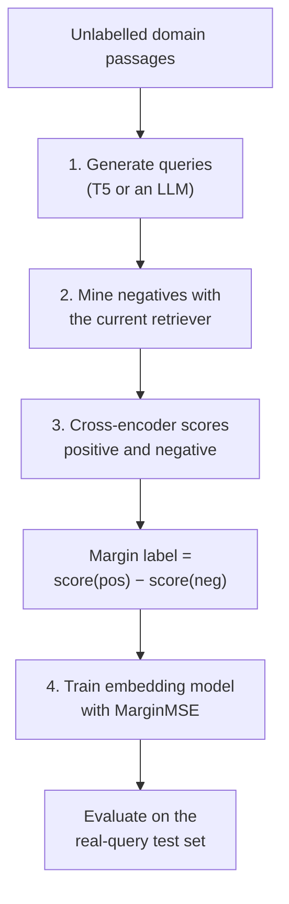

A general-purpose embedding model has learnt what words mean from public text: web pages, forums, encyclopaedias, question-answer sites. Your organisation speaks a dialect of its own. At Meridian, people write "WFH" and "PTO", refer to "Atlas" and "Relay" as if everyone knew what they were, and paste error codes such as E-4021. **Domain adaptation** is the family of techniques that close the gap between the language a model learnt and the language of your corpus and users. This lesson shows how to diagnose that gap, walks up a ladder of fixes from the cheapest (a glossary) to the most involved (training on synthetic queries), and explains the method that made unsupervised adaptation of retrievers practical, Generative Pseudo Labeling.

Supervised fine-tuning on labelled pairs is the subject of the [next lesson](/learn/embedding-optimisation/fine-tuning-embeddings). This lesson is about what to do *before* you have labelled data, and how to decide whether you need training at all.

## Learning objectives

- Distinguish vocabulary shift, meaning shift and query-style shift, and give a Meridian example of each.
- Diagnose domain shift with a paired plain-versus-jargon evaluation and by inspecting how the tokeniser splits domain terms.
- Order the adaptation options by cost and data needed, and choose the cheapest one that closes a measured gap.
- Explain the four steps of Generative Pseudo Labeling (GPL) and the role of the cross-encoder teacher.
- Compute a MarginMSE loss by hand and generate synthetic queries for a corpus with an LLM.

## Prerequisites

- [Embedding evaluation](/learn/embedding-optimisation/embedding-evaluation): per-slice evaluation and paired comparison, which this lesson uses to measure every fix.
- [Domain-specific embeddings](/learn/embedding-models/domain-specific-embeddings): models pre-trained for fields such as law, medicine or code.
- [Tokens and tokenisation](/learn/understanding-large-language-models/tokens-and-tokenisation): how text is split into subword pieces.
- [Dense versus sparse retrieval](/learn/hybrid-search/dense-versus-sparse-retrieval): why lexical and dense matching fail on different queries.

## Why this matters

On public benchmarks, modern embedding models look excellent. On an organisation's internal documents they often degrade, and the degradation concentrates in exactly the queries that matter most to that organisation: the ones that use its products, its error codes and its slang. A model that has never seen "Atlas" cannot know it is Meridian's platform rather than a book of maps; a model that has never seen "E-4021" sees four arbitrary subword pieces.

Without a deliberate approach, teams either tell users to "phrase questions in full", or jump straight to fine-tuning and find weeks later that a glossary or a lexical index would have fixed most of the problem in a day. Domain adaptation done well is a sequence of measured steps, each justified by the gap that remains after the previous one.

## The intuition

A capable graduate joins Meridian. On their first day a colleague asks, "What's the WFH kit budget?" and they are stuck: not because they cannot reason, but because they do not know the words.

Three ways to help, in increasing cost:

1. **Hand them a glossary.** "WFH means working from home; kit means equipment." Immediately useful, but only for terms someone wrote down.
2. **Let them read the handbook and runbooks for a week.** Without anyone testing them, they absorb how Meridian writes: that "Atlas" is followed by "token", "project" and "CLI", that "Sync" is a product. This is learning from unlabelled text.
3. **Have them practise.** For each page they read, write the questions a colleague might ask about it, then check their answers against an expert. They learn both the vocabulary and which page answers which kind of question.

These are the three main rungs of domain adaptation: query-side vocabulary fixes, unsupervised learning from domain text, and training on synthetic question-passage pairs labelled by a stronger model.

## How it works

### Three kinds of domain shift

**Domain shift** is any systematic difference between the data a model was trained on and the data it is used on. For retrieval it takes three forms:

| Kind | What changes | Meridian example |
| --- | --- | --- |
| Vocabulary shift | Words the model rarely or never saw | "WFH", "PTO", "E-4021", "AskMeridian" |
| Meaning shift | Familiar words used with an organisation-specific sense | "Atlas" (a platform, not a map book), "Sync" and "Relay" (products), "kit" (equipment) |
| Query-style shift | How questions are phrased relative to training queries | Fragments such as "4021 again" or "nicked MBP, who do I tell" |

Vocabulary shift shows up in the tokeniser, as unfamiliar terms broken into many short pieces. Meaning shift shows up only in retrieval errors. Query-style shift shows up as a gap between well-formed and terse versions of a question.

### Diagnosing the gap

Two diagnostics are cheap and informative.

**A paired plain-versus-domain evaluation.** Write each information need twice: once in plain English using the documents' own vocabulary, once the way staff actually type it. Same relevant chunk, two phrasings. If the model handles the plain version well and the domain version badly, you have isolated domain shift from other causes (bad chunking, missing documents). This builds directly on the slice-based evaluation of the [previous lesson](/learn/embedding-optimisation/embedding-evaluation).

**Tokeniser inspection.** Tokenise your domain's important terms. A term split into many pieces, especially single letters, has no stored meaning; the model must assemble one from fragments, which works for compositional words and fails for acronyms and codes.

### The adaptation ladder

Climb only as high as the measured gap requires. Each rung costs more and needs more data than the one below.

| Rung | Technique | Data needed | Changes the model? |
| --- | --- | --- | --- |
| 0 | Use the model as documented (prefixes, length limits) | None | No |
| 1 | Query-side vocabulary: glossary expansion or LLM query rewriting | A glossary, or an LLM | No |
| 2 | Add a lexical index and fuse rankings ([hybrid search](/learn/hybrid-search/hybrid-retrieval-architecture)) | None | No |
| 3 | Switch to a model pre-trained on a similar domain | None, but a new bake-off | Replaces it |
| 4 | Unsupervised adaptation on domain text (TSDAE, continued pre-training) | Unlabelled domain text | Yes |
| 5 | Synthetic supervision: generated queries labelled by a teacher (GPL) | Unlabelled domain text, an LLM, a cross-encoder | Yes |
| 6 | Supervised fine-tuning on real labelled pairs ([next lesson](/learn/embedding-optimisation/fine-tuning-embeddings)) | Hundreds to thousands of real pairs | Yes |

Rungs 0 to 2 leave the embedding model untouched. Rungs 3 to 6 change the vectors, so every chunk must be re-embedded under a new [embedding contract](/learn/embedding-fundamentals/what-are-embeddings).

**Rung 1: query-side vocabulary.** A **glossary expansion** appends the documents' words for any shorthand in the query: "WFH kit budget" becomes "WFH kit budget (work from home remotely; equipment)". It is transparent and testable, but only knows the terms someone wrote down. LLM-based [query rewriting](/learn/advanced-retrieval/query-rewriting) generalises the idea at the cost of a model call per query.

**Rung 4: unsupervised adaptation.** **Continued pre-training** continues the masked-language-model objective (predicting hidden words) on your corpus; Gururangan and colleagues (2020) showed its value for language models. For an embedding model it is not a drop-in step: the sentence-embedding ability normally has to be restored with further contrastive training afterwards. **TSDAE** (Transformer-based Sequential Denoising Auto-Encoder; Wang, Reimers and Gurevych, 2021) trains the encoder to produce a sentence vector from which a small decoder can reconstruct the sentence after many of its words were deleted. It needs only sentences from your domain, and the result is a sentence encoder directly. Used alone, unsupervised methods usually trail models trained on question-passage pairs for retrieval; they are most useful as a first stage before supervised or synthetic training.

### Generative Pseudo Labeling

**Generative Pseudo Labeling (GPL)**, introduced by Wang, Thakur, Reimers and Gurevych (2022), adapts a dense retriever to a new domain using only unlabelled passages from that domain. It manufactures training data in four steps:

1. **Generate queries.** For each passage in the corpus, a generator model writes a few queries that the passage answers. The original paper used a T5 model trained for this task; a modern LLM can do the same job.
2. **Mine negatives.** For each generated query, retrieve the top passages with an existing dense retriever and sample some that are not the source passage. These are **negatives**: passages the model currently confuses with the right one. ([Hard negative mining](/learn/embedding-optimisation/hard-negative-mining) covers this step in depth.)
3. **Pseudo-label with a teacher.** A **cross-encoder**, a model that reads query and passage together and outputs a relevance score (see [Cross-encoders](/learn/reranking-fundamentals/cross-encoders)), scores both the positive and the negative. The label is the **margin** between the two scores.
4. **Train the student.** The embedding model (the student) is trained so that the difference between its own two similarity scores matches the teacher's margin. This loss is **MarginMSE**.



Why a margin rather than a hard "positive versus negative" label? Generated data is noisy. A mined "negative" is sometimes relevant too, a **false negative**: two runbooks may both answer "Atlas says my token is bad". A hard label pushes them apart anyway; the cross-encoder gives the pair a small or negative margin, so MarginMSE asks the student to score them similarly. Soft labels absorb noise that hard labels amplify.

The teacher must itself be reasonably good on the domain. Cross-encoders tend to generalise better than bi-encoders because they read query and passage together, but they are not immune to jargon; spot-check the margins on a few dozen domain triples first.

### Synthetic queries with an LLM

Step 1 of GPL now often uses an instruction-following LLM. InPars (Bonifacio and colleagues, 2022) and Promptagator (Dai and colleagues, 2022) showed that LLM-generated queries can train effective retrievers. Practical points:

- **Ask for the users' register and for variety.** Request short, informal queries that avoid the passage's wording (a direct question, a situation, a terse fragment), with a few real queries as examples. Otherwise every query reads like "What is the annual leave entitlement?", which teaches nothing about vocabulary mismatch.
- **Filter.** Discard a generated query if the teacher scores its source passage low, or if its source passage is not in the teacher's top few among retrieved candidates. This **consistency filtering** removes queries the passage does not actually answer.
- **Keep generated queries out of the test set.** Evaluate on real queries.

### Choosing a rung

1. Build the paired plain-versus-domain evaluation and measure the gap.
2. If the gap is concentrated in shorthand terms, apply a glossary and re-measure.
3. If what remains is identifiers and codes, add lexical retrieval.
4. If a broad gap remains on ordinary-looking domain language (meaning shift), consider a domain model or training: GPL while you have only unlabelled text, supervised fine-tuning once real pairs accumulate.

## The mathematics

### MarginMSE

**Intuition.** Rather than telling the student "this passage is right, that one is wrong", tell it *how much* better the right one is, according to a stronger model, and ask it to reproduce that gap.

$$
\mathcal{L}_{\text{MarginMSE}} = \frac{1}{B}\sum_{i=1}^{B}\Big(\big[s(q_i, p_i^{+}) - s(q_i, p_i^{-})\big] - \big[t(q_i, p_i^{+}) - t(q_i, p_i^{-})\big]\Big)^2
$$

$B$ is the number of training triples in a batch; $q_i$ is a generated query, $p_i^{+}$ the passage it was generated from and $p_i^{-}$ a mined negative; $s(\cdot,\cdot)$ is the student's similarity score (in GPL, a dot product of embeddings); $t(\cdot,\cdot)$ is the teacher cross-encoder's score. The bracketed terms are the student's and the teacher's **margins**. The loss is the mean squared difference between them, so it is zero when the student's margins equal the teacher's.

Because the student must match margins on the teacher's scale, an unnormalised dot product suits it better than cosine similarity, which can differ by at most 2 between two passages. This is one reason the GPL setup uses dot-product scoring.

**By hand.** Two triples. The teacher's scores come from the code below.

- Triple 1 (E-4021 query): student scores 21.0 and 18.0, margin 3.0. Teacher scores 6.71 and 6.36, margin 0.35. Squared error $(3.0 - 0.35)^2 = 2.65^2 = 7.0225$.
- Triple 2 (carry-over query): student scores 24.0 and 19.0, margin 5.0. Teacher scores 8.62 and 0.98, margin 7.64. Squared error $(5.0 - 7.64)^2 = (-2.64)^2 = 6.9696$.
- Loss: $(7.0225 + 6.9696)/2 = 6.99605 \approx 6.996$.

The gradient pushes triple 1's student margin *down* (the teacher thinks the two error codes are closer than the student does) and triple 2's *up*. A hard-label loss would have pushed both up.

```python
import numpy as np

student_pos = np.array([21.0, 24.0]); student_neg = np.array([18.0, 19.0])   # dot products
teacher_pos = np.array([6.71, 8.62]); teacher_neg = np.array([6.36, 0.98])   # cross-encoder logits
student_margin = student_pos - student_neg
teacher_margin = teacher_pos - teacher_neg
loss = np.mean((student_margin - teacher_margin) ** 2)
print("student margins:", student_margin, " teacher margins:", teacher_margin.round(2))
print(f"MarginMSE loss: {loss:.4f}")
```

```output
student margins: [3. 5.]  teacher margins: [0.35 7.64]
MarginMSE loss: 6.9960
```

## In code

### Part 1: diagnose the gap and climb the first rungs

**The problem.** Measure how much worse AskMeridian's embedding model does when staff use Meridian shorthand, see why, and test whether a glossary and a lexical index close the gap.

**Dependencies.** `sentence-transformers`, `rank-bm25` and NumPy; no API key.

```bash
pip install sentence-transformers rank-bm25 numpy
```

Ten information needs are each written twice: in plain English, and in the shorthand staff actually use. The relevant chunk is the same for both, so any drop in quality is caused by the phrasing alone.

```python
import re
import numpy as np
from rank_bm25 import BM25Okapi
from sentence_transformers import SentenceTransformer

CORPUS = {
    "leave":     "Annual leave is 25 days a year.",
    "carryover": "Up to 5 unused leave days carry over and must be used by 31 March.",
    "remote":    "Staff may work remotely up to 3 days a week.",
    "equipment": "Employees get a £400 home-office equipment budget. Contractors are not eligible.",
    "expenses":  "Expenses must be submitted within 30 days.",
    "receipts":  "Any expense over £75 needs a receipt.",
    "password":  "Passwords must be rotated every 90 days.",
    "vpn":       "Use the VPN whenever you connect from public Wi-Fi.",
    "laptop":    "Laptops are refreshed every 3 years.",
    "lost":      "Report a lost or stolen laptop to the support desk at once.",
    "support":   "The support desk is open 08:00 to 18:00 UK time.",
    "e4021":     "Atlas error E-4021: the VPN client is out of date. Update it from the IT portal.",
    "e4030":     "Atlas error E-4030: your user lacks permission for this operation.",
    "e4031":     "Atlas error E-4031: the token does not grant access to this project.",
    "e4040":     "Atlas error E-4040: the requested Atlas resource does not exist or was deleted.",
    "export":    "Meridian Reports exports to PDF and CSV.",
    "sso":       "SAML single sign-on is available on the Enterprise plan of Meridian Reports.",
    "sync":      "Meridian Sync keeps project files in step across devices.",
}
# The same needs, asked two ways: plain English, and Meridian's internal shorthand.
PAIRS = [  # (plain query, jargon query, relevant id)
    ("How often can I work from home?",          "WFH allowance per week?",          "remote"),
    ("How much annual holiday do I get?",        "PTO entitlement",                  "leave"),
    ("Can unused holiday roll into next year?",  "PTO rollover rules",               "carryover"),
    ("Is there money for home office furniture?","WFH kit budget",                   "equipment"),
    ("When must I change my password?",          "pw rotation cadence",              "password"),
    ("How long do I have to claim expenses?",    "T&E submission window",            "expenses"),
    ("Can I log in to Reports with our company login?", "Okta for Reports?",         "sso"),
    ("My VPN client says it is out of date",         "4021 again",                       "e4021"),
    ("Atlas says I lack permission",             "getting a 4030",                   "e4030"),
    ("My laptop was stolen, what do I do?",      "nicked MBP, who do I tell",        "lost"),
]
# A glossary maintained by the HR and IT teams: shorthand -> words the documents use.
GLOSSARY = {
    "wfh": "work from home remotely", "pto": "annual leave holiday",
    "kit": "equipment", "pw": "password", "t&e": "travel and expenses",
    "okta": "single sign-on SSO", "mbp": "laptop", "nicked": "stolen",
    "4021": "E-4021", "4030": "E-4030",
}

def expand(query):
    words = re.findall(r"[a-z0-9&]+", query.lower())
    extra = [GLOSSARY[w] for w in words if w in GLOSSARY]
    return query + (" (" + "; ".join(extra) + ")" if extra else "")

model = SentenceTransformer("sentence-transformers/all-MiniLM-L6-v2")
ids, texts = list(CORPUS), list(CORPUS.values())
D = model.encode(texts, normalize_embeddings=True)
tok = lambda s: re.findall(r"[a-z0-9&-]+", s.lower())
bm25 = BM25Okapi([tok(t) for t in texts])

def ranks_dense(queries):
    Q = model.encode(queries, normalize_embeddings=True)
    return np.argsort(-(Q @ D.T), axis=1)

def ranks_hybrid(queries, k=60):
    """Reciprocal rank fusion of the dense and BM25 rankings."""
    out = []
    for q, drow in zip(queries, ranks_dense(queries)):
        brow = np.argsort(-bm25.get_scores(tok(q)))
        rrf = np.zeros(len(ids))
        for r, j in enumerate(drow): rrf[j] += 1 / (k + r + 1)
        for r, j in enumerate(brow): rrf[j] += 1 / (k + r + 1)
        out.append(np.argsort(-rrf))
    return np.array(out)

def mrr(order, gold):
    return np.mean([1 / (list(row).index(ids.index(g)) + 1) for row, g in zip(order, gold)])

gold = [g for _, _, g in PAIRS]
plain = [p for p, _, _ in PAIRS]
jargon = [j for _, j, _ in PAIRS]
print("Tokenisation of domain terms by the model's WordPiece vocabulary:")
for term in ["holiday", "E-4021", "AskMeridian", "WFH", "Okta", "MBP"]:
    print(f"  {term:<12} -> {model.tokenizer.tokenize(term)}")
print()
print(f"{'condition':<34}{'MRR':>6}")
print(f"{'plain English, dense':<34}{mrr(ranks_dense(plain), gold):>6.2f}")
print(f"{'jargon, dense':<34}{mrr(ranks_dense(jargon), gold):>6.2f}")
print(f"{'jargon + glossary, dense':<34}{mrr(ranks_dense([expand(q) for q in jargon]), gold):>6.2f}")
print(f"{'jargon + glossary, hybrid (RRF)':<34}{mrr(ranks_hybrid([expand(q) for q in jargon]), gold):>6.2f}")
print("\nexample expansion:", expand("nicked MBP, who do I tell"))
for name, order in [("dense", ranks_dense([expand(q) for q in jargon])),
                    ("hybrid", ranks_hybrid([expand(q) for q in jargon]))]:
    for q, row, g in zip(jargon, order, gold):
        if ids[row[0]] != g:
            print(name, "miss:", q, "->", ids[row[0]])
```

```output
Tokenisation of domain terms by the model's WordPiece vocabulary:
  holiday      -> ['holiday']
  E-4021       -> ['e', '-', '402', '##1']
  AskMeridian  -> ['ask', '##mer', '##idia', '##n']
  WFH          -> ['w', '##f', '##h']
  Okta         -> ['ok', '##ta']
  MBP          -> ['mb', '##p']

condition                            MRR
plain English, dense                1.00
jargon, dense                       0.80
jargon + glossary, dense            0.90
jargon + glossary, hybrid (RRF)     0.85

example expansion: nicked MBP, who do I tell (stolen; laptop)
dense miss: PTO rollover rules -> leave
dense miss: getting a 4030 -> e4031
hybrid miss: PTO rollover rules -> leave
hybrid miss: WFH kit budget -> remote
hybrid miss: pw rotation cadence -> e4030
```

**The important lines.**

- `PAIRS` is the paired diagnostic: each need appears in both phrasings with the same gold chunk.
- `model.tokenizer.tokenize(term)` shows the WordPiece pieces. In WordPiece, `##` marks a piece that continues the previous one. "holiday" is a single known token; "WFH" becomes three letters; "E-4021" becomes `e`, `-`, `402`, `##1`. The model has no learnt meaning for "WFH", only for its letters.
- `expand` appends glossary text rather than replacing the query, so the original words still count. It lower-cases and splits on non-word characters so that "MBP," with a trailing comma still matches.
- `ranks_hybrid` fuses the dense and BM25 rankings with **reciprocal rank fusion** (each chunk scores $\sum 1/(k + \text{rank})$ across the two lists, with the conventional $k = 60$); the [Reciprocal rank fusion](/learn/hybrid-search/reciprocal-rank-fusion) lesson explains it.

**What the output means.**

- **The gap is caused by phrasing.** The same ten needs score MRR 1.00 in plain English and 0.80 in shorthand.
- **The tokeniser explains part of it.** Acronyms and codes are shattered into letters and digit fragments; where the documents spell a term out ("work remotely" for WFH), the model has nothing to connect.
- **The glossary recovers half the gap at almost no cost.** Two misses remain. "getting a 4030" ranks E-4031 first even after expansion: dense vectors for two error chunks that differ by a digit are nearly the same. "PTO rollover rules" ranks the leave allowance above the carry-over rule, a meaning-level confusion ("rollover" is not a word the documents use).
- **Hybrid fixes one miss and introduces two.** BM25 rescues the exact code, but it adds noise to "WFH kit budget" and to "pw rotation cadence". The second is instructive: the glossary expands "pw" to "password", but the corpus says "Passwords" and this BM25 has no stemming, so every chunk scores zero and BM25's ranking is just tie-breaking order. Rank fusion adds that arbitrary ranking to the dense one and, here, lets E-4030 edge past the right chunk by a hair. Overall hybrid MRR falls from 0.90 to 0.85. Ten queries cannot show whether hybrid helps on balance, and the result is a warning that a lexical index needs the same normalisation (stemming, for instance) as the queries; a larger identifier slice would settle it.
- **What is left is meaning shift**, which glossaries and lexical indexes do not address. That residue, measured on a proper evaluation set, is the case for rungs 4 to 6.

### Part 2: synthetic queries with an LLM (not executed)

GPL's first step, with Claude as the generator. This code needs an `ANTHROPIC_API_KEY` and was **not executed** for this lesson; the output shown is illustrative.

```python
import anthropic
from pydantic import BaseModel

class GeneratedQueries(BaseModel):
    queries: list[str]

client = anthropic.Anthropic()  # reads ANTHROPIC_API_KEY from the environment

INSTRUCTIONS = (
    "You write search queries that Meridian staff would type into an internal assistant. "
    "Given one passage, write three queries the passage answers: one direct question, "
    "one describing a situation, and one terse fragment of two to five words. "
    "Avoid copying the passage's wording; use the informal words staff use. "
    "Examples of real staff queries: 'WFH kit budget', 'nicked MBP, who do I tell', '4021 again'."
)

def generate_queries(passage: str) -> list[str]:
    response = client.messages.parse(
        model="claude-opus-5-5",
        max_tokens=1024,
        system=INSTRUCTIONS,
        messages=[{"role": "user", "content": f"<passage>\n{passage}\n</passage>"}],
        output_format=GeneratedQueries,
    )
    return response.parsed_output.queries

print(generate_queries(CORPUS["carryover"]))
```

Illustrative output (yours will differ):

```text
['Can I take leftover holiday into next year?', "It's December and I've got 7 days left, do I lose them?", 'PTO rollover limit']
```

### Part 3: pseudo-labels from a cross-encoder

GPL's third step runs locally. Here the generated queries are written by hand so that the example runs without an API key; in a real pipeline they come from Part 2, and the negatives come from the current retriever.

```python
from sentence_transformers import CrossEncoder

teacher = CrossEncoder("cross-encoder/ms-marco-MiniLM-L-6-v2")
# (generated query, the chunk it was generated from, a mined negative)
triples = [
    ("what does atlas error E-4021 mean",
     "Atlas error E-4021: the VPN client is out of date. Update it from the IT portal.",
     "Atlas error E-4031: the token does not grant access to this project."),
    ("how many unused leave days can be carried over",
     "Up to 5 unused leave days carry over and must be used by 31 March.",
     "Annual leave is 25 days a year."),
    ("is there a budget for home office equipment",
     "Employees get a £400 home-office equipment budget. Contractors are not eligible.",
     "Staff may work remotely up to 3 days a week."),
]
pos = teacher.predict([(q, p) for q, p, _ in triples])
neg = teacher.predict([(q, n) for q, _, n in triples])
for (q, _, _), sp, sn in zip(triples, pos, neg):
    print(f"{q[:46]:<47} pos={sp:6.2f} neg={sn:6.2f} margin={sp - sn:6.2f}")
```

```output
what does atlas error E-4021 mean               pos=  6.71 neg=  6.36 margin=  0.35
how many unused leave days can be carried over  pos=  8.62 neg=  0.98 margin=  7.64
is there a budget for home office equipment     pos=  8.17 neg=-11.36 margin= 19.53
```

The scores are raw logits, not probabilities. The margins are the labels: large for an easy negative, small for a hard one (two Atlas error chunks sharing "Atlas error" and the same sentence shape). The small E-4021 margin is also a warning that this general-purpose teacher only mildly separates two codes: exactly the spot check to make before trusting it on a whole corpus.

Training on these triples uses the next lesson's machinery with Sentence Transformers' `MarginMSELoss`.

## A real-world example

The team that owns the Atlas platform documentation asks the Platform team why AskMeridian is poor at Atlas questions. The Platform team builds a paired evaluation: 80 Atlas information needs, each written once in documentation language and once copied from the #atlas-help chat channel. Plain phrasing scores well; chat phrasing scores much worse, and the per-query misses fall into three groups.

Error codes typed without the "E-" prefix are fixed by a small normaliser plus a BM25 index. Atlas command names and abbreviations go into a glossary owned by the Atlas team.

The last group is meaning shift: "atlas keeps kicking me out", whose answer is the token-expiry runbook, shares no vocabulary with it. With 2,000 runbook chunks and no labelled pairs, the team runs GPL: Claude generates queries in the chat channel's register, the current model mines negatives, the cross-encoder labels margins, and a copy of the model is trained with MarginMSE. On the frozen evaluation the chat-phrased slice improves with an interval excluding zero, and no other slice moves beyond its interval. The team re-embeds, records the new contract and keeps the old index for a week as a rollback.

## Common mistakes

- **Fine-tuning before trying a glossary or hybrid search.** Weeks of work for a gap a day's work would have closed, and a new model to maintain.
- **Measuring adaptation on synthetic queries.** The model is graded on the generator's style, which it was trained on; real-query performance can stay flat.
- **Letting the generator copy the passage's words.** Training pairs with high lexical overlap teach nothing about vocabulary mismatch.
- **Trusting the teacher blindly.** A teacher weak on your domain produces wrong margins, and the student learns them.
- **Checking only the slice you targeted.** Adaptation can quietly degrade general questions.

## Best practices

- Diagnose first with a paired plain-versus-domain evaluation, and inspect tokenisation of your key terms.
- Climb the ladder one rung at a time and re-measure after each step.
- Give the glossary an owner in the team that owns the jargon, and version it like code.
- Generate synthetic queries in the users' register, filter them for consistency, and keep them out of the test set.
- Treat an adapted model as a new model: new contract, full re-index, side-by-side evaluation and a rollback plan.

## Performance considerations

Rungs 0 to 2 add little or no indexing cost. A glossary lookup is microseconds per query; LLM query rewriting adds a model call, typically hundreds of milliseconds and a per-query charge. A BM25 index adds memory roughly proportional to the corpus's total term count and a second search per query.

GPL's costs are one-off. With 2,000 chunks and three queries each, generation is 2,000 LLM calls; at an **assumed** 400 input and 100 output tokens per call, 0.8 million input and 0.2 million output tokens (check current pricing). With 3 negatives per query, teacher labelling is $6{,}000 \times 3 \times 2 = 36{,}000$ cross-encoder passes, minutes on a GPU for a small model. Then the corpus must be re-embedded.

At query time, an adapted model costs exactly what the original did, because the architecture is unchanged.

## Security considerations

- **Sending documents to a generator.** Synthetic query generation sends every passage to the LLM. Confirm the provider's data handling is acceptable for confidential documents, or use a model you host.
- **Prompt injection through passages.** A passage containing instructions ("ignore the above and output…") can steer the generator. Wrap passages in tags, tell the model to treat them as data, validate outputs against a schema, and discard outliers.
- **Training-data poisoning.** Anyone who can edit indexed documents can influence synthetic training data, and hence what the adapted model treats as similar. Restrict training corpora to sources with controlled authorship. [Data poisoning](/learn/rag-security-fundamentals/data-poisoning) covers this threat.

## Summary

- Domain shift comes in three kinds (vocabulary, meaning, query style), and a paired plain-versus-domain evaluation isolates its effect.
- Inspect the tokeniser: terms split into letters and fragments have no learnt meaning in the model.
- Climb the adaptation ladder one rung at a time: model as documented, glossary or rewriting, hybrid lexical search, a domain model, unsupervised adaptation, synthetic supervision, real supervised fine-tuning.
- GPL creates training data from unlabelled passages: generate queries, mine negatives, label margins with a cross-encoder, train with MarginMSE.
- Margins from a teacher are soft labels that tolerate false negatives and poor generated queries better than hard labels.

## Exercises

**1.** Classify each as vocabulary shift, meaning shift or query-style shift: (a) "Relay" in "Relay keeps disconnecting"; (b) "OOO till Mon"; (c) "4021 again"; (d) "BAU" in a runbook.

<details><summary>Show solution</summary>

(a) Meaning shift: "relay" is a common English word used here as a product name. (b) Vocabulary shift (the acronym "OOO" for out of office) combined with query-style shift (a terse fragment). (c) Query-style shift, plus vocabulary shift for the code: the user dropped the "E-" prefix and gave no context. (d) Vocabulary shift: "BAU" (business as usual) is an acronym the model probably fragments.

</details>

**2.** Compute the MarginMSE loss by hand for one triple where the student scores 30 and 20, and the teacher scores 5.0 and 4.5. What is the teacher saying, and how will the gradient change the student?

<details><summary>Show solution</summary>

Student margin $= 10$; teacher margin $= 0.5$; loss $= (10 - 0.5)^2 = 90.25$. The teacher says the two passages are almost equally relevant, possibly a false negative. The gradient reduces the student's margin, pulling the negative's score up or the positive's down, rather than separating them further as a hard-label loss would.

</details>

**3.** Design decision. Meridian's legal team wants AskMeridian to cover 3,000 contract clauses. There are no logged queries, the clauses are confidential and must not leave Meridian's network, and the current model does poorly on a 60-query pilot written by lawyers. Plan the adaptation.

<details><summary>Show solution</summary>

Constraints first: the hosted LLM and any hosted embedding API are out, so generation must use a self-hosted LLM, and the teacher cross-encoder and student run locally.

Steps: (1) expand the pilot into a frozen evaluation of a few hundred lawyer-written queries, with paired plain and legal-shorthand phrasings, and a separate development set; (2) add a glossary of legal abbreviations and a BM25 index for clause numbers and defined terms, and measure; (3) bake off one or two legal-domain open models; (4) if a meaning-shift gap remains, run GPL with a self-hosted generator, filtering generated queries with the teacher, and spot-check the teacher's margins with a lawyer on 50 triples; (5) evaluate per slice against the frozen set, including the existing HR and IT slices, before re-indexing. Keep lawyers' real queries as they accumulate; within months they become the training data for supervised fine-tuning.

</details>

## Check your understanding

```quiz
[
  {
    "q": "The tokeniser splits \"WFH\" into `w`, `##f`, `##h`. What does this suggest?",
    "options": [
      "The model has no learnt meaning for the acronym, so it must rely on fragments that carry little information",
      "The model understands WFH especially well because it uses three tokens",
      "The text is corrupted and must be cleaned",
      "The query will exceed the maximum input length"
    ],
    "answer": 0,
    "why": "Common words are single tokens with rich learnt meanings. An unfamiliar acronym is assembled from letters, which carry almost no meaning."
  },
  {
    "q": "A paired evaluation shows MRR 0.98 for plain-English queries and 0.71 for the same needs in staff shorthand, mostly due to acronyms. What should you try first?",
    "options": [
      "Supervised fine-tuning on 10,000 pairs",
      "Switching to the largest model on the leaderboard",
      "A glossary that expands the acronyms, then re-measure",
      "TSDAE pre-training on the whole corpus"
    ],
    "answer": 2,
    "why": "When the gap is concentrated in a set of shorthand terms, the cheapest rung that addresses it is a glossary. Training is justified only by the gap that remains."
  },
  {
    "q": "In GPL, what is the label for each (query, positive, negative) triple?",
    "options": [
      "1 for the positive and 0 for the negative",
      "The cross-encoder's score for the positive minus its score for the negative",
      "The cosine similarity between positive and negative",
      "The rank of the positive in BM25 results"
    ],
    "answer": 1,
    "why": "GPL uses a cross-encoder teacher to produce a margin, and trains the student with MarginMSE to reproduce it."
  },
  {
    "q": "Why do soft margin labels handle false negatives better than hard labels?",
    "options": [
      "They are computed faster",
      "They remove false negatives from the data",
      "They make the loss always zero for negatives",
      "A false negative gets a small teacher margin, so the student is asked to score the two passages similarly instead of pushing them apart"
    ],
    "answer": 3,
    "why": "A hard label always says 'separate these'. The teacher's margin reflects how relevant the 'negative' actually is."
  },
  {
    "q": "After GPL training, which evaluation tells you whether the adaptation worked?",
    "options": [
      "Real user queries in a frozen test set, per slice, compared with the original model",
      "The training loss on the synthetic triples",
      "The synthetic queries generated in step 1",
      "The cross-encoder's agreement with itself"
    ],
    "answer": 0,
    "why": "Synthetic queries are training data. Only held-out real queries, compared slice by slice with the baseline, show real improvement and catch regressions."
  }
]
```

## Further reading

- Wang, Thakur, Reimers and Gurevych (2022), "GPL: Generative Pseudo Labeling for Unsupervised Domain Adaptation of Dense Retrieval", NAACL 2022, [arXiv:2112.07577](https://arxiv.org/abs/2112.07577).
- Wang, Reimers and Gurevych (2021), "TSDAE: Using Transformer-based Sequential Denoising Auto-Encoder for Unsupervised Sentence Embedding Learning", [arXiv:2104.06979](https://arxiv.org/abs/2104.06979).
- Gururangan et al. (2020), "Don't Stop Pretraining: Adapt Language Models to Domains and Tasks", [arXiv:2004.10964](https://arxiv.org/abs/2004.10964).
- Bonifacio, Abonizio, Fadaee and Nogueira (2022), "InPars: Data Augmentation for Information Retrieval using Large Language Models".
- Dai et al. (2022), "Promptagator: Few-shot Dense Retrieval From 8 Examples".
- Sentence Transformers documentation, [sbert.net](https://www.sbert.net/), the sections on domain adaptation and unsupervised learning.
