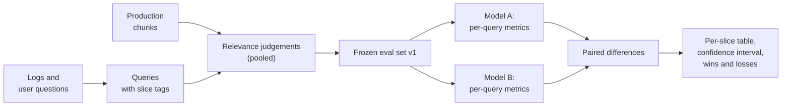

The bake-off in [Model selection](/learn/embedding-optimisation/model-selection) ended with an uncomfortable conclusion: on 16 queries, the differences between three models were too small to trust, and removing a model's documented prefixes appeared to help. This lesson turns that quick bake-off into an evaluation you can base decisions on. You will build a labelled query set with several relevant chunks per query and tags for query type, score models per slice, and put a confidence interval on the difference between two models, so that "model A is better" becomes a claim with evidence behind it.

Every later lesson in this module depends on this one. Domain adaptation, fine-tuning, hard negatives, Matryoshka truncation and quantisation all change the embeddings, and each change is only worth keeping if the evaluation says so.

## Learning objectives

- Distinguish intrinsic evaluation of an embedding model from end-to-end evaluation of a RAG system, and say when each is appropriate.
- Build an evaluation set of queries, a corpus and relevance judgements, with slices that reflect real query types.
- Compute recall@k and MRR per query and per slice, and reproduce them with Sentence Transformers' `InformationRetrievalEvaluator`.
- Compute a paired confidence interval for the difference between two models with the bootstrap and with the normal approximation.
- Estimate how many queries an evaluation needs to detect a given difference.

## Prerequisites

- [Model selection](/learn/embedding-optimisation/model-selection): the bake-off this lesson makes rigorous.
- [Similarity distributions](/learn/embedding-mathematics/similarity-distributions): why raw cosine scores are on a model-specific scale.
- [Recall@K](/learn/retrieval-fundamentals/recall-k): the basic retrieval metric. The [Retrieval Evaluation](/learn/retrieval-evaluation) module covers MRR, NDCG and the other ranking metrics in full; this lesson uses them rather than re-deriving them.

## Why this matters

Without an evaluation, every embedding decision is made by anecdote. Someone tries five questions, the new model gets four right, and it ships. Three failure modes follow.

- **Regressions go unnoticed.** A new model improves the questions people tried and quietly worsens a query type nobody tried, such as error-code lookups. Users notice before the team does.
- **Noise is mistaken for signal.** Two models that differ by one or two queries on a small set are indistinguishable, but a table with two decimals makes the difference look real. Teams then spend weeks fine-tuning to chase a gap that was never there.
- **The wrong thing is measured.** A model is scored on a tiny corpus where every query has only a dozen candidates, scores look excellent, and production, with 200,000 chunks and many near-duplicates, behaves very differently.

A good embedding evaluation is cheap to run, isolates the embedding model from the rest of the pipeline, reflects the real query mix, and reports uncertainty alongside its averages.

## The intuition

Imagine judging two cooks by having each make one dish. Whoever makes the better dish wins, but you have learnt very little: perhaps one cook was lucky with the dish chosen. Now have both cooks make the same 30 dishes, and compare them dish by dish. Three things improve:

1. **More dishes** shrink the role of luck.
2. **The same dishes for both** remove the variation between dishes from the comparison. A hard dish is hard for both cooks, so you compare how each did *on that dish*. This is a **paired** comparison.
3. **Grouping dishes by type** (soups, pastry, grills) shows where each cook is strong. A cook who wins overall but cannot make pastry is a poor choice for a bakery.

An embedding evaluation has the same structure. The dishes are queries, the cooks are models, and the types are slices such as "paraphrase" or "error code".

## How it works

### Intrinsic and end-to-end evaluation

**Intrinsic evaluation** measures the embedding model in isolation: given a query, does nearest-neighbour search over the model's vectors rank the relevant chunks highly? **End-to-end evaluation** measures the whole RAG system: given a question, is the final answer correct and faithful? (The [Generation Evaluation](/learn/generation-evaluation) module covers the second.)

Use intrinsic evaluation for embedding decisions. It is fast (no LLM calls), deterministic, and attributes changes to the embedding model alone. End-to-end metrics fold in chunking, reranking, prompting and the generator, and their noise is much larger. The two are linked: if the relevant chunk is not retrieved, the generator cannot use it. Confirm a large intrinsic improvement end to end before a big migration, but do not use end-to-end metrics to compare embedding models.

To keep intrinsic evaluation honest, search exactly as production does: same chunking, same prefixes, same normalisation, same similarity function, and exact search (a flat index) so that approximate-index errors are not attributed to the model.

### The three parts of an evaluation set

An information-retrieval evaluation set has three parts:

- **Queries**: realistic questions with identifiers.
- **Corpus**: the chunks to search, with identifiers.
- **Relevance judgements**, often called **qrels**: for each query, the set of chunk identifiers that answer it, optionally with a grade (2 for fully answers, 1 for partially).

Each part has pitfalls.

**Queries.** The best source is real user traffic: sample from logs, remove personal data, and keep the original wording, typos included. When there is no traffic yet, ask the people who will use the system to write questions as they would actually type them. **Synthetic queries** generated by an LLM from chunks are quick to produce and useful for volume, but they tend to reuse the chunk's own vocabulary ("What is the annual leave entitlement?") and so overstate how well any model handles real paraphrase. If you use them, keep them in a separate slice and never let them be your only evidence. [Synthetic test data](/learn/testing-and-benchmarking/synthetic-test-data) goes further.

**Corpus.** Evaluate against the full production corpus, or a sample that keeps the near-duplicates. A model that separates "E-4021" from "E-4031" when only one of them is in the corpus has been tested on nothing. Including **distractors**, chunks that look relevant but are not, is what makes an evaluation discriminating.

**Judgements.** Most queries have more than one relevant chunk, especially when facts are split across chunks. Missing judgements make a model look worse than it is: if model B retrieves a chunk that does answer the question but was never labelled, B is penalised. The standard remedy is **pooling**: take the union of the top results from every model under comparison, and have a person judge any unlabelled chunk in that pool. Repeat whenever a new model enters the comparison.

### Slices

A **slice** is a subset of queries sharing a property: query type, source collection, language, length, or whether the query contains an identifier. Report every metric per slice as well as overall. Slices catch the regression an average hides, and they tell you *what kind* of fix is needed. A model that fails on identifiers needs lexical help, not a bigger embedding model.

Keep slices large enough to mean something. A slice of five queries can move by 20 percentage points on a single query.

### Choosing the metric

For RAG, the question that matters most is whether the relevant chunks reach the context window. If you pass the top $k$ chunks to the generator, **recall@k** at that $k$ is the primary metric: the fraction of a query's relevant chunks found in the top $k$. **MRR** (mean reciprocal rank of the first relevant chunk) and **NDCG@10** are useful secondary metrics because they reward putting the relevant chunk first, which matters when a reranker or a small $k$ follows. The [MRR](/learn/retrieval-evaluation/mrr) and [NDCG](/learn/retrieval-evaluation/ndcg) lessons define them carefully.

Recall@k at a large $k$ also measures the embedding model's job as a **candidate generator** for a reranker. If a cross-encoder reranks the top 50, what matters is recall@50, not where in the 50 the chunk sits.

### Paired comparison and uncertainty

Each metric is an average over queries, and averages from a few dozen queries are noisy. Because both models answer the same queries, compare them **per query**: compute the difference $d_i$ for every query, then ask whether the mean difference is distinguishable from zero.

Two ways to put an interval around the mean difference:

- **Normal approximation.** Compute the standard error of the mean difference and take 1.96 standard errors either side. Quick, and adequate with a few hundred queries.
- **Paired bootstrap.** Resample the queries with replacement thousands of times, recompute the mean difference each time, and take the 2.5th and 97.5th percentiles. It makes no assumption about the shape of the distribution, which matters because per-query metrics such as reciprocal rank take only a few distinct values.

If the interval includes zero, the evaluation cannot tell the models apart. That is a result, not a failure: it tells you to choose on other grounds (cost, latency) or to collect more queries.

A useful complement is the **win/loss count**: on how many queries is A better, B better, or tied? When most queries tie, the average difference is driven by a handful of queries, and you should read those queries.

### The procedure

1. Collect queries from logs or users; tag each with its slices.
2. Assemble the corpus as production chunks it, including distractors.
3. Judge relevance for each query; pool the top results of every candidate and judge unlabelled chunks.
4. Freeze the set with a version number. Never tune anything on it; keep a separate development set for tuning.
5. For each model, embed the corpus and queries exactly as production would, search exactly, and record per-query metrics.
6. Report overall and per-slice metrics, the paired interval for each comparison, and win/loss counts.
7. Read the queries where the models disagree.



## The mathematics

### Per-query metrics

For query $i$ with relevant set $R_i$ and top-$k$ results $T_i^{(k)}$:

$$
\text{recall@}k_i = \frac{|R_i \cap T_i^{(k)}|}{|R_i|}, \qquad \text{RR}_i = \frac{1}{\text{rank of the first relevant chunk}}
$$

Recall@k is the fraction of the relevant chunks found; reciprocal rank (RR) rewards the first relevant chunk appearing early. Averaging RR over queries gives MRR. Example: a query with relevant chunks {carryover, leave} whose top 3 contains carryover only has recall@3 $= 1/2$; if carryover sits at rank 2, its RR $= 1/2$.

### The paired difference and its interval

**Intuition.** Comparing per query cancels out how hard each query is. The question becomes: is the average per-query gain large compared with how much it varies?

$$
d_i = m_A(i) - m_B(i), \qquad \bar{d} = \frac{1}{n}\sum_{i=1}^{n} d_i, \qquad
\text{SE} = \frac{s_d}{\sqrt{n}}, \qquad \text{CI}_{95\%} \approx \bar{d} \pm 1.96\,\text{SE}
$$

$m_A(i)$ and $m_B(i)$ are the metric for query $i$ under models A and B; $n$ is the number of queries; $\bar{d}$ is the mean difference; $s_d$ is the sample standard deviation of the $d_i$ (dividing by $n-1$); SE is the standard error of $\bar{d}$; 1.96 is the multiplier for a 95% interval under the normal approximation.

**By hand.** Five queries with RR differences $d = (0.5, 0, 0, -0.5, 1)$.

- Mean: $(0.5 + 0 + 0 - 0.5 + 1)/5 = 0.2$.
- Deviations from the mean: $0.3, -0.2, -0.2, -0.7, 0.8$; squares: $0.09, 0.04, 0.04, 0.49, 0.64$; sum $1.30$.
- $s_d = \sqrt{1.30 / 4} = \sqrt{0.325} \approx 0.570$.
- $\text{SE} = 0.570 / \sqrt{5} \approx 0.255$.
- Interval: $0.2 \pm 1.96 \times 0.255 = 0.2 \pm 0.50$, so about $[-0.30, 0.70]$.

A mean gain of 0.2 sounds large, but the interval comfortably includes zero.

### How many queries?

Rearranging the half-width of the interval, $h = 1.96\, s_d / \sqrt{n}$, gives the number of queries needed for a half-width of $h$:

$$
n \approx \left(\frac{1.96\, s_d}{h}\right)^2
$$

With $s_d = 0.3$ (an assumption; estimate yours from a pilot run) and a target half-width of $0.03$, $n \approx (19.6)^2 \approx 385$. Halving the difference you want to detect quadruples the queries you need. This is why a few dozen queries can only detect large differences.

```python
import numpy as np

d = np.array([0.5, 0.0, 0.0, -0.5, 1.0])   # per-query RR(A) - RR(B)
mean, sd = d.mean(), d.std(ddof=1)
se = sd / np.sqrt(len(d))
print(f"mean={mean:.3f} sd={sd:.3f} se={se:.3f} 95% CI=[{mean - 1.96*se:.3f}, {mean + 1.96*se:.3f}]")

sd_guess, half_width = 0.3, 0.03
print("queries needed:", int(np.ceil((1.96 * sd_guess / half_width) ** 2)))
```

```output
mean=0.200 sd=0.570 se=0.255 95% CI=[-0.300, 0.700]
queries needed: 385
```

## In code

**The problem.** Compare two embedding models on an AskMeridian evaluation set with multiple relevant chunks per query, report per-slice metrics, and decide whether the difference between them is real.

**Dependencies.** `sentence-transformers` and NumPy. The two models download on first use.

```bash
pip install sentence-transformers numpy
```

The corpus has 18 chunks, including deliberate distractors: four Atlas error codes, and facts split across chunks (the leave allowance and the carry-over rule; the expenses deadline and the receipt rule). The 28 queries are tagged with four slices, and some have two relevant chunks.

```python
import numpy as np
from sentence_transformers import SentenceTransformer

CORPUS = {
    "leave":     "Annual leave is 25 days a year.",
    "carryover": "Up to 5 unused leave days carry over and must be used by 31 March.",
    "remote":    "Staff may work remotely up to 3 days a week.",
    "equipment": "Employees get a £400 home-office equipment budget. Contractors are not eligible.",
    "expenses":  "Expenses must be submitted within 30 days.",
    "receipts":  "Any expense over £75 needs a receipt.",
    "password":  "Passwords must be rotated every 90 days.",
    "vpn":       "Use the VPN whenever you connect from public Wi-Fi.",
    "laptop":    "Laptops are refreshed every 3 years.",
    "lost":      "Report a lost or stolen laptop to the support desk at once.",
    "support":   "The support desk is open 08:00 to 18:00 UK time.",
    "e4021":     "Atlas error E-4021: the VPN client is out of date. Update it from the IT portal.",
    "e4030":     "Atlas error E-4030: your user lacks permission for this operation.",
    "e4031":     "Atlas error E-4031: the token does not grant access to this project.",
    "e4040":     "Atlas error E-4040: the requested Atlas resource does not exist or was deleted.",
    "export":    "Meridian Reports exports to PDF and CSV.",
    "sso":       "SAML single sign-on is available on the Enterprise plan of Meridian Reports.",
    "sync":      "Meridian Sync keeps project files in step across devices.",
}
# (query, set of relevant ids, slice)
EVAL = [
    ("How many days of holiday do I get?",                       {"leave"},             "paraphrase"),
    ("Can I carry over vacation I didn't use?",                  {"carryover"},         "paraphrase"),
    ("How often can I work from home?",                          {"remote"},            "paraphrase"),
    ("Deadline for claiming back a taxi fare?",                  {"expenses"},          "paraphrase"),
    ("When do I have to change my password?",                    {"password"},          "paraphrase"),
    ("What time does IT helpdesk close?",                        {"support"},           "paraphrase"),
    ("How long until I get a new laptop?",                       {"laptop"},            "paraphrase"),
    ("Is there an allowance for home office furniture?",         {"equipment"},         "paraphrase"),
    ("Do I need proof of purchase for a £120 hotel bill?",       {"receipts"},          "situational"),
    ("I'm a contractor, can I claim a monitor for my home office?", {"equipment"},      "situational"),
    ("I'm working from a coffee shop, anything I should do first?", {"vpn"},            "situational"),
    ("I left my laptop on the train",                            {"lost"},              "situational"),
    ("My laptop is four years old, can I get a new one?",        {"laptop"},            "situational"),
    ("I still have 7 days of leave left in December, what happens?", {"carryover", "leave"}, "situational"),
    ("I want to claim a £200 train ticket from two months ago",  {"expenses", "receipts"}, "situational"),
    ("It's 7pm and my VPN is broken, who can help?",             {"support"},           "situational"),
    ("What does E-4021 mean?",                                   {"e4021"},             "identifier"),
    ("Fix for E-4030",                                           {"e4030"},             "identifier"),
    ("E-4040 when opening a dashboard",                          {"e4040"},             "identifier"),
    ("atlas says my token is no good for this project",          {"e4031"},             "identifier"),
    ("VPN app says it is out of date",                             {"e4021"},             "identifier"),
    ("Atlas says I'm not allowed to do this",                    {"e4030"},             "identifier"),
    ("Can I download a report as a spreadsheet?",                {"export"},            "product"),
    ("Does Reports support Okta login?",                         {"sso"},               "product"),
    ("How do I keep my files the same on my laptop and phone?",  {"sync"},              "product"),
    ("Which plan do I need for single sign-on?",                 {"sso"},               "product"),
    ("Can Meridian Reports produce a PDF?",                      {"export"},            "product"),
    ("Is SAML available on every plan?",                         {"sso"},               "product"),
]
doc_ids = list(CORPUS)

def per_query_metrics(model, q_prefix="", d_prefix="", k=3):
    """Return arrays of recall@k and reciprocal rank, one value per query."""
    D = model.encode([d_prefix + t for t in CORPUS.values()], normalize_embeddings=True)
    Q = model.encode([q_prefix + q for q, _, _ in EVAL], normalize_embeddings=True)
    order = np.argsort(-(Q @ D.T), axis=1)
    recall, rr = [], []
    for row, (_, relevant, _) in zip(order, EVAL):
        ranked = [doc_ids[j] for j in row]
        recall.append(len(relevant & set(ranked[:k])) / len(relevant))
        first_hit = next(i for i, d in enumerate(ranked) if d in relevant)
        rr.append(1.0 / (first_hit + 1))
    return np.array(recall), np.array(rr)

def paired_bootstrap(a, b, n_resamples=10_000, seed=0):
    """95% interval for mean(a - b), resampling queries with replacement."""
    rng = np.random.default_rng(seed)
    diff = a - b
    idx = rng.integers(0, len(diff), size=(n_resamples, len(diff)))
    means = diff[idx].mean(axis=1)
    return diff.mean(), np.percentile(means, [2.5, 97.5])

runs = {
    "MiniLM-L6": per_query_metrics(SentenceTransformer("sentence-transformers/all-MiniLM-L6-v2")),
    "bge-small": per_query_metrics(SentenceTransformer("BAAI/bge-small-en-v1.5"),
                                   q_prefix="Represent this sentence for searching relevant passages: "),
}

slices = sorted({s for _, _, s in EVAL})
print(f"{'slice':<12}{'n':>3}" + "".join(f"{m + ' R@3':>15}{m + ' MRR':>15}" for m in runs))
for s in slices + ["ALL"]:
    mask = np.array([s == "ALL" or sl == s for _, _, sl in EVAL])
    row = f"{s:<12}{mask.sum():>3}"
    for recall, rr in runs.values():
        row += f"{recall[mask].mean():>15.2f}{rr[mask].mean():>15.2f}"
    print(row)

a, b = runs["MiniLM-L6"][1], runs["bge-small"][1]
mean_diff, (lo, hi) = paired_bootstrap(a, b)
wins, losses = int((a > b).sum()), int((a < b).sum())
print(f"\nMRR difference (MiniLM - bge): {mean_diff:+.3f}, 95% CI [{lo:+.3f}, {hi:+.3f}]")
print(f"MiniLM better on {wins} queries, bge better on {losses}, tied on {len(a) - wins - losses}")
```

```output
slice         n  MiniLM-L6 R@3  MiniLM-L6 MRR  bge-small R@3  bge-small MRR
identifier    6           1.00           0.92           1.00           1.00
paraphrase    8           1.00           0.94           1.00           1.00
product       6           1.00           1.00           0.83           0.87
situational   8           1.00           0.92           0.75           0.80
ALL          28           1.00           0.94           0.89           0.91

MRR difference (MiniLM - bge): +0.026, 95% CI [-0.061, +0.125]
MiniLM better on 3 queries, bge better on 2, tied on 23
```

**The important lines.**

- `EVAL` stores each query with a *set* of relevant identifiers and a slice tag. Sets allow multiple relevant chunks; the tag allows per-slice reporting.
- `recall.append(len(relevant & set(ranked[:k])) / len(relevant))` is recall@k exactly as defined: relevant chunks found in the top $k$, divided by relevant chunks that exist.
- `per_query_metrics` returns arrays rather than averages. Keeping per-query values is what makes paired comparison, slicing and reading individual failures possible. Many evaluation scripts discard them; do not.
- `paired_bootstrap` draws `idx`, a 10,000 by 28 matrix of query indices sampled with replacement, so each row is one resampled evaluation set. `diff[idx].mean(axis=1)` computes all 10,000 resampled mean differences at once. The fixed seed makes the interval reproducible.

**What the output means.**

- **Overall, the models are indistinguishable.** The MRR difference is +0.026 with a 95% interval from −0.061 to +0.125. Zero is well inside. The win/loss count says the same thing more bluntly: 23 of 28 queries are tied, and of the five that differ, MiniLM wins three and bge-small two.
- **The slices disagree with each other.** bge-small is perfect on identifiers and paraphrases but drops on the situational and product slices, where MiniLM is stronger. The overall average hides two opposite effects. If Meridian's real traffic is mostly situational questions, that matters more than the overall figure, but slices of six to eight queries are even noisier than the whole set, so this is a hypothesis to test with more queries, not a conclusion.
- **Recall@3 hides what MRR shows.** MiniLM finds every relevant chunk in the top 3, but MRR of 0.92 on identifiers means it often ranks the wrong error code first. If AskMeridian passes three chunks to the generator, that may be fine; if a reranker or a single-chunk answer follows, it is not.

**Using the library evaluator.** Sentence Transformers ships `InformationRetrievalEvaluator`, which takes the same three parts as dictionaries and returns many metrics at once. It is the evaluator used during fine-tuning in later lessons, so check that it agrees with your own code (output from sentence-transformers 6.3; in versions 3 and later the evaluator returns a dictionary whose keys are prefixed with `name`):

```python
from sentence_transformers.evaluation import InformationRetrievalEvaluator

queries = {f"q{i}": q for i, (q, _, _) in enumerate(EVAL)}
relevant_docs = {f"q{i}": rel for i, (_, rel, _) in enumerate(EVAL)}
evaluator = InformationRetrievalEvaluator(
    queries=queries, corpus=CORPUS, relevant_docs=relevant_docs,
    accuracy_at_k=[1, 3], precision_recall_at_k=[3], mrr_at_k=[10], ndcg_at_k=[10],
    name="askmeridian", write_csv=False,
)
model = SentenceTransformer("sentence-transformers/all-MiniLM-L6-v2")
results = evaluator(model)
for key in ("askmeridian_cosine_recall@3", "askmeridian_cosine_mrr@10", "askmeridian_cosine_ndcg@10"):
    print(f"{key:<30}{results[key]:.3f}")
```

```output
askmeridian_cosine_recall@3   1.000
askmeridian_cosine_mrr@10     0.940
askmeridian_cosine_ndcg@10    0.956
```

Recall@3 and MRR match the hand-written code. The library reports averages only, so keep your own per-query code for paired comparisons.

**Common errors.** Forgetting that `relevant_docs` values must be sets of corpus identifiers that actually exist in `corpus` (a typo silently makes a query unanswerable); passing query prefixes to one model and not the other (the evaluator accepts `query_prompt` and `corpus_prompt` for this); and evaluating on queries that were also used for training, which the [Fine-tuning embeddings](/learn/embedding-optimisation/fine-tuning-embeddings) lesson guards against.

**Extending it.** Add a third model; report recall@10 to assess candidate generation; add a `source` slice (handbook, runbooks, product docs); and save per-query results to a CSV so that next month's run can be compared query by query.

## A real-world example

The Platform team plans to fine-tune AskMeridian's embedding model and wants a baseline. Their first evaluation set is 40 queries written by one engineer in an afternoon. The fine-tuned model improves MRR from 0.81 to 0.86 on it, and the team prepares to deploy.

A reviewer asks three questions. Who wrote the queries? (The engineer who wrote the training data, so both share his phrasing.) What is the interval on the difference? (Nobody had computed it; the bootstrap gives roughly −0.02 to +0.12.) What happens per slice? (Error-code queries got slightly worse.)

The team rebuilds the evaluation. They sample 300 questions from AskMeridian's logs, strip names, and have two people from the HR and IT teams judge relevance, pooling the top 10 from the old and new models so that chunks either model found are judged. They tag slices by source and by whether the query contains an identifier, freeze the set as version 1, and keep 60 further queries as a development set for tuning.

On the new set, the fine-tuned model's gain on handbook questions is clear: the interval excludes zero. Its loss on identifier queries is also clear. The fix is not to abandon fine-tuning but to add identifier-heavy training pairs, which the [Hard negative mining](/learn/embedding-optimisation/hard-negative-mining) lesson shows how to build. The evaluation set, versioned alongside the code, becomes a regression test that every later embedding change must pass.

## Common mistakes

- **Evaluating on a tiny or deduplicated corpus.** Without near-duplicate distractors every model looks good, and the evaluation cannot discriminate.
- **Writing queries from the chunks.** Queries copied from the source text share its vocabulary and overstate quality, especially for lexical overlap.
- **Single-relevant judgements when several chunks answer.** Models that find an unlabelled correct chunk are penalised, and the comparison is biased towards whichever model the labeller used.
- **Reporting averages without intervals.** A difference of 0.02 on 40 queries is presented as a win and decides a migration.
- **Tuning on the test set.** Choosing prefixes, thresholds or training data by looking at the frozen evaluation set makes its scores optimistic; that is what the development set is for.
- **Using approximate search in the evaluation.** Recall lost by the ANN index is blamed on the embedding model.

## Best practices

- Source queries from real usage, keep their original wording, and record where each came from.
- Use pooling: whenever a new model is evaluated, judge any unjudged chunk in its top results.
- Tag slices by query type, source and identifier presence, and report each one.
- Keep per-query results, and compare models with a paired interval and win/loss counts.
- Version the evaluation set, and keep a separate development set for any tuning.
- Search exactly in evaluation, with the same chunking, prefixes and normalisation as production.
- Re-read the disagreements between models every time; they are where you learn what to fix.

## Performance considerations

Intrinsic evaluation is cheap because the expensive part, embedding the corpus, is done once per model. A corpus of 200,000 chunks at an assumed 200 chunks per second takes about 17 minutes per model; queries are negligible. Store the corpus embeddings for each model version so that repeated evaluations, for example after changing prefixes on the query side, only re-embed queries.

Exact search over the full corpus is a matrix product: 300 queries against 200,000 chunks at 384 dimensions is $300 \times 200{,}000 \times 384 \approx 2.3 \times 10^{10}$ multiply-adds, a few seconds on a CPU with NumPy. Above a few million chunks, use a flat GPU index or exact search in batches.

The bootstrap itself is trivial: 10,000 resamples of 300 values is 3 million additions. Human relevance judgement is the real cost. At an assumed one minute per judgement, pooling the top 10 of two models for 300 queries can mean up to 6,000 judgements, about 100 hours, though overlap between the models' results usually reduces this a lot. Budget for it, and reuse judgements across evaluations.

## Security considerations

Evaluation sets built from logs contain what users typed, which can include names, health details or credentials pasted by mistake. Remove or replace personal data before queries enter the set, restrict who can read raw logs, and apply the same retention rules as the logs themselves. Relevance judges see confidential chunks, so the judging pool needs the same document permissions as the people who would normally read them.

## Summary

- Evaluate embedding models intrinsically, by retrieval quality with exact search and production settings, and keep end-to-end evaluation for confirming large changes.
- An evaluation set is queries, corpus and judgements; each needs care: real queries, a corpus with distractors, and pooled judgements with multiple relevant chunks.
- Report per-slice metrics alongside the overall figure; slices reveal regressions and point to the kind of fix needed.
- Compare models per query: a paired bootstrap or normal-approximation interval, plus win/loss counts, says whether a difference is real.
- The number of queries needed grows with the square of the precision you want; a few dozen queries can only detect large differences.

## Exercises

**1.** Query "I still have 7 days of leave left in December, what happens?" has relevant chunks {carryover, leave}. A model returns [carryover, remote, leave, …]. Compute recall@1, recall@3 and the reciprocal rank.

<details><summary>Show solution</summary>

Recall@1: the top 1 contains carryover only, so $1/2 = 0.5$. Recall@3: carryover and leave are both in the top 3, so $2/2 = 1.0$. Reciprocal rank: the first relevant chunk is at rank 1, so RR $= 1$. Note that RR ignores the second relevant chunk entirely; recall at the context size you use captures it.

</details>

**2.** Add the normal-approximation interval to the code example, computed from the same per-query MRR differences, and compare it with the bootstrap interval. Why might they differ on 28 queries?

<details><summary>Show solution</summary>

```python
d = a - b
se = d.std(ddof=1) / np.sqrt(len(d))
print(f"normal approx: [{d.mean() - 1.96 * se:+.3f}, {d.mean() + 1.96 * se:+.3f}]")
```

On this data it prints `[-0.069, +0.121]`, against the bootstrap's `[-0.061, +0.125]`. The two are similar, but they need not match. Most differences are exactly zero and the rest take a few discrete values (here −0.5, +0.13 and +0.8), so the distribution of $d_i$ is far from normal, and with only 28 queries the normal approximation to the mean's distribution is rough. The bootstrap uses the empirical distribution directly. Both agree on the decision that matters here: zero is inside the interval.

</details>

**3.** A pilot run of 50 queries gives $s_d = 0.25$ for the per-query difference in recall@5 between two models. How many queries do you need for a 95% interval of half-width 0.02? What would you do if that number is impractical?

<details><summary>Show solution</summary>

$n \approx (1.96 \times 0.25 / 0.02)^2 = (24.5)^2 \approx 600$ queries.

If 600 judged queries are impractical: accept a wider interval and only act on larger differences; use synthetic queries for volume in a separate slice while keeping real queries as the deciding set; or reduce variance by focusing on the slice the change targets, where differences are usually larger and more consistent. Decide which in advance, not after seeing the results.

</details>

**4.** Design decision. AskMeridian will soon index product documentation, and the team has no user queries for it yet. Design an evaluation for the product slice, covering where queries come from, how relevance is judged, and how you will stop the evaluation from flattering the model.

<details><summary>Show solution</summary>

**Queries.** Ask support staff and product managers to write the questions customers and colleagues actually send, in their own words; import past support tickets if they exist. Supplement with LLM-generated queries for volume, tagged as synthetic, and instruct the generator to avoid the chunk's wording. Plan to replace synthetic queries with logged ones within a few weeks of launch.

**Judgements.** Pool the top 10 from each candidate model and from BM25, and have a product expert judge every pooled chunk with a graded scale. Record judges and dates.

**Not flattering the model.** Include all versions and near-duplicate pages (release notes for several versions of Meridian Sync, for example) as distractors; report the synthetic and human-written slices separately; freeze the set before any tuning; and keep a development set for prefix or threshold choices.

</details>

## Check your understanding

```quiz
[
  {
    "q": "Why should embedding models be compared with intrinsic retrieval metrics rather than end-to-end answer quality?",
    "options": [
      "End-to-end metrics are always wrong",
      "Intrinsic metrics isolate the embedding model, are cheap and deterministic, while end-to-end scores mix in chunking, prompting and generation noise",
      "Intrinsic metrics require no labelled data",
      "End-to-end metrics cannot be computed for RAG"
    ],
    "answer": 1,
    "why": "To attribute a change to the embedding model you need a measurement that depends only on it. End-to-end evaluation is still useful to confirm large changes."
  },
  {
    "q": "Model A beats model B by 0.03 MRR on 40 queries. The paired bootstrap interval is [-0.04, +0.10]. What should you conclude?",
    "options": [
      "A is better and should be deployed",
      "B is better, because the interval extends below zero",
      "The evaluation cannot distinguish the models; decide on other grounds or collect more queries",
      "The bootstrap is invalid for MRR"
    ],
    "answer": 2,
    "why": "Zero lies inside the interval, so the observed difference is compatible with no real difference."
  },
  {
    "q": "What problem does pooling solve when building relevance judgements?",
    "options": [
      "It reduces the number of queries needed",
      "It removes duplicate chunks from the corpus",
      "It makes the bootstrap faster",
      "It ensures chunks retrieved by any compared model get judged, so a model is not penalised for finding an unlabelled relevant chunk"
    ],
    "answer": 3,
    "why": "Unjudged relevant chunks count as misses. Judging the union of every model's top results removes this bias."
  },
  {
    "q": "What does this code print?\n```python\nrelevant = {\"leave\", \"carryover\"}\nranked = [\"remote\", \"carryover\", \"vpn\", \"leave\"]\nprint(len(relevant & set(ranked[:3])) / len(relevant))\n```",
    "options": [
      "0.5",
      "1.0",
      "0.333...",
      "0.25"
    ],
    "answer": 0,
    "why": "The top 3 contain carryover but not leave, so one of the two relevant chunks is found: recall@3 = 0.5."
  },
  {
    "q": "You want to halve the width of your confidence interval on a model comparison. Roughly how many more queries do you need?",
    "options": [
      "Twice as many",
      "Four times as many",
      "The same number, judged more carefully",
      "Ten times as many"
    ],
    "answer": 1,
    "why": "The interval half-width scales with 1 over the square root of n, so halving it requires four times the queries."
  }
]
```

## Further reading

- Manning, Raghavan and Schütze (2008), *Introduction to Information Retrieval*, chapter 8, "Evaluation in information retrieval", including pooling. Free online at [nlp.stanford.edu/IR-book](https://nlp.stanford.edu/IR-book/).
- Sakai (2014), "Statistical reform in information retrieval?", *SIGIR Forum* 48(1): on significance testing and effect sizes in IR evaluation.
- Efron and Tibshirani (1993), *An Introduction to the Bootstrap*, Chapman and Hall.
- Thakur et al. (2021), "BEIR: A Heterogeneous Benchmark for Zero-shot Evaluation of Information Retrieval Models", [arXiv:2104.08663](https://arxiv.org/abs/2104.08663).
- Sentence Transformers documentation, [sbert.net](https://www.sbert.net/), the evaluation section describing `InformationRetrievalEvaluator`.
