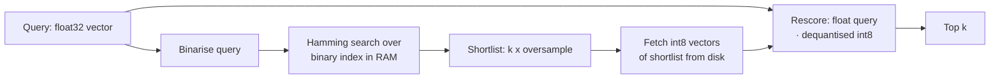

An embedding is usually stored as 32-bit floating-point numbers: four bytes for each of its hundreds of dimensions. **Embedding quantisation** stores each number with fewer bits: 16-bit floats, 8-bit integers, or a single bit per dimension. Memory and search cost fall by a factor of 2, 4 or 32, and the question is how much retrieval quality you pay for it. This lesson explains the three common precisions, the calibration that int8 needs, why the way you *score* quantised vectors matters as much as how you store them, and the oversample-and-rescore pattern that recovers most of the quality lost to binary vectors. You will measure all of this on a corpus of about 1,500 real sentences.

This lesson is about the precision of the embedding vectors you store. The [Vector Indexing Algorithms](/learn/vector-indexing-algorithms) module covers quantisation inside index structures, including [product quantisation](/learn/vector-indexing-algorithms/product-quantisation) and the index-level view of [scalar quantisation](/learn/vector-indexing-algorithms/scalar-quantisation). Quantising the *model's weights* to speed up embedding is a separate technique again, not covered here.

## Learning objectives

- Calculate the memory of an index at float32, float16, int8 and binary precision.
- Quantise embeddings to int8 with per-dimension calibration ranges, and dequantise them.
- Explain why scoring an int8 query against int8 documents loses more quality than scoring a float query against dequantised documents.
- Implement binary quantisation with Hamming-distance search, and relate Hamming distance to the angle between vectors.
- Design an oversample-and-rescore pipeline and measure its recall against float32 search.

## Prerequisites

- [Model selection](/learn/embedding-optimisation/model-selection): the storage formula $N \times d \times b$.
- [Matryoshka embeddings](/learn/embedding-optimisation/matryoshka-embeddings): shortening vectors, which composes with quantisation, and the funnel pattern.
- [Cosine similarity](/learn/embedding-mathematics/cosine-similarity) and [Vector normalisation](/learn/embedding-mathematics/vector-normalisation).
- [Embedding evaluation](/learn/embedding-optimisation/embedding-evaluation): measuring retrieval quality.

## Why this matters

For most dense indexes, RAM is the dominant cost, because vectors are kept in memory for fast search. Ten million 1,024-dimensional float32 vectors need about 41 GB before any index overhead. The same vectors as int8 need about 10 GB, and as binary about 1.3 GB. That difference decides whether an index runs on one modest machine or needs a cluster.

Quantisation done carelessly costs quality silently. Retrieval still returns ten results, they still look plausible, and nobody notices that a fifth of them differ from what full precision would return until answer quality drifts. Done well, with the right scoring and a rescoring stage, quantisation gives most of the memory saving for a small, measured loss. The engineering skill is knowing which variant to use, and measuring the loss on your own data rather than assuming it.

## The intuition

Think of a map with every building's position written to the millimetre. For finding the nearest café, millimetres are wasted: metres would do (float16), and even "which block" would usually be enough (int8). You could go further and record only whether each building is north or south, east or west of the town centre (binary): crude, but it immediately rules out most of the town, after which you can check the precise addresses of the few candidates that remain.

Two lessons hide in this picture. First, how coarse you can go depends on how close together the things you need to distinguish are. Second, the crude description is best used as a first filter, with precise information consulted for the shortlist. Those are the two ideas behind every quantisation scheme in this lesson.

## How it works

### Three precisions

| Precision | Bytes per dimension | 384-d vector | Relative size | How it works |
| --- | --- | --- | --- | --- |
| float32 | 4 | 1,536 bytes | 1 | The default output of embedding models |
| float16 | 2 | 768 bytes | 1/2 | Fewer mantissa bits; plain type conversion |
| int8 | 1 | 384 bytes | 1/4 | Each dimension mapped to 256 levels using a calibrated range |
| binary | 1/8 | 48 bytes | 1/32 | Each dimension reduced to its sign: one bit |

**float16** halves memory with negligible effect on ranking for normalised embeddings, because their values are small and well within float16's range and precision. It is close to a free saving where your database or library supports it.

**int8 scalar quantisation** maps each dimension's values onto 256 integer levels. Embedding dimensions have different ranges (one dimension might span −0.15 to 0.2, another −0.3 to 0.1), so the mapping is calibrated **per dimension**: find each dimension's minimum and maximum over a representative sample of embeddings, divide that range into 255 equal steps, and store the step index. Values outside the calibrated range are clipped. Calibrate on a sample of your real corpus, record the ranges with the index, and use the same ranges for every vector added later.

**Binary quantisation** keeps one bit per dimension: 1 if the value is positive, 0 otherwise, packed eight to a byte. Two binary vectors are compared by **Hamming distance**, the number of bits in which they differ, computed with an XOR and a population count (a CPU instruction that counts set bits). It is extremely fast and small, but it discards all magnitude information.

### Scoring quantised vectors: symmetric versus asymmetric

How you score matters as much as how you store.

- **Symmetric** scoring quantises the query the same way as the documents and compares integers with integers (int8 dot products, or Hamming distance for binary). It is the fastest option.
- **Asymmetric** scoring keeps the query in float32 and compares it with the quantised documents, converted back (**dequantised**) to approximate floats. The query is one vector and costs nothing to keep at full precision; only the stored documents need to be small.

For int8, the difference is large. The int8 level of a value is an affine transformation (scale and shift, per dimension) of the original value, and a dot product of two shifted vectors is *not* proportional to the dot product of the originals: the shifts introduce extra terms, some of which depend only on the document and so change the ranking. The mathematics section shows this. Asymmetric scoring avoids it, because dequantising undoes the shift.

### Oversampling and rescoring

Binary vectors lose too much to be trusted for the final ranking, but they are excellent at discarding the obviously irrelevant. The standard pattern is:

1. Search the binary index for the top $k \times o$ candidates, where $o$ is an **oversampling** factor such as 4 or 10.
2. **Rescore** those candidates with a more precise representation: the float query against int8 or float32 document vectors fetched from slower storage, or at least against the binary documents expanded to ±1.
3. Return the top $k$ after rescoring.

Like the Matryoshka funnel, rescoring can only reorder the shortlist; anything binary search missed is lost. The oversampling factor sets that risk, and the precision used for rescoring sets how well the shortlist is ordered.



### Support in tools

You rarely implement this by hand in production. Sentence Transformers can return quantised embeddings directly (`encode(..., precision="int8")` or `"binary"`/`"ubinary"`) and provides `quantize_embeddings` for existing arrays. FAISS has binary indexes (`IndexBinaryFlat` and others) and a scalar-quantiser index. Several vector databases, Qdrant among them, offer scalar and binary quantisation with configurable rescoring against original vectors and oversampling; pgvector offers half-precision and bit vector types. Check your database's documentation for the exact options, since they change between versions; [Qdrant](/learn/vector-database-ecosystem/qdrant) and [PostgreSQL with pgvector](/learn/vector-database-ecosystem/postgresql-with-pgvector) cover two of them.

### Which models quantise well

Quantisation loss depends on the model. Some recent embedding models are trained or evaluated with quantisation in mind, and their documentation reports retrieval quality at int8 or binary precision; others lose more. Dimensionality matters for binary in particular: with more dimensions there are more bits, and Hamming distance becomes a finer measure. Always measure on your data.

The procedure:

1. Embed a representative sample in float32 and fix the float32 exact top-$k$ as the reference.
2. For int8, compute per-dimension ranges on a calibration sample; store them with the index.
3. Evaluate each candidate precision and scoring scheme by recall@$k$ against the reference, and on your labelled evaluation set.
4. For binary, choose an oversampling factor and a rescoring precision by measuring recall at several settings.
5. Record precision, calibration ranges, scoring scheme and oversampling in the embedding contract.

## The mathematics

### Scalar quantisation

**Intuition.** Divide each dimension's observed range into 255 equal steps and store which step a value falls in.

$$
s_i = \frac{h_i - \ell_i}{255}, \qquad
x^{(8)}_i = \Big\lfloor \frac{x_i - \ell_i}{s_i} \Big\rfloor - 128, \qquad
\hat{x}_i = \big(x^{(8)}_i + 128 + 0.5\big)\, s_i + \ell_i
$$

$x_i$ is dimension $i$ of an embedding; $\ell_i$ and $h_i$ are that dimension's minimum and maximum over the calibration sample; $s_i$ is the step size; $\lfloor\cdot\rfloor$ rounds down to a bucket index from 0 to 255 (clipped to that range), shifted to fit a signed byte; $\hat{x}_i$ is the dequantised value at the centre of the bucket, which is within $s_i/2$ of the original.

**By hand.** A dimension with $\ell = -0.2$, $h = 0.3$ and the value $x = 0.1234$:

- Step: $0.5 / 255 \approx 0.0019608$.
- Bucket: $(0.1234 + 0.2)/0.0019608 \approx 164.93$, rounded down to 164; stored as $164 - 128 = 36$.
- Dequantised: $(164 + 0.5) \times 0.0019608 - 0.2 \approx 0.12255$; error $\approx 0.00085$, under half a step.

### Why int8-by-int8 scores distort ranking

Write each dequantised value as $\hat{x}_i = s_i\,(x^{(8)}_i + c) + \ell_i$ with $c = 128.5$. The true (dequantised) score is

$$
\hat{q} \cdot \hat{d} = \sum_i \Big[s_i^2\, q^{(8)}_i d^{(8)}_i + s_i (c\, s_i + \ell_i)\big(q^{(8)}_i + d^{(8)}_i\big) + (c\, s_i + \ell_i)^2\Big]
$$

The int8 dot product $\sum_i q^{(8)}_i d^{(8)}_i$ keeps only the first term, and without the per-dimension weights $s_i^2$. The middle term contains $\sum_i s_i(c\,s_i + \ell_i)\, d^{(8)}_i$, which depends only on the document: an extra score each document receives regardless of the query. Dropping it changes the order of documents. Asymmetric scoring computes $q \cdot \hat{d}$ directly and has no such problem.

### Hamming distance and angle

**Intuition.** Two vectors that point in nearly the same direction have the same sign on most dimensions.

For sign bits taken against *random* hyperplanes through the origin (the SimHash scheme analysed by Charikar, 2002), the probability that a bit differs equals the angle between the vectors divided by $\pi$:

$$
\Pr[\text{bit differs}] = \frac{\theta}{\pi}, \qquad \theta = \arccos(\cos\theta), \qquad \mathbb{E}[\text{Hamming}] = d\,\frac{\theta}{\pi}
$$

For cosine 0.8, $\theta \approx 36.87°$, so $\Pr = 0.2048$, and over 384 bits the expected Hamming distance is about 78.7. Binarising an embedding's own coordinates is not the same as using random hyperplanes, because learnt coordinates are neither independent nor uniformly spread, so for real embeddings this relation holds only roughly. It does explain the main property: smaller Hamming distance means smaller angle, coarsely.

```python
import numpy as np

# Scalar (int8) quantisation of one value
lo, hi, x = -0.2, 0.3, 0.1234
step = (hi - lo) / 255
bucket = np.floor((x - lo) / step)
x8 = int(bucket) - 128
x_back = (bucket + 0.5) * step + lo
print(f"step={step:.7f} bucket={bucket:.0f} int8={x8} dequantised={x_back:.5f} error={abs(x - x_back):.5f}")

# Sign bits and angle: random hyperplanes (SimHash)
rng = np.random.default_rng(0)
cos = 0.8
theta = np.arccos(cos)
print(f"angle={np.degrees(theta):.2f} deg, P(bit differs)={theta / np.pi:.4f}, expected Hamming over 384 bits={384 * theta / np.pi:.1f}")
a = np.array([1.0, 0.0]); b = np.array([cos, np.sqrt(1 - cos**2)])
H = rng.standard_normal((100_000, 2))
print(f"simulated P(bit differs) with 100,000 random hyperplanes: {np.mean((H @ a > 0) != (H @ b > 0)):.4f}")
```

```output
step=0.0019608 bucket=164 int8=36 dequantised=0.12255 error=0.00085
angle=36.87 deg, P(bit differs)=0.2048, expected Hamming over 384 bits=78.7
simulated P(bit differs) with 100,000 random hyperplanes: 0.2066
```

## In code

**The problem.** Measure how closely each precision and scoring scheme reproduces float32 retrieval, on a corpus large enough for the differences to show.

**Dependencies.** `sentence-transformers` and NumPy 2.0 or later (for `np.bitwise_count`). The corpus is built from your own Python installation, so nothing to download except the embedding model.

```bash
pip install sentence-transformers "numpy>=2"
```

The corpus is the first sentence of every docstring in 37 standard-library modules: about 1,700 real, varied English sentences that anyone can rebuild. 200 are held out as queries. The reference answer for each query is its float32 exact top 10, and each scheme is scored by **recall@10 against float32**: how many of those ten it also returns. This measures the cost of quantisation alone, separately from whether the model's results are relevant. Your Python version's docstrings differ, so your counts and recalls will differ slightly.

```python
import importlib, inspect, random, re
import numpy as np
from sentence_transformers import SentenceTransformer
from sentence_transformers.quantization import quantize_embeddings

# 1. A corpus anyone can rebuild: first sentences of docstrings in Python's standard library.
MODULES = ["os", "pathlib", "json", "csv", "re", "datetime", "collections", "itertools",
           "functools", "statistics", "random", "string", "textwrap", "email", "http.client",
           "urllib.request", "logging", "argparse", "subprocess", "shutil", "tarfile", "zipfile",
           "sqlite3", "socket", "ssl", "threading", "asyncio", "decimal", "fractions", "calendar",
           "unittest", "difflib", "html", "xml.etree.ElementTree", "configparser", "hashlib", "uuid"]

def objects(module):
    for _, obj in inspect.getmembers(module):
        yield obj
        if inspect.isclass(obj):
            for _, method in inspect.getmembers(obj, inspect.isfunction):
                yield method

texts = set()
for name in MODULES:
    for obj in objects(importlib.import_module(name)):
        doc = inspect.getdoc(obj)
        if doc:
            first = re.split(r"(?<=\.)\s", " ".join(doc.split("\n\n")[0].split()))[0]
            if 30 <= len(first) <= 200:
                texts.add(first)
texts = sorted(texts)
random.Random(0).shuffle(texts)
queries, corpus = texts[:200], texts[200:]
print(f"corpus {len(corpus)} texts, {len(queries)} queries")

# 2. Float32 embeddings and the exact top-10 as the reference.
model = SentenceTransformer("sentence-transformers/all-MiniLM-L6-v2", device="cpu")
D = model.encode(corpus, normalize_embeddings=True, batch_size=64)
Q = model.encode(queries, normalize_embeddings=True)
k = 10
reference = np.argsort(-(Q @ D.T), axis=1)[:, :k]

def recall(found):
    return np.mean([len(set(f[:k]) & set(r)) / k for f, r in zip(found, reference)])

rows = []
# 3. float16: half the bytes, same search.
D16, Q16 = D.astype(np.float16), Q.astype(np.float16)
rows.append(("float16", D16.nbytes, recall(np.argsort(-(Q16 @ D16.T).astype(np.float32), axis=1))))

# 4. int8 scalar quantisation: per-dimension min/max from the corpus, 256 levels.
lo, hi = D.min(axis=0), D.max(axis=0)
step = (hi - lo) / 255
def to_int8(X):                       # bucket index 0..255, shifted to -128..127
    return (np.clip(np.floor((X - lo) / step), 0, 255) - 128).astype(np.int8)
def from_int8(X8):                    # back to floats, at the centre of each bucket
    return (X8.astype(np.float32) + 128 + 0.5) * step + lo
D8 = to_int8(D)
assert np.array_equal(D8, quantize_embeddings(D, precision="int8", calibration_embeddings=D))
sym = to_int8(Q).astype(np.int32) @ D8.astype(np.int32).T          # int8 query, int8 docs
rows.append(("int8, int8 query", D8.nbytes, recall(np.argsort(-sym, axis=1))))
asym = Q @ from_int8(D8).T                                         # float query, int8 docs
rows.append(("int8, float query", D8.nbytes, recall(np.argsort(-asym, axis=1))))

# 5. Binary: keep only the sign of each dimension, packed 8 bits to a byte.
Db = np.packbits(D > 0, axis=1)
Qb = np.packbits(Q > 0, axis=1)
assert np.array_equal(Db, quantize_embeddings(D, precision="ubinary"))
hamming = np.bitwise_count(Qb[:, None, :] ^ Db[None, :, :]).sum(axis=2)   # differing bits
rows.append(("binary (Hamming)", Db.nbytes, recall(np.argsort(hamming, axis=1, kind="stable"))))

# 6. Binary search for an oversampled shortlist, then rescore it with the float query.
D_pm1 = np.unpackbits(Db, axis=1).astype(np.float32) * 2 - 1      # bits back to -1/+1
for oversample in (4, 10):
    shortlist = np.argsort(hamming, axis=1, kind="stable")[:, :k * oversample]
    rescored = [s[np.argsort(-(D_pm1[s] @ q))] for s, q in zip(shortlist, Q)]
    rows.append((f"binary + rescore x{oversample}", Db.nbytes, recall(rescored)))

# 7. Same shortlist (x4), rescored against int8 document vectors kept on disk.
D8_float = from_int8(D8)
shortlist = np.argsort(hamming, axis=1, kind="stable")[:, :k * 4]
rescored = [s[np.argsort(-(D8_float[s] @ q))] for s, q in zip(shortlist, Q)]
rows.append(("binary + int8 rescore", Db.nbytes, recall(rescored)))

print(f"\n{'precision':<21}{'bytes/vector':>13}{'size':>10}{'recall@10':>11}")
print(f"{'float32':<21}{D.nbytes // len(D):>13}{D.nbytes / 1e6:>8.2f}MB{1.0:>11.3f}")
for name, nbytes, r in rows:
    print(f"{name:<21}{nbytes // len(D):>13}{nbytes / 1e6:>8.2f}MB{r:>11.3f}")
```

```output
corpus 1521 texts, 200 queries

precision             bytes/vector      size  recall@10
float32                       1536    2.34MB      1.000
float16                        768    1.17MB      1.000
int8, int8 query               384    0.58MB      0.863
int8, float query              384    0.58MB      0.999
binary (Hamming)                48    0.07MB      0.734
binary + rescore x4             48    0.07MB      0.811
binary + rescore x10            48    0.07MB      0.813
binary + int8 rescore           48    0.07MB      0.969
```

Produced with Python 3.15, NumPy 2.5 and sentence-transformers 6.3 on a CPU. In sentence-transformers 6 the `sentence_transformers.quantization` module has moved to `sentence_transformers.util.quantization`; the import shown still works there with a deprecation warning, and it is the current path in versions 3 to 5.

**The important lines.**

- `reference = np.argsort(-(Q @ D.T), axis=1)[:, :k]` fixes float32 exact search as the yardstick, and `recall` counts the overlap of each scheme's top 10 with it.
- `to_int8` implements the formula from the mathematics section with per-dimension `lo`, `hi` and `step`; the `assert` confirms it matches Sentence Transformers' `quantize_embeddings` exactly, including its rounding down. In production, `lo` and `hi` come from a calibration sample and are stored with the index.
- `sym` and `asym` differ only in how the score is computed: integer query times integer documents, or float query times dequantised documents. The stored documents are identical.
- `np.packbits(D > 0, axis=1)` binarises: 384 signs become 48 bytes. `np.bitwise_count(Qb[:, None, :] ^ Db[None, :, :]).sum(axis=2)` computes every query-document Hamming distance: XOR marks differing bits, `bitwise_count` counts them per byte. This brute-force form is fine for 1,521 documents; at scale use a binary index such as FAISS's `IndexBinaryFlat`.
- `D_pm1` turns bits back into −1/+1 vectors for rescoring without any extra storage; `D8_float` uses the int8 vectors instead, which would be stored on disk and fetched only for the shortlist.

**What the output means.**

- **float16 is free here**: identical top-10 lists at half the memory.
- **int8 with a float query is nearly free**: 0.999 recall at a quarter of the memory. **int8 with an int8 query is not**: 0.863, because, as derived above, the integer dot product drops per-dimension scales and adds a document-dependent offset. Same stored bytes, very different quality: the scoring scheme matters.
- **Binary alone keeps 73% of the float32 top 10** at a thirty-second of the memory. That is too lossy for a final ranking but useful as a first filter.
- **Rescoring against ±1 vectors helps a little and then stops**: 0.811 at 4× oversampling and 0.813 at 10×. The shortlist is not the problem; ranking within it using only signs is.
- **Rescoring the binary shortlist with int8 vectors reaches 0.969.** The in-memory index is 48 bytes per vector; the int8 vectors (384 bytes each) sit on disk and only 40 per query are read. This tiered design is how binary quantisation is typically used in practice.
- These figures are for all-MiniLM-L6-v2 on this corpus. Other models, especially larger and quantisation-aware ones, behave differently; measure yours, on your evaluation set as well as against float32.

**Common errors.** Computing int8 ranges from the query batch instead of a fixed calibration sample (every batch then has a different scale); forgetting that int8 values must be widened (here to `int32`) before multiplying, or sums overflow; comparing binary vectors with a dot product of packed bytes rather than Hamming distance; and quantising unnormalised vectors and then expecting cosine behaviour.

**Extending it.** Combine with the previous lesson: truncate a Matryoshka model to 128 dimensions and then binarise (16 bytes per vector); vary the oversampling factor for int8 rescoring and plot recall against it; and evaluate each scheme on a labelled set such as the one in [Embedding evaluation](/learn/embedding-optimisation/embedding-evaluation), since agreement with float32 is not the same as relevance.

## A real-world example

AskMeridian's index is growing towards several million chunks as Meridian adds support tickets. The Platform team's Qdrant nodes are memory-bound, and they must choose between larger machines and quantisation.

They build an offline benchmark: a 200,000-chunk sample, 1,000 logged queries, float32 exact top 10 as the reference, plus the labelled evaluation set. Their first int8 experiment, run by a script that quantised queries and documents alike, shows a recall drop large enough to worry HR, whose policy questions are the most sensitive. A reviewer spots the cause: symmetric integer scoring. Re-run with the float query against dequantised documents, int8 recall against float32 is close to 1 on every slice, and the labelled evaluation shows no difference outside the interval.

They then test binary. Alone, it loses too much on the runbook slice, where E-4030 and E-4031 differ in fine detail. With a binary first stage, 4× oversampling and rescoring against int8 vectors on local SSD, recall against float32 is close to the int8-only figure, and the in-memory footprint falls by a factor of 32 compared with float32.

They configure the equivalent in Qdrant (binary quantisation in RAM, original vectors on disk, rescoring and oversampling enabled), validate on the evaluation set, and deploy behind an alias with the float32 collection retained for rollback. Calibration ranges, precision and oversampling go into the embedding contract. The decision record also notes a trigger: if a future model changes, the whole benchmark is re-run, because quantisation loss is a property of the model, not a constant.

## Common mistakes

- **Scoring int8 queries against int8 documents with a plain integer dot product.** Rankings shift because offsets and per-dimension scales are ignored.
- **Calibrating int8 ranges on too little or unrepresentative data.** Values outside the range clip, and dimensions with outlier ranges waste most of their 256 levels.
- **Using binary vectors for the final ranking.** Signs alone lose fine distinctions; rescore a shortlist with more precise vectors.
- **Measuring only against float32.** Agreement with float32 says nothing about whether float32 results were relevant; use the labelled evaluation too.
- **Assuming a published loss figure applies to your model.** Quantisation loss varies by model, dimension and data.
- **Changing calibration ranges without re-quantising the index.** Old and new vectors are then on different scales.

## Best practices

- Start with float16 or int8 with asymmetric scoring; both are usually close to lossless and simple.
- Calibrate int8 ranges on a representative sample, store them with the index, and reuse them for new vectors.
- Use binary for a first stage only, with oversampling and rescoring against int8 or float32 vectors on cheaper storage.
- Measure recall against float32 and on labelled data, per slice, at each candidate setting.
- Combine with Matryoshka truncation only after measuring each separately.
- Prefer your database's built-in quantisation and rescoring over a hand-rolled layer, and record its settings in the embedding contract.

## Performance considerations

Memory falls in proportion to bits per dimension: 10 million 768-dimensional vectors need 30.7 GB in float32, 15.4 GB in float16, 7.7 GB in int8 and 0.96 GB in binary, before index overhead (graph links in HNSW, for example, do not shrink with quantisation).

Compute falls too. int8 arithmetic is cheaper and more vectors fit in CPU caches. Hamming distance on packed bits processes 64 dimensions per machine word with XOR and population count, so binary search is much faster per comparison than float dot products; exact speed-ups depend on hardware and implementation, so measure.

Rescoring adds I/O: with $k = 10$ and 4× oversampling, each query reads 40 int8 vectors (40 × 384 bytes ≈ 15 KB for 384 dimensions) from SSD. That is small, but at high query rates it becomes random-read load to plan for. Keeping the rescoring vectors in RAM removes the I/O but also most of the memory saving.

Quantisation does not change embedding time: the model still produces float32 vectors, which are converted afterwards.

## Summary

- float16 halves memory and is usually lossless for retrieval; int8 quarters it; binary cuts it by 32.
- int8 needs per-dimension calibration ranges, stored with the index and reused for every vector.
- Score asymmetrically: a float query against dequantised documents keeps int8 close to lossless, while int8-by-int8 dot products distort the ranking.
- Binary vectors work as a fast first filter; oversample and rescore the shortlist with int8 or float vectors to recover most of the quality.
- Quantisation loss depends on the model and data: measure recall against float32 and on labelled queries before deploying.

## Exercises

**1.** A 1,024-dimensional model and 20 million chunks. Compute the vector memory at float32, int8 and binary. If the in-memory budget is 8 GB, which options fit, and what would a binary-plus-int8-rescoring design store on disk?

<details><summary>Show solution</summary>

float32: $20{,}000{,}000 \times 1{,}024 \times 4 = 81.92$ GB. int8: 20.48 GB. Binary: $20{,}000{,}000 \times 128 = 2.56$ GB. Only binary fits in 8 GB. The rescoring design keeps the 2.56 GB binary index in RAM and the 20.48 GB of int8 vectors on SSD, reading $k \times$ oversample vectors per query.

</details>

**2.** A dimension's calibrated range is $[-0.1, 0.1]$. Quantise $x = 0.05$ and $x = 0.15$ to int8 and dequantise both. What happens to the second value, and what does that suggest about calibration?

<details><summary>Show solution</summary>

Step $= 0.2/255 \approx 0.000784$. For 0.05: $(0.05 + 0.1)/0.000784 \approx 191.25$, bucket 191, stored $63$, dequantised $(191.5)(0.000784) - 0.1 \approx 0.0502$. For 0.15: $(0.25)/0.000784 \approx 318.75$, clipped to 255, stored $127$, dequantised $255.5 \times 0.000784 - 0.1 \approx 0.1004$. The value 0.15 is outside the calibrated range and is clipped to about 0.1, losing information. Calibrate on enough representative data that real values rarely fall outside the range; some implementations use percentiles instead of the strict minimum and maximum to stop rare outliers from widening the range for everyone.

</details>

**3.** In the code example, extend step 7 to rescore the binary shortlist with int8 vectors at 2×, 4× and 10× oversampling. How does recall change with oversampling, and what limits it?

<details><summary>Show solution</summary>

Change the shortlist size in step 7 and loop over factors:

```python
for oversample in (2, 4, 10):
    shortlist = np.argsort(hamming, axis=1, kind="stable")[:, :k * oversample]
    rescored = [s[np.argsort(-(D8_float[s] @ q))] for s, q in zip(shortlist, Q)]
    rows.append((f"binary + int8 rescore x{oversample}", Db.nbytes, recall(rescored)))
```

The new rows read:

```output
binary + int8 rescore x2           48    0.07MB      0.908
binary + int8 rescore x4           48    0.07MB      0.969
binary + int8 rescore x10           48    0.07MB      0.997
```

Recall rises with oversampling because more of the float32 top 10 make it into the shortlist, and int8 rescoring then orders them almost as float32 would. It approaches, and cannot exceed, the int8-only figure (0.999), because once the shortlist contains the true top 10, rescoring can do no better than int8 scoring of the whole corpus. The useful output is the smallest factor that gets close to that ceiling at an acceptable I/O cost: here 4× already recovers most of it and 10× nearly all.

</details>

## Check your understanding

```quiz
[
  {
    "q": "How many bytes does a 768-dimensional binary-quantised embedding occupy?",
    "options": [
      "768",
      "96",
      "192",
      "3,072"
    ],
    "answer": 1,
    "why": "One bit per dimension: 768 bits / 8 = 96 bytes, compared with 3,072 bytes in float32."
  },
  {
    "q": "Documents are stored as int8. Which scoring scheme kept recall closest to float32 in this lesson?",
    "options": [
      "Float32 query against the dequantised int8 documents",
      "Int8 query against int8 documents with an integer dot product",
      "Hamming distance between int8 vectors",
      "Binary query against int8 documents"
    ],
    "answer": 0,
    "why": "Asymmetric scoring undoes the per-dimension shift and scale. The integer dot product ignores them and adds a document-dependent offset."
  },
  {
    "q": "Why does int8 quantisation calibrate a separate range for each dimension?",
    "options": [
      "It is required by the int8 data type",
      "To make vectors unit length",
      "Different dimensions span different ranges, so one shared range would waste levels on narrow dimensions",
      "To make binary search possible"
    ],
    "answer": 2,
    "why": "Per-dimension ranges let each dimension use all 256 levels across the values it actually takes."
  },
  {
    "q": "What does this code print?\n```python\nimport numpy as np\na = np.packbits(np.array([[1, 0, 1, 1, 0, 0, 1, 0]], dtype=bool), axis=1)\nb = np.packbits(np.array([[1, 1, 1, 0, 0, 0, 1, 1]], dtype=bool), axis=1)\nprint(int(np.bitwise_count(a ^ b).sum()))\n```",
    "options": [
      "8",
      "5",
      "3",
      "0"
    ],
    "answer": 2,
    "why": "The bit patterns differ in positions 2, 4 and 8, so the Hamming distance is 3."
  },
  {
    "q": "In a binary-first pipeline, increasing oversampling from 4x to 10x barely improved recall when rescoring with -1/+1 vectors, but rescoring with int8 vectors improved it a lot. What does this show?",
    "options": [
      "Oversampling is useless",
      "Binary search misses most of the true top 10",
      "Int8 vectors are faster to read",
      "The shortlist already contained most of the true top 10; the limit was the precision used to rank within it"
    ],
    "answer": 3,
    "why": "More candidates cannot help if the rescoring representation cannot order them well. More precise rescoring vectors fix the ordering."
  }
]
```

## Further reading

- Jégou, Douze and Schmid (2011), "Product Quantization for Nearest Neighbor Search", *IEEE Transactions on Pattern Analysis and Machine Intelligence* 33(1): the classic paper on vector compression for search.
- Charikar (2002), "Similarity Estimation Techniques from Rounding Algorithms", STOC 2002: random-hyperplane hashing and the angle-Hamming relation.
- Sentence Transformers documentation, [sbert.net](https://www.sbert.net/), the embedding quantisation section and `quantize_embeddings`.
- FAISS documentation and wiki, [github.com/facebookresearch/faiss/wiki](https://github.com/facebookresearch/faiss/wiki), on binary indexes and scalar quantisers.
- Qdrant documentation, [qdrant.tech/documentation](https://qdrant.tech/documentation/), the quantisation guide covering scalar and binary quantisation with rescoring and oversampling.
