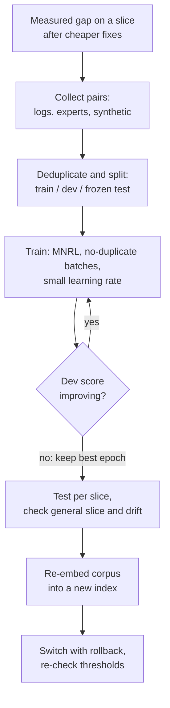

**Fine-tuning** an embedding model means continuing its training on examples from your own domain, so that the questions your users ask land closer to the passages that answer them. It is the most powerful adaptation technique in this module and the most expensive to operate: it produces a new model, which means new vectors, a full re-index and a model you now maintain. This lesson covers the practical workflow end to end: deciding whether to fine-tune, building and splitting training pairs, choosing a loss and hyperparameters, running a real training loop on AskMeridian data, checking for overfitting and drift, and shipping the result safely.

The theory of the loss function is the subject of [Contrastive learning](/learn/embedding-optimisation/contrastive-learning), and improving the negatives is the subject of [Hard negative mining](/learn/embedding-optimisation/hard-negative-mining). This lesson uses both as tools and focuses on the engineering.

## Learning objectives

- Decide, from a measured gap and available data, whether fine-tuning is justified.
- Build query-passage training pairs and split them so that the evaluation measures generalisation rather than memorisation.
- Choose a loss, batch size, learning rate and number of epochs for a first fine-tuning run, and explain each choice.
- Fine-tune a Sentence Transformers model with in-batch negatives and compare it with the base model on held-out queries.
- Measure how far the model's vectors moved, and plan the re-index and rollback that a new model requires.

## Prerequisites

- [Embedding evaluation](/learn/embedding-optimisation/embedding-evaluation): frozen test sets, slices and paired comparison.
- [Domain adaptation](/learn/embedding-optimisation/domain-adaptation): the cheaper rungs to try first, and how to diagnose domain shift.
- [What are embeddings?](/learn/embedding-fundamentals/what-are-embeddings): the embedding contract, which fine-tuning changes.

## Why this matters

A pre-trained model has learnt a geometry from other people's data. When your users' language, products and question patterns differ from that data, and a glossary and lexical search have already taken what they can, the remaining gap is in the geometry itself. Only training changes the geometry.

Done carelessly, fine-tuning makes things worse in ways that are hard to see. A model trained too hard on a few hundred pairs memorises them: its scores on the training questions are perfect and its behaviour on new phrasings deteriorates. A model evaluated on queries that leaked from the training set reports an improvement that does not exist. And a fine-tuned model deployed without re-embedding the corpus compares new query vectors with old document vectors, producing results close to random with no error raised. Each of these has happened to real teams; the workflow below exists to prevent them.

## The intuition

Picture the embedding space as a map on which every text has a pin. A good map puts each question's pin next to the pin of the passage that answers it. A pre-trained model's map is mostly right, but in Meridian's corner it has misplaced things: "PTO" sits far from "annual leave", and "4030" sits closer to E-4031 than to E-4030.

Fine-tuning shows the model pairs of pins that should be together ("PTO allowance" and "Annual leave is 25 days a year") alongside the other passages in the same batch that should be further away, and nudges the map a little each time. Three things follow from this picture:

1. **Small nudges, not a redraw.** Too large a learning rate or too many passes and the map is redrawn around the training pairs, distorting regions you never showed it.
2. **Every pin moves.** Even passages that were never in a training pair get new positions, so the whole corpus has to be pinned again with the new model.
3. **Only real distances count.** Checking the map on the very pairs you nudged proves nothing. You check it on questions it has not seen.

## How it works

### When to fine-tune

Fine-tune when all of these hold:

- A frozen evaluation shows a gap on a slice that matters, and the cheaper rungs of the [adaptation ladder](/learn/embedding-optimisation/domain-adaptation) have been tried.
- You have, or can create, training pairs that look like the failing slice: at least hundreds of real or carefully generated pairs. Narrow domains sometimes improve with a few hundred; broader ones need thousands. There is no reliable universal number, so measure on your evaluation set.
- The corpus is stable enough that re-embedding it for a new model is affordable.
- Someone will own the model: retraining as the domain drifts, versioning, rollback.

If any is missing, a reranker ([Cross-encoders](/learn/reranking-fundamentals/cross-encoders)) or hybrid search is often the better investment, because neither changes the index.

### Training data

The basic unit is a **positive pair**: a query and a passage that answers it. Common variants:

| Format | Example | Typical loss |
| --- | --- | --- |
| (anchor, positive) | ("PTO allowance", "Annual leave is 25 days a year.") | Multiple negatives ranking loss |
| (anchor, positive, negative) | adds a passage that looks relevant but is not | Same loss, with explicit hard negatives |
| (query, positive, negative) plus a teacher margin | margins from a cross-encoder | MarginMSE (see [Domain adaptation](/learn/embedding-optimisation/domain-adaptation)) |
| (text A, text B, similarity score) | scored sentence pairs | CoSENT or cosine-similarity loss; suited to similarity tasks rather than retrieval |

Sources, from most to least trustworthy:

- **Labelled logs.** A user's question paired with the chunk cited in an answer they rated as helpful. This is free once the system runs, and it matches real query style exactly. Beware of feedback loops: logs only contain chunks the current model already retrieved.
- **Expert-written pairs.** Staff write questions for passages, ideally in their own words without looking at the passage text.
- **Synthetic pairs.** Generated by an LLM as in [Domain adaptation](/learn/embedding-optimisation/domain-adaptation), filtered for consistency.

Quality beats quantity. A pair whose passage does not actually answer the query teaches the model the wrong geometry with full confidence.

### Splitting without leakage

The evaluation must contain only queries the model never trained on. Two kinds of split answer two different questions:

- **Split by query** (same corpus, different questions): "Does the model handle new phrasings of needs it was trained on?" This matches most RAG systems, where the corpus is known and fixed.
- **Split by document** (held-out passages have no training pairs at all): "Does the improvement generalise to documents added later?" Run this too if the corpus grows quickly.

Near-duplicates leak. If "PTO allowance" is in training and "PTO allowance?" is in the test set, the test measures memory. Deduplicate after normalising case and punctuation, and preferably by embedding similarity as well.

Keep three sets: **training**, a **development** set for choosing epochs and learning rate, and the frozen **test** set from the [evaluation lesson](/learn/embedding-optimisation/embedding-evaluation), looked at only to confirm the final choice.

### Loss and batches

For (query, passage) pairs the standard choice is the **multiple negatives ranking loss** (MNRL), also called InfoNCE with in-batch negatives. For each query in a batch, its own passage is the positive and every *other* passage in the batch is treated as a negative. The model is trained to pick out the right passage among the batch, which is precisely the retrieval task. [Contrastive learning](/learn/embedding-optimisation/contrastive-learning) derives it.

Two consequences matter in practice:

- **Larger batches give more negatives.** With batch size $B$, each query is contrasted with $B - 1$ negatives. Retrieval models are usually trained with the largest batch that fits in memory. When memory is short, a cached variant (`CachedMultipleNegativesRankingLoss` in Sentence Transformers, based on the GradCache technique) reaches large effective batches by computing embeddings in chunks.
- **Duplicates in a batch create false negatives.** If two queries in one batch share the same positive passage, each query's passage appears as a *negative* for the other. Use a batch sampler that prevents duplicate passages in a batch; Sentence Transformers provides `BatchSamplers.NO_DUPLICATES`.

### Hyperparameters for a first run

These are common starting points for small and base-sized models, not rules; tune on the development set.

| Setting | Starting point | Why |
| --- | --- | --- |
| Learning rate | about 2e-5 (1e-5 to 5e-5) | Small updates preserve what the model already knows |
| Epochs | 1 to 4 | Small datasets overfit quickly; pick the epoch with the best development score |
| Batch size | as large as memory allows (32 to 256 is common) | More in-batch negatives |
| Warm-up | about 10% of steps | Avoids large early updates while the optimiser's statistics settle |
| Evaluation | on the development set every epoch | Detects overfitting and selects the checkpoint |

### Overfitting, forgetting and drift

**Overfitting** is fitting the training pairs at the expense of new queries: training metrics rise while development metrics stall or fall. **Catastrophic forgetting** is losing general ability, so questions outside the training domain get worse. **Drift** is the more neutral fact that every vector moves; you can measure it as the cosine between a text's old and new embedding.

Guard against all three by keeping updates small, stopping at the best development epoch, keeping a general-language slice in the evaluation, and mixing some general pairs into training if forgetting appears. Parameter-efficient methods such as LoRA adapters, which train a small number of extra weights while freezing the rest, are supported in recent Sentence Transformers versions through the PEFT library; they reduce memory and limit how far the model can move, though their effect on quality varies by task and should be measured.

### Shipping a fine-tuned model

A fine-tuned model is a new model. The [embedding contract](/learn/embedding-fundamentals/what-are-embeddings) changes, and with it everything stored under the old one:

1. Save the model with a version identifier and record the base model, data version, hyperparameters and evaluation results.
2. Re-embed the whole corpus into a **new** index; never mix old and new vectors.
3. Evaluate the new index end to end against the frozen test set, slice by slice.
4. Switch queries and index together (for example by changing an alias), keeping the old index for rollback.
5. Re-check any similarity thresholds, because the score distribution has changed.

The whole workflow:



## In code

**The problem.** Fine-tune all-MiniLM-L6-v2 on AskMeridian query-passage pairs written in staff shorthand, and compare it with the base model on held-out queries, on the training queries and on a general-language check. Then measure how far the vectors moved.

**Dependencies.** `sentence-transformers` (with PyTorch) and NumPy. The example runs on a CPU in well under a minute.

```bash
pip install sentence-transformers numpy
```

The loop is written by hand, rather than with the library's trainer, so that each step is visible: tokenise a batch, compute the loss, back-propagate, update. It uses the library's own `MultipleNegativesRankingLoss`.

```python
import random
import numpy as np
import torch
from sentence_transformers import SentenceTransformer
from sentence_transformers.losses import MultipleNegativesRankingLoss

random.seed(0); np.random.seed(0); torch.manual_seed(0)

CORPUS = {
    "leave":     "Annual leave is 25 days a year.",
    "carryover": "Up to 5 unused leave days carry over and must be used by 31 March.",
    "remote":    "Staff may work remotely up to 3 days a week.",
    "equipment": "Employees get a £400 home-office equipment budget. Contractors are not eligible.",
    "expenses":  "Expenses must be submitted within 30 days.",
    "receipts":  "Any expense over £75 needs a receipt.",
    "password":  "Passwords must be rotated every 90 days.",
    "vpn":       "Use the VPN whenever you connect from public Wi-Fi.",
    "laptop":    "Laptops are refreshed every 3 years.",
    "lost":      "Report a lost or stolen laptop to the support desk at once.",
    "support":   "The support desk is open 08:00 to 18:00 UK time.",
    "e4021":     "Atlas error E-4021: the VPN client is out of date. Update it from the IT portal.",
    "e4030":     "Atlas error E-4030: your user lacks permission for this operation.",
    "e4031":     "Atlas error E-4031: the token does not grant access to this project.",
    "e4040":     "Atlas error E-4040: the requested Atlas resource does not exist or was deleted.",
    "export":    "Meridian Reports exports to PDF and CSV.",
    "sso":       "SAML single sign-on is available on the Enterprise plan of Meridian Reports.",
    "sync":      "Meridian Sync keeps project files in step across devices.",
}
# Training pairs (query, relevant id), in the shorthand staff use.
TRAIN = [
    ("PTO allowance", "leave"), ("how much PTO do I get", "leave"), ("days off per year", "leave"),
    ("PTO rollover", "carryover"), ("unused PTO at year end", "carryover"), ("leftover holiday deadline", "carryover"),
    ("WFH days", "remote"), ("WFH policy", "remote"), ("can I WFH on Fridays", "remote"),
    ("WFH kit", "equipment"), ("kit budget for home desk", "equipment"), ("contractor home office kit", "equipment"),
    ("T&E deadline", "expenses"), ("late T&E claim", "expenses"), ("how long to file expenses", "expenses"),
    ("receipt needed for T&E?", "receipts"), ("lost my receipt for a hotel", "receipts"), ("proof of purchase rules", "receipts"),
    ("pw expiry", "password"), ("pw change frequency", "password"), ("password keeps expiring", "password"),
    ("cafe wifi rules", "vpn"), ("working on hotel wifi", "vpn"), ("airport wifi safe?", "vpn"),
    ("MBP refresh", "laptop"), ("old laptop replacement", "laptop"), ("when do I get a new MBP", "laptop"),
    ("MBP stolen", "lost"), ("lost my MBP", "lost"), ("laptop left in a taxi", "lost"),
    ("helpdesk hours", "support"), ("IT open on Saturday?", "support"), ("when does IT close", "support"),
    ("4021", "e4021"), ("atlas vpn client out of date", "e4021"), ("update vpn client from portal", "e4021"),
    ("4030", "e4030"), ("atlas permission denied", "e4030"), ("not allowed to run this atlas command", "e4030"),
    ("4031", "e4031"), ("atlas token wrong project", "e4031"), ("token can't see this project", "e4031"),
    ("4040", "e4040"), ("atlas resource missing", "e4040"), ("atlas says it was deleted", "e4040"),
    ("Reports to excel", "export"), ("Reports csv download", "export"), ("export a report as pdf", "export"),
    ("Okta for Reports", "sso"), ("Reports SSO plan", "sso"), ("company login on Reports", "sso"),
    ("Sync across laptop and phone", "sync"), ("Sync files between devices", "sync"), ("keep files in step", "sync"),
]
# Held-out queries: different wording, never seen in training.
TEST = [
    ("WFH allowance per week?", "remote"), ("PTO entitlement", "leave"), ("PTO rollover rules", "carryover"),
    ("WFH kit budget", "equipment"), ("pw rotation cadence", "password"), ("T&E submission window", "expenses"),
    ("Okta for Reports?", "sso"), ("4021 again", "e4021"), ("getting a 4030", "e4030"),
    ("nicked MBP, who do I tell", "lost"), ("need a receipt for a £120 dinner?", "receipts"),
    ("is train station wifi ok without vpn", "vpn"), ("atlas says my token is no good for this project", "e4031"),
    ("helpdesk open at 7pm?", "support"), ("dashboard gone, atlas 4040", "e4040"), ("Reports spreadsheet export", "export"),
]
# A general-language check for forgetting: nothing to do with Meridian.
GENERAL_DOCS = ["The Eiffel Tower is in Paris.", "Photosynthesis converts light into chemical energy.",
                "The Pacific is the largest ocean.", "Mount Everest is the highest mountain above sea level.",
                "Python is a programming language.", "The heart pumps blood around the body."]
GENERAL_Q = [("Where is the Eiffel Tower?", 0), ("How do plants make energy from sunlight?", 1),
             ("biggest ocean on Earth", 2), ("tallest mountain in the world", 3),
             ("a popular language for coding", 4), ("what organ circulates blood", 5)]

ids = list(CORPUS)

def mrr(model, queries, docs, gold):
    D = model.encode(docs, normalize_embeddings=True)
    Q = model.encode(queries, normalize_embeddings=True)
    order = np.argsort(-(Q @ D.T), axis=1)
    return float(np.mean([1 / (list(r).index(g) + 1) for r, g in zip(order, gold)]))

def report(model, label):
    m_test = mrr(model, [q for q, _ in TEST], list(CORPUS.values()), [ids.index(d) for _, d in TEST])
    m_train = mrr(model, [q for q, _ in TRAIN], list(CORPUS.values()), [ids.index(d) for _, d in TRAIN])
    m_gen = mrr(model, [q for q, _ in GENERAL_Q], GENERAL_DOCS, [g for _, g in GENERAL_Q])
    print(f"{label:<10} train MRR {m_train:.2f}   held-out MRR {m_test:.2f}   general MRR {m_gen:.2f}")

def batches_without_duplicates(pairs, batch_size):
    """Shuffle, then fill each batch with pairs whose positives differ."""
    pool = pairs[:]
    random.shuffle(pool)
    while pool:
        batch, used = [], set()
        for p in pool[:]:
            if p[1] not in used:
                batch.append(p); used.add(p[1]); pool.remove(p)
            if len(batch) == batch_size:
                break
        yield batch

model = SentenceTransformer("sentence-transformers/all-MiniLM-L6-v2", device="cpu")
report(model, "before")
probe = list(CORPUS.values()) + GENERAL_DOCS
before = model.encode(probe, normalize_embeddings=True)

loss_fn = MultipleNegativesRankingLoss(model)          # in-batch negatives, scale 20
optimizer = torch.optim.AdamW(model.parameters(), lr=2e-5)
model.train()
for epoch in range(4):
    total, steps = 0.0, 0
    for batch in batches_without_duplicates(TRAIN, batch_size=16):
        anchors = model.tokenize([q for q, _ in batch])
        positives = model.tokenize([CORPUS[d] for _, d in batch])
        loss = loss_fn([anchors, positives], labels=None)
        optimizer.zero_grad()
        loss.backward()
        optimizer.step()
        total += loss.item(); steps += 1
    print(f"epoch {epoch + 1}: mean training loss {total / steps:.3f}")
model.eval()
report(model, "after")
drift = np.sum(before * model.encode(probe, normalize_embeddings=True), axis=1)
print(f"cosine(old vector, new vector): Meridian chunks {drift[:len(CORPUS)].mean():.3f}, "
      f"general sentences {drift[len(CORPUS):].mean():.3f}")
```

```output
before     train MRR 0.94   held-out MRR 0.87   general MRR 1.00
epoch 1: mean training loss 0.338
epoch 2: mean training loss 0.135
epoch 3: mean training loss 0.086
epoch 4: mean training loss 0.102
after      train MRR 0.99   held-out MRR 0.97   general MRR 1.00
cosine(old vector, new vector): Meridian chunks 0.970, general sentences 0.997
```

Produced with sentence-transformers 6.3 and PyTorch 2 on a CPU. In sentence-transformers 6, `tokenize` still works but emits a deprecation warning in favour of `preprocess`; earlier versions use `tokenize` as shown.

**The important lines.**

- `TRAIN` and `TEST` share the corpus but not the queries: this is a split by query. The test phrasings ("4021 again", "nicked MBP, who do I tell") were written separately and are not near-duplicates of training queries.
- `batches_without_duplicates` builds batches in which no passage appears twice. With three training queries per passage, a plain shuffle would often put two queries for the same passage in one batch, turning the correct passage into a negative.
- `MultipleNegativesRankingLoss(model)` takes the list `[anchors, positives]`. Inside, it embeds both, computes the similarity of every anchor with every positive in the batch, multiplies by a **scale** of 20 (the reciprocal of a temperature of 0.05), and applies cross-entropy with the diagonal as the correct answers. `labels=None` because the correct answers are implied by position.
- `torch.optim.AdamW(..., lr=2e-5)` is the conservative learning rate from the table. Each `optimizer.step()` nudges all of the model's weights.
- `model.train()` and `model.eval()` switch dropout on for training and off for evaluation; forgetting `model.eval()` makes evaluation noisy.
- The drift line computes, for each probe text, the cosine between its embedding before and after training.

**What the output means.**

- **Held-out MRR rose from 0.87 to 0.97.** Nearly every one of the 16 unseen shorthand queries now ranks its passage first, including the codes and "nicked MBP"; the remaining imperfection is a single query landing at rank 2 or lower. This is the effect fine-tuning is for. It is also 16 queries on an 18-passage corpus: a demonstration, not evidence for deployment. On a real evaluation set you would report the interval as in [Embedding evaluation](/learn/embedding-optimisation/embedding-evaluation).
- **Training MRR reached 0.99 and the loss fell from 0.338 to about 0.1** (it ticked up slightly at epoch 4, because batches are reshuffled each epoch). Training metrics always look good; only the held-out number says whether learning generalised.
- **The general check did not move**, but it is too easy to detect anything except a disaster: six unrelated facts. A real forgetting check uses a few hundred general queries.
- **Every vector moved.** Meridian chunks' new vectors have an average cosine of 0.970 with their old ones; the general sentences moved less (0.997). Even this gentle run changed the geometry, which is why old and new vectors must never share an index.

**Common errors.** Running out of memory with large batches (reduce the batch size or use the cached loss); forgetting `model.eval()` before evaluation; evaluating on training queries; and training with duplicate positives in a batch, which shows up as a loss that refuses to fall below a floor.

### The same run with the library trainer

In production, use `SentenceTransformerTrainer`, which adds learning-rate warm-up, evaluation during training, checkpointing, mixed precision and the no-duplicates batch sampler. It requires the `datasets` and `accelerate` packages; the sandbox used for this lesson lacks `accelerate`, so this block was **not executed**. It follows the documented API of Sentence Transformers 3 and later.

```python
from datasets import Dataset
from sentence_transformers import (SentenceTransformer, SentenceTransformerTrainer,
                                   SentenceTransformerTrainingArguments)
from sentence_transformers.evaluation import InformationRetrievalEvaluator
from sentence_transformers.losses import MultipleNegativesRankingLoss
from sentence_transformers.training_args import BatchSamplers

model = SentenceTransformer("sentence-transformers/all-MiniLM-L6-v2")
train_dataset = Dataset.from_dict({
    "anchor":   [q for q, _ in TRAIN],
    "positive": [CORPUS[d] for _, d in TRAIN],
})
dev_evaluator = InformationRetrievalEvaluator(   # use a separate dev set, not the test set
    queries={f"q{i}": q for i, (q, _) in enumerate(DEV)},
    corpus=CORPUS,
    relevant_docs={f"q{i}": {d} for i, (_, d) in enumerate(DEV)},
    name="dev",
)
args = SentenceTransformerTrainingArguments(
    output_dir="models/askmeridian-minilm-ft",
    num_train_epochs=4,
    per_device_train_batch_size=32,
    learning_rate=2e-5,
    warmup_ratio=0.1,
    batch_sampler=BatchSamplers.NO_DUPLICATES,
    eval_strategy="epoch",
    save_strategy="epoch",
    load_best_model_at_end=True,
    metric_for_best_model="eval_dev_cosine_ndcg@10",
    seed=0,
)
trainer = SentenceTransformerTrainer(
    model=model, args=args, train_dataset=train_dataset,
    loss=MultipleNegativesRankingLoss(model), evaluator=dev_evaluator,
)
trainer.train()
model.save_pretrained("models/askmeridian-minilm-ft/v1")
```

`DEV` is a development list of (query, id) pairs, distinct from both `TRAIN` and `TEST`. The `metric_for_best_model` name combines the `eval_` prefix, the evaluator's `name`, and the metric key; check the exact key in the evaluation logs of your version.

**Extending it.** Add hard negatives as a third column (`"negative"`) mined as in [Hard negative mining](/learn/embedding-optimisation/hard-negative-mining); add a general-language slice of a few hundred queries to the evaluator; and wrap the base model with `MatryoshkaLoss` to train for truncatable vectors ([Matryoshka embeddings](/learn/embedding-optimisation/matryoshka-embeddings)).

## A real-world example

Six months after launch, AskMeridian has a thumbs-up button. The Platform team exports every question whose answer received a thumbs up, paired with the chunks cited in that answer: about 4,000 pairs after removing personal data. HR and IT reviewers check a random 200 and find about one in ten pairs where the cited chunk does not really answer the question (the answer was right for other reasons). They tighten the filter to pairs where the question and chunk also pass a cross-encoder score threshold.

They split by query, deduplicate near-identical questions across the split, and hold out a document-level split for the newest runbooks. The first run, at a learning rate of 1e-4 for ten epochs, looks superb on the training set and is worse than the base model on the development set after epoch two. The second run, at 2e-5 for three epochs with the no-duplicates sampler, improves the development score at every epoch.

On the frozen test set, the handbook and runbook slices improve with intervals that exclude zero; the general-language slice and the document-level split are unchanged within their intervals. The team saves the model as `askmeridian-minilm-ft-v1`, re-embeds all chunks into a new Qdrant collection, runs the end-to-end evaluation, and switches an alias from the old collection to the new one. They recalibrate the minimum-similarity threshold used for "I don't know" answers, because the fine-tuned model's scores for relevant chunks are higher than the base model's. The old collection stays for two weeks as a rollback.

The thumbs-up data has a known bias: it only contains chunks the base model already retrieved. The team schedules a retrain every quarter and adds hard negatives in the next round, so that later models are not limited to what the first model could find.

## Common mistakes

- **Evaluating on training queries, or on near-duplicates of them.** Reported gains are memorisation and vanish in production.
- **A learning rate that is too high, or too many epochs.** The model overfits a small dataset and loses general ability; development scores peak early and then fall.
- **Duplicate positives in a batch.** The correct passage becomes a negative for another query, and training fights itself.
- **Skipping the re-index.** New query vectors are compared with old document vectors, and retrieval quality collapses without an error.
- **Reusing similarity thresholds.** The fine-tuned model's score distribution differs, so old thresholds admit too much or too little.
- **Training on unchecked feedback.** Pairs where the passage does not answer the question teach the model the wrong neighbours.

## Best practices

- Fine-tune only after the cheaper fixes, against a gap measured on a frozen test set.
- Split by query and, if the corpus grows, by document; deduplicate across splits.
- Start with MNRL, a learning rate around 2e-5, 1 to 4 epochs, no-duplicate batches and the largest batch that fits.
- Select the checkpoint on a development set; look at the test set once.
- Keep a general-language slice and measure drift.
- Version the model, the data and the hyperparameters together; ship with a new index, an alias switch and a rollback.
- Plan retraining from the start; logs accumulate and the domain drifts.

## Performance considerations

Training cost is easy to estimate. With $N$ pairs, batch size $B$ and $E$ epochs there are $\lceil N/B \rceil \times E$ optimiser steps. 4,000 pairs at batch size 64 for 3 epochs is $63 \times 3 = 189$ steps. Each step embeds $2B$ texts forwards and backwards, roughly three times the cost of embedding them for inference. For a small model on a single modern GPU this is minutes; on a CPU it can be an hour or more (measure yours).

Memory is the binding constraint for MNRL, because activations for all $2B$ texts are held for the backward pass, and the similarity matrix is $B \times B$. Doubling $B$ roughly doubles activation memory. The cached loss trades extra computation (each text is embedded twice) for memory that no longer grows with $B$.

The larger operational cost is the re-index: every chunk must be embedded again, at the same cost as the original indexing, and the old and new indexes coexist during the switch, doubling vector storage temporarily.

Inference cost does not change: a fine-tuned model has the same architecture and dimensionality as its base.

## Security considerations

- **Personal data in training pairs.** Logged questions can contain names, health information or credentials. Scrub them before training; a model can memorise rare strings from its training data.
- **Poisoned feedback.** If anyone can upvote, a coordinated user can teach the model to associate a query with a misleading chunk. Restrict which feedback is used, and review samples.
- **Model artefacts.** Store fine-tuned weights in `safetensors` format with access controls and checksums, and record which data each version was trained on so that a data-deletion request can be traced to the models it affects.

## Summary

- Fine-tuning changes the embedding geometry itself; justify it with a measured gap that cheaper fixes did not close.
- Build pairs from feedback logs, experts or filtered synthetic data, and split by query (and by document if the corpus grows) without near-duplicate leakage.
- Multiple negatives ranking loss with no-duplicate batches, a small learning rate and few epochs is the standard first run; choose the checkpoint on a development set.
- Every vector moves, so a fine-tuned model needs a full re-index, recalibrated thresholds, versioning and a rollback path.
- Watch for overfitting, forgetting and feedback bias, and plan regular retraining.

## Exercises

**1.** You have 3,000 pairs, batch size 32 and 3 epochs. How many optimiser steps is that, and how many in-batch negatives does each query see per step?

<details><summary>Show solution</summary>

$\lceil 3000/32 \rceil = 94$ steps per epoch, so $94 \times 3 = 282$ steps. Each query sees $32 - 1 = 31$ in-batch negatives per step (the last batch of each epoch is smaller, with fewer negatives).

</details>

**2.** Re-run the code example with a learning rate of 2e-4 and 20 epochs. Compare held-out MRR and drift with the original run, and explain the difference.

<details><summary>Show solution</summary>

Change `lr=2e-5` to `lr=2e-4` and `range(4)` to `range(20)`. The final lines print:

```output
after      train MRR 1.00   held-out MRR 1.00   general MRR 1.00
cosine(old vector, new vector): Meridian chunks 0.596, general sentences 0.901
```

The training loss reaches 0.000, held-out MRR is no worse than with the gentle run (1.00 against 0.97, a difference of about one query, which is noise on 16 queries), but the vectors moved far more: Meridian chunks' average cosine with their old vectors is 0.596 instead of 0.970, and even unrelated general sentences moved (0.901 instead of 0.997). The aggressive run memorised the training pairs and redrew much more of the space than it needed to, without a visible gain here, so the held-out number alone would not have warned you. On a realistic general slice, drift of that size is a strong warning sign of forgetting.

</details>

**3.** Remove the `batches_without_duplicates` function and replace it with plain shuffled batches of 16. Explain what you expect to happen to the training loss and why.

<details><summary>Show solution</summary>

With three queries per passage and batches of 16 drawn from 54 pairs, many batches will contain two queries for the same passage. For each such pair, the correct passage also appears in another column of the similarity matrix and is labelled a negative. The model is asked to rank the same passage both first and not first, so the loss cannot approach zero and the gradients partly cancel. Expect a much higher training loss floor and, in general, a weaker improvement. Replacing the loop header with `pool = TRAIN[:]; random.shuffle(pool)` and `for batch in [pool[i:i + 16] for i in range(0, len(pool), 16)]:` gives epoch losses of 0.628, 0.538, 0.503 and 0.412 (against 0.102 at epoch 4 before) and a held-out MRR of 0.97, the same as the gentle run, with Meridian chunks drifting less (cosine 0.981 against 0.970). On this tiny held-out set the damage is visible only in the loss, which stays far above the 0.102 of the clean run; training and held-out MRR match the clean run (0.99 and 0.97), though on a larger or harder set the weaker learning would show there too.

</details>

**4.** Design decision. AskMeridian's corpus will grow by about 30% a year as new runbooks are written, and the team fine-tuned in January. Design a retraining and evaluation policy for the year.

<details><summary>Show solution</summary>

Keep a document-level held-out split refreshed monthly with the newest runbooks, so you can see whether the fine-tuned model generalises to documents written after training. Re-run the frozen test set and the new-document split monthly against the deployed model and the base model.

Retrain on a schedule (quarterly) or on a trigger (the new-document slice falls below the base model, or a slice degrades beyond its interval). Each retrain adds the new feedback pairs, mines hard negatives with the current model, and goes through the same train/dev/test procedure. Each new model is a new version with a full re-index and an alias switch. Track the cost: a re-index per quarter at the projected corpus size, and confirm it fits the budget; if it does not, retrain less often and lean on a reranker for new documents.

</details>

## Check your understanding

```quiz
[
  {
    "q": "Why must the whole corpus be re-embedded after fine-tuning, even passages that never appeared in a training pair?",
    "options": [
      "Training changes the shared weights, so every text's vector moves and old vectors are no longer comparable with new query vectors",
      "Only passages in training pairs change; the rest are re-embedded for consistency",
      "The fine-tuned model has a different dimensionality",
      "Vector databases require it after any model update"
    ],
    "answer": 0,
    "why": "All texts pass through the same updated weights. The drift measurement shows even unrelated sentences move."
  },
  {
    "q": "In multiple negatives ranking loss with batch size B, what serves as the negatives for each query?",
    "options": [
      "Randomly generated vectors",
      "Passages from the previous batch",
      "The other B - 1 positive passages in the same batch",
      "Only explicitly mined hard negatives"
    ],
    "answer": 2,
    "why": "Each query's own passage is the positive; every other passage in the batch is treated as a negative. Hard negatives can be added as an extra column."
  },
  {
    "q": "Training MRR reaches 1.00 at epoch 2 while development MRR peaks at epoch 2 and falls at epochs 3 and 4. What should you do?",
    "options": [
      "Train for more epochs until development MRR recovers",
      "Keep the epoch 2 checkpoint; the later epochs are overfitting",
      "Increase the learning rate",
      "Evaluate on the training set instead"
    ],
    "answer": 1,
    "why": "Falling development scores while training scores stay perfect is overfitting. Select the best development checkpoint."
  },
  {
    "q": "Two training queries in the same batch share the same positive passage. What goes wrong?",
    "options": [
      "Nothing; duplicates strengthen the signal",
      "The batch is skipped by the loss",
      "The model receives twice the learning rate for that passage",
      "The shared passage is treated as a negative for one of the queries, creating a false negative"
    ],
    "answer": 3,
    "why": "In-batch negatives assume every other passage is wrong for a query. A duplicate positive breaks that assumption; use a no-duplicates batch sampler."
  },
  {
    "q": "Which split tests whether a fine-tuned model generalises to runbooks written after training?",
    "options": [
      "A split by query over the existing corpus",
      "Evaluating on the training pairs",
      "A split by document, where held-out passages had no training pairs",
      "Random 80/20 split of all pairs"
    ],
    "answer": 2,
    "why": "Only passages absent from training show whether improvements transfer to new documents."
  }
]
```

## Further reading

- Reimers and Gurevych (2019), "Sentence-BERT: Sentence Embeddings using Siamese BERT-Networks", [arXiv:1908.10084](https://arxiv.org/abs/1908.10084).
- Henderson et al. (2017), "Efficient Natural Language Response Suggestion for Smart Reply", [arXiv:1705.00652](https://arxiv.org/abs/1705.00652): the multiple negatives ranking loss.
- Gao, Zhang, Han and Callan (2021), "Scaling Deep Contrastive Learning Batch Size under Memory Limited Setup" (GradCache), [arXiv:2101.06983](https://arxiv.org/abs/2101.06983).
- Sentence Transformers documentation, [sbert.net](https://www.sbert.net/), the training overview, loss overview and `SentenceTransformerTrainer` pages.
- Hu et al. (2021), "LoRA: Low-Rank Adaptation of Large Language Models", [arXiv:2106.09685](https://arxiv.org/abs/2106.09685).
