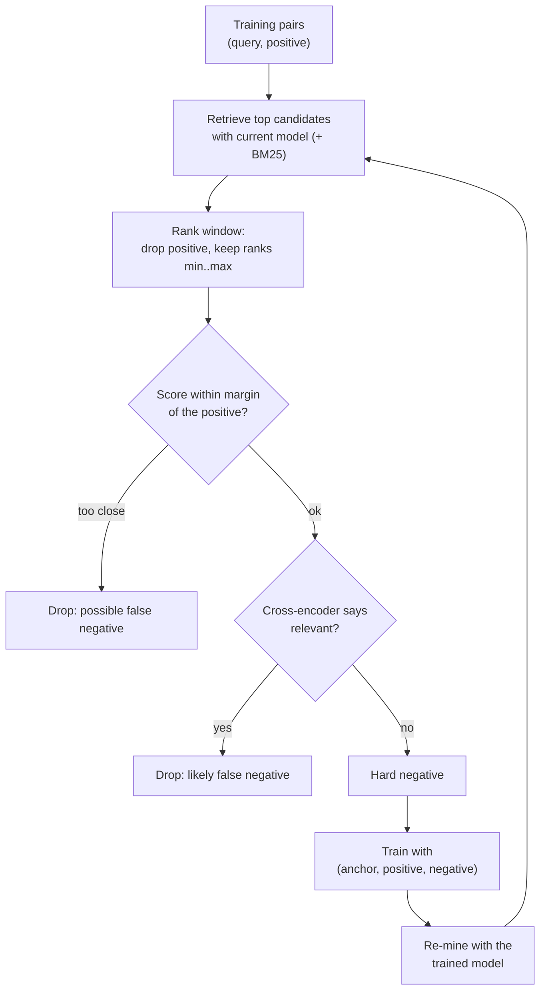

A model learns most from the mistakes it is close to making. In [Contrastive learning](/learn/embedding-optimisation/contrastive-learning) you saw that the InfoNCE gradient pushes each negative in proportion to how similar the model thinks it is to the query: obviously wrong passages receive almost no push at all. **Hard negative mining** is the practice of deliberately finding passages that look relevant but are not, such as the E-4031 runbook for a question about E-4030, and adding them to training, so that the model learns the fine distinctions that matter in production. This lesson covers where hard negatives come from, the serious risk that a "negative" is actually relevant, the filters that manage that risk, and a mining pipeline you can run on AskMeridian data.

## Learning objectives

- Define easy, hard and false negatives, and explain with the InfoNCE gradient why each one affects training differently.
- Mine hard negatives with a bi-encoder, using a rank window and a positive-aware score margin.
- Filter false negatives with a cross-encoder, and explain what over-filtering costs.
- Add mined negatives to a training batch and measure the extra training signal they provide.
- Design a mining pipeline that refreshes negatives as the model improves.

## Prerequisites

- [Contrastive learning](/learn/embedding-optimisation/contrastive-learning): InfoNCE, in-batch negatives and the gradient $\frac{1}{\tau}(p_{ij} - y_{ij})$.
- [Fine-tuning embeddings](/learn/embedding-optimisation/fine-tuning-embeddings): the training workflow these negatives feed into.
- [Cross-encoders](/learn/reranking-fundamentals/cross-encoders): models that score a query and passage together.
- [BM25](/learn/sparse-retrieval/bm25): useful as a second source of candidates.

## Why this matters

In-batch negatives are free, but they are random. In a batch of AskMeridian training pairs, a question about the leave allowance is contrasted with passages about VPNs, expenses and Atlas errors. The model separates those within a few hundred steps, after which they contribute almost nothing. Meanwhile, the distinctions users actually trip over are never trained: the leave allowance versus the carry-over rule, E-4030 versus E-4031, the 2023 handbook versus the current one.

Mining fixes the first problem and creates a second. The passages most similar to a query are, by construction, the ones most likely to be relevant. Labelled datasets are incomplete: if a query has one labelled positive and a second passage that also answers it, mining will happily select that second passage as a "hard negative". Training then pushes apart two texts that say the same thing, with the largest gradient in the batch. Teams that mine naively often find their fine-tuned model gets *worse*. Good mining is as much about rejecting candidates as finding them.

## The intuition

Think of a driving examiner preparing a learner for the test. Practising on empty roads (easy negatives) builds basic control, but after a while it teaches nothing. Real learning happens at tricky junctions: a give-way sign that looks like a stop sign, a bus lane that looks like a normal lane. Those are hard negatives: situations that look like the right answer and are not.

But the examiner must be careful not to mark a correct manoeuvre as wrong. If a learner takes an alternative route that is perfectly legal and is told off for it, they learn a false rule, and because they were so close to "right", the correction is confusing and memorable. That is a false negative. A good examiner picks tricky junctions *and* double-checks before marking something wrong. Mining with filtering does the same.

## How it works

### Three kinds of negative

For a query $q$ with labelled positive $p^{+}$:

- An **easy negative** is clearly irrelevant and already scored far below $p^{+}$. Example: "Meridian Reports exports to PDF and CSV" for a leave question.
- A **hard negative** is irrelevant but scored close to $p^{+}$, usually because it shares topic, vocabulary or structure. Example: the carry-over rule for "How many days of annual leave do I get?"
- A **false negative** is actually relevant but unlabelled, so a mining procedure treats it as a negative. Example: an FAQ line, "Every employee is entitled to 25 days of annual leave", for the same question.

The first two are what you want in training; the third is noise that does harm.

### Where candidates come from

- **The current dense model.** Embed the corpus, retrieve the top results for each training query, and remove the labelled positive. These are the passages *this* model confuses with the right one, exactly the errors training should correct. This is the most common source.
- **BM25.** Lexical candidates share words with the query. Dense Passage Retrieval (Karpukhin and colleagues, 2020) used BM25 negatives successfully. They are complementary to dense candidates, which may share meaning but few words.
- **A refreshed index during training.** Negatives mined with the starting model go stale as the model learns. ANCE (Xiong and colleagues, 2020) re-mines negatives periodically with the model being trained. In practice, a simpler approach is one or two rounds: train, re-mine with the new model, train again.
- **Structure in the corpus.** Sibling sections of the same document, other versions of the same policy and adjacent error codes are hard negatives by design, and can be selected with metadata instead of search.

### Controlling hardness: the rank window and the margin

Two simple controls decide which candidates qualify.

**The rank window.** Take candidates between rank `range_min` and `range_max` (after removing the positive). Skipping the first few ranks avoids the candidates most likely to be false negatives; a `range_max` of 10 to 50 keeps candidates relevant enough to be hard. The right window depends on how many relevant passages a query typically has.

**A positive-aware margin.** Compare each candidate's score with the positive's score. A **relative margin** $r$ keeps a candidate only if its score is at most $(1 - r)$ times the positive's; an **absolute margin** $a$ keeps it only if its score is at least $a$ below the positive's. A candidate scoring nearly as high as the positive is suspicious: either it is relevant, or the model genuinely cannot tell, and in both cases a hard push is risky. The NV-Retriever work (Moreira and colleagues, 2024) studied such positive-aware thresholds and reported that they reduce false negatives compared with taking the top candidates naively.

### Filtering with a cross-encoder

A **cross-encoder** reads the query and candidate together and outputs a relevance score. It is slower than a bi-encoder but usually more accurate, so it makes a good second opinion: drop any mined candidate that the cross-encoder judges relevant. RocketQA (Qu and colleagues, 2021) reported that many top-retrieved "negatives" in the MS MARCO dataset were in fact relevant but unlabelled, and used a cross-encoder to remove them before training a dual encoder; this denoising was one of its main improvements.

Two cautions:

- **Over-filtering.** A cross-encoder that is not perfect on your domain will also reject some genuine hard negatives, often the most valuable ones, because they *look* relevant. You will see this in the code below.
- **Score scales.** Cross-encoders often output raw logits (any real number). Converting to a probability with a sigmoid gives an interpretable threshold such as 0.5. Margins defined as a fraction of the positive's score only make sense for scores that are positive; check before applying one to raw logits.

### Using the negatives

A mined negative becomes a third column in the training data: (anchor, positive, negative). In multiple negatives ranking loss, the negatives of *all* rows are appended to the candidate set, so with batch size $B$ each query is contrasted with $B - 1$ in-batch positives of other rows plus $B$ mined negatives. One to a few negatives per query is typical; more negatives cost more encoding per step.

The mining pipeline, step by step:

1. Embed the corpus with the current model; for each training query, retrieve the top `range_max` candidates.
2. Remove the labelled positives and any candidates above rank `range_max` or below `range_min`.
3. Drop candidates whose score exceeds the positive-aware margin.
4. Score the survivors with a cross-encoder; drop those it judges relevant.
5. Keep the top one to a few survivors per query (or sample from them).
6. Spot-check a random sample by hand; record the drop rates at each filter.
7. Train; then optionally re-mine with the trained model and train again.



## The mathematics

### Why hard negatives carry the signal, and false negatives do damage

**Intuition.** In InfoNCE, each negative is pushed away in proportion to the probability it steals from the positive. That probability grows exponentially with the negative's similarity, divided by the temperature.

From [Contrastive learning](/learn/embedding-optimisation/contrastive-learning), for one query with similarities $s_j$ to candidates and temperature $\tau$:

$$
p_j = \frac{e^{s_j/\tau}}{\sum_k e^{s_k/\tau}}, \qquad \frac{\partial \mathcal{L}}{\partial s_j} = \frac{p_j}{\tau} \ \text{ for each negative } j
$$

$s_j$ is the cosine between the query and candidate $j$; $p_j$ is its softmax probability; the derivative is how strongly a gradient step lowers that similarity.

**By hand.** The query "How many days of annual leave do I get?" with the cosines produced by the code below and $\tau = 0.05$: positive 0.860, FAQ duplicate 0.742, carry-over rule 0.643, remote-work rule 0.400.

- Divide by $\tau$ and subtract the largest: $0$, $-2.36$, $-4.34$, $-9.20$.
- Exponentials: $1$, $0.0944$, $0.0130$, $0.0001$; sum $\approx 1.1076$.
- Probabilities: positive $0.9029$, FAQ duplicate $0.0853$, carry-over $0.0118$, remote work $0.0001$.
- Pushes ($p_j/\tau$): FAQ duplicate $1.705$, carry-over $0.235$, remote work $0.002$.

The easy negative is irrelevant to training. The hard negative gets about a hundred times the push of the easy one. And the false negative, the FAQ line that says the same thing as the positive, gets the largest push of all, seven times the hard negative's. A false negative is not merely wasted; it is the single strongest instruction in the row, and it is wrong.

### The positive-aware margin

$$
\text{keep } n \iff s(q, n) \le (1 - r)\, s(q, p^{+}) \qquad \text{or} \qquad s(q, n) \le s(q, p^{+}) - a
$$

$r$ is a relative margin (for example 0.05) and $a$ an absolute margin (for example 0.1). With $s(q, p^{+}) = 0.860$ and $r = 0.05$, the ceiling is $0.95 \times 0.860 = 0.817$. The FAQ duplicate scores 0.742, below the ceiling, so the margin alone does not catch it. An absolute margin of 0.1 (ceiling 0.760) would not either. That is why a second, independent filter is needed.

```python
import numpy as np

tau = 0.05
s = {"positive": 0.860, "FAQ duplicate (false negative)": 0.742,
     "carry-over (hard negative)": 0.643, "remote work (easy negative)": 0.400}
z = np.array(list(s.values())) / tau
p = np.exp(z - z.max()); p /= p.sum()
for (name, score), prob in zip(s.items(), p):
    print(f"{name:<32} cos={score:.3f}  p={prob:.4f}  push={prob / tau if name != 'positive' else (prob - 1) / tau:+.3f}")

r = 0.05
print(f"\nrelative-margin ceiling: {(1 - r) * s['positive']:.3f}")
```

```output
positive                         cos=0.860  p=0.9029  push=-1.942
FAQ duplicate (false negative)   cos=0.742  p=0.0853  push=+1.705
carry-over (hard negative)       cos=0.643  p=0.0118  push=+0.235
remote work (easy negative)      cos=0.400  p=0.0001  push=+0.002

relative-margin ceiling: 0.817
```

## In code

**The problem.** Mine one hard negative for each of five AskMeridian training queries, with a rank window, a positive-aware margin and a cross-encoder filter, printing the decision for every candidate. Then measure how much more training signal the mined negatives provide than in-batch negatives alone.

**Dependencies.** `sentence-transformers` (with PyTorch) and NumPy. The bi-encoder and cross-encoder download on first use.

```bash
pip install sentence-transformers numpy
```

The corpus deliberately contains a trap: an FAQ line that states the same fact as the handbook's leave line. Only the handbook line is labelled as the positive.

```python
import numpy as np
import torch
from sentence_transformers import SentenceTransformer, CrossEncoder
from sentence_transformers.losses import MultipleNegativesRankingLoss

CORPUS = [
    "Annual leave is 25 days a year.",                                   # 0  handbook
    "Every employee is entitled to 25 days of annual leave.",           # 1  FAQ: same fact
    "Up to 5 unused leave days carry over and must be used by 31 March.",
    "Staff may work remotely up to 3 days a week.",
    "Employees get a £400 home-office equipment budget. Contractors are not eligible.",
    "Expenses must be submitted within 30 days.",
    "Any expense over £75 needs a receipt.",
    "Passwords must be rotated every 90 days.",
    "Use the VPN whenever you connect from public Wi-Fi.",
    "Atlas error E-4021: the VPN client is out of date. Update it from the IT portal.",
    "Atlas error E-4030: your user lacks permission for this operation.",
    "Atlas error E-4031: the token does not grant access to this project.",
    "Atlas error E-4040: the requested Atlas resource does not exist or was deleted.",
    "Meridian Reports exports to PDF and CSV.",
    "Atlas error E-4012: the VPN certificate has expired. Request a new one from the IT portal.",
]
PAIRS = [  # (query, index of its labelled positive)
    ("How many days of annual leave do I get?", 0),
    ("Atlas says my VPN client is out of date", 9),
    ("Atlas says I lack permission for this operation", 10),
    ("Do I need a receipt for my expenses?", 6),
    ("How many days a week can I work from home?", 3),
]
RANGE_MIN, RANGE_MAX = 0, 5      # consider the bi-encoder's top 5 non-positive candidates
RELATIVE_MARGIN = 0.05           # negative must score <= 95% of the positive's score
CE_MAX_PROB = 0.5                # drop candidates the cross-encoder thinks are relevant

model = SentenceTransformer("sentence-transformers/all-MiniLM-L6-v2", device="cpu")
teacher = CrossEncoder("cross-encoder/ms-marco-MiniLM-L-6-v2")
D = model.encode(CORPUS, normalize_embeddings=True)
Q = model.encode([q for q, _ in PAIRS], normalize_embeddings=True)
S = Q @ D.T

triplets = []
for (query, pos), scores in zip(PAIRS, S):
    print(f'\n"{query}"  positive score {scores[pos]:.3f}')
    ranked = [j for j in np.argsort(-scores) if j != pos][RANGE_MIN:RANGE_MAX]
    probs = torch.sigmoid(torch.tensor(teacher.predict([(query, CORPUS[j]) for j in ranked]))).numpy()
    chosen = None
    for j, prob in zip(ranked, probs):
        if scores[j] > (1 - RELATIVE_MARGIN) * scores[pos]:
            verdict = "drop: too close to positive"
        elif prob > CE_MAX_PROB:
            verdict = "drop: teacher says relevant"
        elif chosen is None:
            verdict, chosen = "KEEP as hard negative", j
        else:
            verdict = "spare"
        print(f"  {scores[j]:.3f}  p(rel)={prob:.2f}  {verdict:<28} {CORPUS[j][:52]}")
    triplets.append((query, CORPUS[pos], CORPUS[chosen]))

# How much training signal does each kind of batch carry? Same model, no training.
loss_fn = MultipleNegativesRankingLoss(model)
anchors = model.tokenize([a for a, _, _ in triplets])
positives = model.tokenize([p for _, p, _ in triplets])
negatives = model.tokenize([n for _, _, n in triplets])
with torch.no_grad():
    easy = loss_fn([anchors, positives], labels=None).item()
    hard = loss_fn([anchors, positives, negatives], labels=None).item()
print(f"\nMNRL loss, in-batch negatives only:     {easy:.3f}")
print(f"MNRL loss, plus one mined hard negative: {hard:.3f}")
```

```output

"How many days of annual leave do I get?"  positive score 0.860
  0.742  p(rel)=1.00  drop: teacher says relevant  Every employee is entitled to 25 days of annual leav
  0.643  p(rel)=0.44  KEEP as hard negative        Up to 5 unused leave days carry over and must be use
  0.400  p(rel)=0.01  spare                        Staff may work remotely up to 3 days a week.
  0.397  p(rel)=0.02  spare                        Expenses must be submitted within 30 days.
  0.288  p(rel)=0.00  spare                        Passwords must be rotated every 90 days.

"Atlas says my VPN client is out of date"  positive score 0.814
  0.765  p(rel)=0.95  drop: teacher says relevant  Atlas error E-4012: the VPN certificate has expired.
  0.558  p(rel)=0.00  KEEP as hard negative        Atlas error E-4040: the requested Atlas resource doe
  0.486  p(rel)=0.00  spare                        Atlas error E-4030: your user lacks permission for t
  0.465  p(rel)=0.00  spare                        Atlas error E-4031: the token does not grant access 
  0.314  p(rel)=0.00  spare                        Use the VPN whenever you connect from public Wi-Fi.

"Atlas says I lack permission for this operation"  positive score 0.874
  0.677  p(rel)=0.05  KEEP as hard negative        Atlas error E-4031: the token does not grant access 
  0.623  p(rel)=0.01  spare                        Atlas error E-4040: the requested Atlas resource doe
  0.471  p(rel)=0.00  spare                        Atlas error E-4012: the VPN certificate has expired.
  0.467  p(rel)=0.00  spare                        Atlas error E-4021: the VPN client is out of date. U
  0.198  p(rel)=0.00  spare                        Meridian Reports exports to PDF and CSV.

"Do I need a receipt for my expenses?"  positive score 0.783
  0.427  p(rel)=0.02  KEEP as hard negative        Expenses must be submitted within 30 days.
  0.289  p(rel)=0.00  spare                        Employees get a £400 home-office equipment budget. C
  0.181  p(rel)=0.00  spare                        Up to 5 unused leave days carry over and must be use
  0.171  p(rel)=0.00  spare                        Every employee is entitled to 25 days of annual leav
  0.139  p(rel)=0.00  spare                        Annual leave is 25 days a year.

"How many days a week can I work from home?"  positive score 0.616
  0.415  p(rel)=0.05  KEEP as hard negative        Annual leave is 25 days a year.
  0.405  p(rel)=0.10  spare                        Every employee is entitled to 25 days of annual leav
  0.349  p(rel)=0.00  spare                        Up to 5 unused leave days carry over and must be use
  0.279  p(rel)=0.00  spare                        Employees get a £400 home-office equipment budget. C
  0.267  p(rel)=0.00  spare                        Passwords must be rotated every 90 days.

MNRL loss, in-batch negatives only:     0.004
MNRL loss, plus one mined hard negative: 0.155
```

**The important lines.**

- `ranked = [j for j in np.argsort(-scores) if j != pos][RANGE_MIN:RANGE_MAX]` applies the rank window after removing the labelled positive.
- `scores[j] > (1 - RELATIVE_MARGIN) * scores[pos]` is the positive-aware margin from the mathematics section.
- `torch.sigmoid(...)` converts the cross-encoder's raw logits into probabilities between 0 and 1 so that `CE_MAX_PROB = 0.5` is a meaningful threshold. This model's card describes its outputs as logits to which a sigmoid can be applied.
- `loss_fn([anchors, positives, negatives], labels=None)`: passing a third column makes `MultipleNegativesRankingLoss` add every row's negative to every query's candidate set. Here each query sees 4 in-batch negatives plus 5 mined ones.
- `model` is placed on the CPU explicitly because `tokenize` returns CPU tensors; on a machine with a GPU or Apple MPS device, the model would otherwise be placed there and the loss call would fail with a device mismatch.

**What the output means.**

- **The false negative was caught.** For the leave question, the bi-encoder's top candidate is the FAQ line (0.742). The margin did not remove it (the ceiling is 0.817), but the cross-encoder gave it a relevance probability of 1.00 and it was dropped. Naive top-1 mining would have trained the model to push two statements of the same fact apart.
- **A genuine hard negative was also dropped.** For "Atlas says my VPN client is out of date", E-4012 is about an expired VPN certificate, not an out-of-date client: a different fault with a different fix, and so a perfect hard negative. The cross-encoder rated it 0.95 relevant and removed it. That is over-filtering, and it cost the most informative candidate. The pipeline fell back to E-4040, which is still hard but less so.
- **Borderline cases exist.** The carry-over rule (0.44) was kept for the leave question, just under the threshold. A carry-over rule is arguably *partly* relevant to "how many days do I get". Thresholds encode a judgement that someone should review.
- **The training signal rose about 39-fold.** With in-batch negatives only, the base model already solves these five line-ups (loss 0.004): almost no gradient. With one mined negative per query the loss is 0.155. That is the signal hard negatives add, and it is concentrated on the distinctions that matter: leave allowance versus carry-over, and one Atlas error versus another.

**Common errors.** Using raw cross-encoder logits with a probability threshold; forgetting to remove *all* labelled positives (for queries with several) before mining; mining from a corpus that contains exact duplicates of the positive (deduplicate first); and mixing devices, as noted above.

**The library helper.** Sentence Transformers provides `sentence_transformers.util.mine_hard_negatives`, which takes a `datasets.Dataset` of (anchor, positive) pairs and a model and returns a dataset with negatives, with parameters including `range_min`, `range_max`, `relative_margin`, `absolute_margin`, `num_negatives`, `sampling_strategy`, `cross_encoder` and `use_faiss` for large corpora. Parameter names have changed between versions (older releases had a single `margin`), so check the documentation for your installed version. It prints a summary of positive and negative scores; read it, because when a cross-encoder is supplied the margins apply to its scores, which may be raw logits.

**Extending it.** Add BM25 candidates and merge them with the dense ones before filtering; mine three negatives per query and compare development scores after training; and log the drop rate at each filter as a pipeline metric.

## A real-world example

The Platform team adds mined hard negatives to AskMeridian's fine-tuning data, which is built from 4,000 thumbs-up pairs. Their first attempt takes the top-ranked non-positive passage for each query. After training, the development score falls below the model trained without hard negatives.

An engineer samples 100 mined negatives and reads them. Twenty-odd are not negatives at all. The handbook and the HR FAQ state many policies twice; product documentation has a page per version of Meridian Sync with largely identical text; and several runbooks share a "Before you start" section. For those queries the "hard negative" was a restatement of the answer.

The team rebuilds the pipeline. They deduplicate near-identical chunks across the corpus first (one fix that also improves retrieval). They mine from ranks 3 to 30 of the dense model plus the top 10 of BM25, apply a relative margin of 0.05, and filter with a cross-encoder at a probability of 0.5. A second 100-negative sample contains only a handful of questionable cases, and two are genuinely hard negatives the cross-encoder should have kept, which they accept as the cost of filtering. After training, the development score improves on the runbook slice, where adjacent error codes are now separated more reliably, and holds steady elsewhere.

They then re-mine with the newly trained model. The new negatives are different: the trained model no longer confuses E-4030 with E-4031, but it now confuses some Meridian Relay and Meridian Sync troubleshooting steps. A second training round on the refreshed negatives gives a smaller further gain. The team stops there, records the mining parameters with the model version, and schedules mining as part of each quarterly retrain.

## Common mistakes

- **Taking the top-ranked non-positive as the negative.** It is the candidate most likely to be a false negative and receives the largest gradient.
- **Not deduplicating the corpus before mining.** Exact and near duplicates of the positive become negatives.
- **Trusting a single filter.** A margin misses relevant passages that score lower than the positive; a cross-encoder misses some and over-rejects others.
- **Never reading the mined negatives.** Drop rates and a hand-checked sample are the only evidence the pipeline works.
- **Mining once with the starting model and never again.** The negatives reflect errors the model has already fixed.
- **Too many negatives per query.** Encoding cost grows linearly and returns diminish; noise grows with every extra candidate.

## Best practices

- Deduplicate the corpus first, and remove every labelled positive from the candidates.
- Mine from the current dense model and, for diversity, BM25.
- Combine a rank window, a positive-aware margin and a cross-encoder filter.
- Convert cross-encoder logits to probabilities before thresholding, and check the score scale before applying relative margins.
- Hand-check a random sample of mined negatives and record drop rates per filter.
- Start with one to three negatives per query, and re-mine after each training round.
- Prefer soft labels (MarginMSE with cross-encoder margins, as in [Domain adaptation](/learn/embedding-optimisation/domain-adaptation)) when the data are noisy.

## Performance considerations

Mining cost is dominated by retrieval and cross-encoder scoring. Retrieval is one nearest-neighbour search per training query, cheap even for a large corpus with a flat or approximate index (the library helper can use FAISS). Cross-encoder scoring is one forward pass per candidate: with 10,000 queries and 30 candidates each, 300,000 passes. A small cross-encoder processes passes in batches, so on a GPU this is minutes; on a CPU it can take hours. Reduce it by applying the rank window and margin first, so only survivors reach the cross-encoder.

Training cost rises with negatives. Each mined negative adds one passage to encode per row, so one negative per query raises per-step encoding from $2B$ to $3B$ texts, a 50% increase; three negatives double it. Memory grows in the same proportion, which may force a smaller batch and so fewer in-batch negatives: a real trade-off to measure.

Re-mining after each round repeats the whole cost, including re-embedding the corpus with the new model.

## Security considerations

Mined negatives are chosen by retrieval over the corpus, so anyone who can add documents can influence them. A planted document crafted to look relevant to many queries would be mined as a negative for all of them, teaching the model to push those queries away from legitimate content that resembles it. Restrict training corpora to controlled sources and watch for single passages selected as negatives unusually often. See [Data poisoning](/learn/rag-security-fundamentals/data-poisoning).

## Summary

- Easy negatives stop teaching quickly; hard negatives, which score close to the positive, carry most of the gradient in InfoNCE.
- False negatives, relevant passages treated as negatives, receive the largest push of all, so mining must filter them aggressively.
- Control hardness with a rank window and a positive-aware margin, and filter with a cross-encoder converted to probabilities.
- Filtering has a cost: it also rejects some genuine hard negatives, so read samples and tune thresholds.
- Deduplicate first, mine from the current model (and BM25), and re-mine after each training round.

## Exercises

**1.** A query's positive scores 0.80. Candidates score 0.79, 0.74, 0.70 and 0.50. Which survive a relative margin of 0.05, and which survive an absolute margin of 0.1?

<details><summary>Show solution</summary>

Relative ceiling: $0.95 \times 0.80 = 0.76$, so 0.74, 0.70 and 0.50 survive; 0.79 is dropped. Absolute ceiling: $0.80 - 0.1 = 0.70$, so 0.70 and 0.50 survive; 0.79 and 0.74 are dropped. The absolute margin is stricter here; which is better depends on how scores are distributed for your model.

</details>

**2.** Using the formula $p_j/\tau$, how much larger is the push on a negative at cosine 0.75 than on one at 0.55, when $\tau = 0.05$? What if $\tau = 0.2$?

<details><summary>Show solution</summary>

The ratio of pushes is the ratio of probabilities, $e^{(0.75 - 0.55)/\tau}$. With $\tau = 0.05$: $e^{4} \approx 54.6$. With $\tau = 0.2$: $e^{1} \approx 2.7$. A lower temperature concentrates the gradient far more on the hardest negative, which is why false negatives are especially damaging at low temperatures.

</details>

**3.** Modify the code so that, instead of dropping a candidate the cross-encoder rates between 0.3 and 0.7, it is set aside in a "review" list for a human. Print the review list. Which candidates land in it?

<details><summary>Show solution</summary>

Replace the cross-encoder branch:

```python
        elif prob > 0.7:
            verdict = "drop: teacher says relevant"
        elif prob >= 0.3:
            verdict = "review"
            review.append((query, CORPUS[j], round(float(prob), 2)))
```

and define `review = []` before the loop, printing it at the end. With the scores shown above, only the carry-over rule for the leave question (0.44) falls in the band; E-4012 (0.95) and the FAQ duplicate (1.00) are still dropped. A review band lets people adjudicate the ambiguous cases, which are also the most informative negatives, without reading every candidate.

</details>

**4.** Design decision. Meridian's product documentation contains a page for each of the last five versions of Meridian Sync, with mostly identical text. Training queries are labelled with the current version's page. How do you mine negatives so that the model learns version distinctions without false negatives?

<details><summary>Show solution</summary>

First decide what you want the model to learn. If users mostly ask about the current version, older pages answering the same question are not wrong answers but outdated ones; that is better handled by metadata filtering ([Metadata filtering](/learn/advanced-vector-database-engineering/metadata-filtering)) than by the embedding model, and the older pages should be excluded from mining for those queries.

If version-specific questions matter ("does Sync 4 support X?"), then the other versions' pages are true negatives only for queries that name a version and only where the content actually differs. Mine them through metadata (sibling pages of the same topic, different version) rather than by similarity, keep the candidate only where the relevant section's text differs from the positive's, and let the cross-encoder check the query against the candidate. Deduplicate identical sections across versions into one chunk with version metadata first, so that identical text never becomes a negative.

</details>

## Check your understanding

```quiz
[
  {
    "q": "Why do easy negatives contribute almost nothing to InfoNCE training once a model is partly trained?",
    "options": [
      "They are removed by the loss function",
      "Their softmax probability is tiny, and the push on each negative is proportional to that probability",
      "They make the batch too large",
      "They have zero cosine similarity by definition"
    ],
    "answer": 1,
    "why": "The gradient on negative j is p_j divided by tau. An easy negative scores far below the positive, so p_j is close to zero."
  },
  {
    "q": "Naive mining takes the highest-scoring non-positive passage as the negative. What is the main risk?",
    "options": [
      "The negative is too easy",
      "Training becomes slower",
      "That passage is the one most likely to be relevant but unlabelled, and it receives the largest gradient",
      "It may be in a different language"
    ],
    "answer": 2,
    "why": "The passages most similar to the query are the most likely false negatives, and as the most similar they are pushed hardest."
  },
  {
    "q": "A cross-encoder outputs raw scores of 7.9, -3.2 and 0.4. What should you do before applying a threshold of 0.5?",
    "options": [
      "Nothing; 0.5 works on any scale",
      "Divide by the maximum score",
      "Use only the sign",
      "Convert the logits to probabilities, for example with a sigmoid, or choose a threshold on the logit scale"
    ],
    "answer": 3,
    "why": "Raw logits are unbounded. A probability threshold only makes sense after a sigmoid, or the threshold must be chosen in logit units."
  },
  {
    "q": "In the code example, the cross-encoder dropped E-4012 as a negative for \"Atlas says my VPN client is out of date\". What does this illustrate?",
    "options": [
      "Over-filtering: the filter rejected a genuine and very informative hard negative",
      "A correctly caught false negative",
      "A bug in the rank window",
      "That E-4012 and E-4021 mean the same thing"
    ],
    "answer": 0,
    "why": "E-4012 concerns an expired certificate, not an out-of-date client, so it is a true hard negative. Filters trade false-negative removal against losing useful hard negatives."
  },
  {
    "q": "Why re-mine negatives after a training round?",
    "options": [
      "The corpus changes during training",
      "The trained model makes different mistakes, so the old negatives no longer reflect what it confuses",
      "Mining must always be done twice to be valid",
      "The cross-encoder needs retraining"
    ],
    "answer": 1,
    "why": "Hard negatives are defined relative to the current model. Once it has learnt to separate them, new confusions become the useful negatives."
  }
]
```

## Further reading

- Karpukhin et al. (2020), "Dense Passage Retrieval for Open-Domain Question Answering", [arXiv:2004.04906](https://arxiv.org/abs/2004.04906): BM25 and in-batch negatives.
- Xiong et al. (2020), "Approximate Nearest Neighbor Negative Contrastive Learning for Dense Text Retrieval" (ANCE), [arXiv:2007.00808](https://arxiv.org/abs/2007.00808).
- Qu et al. (2021), "RocketQA: An Optimized Training Approach to Dense Passage Retrieval for Open-Domain Question Answering", [arXiv:2010.08191](https://arxiv.org/abs/2010.08191).
- Moreira et al. (2024), "NV-Retriever: Improving text embedding models with effective hard-negative mining".
- Sentence Transformers documentation, [sbert.net](https://www.sbert.net/), the page on `mine_hard_negatives` and the loss overview.
