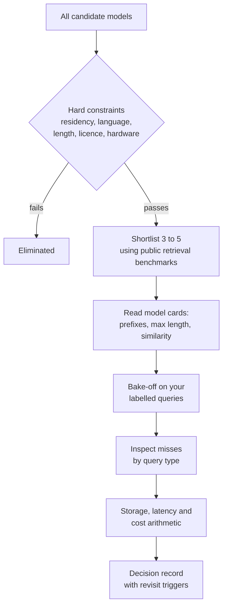

Choosing an embedding model is one of the few decisions in a RAG system that is expensive to reverse. Every chunk in the index is a vector produced by one particular model, so changing the model means re-embedding the whole corpus, rebuilding the index and re-running your evaluation. This lesson gives you a repeatable way to make the choice: turn your requirements into hard constraints that eliminate most candidates, use public benchmarks only to build a shortlist, run a small bake-off on your own queries, and then weigh the survivors on storage, latency and cost with simple arithmetic.

The [Embedding Models](/learn/embedding-models) module described the model families one by one. This lesson is about deciding between them. It opens a module that goes on to measure embeddings properly ([Embedding evaluation](/learn/embedding-optimisation/embedding-evaluation)), adapt them to your data, and make them cheaper to store.

## Learning objectives

- List the hard constraints (language, input length, licence, data residency, deployment target) that eliminate candidate models before any testing.
- Explain what a public leaderboard such as MTEB does and does not tell you about performance on your own corpus.
- Run a bake-off of several local embedding models on a labelled query set, applying each model's documented query and document prefixes.
- Calculate index storage and re-embedding cost from corpus size, dimensionality and token counts.
- Justify a model choice in writing, including the conditions under which you would revisit it.

## Prerequisites

- [What are embeddings?](/learn/embedding-fundamentals/what-are-embeddings): the embedding contract, and why vectors from different models cannot be mixed.
- [Embedding models](/learn/embedding-fundamentals/embedding-models): what an embedding model is and how it is used in retrieval.
- [Query-document matching](/learn/rag-architecture-fundamentals/query-document-matching): the asymmetry between a short question and the passage that answers it.
- Familiarity with at least a few model families from the [Embedding Models](/learn/embedding-models) module, such as [Sentence Transformers](/learn/embedding-models/sentence-transformers), [BGE models](/learn/embedding-models/bge-models) and [E5 models](/learn/embedding-models/e5-models).

## Why this matters

The embedding model sets an upper bound on what dense retrieval can find. If the model places a question far from the chunk that answers it, no amount of prompt engineering downstream recovers that chunk. A reranker can reorder candidates, but it can only reorder what the first stage returned.

Two failure patterns are common. The first is **choosing by leaderboard rank alone**: a team adopts the top model on a public benchmark and discovers months later that it is slow, its vectors are four times larger than needed, its licence forbids commercial use, or it does no better on their questions than a model a tenth of its size. The second is **never choosing at all**: the model that appeared in a tutorial becomes the production model by default, and nobody can say whether a better option exists, because nobody built the queries needed to find out.

Both treat model choice as a matter of reputation rather than measurement, and the cost of a wrong choice grows: once you have embedded millions of chunks and tuned thresholds on one model's score scale, switching becomes a migration project.

## The intuition

Think of hiring a translator to turn Meridian's IT runbooks into plain English. The one with the most awards won them for translating novels, and your job is full of internal error codes. A sensible process looks different:

1. **Filter on requirements.** Must they work on-site because the documents are confidential? Must they handle Portuguese as well as English? Can you afford their rate? Most candidates fail at least one of these, and you never interview them.
2. **Shortlist by reputation.** Among those who remain, the awards are a reasonable hint about general ability.
3. **Give each a test piece.** Hand three shortlisted translators the same ten real runbook pages and compare the results. This is the only evidence that speaks directly to your job.
4. **Weigh the practicalities.** If two do equally well, the faster and cheaper one wins.

Model selection follows exactly these four steps. The awards are the leaderboard; the test piece is your bake-off; the practicalities are dimensionality, latency and price.

## How it works

### Step 1: hard constraints

A **hard constraint** is a requirement that a model either meets or does not, with no trade-off possible. Applying hard constraints first is cheap and removes most candidates.

| Constraint | Question to ask | Why it eliminates models |
| --- | --- | --- |
| Data residency and privacy | May document text leave your network? | If not, every hosted embedding API is out, and you need an open-weight model you can run yourself. |
| Language coverage | Which languages appear in documents *and* in queries? | An English-only model places a Portuguese question somewhere arbitrary. See [Multilingual embeddings](/learn/embedding-models/multilingual-embeddings). |
| Maximum input length | How long are your chunks, in this model's tokens? | Text beyond the model's limit is silently cut off. A 256-token model cannot represent a 600-token chunk. |
| Licence | Is commercial use permitted? Are there attribution or use-based restrictions? | Some open-weight models carry non-commercial licences. Read the model card, not a blog post about it. |
| Deployment target | CPU or GPU? How much memory? Is there an edge or offline requirement? | A model with billions of parameters will not meet a latency budget on a small CPU instance. |
| Modality | Text only, or images and tables too? | Text models cannot embed images. See [Multimodal RAG](/learn/multimodal-rag). |

The maximum-input-length constraint fails silently. The limit is measured in the model's own tokens, and [Sentence Transformers](/learn/embedding-models/sentence-transformers) exposes it as `model.max_seq_length`. If chunks run to 500 words and the model truncates at 256 tokens, the second half of many chunks never influences their vectors, and questions answered there will not retrieve them. Choose a longer limit or [smaller chunks](/learn/chunking-fundamentals/chunk-size).

### Step 2: shortlisting with public benchmarks

The **Massive Text Embedding Benchmark (MTEB)**, introduced by Muennighoff and colleagues in 2022, evaluates embedding models on many datasets grouped into task types: retrieval, reranking, classification, clustering, pair classification, semantic textual similarity and summarisation. Its public leaderboard ranks hundreds of models. For RAG, the relevant column is **retrieval**, whose datasets largely come from the earlier BEIR benchmark (Thakur and colleagues, 2021).

A leaderboard is useful for building a shortlist. It is not a decision, for four reasons:

- **Domain mismatch.** The retrieval datasets cover web questions, scientific claims, financial questions, forum posts and so on. None of them contains Meridian's error codes, and none of them is your corpus. A model's rank on public data is a weak predictor of its rank on yours, especially for internal jargon.
- **Averages hide variance.** A single average over many datasets can conceal a model that is excellent on most and poor on the one that resembles your use.
- **Training-data overlap.** Many modern models are trained on the training splits of datasets that also appear in the benchmark, and it is not always possible to verify what each model saw. Strong scores can partly reflect familiarity with the benchmark's style rather than general ability.
- **No operational information.** A leaderboard score says nothing about latency on your hardware, memory, licence or price.

Use the leaderboard to pick three to five candidates that satisfy your hard constraints and span a range of sizes. Including a small model tells you how much the larger ones actually buy you.

### Step 3: the bake-off on your own queries

A **bake-off** is a head-to-head comparison of the shortlisted models on the same labelled data from your domain. The minimum ingredients are:

- a sample of your real chunks (or all of them, for a small corpus);
- a set of real or realistic queries, each labelled with the chunk or chunks that answer it;
- each model used exactly as its model card instructs.

That last point is where many bake-offs go wrong. Several retrieval models are **asymmetric**: they expect queries and documents to be encoded differently, usually by prepending a short text **prefix** (sometimes called an instruction or prompt). The E5 family expects `query: ` before queries and `passage: ` before documents. The English BGE v1.5 models recommend an instruction before short queries, `Represent this sentence for searching relevant passages: `, and nothing before documents. Hosted APIs often have an equivalent parameter, such as an input type of "query" or "document". Testing a model without its prefixes, or with another model's prefixes, measures a configuration nobody recommended.

The bake-off reports a few retrieval metrics. You will meet them properly in the [Retrieval Evaluation](/learn/retrieval-evaluation) module; for now, two are enough:

- **Hit@k**: the fraction of queries whose relevant chunk appears in the top $k$ results.
- **Mean reciprocal rank (MRR)**: the average over queries of $1/\text{rank}$ of the first relevant chunk. A chunk at rank 1 contributes 1, at rank 2 contributes 0.5, at rank 4 contributes 0.25.

How many queries you need is the subject of the [next lesson](/learn/embedding-optimisation/embedding-evaluation). The short version: with 16 queries, one query changing its outcome moves hit@1 by more than six percentage points, so only large differences mean anything.

### Step 4: operational trade-offs

Among models that pass the bake-off, compare:

- **Dimensionality.** The number of numbers in each vector. It drives index memory and search cost linearly. See [Vector dimensions](/learn/embedding-mathematics/vector-dimensions).
- **Model size and latency.** Query embedding sits on the user's critical path; document embedding is a batch cost paid at every re-index.
- **Price or hosting cost.** A hosted API charges per token. A self-hosted model costs machine hours, and a GPU may be needed for acceptable throughput.
- **Lifecycle risk.** A provider can deprecate a hosted model and force a re-embedding on their schedule; an open-weight model cannot disappear, but you own its serving.
- **Compression support.** Some models are trained so that their vectors can be shortened ([Matryoshka embeddings](/learn/embedding-optimisation/matryoshka-embeddings)) or quantised with little loss ([Embedding quantisation](/learn/embedding-optimisation/embedding-quantisation)). This can make a larger model affordable.

The whole procedure, as a numbered list:

1. Write down the hard constraints and the corpus statistics (number of chunks, typical chunk length in tokens, languages, query volume).
2. Eliminate every model that fails a hard constraint.
3. Shortlist three to five survivors from public retrieval benchmarks, spanning sizes.
4. Read each shortlisted model card: prefixes, maximum length, normalisation, similarity function, licence.
5. Run the bake-off on labelled queries from your domain, applying each model's prefixes.
6. Inspect the misses, not just the averages, and group them by query type.
7. Compute storage, latency and cost for the models that perform comparably.
8. Record the decision, the evidence and the trigger for revisiting it (a new query type, a new language, a cheaper model passing your bake-off).



## The mathematics

Model selection involves little theory, but the operational comparison is arithmetic you should be able to do on a whiteboard.

### Index storage

**Intuition.** Each chunk becomes one vector of $d$ numbers, and each number occupies a fixed number of bytes. Multiply.

$$
S = N \times d \times b
$$

$S$ is the raw vector storage in bytes, $N$ the number of chunks, $d$ the dimensionality, and $b$ the bytes per number: 4 for 32-bit floats (float32), 2 for float16, 1 for int8. This is the raw vector payload only; index structures such as HNSW graphs add overhead on top, which the [Vector Indexing Algorithms](/learn/vector-indexing-algorithms) module quantifies.

**By hand.** Suppose AskMeridian's index holds $N = 200{,}000$ chunks (an assumption for this example).

- $d = 384$, float32: $200{,}000 \times 384 \times 4 = 307{,}200{,}000$ bytes, about 307 MB.
- $d = 1024$, float32: $200{,}000 \times 1024 \times 4 = 819{,}200{,}000$ bytes, about 819 MB.
- $d = 3072$, float32: $200{,}000 \times 3072 \times 4 = 2{,}457{,}600{,}000$ bytes, about 2.46 GB.

The ratio is the ratio of dimensions: the 3,072-dimensional model needs eight times the memory of the 384-dimensional one, regardless of corpus size.

### Re-embedding cost

**Intuition.** A hosted API charges per token processed. A full re-embedding processes every token in the corpus once.

$$
C = \frac{N \times \bar{t}}{10^6} \times p
$$

$C$ is the cost, $\bar{t}$ the average number of tokens per chunk, and $p$ the price per million tokens. With $N = 200{,}000$, $\bar{t} = 300$ and an **assumed** price of 0.02 US dollars per million tokens, $C = 60 \times 0.02 = 1.20$ US dollars. Prices change and differ by a factor of ten or more between models, so always check the provider's current pricing page; the point of the formula is that for a corpus of this size the API bill for a re-index is rarely the deciding cost. The engineering time to rebuild, validate and switch the index usually is.

```python
N, t_bar = 200_000, 300
price_per_million = 0.02          # assumption: check the provider's current price
for d in (384, 1024, 3072):
    print(f"d={d:>4}: float32 {N * d * 4 / 1e6:>7.1f} MB, int8 {N * d / 1e6:>6.1f} MB")
print(f"re-embedding cost: {N * t_bar / 1e6 * price_per_million:.2f} US dollars")
```

```output
d= 384: float32   307.2 MB, int8   76.8 MB
d=1024: float32   819.2 MB, int8  204.8 MB
d=3072: float32  2457.6 MB, int8  614.4 MB
re-embedding cost: 1.20 US dollars
```

## In code

**The problem.** Compare three small open-weight retrieval models on AskMeridian-style queries, each used as its model card instructs, and see how much the result depends on the prefixes. All three models run on a laptop CPU.

**Dependencies.** `sentence-transformers` (which installs PyTorch) and NumPy. The first run downloads the three models from the Hugging Face Hub, roughly 90 MB for MiniLM and 130 MB each for the other two.

```bash
pip install sentence-transformers numpy
```

The corpus has 12 short chunks built from Meridian's handbook, IT runbooks and product documentation. Each of the 16 queries is labelled with the one chunk that answers it. The queries were written to resemble how staff actually ask: paraphrases ("holiday" for "annual leave"), indirect situations ("I'm working from a coffee shop"), an error code and a product feature described in other words.

```python
import numpy as np
from sentence_transformers import SentenceTransformer

DOCS = {
    "leave":     "Annual leave is 25 days a year. Up to 5 unused days carry over and must be used by 31 March.",
    "remote":    "Staff may work remotely up to 3 days a week.",
    "equipment": "Employees get a £400 home-office equipment budget. Contractors are not eligible.",
    "expenses":  "Expenses must be submitted within 30 days; anything over £75 needs a receipt.",
    "password":  "Passwords must be rotated every 90 days.",
    "vpn":       "Use the VPN whenever you connect from public Wi-Fi.",
    "laptop":    "Laptops are refreshed every 3 years. Report a lost laptop to the support desk at once.",
    "support":   "The support desk is open 08:00 to 18:00 UK time.",
    "e4021":     "Atlas error E-4021: the VPN client is out of date. Update it from the IT portal.",
    "e4031":     "Atlas error E-4031: the token does not grant access to this project.",
    "export":    "Meridian Reports exports to PDF and CSV.",
    "sso":       "SAML single sign-on is available on the Enterprise plan of Meridian Reports.",
}
QUERIES = [  # (query, id of the one relevant document)
    ("How many days of holiday do I get?", "leave"),
    ("Can I carry over vacation I didn't use?", "leave"),
    ("How often can I work from home?", "remote"),
    ("Is there money for a desk and chair at home?", "equipment"),
    ("I'm a contractor, can I claim a monitor for my home office?", "equipment"),
    ("Deadline for claiming back a taxi fare?", "expenses"),
    ("Do I need to keep the receipt for a £20 lunch?", "expenses"),
    ("When do I have to change my password?", "password"),
    ("I'm working from a coffee shop, anything I should do first?", "vpn"),
    ("My laptop is four years old, can I get a new one?", "laptop"),
    ("I left my laptop on the train", "laptop"),
    ("What time does IT helpdesk close?", "support"),
    ("What does E-4021 mean?", "e4021"),
    ("atlas says my token is no good for this project", "e4031"),
    ("Can I download a report as a spreadsheet?", "export"),
    ("Does Reports support Okta login?", "sso"),
]

CANDIDATES = [  # (label, model, query prefix, document prefix)
    ("MiniLM-L6",           "sentence-transformers/all-MiniLM-L6-v2", "", ""),
    ("bge-small",           "BAAI/bge-small-en-v1.5",
     "Represent this sentence for searching relevant passages: ", ""),
    ("e5-small",            "intfloat/e5-small-v2", "query: ", "passage: "),
    ("e5-small, no prefix", "intfloat/e5-small-v2", "", ""),
]

doc_ids, doc_texts = list(DOCS), list(DOCS.values())
gold = np.array([doc_ids.index(d) for _, d in QUERIES])

def evaluate(model, q_prefix, d_prefix):
    D = model.encode([d_prefix + t for t in doc_texts], normalize_embeddings=True)
    Q = model.encode([q_prefix + q for q, _ in QUERIES], normalize_embeddings=True)
    order = np.argsort(-(Q @ D.T), axis=1)                 # best document first
    rank = np.argmax(order == gold[:, None], axis=1) + 1   # 1-based rank of the gold doc
    return rank

print(f"{'candidate':<21}{'params':>8}{'dim':>5}{'max tok':>8}{'hit@1':>7}{'hit@3':>7}{'MRR':>6}")
loaded, misses = {}, {}
for label, name, qp, dp in CANDIDATES:
    model = loaded.setdefault(name, SentenceTransformer(name))
    rank = evaluate(model, qp, dp)
    params = sum(p.numel() for p in model.parameters()) / 1e6
    print(f"{label:<21}{params:>7.1f}M{model.get_sentence_embedding_dimension():>5}"
          f"{model.max_seq_length:>8}{np.mean(rank == 1):>7.2f}{np.mean(rank <= 3):>7.2f}"
          f"{np.mean(1 / rank):>6.2f}")
    misses[label] = [QUERIES[i][0] for i in np.where(rank > 1)[0]]

for label, qs in misses.items():
    print(f"\n{label} missed at rank 1: {len(qs)}")
    for q in qs:
        print("  -", q)
```

```output
candidate              params  dim max tok  hit@1  hit@3   MRR
MiniLM-L6               22.7M  384     256   1.00   1.00  1.00
bge-small               33.4M  384     512   0.75   0.88  0.84
e5-small                33.4M  384     512   0.81   0.94  0.88
e5-small, no prefix     33.4M  384     512   0.94   0.94  0.95

MiniLM-L6 missed at rank 1: 0

bge-small missed at rank 1: 4
  - How often can I work from home?
  - Is there money for a desk and chair at home?
  - I'm working from a coffee shop, anything I should do first?
  - Does Reports support Okta login?

e5-small missed at rank 1: 3
  - How often can I work from home?
  - When do I have to change my password?
  - Can I download a report as a spreadsheet?

e5-small, no prefix missed at rank 1: 1
  - I'm working from a coffee shop, anything I should do first?
```

Produced with sentence-transformers 6.3 on a CPU; other versions may shift individual scores slightly.

**The important lines.**

- `CANDIDATES` pairs each model with the prefixes from its model card. Keeping the prefixes next to the model name, rather than scattered through the code, is how you avoid applying the wrong ones. In production the same pairing belongs in the index's recorded embedding contract.
- `model.encode(..., normalize_embeddings=True)` returns unit-length vectors, so `Q @ D.T` is a matrix of cosine similarities, one row per query.
- `np.argsort(-(Q @ D.T), axis=1)` sorts each row from best to worst; `np.argmax(order == gold[:, None], axis=1) + 1` finds the position of the gold chunk in each row, which is its rank.
- `model.max_seq_length` reads the input limit from the loaded model: 256 tokens for MiniLM, 512 for the others. For long chunks that alone could decide the choice.

**What the output means.** Read it sceptically, which is the real lesson of the example.

- The smallest model came first. On public retrieval benchmarks, the two newer models are generally reported to score higher than all-MiniLM-L6-v2. On these 16 queries the ordering is reversed. That is not a contradiction: the leaderboard measured different data.
- **The differences are mostly noise.** With 16 queries, each query is worth 0.0625 of hit@1. MiniLM and bge-small differ by four queries. Change a few wordings and the order could change. You cannot conclude from this run that MiniLM is better for Meridian, only that none of the three is clearly worse than the others on these questions.
- **Removing E5's documented prefixes improved its score here.** It would be a mistake to conclude that the prefixes are harmful. The model was trained with them, and the evidence from 16 queries is far too thin to overturn that. The right reaction is to add queries until the comparison is stable, which is what the [next lesson](/learn/embedding-optimisation/embedding-evaluation) does.
- **The misses are informative even when the averages are not.** bge-small and e5-small both missed "How often can I work from home?", whose answer says "work remotely". MiniLM misses nothing at rank 1 on this set, which says the set is easy for it, not that it is perfect: the paraphrased Atlas error query ("atlas says my token is no good for this project"), where two error chunks differ only in a code and a detail, is exactly the kind of question that a slightly different wording could flip. Grouping misses by query type tells you whether the fix is a different model, a [hybrid](/learn/hybrid-search/dense-versus-sparse-retrieval) lexical component or [domain adaptation](/learn/embedding-optimisation/domain-adaptation).

**Common errors.**

- *Forgetting the prefixes for some models but not others.* The comparison becomes unfair in a way nobody notices. Keep prefixes in a table, as above.
- *Comparing unnormalised dot products across models.* If a model's vectors are not unit length, `Q @ D.T` is not the cosine, and rankings can be dominated by vector length. Normalise or use the similarity function the model card specifies.

**Extending it.** Replace the 12 chunks with a few hundred of your own, write or collect at least 50 to 100 labelled queries, and add a hosted model through its own SDK alongside the local ones. Add a timing column using `time.perf_counter()` around the query encoding, measured on the hardware you will deploy on.

## A real-world example

The Platform team at Meridian runs AskMeridian on all-MiniLM-L6-v2 and a Qdrant cluster. After reading about a new model at the top of a public retrieval leaderboard, an engineer proposes switching. The model has several billion parameters, produces 4,096-dimensional vectors and needs a GPU to embed queries at an acceptable speed.

The team lead asks for the selection procedure instead. The handbook and runbooks may not be sent to a third-party API, which rules out hosted models; the team has only CPU instances, which rules out the multi-billion-parameter model; one shortlisted model's licence restricts commercial use. Two candidates survive alongside the incumbent.

The bake-off uses 120 queries sampled from AskMeridian's logs, labelled by two engineers who check each other's labels and tagged by type: policy questions, runbook lookups by code, and product questions. All three models score within a few queries of each other on policy and product questions. All three do poorly on runbook codes, and the misses look the same: the right runbook family, the wrong code.

The decision follows. The model is not the bottleneck for runbook codes; exact-match matching is. The team keeps the incumbent, adds a lexical BM25 index for codes, and records two triggers for revisiting: Meridian opening an office whose staff ask questions in another language, and any candidate model beating the incumbent on the policy slice by a margin larger than the evaluation's confidence interval. The leaderboard model is not rejected because it is bad; it is rejected because, under Meridian's constraints, it costs a GPU and buys nothing measurable.

## Common mistakes

- **Choosing the top of a leaderboard without a bake-off.** You inherit costs (latency, memory, licence terms) without evidence of benefit on your data.
- **Ignoring the maximum input length.** Chunks longer than the limit are truncated silently, and answers in the cut-off part become unretrievable.
- **Omitting or mixing up query and document prefixes.** The model is evaluated, or deployed, in a configuration it was not trained for, and quality drops with no error.
- **Testing on a dozen queries and treating the result as decisive.** Differences of one or two queries are noise; the decision becomes a coin toss presented as data.
- **Treating dimensionality as free.** Index memory, search time and backup size all scale linearly with $d$; a model with eight times the dimensions needs eight times the RAM for the same corpus.

## Best practices

- Write the hard constraints down before looking at any leaderboard.
- Shortlist candidates of different sizes, including at least one small model, so you can see what extra size buys.
- Store each model's prefixes, maximum length, normalisation and similarity function as configuration, and record them with the index.
- Build the bake-off query set from real user questions where possible, and tag each query with its type so that you can compare models per slice.
- Read the misses. A shared miss across all models points at the data or the retrieval design; a miss unique to one model points at the model.
- Plan for change: keep the raw chunk text so that re-embedding is a batch job, not a re-ingestion.

## Performance considerations

Query embedding latency is paid on every request, before search starts, and grows roughly with the number of parameters and the input length. A model ten times larger takes very roughly ten times longer on the same hardware, which may push it from CPU-viable to GPU-required. Measure on your deployment hardware.

Document embedding is a throughput problem. If a model embeds, say, 200 chunks per second on your hardware (an assumption to be measured), 200,000 chunks take 1,000 seconds, under 17 minutes. At 20 chunks per second the same job takes almost 3 hours, which matters if you re-index nightly.

Index memory follows $N \times d \times b$, and it is usually the largest recurring cost of a dense index because vectors are kept in RAM for fast search. Search cost per query also scales with $d$, since each similarity is a $d$-term dot product. A 1,024-dimensional model costs about 2.7 times as much per comparison as a 384-dimensional one.

Hosted APIs add a network round trip to every query and rate limits to bulk re-indexing; [Embedding costs](/learn/cost-engineering/embedding-costs) models these costs over a system's lifetime.

## Security considerations

- **Data leaving your network.** A hosted embedding API receives the full text of every chunk and every query. Check the provider's data retention and training-use terms, and whether that is acceptable for personal data or confidential documents.
- **Supply-chain risk in open-weight models.** Some models on the Hugging Face Hub require `trust_remote_code=True`, which executes Python code shipped with the model. Only enable it for publishers you trust, and review the code. Pin every model to a specific revision (the `revision` argument) so that a new upload cannot silently change your vectors. Prefer weights in the `safetensors` format, which cannot execute code when loaded.
- **Embeddings are not anonymous.** Research has shown that text can be partially reconstructed from embeddings in some settings, so treat stored vectors with the same access controls as the text they came from.

## Summary

- Model selection is a four-step procedure: hard constraints, a benchmark-based shortlist, a bake-off on your own queries, and operational arithmetic.
- Public leaderboards such as MTEB are useful for shortlisting, but measure performance on other people's data and say nothing about latency, licence or cost.
- Use each model exactly as its card instructs, including asymmetric query and document prefixes, and record those settings with the index.
- Small bake-offs produce noisy results; read the misses by query type, and grow the query set before trusting small differences.
- Storage is $N \times d \times b$ and re-embedding cost is tokens times price; dimensionality is a recurring cost, not a free feature.

## Exercises

**1.** Meridian's chunks average 420 words. A colleague proposes a model with a maximum input length of 256 tokens. Roughly how much of a typical chunk will the model see, and what are the two ways to fix the problem?

<details><summary>Show solution</summary>

English text usually tokenises to somewhat more tokens than words with WordPiece or BPE tokenisers; a rough rule of thumb is 1.3 tokens per word, so 420 words is around 550 tokens. A 256-token limit, including special tokens, covers less than half of a typical chunk. Anything after that point does not influence the vector at all.

Fix 1: choose a model whose limit covers your chunks. Fix 2: re-chunk to about 150 to 180 words. Measure your actual token counts with the model's own tokeniser (`len(model.tokenizer(text)["input_ids"])`) rather than relying on the rule of thumb.

</details>

**2.** Using the formula $S = N \times d \times b$, compute the raw vector storage for 2 million chunks with a 768-dimensional model in float32 and in int8. Which is closer to fitting in 2 GB of RAM?

<details><summary>Show solution</summary>

float32: $2{,}000{,}000 \times 768 \times 4 = 6{,}144{,}000{,}000$ bytes, about 6.1 GB. int8: $2{,}000{,}000 \times 768 \times 1 = 1{,}536{,}000{,}000$ bytes, about 1.5 GB. Only the int8 version fits in 2 GB, and even then the index structure and the rest of the process need memory too. [Embedding quantisation](/learn/embedding-optimisation/embedding-quantisation) covers what int8 costs in retrieval quality.

</details>

**3.** Design decision. Meridian is opening a Lisbon office. About a fifth of AskMeridian's future questions will be in Portuguese, while the handbook stays in English. The current model is English-only. Outline the selection process you would run, including the hard constraints and how you would build the bake-off query set.

<details><summary>Show solution</summary>

Hard constraints: open-weight or a provider whose data terms are acceptable; must support cross-lingual retrieval (Portuguese query, English document), not just Portuguese-to-Portuguese; maximum input length at least the current chunk size; licence permits commercial use; runs within the current latency budget on the deployment hardware.

Shortlist: multilingual retrieval models (see [Multilingual embeddings](/learn/embedding-models/multilingual-embeddings)) of two or three sizes, plus the incumbent as a baseline for English.

Bake-off set: keep the existing English queries, and add Portuguese queries written by Portuguese speakers asking the same kinds of questions, labelled with the same English chunks. Report results separately for the English and the Portuguese slices; a model that gains on Portuguese but loses on English might still be the right choice, but only if the trade is explicit. Also consider the alternative architecture of translating queries to English before embedding, and include it in the bake-off as one more candidate.

</details>

## Check your understanding

```quiz
[
  {
    "q": "What is the main role of a public leaderboard such as MTEB in choosing an embedding model?",
    "options": [
      "It identifies the best model for any corpus",
      "It helps build a shortlist, which must then be tested on your own data",
      "It measures latency and memory on your hardware",
      "It confirms which models have a commercial licence"
    ],
    "answer": 1,
    "why": "Benchmarks measure quality on public datasets that differ from yours and say nothing about operations or licensing. They are a starting point for a shortlist, not a decision."
  },
  {
    "q": "A team evaluates E5 without its `query: ` and `passage: ` prefixes and rejects it. What is wrong with the evaluation?",
    "options": [
      "Nothing; prefixes are optional for every model",
      "E5 requires normalised vectors, which prefixes provide",
      "The model was tested in a configuration it was not trained for, so the result does not reflect its documented use",
      "Prefixes only matter for multilingual models"
    ],
    "answer": 2,
    "why": "Asymmetric models are trained to see specific prefixes on queries and documents. A fair bake-off uses each model as its card instructs."
  },
  {
    "q": "Model A produces 1,536-dimensional vectors and model B 384-dimensional ones. For the same corpus in float32, how does A's raw vector storage compare with B's?",
    "options": [
      "The same, because storage depends on the number of chunks",
      "Twice as large",
      "Sixteen times as large",
      "Four times as large"
    ],
    "answer": 3,
    "why": "Storage is N times d times bytes per number, so it scales linearly with d: 1,536 / 384 = 4."
  },
  {
    "q": "In a 16-query bake-off, model X scores hit@1 = 0.94 and model Y scores 0.81. What is the most defensible conclusion?",
    "options": [
      "X is clearly better and should be deployed",
      "The two differ by two queries, which is too few to separate them; enlarge the query set and inspect the misses",
      "Y is better, because lower scores indicate more conservative retrieval",
      "Hit@1 is meaningless; only MRR should be used"
    ],
    "answer": 1,
    "why": "Each query is worth 1/16 = 0.0625, so 0.13 is two queries. A difference that small can flip with a few rewordings."
  },
  {
    "q": "Your chunks are about 500 tokens long and a candidate model's maximum input length is 256 tokens. What happens if you use it unchanged?",
    "options": [
      "Only the first 256 tokens of each chunk influence its vector; the rest is silently ignored",
      "The library raises an error and refuses to embed",
      "The model automatically averages two 256-token windows",
      "The vectors become twice as long"
    ],
    "answer": 0,
    "why": "Sentence Transformers truncates inputs to `max_seq_length` without warning, so content past the limit cannot be retrieved through the vector."
  }
]
```

## Further reading

- Muennighoff, Tazi, Magne and Reimers (2022), "MTEB: Massive Text Embedding Benchmark", [arXiv:2210.07316](https://arxiv.org/abs/2210.07316). The public leaderboard is at [huggingface.co/spaces/mteb/leaderboard](https://huggingface.co/spaces/mteb/leaderboard).
- Thakur et al. (2021), "BEIR: A Heterogeneous Benchmark for Zero-shot Evaluation of Information Retrieval Models", [arXiv:2104.08663](https://arxiv.org/abs/2104.08663).
- Wang et al. (2022), "Text Embeddings by Weakly-Supervised Contrastive Pre-training" (E5), [arXiv:2212.03533](https://arxiv.org/abs/2212.03533).
- Xiao et al. (2023), "C-Pack: Packaged Resources To Advance General Chinese Embedding" (the BGE models), [arXiv:2309.07597](https://arxiv.org/abs/2309.07597).
- Sentence Transformers documentation, [sbert.net](https://www.sbert.net/), including the pages on pretrained models and on using prompts with `encode`.
