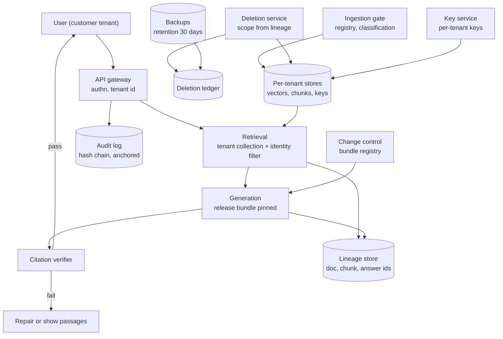

This assessment covers the whole Enterprise RAG Governance module: [data lineage](/learn/enterprise-rag-governance/data-lineage), [audit logs](/learn/enterprise-rag-governance/audit-logs), [compliance](/learn/enterprise-rag-governance/compliance), [GDPR concepts](/learn/enterprise-rag-governance/gdpr-concepts), [data governance](/learn/enterprise-rag-governance/data-governance), [source attribution](/learn/enterprise-rag-governance/source-attribution), [version control](/learn/enterprise-rag-governance/version-control), [secure deletion](/learn/enterprise-rag-governance/secure-deletion) and [responsible AI](/learn/enterprise-rag-governance/responsible-ai). The quiz mixes recall, code reading and scenarios; aim for at least 13 of 18 (about 70 per cent) before moving on. The written sections have hidden model answers, so attempt each one before opening it. Nothing here is legal advice. The coding exercises run with Python and NetworkX or the standard library only.

```quiz
[
  {"q": "What is the difference between backward and forward lineage?", "options": ["Backward lineage is for answers, forward lineage is for documents only", "Backward lineage is stored in logs, forward lineage in the index", "Backward lineage follows arrows from a node to what produced it (provenance); forward lineage follows them to everything it influenced (impact analysis)", "They are two names for the same query"], "answer": 2, "why": "Provenance asks 'what produced this?'; impact analysis asks 'what did this affect?'. Deletion scope is a forward-lineage query."},
  {"q": "What does this code print?\n```python\nimport networkx as nx\ng = nx.DiGraph([('d','c1'),('d','c2'),('c1','a'),('c2','b'),('e','c2')])\nprint(sorted(nx.descendants(g, 'd')))\n```", "options": ["['a', 'b', 'c1', 'c2']", "['c1', 'c2']", "['a', 'b', 'c1', 'c2', 'e']", "['d']"], "answer": 0, "why": "Descendants are every node reachable by following arrows forward from 'd': c1, c2, and through them a and b. 'e' is a parent of c2, not a descendant of d."},
  {"q": "Why is a content hash a better basis for a lineage record than a timestamp?", "options": ["Hashes are shorter", "Timestamps cannot be stored in a graph", "Hashes encrypt the content", "A hash shows whether content actually changed, so unchanged re-ingestion can be skipped and stored chunks can be verified"], "answer": 3, "why": "A timestamp says when something happened; a hash says whether anything changed and lets you detect silent corruption."},
  {"q": "Which best describes an audit log as opposed to a debug log?", "options": ["An audit log is larger and contains full request text", "An audit log is an accountability record with a fixed schema, an integrity guarantee and a retention policy", "An audit log is the same as an application log with a different file name", "An audit log records only successful requests"], "answer": 1, "why": "Audit logs must be reliable evidence of who did what; denials are logged as carefully as successes, and content is minimised."},
  {"q": "A hash-chained audit log verifies successfully. What does that prove?", "options": ["Nobody has ever modified the log", "The entries are internally consistent; truncation or a fully rebuilt chain is detected only if the latest hash was anchored somewhere the attacker cannot reach", "The log contains every event that occurred", "The log is encrypted"], "answer": 1, "why": "A hash chain gives tamper evidence for naive edits. Someone with full write access can recompute it, so external anchoring is needed."},
  {"q": "A security auditor asks for evidence that AskMeridian's processors do not retain prompts. What is the most useful kind of compliance artefact?", "options": ["A statement from the engineering manager", "A screenshot of the architecture diagram", "The system prompt", "A control mapped to the obligation with an owner and evidence, such as the processor's contract terms and attestation, reviewed on a schedule"], "answer": 3, "why": "Compliance means meeting an obligation and being able to demonstrate it; each obligation becomes a control with an owner and evidence."},
  {"q": "Under the GDPR, which of these is still personal data?", "options": ["Data that has been pseudonymised but can be re-linked using separately held information", "Data about a company that names no person", "Fully and irreversibly anonymised statistics", "A random id with no way to link it to anyone"], "answer": 0, "why": "Pseudonymised data stays personal data because the person remains identifiable with additional information."},
  {"q": "A data subject's erasure request arrives. Roughly what response time does the GDPR generally allow, and what makes RAG harder?", "options": ["24 hours; embeddings are random", "One year; vector databases cannot delete", "About one month in general (extendable in some cases); copies of the data live in chunks, embeddings, caches, logs, evaluation sets and backups", "There is no deadline; only the original document matters"], "answer": 2, "why": "A response is generally due within a month. The difficulty is finding every derived copy, which lineage and a register of personal data make tractable."},
  {"q": "In data governance, what does an 'index ceiling' provide?", "options": ["A cap on the number of vectors", "A limit on queries per second", "A minimum embedding dimension", "A maximum classification level allowed into a general-purpose index, bounding the worst-case leak regardless of retrieval filtering"], "answer": 3, "why": "If restricted data never enters the general index, no filtering bug can leak it from there."},
  {"q": "The team that built the ingestion pipeline for a wiki space can technically ingest any page. What does the governance model say about whether they may?", "options": ["They may, because they operate the pipeline", "Technical ability is not authority: the source's owner, recorded in the registry, decides what may be ingested and for what purpose", "Only the security team may decide", "The embedding model decides"], "answer": 1, "why": "Owners are accountable for content; custodians operate systems. The ingestion gate enforces the registry."},
  {"q": "A claim cited as '[S1]' says laptops are refreshed every 4 years; S1 says every 3 years. Which check catches this most reliably?", "options": ["A number and entity check requiring every figure in the claim to appear in the cited text", "Embedding cosine between claim and chunk, since it is high only for correct claims", "Checking that the id S1 exists", "Counting the words in the answer"], "answer": 0, "why": "The id exists and the topic matches, and the embedding cosine was 0.79 against 0.81 for the correct claim in the lesson's run. Only the number check fails."},
  {"q": "An answer cites [S9] but only S1 to S4 were in the prompt. What is the most accurate name for this failure?", "options": ["Stale source", "Misattribution", "Phantom source: the id was never supplied, found by checking set membership", "Citation laundering"], "answer": 2, "why": "A cited chunk must be one that was placed in the prompt; anything else is invented."},
  {"q": "Why is the following release bundle id deterministic and order-independent?\n```python\nraw = json.dumps(components, sort_keys=True, separators=(',', ':'))\nbundle_id = 'rb-' + hashlib.sha256(raw.encode()).hexdigest()[:12]\n```", "options": ["Because SHA-256 ignores order", "Because sort_keys=True gives a canonical serialisation, so equal components always produce the same bytes", "Because the id is truncated", "Because json.dumps encrypts the data"], "answer": 1, "why": "Hashing a canonical serialisation means two equal dictionaries built in different orders yield the same id."},
  {"q": "Answers worsened after a release. The stamped bundle ids before and after differ only in the prompt template hash. What follows?", "options": ["The embedding model is the cause", "The index must be rebuilt", "Nothing can be concluded without the source code", "The prompt template is the only component that changed between those releases, so investigate it first"], "answer": 3, "why": "A bundle diff lists exactly the components that differ; identical components are ruled out as changes between those releases."},
  {"q": "A vector database reports a point as deleted, yet a snapshot taken a minute earlier still contains it. Why is this expected?", "options": ["Snapshots ignore deletes forever", "The database is faulty", "Deletes are often logical first, with physical removal at a later compaction step, and snapshots copy the earlier state", "Embeddings cannot be deleted"], "answer": 2, "why": "Delete flags then background compaction is the common pattern, so earlier snapshots and replicas still hold the data."},
  {"q": "Why must embeddings be deleted along with the text they came from?", "options": ["Research has shown embeddings can be partly inverted to recover text, so they are a lossy copy of the source", "Embeddings are too large to keep", "Embeddings are always public", "Because embeddings contain the user's password"], "answer": 0, "why": "Morris and colleagues (2023) showed substantial text recovery from embeddings for the models they studied, so treat a vector as the data it encodes."},
  {"q": "A disaster-recovery restore resurrects a document erased last month. What practice would have prevented the data going back into service?", "options": ["Longer chunk overlap", "Using a larger embedding model", "Restoring only on weekends", "Replaying a deletion ledger, kept outside the backups, as a mandatory step of every restore"], "answer": 3, "why": "The ledger records every deletion independently of the backups, so a restore can re-apply them before going live."},
  {"q": "AskMeridian answers 'laptop refresh' queries well for employees but contractors are often told employee-only rules. A global similarity threshold is raised to 0.5. What is the most likely result?", "options": ["Wrong-audience answers disappear", "Some wrong-audience answers are refused but others still pass, and groups with terser documents are refused more often; identity-aware filtering addresses the cause", "Contractors get better answers", "The embedding model is retrained"], "answer": 1, "why": "Similarity measures text closeness, not whether a rule applies to the asker. A global threshold also shifts refusals onto groups whose best matches score lower."}
]
```

## Conceptual questions

**1. Lineage, audit log and attribution all record something about where an answer came from. Explain how they differ in purpose, audience and content, and how they relate for one answer.**

<details>
<summary>Show model answer</summary>

Lineage is the factual record of the data and steps behind an answer: which source versions, chunks, components and prompt template. Its audience is engineers and auditors, and it supports debugging, impact analysis and deletion. An audit log is an accountability record of who did what with what authority and what the result was (including denials), with a fixed schema, integrity protection and retention; its audience is security, compliance and investigators. Attribution (citations) is the system's claim, inside the answer, that a given passage supports a given sentence; its audience is the user and reviewers. For one answer: the audit record says that user U asked at time T and was served; the lineage record lists the chunk ids and versions placed in the prompt; the citations point to a subset of those chunks, and the audit record can reference the same request id. A citation outside the lineage record is by construction invalid.

</details>

**2. A colleague proposes meeting GDPR erasure by deleting the original document from the wiki and the vectors from the index. List what is missing, and explain why a single deletion job driven by lineage is better than a checklist of manual steps.**

<details>
<summary>Show model answer</summary>

Missing: the chunk store and parsed caches, keyword indexes, derived summaries or graph facts, cached answers and logs that quote the text, evaluation sets, analytics exports, backups and third-party processors. A lineage-driven job computes the scope as a forward-lineage query from the document id, deletes from every store in one retryable, idempotent procedure, verifies with id checks, probe queries and residue scans, and writes a receipt to a ledger that is replayed on restore. A manual checklist depends on someone remembering every store, drifts as new stores are added and leaves no evidence. The job still needs a named owner for stores lineage does not reach, and it must state honestly what remains (for example a backup that expires on a given date) and what is out of reach (model weights, third parties).

</details>

**3. Why does a hash chain on a log or a change record not, on its own, make it tamper-proof? What additional measures close the gap?**

<details>
<summary>Show model answer</summary>

Each entry includes the previous entry's hash, so editing a past entry breaks the chain. But someone with write access to the whole log can edit an entry and recompute every later hash, and the chain verifies again; truncation from the end also leaves a valid shorter chain. The gap is closed by anchoring the latest hash outside the control of the people being checked: a separate account, a write-once store with a retention lock, or a trusted timestamping service, published at regular intervals and verified on a schedule. Restricting write access to the appending service, separating administrators, and alerting on verification failure or on a missing anchor complete the picture. The chain provides evidence, and the anchor makes hiding that evidence hard.

</details>

**4. Explain, using the module's ideas, why a citation that is valid, on topic and faithful to its source can still lead to a wrong answer. Give two upstream fixes.**

<details>
<summary>Show model answer</summary>

A citation shows where an answer's words came from, not that the source is right. The cited chunk may be from a superseded document (the 2023 handbook), it may have been wrong when written, or it may be untrusted content inserted by an attacker. The verifier will pass all of these because the claim does match the cited text. Upstream fixes include version control and validity filtering, so superseded chunks cannot be retrieved or cited; governance of sources through a registry with owners and review dates so that content is accountable; and ingestion screening for malicious content. Showing provenance (owner, version, approval status) next to a citation helps readers weigh it.

</details>

**5. A product owner says the assistant is "fair" because overall accuracy is 94 per cent on the evaluation set. How would you respond, and what would you ask to see before launch?**

<details>
<summary>Show model answer</summary>

Overall accuracy can hide a group that is served poorly. I would ask who wrote the evaluation set (developer-written queries rarely reflect real users), which user groups exist (employees, contractors, regions, languages), and for per-group metrics: correctness, retrieval to the right audience, refusal of answerable questions and answering of unanswerable ones, each with sample sizes and confidence intervals. I would also ask for a corpus coverage audit by audience, the risk tier of the use case, what human oversight exists for high-consequence answers, and a current system card naming an owner and a review date. Without a slice for a group, the claim of fairness for that group is untested.

</details>

## Coding exercises

### Exercise 1: Deletion scope from a lineage graph

Given the lineage graph below (documents to chunks to answers to log entries), write `deletion_scope(graph, doc)` that returns the derived nodes grouped by kind, and `needs_regeneration(graph, doc)` that returns the affected answers that were *also* built from chunks of other documents. Those answers cannot simply be dropped without losing a still-valid contribution, so they should be regenerated from the surviving chunks. Run it for `doc:hr-17`.

<details>
<summary>Show solution</summary>

```python
import networkx as nx

g = nx.DiGraph()
edges = [
    ("doc:hr-17", "chunk:c1"), ("doc:hr-17", "chunk:c2"), ("doc:hb-25", "chunk:c3"),
    ("chunk:c1", "ans:a1"), ("chunk:c2", "ans:a2"), ("chunk:c3", "ans:a2"), ("chunk:c3", "ans:a3"),
    ("ans:a1", "log:l1"), ("ans:a2", "log:l2"), ("ans:a3", "log:l3"),
]
g.add_edges_from(edges)


def deletion_scope(graph, doc):
    """Everything derived from doc (forward lineage), grouped by kind."""
    scope = {}
    for node in nx.descendants(graph, doc):
        scope.setdefault(node.split(":")[0], set()).add(node)
    return scope


def needs_regeneration(graph, doc):
    """Answers that also used a surviving source: they must be regenerated, not just dropped."""
    gone = nx.descendants(graph, doc) | {doc}
    out = set()
    for ans in (n for n in graph if n.startswith("ans:") and n in gone):
        parents = {p for p in graph.predecessors(ans)}
        if parents - gone:
            out.add(ans)
    return out


scope = deletion_scope(g, "doc:hr-17")
for kind in sorted(scope):
    print(kind, sorted(scope[kind]))
print("answers also built from surviving chunks:", sorted(needs_regeneration(g, "doc:hr-17")))
```

```output
ans ['ans:a1', 'ans:a2']
chunk ['chunk:c1', 'chunk:c2']
log ['log:l1', 'log:l2']
answers also built from surviving chunks: ['ans:a2']
```

`ans:a3` is untouched because it descends only from the handbook chunk. `ans:a2` descends from both `hr-17` (through `c2`) and the handbook (through `c3`): its cached text must go, but regenerating it from `c3` alone is legitimate. In practice the scope also drives the deletion of the vectors for `chunk:c1` and `chunk:c2`, the scrubbing of `log:l1` and `log:l2`, and the cache invalidation for `ans:a1` and `ans:a2`. `chunk:c3` is not a descendant of `doc:hr-17`, so it survives.

</details>

### Exercise 2: Quote-level citation checks

Write `check(item)` for items of the form `{"claim", "source", "quote"}`. It must report problems if the source id is unknown, if the quote is not a substring of the cited chunk after normalising whitespace and case, and if the claim contains a number that the quote lacks. Test it on five items, including one where the quote is genuine but the claim changes a number.

<details>
<summary>Show solution</summary>

```python
import re

CHUNKS = {
    "S1": "Laptops are refreshed every 3 years. Lost laptops must be reported to the support desk at once.",
    "S2": "Annual leave is 25 days. Up to 5 unused days carry over and must be used by 31 March.",
}


def norm(text):
    return re.sub(r"\s+", " ", text).strip().lower()


def check(item):
    problems = []
    src = CHUNKS.get(item["source"])
    if src is None:
        return ["unknown source"]
    if norm(item["quote"]) not in norm(src):
        problems.append("quote is not a substring of the cited chunk")
    claim_numbers = set(re.findall(r"\d+", item["claim"]))
    quote_numbers = set(re.findall(r"\d+", item["quote"]))
    if claim_numbers - quote_numbers:
        problems.append(f"claim has numbers the quote lacks: {sorted(claim_numbers - quote_numbers)}")
    return problems


items = [
    {"claim": "Laptops are refreshed every 3 years.", "source": "S1", "quote": "Laptops are refreshed every 3 years."},
    {"claim": "Laptops are replaced every 4 years.", "source": "S1", "quote": "Laptops are refreshed every 3 years."},
    {"claim": "Leave carries over until 31 March.", "source": "S2", "quote": "must be used by  31 March"},
    {"claim": "You can carry over 10 days.", "source": "S2", "quote": "Up to 10 unused days carry over"},
    {"claim": "Lost laptops go to HR.", "source": "S7", "quote": "anything"},
]
for it in items:
    print(("OK  " if not check(it) else "BAD ") + it["claim"], *check(it), sep=" | " if check(it) else "")
```

```output
OK  Laptops are refreshed every 3 years.
BAD Laptops are replaced every 4 years. | claim has numbers the quote lacks: ['4']
OK  Leave carries over until 31 March.
BAD You can carry over 10 days. | quote is not a substring of the cited chunk
BAD Lost laptops go to HR. | unknown source
```

The second item has a genuine quote, so the substring test passes, and only the number check catches the changed figure. The third item passes because normalisation collapses the doubled space in the quote. The fourth item fabricates a quote ("10 unused days") that does not appear in the chunk, which the substring check catches even though the claim and the quote agree with each other. A quote check is much stronger than overlap, but it verifies the quote and the numbers, not the logic that links the quote to the claim; qualifiers such as "never" and "usually" still need an entailment check for high-stakes answers.

</details>

## Architecture design challenge

**Brief.** Meridian will offer AskMeridian to customers' staff as a managed service, for 40 enterprise customers in the UK and EU. Each customer uploads its own policy documents, some containing personal data. Requirements: every answer must be traceable to the exact versions of everything that produced it; customers must be able to see an audit trail of who queried their data; a customer leaving must have all data unrecoverable within 30 days including backups; a data subject's erasure request must be honoured within the legal deadline; answers must cite sources and be checked before display; and the service must not perform noticeably worse for any customer's user groups. Design the governance architecture.

<details>
<summary>Show reference design</summary>



**Isolation and keys.** One vector collection per tenant, with tenant-prefixed chunk, cache and log stores, and one data-encryption key per tenant in a key-management service. The tenant id comes from the authenticated session, never from the request body.

**Traceability.** Every change to the generation configuration is a release bundle in a registry, approved by two people with required approvers for prompts and policies; every answer record stores the bundle id, chunk ids and a hash of the final prompt. Lineage links documents to chunks to answers so scope questions are graph queries.

**Audit.** A hash-chained audit log per tenant records who asked, which documents were returned or denied, and on what authority, with pseudonymised actors and no document content. The head hash is anchored in a separate account, and customers can export their own tenant's trail.

**Deletion.** A deletion service computes scope from lineage, removes vectors, chunks, caches and log contexts by id, verifies with probes and residue scans, writes a hashed receipt to a ledger, and the ledger is replayed on every restore. Tenant exit drops the tenant collection, deletes prefixes and destroys the tenant key, which makes text, payloads and logs in backups unreadable; backup retention is 30 days, so vectors in backups expire within the contractual window. Erasure requests for individuals use the same service, with a register of personal data and subject tags found at ingestion, and are tracked against the one-month response period.

**Attribution.** Prompt labels sources `S1..Sn`; the verifier checks ids, numbers and quote substrings before display, and sends failures to repair or to a "show the passages" fallback. Superseded chunks are filtered out by validity intervals.

**Fairness.** Customers' user groups are defined per tenant (for example employee type and language). Each release runs disaggregated evaluation per tenant where the customer provides labelled queries, and a shared probe set otherwise; thresholds are tuned per tenant and refusal rate per group is monitored.

**Trade-offs.** Per-tenant collections cost more in memory and operations than one shared collection with filters, but make exit deletion and isolation simple and give a clean answer for audit; with 40 tenants this is manageable, and a shared collection would be reconsidered at thousands of small tenants. Per-tenant keys do not protect vectors, so vector deletion relies on dropping the collection and backup expiry, and this should be disclosed in the contract. Hash-chain anchoring adds a small operational dependency but turns the audit log from a record into evidence. Retaining only manifests and ledgers indefinitely, and heavy artefacts for a bounded window, limits reproducibility to that window by design. Fairness evaluation needs customer-supplied data, which may not exist for small tenants, so the shared probe set is a floor, not a guarantee.

</details>

## Troubleshooting scenarios

### Scenario 1: A deleted employee file is quoted again

Two weeks after an erasure request for a former employee, AskMeridian quotes the employee's grievance outcome to a manager. The deletion job's log shows success.

<details>
<summary>Show diagnosis and fix</summary>

The job reported success for the stores it knew about, so something it did not know about still held the text, or a copy was restored. Check in order. Does a probe query with text from the file retrieve any chunk? If so, a copy exists under an id that lineage did not list (a re-ingested duplicate or an orphan without the `doc_id` payload); delete by a payload filter and probe, and fix the ingestion path that created it. Does the answer carry a cache hit? The answer cache may be keyed by question, with the old answer still served; invalidate by chunk id. Was a backup restored recently without replaying the ledger? If so, replay it and add that step to the restore runbook. Finally, scan logs and evaluation sets for the text. Preventive fixes: probe queries as part of every deletion's verification, a weekly sweep that probes every id in the ledger, cache entries tracked by chunk id, and a restore procedure that cannot complete without the ledger replay.

</details>

### Scenario 2: Contractors report wrong answers after a prompt "improvement"

Complaints from contractors about being told they can claim the home-office budget started on the 12th. Engineering suspects the new embedding model deployed on the 5th.

<details>
<summary>Show diagnosis and fix</summary>

Use the stamped bundle ids on the complaining answers. If all affected answers carry bundles from after the 12th and the bundle diff against the previous release shows only the prompt template and corpus snapshot changed, the embedding model (changed on the 5th) is ruled out for these complaints. Read the prompt diff: it may have dropped an instruction such as "say so if the context excludes a group". Check the corpus diff: a handbook update may have removed or merged the contractor-eligibility chunk. Restore the previous prompt through change control, restore or re-add the eligibility content, and add contractor-eligibility questions to the regression set and the disaggregated evaluation, with a contractor slice and an identity filter on `applies_to`. Process fixes: require the security owner's approval for prompt changes, keep prompts in version control, and make the regression gate block a release that regresses any slice.

</details>

### Scenario 3: Refusal complaints from one team after a threshold tweak

After the Platform team raised the global similarity threshold to cut hallucinations, overall wrong-answer reports fell, but the legal team says AskMeridian now says "I could not find that" about most of its questions.

<details>
<summary>Show diagnosis and fix</summary>

A single global threshold shifts refusals onto topics or groups whose best matches score lower: legal documents may be long, formal and differently phrased from users' short questions, so true matches score under the new cut. The aggregate improvement hid the loss on that slice. Measure refusal of answerable questions per team and topic with a labelled slice and intervals; plot score distributions for answerable and unanswerable queries per slice to see how well the threshold separates them. Fixes in order of preference: per-slice thresholds chosen from data; better retrieval for that slice (domain-suited embedding model, hybrid search, query rewriting); a different abstention signal such as a reranker score or an entailment check rather than raw embedding similarity. Also improve the refusal message so it points users to the legal team. Add the slice to the release regression suite and monitor per-team refusal rates so a threshold change cannot repeat this silently.

</details>
