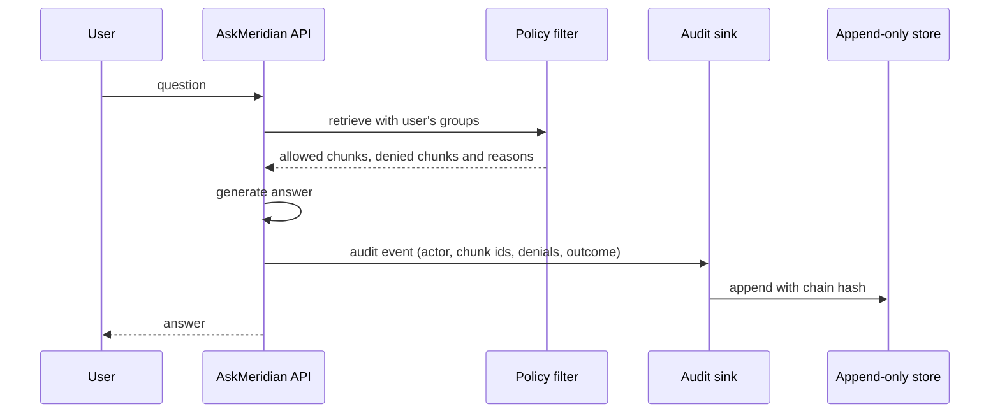

Suppose a Meridian employee reports that a colleague seems to know the salary band for senior engineers, and the only place that colleague could have seen it is AskMeridian. Did the assistant disclose it? To whom, when, and from which document? Your application logs probably cannot say, because they were written for debugging, rotate after two weeks, can be edited by any engineer with server access, and record nothing about what the requester was *entitled* to see.

An **audit log** is a different kind of record: a durable, trustworthy account of who did what, to which data, when, and with what result, kept so that an independent party can later establish the facts. This lesson explains how audit logs differ from the operational logs you met in [Logging](/learn/rag-observability/logging), what a RAG system must record, how to make records tamper-evident with a hash chain, and how to reconcile an audit trail with the privacy duties that apply to the very data it describes. You will build and attack a small tamper-evident log.

## Learning objectives

- Distinguish audit logs from operational logs by purpose, audience, integrity guarantee and retention.
- Specify the events and fields a RAG system must record for queries, access-control decisions, administration and data changes.
- Implement an append-only hash-chained log, verify it, and explain exactly which kinds of tampering it detects and which it does not.
- Apply data minimisation to audit records using pseudonyms and fingerprints instead of raw queries and text.
- Design retention, access and review controls for the audit trail itself.

## Prerequisites

- [Logging](/learn/rag-observability/logging): structured events and request identifiers.
- [Data lineage](/learn/enterprise-rag-governance/data-lineage): the chunk-to-answer edge that audit records reuse.
- [Document-level permissions](/learn/access-control-and-privacy/document-level-permissions): the access decisions that audit records capture.

## Why this matters

When something goes wrong in an enterprise system, three groups ask for the facts, and none of them can use a debug log.

- **Security teams** investigating a suspected leak need to know exactly which user retrieved which documents, including attempts that were denied. A denied attempt is often the first sign of probing.
- **Auditors and customers** ask you to evidence that controls operate: that access restrictions are enforced, that changes are authorised, that deleted data was deleted. A control you cannot show is, for their purposes, a control you do not have (see [Compliance](/learn/enterprise-rag-governance/compliance)).
- **Privacy regulators and data subjects** may ask what you did with someone's data, which under rules such as [GDPR](/learn/enterprise-rag-governance/gdpr-concepts) you must be able to answer.

RAG raises the stakes because the pipeline acts as a *confused deputy*: it holds credentials that can read everything in the index and decides, per request, what a given user may see. If the filtering has a bug, the assistant becomes a way to read documents the user was never entitled to read, and the only trace is the request itself. An audit log that records the access decision, not only the answer, lets you reconstruct who saw what even after the bug is found. Without it you must assume the worst: that every user saw everything.

## The intuition

A building has two records. The maintenance team keeps a *work log* of boiler temperatures and fault codes. It is detailed, informal, and thrown away after a few weeks because nobody needs last month's temperatures. Reception keeps a *visitor book*: every person who entered, who they came to see, when they arrived and left. The book is bound, written in ink, numbered page by page, and kept for years. If a page were torn out, you would see the gap in the numbering.

The work log helps you fix the boiler. The visitor book helps you establish, afterwards and to a sceptical outsider, who was in the building. They have different readers, different durability and different rules about editing. In a RAG system, the operational log is the work log and the audit log is the visitor book. Writing audit events into the ordinary application log, to be rotated and edited like everything else, is like asking visitors to sign the maintenance whiteboard.

## How it works

### Audit logs versus operational logs

| | Operational log | Audit log |
| --- | --- | --- |
| Purpose | Debug and monitor the system | Establish accountability |
| Reader | Engineers on call | Security, compliance, auditors, legal |
| Content | Whatever helps diagnose: timings, errors, scores | Fixed schema: actor, action, object, time, outcome, authority |
| Integrity | Best effort; may be sampled or dropped | Complete and tamper-evident; a missing record is itself a finding |
| Retention | Days or weeks | Set by policy and regulation, often a year or more |
| Access | Wide (all engineers) | Narrow, itself audited |

The two can share infrastructure (the same event pipeline), but they should be separate streams with separate schemas, retention and permissions. Sampling is acceptable for debug logs and unacceptable for audit logs: you cannot sample a security trail.

### The five questions every record answers

A useful audit record answers five questions, remembered as *who, what, which, when, with what result*, plus a sixth that RAG makes necessary:

1. **Who** (the actor): an authenticated user identifier, or a service account. Never a name typed in by the user.
2. **What** (the action): a value from a fixed vocabulary such as `rag.query`, `doc.ingest`, `doc.delete`, `acl.change`, `admin.config`.
3. **Which** (the object): the document ids, chunk ids and collection involved.
4. **When**: a timestamp from a synchronised clock, in UTC.
5. **With what result**: success, failure, denied, refused by the model, error.
6. **On what authority**: *why the action was allowed*. For a retrieval, this is the access-control decision: which groups the user belonged to, which chunks were excluded by permission filtering and under which rule.

The sixth is what separates a RAG audit trail from a generic one. A record that says "user 17 received chunk C" is half an answer; the other half is "and the policy permitted it because user 17 is in group HR".

### Which events to record

For AskMeridian, the baseline set is:

- **Query events**: for every question, the actor, request id, a fingerprint of the query, the ids of chunks placed in the prompt, the number and reasons of chunks excluded by permissions, the model, and the outcome (answered, refused, errored).
- **Authentication and authorisation events**: sign-ins, failed sign-ins, token refreshes and, specifically, every access denial.
- **Ingestion and data-change events**: a document ingested, re-indexed, superseded or deleted, with the version, who or what triggered it, and the content hash (see [Data lineage](/learn/enterprise-rag-governance/data-lineage)).
- **Administrative events**: changes to configuration, retention periods, permission rules, prompts, model choices and the list of data sources. These are the changes that alter what the system will do tomorrow.
- **Audit-of-the-audit events**: every read of the audit log, every export, every attempt to alter it.
- **Data subject events**: access requests, erasure requests and their completion (see [GDPR concepts](/learn/enterprise-rag-governance/gdpr-concepts)).

Notice what is *not* on the list: the full text of the question, the retrieved chunks or the answer. We come back to that below.



### The ordering question: log before or after?

If the audit record is written *after* the answer is returned and the process crashes in between, the user got an answer that left no trace. If it is written *before*, you may log an answer that was never delivered. For access to sensitive data, prefer **write-ahead**: write the audit event (with outcome `started`) before releasing the answer, and treat a failure to write it as a failure to answer. This is the audit equivalent of "fail closed". For low-risk events such as a public FAQ lookup, an asynchronous best-effort write may be an acceptable trade for latency; decide per event class and write the decision down.

### Making the log tamper-evident

An audit log that an administrator can quietly edit proves little. Three layers of protection, used together:

1. **Append-only storage.** Use a store that does not allow updates or deletes through the application's credentials: a database table where the writer role has `INSERT` but not `UPDATE` or `DELETE`, or an object store with a write-once retention mode (cloud object stores offer one; AWS calls it S3 Object Lock, for instance, and the other major clouds have equivalents). The person who administers the application should not also administer the audit store: this is **separation of duties**.
2. **A hash chain.** Each record carries a hash computed over its own content *and the previous record's hash*. Changing any earlier record changes its hash, which no longer matches the `prev` field stored in the next record, and the mismatch propagates to the end of the chain. It is the same idea as a blockchain without the distributed-consensus machinery, and it is a few lines of code.
3. **External anchoring.** A hash chain only detects tampering if you know the true latest hash. An attacker who controls the whole store can recompute every hash from the edit onwards and produce a chain that verifies perfectly. Defeat this by periodically publishing the head hash somewhere the attacker does not control: a separate account, a write-once bucket, a signed daily checkpoint sent to the compliance team. Then verification is "recompute the chain and compare its head with the anchored value".

Be precise about what each layer gives you. A hash chain is **tamper-evident**, not tamper-proof: it makes undetected modification impractical, but it does not prevent anyone with write access from changing the data. Without anchoring, it also does not detect truncation: deleting the last N records leaves a shorter chain that is internally consistent.

### Privacy versus accountability

An audit log of RAG queries is a log of what your employees *asked*, and questions are revealing: "how do I report a manager?", "what is the redundancy process?", "sick pay for chemotherapy". Storing full text would turn the audit trail into the most sensitive surveillance dataset in the company, which would itself need protecting and justifying under data-protection rules. The standard resolution is minimisation:

- **Pseudonymise the actor.** Replace the user id with a keyed hash (HMAC) in the log. The same user always maps to the same token, so you can ask "show everything this token did", but reading the log does not reveal who it is. Resolution back to a real person is a separate, authorised, itself-audited step performed by someone holding the key or the mapping table. A plain unkeyed hash is *not* enough: user ids are guessable, so anyone can hash a list of employee emails and look for matches.
- **Fingerprint the query.** Store a hash and a length, not the text. You can prove that a given question was asked (hash a candidate and compare) without being able to browse what people asked.
- **Record ids, not content.** Chunk ids and versions are enough to reconstruct what was disclosed, given the document store.
- **Keep the text, if you must, somewhere else.** If you need full text for quality evaluation, keep it in a separate, shorter-retention store with stricter access (see the [logging](/learn/rag-observability/logging) lesson for the trade-offs), not in the audit trail.

The tension is real: the more you minimise, the less you can explain. The test is purpose-based. Ask, for each field, which audit question it answers and whether a less revealing field would answer it just as well.

### Review: a log nobody reads is a liability

A trail has value only if someone looks at it. Define a small set of **review queries** and run them on a schedule or as alerts: repeated access denials by one actor, access to documents by users outside their usual groups, bursts of queries far above a user's norm (a sign of bulk extraction), administrative changes outside change windows, and chain-verification failures. The audit log also has a retention clock: set it by policy, and make sure the audit store's own retention does not outlive the retention allowed for the personal data it contains.

## In code

### A tamper-evident audit log

**The problem.** Meridian wants an audit trail for AskMeridian that (1) records who asked, which chunks reached the prompt, which were denied and why, (2) does not store question text or raw user ids, (3) detects edits and deletions, and (4) can answer "who received chunks of this document?".

**Dependencies.** Python's standard library only (`hashlib`, `hmac`, `json`), so there is nothing to install.

**The source.** `pseudonymise` makes a keyed pseudonym with HMAC-SHA-256. `AuditLog.append` links each record to the previous one; `verify` recomputes the chain and returns the position of the first bad record. In production the key would come from a secrets manager and the records would go to an append-only store, not a Python list. The demo key here is for illustration only.

```python
"""A tamper-evident, append-only audit log for AskMeridian."""
import hashlib
import hmac
import json
import os
from dataclasses import dataclass, field

GENESIS = "0" * 64
# In production these come from a secrets manager, never from source code.
PSEUDONYM_KEY = os.environ.get("AUDIT_PSEUDONYM_KEY", "demo-only-key").encode()


def pseudonymise(user_id: str) -> str:
    """Stable, keyed pseudonym: same user -> same token, not reversible without the key."""
    return "u_" + hmac.new(PSEUDONYM_KEY, user_id.encode(), hashlib.sha256).hexdigest()[:12]


def canonical(event: dict) -> bytes:
    return json.dumps(event, sort_keys=True, separators=(",", ":")).encode()


@dataclass
class AuditLog:
    records: list = field(default_factory=list)

    def append(self, event: dict) -> dict:
        prev = self.records[-1]["hash"] if self.records else GENESIS
        body = {"seq": len(self.records), "prev": prev, "event": event}
        digest = hashlib.sha256(prev.encode() + canonical(event)).hexdigest()
        record = {**body, "hash": digest}
        self.records.append(record)
        return record

    def verify(self):
        """Return (True, None) or (False, index of the first bad record)."""
        prev = GENESIS
        for i, r in enumerate(self.records):
            expected = hashlib.sha256(prev.encode() + canonical(r["event"])).hexdigest()
            if r["seq"] != i or r["prev"] != prev or r["hash"] != expected:
                return False, i
            prev = r["hash"]
        return True, None


def query_event(user, request_id, query_text, allowed, denied, outcome):
    return {
        "type": "rag.query",
        "request_id": request_id,
        "actor": pseudonymise(user),
        "query_sha": hashlib.sha256(query_text.encode()).hexdigest()[:16],
        "query_chars": len(query_text),
        "chunks_in_prompt": allowed,
        "chunks_denied": len(denied),
        "denied_reasons": sorted({r for _, r in denied}),
        "outcome": outcome,
        "model": "claude-opus-5-5",
    }


if __name__ == "__main__":
    log = AuditLog()
    log.append(query_event("amira@meridian.example", "req-1",
        "How many days of annual leave do I get?",
        ["handbook@2025:3"], [], "answered"))
    log.append(query_event("ben@meridian.example", "req-2",
        "What is the salary band for senior engineers?",
        [], [("hr-comp@4:0", "acl:hr-only")], "refused"))
    log.append({"type": "admin.config", "actor": pseudonymise("platform-bot"),
                "change": "retention_days: 90 -> 30"})
    log.append(query_event("amira@meridian.example", "req-3",
        "What does error E-4021 mean?",
        ["runbook-vpn@7:0", "runbook-vpn@7:1"], [], "answered"))

    print("records:", len(log.records))
    print("verify :", log.verify())
    print("last   :", json.dumps(log.records[-1], indent=1)[:420])

    print("\nWho received chunks of handbook@2025?")
    for r in log.records:
        e = r["event"]
        if e["type"] == "rag.query" and any(c.startswith("handbook@2025") for c in e["chunks_in_prompt"]):
            print("  ", e["actor"], e["request_id"])

    # An insider edits history: the refusal becomes an answer.
    log.records[1]["event"]["outcome"] = "answered"
    log.records[1]["event"]["chunks_denied"] = 0
    print("\nafter editing record 1:", log.verify())

    # A cleverer insider recomputes record 1's own hash...
    r = log.records[1]
    r["hash"] = hashlib.sha256(r["prev"].encode() + canonical(r["event"])).hexdigest()
    print("after recomputing its hash:", log.verify())

    # ...and deleting a record is caught too.
    fresh = AuditLog()
    for i in range(4):
        fresh.append({"type": "demo", "n": i})
    del fresh.records[2]
    print("after deleting a record:", fresh.verify())
```

**Running it** prints:

```output
records: 4
verify : (True, None)
last   : {
 "seq": 3,
 "prev": "eb05af249a2134aa0be03454aa1bd546cf7c9e762a165ce59ac77d1fe32fece9",
 "event": {
  "type": "rag.query",
  "request_id": "req-3",
  "actor": "u_55b3f528f08f",
  "query_sha": "5753111245c047a0",
  "query_chars": 28,
  "chunks_in_prompt": [
   "runbook-vpn@7:0",
   "runbook-vpn@7:1"
  ],
  "chunks_denied": 0,
  "denied_reasons": [],
  "outcome": "answered",
  "model": "claude-opus-5-5"
 },
 "hash": 

Who received chunks of handbook@2025?
   u_55b3f528f08f req-1

after editing record 1: (False, 1)
after recomputing its hash: (False, 2)
after deleting a record: (False, 2)
```

(The `last` line is cut at 420 characters by the script, which is why the record's `hash` field is missing from the print.)

**What the output means.** Four records were appended and the chain verifies. The "who received chunks of `handbook@2025`" query is a simple scan over the structured events and finds one pseudonymous actor and one request: with a database you would index `chunks_in_prompt`. Then the demonstration attacks begin. Editing record 1 (turning a refusal into an answer) makes `verify` fail at index 1, because its stored hash no longer matches its content. The cleverer insider who recomputes record 1's hash is still caught, but now at index 2: record 2's `prev` field holds the *old* hash of record 1. To hide the edit, the insider would have to rewrite every later record too, and that is the case anchoring defends against. Deleting a record from the middle is caught because the following record's `prev` no longer matches and its `seq` is off by one.

**Important lines.**

- `canonical` serialises with sorted keys and fixed separators, so the same event always hashes to the same value regardless of dictionary order. A hash over non-canonical JSON produces false tamper alarms.
- `hashlib.sha256(prev.encode() + canonical(event))` is the chain link: each hash commits to the whole history before it.
- `pseudonymise` uses `hmac.new(key, ...)`, not a bare `sha256`, for the reason given earlier: an unkeyed hash of an email address can be reversed by guessing.
- `query_event` records `query_sha`, `query_chars`, `chunks_in_prompt`, `chunks_denied` and `denied_reasons`: the *authority* part of the record. The refused request for the salary band is evidence that the access control worked.

**Errors people commonly hit.**

- `verify` failing on a log you did not touch: usually a serialisation difference (floats, Unicode escaping, key order) between writer and verifier. Fix the canonical form, never the check.
- Two writers appending concurrently produce two records with the same `prev` and a forked chain. Serialise appends through one writer (a queue consumer, a database sequence or a lock).
- Believing the chain proves completeness: it does not detect truncation of the tail. Anchor the head hash and count.

**Extending it.** Sign the head hash with an asymmetric key (so verifiers need only the public key), publish it hourly to a separate write-once location, store records in a database role without `UPDATE` and `DELETE`, add a `policy_version` field to every query record, and emit `audit.read` events whenever someone queries the trail.

## A real-world example

Meridian's Security team gets an alert from a review query: one pseudonymous actor produced 37 access denials on `hr-comp` documents in twenty minutes, each with a slightly different question about salary bands. Because the audit record has the denial reason (`acl:hr-only`) and the fingerprint of each query, the team can see that every attempt was refused by the permission filter and that no chunk of `hr-comp` reached any prompt for this actor. The audit trail turns an alarming alert into a closed case: attempted probing, no disclosure. The pseudonym is resolved to a person by the Head of Security under a documented procedure, which writes its own audit event, and the matter goes to HR.

Three weeks later a different incident is less fortunate. A code change shipped on a Friday applied the group filter after reranking instead of before, so for ninety minutes the reranker's top three chunks, sometimes from restricted documents, were checked only at the end, and a bug in the end check let a restricted chunk through when it was the sole result. The audit log lists exactly which requests had a `chunks_in_prompt` entry from a restricted collection while the actor lacked the group, by joining the log with the permission snapshot (`policy_version`) at that time. Eleven requests, five actors. Without the log, Meridian would have had to tell all 400 employees that a disclosure *might* have occurred.

## Common mistakes

- **Using the application log as the audit log.** It rotates, can be edited and has no fixed schema, so it fails the first serious request for evidence.
- **Logging only successes.** Denied attempts are the most valuable security signal, and the record that a control worked.
- **Storing full question text and answers "just in case".** The audit trail becomes the most sensitive dataset in the company, with its own regulatory exposure.
- **An unkeyed hash as a pseudonym.** Anyone can hash a list of email addresses and match them. Use HMAC with a protected key.
- **No anchor for the hash chain.** An attacker with store access rebuilds the whole chain and it verifies. Publish head hashes elsewhere.
- **Letting administrators of the application administer the audit store.** The people being audited must not control the evidence.
- **Unsynchronised clocks.** Timestamps from drifting servers make the order of events unprovable. Use NTP-synchronised UTC and a sequence number.
- **Never reviewing the trail.** An unread log detects nothing and still costs storage and risk.

## Best practices

- Keep a fixed event vocabulary and schema, versioned, and reject events that do not conform.
- Record the access decision (which policy, which groups, what was excluded) alongside the access itself.
- Write audit events before releasing results for sensitive operations, and fail closed if the write fails.
- Store ids and fingerprints rather than content; keep any full text in a separate store with shorter retention and tighter access.
- Chain records, anchor the head externally, and run verification on a schedule, alerting on failure.
- Audit the audit: log reads, exports and verification runs.
- Define retention for the audit trail explicitly and align it with the retention rules for the personal data inside it (see [Data retention](/learn/access-control-and-privacy/data-retention)).
- Write and test review queries before you need them: repeated denials, unusual volume, off-hours administration.

## Performance considerations

An audit event is small and cheap, so the cost is in the synchronous write. Suppose AskMeridian serves 20,000 requests a day and each audit record is about 600 bytes of JSON. That is 12 MB a day, around 4.4 GB a year, trivial to store. A write-ahead audit append to a database in the same region typically adds a few milliseconds to a request that takes seconds to generate its answer; measure it in your environment rather than assuming. If that is too much for the highest-volume low-risk path, move it off the critical path with a queue, accepting that a crash can lose in-flight events, and keep write-ahead behaviour for sensitive collections.

The hash chain itself is negligible: hashing 600 bytes takes microseconds. Verification is linear: re-hashing a year of 7.3 million records is on the order of seconds to a minute on one core, so a nightly full verification is easy and an hourly incremental one (from the last verified head) is cheaper still. The real scaling concern is the single writer that the chain requires. If one writer becomes a bottleneck, shard the chain (one chain per tenant or per day) and anchor each head, rather than allowing parallel appends to a single chain.

## Security considerations

The audit log is an attack target, because it is where an intruder would cover their tracks. Protect it with separate credentials, network isolation and the append-only controls above. Treat it as personal data: pseudonymised data remains personal data when the key exists, so restrict who can resolve pseudonyms and log each resolution. Beware **log injection**: question text and filenames are untrusted input, and if you write them into a log line unescaped, a crafted string containing newlines or JSON syntax can forge records or break parsers. Structured, escaped serialisation (as `json.dumps` does) removes the problem, and storing fingerprints rather than text sidesteps it. Finally, remember that an audit log records the *behaviour* of a prompt-injected model only if you log tool calls and outputs: for agentic systems, extend the schema to cover them (see [Prompt injection](/learn/rag-security-fundamentals/prompt-injection)).

## Summary

- An audit log is an accountability record with a fixed schema, an integrity guarantee and a retention policy; it is not a debug log.
- Each record should say who, what, which object, when, with what result, and on what authority; the last is what makes a RAG audit trail useful.
- Log denials as carefully as successes, and write the audit event before releasing results for sensitive data.
- A hash chain makes tampering evident, but only external anchoring detects a rebuilt chain or truncation.
- Minimise content: pseudonymise actors with a keyed hash and store fingerprints and ids rather than text.
- Control and review the trail itself: separate administrators, audit reads, scheduled verification and alerting.

## Exercises

**1.** A colleague says: "We already log every request in our application log, so we have an audit trail." Give three reasons this is insufficient.

<details><summary>Show solution</summary>

Any three of: it is rotated after days or weeks, so evidence disappears before an investigation; it can be edited or deleted by anyone with server access and has no integrity protection; it has no fixed schema, so the same fact is recorded differently across code paths; it is sampled or dropped under load; it does not record the access-control decision and so cannot show what a user was *entitled* to see; it is readable by all engineers, who are the people being audited; and it often contains raw question text that should not be retained that long.

</details>

**2.** Why does recomputing record 1's hash after editing it not hide the edit, and what extra step would the attacker need? What defence stops that step?

<details><summary>Show solution</summary>

Record 2 stores `prev`, the hash of record 1 as it was. After the edit and recomputation, record 1's hash differs from that stored value, so verification fails at record 2. The attacker must also rewrite record 2 and every later record, recomputing each hash in turn, which yields a chain that verifies. The defence is external anchoring: periodically publishing the head hash (or a signature over it) somewhere the attacker cannot alter. The rebuilt chain has a different head and no longer matches the anchor.

</details>

**3.** Write a function `denials_by_actor(log, min_count)` for the `AuditLog` in the lesson that returns each actor with at least `min_count` records whose `chunks_denied` is greater than zero, and run it on a log you build with four such records for one actor and one for another.

<details><summary>Show solution</summary>

```python
from collections import Counter
from audit import AuditLog, query_event

def denials_by_actor(log, min_count):
    c = Counter(r["event"]["actor"] for r in log.records
                if r["event"]["type"] == "rag.query" and r["event"]["chunks_denied"] > 0)
    return {a: n for a, n in c.items() if n >= min_count}

log = AuditLog()
for i in range(4):
    log.append(query_event("mallory@meridian.example", f"r{i}", f"salary {i}", [], [("hr-comp@4:0", "acl:hr-only")], "refused"))
log.append(query_event("amira@meridian.example", "r9", "leave", [], [("hr-comp@4:0", "acl:hr-only")], "refused"))
print(denials_by_actor(log, 3))
```

It prints a dictionary with one pseudonymous actor mapped to 4 (the token is the HMAC of the address under the key in use, so its exact value depends on `AUDIT_PSEUDONYM_KEY`). The other actor has one denial and is filtered out. In production this would be a database query over an indexed `actor` and `chunks_denied` column, run as a scheduled alert.

</details>

**4.** Design question. The Legal team wants full question text kept for seven years "in case of disputes". Propose a design that respects data minimisation while meeting the genuine need, and name the trade-offs.

<details><summary>Show solution</summary>

First challenge the requirement: a dispute about an answer needs to establish *what the system said and on what basis*, which the audit record (request id, chunk ids and versions, model, prompt-template version, outcome) already supports, and answer text can be regenerated only approximately, so decide whether answers must be retained. If text is genuinely needed, store it in a separate encrypted store, keyed by request id, with its own access controls, audited reads and a defined retention (seven years only for a defined class of cases, shorter for the rest), and keep the audit trail itself free of text. Trade-offs: a separate store adds a system to secure and a deletion path to maintain (see [Secure deletion](/learn/enterprise-rag-governance/secure-deletion)); longer retention increases breach impact and the number of data-subject requests that must be searched; fingerprints let you prove a given question was asked without retaining it, but cannot show what was *said* if the text is gone.

</details>

## Check your understanding

```quiz
[
  {
    "q": "Which field most distinguishes a RAG audit record from a generic access log?",
    "options": [
      "The request timestamp",
      "The access-control decision: which chunks were allowed or denied and why",
      "The response latency",
      "The size of the prompt in tokens"
    ],
    "answer": 1,
    "why": "Knowing what a user received is half the story; the record must also show the policy basis, including what was excluded, so that you can prove the controls operated."
  },
  {
    "q": "An attacker with full write access edits record 5 of a hash-chained log and recomputes the hashes of records 5 to the end. What exposes this?",
    "options": [
      "Nothing inside the log; comparing the head hash with an externally anchored copy does",
      "The verify function, always, at record 5",
      "The timestamp of record 5",
      "The pseudonymised actor field"
    ],
    "answer": 0,
    "why": "A fully recomputed chain is internally consistent. Only a head hash published outside the attacker's control reveals that the history changed."
  },
  {
    "q": "Why use HMAC rather than a plain SHA-256 hash to pseudonymise user ids?",
    "options": [
      "HMAC is faster",
      "HMAC output is shorter",
      "Without the secret key an attacker cannot confirm guesses by hashing candidate ids",
      "SHA-256 cannot hash email addresses"
    ],
    "answer": 2,
    "why": "User ids are guessable, so an unkeyed hash can be reversed by hashing a list of candidates. The secret key prevents that."
  },
  {
    "q": "For a query touching a restricted collection, when should the audit event be written?",
    "options": [
      "Before the answer is released, failing the request if the write fails",
      "Never, to protect user privacy",
      "Hours later in a batch job",
      "Only when the answer is wrong"
    ],
    "answer": 0,
    "why": "Write-ahead logging ensures an answer to sensitive data cannot be released without leaving a record, which is the fail-closed behaviour audit requires."
  },
  {
    "q": "Which statement about a hash chain is correct?",
    "options": [
      "It prevents anyone from modifying records",
      "It makes tampering evident but does not by itself detect truncation of the latest records",
      "It encrypts the records",
      "It guarantees every event was logged"
    ],
    "answer": 1,
    "why": "A chain detects changes and mid-chain deletions, but a shortened chain is still internally consistent. Anchoring the head and a record count closes that gap."
  }
]
```

## Further reading

- NIST Special Publication 800-92, *Guide to Computer Security Log Management*, on log generation, storage and review.
- OWASP, *Logging Cheat Sheet*, covering what to log, log injection and protecting log data: [cheatsheetseries.owasp.org](https://cheatsheetseries.owasp.org/).
- Schneier and Kelsey (1999), "Secure Audit Logs to Support Computer Forensics", *ACM Transactions on Information and System Security* 2(2), the classic treatment of forward-secure, tamper-evident logs.
- Krawczyk, Bellare and Canetti (1997), *HMAC: Keyed-Hashing for Message Authentication*, RFC 2104.
- Python documentation, [`hmac`](https://docs.python.org/3/library/hmac.html) and [`hashlib`](https://docs.python.org/3/library/hashlib.html).
