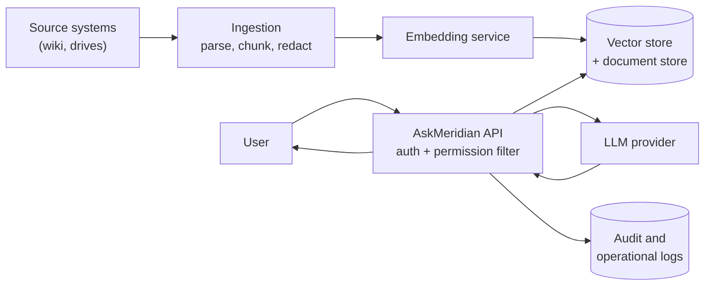

Meridian's biggest prospective customer, a regional bank, has sent a 140-question security questionnaire about AskMeridian's sibling product. Question 37 reads: "Describe where customer data is processed, which sub-processors receive it, how long it is retained, and how you evidence that your answer is true." The engineers know the architecture well. What they cannot do quickly is prove it, because the answers live in six people's heads, three wikis and a Terraform repository.

**Compliance** is the discipline of meeting external obligations (laws, regulations, industry standards and customer contracts) and being able to *demonstrate* that you do. This lesson is not legal advice, and it does not try to teach any regulation clause by clause. It teaches the engineering side: the landscape of frameworks a RAG system is likely to meet, how to turn a vague obligation into a concrete control with evidence, where a RAG pipeline creates compliance exposure that an ordinary web application does not, and how to automate evidence so that the next questionnaire takes an hour rather than a month. The next lesson, [GDPR concepts](/learn/enterprise-rag-governance/gdpr-concepts), looks at one regulation in depth.

## Learning objectives

- Distinguish security from compliance and explain why a system can be secure yet non-compliant, and the reverse.
- Describe, at a conceptual level, the frameworks a RAG deployment commonly meets (SOC 2, ISO/IEC 27001, sector and privacy law, AI-specific regulation) and what each asks of an engineering team.
- Trace the data flow of a RAG system and identify the points where each obligation attaches: sources, storage, processors, generation, logs and deletion.
- Translate an obligation into a control with an owner and automatically collected evidence.
- Evaluate a third-party processor (an embedding or language-model API) against a compliance checklist.

## Prerequisites

- [Audit logs](/learn/enterprise-rag-governance/audit-logs): the evidence record that many controls depend on.
- [Data lineage](/learn/enterprise-rag-governance/data-lineage): knowing where data went.
- [Data encryption](/learn/access-control-and-privacy/data-encryption): what encryption in transit and at rest provide.
- [Multi-tenant RAG](/learn/production-architecture/multi-tenant-rag): why customer separation matters.

## Why this matters

For an enterprise product, compliance is frequently the gate to revenue. Large customers will not sign until you show an independent report or certificate, answer a security questionnaire, and agree contractual terms on data handling. For an internal assistant, compliance is the gate to launch: legal, security and data-protection reviews decide whether AskMeridian may index HR files at all. Teams that treat compliance as a late paperwork exercise discover that the architecture cannot support it. The vector database sits in the wrong region, query text has been kept indefinitely in a debugging log, or nobody knows which model provider receives the prompts.

RAG sharpens the problem in four ways.

1. **Data is copied and transformed.** A document becomes parsed text, chunks, embeddings, cached answers, log lines and evaluation sets. Each copy is regulated data in a different place, and an obligation attached to the original (retention, location, deletion) follows every copy.
2. **A third party sees the content.** Embedding and generation often use external APIs, so confidential text leaves your boundary on every request. The provider becomes a **processor** or **sub-processor** with obligations you must verify and contract for.
3. **The output is a new artefact.** A generated answer can be wrong, can reveal something a user should not see, and, depending on jurisdiction and use, may attract transparency or accuracy duties of its own.
4. **The behaviour is probabilistic.** Traditional controls assume deterministic code you can test. A model's behaviour is shaped by prompts and retrieved text, so controls need layered, testable guardrails and monitoring rather than a single check.

## The intuition

Think of a hospital pharmacy. Medicines are *safe* because the pharmacists are careful, the cupboards are locked and the labels are right. But the pharmacy is *compliant* only if it can show an inspector the register of what came in and went out, the temperature log of the fridge, the training record of each pharmacist, the signed delivery notes of each supplier, and the procedure for recalls, all dated and complete. A pharmacy full of careful people with no paperwork fails inspection. A pharmacy with immaculate paperwork and an unlocked cupboard passes inspection and is dangerous.

Compliance is the discipline of showing, to a stranger who does not trust you yet, that your safety practices are real. The engineering lesson follows directly: the safest design is not enough, and the best paperwork is not enough. You want controls that actually work and that *produce their own evidence as a by-product*, so the register writes itself.

## How it works

### Security, compliance and governance

The three words overlap but differ:

- **Security** is protecting data and systems from harm.
- **Compliance** is demonstrating adherence to defined external requirements.
- **Governance** is the internal system of decision rights, policies and accountability that sets and enforces your own rules (the subject of [Data governance](/learn/enterprise-rag-governance/data-governance)).

Compliance rests on security (you cannot demonstrate controls you do not have) and on governance (someone must own each obligation). But a compliance programme can drift into "box ticking" if it documents controls that do not work. The antidote is the design principle of this lesson: controls that generate evidence.

### The landscape, conceptually

You will meet obligations from four directions. The summaries below are deliberately general; frameworks change, so confirm details with your compliance and legal teams and the official sources.

**Attestations and certifications about your security management.**

- **SOC 2** is a reporting framework from the American Institute of CPAs. An independent auditor examines your controls against selected *trust services criteria* (security, availability, processing integrity, confidentiality and privacy; security is always in scope) and issues a report. A *Type I* report describes whether controls are suitably designed at a point in time; a *Type II* report also tests whether they operated effectively over a period of months. Enterprise buyers in many markets ask for the Type II.
- **ISO/IEC 27001** is an international standard for an *information security management system* (ISMS). You are certified by an accredited body after an audit that checks your risk assessment, your chosen controls and that you run a continual improvement cycle. ISO/IEC 42001 is a related management-system standard for organisations building or using AI systems.

**Privacy and data-protection law.** The EU and UK GDPR, other national privacy laws and regulations such as California's CCPA govern *personal data*. They set obligations about lawful use, minimisation, retention, security, data-subject rights and cross-border transfers, and they are the reason a RAG system needs a deletion path that works. This is the subject of the next lesson.

**Sector-specific rules.** Health data in the United States is regulated by HIPAA, which requires business associate agreements with processors. Payment-card data falls under PCI DSS. Financial services, public-sector and defence customers add their own requirements, including data residency and, sometimes, a requirement that data never leave a particular jurisdiction. If your assistant indexes data in these categories, those rules apply to the index and everything derived from it.

**AI-specific regulation and guidance.** The EU's Artificial Intelligence Act (Regulation (EU) 2024/1689) takes a risk-based approach: the more harm an AI system could cause, the heavier the obligations, with transparency duties for some systems that interact with people and stricter rules for listed high-risk uses. Its obligations phase in over several years, so check the current timetable and whether your use case is in scope. The NIST AI Risk Management Framework is voluntary US guidance for identifying and managing AI risks. Most internal knowledge assistants are not high-risk in the regulatory sense, but a RAG system that screens job applicants or informs decisions about people's access to services can be, so *what the answers are used for* matters as much as how the system is built. [Responsible AI](/learn/enterprise-rag-governance/responsible-ai) returns to this.

**Customer contracts** are obligations too. A contract may promise data stays in a region, that sub-processors are disclosed and approved, that data is deleted within a set period after termination, or that a breach is reported within a set time. These bind you whether or not any law does.

### From obligation to control to evidence

The core skill is translation. An obligation is a sentence in a regulation or contract; a control is something your system does; evidence is proof that the control ran. A repeatable method:

1. **State the obligation in plain words.** "Personal data must not be kept longer than necessary."
2. **Define a testable control.** "Raw question text is deleted after 30 days; audit records hold only fingerprints."
3. **Assign an owner.** A named team, not "engineering".
4. **Choose the control type.** *Preventive* controls stop a violation (a permission filter before ranking); *detective* controls reveal one (alerts on repeated denials); *corrective* controls fix one (a deletion runbook). Mature programmes use all three for important risks.
5. **Define the evidence.** The artefact that proves the control operated: a configuration export, a log extract, a job-run record, a signed review.
6. **Automate collection.** If a human must remember to take a screenshot each quarter, it will be missed.

One control often supports several frameworks. "Access to production data is restricted, reviewed quarterly and logged" maps onto security criteria in SOC 2, ISO 27001 access-control requirements and GDPR's security obligation at once. Build a single control set and map it to frameworks, rather than running a separate effort per framework. A plain table of *control, owner, evidence source, frameworks supported* is the most useful compliance artefact an engineering team can own.

### Where a RAG pipeline attaches obligations



Walk the diagram and ask, at each box, what an assessor would ask.

- **Sources.** Are we permitted to index this? Documents carry licences, confidentiality labels, personal data and legal holds. Indexing a customer's data for another customer's assistant is a contract breach. Classification and ownership (see [Data governance](/learn/enterprise-rag-governance/data-governance)) decide what may enter.
- **Ingestion.** Is personal or sensitive data detected and handled, redacted or tagged (see [PII detection](/learn/access-control-and-privacy/pii-detection))? Is each document's lineage recorded?
- **Embedding service.** If it is an external API, document text leaves your boundary. Where is it processed, is it retained, may the provider use it to improve its models, and is there a contract (typically a data processing agreement) covering it? If you host the model yourself, none of those questions arise, but you inherit the operational controls.
- **Vector and document stores.** Encrypted at rest? In an approved region? Backed up (and are backups covered by your deletion promise)? Tenant-isolated? Embeddings deserve the same protection as the text they came from: research has shown that text can sometimes be partly reconstructed from embeddings, so a vector is not "just numbers".
- **API and permission filter.** Authenticated, authorised, and filtered before ranking (see [Authorisation](/learn/access-control-and-privacy/authorisation)).
- **LLM provider.** Each prompt contains retrieved confidential text. The same processor questions apply as for the embedding service, and the contractual terms differ between vendors and plans, so read the provider's current data-usage and retention documentation rather than assuming.
- **Logs.** Do they contain question text or chunks? How long are they kept? Who can read them? See [Audit logs](/learn/enterprise-rag-governance/audit-logs).
- **Deletion.** When a source document is deleted, are its chunks, vectors, caches, log excerpts and backups handled? See [Secure deletion](/learn/enterprise-rag-governance/secure-deletion).

### Shared responsibility and processors

You are rarely alone in the pipeline. A cloud provider secures the data centre; you configure the services. A model provider operates the model; you decide what to send it. Compliance frameworks call the parties that handle data on your behalf **processors** (and their own suppliers **sub-processors**), and they require you to choose them with care. The practical due-diligence checklist for any processor in a RAG system:

- What data does it receive (full text, chunks, only queries) and in which regions is it processed and stored?
- How long does it retain inputs and outputs, and can that be set to a minimum or zero?
- May it use your data to train or improve models, and is the default opt-in or opt-out?
- Does it hold an independent attestation (a SOC 2 report or an ISO/IEC 27001 certificate) that covers the service you use?
- What sub-processors does it use, and will it tell you before changing them?
- What does the contract say about breach notification, deletion on request and audit rights?

Record the answers, date them and re-review annually, because services change their terms.

### Continuous compliance

Annual audits sample a year of behaviour. Systems drift in between: a retention setting reverts, a new data source is added without review, a processor changes region. **Continuous compliance** closes the gap by checking the live system against policy automatically and often, treating a failing control like a failing test. That is exactly what the code below does: a declared configuration, a list of controls as code, and a report whose failures break the build.

## In code

### Controls as code

**The problem.** Meridian wants to know, on every deployment, whether AskMeridian's declared configuration satisfies its own policy: encryption, audit retention, query-text minimisation, permission filtering, region restrictions, processor agreements and a recently tested deletion procedure. Failing controls should be visible with their evidence and should return a non-zero exit code so that a CI pipeline can block the release.

**Dependencies.** Pydantic, to validate the configuration schema:

```bash
pip install pydantic
```

**The source.** `SystemConfig` is the declared state (in a real system you would generate it from your infrastructure code, cloud APIs and a processor register, not type it by hand). Each `Control` pairs an objective with a check function that returns a pass flag and a short evidence string, and lists the framework themes it generally supports. `run` evaluates every control on a given date, which is passed in so that the output is reproducible.

```python
"""Compliance controls as code: check a RAG system's declared configuration."""
import sys
from datetime import date
from typing import Callable

from pydantic import BaseModel, Field


class Processor(BaseModel):
    name: str
    purpose: str
    region: str
    dpa_signed: bool
    reviewed_on: date


class SystemConfig(BaseModel):
    name: str
    allowed_regions: list[str]
    encryption_at_rest: bool
    tls_in_transit: bool
    audit_log_enabled: bool
    audit_retention_days: int
    query_text_retention_days: int
    permission_filter_before_rerank: bool
    pii_redaction_on_ingest: bool
    deletion_runbook_tested_on: date | None
    processors: list[Processor] = Field(default_factory=list)


class Control(BaseModel):
    id: str
    objective: str
    themes: list[str]  # which framework requirements this typically supports
    check: Callable[[SystemConfig, date], tuple[bool, str]]


def c_encryption(cfg, today):
    ok = cfg.encryption_at_rest and cfg.tls_in_transit
    return ok, f"at_rest={cfg.encryption_at_rest}, in_transit={cfg.tls_in_transit}"


def c_audit(cfg, today):
    ok = cfg.audit_log_enabled and cfg.audit_retention_days >= 365
    return ok, f"enabled={cfg.audit_log_enabled}, retention={cfg.audit_retention_days}d (policy >= 365d)"


def c_minimise(cfg, today):
    ok = cfg.query_text_retention_days <= 30
    return ok, f"query text kept {cfg.query_text_retention_days}d (policy <= 30d)"


def c_access(cfg, today):
    return cfg.permission_filter_before_rerank, f"filter_before_rerank={cfg.permission_filter_before_rerank}"


def c_residency(cfg, today):
    bad = [p.name for p in cfg.processors if p.region not in cfg.allowed_regions]
    return not bad, f"outside allowed regions {cfg.allowed_regions}: {bad or 'none'}"


def c_vendors(cfg, today):
    bad = [p.name for p in cfg.processors
           if not p.dpa_signed or (today - p.reviewed_on).days > 365]
    return not bad, f"missing DPA or review older than 365d: {bad or 'none'}"


def c_deletion(cfg, today):
    d = cfg.deletion_runbook_tested_on
    ok = d is not None and (today - d).days <= 180
    return ok, f"deletion runbook last tested {d} (policy: within 180d)"


CONTROLS = [
    Control(id="CRY-1", objective="Data is encrypted in transit and at rest",
            themes=["security", "confidentiality"], check=c_encryption),
    Control(id="LOG-1", objective="Access is logged and logs kept for a year",
            themes=["security", "accountability"], check=c_audit),
    Control(id="MIN-1", objective="Question text is not kept longer than needed",
            themes=["privacy", "minimisation"], check=c_minimise),
    Control(id="ACC-1", objective="Permissions are enforced before ranking",
            themes=["security", "confidentiality"], check=c_access),
    Control(id="RES-1", objective="Data is processed only in approved regions",
            themes=["privacy", "residency"], check=c_residency),
    Control(id="VND-1", objective="Every processor has a signed DPA and a recent review",
            themes=["privacy", "supplier management"], check=c_vendors),
    Control(id="DEL-1", objective="The deletion procedure has been tested recently",
            themes=["privacy", "erasure"], check=c_deletion),
]


def run(cfg: SystemConfig, today: date):
    rows = []
    for c in CONTROLS:
        ok, evidence = c.check(cfg, today)
        rows.append((c.id, "PASS" if ok else "FAIL", c.objective, evidence))
    return rows


if __name__ == "__main__":
    cfg = SystemConfig(
        name="AskMeridian",
        allowed_regions=["uk", "eu"],
        encryption_at_rest=True,
        tls_in_transit=True,
        audit_log_enabled=True,
        audit_retention_days=365,
        query_text_retention_days=90,
        permission_filter_before_rerank=True,
        pii_redaction_on_ingest=True,
        deletion_runbook_tested_on=date(2025, 1, 20),
        processors=[
            Processor(name="Qdrant cluster (self-hosted)", purpose="vector store", region="uk",
                      dpa_signed=True, reviewed_on=date(2025, 9, 1)),
            Processor(name="Embedding service", purpose="embeddings", region="eu",
                      dpa_signed=True, reviewed_on=date(2025, 6, 1)),
            Processor(name="LLM API provider", purpose="generation", region="us",
                      dpa_signed=False, reviewed_on=date(2024, 3, 1)),
        ],
    )
    today = date(2025, 10, 1)
    rows = run(cfg, today)
    for cid, status, objective, evidence in rows:
        print(f"{cid}  {status}  {objective}")
        print(f"        evidence: {evidence}")
    failed = [r[0] for r in rows if r[1] == "FAIL"]
    print(f"\n{len(rows) - len(failed)}/{len(rows)} controls pass; failing: {failed}")
    sys.exit(1 if failed else 0)
```

**Running it** prints (the script exits with status 1 because some controls fail):

```output
CRY-1  PASS  Data is encrypted in transit and at rest
        evidence: at_rest=True, in_transit=True
LOG-1  PASS  Access is logged and logs kept for a year
        evidence: enabled=True, retention=365d (policy >= 365d)
MIN-1  FAIL  Question text is not kept longer than needed
        evidence: query text kept 90d (policy <= 30d)
ACC-1  PASS  Permissions are enforced before ranking
        evidence: filter_before_rerank=True
RES-1  FAIL  Data is processed only in approved regions
        evidence: outside allowed regions ['uk', 'eu']: ['LLM API provider']
VND-1  FAIL  Every processor has a signed DPA and a recent review
        evidence: missing DPA or review older than 365d: ['LLM API provider']
DEL-1  FAIL  The deletion procedure has been tested recently
        evidence: deletion runbook last tested 2025-01-20 (policy: within 180d)

3/7 controls pass; failing: ['MIN-1', 'RES-1', 'VND-1', 'DEL-1']
```

**What the output means.** Three controls pass (encryption, audit logging, permission ordering) and four fail, each with its evidence. Query text is kept for 90 days against a 30-day policy. The LLM provider sits in a region outside the allowed list, has no signed data processing agreement and was last reviewed more than a year before the run date. The deletion runbook was last tested in January, more than 180 days earlier. Notice that three different problems all trace to one row of the processor register: the control set found a vendor that should not be receiving prompts yet. In CI, the non-zero exit code would stop the deployment; the same report, saved with a date, is evidence for an auditor of the control's operation.

**Important lines.**

- `Control.check` is typed as a callable that takes the config and a date and returns `(bool, str)`. The string is not decoration: a bare PASS or FAIL is not evidence, the *reason* is.
- `c_vendors` and `c_deletion` take `today` as an argument. Passing the date in, rather than calling `date.today()` inside, makes controls testable and reports reproducible.
- `themes` is a lightweight mapping to the frameworks each control supports. In practice it would reference your own control catalogue and be rendered into a matrix.
- `sys.exit(1 if failed else 0)` is what turns the report into a gate.

**Errors people commonly hit.**

- `ValidationError` from Pydantic: a missing or mistyped field in the configuration, such as a date string in the wrong format. That is the schema doing its job; a config that cannot be validated cannot be certified.
- A control that always passes, because it reads a hand-edited flag rather than the real system. Wire checks to authoritative sources (cloud APIs, database settings), and test each control by deliberately breaking the system and watching it fail.
- Date arithmetic across time zones. Keep dates in UTC and compare calendar dates, as above.

**Extending it.** Read the configuration from infrastructure-as-code outputs and a processor register in a database; add checks for backup retention and for the presence of an up-to-date data-flow diagram; store each run's report with the commit hash in an append-only location; and map each control to your framework requirements in a table that the report renders for auditors.

## A real-world example

Meridian's regional bank prospect asks question 37. The Platform team answers it in two stages.

At first, the answer is a mixture of memory and optimism. A senior engineer states that all data stays in the UK. Then someone checks the processor register and finds that the language-model API is called in a US region, a fact buried in a client configuration from the prototype phase. The embeddings are generated in the EU. The audit trail is in the UK. The honest answer to the bank's question is "UK and EU for storage; generation in the US", which fails the bank's residency requirement.

The team does three things. They adopt a controls-as-code check like the one above, and the residency control immediately fails. They move generation to a provider and region that meets the requirement, then update the processor register with the contract, DPA reference and review date. And they publish a data-flow diagram, generated from the same register, that answers question 37 and its siblings. When the bank's auditors return six months later, the evidence is a dated series of passing reports, the register's change history, and the audit log, none of it assembled by hand. The earlier mistake did not become a contract breach because the check ran before the customer's data did.

## Common mistakes

- **Treating compliance as a document, not a system.** Policies that nobody can show operating fail the first audit, and policies that describe controls that do not exist are worse than none.
- **Certifying the company, not the system.** A SOC 2 report scoped to the main product says nothing about the new AI assistant if it was not in scope. Check the scope statement.
- **Forgetting derived copies.** Chunks, embeddings, caches, evaluation sets and log excerpts all inherit the obligations of the source.
- **Assuming a vendor's compliance is yours.** The provider's attestation covers its operations; your configuration, data choices and contract remain your responsibility.
- **Unreviewed processors.** A sub-processor added silently by your vendor changes where your data goes. Subscribe to change notices.
- **One-off evidence.** A screenshot from the audit week proves the system was compliant that week. Collect evidence continuously.
- **Ignoring use case.** The same RAG pipeline is low-risk for an FAQ bot and potentially high-risk when used to rank candidates. Obligations follow the use.
- **Sending real customer data into development and evaluation.** Test sets built from production text bring production obligations into laptops and notebooks.

## Best practices

- Keep one control catalogue (control, owner, evidence source, frameworks supported) and map frameworks onto it rather than the reverse.
- Maintain a processor register with region, contract status, data categories and review date, and make it machine-readable.
- Draw and maintain the data-flow diagram; update it in the same change that alters the architecture.
- Automate checks and evidence collection, and run them in CI and on a schedule.
- Prefer preventive controls (filters, encryption, region pinning) for the highest risks, with detective and corrective controls behind them.
- Classify use cases by risk before building, and involve legal and security reviewers at design time.
- Set data retention for each copy (raw text, chunks, embeddings, logs, backups) and test that it is enforced.
- Test the unhappy paths: run a deletion exercise, a breach-notification drill and a processor-failure scenario at least annually.

## Performance considerations

Compliance has costs that you can reason about. Evidence retention is mostly storage: if each daily control report is 5 KB and you keep two years of them with 30 controls, that is well under a gigabyte, and the audit trail estimates in [Audit logs](/learn/enterprise-rag-governance/audit-logs) apply for the rest. The costs that bite are latency and architecture. Region pinning can force a smaller model or provider choice and higher round-trip times if users are far from the permitted region. Self-hosting a model to avoid a processor removes a vendor review but adds GPU capacity, patching and on-call work, which you must weigh against it. Redaction on ingestion adds a processing pass (for example a PII detector over every chunk); a detector that handles 100 chunks a second takes under three hours for a million chunks, which is a one-off backfill, but it also lengthens each incremental update. Encryption at rest and in transit typically adds small overhead on modern hardware, but key management (rotation, access to the key service on the hot path) deserves its own latency budget. The largest cost, in practice, is human: every control with a manual evidence step will be late. Automate it.

## Security considerations

Compliance artefacts are sensitive. A data-flow diagram, processor register and control report together describe your architecture and weaknesses, so protect them as confidential and share externally only under NDA. Keep the controls-as-code configuration source in a repository with review requirements, because anyone who can edit the config can make failing controls pass; require a second reviewer for changes to policy thresholds, as with the retention limits above. Treat the compliance pipeline's credentials (read access to cloud APIs and configurations) as privileged. Finally, beware of "compliance theatre": passing checks do not prove safety. The permission-filter control only asserts the filter is configured before ranking; whether the filter is *correct* needs tests, such as the red-team exercises in [Prompt injection](/learn/rag-security-fundamentals/prompt-injection) and the access-control tests of the [Access Control and Privacy](/learn/access-control-and-privacy) module.

## Summary

- Compliance means meeting external obligations and demonstrating that you do; it depends on security and governance but is not the same as either.
- RAG makes compliance harder because data is copied and transformed, external processors see content, outputs are new artefacts and behaviour is probabilistic.
- Translate each obligation into a control with an owner and evidence, and map many frameworks onto one control catalogue.
- Walk the data-flow diagram to find where obligations attach: sources, ingestion, embeddings, stores, processors, generation, logs and deletion.
- Choose and review processors against a written checklist, including region, retention, training use, contract and attestation.
- Automate checks and evidence so that compliance is continuous and a failing control blocks release.

## Exercises

**1.** Explain how an assistant can be secure but non-compliant, and give a RAG-specific example.

<details><summary>Show solution</summary>

Security is about protecting data; compliance is about meeting defined requirements and demonstrating it. A well-secured system can still breach a requirement, for example by sending prompts to a language-model provider in a region the customer contract prohibits, or by retaining question text longer than a retention policy allows, even though everything is encrypted and access-controlled. The reverse also happens: thorough documentation with controls that do not actually operate.

</details>

**2.** Turn this obligation into a control with an owner, a type and evidence: "Personal data of leavers must not remain searchable after their employment ends and a 30-day grace period."

<details><summary>Show solution</summary>

Control: when HR marks an employee as a leaver, a job locates documents and chunks tagged with that employee's subject id and deletes them from the vector store, document store and caches 30 days after the leaving date. Owner: the Platform team (the system owner), with HR as the source of the trigger. Type: corrective, supported by a detective check that periodically searches for chunks tagged with the ids of employees whose leaving date is more than 30 days past. Evidence: the job's run records, showing the leaver id (or pseudonym), timestamp and number of items deleted; the detective check's report showing zero findings. See [Secure deletion](/learn/enterprise-rag-governance/secure-deletion) for how to make the deletion complete.

</details>

**3.** Add a control `PII-1` to the lesson's code which passes only if `pii_redaction_on_ingest` is true, and show the report line for the example configuration.

<details><summary>Show solution</summary>

```python
from controls import CONTROLS, Control, run, SystemConfig, Processor
from datetime import date

def c_pii(cfg, today):
    return cfg.pii_redaction_on_ingest, f"pii_redaction_on_ingest={cfg.pii_redaction_on_ingest}"

CONTROLS.append(Control(id="PII-1", objective="PII is redacted or tagged on ingest",
                        themes=["privacy"], check=c_pii))

cfg = SystemConfig(
    name="AskMeridian", allowed_regions=["uk"], encryption_at_rest=True, tls_in_transit=True,
    audit_log_enabled=True, audit_retention_days=365, query_text_retention_days=30,
    permission_filter_before_rerank=True, pii_redaction_on_ingest=True,
    deletion_runbook_tested_on=date(2025, 9, 1), processors=[])
print([r for r in run(cfg, date(2025, 10, 1)) if r[0] == "PII-1"])
```

It prints `[('PII-1', 'PASS', 'PII is redacted or tagged on ingest', 'pii_redaction_on_ingest=True')]`. The lesson's `pii_redaction_on_ingest` field was declared but unused, so this closes the gap. Remember that a flag proves a setting, not that the detector works; pair the control with a test set of known PII.

</details>

**4.** Design question. AskMeridian will be sold to a hospital group whose contract requires that patient-related text never leaves the EU and that no provider may retain it. Which parts of the pipeline do you change, which controls do you add, and what would you refuse to promise?

<details><summary>Show solution</summary>

Pin every processor that sees content to EU regions: the vector and document stores, the embedding service, and generation. If the language-model provider cannot offer EU processing with contractually minimal or zero retention under a data processing agreement, either choose another provider or host a model yourself within the EU. Add controls for region (RES-1 style, with the allowed list restricted to the EU), for retention (provider retention setting verified from contract and configuration), for tenant isolation (a separate collection or deployment for the hospital), and for logging (no question text; fingerprints only). Health-related data is a special category under GDPR and may trigger other health-sector rules, so involve legal early. What you should refuse to promise is anything you cannot evidence or control: for example that the provider "never" stores anything, beyond what its contract and attestation state, or that embeddings cannot reveal source text.

</details>

## Check your understanding

```quiz
[
  {
    "q": "What is the difference between a SOC 2 Type I and Type II report?",
    "options": [
      "Type I covers security only; Type II covers privacy only",
      "Type I assesses the design of controls at a point in time; Type II also tests that they operated effectively over a period",
      "Type I is for software and Type II is for hardware",
      "There is no difference; the types are for different countries"
    ],
    "answer": 1,
    "why": "Type II adds testing of operating effectiveness over a period (typically months), which is why enterprise buyers often ask for it."
  },
  {
    "q": "A RAG team encrypts everything and restricts access, but has no records showing the controls operate. In compliance terms, the likeliest outcome is:",
    "options": [
      "They pass, because the system is secure",
      "They fail or struggle to evidence compliance, because controls must be demonstrable",
      "They automatically meet GDPR",
      "Nothing, because audits only check policy documents"
    ],
    "answer": 1,
    "why": "Compliance requires demonstrable adherence. Security without evidence cannot be shown to an assessor."
  },
  {
    "q": "Which is the best reason to treat embeddings as sensitive as the text they were made from?",
    "options": [
      "They are always larger than the text",
      "Text can sometimes be partly reconstructed from embeddings",
      "Embeddings cannot be encrypted",
      "Regulations only mention embeddings"
    ],
    "answer": 1,
    "why": "Research has shown that source text can sometimes be partially recovered from embeddings, so they carry the obligations of their source."
  },
  {
    "q": "In the lesson's code, why is `today` passed into each check instead of calling `date.today()` inside?",
    "options": [
      "It is required by Pydantic",
      "It makes checks testable and the report reproducible",
      "date.today() is not available in Python",
      "It speeds up the check"
    ],
    "answer": 1,
    "why": "Injecting the date makes controls deterministic in tests and lets you re-run an old report for evidence."
  },
  {
    "q": "A vendor holds a SOC 2 report. What does this mean for your own compliance duties?",
    "options": [
      "Nothing further is required of you",
      "Your obligations transfer to the vendor",
      "You still decide what data you send, how you configure the service and what your contract says; the report covers only the vendor's operations and scope",
      "You no longer need a data processing agreement"
    ],
    "answer": 2,
    "why": "Shared responsibility: the attestation shows the vendor's controls within its scope; your configuration, data and contracts remain yours."
  }
]
```

## Further reading

- AICPA, *SOC 2 Reporting on an Examination of Controls at a Service Organization*, and the Trust Services Criteria: [aicpa-cima.com](https://www.aicpa-cima.com/).
- ISO/IEC 27001, *Information security management systems: Requirements*, and ISO/IEC 42001 on AI management systems: [iso.org](https://www.iso.org/).
- Regulation (EU) 2024/1689 (the Artificial Intelligence Act), published in the Official Journal of the European Union; read it, or the Commission's guidance, for the current obligations and dates.
- NIST (2023), *Artificial Intelligence Risk Management Framework (AI RMF 1.0)*: [nist.gov/itl/ai-risk-management-framework](https://www.nist.gov/itl/ai-risk-management-framework).
- Morris et al. (2023), "Text Embeddings Reveal (Almost) As Much As Text", on reconstructing text from embeddings.
- Cloud Security Alliance, *Cloud Controls Matrix*, an example of mapping one control set to many frameworks: [cloudsecurityalliance.org](https://cloudsecurityalliance.org/).
