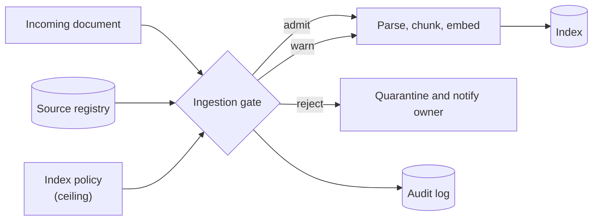

Six months after launch, Meridian's Platform team runs an inventory of what AskMeridian actually indexes. They expect the handbook and the IT runbooks. They find those, plus a legacy wiki nobody has edited since 2022, an export of a shared drive that someone uploaded "temporarily", minutes of a board meeting that include a redundancy plan, and a folder of exit-interview summaries. No one can say who approved any of them, who owns them, or whether they should be there. The assistant is working perfectly. The *data programme* around it is not.

**Data governance** is the set of decisions, roles, policies and controls that determine what data an organisation holds, who is accountable for it, who may use it and for what, and how its quality is kept up. For a RAG system the question governance answers is blunt: *what are we allowed to put in the index, who said so, and how do we keep that true?* This lesson separates governance from the technical and legal neighbours it is often confused with, defines the roles and artefacts that make it real, and builds a source registry with an ingestion gate that refuses documents that break the rules. The next two lessons of the module, [Source attribution](/learn/enterprise-rag-governance/source-attribution) and [Version control](/learn/enterprise-rag-governance/version-control), apply governed data at answer time and over time.

## Learning objectives

- Distinguish data governance from compliance, security and lineage, and say what question each answers.
- Define the governance roles (owner, steward, custodian, consumer) and the decision each is accountable for.
- Design a data classification scheme and a policy that sets which classes a given RAG index may hold.
- Specify a source registration record and implement an ingestion gate that enforces it.
- Choose governance metrics, such as orphaned sources and overdue reviews, that show whether governance is working.

## Prerequisites

- [Compliance](/learn/enterprise-rag-governance/compliance): external obligations that governance policy must satisfy.
- [GDPR concepts](/learn/enterprise-rag-governance/gdpr-concepts): lawful basis, purpose limitation and retention, which governance records per source.
- [Document metadata](/learn/document-engineering/document-metadata): where classification and ownership are stored on documents.
- [Ingestion architecture](/learn/understanding-document-ingestion/ingestion-architecture): the point at which a gate can be applied.

## Why this matters

Without governance, a RAG index accretes. Each team adds a source when it wants the assistant to know something, nobody removes anything, and the index becomes a record of past enthusiasm rather than a curated knowledge base. The consequences are concrete.

- **Sensitive data leaks by inclusion.** The most reliable way to leak a confidential document through a RAG system is to index it. Access controls on retrieval are a second line of defence; the first is not ingesting things that should never be answerable from a general assistant.
- **Quality decays silently.** A runbook that was right two years ago is now wrong, but it is still retrieved with a high score. When a wrong answer is traced to a stale document, no one owns it, so no one fixes it.
- **Accountability evaporates.** When an auditor, a customer or a regulator asks who approved indexing the HR case notes, "an engineer, probably" is an unacceptable answer.
- **Incidents have no responder.** If a document is found to contain something it should not, someone has to decide, quickly, to remove it. If no one is registered as responsible, the decision waits for an argument.
- **Everything else rests on it.** Lineage records where data went; audit logs record what happened; compliance demonstrates obligations. None of them decides what *should* go in. Governance does.

## The intuition

A public library does not accept every box of paper that people leave on its doorstep. It has an acquisitions policy: what the library collects, who decides, how items are catalogued, which are kept in the reference section, which are restricted to the archive reading room, and when items are reviewed and withdrawn. Each section has a responsible librarian. Items do not enter the stacks without a catalogue record, and the catalogue says where each came from.

A RAG index is a library whose books are chunks and whose readers are an assistant and everyone who asks it questions. Governance is the acquisitions policy, the catalogue, the named librarians and the periodic weeding. The most important rule is the simplest: nothing goes onto the shelves without a record that says who is responsible for it.

## How it works

### Governance and its neighbours

| Discipline | Question it answers | Typical artefact |
| --- | --- | --- |
| Data governance | What may we hold, who is accountable, to what standard? | Policies, classification scheme, source registry, decision rights |
| Compliance | Do we meet external obligations, and can we prove it? | Controls, evidence, attestations |
| Security | Is the data protected from misuse? | Access control, encryption, monitoring |
| Lineage | Where did this data come from and go? | Graph of derivations |
| Audit | What happened, who did it? | Tamper-evident log |

They reinforce each other. Governance sets the rule ("restricted data never enters the general index"), compliance shows the rule is followed, security enforces parts of it, lineage shows where the data ended up and audit records the actions. A governance policy with no enforcement is a wish; enforcement without a policy is arbitrary. The ingestion gate below is where policy meets enforcement.

### Roles and decision rights

Governance is largely about *who decides*. The standard roles are:

- **Data owner**: an accountable person or team, usually a business function, who decides what the data may be used for, who may access it and when it must be removed. For the handbook, the owner is HR. Ownership is about accountability and cannot be delegated to "the platform".
- **Data steward**: the owner's day-to-day delegate, who maintains quality, answers questions and approves routine changes, such as a new handbook edition.
- **Custodian**: the team operating the systems that store the data and implementing the owner's decisions. For AskMeridian, the Platform team is the custodian of the *index*, though not the owner of the *content*.
- **Consumers**: the users and systems that read the data, including the assistant.
- **Governance group**: a small cross-functional body (security, legal or privacy, data, the main business owners) that sets policy, rules on exceptions and reviews metrics.

A useful device is a **RACI** table (responsible, accountable, consulted, informed) for the key decisions: onboard a source, change a source's classification, permit a new use, retire a source, respond to a data incident. Write it down; the arguments it prevents are costly.

The central split for RAG is **content ownership versus system ownership**. The Platform team owns the pipeline; it does not decide that the HR case notes may be indexed. The data owner does, with input from security and privacy. A common failure is that the team that *can* ingest a source behaves as though it is the team that *may*.

### Classification and the index ceiling

**Data classification** labels data by sensitivity so that handling rules can be defined by label. A typical four-level scheme:

| Level | Meaning | Example at Meridian |
| --- | --- | --- |
| Public | Safe to publish | Product documentation on the website |
| Internal | For all staff, harmful if public | Employee handbook, IT runbooks |
| Confidential | Restricted to teams or roles | Board minutes, customer contracts |
| Restricted | Severe harm if exposed; often legally protected | HR case notes, health data, credentials |

Schemes vary by organisation; the useful property is that every source has exactly one label that someone chose.

For RAG the key design is an **index ceiling**: each index (or collection) is assigned the highest classification it may hold. The company-wide assistant's index has a ceiling of *internal*: anything above it never enters. Confidential material can live in a separate, more tightly permissioned index (for example, one per department with document-level permissions, see [Document-level permissions](/learn/access-control-and-privacy/document-level-permissions)), and restricted material may be excluded from RAG entirely or served only through a purpose-built system with its own controls.

This design has a pleasing property: if the ceiling is enforced at ingestion, the worst-case leak from the general assistant is bounded by the ceiling, however flawed retrieval-time filtering turns out to be. It is an example of **defence in depth** at the data layer.

Classification can be set by the owner at source level (simplest, and the right starting point) and refined at document level by automated classifiers or labels carried in the source system (see [Document classification](/learn/document-engineering/document-classification)). Automated classifiers help but make mistakes, so use them to *raise* classification or flag for review, not to lower it.

### The source registry

The **registry** (or data catalogue) is the central record that makes governance operational. It has one entry for each source feeding the index, with at least:

- **Identity and description**: a stable source id, what it is, and where it lives.
- **Ownership**: owner and steward, with a way to reach them.
- **Classification** and the index it may enter.
- **Purpose**: why the data is in the index. This is what purpose limitation (see [GDPR concepts](/learn/enterprise-rag-governance/gdpr-concepts)) requires you to be able to state.
- **Personal data flag and lawful basis**: whether personal data is present and, if so, the recorded basis.
- **Retention**: how long its derived copies may remain, feeding [Data retention](/learn/access-control-and-privacy/data-retention).
- **Freshness expectation**: how stale documents may become before they are flagged, set by the owner who knows how quickly the content ages.
- **Review date**: when the registration itself must be re-confirmed.
- **Status**: active, suspended or retired.

An entry is a lightweight **data contract** between the source's owner and the index's custodian: the owner promises content of a stated class, kept to a stated freshness, and the custodian promises to process it under stated rules and remove it on request. Writing it down converts folklore into something that can be enforced and audited.

### The ingestion gate

A policy only matters if the system enforces it, and ingestion is the natural choke point. The **gate** checks each document against the registry before it is parsed and embedded, and returns one of three decisions: *admit*, *admit with warning* or *reject*, with reasons. Rules a gate commonly enforces:

1. The source is registered. Unregistered sources are rejected, never auto-registered.
2. The source is active and has an accountable owner.
3. Its classification does not exceed the index ceiling.
4. The registration has been reviewed within its review interval.
5. If personal data is present, a lawful basis is recorded (this is better enforced when the registry record is created, so an invalid record cannot exist at all).
6. The document is within its freshness limit, or a warning is raised.

Rejections should be visible to humans: a rejected document is a prompt for the owner to register properly, not a silent failure. Place the gate in the shared code path, so that batch loads, event-driven updates and manual uploads all pass through it (see [Event-driven ingestion](/learn/understanding-document-ingestion/event-driven-ingestion) for the architecture it plugs into).



### Quality and lifecycle

Governance continues after admission. Treat each source as a **lifecycle**: *onboard* (registration, review by security and privacy, classification), *operate* (freshness monitoring, access reviews), *review* (annual re-registration; does the source still serve its purpose?) and *retire* (remove from the index, delete derived copies, record the retirement; see [Secure deletion](/learn/enterprise-rag-governance/secure-deletion)).

Quality for RAG sources has measurable dimensions: **freshness** (age of documents against the owner's limit), **completeness** (are expected documents present?), **consistency** (do versions conflict? see [Version control](/learn/enterprise-rag-governance/version-control)), and **provenance** (is the origin recorded? see [Data lineage](/learn/enterprise-rag-governance/data-lineage)). Where possible attach each to an automated check, as the retrieval-monitoring lessons of [RAG observability](/learn/rag-observability/retrieval-monitoring) do for retrieval quality.

### Metrics: is governance working?

A programme that cannot be measured drifts into ceremony. Useful numbers, all computable from the registry and the index:

- **Registered coverage**: the fraction of indexed documents whose source is registered. The target is 100 percent; anything less is shadow data.
- **Orphaned sources**: active sources with no named owner.
- **Overdue reviews**: sources past their review date.
- **Policy exceptions**: how many documents were admitted by exception, and how many exceptions are still open.
- **Rejections per week**: a spike means either a new team onboarding badly or a gate that is too strict.
- **Mean time to retire** a source after the owner requests it.

Review them monthly in the governance group and treat a worsening trend as a finding.

## In code

### A source registry and ingestion gate

**The problem.** Meridian wants the ingestion pipeline to refuse any document whose source is unregistered, ownerless, above the general assistant's classification ceiling, overdue for review, or stale, and wants a health report on the registry. Registration itself should refuse personal data with no recorded lawful basis.

**Dependencies.** Pydantic:

```bash
pip install pydantic
```

**The source.** `Level` is an integer enum, so classifications compare with `>`. `Source` is the registry record, and its validator makes "personal data without a lawful basis" an unrepresentable state. `admit` is the gate; `health_report` computes the registry-side metrics. The dates are fixed so that the output is reproducible; the five sources include deliberately flawed ones.

```python
"""A source registry and an ingestion gate: governance rules enforced in code."""
from datetime import date, timedelta
from enum import IntEnum

from pydantic import BaseModel, ValidationError, model_validator


class Level(IntEnum):
    PUBLIC = 0
    INTERNAL = 1
    CONFIDENTIAL = 2
    RESTRICTED = 3


class Source(BaseModel):
    source_id: str
    owner: str | None            # accountable team or person
    steward: str | None          # day-to-day contact
    classification: Level
    purpose: str
    contains_personal_data: bool
    lawful_basis: str | None = None
    retention_days: int
    max_doc_age_days: int        # freshness expectation set by the owner
    last_reviewed: date
    review_every_days: int = 365
    status: str = "active"       # active | suspended | retired

    @model_validator(mode="after")
    def personal_data_needs_basis(self):
        if self.contains_personal_data and not self.lawful_basis:
            raise ValueError(f"{self.source_id}: personal data without a recorded lawful basis")
        return self


class Doc(BaseModel):
    source_id: str
    doc_id: str
    modified: date


# Policy set by the data governance group for this index.
INDEX_CEILING = Level.INTERNAL   # the general assistant may hold up to 'internal'


def admit(doc: Doc, registry: dict[str, Source], today: date):
    """Return (decision, reasons). Decision: admit | admit_with_warning | reject."""
    src = registry.get(doc.source_id)
    if src is None:
        return "reject", ["source is not registered"]
    reasons, warnings = [], []
    if src.status != "active":
        reasons.append(f"source status is {src.status}")
    if not src.owner:
        reasons.append("source has no accountable owner")
    if src.classification > INDEX_CEILING:
        reasons.append(f"classification {src.classification.name} exceeds index ceiling {INDEX_CEILING.name}")
    if today - src.last_reviewed > timedelta(days=src.review_every_days):
        reasons.append(f"registration review overdue (last {src.last_reviewed})")
    if reasons:
        return "reject", reasons
    if today - doc.modified > timedelta(days=src.max_doc_age_days):
        warnings.append(f"document older than the {src.max_doc_age_days}-day freshness limit")
    return ("admit_with_warning", warnings) if warnings else ("admit", [])


def health_report(registry: dict[str, Source], today: date):
    out = []
    for s in registry.values():
        issues = []
        if not s.owner:
            issues.append("orphaned (no owner)")
        if today - s.last_reviewed > timedelta(days=s.review_every_days):
            issues.append("review overdue")
        if s.classification > INDEX_CEILING and s.status == "active":
            issues.append("active above index ceiling")
        out.append((s.source_id, issues or ["ok"]))
    return out


if __name__ == "__main__":
    today = date(2025, 10, 1)
    registry = {s.source_id: s for s in [
        Source(source_id="handbook", owner="HR", steward="hr-ops", classification=Level.INTERNAL,
               purpose="answer staff policy questions", contains_personal_data=False,
               retention_days=3650, max_doc_age_days=400, last_reviewed=date(2025, 3, 1)),
        Source(source_id="it-runbooks", owner="Platform", steward="support-desk", classification=Level.INTERNAL,
               purpose="troubleshooting", contains_personal_data=False,
               retention_days=1825, max_doc_age_days=180, last_reviewed=date(2025, 6, 1)),
        Source(source_id="hr-case-notes", owner="HR", steward="hr-casework", classification=Level.RESTRICTED,
               purpose="casework", contains_personal_data=True, lawful_basis="legal obligation",
               retention_days=2190, max_doc_age_days=3650, last_reviewed=date(2025, 1, 10)),
        Source(source_id="board-minutes", owner=None, steward=None, classification=Level.CONFIDENTIAL,
               purpose="record decisions", contains_personal_data=False,
               retention_days=3650, max_doc_age_days=3650, last_reviewed=date(2024, 2, 1)),
        Source(source_id="old-wiki", owner="Platform", steward="platform-docs", classification=Level.INTERNAL,
               purpose="legacy engineering notes", contains_personal_data=False,
               retention_days=730, max_doc_age_days=365, last_reviewed=date(2023, 11, 1), status="active"),
    ]}

    docs = [
        Doc(source_id="handbook", doc_id="leave-policy", modified=date(2025, 1, 1)),
        Doc(source_id="it-runbooks", doc_id="vpn-e4021", modified=date(2024, 12, 1)),
        Doc(source_id="hr-case-notes", doc_id="case-889", modified=date(2025, 8, 1)),
        Doc(source_id="board-minutes", doc_id="2025-q2", modified=date(2025, 7, 1)),
        Doc(source_id="old-wiki", doc_id="relay-notes", modified=date(2025, 5, 1)),
        Doc(source_id="shared-drive-dump", doc_id="misc-1", modified=date(2025, 9, 1)),
    ]
    for d in docs:
        decision, why = admit(d, registry, today)
        print(f"{d.source_id + '/' + d.doc_id:32} {decision:20} {'; '.join(why)}")

    print("\nSource health")
    for sid, issues in health_report(registry, today):
        print(f"  {sid:15} {', '.join(issues)}")

    print("\nRegistration check:")
    try:
        Source(source_id="exit-interviews", owner="HR", steward=None, classification=Level.CONFIDENTIAL,
               purpose="analysis", contains_personal_data=True, retention_days=365,
               max_doc_age_days=365, last_reviewed=today)
    except ValidationError as e:
        print(" ", e.errors()[0]["msg"])
```

**Running it** prints:

```output
handbook/leave-policy            admit                
it-runbooks/vpn-e4021            admit_with_warning   document older than the 180-day freshness limit
hr-case-notes/case-889           reject               classification RESTRICTED exceeds index ceiling INTERNAL
board-minutes/2025-q2            reject               source has no accountable owner; classification CONFIDENTIAL exceeds index ceiling INTERNAL; registration review overdue (last 2024-02-01)
old-wiki/relay-notes             reject               registration review overdue (last 2023-11-01)
shared-drive-dump/misc-1         reject               source is not registered

Source health
  handbook        ok
  it-runbooks     ok
  hr-case-notes   active above index ceiling
  board-minutes   orphaned (no owner), review overdue, active above index ceiling
  old-wiki        review overdue

Registration check:
  Value error, exit-interviews: personal data without a recorded lawful basis
```

**What the output means.** The handbook passes cleanly. The IT runbook is admitted with a warning because the document is older than the 180-day freshness limit its owner set: the owner is notified, but the content is probably still useful. The HR case notes are rejected because they are classified restricted, above the internal ceiling, even though their source is well run and has a recorded lawful basis: a good registration is necessary but not sufficient. The board minutes accumulate three reasons (no owner, confidential classification, overdue review), and the gate reports all of them rather than stopping at the first, so the owner can fix everything in one pass. The old wiki is rejected only for the overdue review, which is easily remedied by a re-registration. The document from the shared-drive dump is rejected because its source was never registered. The health report shows the same story from the registry side. The final lines show the registration check: a record that holds personal data without a lawful basis cannot be created at all.

**Important lines.**

- `class Level(IntEnum)` makes `src.classification > INDEX_CEILING` a single readable comparison, and makes classification a closed set rather than free text.
- The `@model_validator(mode="after")` on `Source` enforces the rule at registration time. Invalid states are best made impossible, rather than checked later.
- `admit` accumulates `reasons` and returns them all, so a rejection is actionable. A bare "rejected" teaches nothing.
- Freshness is a *warning*, not a rejection: old documents are not necessarily wrong. A different policy for a different source (for example, time-sensitive pricing) can make it a rejection by setting a short `max_doc_age_days`.
- `today` is a parameter, as in the previous lesson, so the gate is testable and the output reproducible.

**Errors people commonly hit.**

- `ValidationError` on registration for a source with personal data: add a lawful basis, or reconsider whether the source belongs in the index.
- A gate that nobody calls: a backfill script or manual upload that writes to the index directly. Enforce the gate at the index layer, for instance by rejecting writes that lack a registered `source_id` in the payload.
- Comparing classifications as strings. `"RESTRICTED" > "INTERNAL"` is a lexical comparison and gives the wrong answer for some pairs. Use an ordered enum.
- A registry in a spreadsheet that drifts from reality. Keep it in a database or in version control with required review, and generate the health report from it.

**Extending it.** Add an `approved_by` and `approved_on` field and an approvals trail written to the audit log; carry classification down to document level and take the maximum of source and document labels; add a quarantine store so rejected documents are held for the owner rather than discarded; run `health_report` weekly and send the owner a message when a source turns overdue; and add the index name to each source so that one registry serves several indexes with different ceilings.

## A real-world example

Meridian's inventory finds eleven unregistered sources and several indexed documents above the general ceiling, and the Platform team's first instinct is to delete everything unregistered. The governance group, which has just been formed, takes the opposite approach: it asks each source's team to claim it.

In the first fortnight, seven sources are registered with owners and classifications and stay. Two are retired because nobody claims them. The board minutes are removed from the general index at once, since their classification exceeds the ceiling, and the owner (the Company Secretary) agrees that a separate, tightly permissioned collection might be justified later, after a privacy review. The exit-interview summaries trigger a heated debate. The HR owner points out that they hold valuable insights; the privacy lead points out that they contain personal and sometimes special category data, collected for a narrow purpose, with no basis recorded for assistant use. The decision is a classification of *restricted* and exclusion from the assistant, with a note that anonymised themes could be published in the handbook instead. The decision is recorded in the registry with the names of the people who made it.

Then the team installs the gate. In the following month it rejects 23 documents: most from a team that tried to upload a shared-drive folder, a few from a source whose registration lapsed. Each rejection arrives in the owner's queue with reasons. Nothing dramatic happened, which is the point: governance that works mostly looks like a quiet queue of fixable rejections.

## Common mistakes

- **Treating governance as a committee, not a mechanism.** Policies in a wiki that no code enforces are ignored under deadline pressure. Put the rule in the ingestion gate.
- **Conflating system ownership and content ownership.** The team that runs the pipeline starts deciding what is allowed in, with no authority and no accountability for the content.
- **Auto-registering unknown sources.** The point of a registry is that a human accepted responsibility. A script that creates entries automatically turns the registry into a log of what happened to be ingested.
- **One-time classification.** Content changes: a draft becomes a final contract, a runbook acquires credentials. Review classifications on a schedule and re-check at document level.
- **Using automated classifiers to lower a label.** A classifier that is wrong 3 percent of the time, applied downwards, leaks restricted material. Use it to raise labels or flag for review.
- **No owner for legacy sources.** An old wiki everyone ignores is still retrieved, and its stale pages still produce wrong answers.
- **Governing the sources but not the derivatives.** Chunks, vectors, caches and evaluation sets also need classification and retention, inheriting at least the source's label.
- **Metrics nobody reads.** Orphans and overdue reviews accumulate silently if no group reviews the numbers.

## Best practices

- Maintain one registry entry per source, with owner, steward, classification, purpose, lawful basis, retention, freshness limit and review date.
- Give each index an explicit classification ceiling and enforce it at ingestion, not only at retrieval.
- Make invalid registrations impossible (a validator or schema) rather than merely discouraged.
- Reject with all reasons, quarantine the document and notify the owner; never fail silently.
- Carry source id, classification and version in every chunk's payload so governance can be verified from the index itself.
- Review each source on a fixed schedule, and retire unreviewed sources automatically after a grace period.
- Define a RACI for onboarding, reclassification, new uses, retirement and incidents.
- Track a few governance metrics (coverage, orphans, overdue reviews, open exceptions) and review them monthly.
- Make the cheapest path the compliant path: if registering a source takes ten minutes and a form, people will register; if it takes a week, they will bypass the process.

## Performance considerations

Governance checks are cheap compared with embedding. A registry lookup is a dictionary or indexed database read, microseconds to a millisecond, against the tens of milliseconds to seconds that parsing and embedding a document cost, so the gate adds negligible latency to ingestion. Embedding a million chunks at, say, 200 chunks a second takes about 83 minutes, and rejecting a source before it reaches that stage saves that compute entirely; a gate also *saves* money by keeping unwanted documents out of the index in the first place. The expensive part of governance is human attention: reviews and approvals that take days block teams, and teams respond by routing around the process. The metric that tells you the process is too slow is the time from registration request to approval; set a target (a few working days for low-risk internal sources) and track it. For large registries, run the health report as a scheduled job rather than on every request, and cache classification lookups in the ingestion workers with a short expiry, so that a reclassification takes effect within minutes.

## Security considerations

The registry is a high-value target and a control point: whoever can edit it can make a restricted source look internal. Restrict write access to owners and the governance group, require review for changes to classification, ceiling and review dates, and log every change to the audit trail. Treat ownership as an authentication problem too: an attacker who persuades an engineer to register a malicious or poisoned source as "internal" has a route into the index (see [Data poisoning](/learn/rag-security-fundamentals/data-poisoning) and [Malicious documents](/learn/rag-security-fundamentals/malicious-documents)), so registration should require approval by the owner's real authority, not self-service alone. Keep classification labels with the data: a chunk without its source id and classification in the payload cannot be filtered or deleted by policy later. And plan for removing a source quickly: a retirement path that works in minutes is a security control when a document is found to hold something it should not.

## Summary

- Governance decides what may be held, who is accountable and to what standard; compliance, security, lineage and audit support and verify it.
- Owners are accountable for content; custodians operate the systems; the team that can ingest a source is not automatically the team that may.
- A classification scheme with an index ceiling bounds the worst-case leak of a general assistant, however retrieval filtering behaves.
- A source registry, acting as a data contract with the owner, records ownership, classification, purpose, lawful basis, retention, freshness and review date.
- An ingestion gate enforces the registry and the ceiling, reports every reason for rejection, and makes the compliant path the easy one.
- Measure governance with coverage, orphans, overdue reviews and open exceptions, and review them on a schedule.

## Exercises

**1.** Meridian's Platform team proposes to index the customer-support ticket archive "because it would help the assistant". List four registration fields the team must obtain from the ticket system's owner before ingestion, and say what could make the source unsuitable for the general index.

<details><summary>Show solution</summary>

At least: the accountable owner and steward; the classification (tickets often contain customer data and sometimes credentials, so likely confidential); the purpose and whether the assistant's use is compatible with the purpose the tickets were collected for; the personal-data flag and lawful basis; and the retention limit. It may be unsuitable because the classification exceeds the general ceiling, because tickets include customer personal data with no compatible basis, or because contracts forbid use of customer data for other purposes. Options include a redacted derivative, a separate permissioned index or exclusion.

</details>

**2.** Why should an automated classifier be allowed to raise a document's classification but not lower it?

<details><summary>Show solution</summary>

The costs of the errors are asymmetric. A wrongly raised label keeps a document out of the general index or sends it for review: an inconvenience that a human can fix. A wrongly lowered label admits a sensitive document to a broad audience, and the harm may be irreversible. Classifiers are statistical and make mistakes, so they should be used on the safe side only: to add caution, with human review required to relax a label.

</details>

**3.** Write a function `quarantine_report(docs, registry, today)` using the lesson's code that returns, for each rejected document, its id and reasons as a list of dictionaries, then run it on two documents: one from `handbook` and one from an unregistered source `team-drive`.

<details><summary>Show solution</summary>

```python
from datetime import date
from gov import Doc, admit

def quarantine_report(docs, registry, today):
    out = []
    for d in docs:
        decision, reasons = admit(d, registry, today)
        if decision == "reject":
            out.append({"doc": f"{d.source_id}/{d.doc_id}", "reasons": reasons})
    return out

# Reuses the 'registry' built in the lesson's __main__ block; here, a minimal copy:
from gov import Source, Level
registry = {"handbook": Source(source_id="handbook", owner="HR", steward="hr-ops",
    classification=Level.INTERNAL, purpose="policy answers", contains_personal_data=False,
    retention_days=3650, max_doc_age_days=400, last_reviewed=date(2025, 3, 1))}
docs = [Doc(source_id="handbook", doc_id="leave", modified=date(2025, 1, 1)),
        Doc(source_id="team-drive", doc_id="notes", modified=date(2025, 9, 1))]
print(quarantine_report(docs, registry, date(2025, 10, 1)))
```

The handbook document is admitted and so omitted; the output is a list with one entry: `[{'doc': 'team-drive/notes', 'reasons': ['source is not registered']}]`.

</details>

**4.** Design question. Argue for or against giving each department its own RAG index with its own ceiling, rather than one company-wide index with document-level permissions. Name at least two trade-offs.

<details><summary>Show solution</summary>

For separate indexes: the ceiling bounds the worst case per index, so a filtering bug in the HR index cannot expose finance data; ownership is clearer; deletion and retention can be applied per department; and noisy neighbours are avoided. Against: duplicated infrastructure and operations; cross-department questions need federated retrieval (querying several indexes and merging), which adds latency and complexity; shared content (such as the handbook) is stored repeatedly or needs its own index; and governance overhead grows with the number of indexes. A common compromise is one broad index capped at internal classification and a small number of specialised, tightly permissioned indexes for confidential domains, with the router selecting indexes by the user's entitlements.

</details>

## Check your understanding

```quiz
[
  {
    "q": "In RAG governance, who decides that a source may be indexed?",
    "options": [
      "Whichever engineer builds the connector",
      "The data owner, with input from security and privacy, under the governance group's policy",
      "The embedding model's provider",
      "Nobody; indexing is automatic"
    ],
    "answer": 1,
    "why": "Content ownership is separate from system ownership. The owner is accountable for what the data may be used for; the platform team only implements it."
  },
  {
    "q": "What does an index classification ceiling guarantee?",
    "options": [
      "That retrieval never makes mistakes",
      "That no document above the ceiling enters the index, bounding the worst-case leak from that index",
      "That all documents are encrypted",
      "That answers are always correct"
    ],
    "answer": 1,
    "why": "If enforced at ingestion, higher-classified data never reaches the index, so even a flawed retrieval filter cannot expose it."
  },
  {
    "q": "Why does the lesson's gate return all reasons for a rejection instead of stopping at the first?",
    "options": [
      "To make the code slower",
      "So the owner can fix everything in one pass",
      "Because Pydantic requires it",
      "To hide the real reason"
    ],
    "answer": 1,
    "why": "An actionable rejection lists every failing rule; otherwise the owner fixes one, resubmits and fails on the next."
  },
  {
    "q": "A source holds personal data but the registration has no lawful basis. Where is it best to prevent this?",
    "options": [
      "At retrieval time",
      "At registration, with a validator that makes the invalid record impossible",
      "In the generation prompt",
      "In the log files"
    ],
    "answer": 1,
    "why": "Making invalid states unrepresentable at registration is cheaper and more reliable than detecting them downstream."
  },
  {
    "q": "Which is a governance metric that signals shadow data?",
    "options": [
      "Mean latency of generation",
      "Fraction of indexed documents whose source is registered",
      "Average chunk length",
      "Embedding dimension"
    ],
    "answer": 1,
    "why": "Registered coverage below 100 percent means documents are in the index with no recorded owner, classification or purpose."
  }
]
```

## Further reading

- DAMA International, *DAMA-DMBOK: Data Management Body of Knowledge* (2nd edition, 2017), the chapters on data governance and data security.
- Dehghani (2022), *Data Mesh*, O'Reilly, for the ideas of data ownership by domain and data as a product with explicit contracts.
- NIST, *Special Publication 800-60*, "Guide for Mapping Types of Information and Information Systems to Security Categories", an example of structured classification.
- UK Government Security Classifications Policy, a public example of a tiered classification scheme with handling rules: [gov.uk](https://www.gov.uk/government/publications/government-security-classifications).
- Pydantic documentation, [validators](https://docs.pydantic.dev/latest/concepts/validators/), including `model_validator`.
