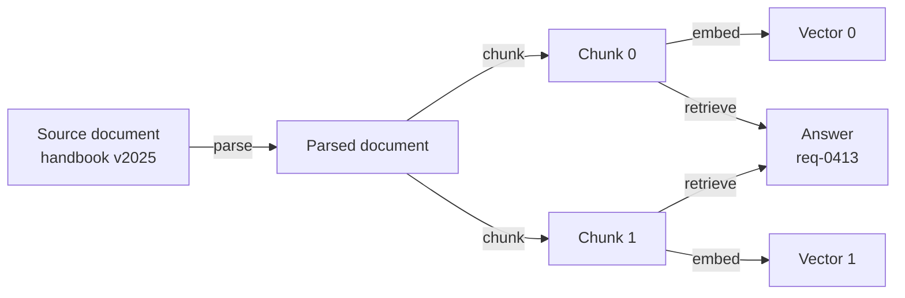

When AskMeridian tells an employee that laptops are refreshed every four years, someone will eventually ask a simple question: *where did that come from?* The honest answer, in a typical RAG system, is a shrug. The answer was written by a language model from five chunks, the chunks came from a vector index, the index was built from parsed documents, and the documents were copied from a wiki that three teams edit. Each hop is a place where information can be changed, lost or kept past its useful life, and unless you recorded the hops as they happened, you cannot reconstruct them afterwards.

**Data lineage** is that record: a description of where each piece of data came from, what was done to it, and where it went. This lesson shows how to model lineage for a RAG pipeline as a graph, what to capture at each stage, how to answer the two questions lineage exists for (backwards, "what produced this?", and forwards, "what did this affect?"), and where lineage stops being useful because it costs more than it is worth. It is the foundation for the rest of the module: [audit logs](/learn/enterprise-rag-governance/audit-logs) record who did what, [secure deletion](/learn/enterprise-rag-governance/secure-deletion) needs lineage to know what to delete, and [source attribution](/learn/enterprise-rag-governance/source-attribution) shows users a piece of the lineage.

## Learning objectives

- Define data lineage and distinguish backward lineage (provenance) from forward lineage (impact analysis).
- Model a RAG pipeline as a directed acyclic graph of sources, parsed documents, chunks, vectors and answers, and name the metadata each node and edge needs.
- Use content hashes and version identifiers to make lineage records stable and verifiable.
- Query a lineage graph to find every answer influenced by a superseded document, and every vector that must be recomputed after an embedding-model change.
- Decide what granularity of lineage a given system needs and where to record it.

## Prerequisites

- [Document identifiers](/learn/document-engineering/document-identifiers): stable ids and content hashes for documents and chunks.
- [Document versioning](/learn/document-engineering/document-versioning): why documents have versions and how superseded ones are handled.
- [Ingestion architecture](/learn/understanding-document-ingestion/ingestion-architecture): the stages a document passes through before it is searchable.
- [Logging](/learn/rag-observability/logging): structured logs and request identifiers.

## Why this matters

A RAG system is a data pipeline with a language model at the end of it. Every serious data platform learned the same lesson: when a number on a dashboard is wrong, you need to trace it back to the rows that produced it; when a source system turns out to be faulty, you need to trace forward to everything it contaminated. RAG adds new reasons.

- **Wrong answers need a cause.** A wrong answer might come from a stale document, a parser that dropped a table, a chunk boundary that split a rule from its exception, or an embedding model that was swapped without re-indexing. Without lineage you test hypotheses by guessing; with it you read the cause off the record.
- **Superseded sources must stop mattering.** When the 2023 handbook is replaced, you need to know which chunks, vectors and cached answers derived from it, not merely that "the old one should be gone".
- **Components change.** Parsers get upgraded, chunkers re-tuned, embedding models replaced. Each change makes a slice of the index inconsistent with the rest. Lineage tells you which slice, so you re-process hundreds of chunks instead of a million.
- **Regulation and contracts ask.** Rules on personal data (see [GDPR concepts](/learn/enterprise-rag-governance/gdpr-concepts)) and customer contracts that restrict where data may be processed ask you to demonstrate where data went. "We believe it did not go there" is not evidence.
- **Trust.** An answer you can trace is an answer you can defend. An answer you cannot trace is, in an enterprise setting, an answer no one will rely on for anything that matters.

Without lineage, incidents end in the same unsatisfying way: you rebuild the whole index "to be safe", the problem disappears or does not, and you never learn which.

## The intuition

Think of a restaurant that has to trace a food-safety problem. A customer is ill. The kitchen asks backwards: which dishes did that customer eat, which ingredients went into them, which supplier delivered those ingredients on which day, from which batch? Then it asks forwards: if that batch was contaminated, which other dishes used it and who ate them? The restaurant can only do this if it kept delivery notes, batch numbers and prep logs *at the time*. Nobody can reconstruct them afterwards from memory.

A RAG pipeline is a kitchen. Documents are deliveries, parsing and chunking are preparation, the index is the pantry, and an answer is a dish served to a customer. Lineage is the batch number written on every container. The key habit is the same: the label is attached when the item is made, by the process that makes it, not reconstructed later.

## How it works

### Lineage as a graph

Lineage is naturally a **directed acyclic graph** (DAG): a set of nodes connected by arrows that never loop back. Each node is a piece of data; an arrow from node A to node B means "B was derived from A". For a RAG system the nodes fall into five kinds:



- **Source**: the document as it existed in the system of record (a wiki page, a PDF in a drive) at a particular version.
- **Parsed document**: the text and structure extracted from it.
- **Chunk**: a piece of the parsed document, the unit that is retrieved.
- **Vector**: the embedding of a chunk (plus the index entry that holds it).
- **Answer**: a generated response, linked to the chunks that were placed in its prompt.

The arrows are labelled with the **step** that made the child: parse, chunk, embed, retrieve. Two queries over this graph give lineage its value:

- **Backward lineage (provenance)**: start at a node and follow arrows backwards. From an answer, you reach its chunks, the documents they came from and the exact version of each.
- **Forward lineage (impact analysis)**: start at a node and follow arrows forwards. From a superseded document you reach every chunk, vector and answer it influenced.

These are the graph operations *ancestors* and *descendants*, and every graph library has them. The hard part is not the query; it is making sure the graph is complete and truthful, which means capturing the right metadata at the right moment.

### What each node and edge must record

A lineage record is only useful if it identifies the thing precisely and describes how it was made. The checklist:

| Node | Identity | What else to record |
| --- | --- | --- |
| Source | Stable document id, version, **content hash** | System of record and URI, owner, ingestion timestamp, access-control snapshot |
| Parsed document | Hash of the parsed text | Parser name and version, parser settings, warnings (such as "table skipped") |
| Chunk | Document id, version, position, hash of text | Chunker name and parameters (size, overlap), metadata attached |
| Vector | Chunk id | Embedding model name and version, dimension, normalisation, index name and collection |
| Answer | Request id | Prompt template version, generation model and version, chunk ids and ranks placed in context, timestamp |

Three design points matter more than the table.

**Content hashes beat timestamps.** A hash such as the first 10 hexadecimal characters of a SHA-256 digest of the text is a fingerprint: if two nodes have the same hash they have the same content, and if a "re-ingestion" produces the same hash, nothing actually changed and downstream work can be skipped. Timestamps tell you *when* something happened, not *whether anything changed*. The [document identifiers](/learn/document-engineering/document-identifiers) lesson explains hashing in more depth; here the point is that the hash is what lets a lineage record be *verified*: re-hash the stored chunk and compare it with the recorded hash to detect silent corruption.

**Record component versions, not just names.** "Embedded with MiniLM" is not lineage. "Embedded with `all-MiniLM-L6-v2`, 384 dimensions, normalised" is. A parser upgrade that changes how tables are extracted changes the chunks without changing the document, and only a recorded parser version lets you find the affected ones. The same goes for the generation model and the prompt template on the answer side.

**Identify by what, not by where.** A path or URL changes when someone moves a file; a stable document id plus version does not. A chunk's identity should be derived from its document, version and position, so the same chunk keeps the same id across a re-run of an unchanged pipeline.

### Granularity: how much lineage is enough

You can capture lineage at three levels, and each costs more than the last.

1. **Dataset level**: "the `handbook` collection is built from the HR wiki space by pipeline `hr-ingest` v7." Cheap, coarse, and sufficient for questions such as "which systems consume this wiki?".
2. **Document level**: each source document version maps to the chunks derived from it. This is the sweet spot for most RAG systems, because deletions, supersessions and access changes happen to documents.
3. **Chunk and request level**: each answer lists the chunk ids (and versions) in its prompt. This is what lets you reconstruct a specific answer, and it is what an auditor or a distressed user will ask for.

Column-level or token-level lineage, familiar from analytics platforms, is rarely worth it for RAG: a chunk is already the unit of retrieval, and "which sentence of the answer came from which sentence of the chunk" is the separate problem of [source attribution](/learn/enterprise-rag-governance/source-attribution).

A sensible default is document-level lineage for everything in the index, plus chunk-level lineage on every answer.

### Where to capture it

Lineage is only trustworthy when it is a by-product of the real pipeline, not a parallel description someone maintains by hand. Three patterns, in increasing robustness:

- **Emit lineage events from each stage.** Every stage writes a small event ("I produced chunk X from parsed document Y using chunker Z") to a lineage store as it works. This is simple and works with any orchestrator. Its weakness is that a stage someone forgets to instrument becomes a gap in the graph.
- **Make the lineage the index metadata.** Store `doc_id`, `doc_version`, `content_hash`, `parser_version`, `chunker`, `embedding_model` in the payload of every chunk in the [vector database](/learn/vector-database-fundamentals). Then forward lineage from a document is a metadata filter, and the lineage cannot drift from the index because it *is* the index. This is the most robust pattern for the chunk-to-vector hop, and it is what the [document metadata](/learn/document-engineering/document-metadata) lesson sets you up for.
- **Use an open standard.** OpenLineage is an open specification and API for collecting lineage events (jobs, runs and datasets) from data pipelines, with integrations for common orchestrators. If your organisation already runs a data catalogue that understands it, emitting standard events lets RAG lineage appear next to the rest of the company's data lineage. Check the project's documentation for the current integrations; the concept transfers even if you build your own store.

In practice you combine them: rich metadata on every chunk, plus events for the steps that happen outside the index (parsing, source fetch, answer generation).

### The answer node: the part most systems omit

Most pipelines capture ingestion lineage at least informally, because the pipeline code already touches each step. The answer side is where lineage usually has a hole, because the request path is optimised for latency and nobody thought to keep the record. For each request, log the identifiers of the chunks that were *placed in the prompt* (not merely retrieved: reranking and context trimming remove some), their ranks, the prompt-template version and the model. Then the lineage edge from chunk to answer exists, and so does the whole backward path. This record is also the raw material for [audit logs](/learn/enterprise-rag-governance/audit-logs), where it is combined with who asked and what they were allowed to see.

### What lineage cannot tell you

Lineage records *which* inputs fed an answer, not *how much each one mattered*, and not whether the model used or ignored them. A chunk in the prompt may have been irrelevant to the answer. Lineage is a necessary condition for explaining an answer, not a sufficient one. It also cannot tell you what is *inside* the model's weights: a language model's own training data is outside your graph, and an answer might contain knowledge that no chunk supplied. Treat a lineage path as "these were the retrieved inputs", and use [faithfulness evaluation](/learn/generation-evaluation) to check whether the answer actually followed them.

## In code

### A lineage graph for the ingestion pipeline

**The problem.** Meridian has two versions of its handbook in the pipeline, 2023 and 2025. The 2023 version said laptops are refreshed every four years; the 2025 version says three. We want to record every derivation step, then answer four operational questions: which sources fed a given answer, which answers a superseded document influenced, which vectors need re-embedding after a model change, and what the path from source to answer looks like.

**Dependencies.** Only NetworkX, which is a pure-Python graph library (it is also in the scratch environment used for this course):

```bash
pip install networkx
```

**The source.** The code below defines a `LineageGraph` that wraps a NetworkX `DiGraph`, an `ingest` function that records each step for one document version, and a `record_answer` function that adds an answer node linked to the chunks in its prompt. In a real system the same events would be written to a database; the graph logic is identical.

```python
"""A small lineage store for a RAG ingestion pipeline."""
import hashlib
import json
from dataclasses import dataclass, field

import networkx as nx


def sha(text: str) -> str:
    return hashlib.sha256(text.encode("utf-8")).hexdigest()[:10]


@dataclass
class LineageGraph:
    g: nx.DiGraph = field(default_factory=nx.DiGraph)

    def add_node(self, node_id: str, kind: str, **attrs):
        self.g.add_node(node_id, kind=kind, **attrs)

    def add_edge(self, parent: str, child: str, step: str, **attrs):
        # An edge says: `child` was produced from `parent` by `step`.
        self.g.add_edge(parent, child, step=step, **attrs)

    def upstream(self, node_id: str):
        return nx.ancestors(self.g, node_id)

    def downstream(self, node_id: str):
        return nx.descendants(self.g, node_id)

    def of_kind(self, ids, kind):
        return sorted(n for n in ids if self.g.nodes[n]["kind"] == kind)


PARSER = "parser-v2"
CHUNKER = "split-400-50"
EMBEDDER = "minilm-l6-v2"


def ingest(lg: LineageGraph, doc_id: str, version: str, text: str):
    """Record every derivation step for one document version."""
    src = f"src:{doc_id}@{version}#{sha(text)}"
    lg.add_node(src, "source", doc_id=doc_id, version=version, content_hash=sha(text))
    parsed = text.strip()
    pid = f"parsed:{doc_id}@{version}#{sha(parsed)}"
    lg.add_node(pid, "parsed", parser=PARSER)
    lg.add_edge(src, pid, "parse", parser=PARSER)
    for i, piece in enumerate(p for p in parsed.split("\n\n") if p):
        cid = f"chunk:{doc_id}@{version}:{i}#{sha(piece)}"
        lg.add_node(cid, "chunk", text=piece, chunker=CHUNKER)
        lg.add_edge(pid, cid, "chunk", chunker=CHUNKER)
        vid = f"vec:{cid.split(':', 1)[1]}"
        lg.add_node(vid, "vector", model=EMBEDDER, dim=384)
        lg.add_edge(cid, vid, "embed", model=EMBEDDER)


def record_answer(lg, request_id, chunk_ids, model):
    aid = f"answer:{request_id}"
    lg.add_node(aid, "answer", model=model)
    for cid in chunk_ids:
        lg.add_edge(cid, aid, "retrieve", request=request_id)
    return aid


if __name__ == "__main__":
    lg = LineageGraph()
    handbook_2023 = "Laptops are refreshed every 4 years.\n\nSupport desk hours are 09:00 to 17:00."
    handbook_2025 = "Laptops are refreshed every 3 years.\n\nSupport desk hours are 08:00 to 18:00."
    ingest(lg, "handbook", "2023", handbook_2023)
    ingest(lg, "handbook", "2025", handbook_2025)

    chunks_2023 = [n for n in lg.g if n.startswith("chunk:handbook@2023")]
    chunks_2025 = [n for n in lg.g if n.startswith("chunk:handbook@2025")]
    record_answer(lg, "req-0412", [sorted(chunks_2023)[0]], "claude-opus-5-5")
    record_answer(lg, "req-0413", [sorted(chunks_2025)[0]], "claude-opus-5-5")

    print("Nodes by kind:")
    kinds = {}
    for _, d in lg.g.nodes(data=True):
        kinds[d["kind"]] = kinds.get(d["kind"], 0) + 1
    print(json.dumps(kinds, sort_keys=True))

    print("\nQ1. Which sources and versions fed answer req-0412?")
    up = lg.upstream("answer:req-0412")
    for s in lg.of_kind(up, "source"):
        print("  ", s, lg.g.nodes[s]["version"])

    print("\nQ2. The 2023 handbook was superseded. Which answers did it influence?")
    src2023 = [n for n in lg.g if n.startswith("src:handbook@2023")][0]
    down = lg.downstream(src2023)
    print("  chunks :", len(lg.of_kind(down, "chunk")))
    print("  vectors:", len(lg.of_kind(down, "vector")))
    print("  answers:", lg.of_kind(down, "answer"))

    print("\nQ3. Embedding model changes. Which vectors need re-embedding?")
    stale = [n for n, d in lg.g.nodes(data=True) if d["kind"] == "vector" and d["model"] == EMBEDDER]
    print("  ", len(stale), "vectors use", EMBEDDER)

    print("\nQ4. Path from source to answer (steps):")
    path = nx.shortest_path(lg.g, src2023, "answer:req-0412")
    for a, b in zip(path, path[1:]):
        print(f"   {lg.g.edges[a, b]['step']:<9} {a.split('#')[0]} -> {b.split('#')[0]}")
```

**Running it** prints:

```output
Nodes by kind:
{"answer": 2, "chunk": 4, "parsed": 2, "source": 2, "vector": 4}

Q1. Which sources and versions fed answer req-0412?
   src:handbook@2023#a61f139a35 2023

Q2. The 2023 handbook was superseded. Which answers did it influence?
  chunks : 2
  vectors: 2
  answers: ['answer:req-0412']

Q3. Embedding model changes. Which vectors need re-embedding?
   4 vectors use minilm-l6-v2

Q4. Path from source to answer (steps):
   parse     src:handbook@2023 -> parsed:handbook@2023
   chunk     parsed:handbook@2023 -> chunk:handbook@2023:0
   retrieve  chunk:handbook@2023:0 -> answer:req-0412
```

**What the output means.** The graph holds two sources, two parsed documents, four chunks, four vectors and two answers. Question 1 follows arrows backwards from `req-0412` and lands on exactly one source, the 2023 handbook: the answer that said "four years" is explained. Question 2 goes forwards from the 2023 source and finds two chunks, two vectors and one answer, so we know precisely which served answer drew on the superseded text. Question 3 counts vectors by recorded embedding model: if Meridian replaces MiniLM, these four (in production, perhaps a few hundred thousand) are the re-embedding list. Question 4 prints the derivation path with the step on each edge, which is the evidence trail you would hand to a reviewer. Note that the path stops at `retrieve`: the embedding edge lies on a side branch, because the vector is not an ancestor of the answer in this model. That is a modelling choice, not an accident: the answer was built from the *chunk text*, not the vector.

**Important lines.**

- `sha` truncates a SHA-256 digest to ten hexadecimal characters. Ten characters is 40 bits, enough to tell versions of a few thousand documents apart, but use the full digest where tamper-resistance matters.
- Node ids embed the document id, version and position (`chunk:handbook@2025:0#...`), so re-running an unchanged pipeline reproduces the same ids. Re-ingestion is idempotent: adding the same node twice to a NetworkX graph updates it rather than duplicating it.
- `add_edge(parent, child, step, ...)` stores the step and the component version on the edge. This is how Q3 can find vectors by embedding model, and how you would find chunks by chunker.
- `upstream` and `downstream` are thin wrappers over `nx.ancestors` and `nx.descendants`; every impact-analysis query is one of these two calls plus a filter on node kind.

**Errors people commonly hit.**

- `NetworkXError: The node ... is not in the graph` from `ancestors` or `descendants`: the id you queried does not match the one recorded, usually because the hash suffix differs. Look nodes up by attribute (as `affected_answers` below does) rather than rebuilding id strings by hand.
- Lineage that "works" in testing but has gaps in production: a code path (a retry, a backfill script, a manual upload) that creates chunks without calling `ingest`. Route every write through one function, or enforce the metadata at the index layer.

**Extending it.** Persist nodes and edges in two database tables and traverse with a recursive query, add an `access_snapshot` attribute to sources, and write chunk-level attributes into the vector database payload too.

### A forward-impact query you can reuse

The most operationally valuable query is "which answers did this document version influence?". The helper below finds the source nodes by attribute and collects the answers beneath them. It uses the `lg` graph and the ingestion code from the listing above, run on a fresh graph with the 2025 handbook and a VPN runbook.

```python
from lineage import LineageGraph, ingest, record_answer

lg = LineageGraph()
ingest(lg, "handbook", "2025", "Laptops are refreshed every 3 years.\n\nSupport desk hours are 08:00 to 18:00.")
ingest(lg, "runbook-vpn", "7", "E-4021 means the VPN client is out of date.\n\nE-4012 means the VPN certificate expired.")
chunks = sorted(n for n in lg.g if n.startswith("chunk:"))
record_answer(lg, "req-1", [chunks[0], chunks[2]], "claude-opus-5-5")


def affected_answers(lg, doc_id, version):
    """Answers influenced by any chunk of one document version."""
    out = set()
    for n, d in lg.g.nodes(data=True):
        if d["kind"] == "source" and d["doc_id"] == doc_id and d["version"] == version:
            out |= set(lg.of_kind(lg.downstream(n), "answer"))
    return sorted(out)


print(affected_answers(lg, "runbook-vpn", "7"))
print(affected_answers(lg, "handbook", "2025"))
print(affected_answers(lg, "handbook", "2023"))
```

```output
['answer:req-1']
['answer:req-1']
[]
```

The single answer drew on one chunk from each document, so both documents list it, and a version that was never ingested lists nothing. The same shape answers "which answers did a retracted document touch?", the first step in deciding whether to notify anyone.

## A real-world example

Meridian's Platform team receives a ticket: an employee in Leeds ordered a replacement laptop in March on the strength of an AskMeridian answer that said the refresh cycle was four years, and has now been told by IT that it is three. The employee's answer is in the support transcript. Nobody can say why the assistant quoted the 2023 handbook.

Before lineage, the team's options are poor. They can search the vector database for "four years" and find the chunk, but that does not say which version of which document it came from, whether it was retrieved because it was ranked well or because the newer chunk was missing, or how many other employees saw it. They rebuild the index overnight and hope.

After the team adds the lineage described above, the investigation takes ten minutes. The request id from the transcript leads to an answer node. Backward lineage shows one chunk in the prompt, from `handbook@2023`. The source node's ingestion timestamp shows it was ingested in 2024 and its recorded `superseded_at` attribute is empty: the 2025 edition was ingested, but the supersession step, which should have marked the 2023 chunks as inactive, failed silently on a permissions error. Forward lineage from the 2023 source lists 41 answers over six weeks that used its chunks, 9 of which mention the laptop cycle. The team fixes the supersession step, deactivates the stale chunks, and sends a correction to the nine affected users, using the audit trail of who asked (see [audit logs](/learn/enterprise-rag-governance/audit-logs)). Lineage did not fix anything; it turned an unbounded "we don't know how far this went" into a list of nine names.

## Common mistakes

- **Reconstructing lineage after the fact.** Inferring provenance from file names and timestamps gives plausible but unreliable answers, which is worse than none. Capture it as the pipeline runs.
- **Recording component names but not versions.** "Parsed with the PDF parser" cannot find the chunks affected by last month's parser upgrade.
- **Identifying by path or URL.** Moving a document breaks every record that points to it. Use stable ids and hashes.
- **Omitting the answer node.** Perfect ingestion lineage is not enough, because users complain about answers. Without the chunk-to-answer edge you cannot go from a complaint to a source.
- **Logging retrieved chunks instead of prompted chunks.** Reranking and context budgets drop chunks. Record what was actually in the prompt, or the lineage over-claims.
- **Letting the lineage store outlive deletion duties.** Lineage records often contain text snippets or personal identifiers. A deleted document whose text survives in the lineage store has not been deleted (see [secure deletion](/learn/enterprise-rag-governance/secure-deletion)).

## Best practices

- Attach lineage metadata to every chunk payload in the index: document id, version, content hash, parser version, chunker parameters, embedding model.
- Give every ingestion run and every request an identifier, and write it on every record the run or request produces.
- Record at least document-level lineage for the whole index and chunk-level lineage for every answer.
- Store hashes, not copies of content, in the lineage store. A hash proves identity without becoming a second copy of sensitive text.
- Write lineage in the same transaction or the same code path as the data it describes, so that the two cannot disagree.
- Test lineage like any other feature: ingest a known document, then assert that its forward lineage includes the expected chunks and that a deleted document's forward lineage is empty.
- Treat the embedding model, parser and chunker as versioned dependencies; bump their version string whenever behaviour changes, even if the code looks unchanged.

## Performance considerations

Lineage adds writes, not reads, to the hot path, and the arithmetic is gentle. Suppose AskMeridian serves 20,000 requests a day and puts 6 chunks in each prompt. Answer-side lineage is then 20,000 answer nodes and 120,000 edges per day. At roughly 100 bytes per edge (two identifiers and a step name), that is about 12 MB per day, or around 4.4 GB a year, which is trivial for a relational database and a rounding error next to the logs. Ingestion-side lineage scales with chunks: a million chunks with four nodes and three edges each is a few million rows, written once.

The costs to watch are different. Writing a lineage event synchronously in the request path adds a database round trip to every answer, so emit it asynchronously (a queue or a buffered logger) and accept that a crash can lose the last few events, or write it to the same log line as the request record. Graph traversal over millions of nodes in memory is slow and heavy; for production, query the database with indexed lookups by document id (one hop down to chunks, one more to answers) rather than loading the graph. Finally, re-embedding after a model change is cheap to *plan* with lineage and expensive to *do*: lineage lets you re-embed only the affected vectors, but if the whole index used the old model, the answer is still "all of it".

## Security considerations

Lineage is metadata about your most sensitive material, and it deserves the same protection as the material itself. Source URIs and titles can reveal confidential projects ("acquisition-of-X-draft.docx"), so apply the access rules of the source to lineage queries, or restrict lineage to a small operations group. Do not copy chunk text into lineage records; store ids and hashes. Answer nodes link a request to a user, so lineage joined with request logs is personal data, with its own retention period (see [data retention](/learn/access-control-and-privacy/data-retention)). Finally, make lineage tamper-evident where it supports compliance claims: a lineage store that an engineer can quietly edit proves nothing. The hash-chaining technique in [audit logs](/learn/enterprise-rag-governance/audit-logs) applies equally here.

## Summary

- Lineage is a directed acyclic graph that records which data was derived from which, by what step and with which component version.
- Backward lineage (provenance) explains an answer; forward lineage (impact analysis) finds everything a faulty or superseded source touched.
- Capture it as a by-product of the pipeline, with content hashes, stable ids and component versions, never reconstructed later.
- Document-level lineage for the index plus chunk-level lineage for each answer is the practical default.
- The answer node, linking a request to the chunks that were actually in its prompt, is the edge most systems forget and the one users need.
- Lineage tells you what fed an answer, not whether the model used it; pair it with evaluation.

## Exercises

**1.** List the five node kinds in a RAG lineage graph and, for each, one attribute that would let you answer "which items were affected by an upgrade to the chunker?" or "by a change of embedding model?".

<details><summary>Show solution</summary>

Source, parsed document, chunk, vector, answer. For the chunker upgrade, the chunk node (or the `chunk` edge) records the chunker name and parameters, such as `split-400-50`; filter chunks on that value to find everything produced by the old version. For the embedding model, the vector node records the model name and version, such as `minilm-l6-v2`; filtering vectors on it gives the re-embedding list. The parsed-document node's `parser` attribute plays the same role for parser upgrades, and the answer node's model and prompt-template attributes support "which answers did the old template produce?".

</details>

**2.** A colleague proposes recording lineage only at the dataset level ("the `handbook` collection comes from the HR wiki") because it is cheap. Give two incidents from this lesson that dataset-level lineage cannot resolve.

<details><summary>Show solution</summary>

First, the Leeds laptop incident: the question was which version of which document a particular answer drew on, and which other answers did the same. A dataset-level record says only that the collection came from the HR wiki, not that one chunk came from the 2023 edition. Second, a parser upgrade that mishandles tables: only some documents are affected, and without per-document and per-chunk parser versions you cannot find them, so you must re-ingest everything. Dataset-level lineage answers organisational questions (who owns this, which systems consume it), not forensic ones.

</details>

**3.** Using the helper in the lesson, write a function `vectors_for_model(lg, model)` that returns the vector ids using a given embedding model, and show the output for `"minilm-l6-v2"` after ingesting one two-paragraph document.

<details><summary>Show solution</summary>

```python
from lineage import LineageGraph, ingest

def vectors_for_model(lg, model):
    return sorted(n for n, d in lg.g.nodes(data=True)
                  if d["kind"] == "vector" and d["model"] == model)

lg = LineageGraph()
ingest(lg, "handbook", "2025", "Annual leave is 25 days.\n\nUp to 5 days carry over.")
print(vectors_for_model(lg, "minilm-l6-v2"))
print(vectors_for_model(lg, "some-other-model"))
```

Running it prints two vector ids for the first call (`vec:handbook@2025:0#...` and `vec:handbook@2025:1#...`) and an empty list for the second. The point is that the filter works because the model name was recorded on the node at ingestion time.

</details>

**4.** Design question. Meridian's legal team says that a customer contract forbids processing its data in a particular region. The generation model is called through a hosted API. Which lineage attributes would you add to answer nodes and to which nodes, so that you can prove no prompt containing that customer's chunks was sent to that region? What would you still be unable to prove?

<details><summary>Show solution</summary>

Add the customer or tenant identifier to every source and propagate it to chunks (it should already be in the chunk payload for access control), and record on each answer node the endpoint or region the generation call was sent to, along with the model and provider. Then the query is: find all answers whose ancestors include a chunk with the customer id, and assert that none has the forbidden region. What lineage cannot show is what happens inside the provider (retention, sub-processors) or any call that bypassed the instrumented client. Those claims need the provider's contractual terms and network controls; see [compliance](/learn/enterprise-rag-governance/compliance).

</details>

## Check your understanding

```quiz
[
  {
    "q": "An answer cites a chunk from a handbook that has since been replaced. Which kind of lineage tells you which other answers used the same document?",
    "options": [
      "Backward lineage from the answer",
      "Forward lineage from the document version",
      "Dataset-level lineage only",
      "Column-level lineage"
    ],
    "answer": 1,
    "why": "Forward lineage (descendants of the source node) finds everything derived from it, including other answers. Backward lineage goes the other way."
  },
  {
    "q": "Why are content hashes preferred over timestamps for lineage identity?",
    "options": [
      "Hashes are shorter to store",
      "Hashes show whether content actually changed and let you verify stored data",
      "Timestamps cannot be written to a graph",
      "Hashes encrypt the content"
    ],
    "answer": 1,
    "why": "Equal hashes mean equal content, so unchanged re-ingestions can be skipped and stored records can be re-hashed to detect corruption. A timestamp says only when."
  },
  {
    "q": "Which chunk ids should an answer's lineage edges point to?",
    "options": [
      "All chunks in the index",
      "Every chunk the retriever returned, before reranking",
      "The chunks actually placed in the prompt",
      "Only the top-ranked chunk, always"
    ],
    "answer": 2,
    "why": "Reranking and context budgets remove chunks. Lineage should describe what the model actually saw, otherwise it over-claims."
  },
  {
    "q": "Meridian swaps its embedding model. Which lineage attribute lets you list the vectors that must be recomputed?",
    "options": [
      "The source document's owner",
      "The answer's request id",
      "The embedding model name and version recorded on each vector",
      "The chunk's character count"
    ],
    "answer": 2,
    "why": "Filtering vectors on the recorded model identifies exactly those produced by the old model."
  },
  {
    "q": "What can data lineage NOT tell you about an answer?",
    "options": [
      "Which document versions were in its prompt",
      "Which prompt template produced it",
      "Whether the model actually used or followed a given chunk",
      "Which parser handled the source"
    ],
    "answer": 2,
    "why": "Lineage records inputs and processing steps, not how the model weighed them. Faithfulness evaluation addresses that."
  }
]
```

## Further reading

- OpenLineage, the open standard for lineage metadata collection: [openlineage.io](https://openlineage.io/).
- NetworkX documentation, [`ancestors` and `descendants`](https://networkx.org/documentation/stable/reference/algorithms/dag.html) in the DAG algorithms reference.
- Kleppmann (2017), *Designing Data-Intensive Applications*, chapters 10 to 12, on derived data, batch and stream pipelines and keeping derived data consistent with its sources.
- Buneman, Khanna and Tan (2001), "Why and Where: A Characterization of Data Provenance", *International Conference on Database Theory*, the classic distinction between why-provenance and where-provenance.
- W3C (2013), *PROV-Overview*, the W3C recommendation family for describing provenance: [w3.org/TR/prov-overview](https://www.w3.org/TR/prov-overview/).
