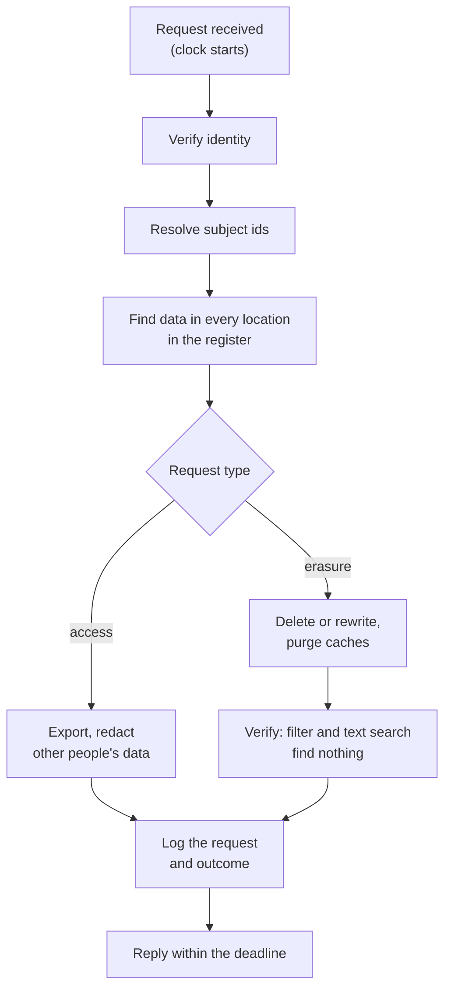

Priya Nair, a Meridian engineer, emails the HR team: "Under data protection law I want a copy of everything you hold about me, and then I want my IT support tickets removed." HR knows how to find her personnel file. But since March, IT support tickets have also been indexed by AskMeridian, where each ticket became chunks, embeddings, cached answers and log lines, with the vector database holding copies of her name in fifty places. Where is her data, who is responsible for it, how fast must Meridian respond, and what does "removed" mean for a system built from copies of copies?

This lesson teaches the concepts of the **General Data Protection Regulation (GDPR)** that shape RAG design: what counts as personal data, who is a controller and who a processor, the principles and lawful bases, the rights of data subjects, and the obligations around impact assessments and breaches. It then builds a small access-and-erasure tool over a vector store. It is an engineering introduction, **not legal advice**: laws are interpreted by regulators and courts, and your data-protection officer and lawyers decide how they apply to you. Meridian is a UK company, so the UK's version of the regulation (the UK GDPR, together with the Data Protection Act 2018) applies to it, alongside the EU GDPR for EU data subjects. The two are close in structure, and this lesson cites the EU articles; UK law has been amended recently, so check the current UK text. Secure *deletion* mechanics have their own lesson, [Secure deletion](/learn/enterprise-rag-governance/secure-deletion); here we focus on the concepts and on how to find the data.

## Learning objectives

- Define personal data, special category data, controller and processor, and classify the actors and data in a RAG system.
- State the GDPR principles and lawful bases and apply them to a decision to index a new source.
- Map each data-subject right (access, rectification, erasure, restriction, portability, objection) to what it requires of a RAG pipeline.
- Explain why embeddings, caches, logs and backups are in scope, and design a subject-to-data mapping that makes access and erasure requests answerable.
- Identify when a data protection impact assessment and breach notification apply.

## Prerequisites

- [Compliance](/learn/enterprise-rag-governance/compliance): the landscape of obligations and the idea of controls with evidence.
- [Data lineage](/learn/enterprise-rag-governance/data-lineage): knowing which chunks derive from which documents.
- [PII detection](/learn/access-control-and-privacy/pii-detection): finding personal data in text.
- [Data retention](/learn/access-control-and-privacy/data-retention): deciding how long each copy lives.

## Why this matters

Data-protection law has teeth. For the most serious infringements the EU GDPR allows fines of up to 20 million euros or 4 percent of worldwide annual turnover, whichever is higher, and regulators can also order processing to stop. More practically, requests from individuals are a routine event: employees, customers and former customers ask what you hold and ask you to delete it, and you have a deadline measured in weeks.

RAG systems stress the regulation in three ways.

- **Personal data is everywhere in unstructured text.** Tickets, emails, meeting notes and HR documents mention people by name, and a RAG system indexes them wholesale. You may not know which chunks contain personal data until you look.
- **Copies multiply.** One ticket becomes parsed text, chunks, vectors, cached answers, evaluation examples, log lines and backups. A right exercised against "the data" applies to all of them.
- **The architecture resists targeted removal.** A document in a vector index can be deleted, but a fact absorbed into a model's weights through fine-tuning cannot be pulled out by deleting a row. One of the strongest practical arguments for RAG over fine-tuning on personal data is that retrieval keeps data in a place you can find and edit (see [RAG versus fine-tuning](/learn/introduction-to-rag/rag-versus-fine-tuning)). That advantage only holds if you actually track where the data went.

## The intuition

Imagine you run a library of index cards about people, and a privacy law says three things. You may only keep cards for a good reason you can state. You may only keep what you need, for as long as you need it. And any person may walk in, ask to see every card that mentions them, and ask you to destroy them.

Now suppose the librarian, to be helpful, has photocopied cards into five other binders, summarised them on sticky notes, and read some aloud into a recording that is backed up weekly. The law does not care which binder holds the copy. It asks whether you can find every one. The discipline GDPR imposes is mostly about inventory: knowing what you hold, why, where and for how long, and designing the filing system so that a person's cards can be found and removed in one pass rather than discovered one at a time.

## How it works

### Key definitions

**Personal data** is any information relating to an identified or identifiable natural person (an individual). The definition is broad. A name or email is obviously personal data, but so is an employee number, an IP address in many contexts, and a combination of facts (job title, office and start date) that points at one person. What matters is whether the person can be identified, directly or indirectly, by anyone reasonably likely to try. **Pseudonymised** data, where identifiers are replaced by tokens but a key exists somewhere, is still personal data. Truly **anonymised** data, where re-identification is not reasonably possible, is outside the regulation, but that bar is high and often missed.

**Special category data** gets extra protection: information revealing racial or ethnic origin, political opinions, religious or philosophical beliefs, trade-union membership, genetic data, biometric data used to identify someone, health data, and data about sex life or sexual orientation. A sick-leave note in an HR folder indexed by AskMeridian is special category data.

**Processing** is nearly anything done with data: collecting, storing, indexing, embedding, retrieving, generating text from, and deleting it.

A **data subject** is the individual the data is about. The **controller** decides the purposes and means of processing. A **processor** processes on the controller's behalf and instructions. For AskMeridian, Meridian is the controller of employee data. The embedding service and the language-model provider are processors (or sub-processors of a processor). The controller must have a written contract with each processor that sets out what it may do (this is Article 28 in the EU text), which is why the processor register of the previous lesson matters.

### The principles

Article 5 sets out the principles that every other rule hangs from. Each has a direct RAG reading.

| Principle | Meaning | In a RAG system |
| --- | --- | --- |
| Lawfulness, fairness, transparency | A valid legal basis; people are told what happens to their data | Staff are told AskMeridian indexes tickets; no hidden uses |
| Purpose limitation | Data is collected for stated purposes and not reused incompatibly | Tickets collected for IT support are not silently indexed for HR performance analysis |
| Data minimisation | Only what is necessary | Do not index whole mailboxes when the assistant needs a runbook; redact before embedding |
| Accuracy | Personal data is correct and up to date | Stale chunks and wrong generated statements about people are an accuracy problem |
| Storage limitation | Keep data no longer than necessary | Retention for each copy: chunks, caches, logs |
| Integrity and confidentiality | Appropriate security | Access control, encryption, permission-filtered retrieval |
| Accountability | You can demonstrate compliance | Audit logs, lineage, records of processing |

Two principles deserve emphasis for RAG engineers. **Purpose limitation** is the quiet trap: a source gathered for one reason is tempting to index "because it is there". Before ingesting a new source, ask what purpose it was collected for and whether the assistant's use is compatible. **Data minimisation** is the cheapest control you have: personal data that never enters the index never needs to be found, exported or deleted.

### Lawful bases

Processing is only lawful if it rests on one of six bases (Article 6): **consent**, **contract** (necessary to perform one), **legal obligation**, **vital interests**, **public task**, and **legitimate interests** (a balancing test between your interest and the individual's rights). There is no ranking; you choose the one that genuinely fits and record it. Two notes for RAG:

- **Employee consent is a weak basis.** Because of the imbalance of power between employer and employee, regulators generally treat consent given by employees as not freely given. Employers more often rely on contract, legal obligation or legitimate interests. For a company-wide assistant, legitimate interests with a documented assessment is common, though it must pass the balancing test, and special category data needs a further condition under Article 9.
- **Basis, purpose and retention come together.** The basis you record for indexing tickets determines what the data may be used for and for how long.

### Rights of data subjects

Individuals hold a set of rights against controllers. The engineering reading is what matters here.

| Right (EU article) | What the person can ask | What it needs from the pipeline |
| --- | --- | --- |
| Access (15) | A copy of their personal data and information about its processing | Find every copy by subject; export it; redact other people's data |
| Rectification (16) | Correct inaccurate data | Edit the source, then re-index, re-embed and invalidate caches |
| Erasure (17) | Delete their data, subject to exceptions (for example a legal duty to keep it) | Delete from every store and copy; handle shared chunks |
| Restriction (18) | Stop using data while a dispute is resolved | A "do not retrieve" flag that excludes it without deleting |
| Portability (20) | Receive data they provided in a machine-readable form | Structured export of the data they supplied |
| Objection (21) | Object to processing based on legitimate interests | Ability to exclude an individual from indexing |
| Automated decisions (22) | Not be subject to solely automated decisions with legal or similarly significant effect | Human involvement where answers drive significant decisions about people |

The default deadline for responding is one month from the request, extendable by up to two further months for complex or numerous requests (Article 12). Plan for that clock to start when the request arrives, not when someone reads it.

The rights are not absolute: erasure, for example, does not apply where you must retain data to comply with a legal obligation or to establish or defend legal claims. Deciding which exception applies is a job for your data-protection officer; your job is to make the *mechanics* possible.

### Where the data hides in a RAG system

The hardest part of an access or erasure request is enumeration. For AskMeridian a subject's data may be in:

1. **The source systems** (ticket tool, wiki, mail archive), which usually already have processes for requests.
2. **Raw and parsed document storage** used by the ingestion pipeline.
3. **Chunks and their payloads** in the vector store.
4. **Embeddings.** Treat vectors derived from personal text as personal data. A vector may not look like a name, but research has shown that text can sometimes be partly recovered from embeddings, and a vector that is linked to a person's record identifies them in effect.
5. **Caches**: semantic caches, answer caches and conversation memory.
6. **Logs and traces**, including debug logs of prompts and any audit records that contain identifiers (pseudonymised actors, see [Audit logs](/learn/enterprise-rag-governance/audit-logs)).
7. **Evaluation sets and test fixtures** built from production text, and notebooks on laptops.
8. **Processors**: provider-side retention of prompts, or provider-held fine-tuning data.
9. **Backups and snapshots** of every store above.

The model weights are a different matter. If you only *retrieve* from personal data and never train or fine-tune on it, the weights contain none of it. If you fine-tune on it, the position is much harder, and regulators are still working out how GDPR applies to trained models; treat it as unsettled and keep personal data out of training sets unless you have taken specific advice.

### Making enumeration possible

Three design decisions determine whether a subject request takes an hour or a month.

**Tag at ingestion.** When a chunk is created, record the subject identifiers it concerns in its payload (as a list of stable ids, not names) alongside the document id and version from your [lineage](/learn/enterprise-rag-governance/data-lineage) record. A metadata filter then finds a subject's chunks without scanning text. Tagging relies on detection (see [PII detection](/learn/access-control-and-privacy/pii-detection)), which is imperfect, so also keep the ability to search text for names as a safety net.

**Handle shared chunks.** A ticket that mentions two employees is data about both. Erasing one person must not erase the other's data, and must not leave the first person's name in the shared chunk. The usual approach is to rewrite the chunk: redact the departing person's details, re-embed the edited text and update the tags. Where rewriting is not feasible, delete the chunk and accept the loss of the other person's data; document the choice.

**Keep a register of locations.** A short document listing every store, its content, its subject-id key and its retention is the map an access request follows. This is the same artefact as a processor register extended to your own systems, and it doubles as the Article 30 *record of processing activities* that most organisations must maintain.



### Other obligations that touch RAG

**Data protection by design and by default (Article 25).** Build privacy into the architecture: redact before indexing, filter by permission, set short default retention. Retrofitting is costly.

**Data protection impact assessment (Article 35).** Where processing is likely to result in a high risk to individuals, you must assess the risks before starting. Large-scale processing of special category data, systematic monitoring of staff and the use of new technologies are typical triggers. A company-wide assistant that indexes HR case files is a strong candidate. The DPIA documents purpose, necessity, risks and mitigations, and the engineering team supplies the real data flows.

**Security (Article 32).** Appropriate technical and organisational measures: encryption, access control, resilience, testing. Permission-filtered retrieval is the RAG-specific one.

**Breach notification (Articles 33 and 34).** A personal data breach must be reported to the regulator without undue delay and, where feasible, within 72 hours of becoming aware, unless unlikely to result in risk to individuals. Where there is high risk, the individuals must be told. The lineage and audit data from this module are what let you establish scope within that window (see the example below).

**International transfers (Chapter V).** Sending personal data outside the UK or EEA, including to a model provider whose infrastructure is elsewhere, requires a recognised transfer mechanism. Check the provider's processing locations against this.

**Accuracy.** A language model asked "what happened to Priya Nair?" may confidently generate something false. Statements about named individuals are personal data and subject to the accuracy principle. Constrain assistants to answer about people only from permitted retrieved text, and refuse to speculate.

## In code

### Access and erasure over a vector store

**The problem.** Priya Nair (employee `emp-0412`) has requested access and then erasure. Meridian's ticket chunks are in a Qdrant collection with `subjects` in each payload, and AskMeridian has a small cache of answers that may repeat her name. We need to (1) produce an access export per location, (2) erase her data, correctly handling a chunk shared with a colleague, and (3) verify nothing remains.

**Dependencies.** The Qdrant Python client, run in its local in-memory mode (no server needed), and NumPy:

```bash
pip install qdrant-client numpy
```

**The source.** To keep it runnable offline the "embedding" is a toy hashed bag of words, a stand-in for a real model. `build` loads five chunks and an answer cache. `access_request` filters the collection on the subject id. `erasure_request` deletes chunks that concern only this person, rewrites and re-embeds chunks shared with others, and purges cache entries. `residual_check` verifies the result in three independent ways. The code was run with qdrant-client 1.20.0.

```python
"""Data-subject access and erasure over a vector store and an answer cache."""
import hashlib
import re

import numpy as np
from qdrant_client import QdrantClient
from qdrant_client.models import (Distance, FieldCondition, Filter, MatchAny,
                                  PointIdsList, PointStruct, VectorParams)

DIM = 128
COLLECTION = "askmeridian"


def embed(text: str) -> list[float]:
    """Toy hashed bag-of-words embedding (stand-in for a real model)."""
    v = np.zeros(DIM)
    for tok in re.findall(r"[a-z0-9\-]+", text.lower()):
        h = int(hashlib.md5(tok.encode()).hexdigest(), 16)
        v[h % DIM] += 1.0 if (h >> 8) % 2 else -1.0
    n = np.linalg.norm(v)
    return (v / n if n else v).tolist()


NAMES = {"emp-0412": "Priya Nair", "emp-0877": "Tom Okafor"}

CHUNKS = [
    ("t-118", ["emp-0412"], "Priya Nair reported a lost laptop on 3 March and was issued a replacement."),
    ("t-118", ["emp-0412"], "Priya Nair's replacement laptop was delivered to the Leeds office."),
    ("t-205", ["emp-0877"], "Tom Okafor asked how to claim a home-office equipment budget of 400 pounds."),
    ("t-231", ["emp-0412", "emp-0877"], "Priya Nair and Tom Okafor both reported error E-4021 on the VPN client."),
    ("hb-2025", [], "Annual leave is 25 days; up to 5 unused days carry over until 31 March."),
]


def build():
    client = QdrantClient(":memory:")
    client.create_collection(COLLECTION, vectors_config=VectorParams(size=DIM, distance=Distance.COSINE))
    client.upsert(COLLECTION, points=[
        PointStruct(id=i, vector=embed(text), payload={"doc_id": d, "subjects": s, "text": text})
        for i, (d, s, text) in enumerate(CHUNKS)])
    cache = {  # question -> cached answer text (a second copy of personal data)
        "who lost a laptop in March?": "Priya Nair reported a lost laptop on 3 March.",
        "how many leave days?": "25 days.",
    }
    return client, cache


def subject_filter(subject_id):
    return Filter(must=[FieldCondition(key="subjects", match=MatchAny(any=[subject_id]))])


def access_request(client, cache, subject_id):
    """Everything we hold about one person, per location."""
    points, _ = client.scroll(COLLECTION, scroll_filter=subject_filter(subject_id),
                              limit=100, with_payload=True)
    name = NAMES[subject_id]
    return {
        "vector_store": sorted((p.payload["doc_id"], p.payload["text"]) for p in points),
        "answer_cache": sorted(q for q, a in cache.items() if name in a),
    }


def erasure_request(client, cache, subject_id):
    points, _ = client.scroll(COLLECTION, scroll_filter=subject_filter(subject_id),
                              limit=100, with_payload=True)
    name = NAMES[subject_id]
    deleted, rewritten = [], []
    for p in points:
        if p.payload["subjects"] == [subject_id]:
            deleted.append(p.id)
        else:  # shared with other people: remove only this person's data
            text = p.payload["text"].replace(name, "[removed]")
            others = [s for s in p.payload["subjects"] if s != subject_id]
            client.upsert(COLLECTION, points=[PointStruct(
                id=p.id, vector=embed(text),
                payload={"doc_id": p.payload["doc_id"], "subjects": others, "text": text})])
            rewritten.append(p.id)
    if deleted:
        client.delete(COLLECTION, points_selector=PointIdsList(points=deleted))
    purged = [q for q, a in cache.items() if name in a]
    for q in purged:
        del cache[q]
    return {"deleted_points": deleted, "rewritten_points": rewritten, "purged_cache": purged}


def residual_check(client, cache, subject_id):
    """Verification: count by filter, and look for the name as plain text everywhere."""
    name = NAMES[subject_id]
    by_filter = client.count(COLLECTION, count_filter=subject_filter(subject_id), exact=True).count
    all_pts, _ = client.scroll(COLLECTION, limit=100, with_payload=True)
    by_text = sum(name in p.payload["text"] for p in all_pts)
    by_cache = sum(name in a for a in cache.values())
    return {"by_filter": by_filter, "name_in_chunks": by_text, "name_in_cache": by_cache}


if __name__ == "__main__":
    client, cache = build()
    sid = "emp-0412"
    print("ACCESS REQUEST for", sid)
    for loc, items in access_request(client, cache, sid).items():
        print(f"  {loc}:")
        for it in items:
            print("    ", it)
    print("\nERASURE REQUEST for", sid)
    print(" ", erasure_request(client, cache, sid))
    print("\nRESIDUAL CHECK:", residual_check(client, cache, sid))
    pts, _ = client.scroll(COLLECTION, limit=100, with_payload=True)
    print("\nREMAINING CHUNKS")
    for p in sorted(pts, key=lambda p: p.id):
        print(f"  {p.id} {p.payload['doc_id']:8} {p.payload['subjects']} {p.payload['text'][:60]}")
```

**Running it** prints:

```output
ACCESS REQUEST for emp-0412
  vector_store:
     ('t-118', 'Priya Nair reported a lost laptop on 3 March and was issued a replacement.')
     ('t-118', "Priya Nair's replacement laptop was delivered to the Leeds office.")
     ('t-231', 'Priya Nair and Tom Okafor both reported error E-4021 on the VPN client.')
  answer_cache:
     who lost a laptop in March?

ERASURE REQUEST for emp-0412
  {'deleted_points': [0, 1], 'rewritten_points': [3], 'purged_cache': ['who lost a laptop in March?']}

RESIDUAL CHECK: {'by_filter': 0, 'name_in_chunks': 0, 'name_in_cache': 0}

REMAINING CHUNKS
  2 t-205    ['emp-0877'] Tom Okafor asked how to claim a home-office equipment budget
  3 t-231    ['emp-0877'] [removed] and Tom Okafor both reported error E-4021 on the V
  4 hb-2025  [] Annual leave is 25 days; up to 5 unused days carry over unti
```

**What the output means.** The access request finds data in two locations: three chunks in the vector store (note that one of them, from ticket `t-231`, also names Tom Okafor) and one cached answer. That shared chunk raises a real access-request question: the export to Priya should not reveal Tom's name, so a production export redacts other people's data before sending. The erasure request deletes the two chunks that concerned only Priya (points 0 and 1), rewrites the shared chunk (point 3) so it now reads "[removed] and Tom Okafor both reported error E-4021" with Tom's id kept in `subjects`, and purges the cached answer. The residual check reports zero by three independent measures: the subject filter, a plain-text search of every chunk and a search of the cache. The final listing shows Tom's own ticket and the handbook untouched and the rewritten chunk in place.

**Important lines.**

- `MatchAny(any=[subject_id])` on the `subjects` payload field finds every chunk that lists the subject, including shared ones. This is why tagging is a list, not a single id.
- `p.payload["subjects"] == [subject_id]` separates chunks that belong only to the subject (delete) from shared ones (rewrite).
- The rewrite calls `embed(text)` again. Editing text without recomputing the vector would leave a vector derived from the old text, which still encodes the removed name. This is the most common mistake in erasure code.
- `residual_check` does not trust its own tags. Looking for the name as plain text catches chunks that were mis-tagged or never tagged.

**Errors people commonly hit.**

- `scroll` returns only the first page (`limit` points) and a next-page offset. The script uses a limit larger than the data; production code must loop on the offset until it is `None`, or it will silently miss data.
- Filtering on a payload field is slow on a large collection unless the field is indexed. Qdrant's `create_payload_index` exists for this; the in-memory demo does not need one.

**Extending it.** Add a `restricted` payload flag (see exercise 3), log each request with the audit-log technique, extend the register to caches, logs and evaluation sets with a deletion function each, and run the residual check nightly as a detective control.

## A real-world example

Meridian's Platform team holds a Thursday review of Priya's request, and the data-protection officer asks a pointed question: "How do we know that the answer cache and the weekly evaluation set did not also hold her name?" The team's first attempt at the request had found chunks in the vector store, but nobody had listed the other places. The evaluation set, built from ticket text for a retrieval-quality benchmark, did contain two of her tickets, and so did a notebook an engineer had exported to a shared drive.

The team does not treat this as a one-off. They add the evaluation set and the notebook directory to the register of locations, tag evaluation examples with subject ids at creation, and add an erasure function for each location. They turn the residual check into a nightly job that searches for names of anyone with an open or completed erasure request, so a re-ingestion that restores deleted text trips an alert. And they change the ingestion pipeline to redact employee names from tickets before embedding unless the use case needs them, because data that never enters the index is data they never have to find. The next request, three months later, takes one afternoon.


## Common mistakes

- **Treating the vector store as the only copy.** Caches, logs, evaluation sets, notebooks and backups also hold personal data, and an erasure that skips them is incomplete.
- **Deleting a point but not re-embedding an edited chunk.** The stale vector still encodes the removed text.
- **Assuming pseudonymised means out of scope.** If a key or mapping exists, the data is still personal.
- **Indexing a source for a convenient new purpose** without checking that it is compatible with the purpose it was collected for.
- **Exporting a shared chunk unredacted** and thereby disclosing a third party's personal data in an access response.

## Best practices

- Minimise first: redact or drop personal data before embedding unless the use case needs it.
- Tag every chunk with subject ids (not names) at ingestion, and record the lawful basis and purpose for each source.
- Keep a machine-readable register of every location that may hold personal data, with its subject key and retention.
- Build and rehearse the access and erasure runbooks; time a full exercise against the one-month deadline.
- On erasure, re-embed edited chunks, purge caches, and verify with independent checks (filter, text search, cache search).
- Choose processors under written contracts, check their processing locations and retention, and review annually.
- Complete a DPIA before launching anything that indexes sensitive HR, health or customer data at scale, and revisit it when the system changes.

## Performance considerations

Subject requests are rare events, so correctness matters more than speed, but the arithmetic is worth doing. If a payload filter scans every point (no index), a collection of 5 million chunks at a few microseconds per payload check is on the order of ten to a hundred seconds per request: acceptable for a monthly task, slow for an automated nightly sweep over a hundred pending erasures. Payload indexes on `subjects` reduce this to a lookup. Re-embedding a rewritten chunk costs one embedding call: trivial for dozens of chunks, but a popular document that names a person hundreds of times is a reason to keep names out of chunks in the first place.

Backups deserve a note: regulators generally accept that backups need not be edited in place if the data is held securely, not used, and removed when the backup expires, provided that a restore re-applies pending deletions. That requires a persistent list of erased subjects, which must itself be kept minimal. Check your regulator's guidance, and see [Secure deletion](/learn/enterprise-rag-governance/secure-deletion).

## Security considerations

Rights requests are an attack vector. Anyone who can impersonate a person can request their data, so **verify identity** before releasing an export, using a channel you control (a signed-in session, an HR-held contact) rather than the email address in the request. An access export is a concentrated bundle of one person's data, so transmit it securely and avoid exposing third parties' data inside it. The erasure tooling holds delete rights over production stores: protect it with strong authentication, log every invocation, and require a second approver for large or unusual deletions, because an attacker or a bug that can delete "by subject" can delete a lot.

## Summary

- Personal data is anything relating to an identifiable person; pseudonymised data stays personal; special category data needs extra care.
- Principles such as purpose limitation, minimisation and storage limitation translate directly into RAG choices about what to index, how long to keep it and what to log.
- Data subjects can ask to access, correct, restrict, port, object to and erase their data, and a response is generally due within a month.
- Copies of personal data live in chunks, embeddings, caches, logs, evaluation sets and backups; a register and subject tags make them findable.
- Erasure means deleting or rewriting, re-embedding, purging caches and verifying with independent checks.
- This is not legal advice; build the mechanics and let your data-protection officer decide the interpretation.

## Exercises

**1.** Classify each as controller or processor for AskMeridian: (a) Meridian, (b) the hosted embedding API, (c) the language-model provider, (d) Meridian's self-hosted Qdrant cluster operated by its own Platform team.

<details><summary>Show solution</summary>

(a) Controller: it decides why and how employee data is processed. (b) and (c) Processors acting on Meridian's instructions, under a data processing contract; they may themselves have sub-processors. (d) Not a separate party at all: Meridian operates it, so it is part of the controller's own processing, though the Platform team is accountable for its security.

</details>

**2.** An employee asks AskMeridian "What was Tom's sick leave last year?" The HR case notes are indexed. List the GDPR concerns and two engineering controls.

<details><summary>Show solution</summary>

Concerns: the notes are health data, a special category, which needs an Article 9 condition and is unlikely to be justified for a general-purpose assistant; disclosing it to a colleague without a legitimate need breaches confidentiality and purpose limitation; and a generated statement about a named person must be accurate. Controls: do not index HR case notes into the general assistant, or restrict them by document-level permissions so only authorised HR staff can retrieve them (see [Document-level permissions](/learn/access-control-and-privacy/document-level-permissions)); and add a policy layer or prompt rule that refuses questions seeking information about named individuals' health.

</details>

**3.** Using the lesson's code, add a function `restrict(client, subject_id)` implementing the right to restriction: set a `restricted` payload flag on every chunk concerning the subject, then show that a filtered search can exclude those chunks. Run it on `emp-0877`.

<details><summary>Show solution</summary>

```python
from qdrant_client.models import FieldCondition, Filter, MatchValue
from dsr import COLLECTION, build, embed, subject_filter

def restrict(client, subject_id):
    client.set_payload(COLLECTION, payload={"restricted": True},
                       points=subject_filter(subject_id))

client, cache = build()
restrict(client, "emp-0877")
visible = Filter(must_not=[FieldCondition(key="restricted", match=MatchValue(value=True))])
hits = client.query_points(COLLECTION, query=embed("VPN error E-4021"),
                           query_filter=visible, limit=5, with_payload=True).points
print([h.id for h in hits])
```

`set_payload` accepts a filter (or a list of ids) as its `points` argument in current clients. Chunks 2 and 3 (those listing `emp-0877`) are flagged, so the filtered search returns only the others: the result is `[4, 1, 0]`, ordered by similarity. The data is retained but not used, which is what restriction requires. Remember that every retrieval path, including caches, must apply the same exclusion.

</details>

## Check your understanding

```quiz
[
  {
    "q": "Which statement about pseudonymised data under GDPR is correct?",
    "options": [
      "It is outside GDPR because names are removed",
      "It remains personal data while a key or mapping exists that can re-identify people",
      "It is allowed to be kept indefinitely",
      "It only applies to special category data"
    ],
    "answer": 1,
    "why": "Pseudonymisation reduces risk but does not anonymise: if re-identification is possible with additional information, the data is still personal data."
  },
  {
    "q": "After deleting a person's chunks from the vector store, which other places must an erasure request consider?",
    "options": [
      "None; the vector store is the only copy",
      "Only the source system",
      "Caches, logs, evaluation sets, notebooks, processors and backups as well as the source",
      "Only the language model's weights"
    ],
    "answer": 2,
    "why": "Copies of personal data in every derived store are in scope. If you only retrieve (not fine-tune), the weights contain none of it."
  },
  {
    "q": "A chunk mentions two employees and one requests erasure. What is the best handling?",
    "options": [
      "Delete the chunk and ignore the other employee",
      "Leave it, since it also concerns someone else",
      "Redact the requester's details, re-embed the edited text and update the subject tags",
      "Only remove the requester's id from the tags"
    ],
    "answer": 2,
    "why": "Rewriting removes the requester's data without destroying the other person's, and re-embedding removes the stale vector derived from the old text."
  },
  {
    "q": "What is the default time limit to respond to a data-subject request under the GDPR?",
    "options": [
      "24 hours",
      "72 hours",
      "One month, extendable in complex cases",
      "One year"
    ],
    "answer": 2,
    "why": "Article 12 sets one month from receipt, extendable by up to two further months for complex or numerous requests. (72 hours is the breach notification window.)"
  },
  {
    "q": "Why is employee consent a weak lawful basis for an internal AI assistant?",
    "options": [
      "Employees cannot give consent by email",
      "Consent is only valid for customers",
      "The power imbalance means consent is unlikely to be freely given",
      "Consent expires after one day"
    ],
    "answer": 2,
    "why": "Valid consent must be freely given. Regulators generally treat employee consent as problematic, so employers rely on other bases such as legitimate interests, with a documented assessment."
  }
]
```

## Further reading

- Regulation (EU) 2016/679, the General Data Protection Regulation, in particular Articles 5, 6, 9, 12 to 22, 25, 28, 30, 32 to 35: [eur-lex.europa.eu](https://eur-lex.europa.eu/).
- UK Information Commissioner's Office, *Guide to the UK GDPR*, including its guidance on rights requests and on AI and data protection: [ico.org.uk](https://ico.org.uk/).
- European Data Protection Board, guidelines on data subject rights and on data protection by design and by default: [edpb.europa.eu](https://www.edpb.europa.eu/).
- Morris et al. (2023), "Text Embeddings Reveal (Almost) As Much As Text", on inversion of embeddings.
- Voigt and von dem Bussche (2017), *The EU General Data Protection Regulation (GDPR): A Practical Guide*, Springer.
- Qdrant documentation, [filtering and payload indexes](https://qdrant.tech/documentation/).
