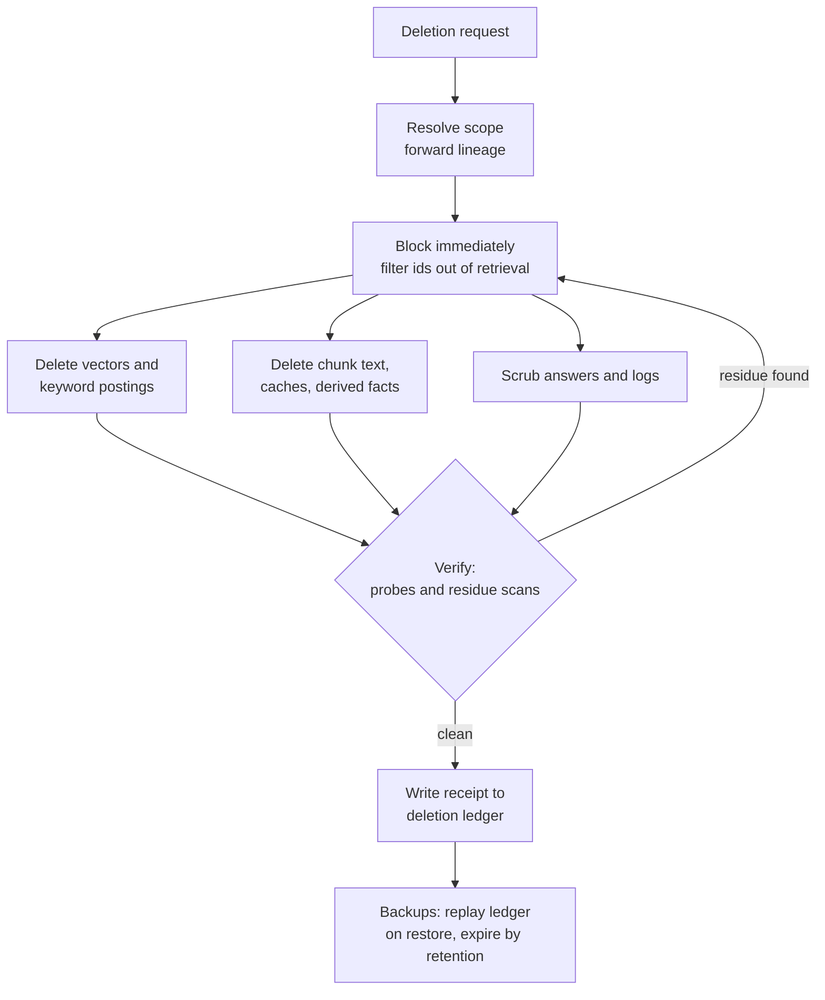

Deleting a document from a RAG system sounds like one operation. In practice it is a hunt. The text was copied out of the wiki into a parsed cache, split into chunks, embedded into vectors, replicated across nodes, quoted in cached answers, written into request logs, captured in a nightly backup and perhaps pasted into an evaluation spreadsheet. A delete that removes the vectors and stops there has hidden the document, not deleted it, and the first time someone checks, the system will still be quoting it.

**Secure deletion** means making data unrecoverable from every place the system holds it, and being able to show that you did. This lesson builds the map of those places, explains why vector databases and backups resist deletion, shows a lineage-driven deletion procedure with a verifier that finds the copies a naive delete leaves behind, and covers the techniques (compaction, ledger replay, crypto-shredding) that deal with the hard cases. It depends on [data lineage](/learn/enterprise-rag-governance/data-lineage), which tells you where the copies are, and it is the technical half of the right to erasure described in [GDPR concepts](/learn/enterprise-rag-governance/gdpr-concepts).

## Learning objectives

- Enumerate the stores and derived artefacts in a RAG system that can hold a copy of a deleted document.
- Explain the difference between a logical delete and a physical delete, and why vector indexes and backups complicate physical deletion.
- Implement lineage-driven deletion across several stores and verify it with probe queries and residue checks.
- Describe how crypto-shredding and a deletion ledger handle backups, and state what each does not solve.
- Explain why embeddings must be treated as the data they were computed from, and what remains out of reach (model weights, third parties).

## Prerequisites

- [Data lineage](/learn/enterprise-rag-governance/data-lineage): forward lineage from a document to everything derived from it.
- [Data retention](/learn/access-control-and-privacy/data-retention): how long data may be kept, and why.
- [Data encryption](/learn/access-control-and-privacy/data-encryption): encryption at rest and key management.
- [Vector databases](/learn/vector-database-fundamentals): points, payloads and indexes.

## Why this matters

Data must be deleted for several different reasons, and each has a different clock.

- **Erasure requests.** Under laws such as the GDPR, individuals can ask for their personal data to be erased, and there are deadlines for responding (see [GDPR concepts](/learn/enterprise-rag-governance/gdpr-concepts)).
- **Retention expiry.** Data held for a defined period must go when the period ends.
- **Retraction.** A salary spreadsheet that reached the HR wiki must leave the index within hours, not weeks.
- **Contract end.** A tenant leaves, and its data must go with it.
- **Incident response.** A credential or customer record has appeared in an indexed page.

RAG makes this harder than in a conventional application because **derivation multiplies copies**. A conventional application stores a record in a table and perhaps a backup. A RAG pipeline stores the text in three or four forms, turns it into vectors that encode its meaning, and then lets a language model quote it into new text that is cached and logged. Each of those is a copy for the purposes of deletion.

Failure is concrete: the system quotes a document "deleted" last month, a backup restore resurrects erased personal data, a support engineer reads a retracted message in a trace. Each comes from the same cause: nobody had a list of the copies.

## The intuition

Imagine a library asked to remove a book that should never have been shelved. The librarian takes the card out of the catalogue and reports the job done. But the book is still on the shelf, photocopies sit in the reading room, a summary is pinned to a noticeboard, and the offsite archive holds a boxed copy of every shelf as it looked last Tuesday.

Removing the catalogue card is a **logical delete**: the item is unreachable by the normal route. Removing the book, the photocopies and the summary is a **physical delete**. The archive is the hard part: you cannot open every box to remove one page, so you staple a note to the box: "when you open this, remove that page first".

A deletion procedure works the same way. Make the item unreachable at once, find every copy by following a record of where copies went, remove each one, check that you succeeded, and deal with the archive separately.

## How it works

### The copy map

The first task is a list of places a copy can live. The table is a starting point; yours will have more rows.

| Where | What it holds | Notes on deletion |
| --- | --- | --- |
| Source system (wiki, drive) | The original | Often owned by someone else; deletion upstream may be what triggers the rest |
| Raw and parsed caches | Extracted text, intermediate files | Easy to forget; often on shared disks or object storage |
| Chunk or document store | Chunk text, metadata | Delete by document id |
| Vector index | Embeddings plus payload | Logical versus physical delete (below); replicas |
| Keyword (BM25) index | Tokens and postings | A second index of the same text |
| Knowledge graph | Entities and relations extracted from text | Derived facts survive deletion of the chunk unless removed explicitly |
| Summaries and metadata | Document summaries, generated titles | Derived text that restates the source |
| Answer and semantic caches | Generated answers, cached query results | Answers can quote the document |
| Request logs and traces | Prompts, retrieved text, answers | Often the largest uncontrolled copy |
| Evaluation sets | Questions and reference passages | Frozen copies, often in notebooks or spreadsheets |
| Analytics exports | Warehouse tables, dashboards | Downstream of logs |
| Backups and snapshots | Everything at a moment in time | Immutable by design |
| Third parties | Embedding API, model provider, hosted vector service | Governed by contract, not by your code |

Lineage turns this table from a checklist someone remembers into a query. If every chunk records its document, and every answer and log entry records the chunks used (see [data lineage](/learn/enterprise-rag-governance/data-lineage)), then **forward lineage from a document id is the deletion scope**: the chunks, their vectors, the answers built from them, the log lines that quote them. Stores that lineage does not reach (evaluation spreadsheets, analytics exports) must be on the list by name and owned by a person.



### Logical versus physical delete in a vector index

Most vector databases do not erase a point from disk the moment you delete it. Typically a delete marks the point as removed so that queries skip it, and a background process later rewrites the underlying storage without it. The names vary (tombstones, delete flags, compaction, vacuum, merge), and the details differ by product; read your database's documentation for exactly when space is reclaimed and what a snapshot taken in between contains.

The reasons are structural. Approximate nearest-neighbour indexes such as HNSW are graphs in which each node links to neighbours. Removing a node means repairing the graph around it or rebuilding it, which is expensive, so many implementations do not remove nodes in place. The FAISS library makes this explicit: `IndexFlatL2.remove_ids` works, while calling `remove_ids` on an `IndexHNSWFlat` raises an error saying it is not implemented for that index type. In that case "delete" means rebuild the index without the vectors (the sandbox run in this lesson shows both).

The practical consequences:

- **There is a window between logical and physical delete.** Make the logical delete effective at once (a filter on retrieval, or a delete flag your query path always checks) and measure the physical delete separately.
- **Snapshots and replicas copy the pre-compaction state.** A snapshot taken before compaction contains the data. A replica that was offline during the delete may rejoin with it.
- **Write-ahead logs hold what was written.** Depending on the database, deleted data may persist in logs until they rotate.
- **A rebuild is a legitimate deletion strategy.** For a small index, rebuilding from the cleaned chunk store is simpler and more certain than relying on in-place removal.

### Embeddings are the data

It is tempting to treat vectors as anonymous numbers: "we deleted the text; the embedding is just floats". Research says otherwise. Morris and colleagues (2023, "Text Embeddings Reveal (Almost) As Much As Text") showed that, for the models and text lengths they studied, an attacker with access to the embeddings and the embedding model could recover a large share of the original text, including exact matches for short inputs. The right operating assumption is that **a vector is a lossy but potentially invertible copy of its source**. Regulatory guidance and security practice treat it accordingly: if the text is personal data, so is its embedding. Deleting the text and keeping the vector is not deletion.

### Verification

A deletion you cannot verify is a deletion you hope happened. Three kinds of check cover most of it.

1. **Id checks.** For each store, look up the ids that should be gone and confirm they are absent. Cheap and precise, but it only proves absence of *known* ids.
2. **Probe queries.** Search the live system with text taken from the deleted document and confirm that none of its ids come back. This catches a copy under an id you did not know about (for instance a re-ingested duplicate), and it tests the whole query path, caches included.
3. **Residue scans.** Search logs, caches and derived stores for the document's distinctive text or ids. This finds the copies lineage did not reach.

Verification proves what it checks and no more. It cannot show absence from a backup nobody opened, from a third party's systems, or from the weights of a model fine-tuned on the data. Treat the receipt as "deleted from these stores, verified in these ways", not as a universal guarantee.

### Backups and the deletion ledger

Backups are meant to be unchangeable. Opening a backup to remove one record defeats the point, and often is not possible at all. Three approaches work together.

- **Short retention.** If backups expire after 35 days, erased data leaves the backups within 35 days with no further action. The retention period becomes part of what you tell the data subject.
- **A deletion ledger replayed on restore.** Record every deletion in a ledger kept outside the backups, and make "apply the ledger" a mandatory step of any restore. Data that sits in an old backup is never put back into service. Note that the ledger should hold identifiers or hashes of identifiers, not the deleted content.
- **Crypto-shredding.** Encrypt each document (or each tenant, or each data subject) under its own key, and delete the key. Anything encrypted under it, including every copy in every backup, becomes unreadable. The next section covers its limits.

### Crypto-shredding

**Crypto-shredding** relies on the fact that destroying a key is a single small operation, whereas finding every ciphertext is not. If chunk text is stored encrypted under a per-document data key, and the key lives in a key-management service, then deletion means deleting the key. Backups, replicas and old log files hold only ciphertext that nobody can read.

It is a strong tool for **text, payloads, logs and backups**. Its limits matter:

- **Vectors must be searched in plaintext.** Standard similarity search needs the vectors in the clear (or at least in a form the database can compare). Encrypting vectors per document is incompatible with ordinary nearest-neighbour search. Because vectors can be partly inverted, per-document key destruction does not remove the risk from stored vectors. For vectors, use physical deletion, plus *per-tenant* collections or indexes you can drop wholesale (see [tenant isolation](/learn/access-control-and-privacy/tenant-isolation)).
- **Key management is the control.** If keys are cached, backed up or escrowed elsewhere, "deleting" the key may not delete it. Deleting a key from a key-management service typically involves a scheduled period or soft-delete; check the service's behaviour.

### What deletion cannot reach

**Model weights**: if a model was fine-tuned on data that must now be erased, its influence is in the weights, and the established remedy is retraining without it; *machine unlearning* is active research, not settled practice. **Third parties**: an embedding API or hosted vector service may retain data under its own terms, governed by your contract. **People**: an employee who pasted an answer into an email has made a copy no process can find.

## In code

### Lineage-driven deletion with verification

**The problem.** Meridian's HR team must erase a grievance case file, `hr-case-17`, which AskMeridian has indexed, cached and quoted in logs. We build a small system with a Qdrant collection, a chunk store, an answer cache, request logs, a backup and a ledger, then compare a naive delete (vectors only) with a lineage-driven one, and then simulate restoring the backup.

**Dependencies.** `qdrant-client` (its in-memory mode needs no server) and `sentence-transformers`. The first run downloads `all-MiniLM-L6-v2`.

```bash
pip install qdrant-client sentence-transformers
```

**The source.**

```python
"""Lineage-driven deletion across the stores of a RAG system, with verification."""
import copy
import hashlib
from collections import defaultdict

from qdrant_client import QdrantClient, models
from sentence_transformers import SentenceTransformer

enc = SentenceTransformer("sentence-transformers/all-MiniLM-L6-v2")

DOCS = {
    "hr-case-17": ["Priya Nair raised a grievance about her manager on 4 March.",
                   "The grievance outcome for Priya Nair was recorded in the HR system."],
    "handbook-2025": ["Annual leave is 25 days. Up to 5 unused days carry over.",
                      "Expenses must be submitted within 30 days."],
}


class System:
    def __init__(self):
        self.qdrant = QdrantClient(":memory:")
        self.qdrant.create_collection("kb", vectors_config=models.VectorParams(size=384, distance=models.Distance.COSINE))
        self.chunk_text = {}                 # chunk id -> text (document store)
        self.lineage = defaultdict(set)      # doc id -> chunk ids
        self.answer_cache = {}               # question -> answer text and the chunk ids behind it
        self.logs = []                       # request logs that record retrieved text
        self.backup = None
        self.ledger = []                     # deletion receipts, kept for replay after a restore

    def ingest(self, doc_id, texts):
        vecs = enc.encode(texts, normalize_embeddings=True)
        points = []
        for t, v in zip(texts, vecs):
            cid = len(self.chunk_text)
            self.chunk_text[cid] = t
            self.lineage[doc_id].add(cid)
            points.append(models.PointStruct(id=cid, vector=v.tolist(), payload={"doc_id": doc_id}))
        self.qdrant.upsert("kb", points)

    def ask(self, question, k=2):
        qv = enc.encode(question, normalize_embeddings=True).tolist()
        ids = [h.id for h in self.qdrant.query_points("kb", query=qv, limit=k).points]
        context = [self.chunk_text[i] for i in ids]
        self.answer_cache[question] = {"answer": " ".join(context), "chunks": ids}
        self.logs.append({"q": question, "chunks": ids, "context": context})
        return ids

    def snapshot(self):
        self.backup = copy.deepcopy(self.chunk_text)

    def restore(self, replay_ledger):
        self.chunk_text = copy.deepcopy(self.backup)
        if replay_ledger:
            for receipt in self.ledger:
                for cid in receipt["chunk_ids"]:
                    self.chunk_text.pop(cid, None)

    def delete_naive(self, doc_id):
        self.qdrant.delete("kb", points_selector=models.PointIdsList(points=sorted(self.lineage[doc_id])))

    def delete_document(self, doc_id):
        ids = self.lineage.pop(doc_id, set())
        self.qdrant.delete("kb", points_selector=models.PointIdsList(points=sorted(ids)))
        for cid in ids:
            self.chunk_text.pop(cid, None)
        for q in [q for q, c in self.answer_cache.items() if ids & set(c["chunks"])]:
            del self.answer_cache[q]
        for e in self.logs:
            keep = [(i, t) for i, t in zip(e["chunks"], e["context"]) if i not in ids]
            e["chunks"], e["context"] = [i for i, _ in keep], [t for _, t in keep]
        receipt = {"doc_ref": hashlib.sha256(doc_id.encode()).hexdigest()[:12], "chunk_ids": sorted(ids)}
        self.ledger.append(receipt)
        return receipt

    def residues(self, chunk_ids, probes):
        found = []
        if self.qdrant.retrieve("kb", ids=list(chunk_ids)):
            found.append("vector store still holds the points")
        for v in enc.encode(probes, normalize_embeddings=True):
            if any(h.id in chunk_ids for h in self.qdrant.query_points("kb", query=v.tolist(), limit=3).points):
                found.append("a probe query still retrieves the document")
                break
        if any(i in self.chunk_text for i in chunk_ids):
            found.append("document store still holds the text")
        if any(set(chunk_ids) & set(c["chunks"]) for c in self.answer_cache.values()):
            found.append("answer cache still serves an answer built from it")
        if any(set(chunk_ids) & set(e["chunks"]) for e in self.logs):
            found.append("request logs still hold the text")
        if self.backup and any(i in self.backup for i in chunk_ids):
            found.append("backup still holds the text")
        return found


def build():
    s = System()
    for d, texts in DOCS.items():
        s.ingest(d, texts)
    s.ask("What happened with Priya Nair's grievance?")
    s.ask("How many days of annual leave do I get?")
    s.snapshot()
    return s


if __name__ == "__main__":
    probes = DOCS["hr-case-17"]
    s = build()
    ids = set(s.lineage["hr-case-17"])
    s.delete_naive("hr-case-17")
    print("after deleting only the vectors:")
    print(*[f"  - {r}" for r in s.residues(ids, probes)], sep="\n")

    s = build()
    print("\nafter lineage-driven deletion, receipt:", s.delete_document("hr-case-17"))
    print(*[f"  - {r}" for r in s.residues(ids, probes)], sep="\n")
    s.restore(replay_ledger=False)
    print("\nafter restoring the backup without replay:")
    print(*[f"  - {r}" for r in s.residues(ids, probes)], sep="\n")
    s.restore(replay_ledger=True)
    live = [r for r in s.residues(ids, probes) if not r.startswith("backup")]
    print("\nafter restoring with the ledger replayed, live stores:", live or "clean")
```

```output
after deleting only the vectors:
  - document store still holds the text
  - answer cache still serves an answer built from it
  - request logs still hold the text
  - backup still holds the text

after lineage-driven deletion, receipt: {'doc_ref': 'b3b609646d56', 'chunk_ids': [0, 1]}
  - backup still holds the text

after restoring the backup without replay:
  - document store still holds the text
  - backup still holds the text

after restoring with the ledger replayed, live stores: clean
```

**What the output means.** Deleting only the vectors passed the most obvious test, since the vector store and the probe query came back clean, yet four copies remained: the chunk text, an answer in the cache that quotes the grievance, a request log holding the retrieved text, and the backup. A user asking the same question again would have been served the cached answer. The lineage-driven delete cleared all live stores in one pass and left only the backup, which is the case designed for: it ages out under retention. Restoring that backup *without* replaying the ledger resurrected the text into the document store, the failure that surprises teams after a disaster-recovery exercise. Replaying the ledger removed it again. The receipt stores a hash of the document id and the chunk ids, but no content, so the ledger itself is not a new copy of the erased data. The ids and hash are the same on every run.

**Important lines.**

- `self.lineage[doc_id]` is the forward-lineage index. Everything else follows from having it.
- `delete_document` removes from every store in the same function, and removes the *cached answers and log entries* by chunk id, not by text search; text search would miss paraphrases.
- `residues` tests each store independently, including a probe query against the live query path.
- `restore(replay_ledger=True)` is the rule "a restore is not finished until the ledger has been applied".

**Common errors.** Deleting by a payload filter when some chunks lack the field, leaving orphans (delete by lineage ids and add a probe query); forgetting that a cache keyed by the *question* still holds the answer (track chunk ids as here); and scrubbing logs by text edit, leaving partial lines.

**How to extend it.** Add a keyword index and a graph store to `residues`; make `delete_document` idempotent so a retry after a partial failure is safe; run it as a background job with a state machine (`requested`, `blocked`, `deleted`, `verified`); and add a scheduled sweep that probes for every id in the ledger, to catch a re-ingested copy.

### In-place removal depends on the index type

A short experiment shows why "just delete the vectors" is not uniform. FAISS's flat index supports removal; its HNSW index does not.

```python
import faiss, numpy as np
rng = np.random.default_rng(0)
x = rng.standard_normal((100, 16)).astype("float32")
flat = faiss.IndexFlatL2(16); flat.add(x)
print("flat before:", flat.ntotal, "removed:", flat.remove_ids(np.array([3, 4])), "after:", flat.ntotal)
hnsw = faiss.IndexHNSWFlat(16, 8); hnsw.add(x)
try:
    hnsw.remove_ids(np.array([3, 4]))
except Exception as e:
    print(type(e).__name__, str(e).strip().splitlines()[-1].split(": ")[-1])
```

```output
flat before: 100 removed: 2 after: 98
RuntimeError remove_ids not implemented for this type of index
```

For an HNSW index, deletion means building a new index from the surviving vectors, so plan for rebuild time and for serving traffic from the old index until the new one is ready (a [blue-green switch](/learn/ci-cd-and-mlops/blue-green-deployments)).

### Per-document keys (not executed)

The following sketch uses the `cryptography` package, which is not installed in the lesson's sandbox, so it was **not executed**. `Fernet` is the package's high-level authenticated symmetric encryption; the key store here is a plain dictionary standing in for a key-management service.

```python
from cryptography.fernet import Fernet

keys = {}  # stand-in for a key-management service; never keep keys beside the data in production

def store_chunk(doc_id: str, text: str) -> bytes:
    key = keys.setdefault(doc_id, Fernet.generate_key())
    return Fernet(key).encrypt(text.encode("utf-8"))

def read_chunk(doc_id: str, token: bytes) -> str:
    return Fernet(keys[doc_id]).decrypt(token).decode("utf-8")

token = store_chunk("hr-case-17", "Priya Nair raised a grievance.")
print(read_chunk("hr-case-17", token))
del keys["hr-case-17"]          # crypto-shredding: every copy of `token` is now unreadable
```

Printing the first line would show the original sentence; after the key is deleted, `read_chunk` can no longer succeed, because the key is gone (it would raise `KeyError` here). This encrypts the chunk store, backups and logs; it does not protect vectors, as explained earlier.

## A real-world example

A Meridian manager mistakenly uploads a spreadsheet of salary adjustments to the HR wiki folder that AskMeridian indexes. It is live for four hours before HR notices. The Platform team's runbook, written after the grievance exercise, goes into action.

Within minutes, the on-call engineer sets the document's ids on the retrieval block-list, which makes the content unretrievable at once (the logical delete). Forward lineage from the document lists 14 chunks, 3 cached answers and 9 log entries that quoted them. The deletion job removes the vectors, the chunk text and the keyword postings, drops the cached answers and scrubs the log contexts by chunk id. A probe query built from three distinctive salary figures returns nothing relevant. A scan of the analytics warehouse finds no copy, because the export job only takes aggregate counts.

Two items are not covered by lineage. A data scientist had copied six of the logged prompts into an evaluation notebook, which the runbook lists as an owned store; she removes them. And the nightly backup from the previous night, taken during the exposure window, contains the file. It cannot be edited; it expires in 35 days. The ledger entry is written, and the restore procedure replays the ledger. The incident record states what was done and exactly what remains and for how long. HR can tell the affected staff the truth: removed from every live system within the hour, present in one backup that cannot be accessed by users and that expires on a stated date.

## Common mistakes

- **Deleting only the vectors.** The text, caches and logs remain, and the system keeps quoting the document. Delete by lineage across every store.
- **Believing a logical delete is physical.** Tombstoned points persist in storage, snapshots and replicas until compaction. Measure and document the gap.
- **Treating embeddings as anonymous.** Vectors can be partly inverted to recover text. Delete them as you would the source.
- **Forgetting derived artefacts.** Summaries, graph nodes, cached answers and evaluation sets restate the source. List them and give each an owner.
- **Restoring a backup without replaying deletions.** Disaster recovery resurrects erased data. Make ledger replay a required restore step.
- **Putting deleted content in the deletion record.** Store ids and hashes of ids; hashes of guessable values such as names can be brute-forced.
- **Deleting without verifying.** An unverified delete is an assumption.
- **One key for everything.** A corpus-wide key cannot shred a single document.

## Best practices

- Maintain a copy map and keep it current; review it whenever a store, cache or export is added.
- Record lineage from document to chunks to answers and log entries so that deletion scope is a query.
- Make the logical delete immediate and independent of physical clean-up.
- Delete from every live store in one idempotent, retryable job, with a state recorded for each step.
- Verify with id checks, probe queries and residue scans, and keep the output with the receipt.
- Keep a deletion ledger outside the backups and replay it on every restore; keep backup retention short and stated.
- Encrypt text, payloads, logs and backups under scoped keys; isolate tenants so a whole index can be dropped.
- Keep log and cache retention short.
- Choose third-party services with documented deletion, and rehearse restores in staging to confirm erased data does not return.

## Performance considerations

Deletion costs are dominated by index maintenance and verification, not by the delete calls themselves.

**Rebuilds.** If your index type cannot remove vectors, deleting one document means a rebuild. Embedding is usually the slow part, but you can avoid it: keep the stored vectors (or a copy in the chunk store) and rebuild the index structure from them, skipping re-encoding. Index construction for HNSW is roughly $O(N \log N)$ in the number of vectors, so rebuilding a 5-million-vector index is minutes to hours depending on hardware (measure yours). That makes it sensible to *batch* routine deletions into a periodic rebuild, while using an immediate logical block for urgent ones.

**Batching.** Suppose Meridian gets 20 erasure requests a month and a rebuild takes 30 minutes. Rebuilding per request costs 10 hours of compute a month; a nightly rebuild costs 15 hours but is independent of volume, and a weekly one costs about 2 hours. Choose the cadence from your deadline, and keep the logical block immediate so waiting costs nothing in exposure.

**Verification.** A probe query costs one embedding and one search: milliseconds. Residue scans scale with log volume: 90 days at 1 million requests a day is 90 million records, impractical to scan as text per deletion, so key logs by chunk id and keep retention short.

**Block-list size.** A block-list of thousands of ids is cheap to filter on; millions signal that physical clean-up is overdue.

## Security considerations

- **Authorisation of deletion.** Deletion is destructive. Require authenticated, logged, ideally two-person approval for non-routine deletions.
- **Deletion as an attack.** Rate-limit, validate scope, and record every request in the [audit log](/learn/enterprise-rag-governance/audit-logs).
- **The ledger is sensitive.** It reveals that a deletion occurred. Hash identifiers, restrict access, and never store deleted content.
- **Logs are copies.** Avoid logging full retrieved text where ids suffice; where text must be logged, give it the shortest retention you can justify and key it by chunk id so it can be scrubbed.
- **Caches across users.** A cached answer may be served to someone other than its requester, and deletion must invalidate it for everyone (see [tenant isolation](/learn/access-control-and-privacy/tenant-isolation)).

## Summary

- A RAG system holds many copies of a document: parsed caches, chunk stores, vectors, keyword postings, derived facts, cached answers, logs, evaluation sets, backups and third-party systems.
- Forward lineage turns that list into a query; delete by the ids lineage returns, not by text matching, and verify each store.
- Vector databases usually delete logically first and physically later, and some index types (such as FAISS HNSW) cannot remove vectors at all, so make the logical delete immediate and plan the physical one.
- Embeddings can be partly inverted, so treat them as the data they came from.
- Backups are handled by short retention, a deletion ledger replayed on restore, and crypto-shredding for text and logs; model weights and third-party systems lie beyond your control, so state the boundary honestly.

## Exercises

**1. Concept.** An engineer says, "We deleted the document's vectors, so it is gone." List four places a copy may still exist and how you would check each.

<details>
<summary>Show solution</summary>

The chunk or document store (look up the chunk ids); the answer cache (search for entries whose chunk ids include the deleted ids); request logs and traces (scan by chunk id, or by distinctive text if lineage keys are missing); backups and snapshots (check whether they contain the ids, and whether the restore procedure replays the ledger). Also acceptable: the keyword index, a knowledge graph, summaries, evaluation sets and third-party services.

</details>

**2. Calculation.** A tenant's index holds 2 million chunks at 384 dimensions (float32). Retention for nightly snapshots is 35 days. How many bytes of vectors are in the snapshots at any time, ignoring deduplication? What does this suggest about erasure of one chunk?

<details>
<summary>Show solution</summary>

One snapshot is $2{,}000{,}000 \times 384 \times 4 = 3{,}072{,}000{,}000$ bytes, about 3.07 GB. Thirty-five snapshots hold about 107.5 GB of vectors. Editing 35 snapshots to remove one chunk is impractical and usually impossible, so the erased chunk must leave the snapshots by expiry (35 days), with the ledger replayed on any restore in the meantime.

</details>

**3. Code.** Modify `delete_document` so that it is idempotent: calling it twice for the same document must not raise an error or append a second receipt. Show how you would test it.

<details>
<summary>Show solution</summary>

At the top of the method, return the existing receipt if the document id has already been deleted:

```python
def delete_document(self, doc_id):
    ref = hashlib.sha256(doc_id.encode()).hexdigest()[:12]
    for r in self.ledger:
        if r["doc_ref"] == ref:
            return r
    ids = self.lineage.pop(doc_id, set())
    ...
```

Test by calling it twice and asserting that `len(s.ledger) == 1` and that both calls return the same receipt. The idempotence matters because deletion jobs are retried after partial failures.

</details>

**4. Design.** A customer's contract requires that, on termination, all of its data is unrecoverable within 30 days, including backups. Design the data layout and procedure for AskMeridian-style multi-tenant RAG that meets this, and say what you would tell the customer about vectors.

<details>
<summary>Show solution</summary>

Give each tenant its own vector collection, its own data-encryption key in a key-management service, and tenant-scoped prefixes in the chunk store, caches and logs. On termination: drop the collection, delete the prefixes, and destroy the tenant key, which makes text, payloads and logs in all backups unreadable. Set backup retention to 30 days or less, with the ledger replayed on restore. Tell the customer that vectors are removed by dropping the collection and by backup expiry, not by key destruction, since similarity search needs plaintext vectors that may be partly invertible. Provide a receipt listing stores cleared and the verification run.

</details>

## Check your understanding

```quiz
[
  {
    "q": "Why does deleting only a document's vectors leave the system able to quote it?",
    "options": [
      "Vectors cannot be deleted",
      "The chunk text, cached answers and logs are separate copies that are not removed by deleting vectors",
      "Language models memorise every document instantly",
      "Deletion in vector databases is always asynchronous"
    ],
    "answer": 1,
    "why": "Derived and parallel copies persist in other stores. Lineage finds them so that one procedure can remove them all."
  },
  {
    "q": "What does a typical vector database do when you delete a point?",
    "options": [
      "Overwrites the storage immediately and irreversibly",
      "Marks it as removed so queries skip it, and reclaims storage later in a background step",
      "Moves it to a trash index that queries still search",
      "Nothing, until the index is rebuilt by the user"
    ],
    "answer": 1,
    "why": "Delete flags and later compaction are the common pattern; snapshots or replicas taken in between may still contain the data."
  },
  {
    "q": "In the lesson's FAISS experiment, what happened when remove_ids was called on an IndexHNSWFlat?",
    "options": [
      "It removed the vectors silently",
      "It raised an error saying removal is not implemented for that index type",
      "It rebuilt the index automatically",
      "It marked the vectors as deleted for later"
    ],
    "answer": 1,
    "why": "HNSW graphs cannot have nodes removed in FAISS; deletion means rebuilding the index from the surviving vectors."
  },
  {
    "q": "Why can crypto-shredding not be relied on to erase stored embeddings?",
    "options": [
      "Encryption keys cannot be deleted",
      "Similarity search needs the vectors in plaintext, and vectors can be partly inverted back to text",
      "Embeddings are too large to encrypt",
      "Backups never contain embeddings"
    ],
    "answer": 1,
    "why": "Vectors usually must stay searchable, so per-document encryption does not fit; they are deleted physically and tenant indexes are dropped wholesale."
  },
  {
    "q": "A disaster-recovery restore brings back a backup that contains a document erased last month. What practice prevents the data returning to service?",
    "options": [
      "Replaying the deletion ledger as a mandatory step of every restore",
      "Restoring only the vector store",
      "Disabling backups",
      "Using longer document identifiers"
    ],
    "answer": 0,
    "why": "The ledger records every deletion outside the backups, so a restore can re-apply them before the system goes live."
  }
]
```

## Further reading

- Morris, J. X., Kuleshov, V., Shmatikov, V. and Rush, A. M. (2023), "Text Embeddings Reveal (Almost) As Much As Text", on recovering text from embeddings.
- Regulation (EU) 2016/679 (the GDPR), Article 17, "Right to erasure ('right to be forgotten')", available on the EUR-Lex website.
- The documentation of your vector database on deletion, snapshots and optimisation or compaction (for example Qdrant's documentation at [qdrant.tech/documentation](https://qdrant.tech/documentation)), for exactly when deleted points are physically removed.
- FAISS documentation and wiki at [github.com/facebookresearch/faiss](https://github.com/facebookresearch/faiss), for which index types support `remove_ids`.
- NIST Special Publication 800-57, "Recommendation for Key Management", for key lifecycle practice including destruction.
