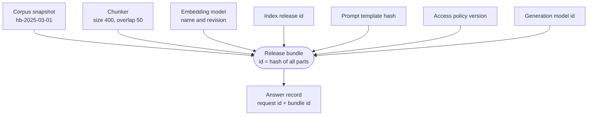

Six weeks ago AskMeridian told an employee that the home-office budget was £250. Today it says £400. Both answers were "correct" for the system that gave them, because between the two the handbook changed, the embedding model was upgraded, and someone edited the system prompt. Which of those three changes explains the difference? If the only record is a Git history of application code, nobody can say.

**Version control** in enterprise RAG means more than keeping source code in Git. An answer is the product of many separately changing parts: documents, chunking settings, embedding models, indexes, prompts, access policies and the generation model. This lesson takes a *governance* view of that problem: how to name the exact combination of versions behind any answer, how to make changes to that combination reviewable and tamper-evident, and how to answer an auditor who asks "what was the system doing on 3 March?". The mechanics of individual pieces are covered elsewhere and linked as we go; this lesson is about the whole.

## Learning objectives

- List the components of a RAG system whose versions determine an answer, and state which of them are most often left unversioned.
- Build a release bundle that identifies a configuration by the hash of its contents, and diff two bundles to find what changed.
- Implement a change-control rule (separation of duties and required approvers) and a hash-chained change log, and explain what tampering the chain detects and what it does not.
- Stamp each answer with its bundle id so that a past answer can be tied to the configuration that produced it.
- Explain the conflict between keeping old versions for reproducibility and deleting data on request, and describe a policy that resolves it.

## Prerequisites

- [Data lineage](/learn/enterprise-rag-governance/data-lineage): recording which inputs produced an answer.
- [Document versioning](/learn/document-engineering/document-versioning): validity intervals and the three clocks of a document.
- [Index versioning](/learn/ci-cd-and-mlops/index-versioning): how an index's manifest identifies it.
- [Git workflows](/learn/ci-cd-and-mlops/git-workflows): branches, reviews and tags for code.

## Why this matters

Ordinary software versioning answers "which code is running". RAG breaks that assumption in three ways.

First, **the behaviour depends on data as much as on code.** Deploying the same code against a new handbook, a rebuilt index or a different embedding model can change answers without a single line of code changing. Git does not see any of it.

Second, **the changes are made by different people on different schedules.** HR publishes a new handbook. A data scientist re-tunes chunk sizes. A platform engineer swaps the embedding model. A product manager edits the prompt in an admin screen. None of these is a "release" in the traditional sense, and each can alter what thousands of employees are told.

Third, **someone will ask after the fact.** An employee relied on an answer and was wrong. A regulator or customer asks how an automated system reached a decision (see [compliance](/learn/enterprise-rag-governance/compliance)). Your own team asks why quality dropped on a Tuesday. Each question is the same: *what exactly was running, who allowed it, and what was different the day before?* Without versioning of every component, the honest answer is "we don't know", and the investigation becomes archaeology.

There is a fourth, quieter reason. Without change control, a well-meaning edit can quietly weaken a safeguard: a prompt change that removes the "cite your sources" instruction, a loosened access policy, a reindex that includes a folder that was excluded. Review and approval on the components that carry risk is how you catch those before they ship.

## The intuition

Think of a pharmacy. Every batch of medicine carries a batch number. The batch number is not a date or a name; it identifies a specific production run, whose records list the ingredient lots, the equipment, the operator and the quality checks. When a patient reports a problem, the pharmacy does not ask "which medicine?" but "which batch?", and from the batch number can recall every unit made the same way. A change to the recipe is not made by whoever happens to be at the machine; it is proposed, reviewed, approved by a named person, and written into a log that cannot be quietly edited.

A RAG release bundle is the batch number. It identifies one combination of document snapshot, chunker, embedding model, index, prompt, access policy and generator. The change log is the production record. Every answer carries its batch number, so "which batch?" is a lookup, and "what changed since?" is a diff between two batches.

## How it works

### What there is to version

An answer is a function of many inputs. The table lists them, who usually owns them, and what versioning each needs.

| Component | Typical owner | How to version it | Commonly left unversioned |
| --- | --- | --- | --- |
| Source documents | Content owners (HR, IT) | Document id, version, content hash, validity interval | Edits made in place without a new version |
| Parser and chunker | Data engineering | Code version plus parameters (size, overlap, splitter) | Parameters held in environment variables |
| Embedding model | ML or platform | Model name and revision, dimension, normalisation | A model referenced by name, which a provider or hub can update |
| Index | Platform | Release id from a manifest (see [index versioning](/learn/ci-cd-and-mlops/index-versioning)) | Index settings changed on the live collection |
| Prompt templates | Product, engineering | Hash of the text, stored in version control | Prompts edited in a dashboard or database |
| Access policy | Security | Policy version and hash of rules | Group-membership rules maintained in an admin UI |
| Generation model | Platform | Exact model identifier and parameters | An alias that is repointed by the provider |
| Evaluation set | Quality | Version, so scores are comparable | Test questions edited after a baseline was recorded |

The right-hand column is the useful one. The usual gaps are the pieces that are *edited* instead of *released*: prompts in a web form, chunker parameters in an environment variable, a model name that resolves to something different next month. The principle is to treat every one of them as code. If a thing can change an answer, it gets an identifier derived from its content, stored somewhere that keeps history.

### Content-addressed versions

A **content-addressed** identifier is derived from the content itself: hash the bytes and the result is the id. Two things have the same id if and only if (barring a hash collision, which for SHA-256 is not a practical concern) they have the same content. This has three consequences that make it the right default.

1. **Identity cannot lie.** A hand-assigned label such as `prompt-v3` can be reused or edited by mistake; a hash changes if one character does.
2. **Unchanged means identical.** Re-running a build that changes nothing produces the same id, so you can tell "no change" from "a change that happened to look similar".
3. **Composition is easy.** The id of a bundle is the hash of the ids of its parts. Change any part and the bundle id changes; change nothing and it does not.

Hash identity does not replace human-readable names. Keep a human label (a semantic version or a date) as an alias, and a content hash as the truth.

### The release bundle

A **release bundle** is a small record naming the exact version of every component that shapes an answer, with an id derived from the whole. It is deliberately a *manifest* (a list of references), not a copy: the prompt text itself lives in Git, the index lives in the vector database under its release id, the documents live in the snapshot store. The bundle just pins them together.



The bundle gives you three operations that govern everything else:

- **Pin**: a running deployment declares one bundle id, and refuses to start if components do not match it (the idea behind the start-up guard in [index versioning](/learn/ci-cd-and-mlops/index-versioning)).
- **Diff**: comparing two bundle ids lists exactly which components differ. This is how the opening mystery is solved.
- **Stamp**: each answer record stores the bundle id. Now "what produced this answer?" is a lookup.

Operational mechanics such as reindexing, blue-green switches and rollbacks are the subject of the [CI/CD and MLOps](/learn/ci-cd-and-mlops) module; the bundle is what makes them auditable, because every switch is a move from one named bundle to another.

### Two kinds of time

Documents have **valid time** (when a rule was in force in the real world: the 2023 handbook was in force until 31 December 2024) and **system time** (when your index learned about it). They can differ: HR may publish a correction on 10 January that applies from 1 January. The [document versioning](/learn/document-engineering/document-versioning) lesson owns this; for governance the consequence is this. "What did the system *say* on 3 March?" is answered by the bundle that was live then (system time). "What *should* it have said?" is answered by the documents in force on that date (valid time). An auditor usually wants both, and a bundle stamped on every answer, together with retained document snapshots, supplies the first without losing the second.

### Change control

A bundle id tells you what changed; **change control** governs who is allowed to change it. The core rules are old and simple.

- **Separation of duties.** The person who makes a change cannot be the one who approves it. This stops a single mistaken or malicious edit from reaching production.
- **Required approvers by risk.** Not every component deserves the same scrutiny. A change to the chunk overlap needs an engineer's review; a change to the prompt or the access policy changes the system's safety posture and should need the security owner; a change to the corpus snapshot should need the content owner. Map components to approver roles explicitly.
- **A reason for every change.** A one-line justification recorded at the time costs seconds and is priceless a year later.
- **An append-only record.** The log of changes is never edited; corrections are new entries.
- **Automated gates before humans.** A candidate bundle must pass the regression suite (see [regression testing](/learn/testing-and-benchmarking/regression-testing)) before it reaches an approver, so that humans review judgement calls, not whether the build passes.

### Tamper evidence with hash chains

An append-only log is only as good as the guarantee that nobody edited it. A **hash chain** gives cheap tamper *evidence*: each entry stores the hash of the previous entry, so changing any past entry changes its hash, which no longer matches the value stored in the next entry. Verification walks the chain and recomputes every hash.

A hash chain has limits worth stating plainly. It detects *accidental* edits and *naive* tampering. Someone with write access to the entire log can recompute every hash after an edit, and the chain will verify again. To resist that, publish the latest hash somewhere the editor cannot reach (a separate account, a write-once object store, a signed timestamp from a trusted service) at regular intervals. This is the principle behind transparency logs; it is covered further in [audit logs](/learn/enterprise-rag-governance/audit-logs).

### Reproducibility, honestly

The hope behind all of this is that, given an answer's bundle and request, you could reproduce it. Pinned components make that *nearly* possible, and it is worth being clear about where it ends.

- Retrieval over a pinned index with a fixed query is deterministic in most implementations, but approximate nearest-neighbour search can differ between hardware and library versions, and tie-breaking order may change.
- Language-model generation is generally not guaranteed to be reproducible, even for a fixed prompt and model. Providers may serve updated model snapshots behind a stable name, and sampling may involve non-determinism.
- The context you rebuild must be the context that was used. This is why the answer record stores the chunk ids and a hash of the final prompt, not only the bundle id.

So the practical goal is *reconstruction*, not bit-for-bit replay: you can show what the model was given, under which configuration, and compare today's behaviour for the same inputs. For evidence of what was *said*, store the answer text itself (subject to retention, below).

### Retention versus deletion

Versioning pulls toward keeping everything: old bundles, old index releases, old document snapshots. [Secure deletion](/learn/enterprise-rag-governance/secure-deletion) pulls the other way: when personal data must be erased, every copy must go, including the copy inside a retained 18-month-old index snapshot. The two goals genuinely conflict, and a mature policy decides in advance.

- Retain the **bundle manifests and the change log** indefinitely. They contain identifiers and hashes, not document content, so they are rarely subject to erasure.
- Retain **heavy artefacts** (index snapshots, document snapshots) for a defined window, long enough to investigate and roll back (for example 90 days; a value you must set from your own needs and obligations).
- When a deletion request arrives, **purge the data from retained artefacts too**, or retire the artefact; and record in the log that bundle X is no longer reproducible because of a deletion. Losing reproducibility for that artefact is the correct outcome.
- Keep hashes of deleted content only if you are sure a hash cannot be reversed to the data. Hashes of short, guessable values such as names or phone numbers can be brute-forced.

## In code

### A bundle, a change log and an approval rule

**The problem.** Meridian wants every AskMeridian release to be a named bundle, wants changes to the prompt and access policy to need the security team, wants nobody to approve their own change, and wants a log that shows if someone edits history. The code builds bundles by hashing their components, diffs them, enforces the approval rules in `propose`, chains the log entries, and stamps an answer with a bundle id.

**Dependencies.** The standard library only.

**The source.**

```python
"""Change-controlled release bundles for a RAG system, with a tamper-evident log."""
import hashlib
import json
from dataclasses import dataclass, field


def h(obj) -> str:
    raw = json.dumps(obj, sort_keys=True, separators=(",", ":")).encode("utf-8")
    return hashlib.sha256(raw).hexdigest()[:12]


def make_bundle(**components) -> dict:
    """A bundle names the exact version of every part that shapes an answer."""
    return {"id": "rb-" + h(components), "components": components}


def diff(a: dict, b: dict) -> dict:
    keys = set(a["components"]) | set(b["components"])
    return {k: (a["components"].get(k), b["components"].get(k)) for k in sorted(keys)
            if a["components"].get(k) != b["components"].get(k)}


# Components whose change needs a particular approver, whoever the author is.
SENSITIVE = {"prompt_template": "security", "access_policy": "security", "corpus_snapshot": "hr"}


@dataclass
class ChangeLog:
    entries: list = field(default_factory=list)

    def propose(self, bundle, author, approvers, reason):
        prev = self.entries[-1]["bundle"] if self.entries else {"components": {}}
        changed = diff(prev, bundle)
        if author in approvers:
            raise PermissionError("author cannot approve their own change")
        if len(set(approvers)) < 2:
            raise PermissionError("two distinct approvers required")
        for comp in changed:
            need = SENSITIVE.get(comp)
            if need and need not in approvers:
                raise PermissionError(f"change to {comp!r} needs approval from {need!r}")
        entry = {"seq": len(self.entries), "bundle": bundle, "author": author,
                 "approvers": sorted(approvers), "reason": reason, "changed": sorted(changed),
                 "prev_hash": self.entries[-1]["entry_hash"] if self.entries else "genesis"}
        entry["entry_hash"] = h({k: v for k, v in entry.items()})
        self.entries.append(entry)
        return entry

    def verify(self) -> bool:
        prev = "genesis"
        for e in self.entries:
            body = {k: v for k, v in e.items() if k != "entry_hash"}
            if e["prev_hash"] != prev or h(body) != e["entry_hash"]:
                return False
            prev = e["entry_hash"]
        return True


v1 = make_bundle(prompt_template=h("Answer only from context. Cite [S#]."), embedder="all-MiniLM-L6-v2",
                 chunker={"size": 400, "overlap": 50}, corpus_snapshot="hb-2025-01-01",
                 access_policy="ap-7", generator="gen-model-A")
v2 = make_bundle(**{**v1["components"], "corpus_snapshot": "hb-2025-03-01"})
v3 = make_bundle(**{**v2["components"], "prompt_template": h("Answer concisely. Cite [S#].")})

log = ChangeLog()
log.propose(v1, "asha", ["security", "hr"], "initial release")
log.propose(v2, "asha", ["ben", "hr"], "March handbook update")
print("v2 changed:", log.entries[-1]["changed"])

for label, args in [("self-approval", ("asha", ["asha", "ben"])), ("one approver", ("asha", ["ben"])),
                    ("prompt, no security", ("asha", ["ben", "hr"]))]:
    try:
        log.propose(v3, args[0], args[1], "shorter answers")
    except PermissionError as err:
        print(f"{label}: rejected ({err})")
log.propose(v3, "asha", ["ben", "security"], "shorter answers")
print("chain valid:", log.verify())

stamped = {"request": "req-0413", "bundle_id": v2["id"]}
now = log.entries[-1]["bundle"]
print("answer req-0413 ran on", stamped["bundle_id"], "- live is", now["id"])
print("differences:", diff(v2, now))

log.entries[1]["reason"] = "nothing to see here"
print("chain valid after editing the log:", log.verify())
```

```output
v2 changed: ['corpus_snapshot']
self-approval: rejected (author cannot approve their own change)
one approver: rejected (two distinct approvers required)
prompt, no security: rejected (change to 'prompt_template' needs approval from 'security')
chain valid: True
answer req-0413 ran on rb-6d371e257e2f - live is rb-798f54c7bc3f
differences: {'prompt_template': ('a952fd8b130b', 'c56e49c0ca68')}
chain valid after editing the log: False
```

**What the output means.** Each guard fired as designed: self-approval, a single approver, and a prompt change without the security team were all rejected before they reached the log. Once approved, the chain verified. The stamped answer, `req-0413`, ran on bundle `rb-6d371e257e2f`; the live bundle is different, and the diff names the culprit, the prompt template hash, with the old and new values. That is the opening mystery solved by a dictionary comparison. Finally, editing the stored reason of one past entry made verification fail. Your bundle ids are deterministic here (they are hashes of fixed inputs), so you should see the same values.

**Important lines.**

- `make_bundle` hashes the components dictionary with sorted keys, so key order cannot change the id. Without `sort_keys=True` two equal bundles could hash differently.
- `propose` computes `changed` against the previous bundle in the log, so the approval rule applies to what *this* change touches, not to the bundle as a whole.
- The `SENSITIVE` map is the policy: edit it and the rules change. In production it would itself be a versioned, reviewed file.
- `entry_hash` covers the previous hash, which is what makes it a chain: altering entry 1 breaks its own hash and the `prev_hash` in entry 2.

**Limits to understand.** The hash chain proves nothing against someone who can rewrite every entry and recompute the hashes. Publish the head hash externally (an object store with retention lock, a separate account) to close that gap. Approver names here are plain strings; a real system takes them from authenticated identities, and the log records the identity provider's subject id, not a typed name.

**Common errors.** Hashing a Python `dict` with `str()` instead of canonical JSON (key order and spacing differ across runs); hashing floating-point parameters whose text representation changes between libraries (store them as strings); and forgetting to include a component, so the bundle id does not change when that component does. The last is the most dangerous because it fails silently. A test that mutates each component in turn and asserts the id changes catches it.

**How to extend it.** Store the prompt text in Git and reference it by commit; add an `index_release` component filled from the id in [index versioning](/learn/ci-cd-and-mlops/index-versioning); gate `propose` on a regression run result; write the head hash to an external store after every entry; and record answers with the stamped bundle id in your [observability](/learn/rag-observability/logging) pipeline so the lookup is one query.

## A real-world example

The Platform team at Meridian gets a message from HR on a Monday: AskMeridian is telling staff that contractors can claim the £400 home-office budget. The handbook says they cannot. The first reaction in the channel is to blame the new embedding model, which shipped the previous week, and a rollback is proposed.

Priya, the on-call engineer, looks up the stamped answers. Complaints that mention the wrong behaviour all carry bundle ids from after the 12th. She diffs the bundle just before the 12th with the one after. Exactly two components differ: the corpus snapshot and the prompt template. The embedding model is identical. The change log shows the prompt change was approved by two people but, because the rule was only applied to the access policy at the time, not by the security owner. Its reason reads "make answers friendlier". Reading the prompt diff in Git, she sees that the friendlier wording dropped the sentence "If the context excludes a group of people, say so."

A rollback of the embedding model would have changed nothing and cost a day of re-indexing. Instead the team restores the previous prompt through the normal change process, adds `prompt_template` to the sensitive list so the security owner must approve it, and adds a regression question about contractor eligibility to the golden set. The incident takes an afternoon because the question "what changed?" was answerable in one query. They also note that this is a failure of *change control*, not of Git: the prompt lived in a database table, not a repository, until this week.

## Common mistakes

- **Versioning code but not data.** Git history shows nothing when the handbook, index or model changed. Version the whole bundle.
- **Referencing models by alias.** A name such as `latest`, or a provider alias that is repointed, changes behaviour without a diff. Pin an exact identifier and record it.
- **Editing the live index in place.** A changed setting on a running collection leaves no record and no rollback. Build a new release and switch to it.
- **Prompts that live outside version control.** A prompt in an admin form or database cell is a production code change with no review. Store prompts in a repository and release them like code.
- **No separation of duties.** One person who writes, approves and deploys can ship an error or a malicious change alone.
- **Treating the hash chain as proof.** It detects naive edits only. Anchor the head hash externally.
- **Keeping every old index forever.** Retained snapshots can contain data that must be erased. Define a retention window and a purge path.

## Best practices

- Give every component a content-derived identifier and compose a release bundle id from them.
- Stamp every answer record with the bundle id, the chunk ids and a hash of the final prompt.
- Map components to approver roles by risk, require two distinct approvers, and prohibit self-approval.
- Run automated gates (regression tests, access-control tests) before human review, and record their results in the log entry.
- Keep the change log append-only and publish its head hash outside the system that writes it.
- Keep manifests and logs indefinitely; give heavy artefacts a retention window and a documented purge process.
- Test the versioning itself: mutate each component and assert that the bundle id changes.
- Prefer rollback to a named bundle over editing forward under pressure.

## Performance considerations

Versioning metadata is tiny. A bundle is a few hundred bytes; at one change a day, ten years of log entries is under 4,000 entries, trivial to store and verify. Stamping a bundle id on each answer adds a dozen bytes to the answer record. The costs are elsewhere.

**Storage of heavy artefacts.** Retaining index snapshots multiplies storage. A rough estimate: one million chunks of 384-dimensional float32 vectors take $10^6 \times 384 \times 4 \approx 1.5$ GB for the vectors alone, before the index structure and payloads. If you keep a snapshot after each of 12 releases, plan for roughly 12 times that, minus whatever your storage layer deduplicates. This is a reason for retention windows, and for storing document snapshots once by content hash so identical documents are shared across releases.

**Verification time.** Verifying a hash chain is linear in its length, and each step hashes a small record: even 100,000 entries verify in well under a second on commodity hardware. Run it on a schedule and alert on failure.

**Gate time.** Regression suites dominate release time. Running a golden set of 500 questions against a candidate bundle at, say, 1 second per question is about 8 minutes sequentially (an assumption; measure yours) and far less with concurrency. This is the cost of reviewing changes to behaviour, and it is cheap against the cost of shipping one that weakens a safeguard.

## Security considerations

- **The change log is a target.** Anyone who can edit the log can hide a change. Restrict write access to the service that appends entries, store the head hash externally, and alert if verification fails.
- **Approvals must be real identities.** A free-text approver field is forgeable. Take approver identity from your authentication system and, for the highest-risk components, require a second factor on approval. See [authentication](/learn/access-control-and-privacy/authentication).
- **Prompts and policies are security controls.** A prompt change can remove an instruction that blocks a class of attack; an access-policy change can widen who sees what. Treat them with the same review as code that touches authorisation.
- **Retained artefacts retain sensitive data.** Old snapshots hold whatever the index held then, including documents since restricted or deleted. Apply the same access controls and encryption to archives as to the live index, and include them in deletion workflows.
- **Do not put secrets in bundles.** A bundle references components by id; keys and credentials belong in a secret manager and must never be hashed into or stored in a manifest.

## Summary

- An answer depends on documents, chunker, embedding model, index, prompt, access policy and generator; version all of them, especially the ones that are edited rather than released.
- A release bundle pins those components under an id derived from their contents, which lets you stamp answers, diff configurations and answer "what changed?" with a lookup.
- Change control adds separation of duties, risk-based required approvers, recorded reasons and an append-only log; a hash chain makes tampering evident, but only external anchoring makes it hard to hide.
- Reproducibility is reconstruction rather than guaranteed replay: retrieval is mostly deterministic, generation is not, so store the context and the answer, not just the configuration.
- Versioning and deletion conflict; keep manifests and logs, bound the life of heavy artefacts, and purge retained data when erasure demands it.

## Exercises

**1. Concept.** Give three components of a RAG system that are commonly changed without being versioned, and for each say how a change could alter answers.

<details>
<summary>Show solution</summary>

A prompt template edited in an admin screen (it can drop a grounding instruction or change the refusal behaviour); chunker parameters held in an environment variable (a different chunk size changes what is retrievable and where rules are split from exceptions); a model referenced by an alias that the provider repoints (the same name can produce different embeddings or answers, silently breaking compatibility between stored vectors and query vectors). Others are acceptable: access-group rules in an admin UI, an evaluation set edited after a baseline.

</details>

**2. Calculation.** Meridian keeps one index snapshot per weekly release for 26 weeks. The index holds 400,000 chunks of 384-dimensional float32 vectors. Estimate vector storage for the retained snapshots, and say what changes if retention drops to 8 weeks.

<details>
<summary>Show solution</summary>

One snapshot's vectors: $400{,}000 \times 384 \times 4$ bytes $= 614{,}400{,}000$ bytes, about 0.61 GB. Twenty-six snapshots: about 16 GB for vectors alone (ignoring graph structure, payloads and deduplication). Eight snapshots: about 4.9 GB. The saving is roughly 11 GB, and also fewer places that hold data that might need to be erased. The retention window should come from how far back rollback and investigation realistically reach.

</details>

**3. Code.** Add a test to the lesson's code that mutates each component of `v1` in turn and asserts that the bundle id changes. What bug does the test guard against?

<details>
<summary>Show solution</summary>

```python
for key in v1["components"]:
    changed = dict(v1["components"])
    changed[key] = "mutated"
    assert make_bundle(**changed)["id"] != v1["id"], key
print("every component affects the bundle id")
```

It guards against a component being omitted from the hash (for example, building the id from a hand-picked subset of fields). Such a bug is silent: the pipeline keeps working, but a change to the omitted component produces no new bundle id, so the diff and the audit trail both miss it.

</details>

**4. Design.** Security asks that any change to the access policy be visible within one hour to someone outside the Platform team, and that it be impossible for a Platform engineer with full database access to hide a change. Design the mechanism using this lesson's ideas.

<details>
<summary>Show solution</summary>

Append every change as a hash-chained entry (as in the lesson). After each entry, a separate small service owned by the security team reads the head hash and writes it, with a timestamp, to a write-once store in a different cloud account to which Platform engineers have no write access. A scheduled job in the security account verifies the chain against the published heads every hour and pages on mismatch or on a missing publication. A change to `access_policy` also emits a notification to a security channel on creation. A Platform engineer who rewrote the log could recompute internal hashes, but could not alter heads already published externally, so the rewrite is detected at the next verification; an engineer who suppressed the publication is detected by the missing-publication alert.

</details>

## Check your understanding

```quiz
[
  {
    "q": "Why is a content-derived hash a better version identifier for a prompt than a hand-assigned label such as prompt-v3?",
    "options": [
      "Hashes are shorter and easier to remember",
      "A hash changes whenever the content changes, so an id cannot be reused or left unchanged after an edit",
      "Hashes make the prompt run faster",
      "Labels cannot be stored in Git"
    ],
    "answer": 1,
    "why": "Identity derived from content cannot lie: the same id means the same bytes, and any edit produces a new id."
  },
  {
    "q": "Answers worsened after a release. The stamped bundle ids before and after differ only in the corpus snapshot and prompt template. What should you conclude about the embedding model?",
    "options": [
      "It is probably the cause, because it is the most complex component",
      "It is unchanged between the two bundles, so it is not the cause of this difference",
      "Nothing, because bundles do not record models",
      "It must be rolled back anyway"
    ],
    "answer": 1,
    "why": "The diff lists every component that differs; an identical embedding model reference rules it out as a change between those releases."
  },
  {
    "q": "What does a hash chain over the change log detect, and what does it not?",
    "options": [
      "It detects edits to past entries, but not a rewrite by someone who recomputes every later hash unless the head is published elsewhere",
      "It prevents anyone from editing the log",
      "It detects only deletions, not edits",
      "It proves who made each change"
    ],
    "answer": 0,
    "why": "Each entry stores the previous hash, so a naive edit breaks the chain; an attacker with full write access can recompute it, so the head must be anchored outside their reach."
  },
  {
    "q": "A deletion request arrives for a document that is also present in a retained 6-month-old index snapshot. What is the correct treatment?",
    "options": [
      "Leave the snapshot, since it is needed for reproducibility",
      "Purge the data from the snapshot or retire it, and record that the bundle is no longer reproducible",
      "Delete only the live index",
      "Encrypt the snapshot and keep it indefinitely"
    ],
    "answer": 1,
    "why": "Erasure must cover every copy; losing reproducibility of that artefact is the accepted consequence."
  },
  {
    "q": "In the lesson's code, why must json.dumps be called with sort_keys=True when hashing a bundle?",
    "options": [
      "To make the JSON easier to read",
      "So that equal bundles hash identically regardless of dictionary key order",
      "Because SHA-256 requires sorted input",
      "To reduce the size of the hash"
    ],
    "answer": 1,
    "why": "Without canonical key order, two identical bundles built in different orders could produce different ids."
  }
]
```

## Further reading

- The OpenLineage project documentation at [openlineage.io](https://openlineage.io), for an open standard for recording data lineage events that pairs naturally with release manifests.
- Git documentation, at [git-scm.com/doc](https://git-scm.com/doc), for the content-addressed object model that underlies the idea in this lesson.
- NIST AI Risk Management Framework (AI RMF 1.0), 2023, published by the US National Institute of Standards and Technology, for governance practices around documentation and change management of AI systems.
- Kleppmann, M. (2017), *Designing Data-Intensive Applications*, O'Reilly, on immutable logs and reasoning about data over time.
- Humble, J. and Farley, D. (2010), *Continuous Delivery*, Addison-Wesley, on release pipelines, gates and deployment discipline.
