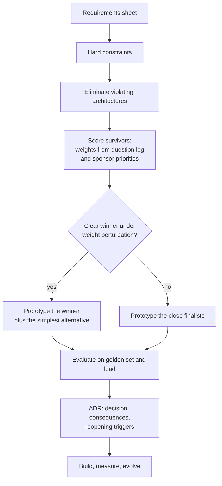

The module so far has given you a signed requirements sheet. This lesson turns it into a choice: of the many RAG architectures in the literature and on conference slides, **which one should this system start with, and why?** The right answer is almost never the most sophisticated architecture. It is the simplest one that satisfies the hard constraints, with a clear path to the next one if measurement shows it is needed.

You will learn a repeatable method: eliminate by hard constraints, score what remains against weights taken from the requirements, test the sensitivity of the answer, prototype the finalists, and record the decision. You will also meet the structural choices that sit around the retrieval pattern itself: how to split services, where to be synchronous, and how to isolate tenants. The running case is Northgate Mutual's ClaimsCompanion from [requirements gathering](/learn/enterprise-rag-system-design/requirements-gathering).

## Learning objectives

- Describe the main RAG architecture families and the requirement each one is designed to satisfy.
- Apply hard-constraint elimination before weighted scoring, and explain why the order matters.
- Derive scoring weights from a question log and stakeholder priorities, and test a ranking for sensitivity to those weights.
- Choose structural options (service boundaries, sync versus async, tenancy model) from requirements rather than fashion.
- Write an architecture decision record that states the context, options, decision, consequences and the evidence that would reverse it.

## Prerequisites

- [Requirements gathering](/learn/enterprise-rag-system-design/requirements-gathering): the sheet this lesson consumes.
- [Naive RAG](/learn/advanced-rag-patterns/naive-rag) and [Advanced RAG](/learn/advanced-rag-patterns/advanced-rag): the baseline and the first set of improvements.
- [Scalable RAG systems](/learn/production-architecture/scalable-rag-systems): the dimensions along which a system grows.

## Why this matters

Architecture is the set of decisions that are expensive to change. Prompts, chunk sizes and the number of retrieved passages are tuning; the choice between a single retrieval pass and an agent that plans several, or between one shared index and one per tenant, is architecture. Make it badly and you pay twice: once to build the wrong thing and once to migrate.

Two opposite errors dominate. **Under-building** sends a naive pipeline into an environment with per-document permissions and cross-document questions, and then patches it for a year. **Over-building** adopts an agent or a knowledge graph because a paper reported a gain on someone else's benchmark; the team then carries extra latency, cost and failure modes for a benefit its users never see. The method in this lesson is a defence against both: it makes the choice a consequence of written requirements and lets evidence, rather than enthusiasm, justify added complexity.

## The intuition

Choosing a vehicle for a delivery business is a good analogy. You do not begin by asking which vehicle is most impressive. You begin with the constraints: it must fit down the narrow lanes, carry a pallet, and stay within a fuel budget. A lorry fails the lane constraint and is eliminated immediately, however powerful. Among the vehicles that fit, you weigh what matters: running cost, load, driver availability. If a small van and a larger van are close, you do not agonise over the score; you hire both for a week and watch.

The same shape applies to RAG. A graph-based architecture may be wonderful for questions that chain across entities, but if its retrieval cannot enforce per-document permissions and the sheet demands them, it is the lorry in the narrow lane. The method eliminates first, scores second, and prototypes whatever is still close.

## How it works

### The architecture families

Each family below exists to fix a specific weakness of the one before it. Learn them as answers to problems, not as a menu. Detailed treatment lives in later lessons; here the question is only which problem each one buys you.

| Family | What it adds | Problem it solves | What it costs |
| --- | --- | --- | --- |
| **Naive vector RAG** | Embed, retrieve top-k, generate | Grounding answers in documents at all | Misses exact identifiers; ranks by rough similarity |
| **Hybrid + rerank** | Keyword and vector retrieval fused, then a cross-encoder reorders candidates ([hybrid retrieval](/learn/hybrid-search/hybrid-retrieval-architecture), [reranking](/learn/reranking-fundamentals/why-reranking-is-needed)) | Identifier queries and precision at the top of the list | A second index or field, a reranker's latency and compute |
| **Query planning** | Rewrite or decompose the query before retrieval ([query decomposition](/learn/advanced-retrieval/query-decomposition)) | Questions needing several facts or several documents | One or more extra model calls on affected queries |
| **Structured and hierarchical retrieval** | Document, section and chunk levels ([hierarchical indexes](/learn/hierarchical-rag/hierarchical-indexes), [parent-child retrieval](/learn/hierarchical-rag/parent-child-retrieval)) | Chunks that lose context; long structured documents | More index structure and ingestion logic |
| **Agentic RAG** | A loop where a model plans, searches, reads and decides to stop ([agentic retrieval](/learn/agentic-rag/agentic-retrieval)) | Open-ended research across tools and many documents | Latency and cost that vary per query, harder testing |
| **Graph RAG** | Entity and relationship graph alongside vectors ([knowledge graphs](/learn/graph-rag/knowledge-graphs)) | Global or relational questions over a corpus | Expensive extraction at ingestion, hard to keep fresh and permissioned |
| **Long-context prompting** | Skip retrieval, supply many documents directly ([RAG versus long-context](/learn/introduction-to-rag/rag-versus-long-context-prompting)) | Small, stable corpora where retrieval errors are the main risk | Token cost per query, and a corpus that must fit |

Two more patterns modify any of these. **Adaptive routing** ([adaptive RAG](/learn/advanced-rag-patterns/adaptive-rag)) sends each query down a path of suitable cost, so only the questions that need decomposition pay for it. **Corrective patterns** ([corrective RAG](/learn/advanced-rag-patterns/corrective-rag)) check retrieval quality and retry or fall back. Both add a decision point whose accuracy you must measure.

### Step 1: eliminate by hard constraints

Take the requirements that are pass-or-fail and remove every architecture that violates one. For ClaimsCompanion these are:

- p95 time to a complete answer within the budget the sheet implies (here we use 4 seconds for the whole path, simplified from the earlier time-to-first-token target to keep the example clear).
- Document-level permissions enforced at retrieval time.
- 30 million chunks searchable.

Elimination first has two virtues. It cannot be argued around: a design that leaks documents is not "worth 3 points elsewhere". And it shrinks the scoring problem, which makes the soft judgements that follow more careful.

Hard constraints usually come from latency, access control, residency, corpus size and availability. Be strict about what is truly hard. A target the sponsor would trade for quality is soft; mislabelling it eliminates good options.

### Step 2: score the survivors

For what remains, choose **criteria** that matter, give each a **weight**, and rate each architecture on each criterion. Three disciplines keep this honest:

1. **Take weights from evidence.** The question log tells you how much quality on simple lookups should count against quality on comparisons. If 70 per cent of real questions are single-clause lookups and 30 per cent compare documents, weight the two quality criteria in that ratio. The sponsor's priorities set the rest: latency, cost, simplicity and auditability.
2. **Rate against an anchor.** Score each criterion relative to the naive baseline using a short written rubric ("3 means about the same as naive vector RAG; 5 means a clear, demonstrated improvement"), and revise ratings when prototypes produce measurements.
3. **Treat ratings as hypotheses.** A rating of 4 for hybrid retrieval on lookup quality is a claim to be tested on your golden set, not a fact.

The score is then a weighted sum:

$$
S_a = \sum_{i} w_i \, r_{a,i}, \qquad \sum_i w_i = 1
$$

where $w_i$ is the weight of criterion $i$ and $r_{a,i}$ is the rating of architecture $a$ on it. The mathematics is trivial; the discipline is in the inputs.

### Step 3: test the answer's sensitivity

A ranking is only useful if it survives reasonable disagreement about the weights. Perturb each weight by, say, plus or minus 50 per cent many times and count how often each option wins. If one option wins 95 per cent of the time, the choice is robust. If the top two split the wins, the matrix has told you something different and more useful: **these two cannot be separated on paper, so run them against real data.**

### Step 4: prototype the finalists

For each finalist, build the thinnest version that can be evaluated against the golden set and the load profile. You are measuring four things: retrieval and answer quality on the question log (especially on the slice of hard questions), latency at the planned concurrency, cost per query, and operational burden (how many moving parts, how many pages-worth of runbook). Two weeks of prototyping that reveals the multi-hop slice is only 4 per cent of real questions is far cheaper than a graph-based rebuild.

### Step 5: record the decision

Write an **architecture decision record** (ADR): a short document stating the context, the options considered, the decision, the consequences, and the **trigger that would reopen it**. Triggers make evolution cheap: "If multi-document comparison questions exceed 15 per cent of traffic, or Recall@10 on the comparison slice stays under 0.7 after tuning, introduce routed query decomposition." The ADR is also the artefact that survives staff changes.



### Structural decisions around the pattern

The retrieval family is one decision. Several others shape the system as much:

**Service boundaries.** Start with the fewest deployable units that keep concerns separable. A common starting point is two: an **online service** (query handling, retrieval, reranking, generation) and an **ingestion pipeline** (parse, chunk, embed, write). They have different scaling shapes (steady request traffic against bursty batch work), different failure modes and different release cadences, so separating them is nearly always justified. Splitting the online path into five microservices adds network hops, each of which costs latency and a failure mode; do it when teams or scaling genuinely require it. Keep clean **interfaces** (a retriever interface, a generator interface, an embedder interface) inside the service so a component can be replaced without rewriting its neighbours.

**Synchronous and asynchronous work.** Answering a user is synchronous. Everything that can be done in advance (parsing, embedding, summarising, building permission metadata) should be asynchronous. [Queue-based pipelines](/learn/production-architecture/queue-based-pipelines) explain the mechanics. Anything you can move from the query path to ingestion improves latency permanently, at the price of freshness and storage.

**Tenancy.** Northgate has business units whose data must not mix. Options run from one shared index with a tenant filter, through one collection per tenant, to fully separate deployments. Shared is cheapest and hardest to prove isolated; separate is simplest to prove and costliest to run. [Multi-tenant RAG](/learn/production-architecture/multi-tenant-rag) works through the trade-offs; at design time the key input is how strong an isolation guarantee the requirements demand.

**Permission enforcement.** Decide where permissions are applied: as a **pre-filter** (the search only considers documents the user may read), as a **post-filter** (search, then discard forbidden results), or both. Pre-filtering gives correct top-k but needs an index that filters efficiently; post-filtering is simple but can return too few results and, if done carelessly, leak existence. See [filtering](/learn/vector-database-fundamentals/filtering).

**Build, buy or assemble.** Whether to use a managed RAG product, a framework, or custom code is largely a [technology selection](/learn/enterprise-rag-system-design/technology-selection) question, but the architecture must say which seams must remain under your control (access control, evaluation, logging) regardless.

### Evolve, do not leap

The most reliable strategy is a **ladder**: begin with the simplest architecture that passes the hard constraints, instrument it, and climb a rung only when a measured failure justifies it. A plausible ladder for ClaimsCompanion: hybrid retrieval with reranking; then parent-child retrieval if clause context is being lost; then routed query decomposition if comparison questions fail; and agentic behaviour only for a separate research feature with its own latency promise. Each rung has its own ADR and reopening trigger, and each can be rolled back.

## In code

The example below mechanises the first three steps: eliminating architectures by hard constraints, scoring survivors, and running the weight-perturbation test. It uses only NumPy and no model, so the result is reproducible; the ratings are **teaching judgements** drawn from the discussion above, not measurements, and in a real project they would be replaced by prototype results.

```bash
pip install numpy
```

```python
import numpy as np

CRITERIA = ["lookup_quality", "multihop_quality", "latency", "cost", "simplicity", "auditability"]

# Teaching ratings, 1 (poor) to 5 (good), from the reasoning in the lesson. They are judgements,
# not measurements: replace them with results from your own prototype.
ARCHITECTURES = {
    "naive vector RAG":            dict(scores=[3, 1, 5, 5, 5, 4], p95_s=2.5,  acl_at_retrieval=True,  fits_30m_chunks=True),
    "hybrid + rerank":             dict(scores=[5, 2, 4, 4, 4, 4], p95_s=3.2,  acl_at_retrieval=True,  fits_30m_chunks=True),
    "hybrid + rerank + decompose": dict(scores=[5, 3, 3, 3, 3, 4], p95_s=3.9,  acl_at_retrieval=True,  fits_30m_chunks=True),
    "hybrid + rerank, routed decompose": dict(scores=[5, 3, 4, 4, 3, 4], p95_s=3.9, acl_at_retrieval=True, fits_30m_chunks=True),
    "agentic multi-step":          dict(scores=[5, 5, 1, 1, 2, 2], p95_s=14.0, acl_at_retrieval=True,  fits_30m_chunks=True),
    "graph RAG":                   dict(scores=[3, 4, 3, 2, 1, 3], p95_s=5.0,  acl_at_retrieval=False, fits_30m_chunks=True),
    "long-context, no index":      dict(scores=[4, 3, 1, 1, 5, 3], p95_s=20.0, acl_at_retrieval=False, fits_30m_chunks=False),
}

# Hard constraints from the requirements sheet: failing any one removes the option.
P95_BUDGET_S = 4.0          # time budget, simplified to "whole answer path"
NEEDS_DOC_ACL = True
NEEDS_30M_CHUNKS = True

survivors, eliminated = {}, {}
for name, a in ARCHITECTURES.items():
    reasons = []
    if a["p95_s"] > P95_BUDGET_S:
        reasons.append(f"p95 {a['p95_s']} s > {P95_BUDGET_S} s")
    if NEEDS_DOC_ACL and not a["acl_at_retrieval"]:
        reasons.append("no document-level ACL at retrieval")
    if NEEDS_30M_CHUNKS and not a["fits_30m_chunks"]:
        reasons.append("corpus does not fit")
    (eliminated if reasons else survivors)[name] = reasons or a

print("ELIMINATED BY HARD CONSTRAINTS")
for n, r in eliminated.items():
    print(f"  {n:34s} {'; '.join(r)}")

# Soft weights. The first two come from the question log: 70% lookups, 30% comparisons.
weights = np.array([0.70 * 0.35, 0.30 * 0.35, 0.20, 0.15, 0.15, 0.15])
weights = weights / weights.sum()

def rank(w):
    totals = {n: float(np.dot(w, a["scores"])) for n, a in survivors.items()}
    return sorted(totals.items(), key=lambda kv: -kv[1])

print("\nWEIGHTED SCORES (base weights)")
for n, s in rank(weights):
    print(f"  {n:34s} {s:.2f}")

# Sensitivity: perturb every weight by up to +/-50% many times and count the winners.
rng = np.random.default_rng(7)
wins = {n: 0 for n in survivors}
for _ in range(2000):
    w = weights * rng.uniform(0.5, 1.5, size=len(weights))
    wins[rank(w / w.sum())[0][0]] += 1
print("\nWINNER UNDER 2,000 RANDOM WEIGHT PERTURBATIONS")
for n, c in sorted(wins.items(), key=lambda kv: -kv[1]):
    print(f"  {n:34s} {c / 20:.1f}%")
```

```output
ELIMINATED BY HARD CONSTRAINTS
  agentic multi-step                 p95 14.0 s > 4.0 s
  graph RAG                          p95 5.0 s > 4.0 s; no document-level ACL at retrieval
  long-context, no index             p95 20.0 s > 4.0 s; no document-level ACL at retrieval; corpus does not fit

WEIGHTED SCORES (base weights)
  hybrid + rerank                    4.04
  hybrid + rerank, routed decompose  3.99
  naive vector RAG                   3.94
  hybrid + rerank + decompose        3.64

WINNER UNDER 2,000 RANDOM WEIGHT PERTURBATIONS
  hybrid + rerank                    52.0%
  naive vector RAG                   28.9%
  hybrid + rerank, routed decompose  19.1%
  hybrid + rerank + decompose        0.0%
```

**How it works.** The loop at the top records every reason an option fails, not just the first, so the elimination is auditable. The weights apply the 70/30 split from the question log to the two quality criteria (scaled by their combined 0.35 share), with the sponsor's priorities for the rest, then normalise so they sum to one. `rank` is the weighted sum; the final loop multiplies each weight by a random factor between 0.5 and 1.5, renormalises, and counts which architecture wins.

**What the output means.** Three options are gone before scoring starts, and the reasons are specific: the agent is too slow, the graph design cannot enforce document-level permissions at retrieval (in this teaching table), and long-context prompting cannot hold 30 million chunks. Among the survivors, the base scores of the top three differ by about 0.1 on a five-point scale, and the sensitivity test splits the wins. That is the key result: **the matrix cannot choose between hybrid retrieval with reranking, the routed variant, and arguably the naive baseline.** It did, however, make one fact plain, which is that unrouted decomposition never wins because it taxes every query for a benefit only 30 per cent of them need. The decision is therefore to prototype hybrid with reranking as the baseline and routed decomposition as the likely next rung, and to let the golden set decide.

**Common errors.** Forgetting to renormalise the perturbed weights, which makes totals incomparable between runs. Treating a 0.05 difference as meaningful. Leaving a hard constraint in the soft weights, where a high enough score elsewhere can mask a violation.

**Extending it.** Replace the ratings with prototype measurements as they arrive, add a column for operational burden, and re-run when the question log grows. Keep the table in the repository beside the ADR.

## A real-world example

Northgate's platform team has two camps. One engineer, impressed by a conference talk, wants a graph-based architecture for the comparison questions. Another wants naive RAG "because it ships this month". The matrix and the elimination step reframe the debate.

First, the hard constraints remove the graph proposal for now: its permission model, as the team's early investigation showed, applies at the graph level rather than the document level, and rebuilding it per permission group is out of the question for 9,000 users. This is not a verdict on graph techniques; it is a verdict on this requirement set.

Second, the sensitivity analysis shows the simple baseline and the hybrid design are close on paper. So the team runs a two-week prototype of both over a 40,000-document sample, replaying the 140-question log. The hybrid design wins on the claims identifiers that make up a large share of real questions (policy numbers, clause numbers, form codes, where pure vector search ranks near-matches above the exact one). The comparison questions fail on both, with Recall@10 on that slice well below the target, which is consistent with what the matrix suggested: both designs rate low on multi-hop.

The ADR records: adopt hybrid retrieval with a cross-encoder reranker; use two deployable units, online and ingestion; apply permissions as a pre-filter with a post-check before the prompt is assembled; shared index with a mandatory tenant and permission filter, with the reopening trigger to move to per-tenant collections if the security review requires stronger isolation. A second ADR records the next rung: routed decomposition, to be built if the comparison slice remains below target after the baseline is tuned. The engineer who wanted a graph is asked to own the evaluation of that slice, which is where a graph might eventually earn its place.

## Common mistakes

- **Choosing by novelty.** Adopting an architecture because it is recent adds latency, cost and failure modes without a measured benefit.
- **Scoring before eliminating.** Letting hard constraints compete in the weighted sum permits a design that violates a requirement to win on other points.
- **Weights from opinion.** Weights invented in a meeting reflect the loudest voice; derive them from the question log and sponsor priorities, and show sensitivity.
- **Over-trusting the matrix.** A weighted sum with 0.1 differences is noise; treat close results as a call for prototypes.
- **Architecture by diagram.** A box diagram does not show failure behaviour, latency under load or permission leaks; evaluate running prototypes.
- **Microservices by default.** Splitting the online path early multiplies network hops and operational overhead for no scaling benefit.
- **No reopening triggers.** An ADR without one hardens into dogma, or is quietly ignored when conditions change.

## Best practices

- Eliminate on hard constraints first, and record the reason for each elimination.
- Begin with the simplest architecture that passes, then climb a rung only on measured failure.
- Derive weights from the question log, and run a sensitivity test before trusting a ranking.
- Prototype the top two finalists against the golden set and a replay of peak load.
- Separate ingestion from the online path; keep stable interfaces between retriever, reranker, generator and embedder.
- Decide permission enforcement (pre-filter, post-check) and tenancy model explicitly, with the isolation strength the requirements demand.
- Write an ADR for each decision with context, options, consequences and reopening triggers.
- Route expensive techniques to the queries that need them, rather than applying them to every query.

## Performance considerations

Architecture sets the latency floor. Add the stage budgets of the path you choose and compare with the target before building. For a hybrid design with reranking, a plausible budget at the 95th percentile (all figures are assumptions to be measured) is 0.15 seconds for query embedding and permission lookup, 0.25 for parallel keyword and vector retrieval, 0.35 for reranking 50 candidates, 0.1 for prompt assembly, and the rest for the model to begin streaming. An agent with a plan, three searches and a final answer makes five or more model calls in sequence; at even 1.5 seconds each, it exceeds a 4-second budget by itself, which is the arithmetic behind its elimination.

Cost scales with model calls per query. A design that makes one generation call per query costs one unit; a decomposition path that makes a planning call, three sub-retrievals and a synthesis call costs several times more on the queries it serves, which is why routing it matters. Memory and storage costs depend on structures added: a second index for keyword search, a hierarchy of summaries, or a graph all increase stored data and ingestion compute. [Capacity planning](/learn/enterprise-rag-system-design/capacity-planning) quantifies these.

## Security considerations

Architecture determines whether security properties can be proven at all. Prefer designs where authorisation is applied **inside** retrieval, so that unauthorised content never enters a candidate list, a prompt or a log. Every extra component that reads documents (a summariser, a graph extractor, a cache) is another place that must carry permissions. Agentic designs add an attack surface: a model that chooses tools and queries can be steered by text in a retrieved document ([indirect prompt injection](/learn/rag-security-fundamentals/indirect-prompt-injection)), so they need tool allow-lists and per-call authorisation. Record in the ADR where the trust boundaries are: user to API, API to retrieval, retrieval to model, model to tools.

## Summary

- RAG architecture families each address a specific weakness; choose by the problem you have, not by popularity.
- Eliminate on hard constraints first, then score survivors with weights drawn from the question log and sponsor priorities.
- Test the ranking's sensitivity to the weights; when finalists cannot be separated, prototype them.
- Structural choices (service split, sync versus async, tenancy, permission enforcement) matter as much as the retrieval pattern.
- Start simple and climb a ladder of complexity only when measured failures justify each rung.
- Record each decision as an ADR with its context, consequences and the evidence that would reverse it.

## Exercises

**1. Which constraints eliminate what?** A legal firm needs answers within 3 seconds, enforces matter-level permissions, and has 200,000 chunks. Using the table of families, which of the seven could you eliminate immediately, and which could you not?

<details><summary>Show solution</summary>

Agentic RAG is eliminated by the 3-second budget, because it makes several sequential model calls. Long-context prompting is eliminated twice over: 200,000 chunks at about 400 tokens each is roughly 80 million tokens, far beyond any single prompt, and it cannot enforce matter-level permissions without an index in front of it. Graph RAG is doubtful on permissions and on ingestion cost, so you would need evidence before keeping it. Naive, hybrid, hierarchical retrieval and routed query planning survive. The point of the exercise is that elimination needs the numbers: you cannot rule out long-context prompting without computing the corpus size.

</details>

**2. Read a sensitivity result.** Two architectures win 51 per cent and 49 per cent of 2,000 weight perturbations. What do you do, and what would change if they won 98 per cent and 2 per cent?

<details><summary>Show solution</summary>

At 51/49 the matrix cannot separate them, so you prototype both and decide on measured quality, latency, cost and operational burden. At 98/2 the choice is robust to reasonable disagreement about weights; you would still prototype the winner against the golden set (the ratings are hypotheses), but you would not spend effort building the loser. Sensitivity does not make the ratings true; it shows whether disagreement about priorities matters.

</details>

**3. Write the reopening trigger.** Draft an ADR trigger for adding a reranker to a naive pipeline at a firm whose users mostly search by clause number.

<details><summary>Show solution</summary>

"Context: users search by clause and policy number; the naive pipeline ranks near-matches above exact identifiers. Decision: use hybrid keyword and vector retrieval first, defer reranking. Trigger to add a reranker: if, after hybrid retrieval is tuned, Recall@50 is above 0.95 but Recall@5 is below 0.85 on the golden set (the right passage is retrieved but ranked too low), add a cross-encoder over the top 50, provided the added p95 latency is within the budget." The trigger names a measurable condition, a metric source and a constraint.

</details>

**4. Modify the scoring code.** Add a seventh criterion, "operational burden" (1 = heavy, 5 = light), with weight 0.10 taken proportionally from the others, and ratings of 5 for naive, 4 for hybrid, 3 for routed decomposition. Describe how the result is likely to change, then explain what you would do before trusting it.

<details><summary>Show solution</summary>

Append `"operational_burden"` to `CRITERIA`, append the rating to each `scores` list (extend the eliminated ones too, with any value, so the lists have equal length), scale the existing weights by 0.9, append 0.10, and renormalise. Because naive scores highest on the new criterion and routed decomposition lowest, the naive baseline gains and routed decomposition loses a little; the top spots probably tighten further. Before trusting it, ask the operations team to rate the burden against a written rubric, and check that the added criterion is not double-counting `simplicity`, which already captures similar information. Then re-run the sensitivity test.

</details>

## Check your understanding

```quiz
[
  {
    "q": "Why eliminate on hard constraints before scoring?",
    "options": [
      "Scoring is too expensive to run on every option.",
      "A weighted sum lets a high score elsewhere mask a pass-or-fail violation, such as leaking documents.",
      "Hard constraints always favour the simplest design.",
      "Eliminated options can never be revisited."
    ],
    "answer": 1,
    "why": "Compensation between criteria is acceptable for soft preferences but not for a requirement that must hold."
  },
  {
    "q": "Two finalists win 52 and 48 per cent of weight perturbations. What does that tell you?",
    "options": [
      "The first is clearly better.",
      "The matrix cannot separate them, so you should prototype both on real data.",
      "The weights are wrong and must be replaced.",
      "Both are unsuitable."
    ],
    "answer": 1,
    "why": "A split result shows the ranking depends on weights nobody can pin down; measurement on the golden set is the tiebreaker."
  },
  {
    "q": "Why does unrouted query decomposition tend to lose in the example?",
    "options": [
      "It cannot retrieve exact identifiers.",
      "It adds latency and cost to every query although only the minority of comparison questions benefit.",
      "It is incompatible with reranking.",
      "It requires a graph."
    ],
    "answer": 1,
    "why": "The benefit applies to about 30 per cent of questions while the cost applies to all, which routing avoids."
  },
  {
    "q": "Where should weights for lookup versus multi-hop quality come from?",
    "options": [
      "The loudest stakeholder.",
      "Equal weighting by default.",
      "The mix of real questions in the question log.",
      "The vendor's benchmark."
    ],
    "answer": 2,
    "why": "The log shows what users actually ask, so quality on each kind of question should count in that proportion."
  },
  {
    "q": "What is the main purpose of a reopening trigger in an ADR?",
    "options": [
      "To make the decision look provisional.",
      "To state measurable evidence under which the decision should be revisited.",
      "To assign blame if the decision proves wrong.",
      "To delay the decision."
    ],
    "answer": 1,
    "why": "A trigger turns later evolution into a check against stated conditions, rather than a fresh argument."
  }
]
```

## Further reading

- Michael Nygard, 2011, "Documenting Architecture Decisions" (a short essay introducing architecture decision records, available on the Cognitect blog).
- Len Bass, Paul Clements and Rick Kazman, *Software Architecture in Practice*: quality attributes and architecture evaluation methods such as ATAM.
- Patrick Lewis et al., 2020, "Retrieval-Augmented Generation for Knowledge-Intensive NLP Tasks."
- Yunfan Gao et al., 2023, "Retrieval-Augmented Generation for Large Language Models: A Survey": a survey of naive, advanced and modular RAG.
- Martin Kleppmann, *Designing Data-Intensive Applications*: chapters on reliability, scalability and maintainability as design drivers.
