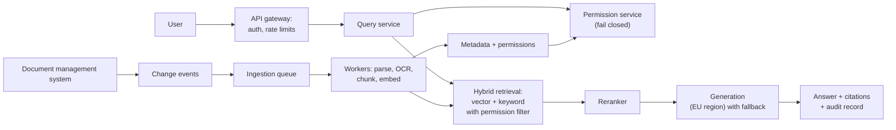

This assessment covers the whole module on enterprise RAG system design: requirements, architecture and technology selection, capacity planning, scaling, reliability, cost estimation and trade-offs. Work through the quiz first (the pass mark is 70 per cent, so 14 of 20), then the conceptual questions, the coding exercises, the design challenge and the troubleshooting scenarios. Attempt each open question on paper before opening the model answer. The coding solutions were run, and their output is real.

```quiz
[
  {
    "q": "A draft requirements sheet asks for sources to be searchable within 15 minutes of a change, and ingestion runs as a nightly batch. What is the right response?",
    "options": [
      "Accept both; the batch can be tuned later.",
      "Drop the freshness target silently.",
      "Flag the contradiction and have the requirement owner decide: event-driven ingestion, or a relaxed freshness target.",
      "Add more embedding workers."
    ],
    "answer": 2,
    "why": "A nightly batch cannot meet a 15-minute target however fast it runs; the conflict needs an explicit decision, recorded with its owner."
  },
  {
    "q": "A firm has 10,000 queries a day, with 20 per cent in the busiest hour. What is the busiest-hour average rate, before any burst factor?",
    "options": [
      "About 0.12 requests per second",
      "About 0.56 requests per second",
      "About 2.8 requests per second",
      "About 5.6 requests per second"
    ],
    "answer": 1,
    "why": "10,000 × 0.20 = 2,000 queries in the busiest hour, divided by 3,600 seconds is about 0.56 per second."
  },
  {
    "q": "Why should architectures be eliminated on hard constraints before they are scored?",
    "options": [
      "To reduce the number of weights.",
      "Because weighted scores cannot be computed for slow options.",
      "So that a high score elsewhere cannot compensate for violating a pass-or-fail requirement.",
      "Because hard constraints are always about cost."
    ],
    "answer": 2,
    "why": "Compensation is acceptable for preferences but not for requirements such as access control or residency."
  },
  {
    "q": "A weight-perturbation test shows two architectures winning 51 and 49 per cent of the time. What should you do?",
    "options": [
      "Pick the first; it has more wins.",
      "Pick the cheaper one without testing.",
      "Add a third option.",
      "Prototype both on your own questions and decide from measurements."
    ],
    "answer": 3,
    "why": "The matrix cannot separate them; evidence from the golden set, latency and cost is the tiebreaker."
  },
  {
    "q": "Which permission strategy gives a correct top-k for a user who may read only a tiny part of the corpus?",
    "options": [
      "Retrieve the top 10 and discard forbidden results afterwards.",
      "Apply the permission filter inside the nearest-neighbour search (pre-filtering).",
      "Cache one answer for all users.",
      "Rely on the prompt to ignore forbidden text."
    ],
    "answer": 1,
    "why": "A post-filter can leave few or no results when the top candidates are mostly forbidden; the prompt is not an access-control mechanism."
  },
  {
    "q": "Which component is generally the most expensive to replace after launch?",
    "options": [
      "The reranker",
      "The generation model behind an interface",
      "The embedding model",
      "The logging format"
    ],
    "answer": 2,
    "why": "Replacing the embedding model forces re-embedding every chunk and rebuilding the index."
  },
  {
    "q": "A paired bootstrap gives a 95 per cent interval of [-0.01, +0.04] for the nDCG difference between model A and model B. What follows?",
    "options": [
      "The data do not separate them, so decide on cost, speed and operations.",
      "A is significantly better.",
      "B is significantly better.",
      "The bootstrap failed."
    ],
    "answer": 0,
    "why": "An interval containing zero is consistent with no real difference on this evaluation set."
  },
  {
    "q": "Why must a bake-off use each embedding model's required query and passage prefixes?",
    "options": [
      "Prefixes speed up encoding.",
      "Omitting a required prefix quietly lowers measured quality and can cause a good model to be rejected.",
      "Prefixes change the vector dimension.",
      "They are only needed for hosted models."
    ],
    "answer": 1,
    "why": "Some models are trained with fixed prefixes; using them wrongly mis-measures the model."
  },
  {
    "q": "What does this code print?\n```python\nfrom math import ceil\nqps, secs, util = 2.0, 5.0, 0.5\nprint(ceil(qps * secs / util))\n```",
    "options": [
      "10",
      "5",
      "20",
      "4"
    ],
    "answer": 2,
    "why": "Concurrency is 2.0 × 5.0 = 10 generations in flight; dividing by the 0.5 utilisation target gives 20 slots."
  },
  {
    "q": "Moving a 384-dimension index from float32 to int8 vectors reduces memory per vector by less than four times. Why?",
    "options": [
      "int8 vectors are padded.",
      "Replicas double.",
      "Payload text is stored twice.",
      "The graph links stored per vector do not shrink, so they become a larger share of a smaller total."
    ],
    "answer": 3,
    "why": "Only the vector part shrinks to a quarter; the neighbour links of a graph index stay the same size."
  },
  {
    "q": "A vector index does not fit in RAM on one node, and CPU is at 25 per cent. What is the most appropriate first response?",
    "options": [
      "Add replicas.",
      "Reduce memory per vector, tier cold data, and shard if that is not enough.",
      "Add API pods.",
      "Raise the burst factor."
    ],
    "answer": 1,
    "why": "Each replica holds the whole index, so replicas do not relieve memory; data size must be addressed."
  },
  {
    "q": "Each of 8 independent shards is slow 2 per cent of the time. About what fraction of scatter-gather queries meet at least one slow shard?",
    "options": [
      "2 per cent",
      "About 8 per cent",
      "About 15 per cent",
      "About 50 per cent"
    ],
    "answer": 2,
    "why": "The chance that all eight are fast is 0.98^8, about 0.85, so about 15 per cent of queries are affected."
  },
  {
    "q": "Which autoscaling signal best suits a worker pool that mostly waits on a remote language model?",
    "options": [
      "CPU utilisation",
      "Memory usage",
      "In-flight requests or queue depth",
      "Disk throughput"
    ],
    "answer": 2,
    "why": "Such workers are saturated while CPU stays low; in-flight requests or queue depth reflect the real bottleneck."
  },
  {
    "q": "A 99.95 per cent availability SLO over 30 days allows how much complete outage?",
    "options": [
      "About 21.6 minutes",
      "About 2.2 minutes",
      "About 43 minutes",
      "About 216 minutes"
    ],
    "answer": 0,
    "why": "0.0005 × 30 × 24 × 60 = 21.6 minutes."
  },
  {
    "q": "The access-control service is unreachable. What should the RAG system do?",
    "options": [
      "Serve answers without the check to stay available.",
      "Serve cached answers to everyone.",
      "Fail closed: deny the request and tell the user to retry.",
      "Switch to the fallback model and skip the check."
    ],
    "answer": 2,
    "why": "Degrade quality, never security; answering without the check risks exposing restricted documents."
  },
  {
    "q": "Two layers each retry a failing call up to four times. How many calls can reach the failing dependency per user request?",
    "options": [
      "8",
      "6",
      "4",
      "16"
    ],
    "answer": 3,
    "why": "Attempts multiply across layers: 4 × 4 = 16."
  },
  {
    "q": "What does this code print?\n```python\nq = 100_000\nc = (2000 * 2.0 + 300 * 10.0) / 1e6\nprint(round(q * 0.8 * c))\n```",
    "options": [
      "700",
      "560",
      "875",
      "70"
    ],
    "answer": 1,
    "why": "Cost per generated query is (4,000 + 3,000) / 1,000,000 = 0.007; 80,000 generated queries cost 560."
  },
  {
    "q": "In a typical enterprise RAG cost estimate, which line is most often the largest and most often omitted from a first draft?",
    "options": [
      "People to run, evaluate and improve the system",
      "Model tokens",
      "Vector database nodes",
      "Embedding backfill"
    ],
    "answer": 0,
    "why": "Engineers and evaluation owners usually outweigh the cloud bill, yet drafts often list only tokens and servers."
  },
  {
    "q": "Configuration A takes 100 ms and scores 0.60; B takes 200 ms and scores 0.60; C takes 200 ms and scores 0.70. Which are on the quality-latency frontier?",
    "options": [
      "A and C",
      "A, B and C",
      "Only C",
      "B and C"
    ],
    "answer": 0,
    "why": "B is dominated by A (same quality, slower). A is the fastest and C the best, and neither dominates the other."
  },
  {
    "q": "A wrong answer costs 4 times as much as a right answer is worth. Above what probability of being correct should the system answer rather than abstain?",
    "options": [
      "0.50",
      "0.67",
      "0.80",
      "0.95"
    ],
    "answer": 2,
    "why": "Answer if p × V > (1 - p) × L, so p > L / (V + L) = 4 / 5 = 0.80."
  }
]
```

## Conceptual questions

**1. Why does a real question log change an architecture decision?** Give two concrete ways.

<details><summary>Show model answer</summary>

The log shows what users actually ask, which tells you which quality criteria deserve weight and which techniques are needed. First, the mix of question types sets the scoring weights: if 70 per cent are single-clause lookups and 30 per cent compare documents, the multi-hop quality criterion should carry roughly that share, and an expensive decomposition path should be routed to the minority of queries instead of applied to all. Second, it exposes properties that invented questions miss: heavy use of exact identifiers (clause numbers, policy numbers) supports hybrid keyword and vector retrieval, and queries that span several documents justify query planning. It also seeds the golden dataset, so the same artefact later serves as the acceptance test. A design chosen from imagined questions is tuned to the team's guesses.

</details>

**2. Explain why adding shards can make p99 latency worse, and give three ways to reduce the effect.**

<details><summary>Show model answer</summary>

In scatter-gather retrieval a query waits for the slowest shard. If each shard is slow with probability $1-F$ on a given request, then with $S$ shards the query is fast only with probability $F^{S}$, so the query's p99 corresponds to each shard's $0.99^{1/S}$ quantile, which is further out in the tail as $S$ grows. The median also rises because the maximum of several draws is larger than a single draw. Remedies: use fewer, larger shards (do not shard until the index no longer fits, after quantisation and tiering); route queries to the relevant shard or collection (for example by tenant) so fewer shards are visited; hedge requests across replicas, accepting extra load; and return partial results at a deadline where the requirements allow incompleteness. Sharding also does nothing for request throughput, since every query still visits every shard.

</details>

**3. Design a degradation ladder for a policy assistant and state what must never degrade.**

<details><summary>Show model answer</summary>

Order from least to most degraded: reranker unavailable, use the fused retrieval order; primary model unavailable or throttled, switch to a tested fallback model; all models unavailable, return the top retrieved passages with citations and say that no summary could be generated; retrieval unavailable, return an error with a retry hint rather than letting a model answer without evidence. Every response carries a mode label for logs, metrics and, where it matters, the user. The access check must never degrade: if the permission service cannot be reached, fail closed. Each rung should be tested by failure injection, and degraded modes should be counted separately in the availability and quality indicators, since a degraded answer is not the same as a healthy one.

</details>

**4. A sponsor's first cost draft lists model tokens and servers only. What is missing, and how should uncertainty be shown?**

<details><summary>Show model answer</summary>

Missing lines usually include people (on-call, tuning, content owners, the evaluation owner), build cost, evaluation labelling, environments beyond production (staging, disaster recovery, warm fallback capacity), observability and audit-log retention, security and compliance work, and migration events such as an embedding-model change. Only generation scales directly with usage, so the shape differs from a pure per-query cost: most of the bill is fixed or step-fixed. Show uncertainty as low, expected and high values per input, a tornado analysis showing which inputs move the total most, and a Monte Carlo result such as "the run cost has a 16 per cent chance of exceeding the ceiling". Report unit costs (per query with and without people, per active user), date every price as an assumption, and pair the cost with a conservative value estimate and a break-even.

</details>

**5. Two embedding models differ by 0.02 nDCG@10 on 300 queries, and one is twice as expensive in memory. How do you decide?**

<details><summary>Show model answer</summary>

First test whether the gap is larger than noise with a paired bootstrap over queries. If the interval includes zero, treat them as tied on quality and choose on the other criteria: memory (the larger model doubles vector memory per replica), encoding throughput and backfill time, query latency, licence, hosting and residency. If the interval excludes zero, quantify what the gain is worth (for example on the slice of hard questions) against the extra memory and compute, using the capacity and cost models. Either way, report results per question type, because an overall tie can hide a gap on identifiers or comparisons, and record the decision with a trigger to reopen it. Hide the model behind an interface and store its identifier with the vectors so that a later change is a migration, not a rewrite.

</details>

## Coding exercises

**1. A sizing function.** Write `size(...)` that returns daily queries, peak queries per second, generation slots and index RAM per replica, using the capacity-planning formulas (burst factor, 0.6 utilisation, 132 bytes of graph overhead per vector, 0.65 RAM fill factor). Use it for Halden Legal: 1,200 users, half active each day, 6 queries each, 20 per cent in the busiest hour, burst factor 2, 8-second slots, 8 million chunks of 768 dimensions, at float32 and at int8.

<details><summary>Show solution</summary>

```python
from math import ceil


def size(users, active_share, queries_each, busiest_hour_share, burst, slot_seconds,
         chunks, dims, bytes_per_dim=4, overhead=132, ram_fill=0.65, utilisation=0.6):
    daily = users * active_share * queries_each
    qps = daily * busiest_hour_share / 3600 * burst
    slots = ceil(qps * slot_seconds / utilisation)
    ram_gb = chunks * (dims * bytes_per_dim + overhead) / 1e9 / ram_fill
    return {"daily queries": daily, "peak QPS": round(qps, 3), "slots": slots, "RAM per replica (GB)": round(ram_gb, 1)}


# Halden Legal: 1,200 users, half active, 6 queries each, 20% in the busiest hour, burst 2, 8 s slots,
# 8 million chunks of 768 dimensions.
print(size(1200, 0.5, 6, 0.20, 2, 8, 8e6, 768))
print(size(1200, 0.5, 6, 0.20, 2, 8, 8e6, 768, bytes_per_dim=1))
```

```output
{'daily queries': 3600.0, 'peak QPS': 0.4, 'slots': 6, 'RAM per replica (GB)': 39.4}
{'daily queries': 3600.0, 'peak QPS': 0.4, 'slots': 6, 'RAM per replica (GB)': 11.1}
```

Check by hand: 3,600 × 0.2 / 3,600 × 2 = 0.4 per second; 0.4 × 8 / 0.6 = 5.33, rounded up to 6 slots; float32 memory is 8e6 × (3,072 + 132) = 25.6 GB, divided by 0.65 is 39.4 GB; int8 is 8e6 × 900 = 7.2 GB, divided by 0.65 is 11.1 GB. Plain `ceil` on the slot count matters: truncating would under-provision.

</details>

**2. A multi-window burn-rate alert.** Given per-minute `(good, total)` counts and a 99.9 per cent SLO, write `burn(counts, minutes)` and `should_page(counts)`, paging only if both the 5-minute and the 60-minute burn rates exceed 14.4. Simulate 180 minutes of traffic with one bad minute (25 per cent errors) at minute 30 and a sustained 5 per cent error incident from minute 100 to 149, and show when it pages.

<details><summary>Show solution</summary>

```python
import numpy as np

SLO = 0.999
BUDGET = 1 - SLO


def burn(good_total, minutes):
    """Burn rate over the most recent `minutes` of (good, total) per-minute counts."""
    recent = good_total[-minutes:]
    good = sum(g for g, _ in recent)
    total = sum(t for _, t in recent)
    return (1 - good / total) / BUDGET if total else 0.0


def should_page(good_total, threshold=14.4):
    """Page only if both the 5-minute and the 60-minute burn rates exceed the threshold."""
    return burn(good_total, 5) > threshold and burn(good_total, 60) > threshold


rng = np.random.default_rng(3)
minutes = []
for m in range(180):
    total = int(rng.poisson(40))
    if 100 <= m < 150:
        err = 0.05            # sustained incident: 5% errors for 50 minutes
    elif m == 30:
        err = 0.25            # one bad minute
    else:
        err = 0.0005
    good = total - int(rng.binomial(total, err))
    minutes.append((good, total))
    if m in (30, 31, 60, 110, 130, 149, 170):
        print(f"minute {m:>3}: 5-min burn {burn(minutes, 5):6.1f}  60-min burn {burn(minutes, 60):6.1f}  page: {should_page(minutes)}")
```

```output
minute  30: 5-min burn   60.6  60-min burn    9.6  page: False
minute  31: 5-min burn   62.5  60-min burn    9.3  page: False
minute  60: 5-min burn    0.0  60-min burn    5.8  page: False
minute 110: 5-min burn   38.5  60-min burn    8.1  page: False
minute 130: 5-min burn   49.0  60-min burn   23.6  page: True
minute 149: 5-min burn   49.1  60-min burn   35.5  page: True
minute 170: 5-min burn    0.0  60-min burn   28.2  page: False
```

The short window makes the alert react quickly; the long window prevents a single bad minute (minute 30) from paging. At minute 110 the short window is high but the long window has not yet accumulated enough burn, so the alert waits until it is clear the incident is sustained (it fires by minute 130). At minute 170 the incident is over, the short window is clean, and the alert resets even though the long window still remembers the burn. Real systems pair this with a lower-threshold ticket alert for slow burns.

</details>

**3. A frontier function.** Write `frontier(options)` taking `{name: (latency_ms, quality)}` and returning the names of options not dominated by any other (one that is at least as fast and at least as good, and strictly better on one). Test it on `A (120, 0.70)`, `B (300, 0.74)`, `C (310, 0.72)`, `D (900, 0.75)`, `E (150, 0.70)`, `F (900, 0.75)`.

<details><summary>Show solution</summary>

```python
def frontier(options):
    """options: {name: (latency_ms, quality)}. Return names that no other option dominates."""
    keep = []
    for name, (lat, q) in options.items():
        dominated = any(l2 <= lat and q2 >= q and (l2 < lat or q2 > q)
                        for other, (l2, q2) in options.items() if other != name)
        if not dominated:
            keep.append(name)
    return keep


options = {"A": (120, 0.70), "B": (300, 0.74), "C": (310, 0.72), "D": (900, 0.75), "E": (150, 0.70), "F": (900, 0.75)}
print(frontier(options))
```

```output
['A', 'B', 'D', 'F']
```

E is dominated by A (same quality, slower) and C by B (slower and worse). D and F are identical, so neither dominates the other and both stay; in practice you would deduplicate and choose on cost. The strict-improvement clause is what prevents two identical options from eliminating each other. The frontier tells you which options are worth considering, not which to pick: that depends on the latency budget and on what the extra quality is worth.

</details>

## Architecture design challenge

**Brief.** Helix Pharma has 6,000 staff and about 2 million documents (regulatory submissions, standard operating procedures, study reports) in English, German and French. Requirements: all data and processing within the EU; per-document permissions that follow the document management system; p95 time to first token under 5 seconds; 99.9 per cent monthly availability; changes searchable within 4 hours; every answer auditable to document versions; roughly 15,000 questions on a working day, 20 per cent of them in the busiest hour; budget for run cost excluding people to be proposed. Design the system, size it, and state the main trade-offs.

<details><summary>Show reference design</summary>

**Requirements first.** The constraints that eliminate options are EU residency (model providers and hosting must process in the EU), document-level permissions (retrieval must filter inside the search), and the audit requirement (log document identifiers and versions for each answer). Freshness of four hours allows frequent incremental ingestion, so a queue-driven pipeline with change events or polling every 30 minutes suffices; real-time streaming is unnecessary.

**Architecture.** Hybrid retrieval (keyword and vector) with a cross-encoder reranker, query-time permission pre-filter, and a single generation call with citations. Routed query decomposition is a later rung if comparisons across submissions fail evaluation. An agentic design is excluded by the latency target. A multilingual embedding model is a must-have; a single multilingual index avoids three separate pipelines.



**Sizing.** At about 40 chunks per document, 80 million chunks. Peak rate: 15,000 × 0.2 / 3,600 × 1.5 burst is about 1.25 requests per second. Generation concurrency with a 6-second slot and 0.6 utilisation target is about 13 slots. Memory with an assumed 768-dimension model: float32 needs about 80e6 × 3,204 bytes / 0.65, roughly 394 GB per replica, which would force sharding; with int8 scalar quantisation, 80e6 × 900 bytes / 0.65 is about 111 GB per replica, which fits on a single large node. Quantisation is therefore the first lever, validated on a multilingual golden set. Run three replicas (N+1 plus capacity for a rolling update).

**Reliability.** Two availability zones in one EU region; replicas across zones; fallback model in the same region (contract and residency approved); degradation ladder with a fail-closed permission service; index snapshots to meet an RTO of a few hours; versioned indexes with alias switch; freshness probe document; retrieval-health SLI per language.

**Trade-offs.** Quantisation saves memory and risks recall (measure per language). A single multilingual index is simpler but may rank unevenly across languages (check per-language Recall@10). Pre-filtering gives correct top-k but needs an engine with efficient filtered search at the selectivity of narrow-access users. Four-hour freshness is cheap; tightening it increases ingestion cost and operational load. A single region is cheaper than multi-region and consistent with 99.9 per cent, but a regional outage would exceed the monthly budget; accept and record it. Cost: the main variable line is generation; the main fixed lines are people and index nodes.

</details>

## Troubleshooting scenarios

**Scenario 1.** After Tuesday's release there are no errors and latency is normal, but users report noticeably worse answers, and the retrieval-health indicator (queries with at least one passage above the relevance floor) has dropped from 98 to 71 per cent. What do you suspect, how do you confirm it, and what do you change?

<details><summary>Show diagnosis</summary>

Suspect a mismatch between the query-side and corpus-side embeddings: the release probably changed the embedding model, its version or its prefix handling on the query service while the stored vectors still come from the old configuration. This produces plausible but poor retrieval, with no errors. Confirm by comparing the embedding model identifier recorded with the stored vectors against the identifier the query service is using, by running the golden-set evaluation against the live index, and by checking whether the release notes touched the embedding client. Fix by rolling back the release, then add three safeguards: store the model identifier in the collection metadata and refuse to start the query service if it does not match, make the golden-set evaluation a deployment gate, and ship embedding changes only through a new versioned index with an alias switch and a canary.

</details>

**Scenario 2.** Every Monday at 09:00 the system's p95 latency rises from 3 seconds to 40 seconds for about eight minutes, then recovers. API pod CPU is at 10 per cent, the vector database is at 30 per cent utilisation, and the model provider dashboard shows requests queued against the concurrency limit. What is happening and what do you do?

<details><summary>Show diagnosis</summary>

Generation concurrency (or the provider's token or request limit) is saturated during the surge. The request queue is unbounded, so delay builds for every user and drains slowly after the surge ends; CPU is low because workers are waiting on the remote model. Measure peak in-flight generations against the plan: arrival rate times slot time should be compared with the concurrency limit, and the token rate with the tokens-per-minute allowance. Changes, in order: add a bounded queue with fast rejection and a clear retry message; add a degraded mode (fewer reranker candidates, a smaller or fallback model) triggered by queue depth; add per-user rate limits; request a higher provider limit (allow for lead time) and schedule extra concurrency for 08:30 to 10:30 on weekdays; and consider caching permitted repeat questions and trimming prompt context after checking quality. Scaling API pods or the vector database would change nothing.

</details>

**Scenario 3.** To cut index memory, the team splits one index into 12 hash-partitioned shards. Afterwards p99 latency doubles, p50 rises by 40 per cent, and throughput at saturation does not improve. Explain the result and propose a remedy.

<details><summary>Show diagnosis</summary>

Hash sharding turns every query into a scatter-gather across 12 shards, and the query now waits for the slowest. Even if each shard is individually unchanged, the maximum of 12 latencies has a higher median and a much heavier tail, so p99 worsens more than p50. Throughput does not improve because every query still does work on every shard (and adds merge work), so total capacity per query is unchanged or slightly worse; shards divide data, not request load. The memory goal could have been reached more cheaply: quantise the vectors (int8 cuts the vector part to a quarter), tier cold data, and shard only if the index still does not fit. If sharding is required, route queries to the relevant shards (for example by tenant or business unit), keep the shard count as small as memory allows, hedge slow shard requests across replicas at a cost in load, add a deadline with partial results if the requirements allow it, and add replicas if throughput is the goal.

</details>
