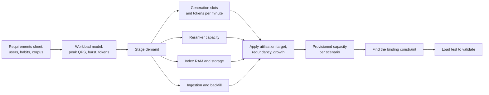

"How big a cluster do we need?" is the question every enterprise review asks, and the honest answer is "it depends on five numbers, and here they are." Capacity planning is the discipline of turning the requirements sheet into those numbers: how many requests per second at the peak, how many model calls in flight, how much memory the index needs, how long the first load takes, and how many tokens per minute the language-model provider must allow. It does this before anything is built, using arithmetic and a few small measurements, so that the infrastructure request, the budget and the architecture all rest on figures rather than hunches.

This lesson builds a **capacity model** for Northgate Mutual's ClaimsCompanion as a short Python program, shows how to **calibrate** its inputs by measuring your own components, and explains how to carry uncertainty through with low, expected and high scenarios. It does not re-derive queueing theory; [scalable RAG systems](/learn/production-architecture/scalable-rag-systems) already explains Little's law and why queues explode near full utilisation, and this lesson applies those results to a whole system.

## Learning objectives

- Translate a requirements sheet into a workload model with peak, burst and growth assumptions.
- Compute the resource demand of each pipeline stage: generation slots, reranker capacity, index memory, storage, ingestion and token rate.
- Apply headroom and redundancy rules to turn raw demand into provisioned capacity.
- Calibrate a capacity model by measuring service rates of your own components, and say which inputs are measured and which are assumed.
- Identify the binding constraint of a design and compare the effect of changes such as quantisation on it.

## Prerequisites

- [Requirements gathering](/learn/enterprise-rag-system-design/requirements-gathering): the load, corpus and update figures this lesson starts from.
- [Scalable RAG systems](/learn/production-architecture/scalable-rag-systems): Little's law, utilisation and the index-memory formula.
- [HNSW](/learn/vector-indexing-algorithms/hnsw): where the per-vector graph overhead comes from.
- [Token budgets](/learn/cost-engineering/token-budgets): how prompt size is composed.

## Why this matters

Capacity errors are expensive in both directions. Under-provisioning produces outages at the worst moment, a Monday morning or a quarter-end, and a vector index that does not fit in memory cannot be fixed by adding CPU. Over-provisioning wastes money every hour: a team that sizes for fifty queries per second when the peak is two pays for twenty times the hardware.

The failure that capacity planning most often prevents is the **wrong bottleneck**. Teams scale the component they can see, usually the API pods, while the real limit sits elsewhere: a language-model provider's tokens-per-minute allowance, a reranker pool that saturates, or an index that needs 150 GB of memory per replica. The model finds the binding constraint on paper, which is far cheaper than finding it in production. It also makes the cost conversation honest, because every line of the [cost estimate](/learn/enterprise-rag-system-design/cost-estimation) derives from these quantities.

## The intuition

A restaurant owner estimating kitchen capacity does not think in covers per year. She asks how many customers arrive in the busiest hour on a Saturday, how long each dish occupies a station, and which station is the slowest. If the grill handles twelve steaks an hour and Saturday peak demand is twenty, no amount of spare space in the dessert section helps. She also leaves slack: a kitchen run at 100 per cent utilisation turns one late delivery into a queue out of the door. And she plans for next year's growth, including the new menu that uses the grill more.

A RAG system has the same stations in series: query embedding, retrieval, reranking, prompt assembly, generation. Each has a capacity, the slowest sets the ceiling, and headroom keeps bursts from becoming queues.

## How it works

### The workload model

Start from a small set of inputs, each with a low, expected and high value. The first three come straight from the requirements sheet.

| Input | Meaning | Northgate expected |
| --- | --- | --- |
| Daily queries | Users × active share × queries each | 25,200 |
| Busiest-hour share | Fraction of a day's queries in the peak hour | 0.18 |
| Burst factor | Peak minute rate divided by peak-hour average | 1.5 (assumption) |
| Chunks | Documents × chunks per document | 30 million |
| Changed chunks per day | Re-embedding load | 75,000 |
| Prompt tokens | System prompt + retrieved context + question | 2,750 (assumption) |
| Output tokens | Answer length | 350 (assumption) |
| Generation seconds | Mean time a request occupies a model slot | 6 (assumption) |

The **burst factor** deserves a word. Averaging over an hour hides the fact that arrivals are random and clumpy: five users may submit questions in the same minute after a morning meeting. If you have no pilot logs, 1.5 to 2 is a reasonable starting assumption for an office tool; replace it with a measured value as soon as you have one.

### Demand per stage

Each stage turns the workload into a demand on a resource. The table shows the unit of work, the formula and what usually sets the service rate.

| Stage | Demand at peak | Service rate comes from | Typical bottleneck behaviour |
| --- | --- | --- | --- |
| **Query embedding** | Peak QPS × 1 text | Model speed per machine, measured | Rarely binding; milliseconds per query |
| **Retrieval** | Peak QPS × searches per query | Index type, memory and filter selectivity | Limited by memory and by cache warmth |
| **Reranking** | Peak QPS × candidates scored per query | Pairs per second per machine, measured | CPU or GPU saturation; scales with candidate count |
| **Generation** | Concurrent requests = peak QPS × mean slot time | Provider concurrency or GPU slots | Almost always binding; also bounded by tokens per minute |
| **Ingestion** | Changed chunks per day; backfill for first load | Chunks per second per worker, measured | Backfill duration, not steady state |
| **Storage** | Chunks × bytes per chunk | Disk and RAM | Index memory per replica |

Two stages deserve a closer look.

**Generation concurrency** is Little's law, $L = \lambda W$: the number of generations in flight equals the arrival rate times the time each one occupies a slot. A rate of 1.89 requests per second and a 6-second slot time gives 11.3 concurrent generations on average, before headroom. Provider limits usually apply to both concurrent requests and tokens per minute, so check each: 1.89 requests per second at 3,100 tokens each is about 351,000 tokens per minute at peak. Whether your provider tier allows that is a fact to confirm in writing, not to assume. Streaming does not change the arithmetic, because the slot is held until the last token.

**Index memory** dominates the infrastructure for large corpora. A graph index such as HNSW keeps the vectors and neighbour lists in RAM for speed. The memory per replica is chunks × (dimensions × bytes per dimension + graph overhead), divided by the share of RAM you are willing to fill, because the operating system, the database's own structures and write buffers need room too. See [scalar quantisation](/learn/vector-indexing-algorithms/scalar-quantisation) for how storing one byte per dimension cuts the vector part to a quarter.

### From demand to provisioned capacity

Raw demand is not what you provision. Three rules turn one into the other:

1. **Utilisation target.** Plan to run each stage at no more than about 60 per cent of capacity at the planned peak. The reasons are in [scalable RAG systems](/learn/production-architecture/scalable-rag-systems): delay climbs steeply as utilisation approaches 100 per cent, and the model's peak is an estimate, not a promise. Dividing demand by 0.6 gives the provisioned figure.
2. **Redundancy.** If a failure of one machine must not take the service down, provision enough that the remaining machines carry the load: the N+1 rule from [high availability](/learn/production-architecture/high-availability). Replicas of an index multiply its memory, which is why the model reports memory per replica and in total.
3. **Growth.** Provision for the high scenario at the end of the planning horizon, or plan the dates at which you will add capacity. Memory is the awkward resource, since re-sharding an index is a project, so size it for growth; stateless stages can be added later.

### Calibrating with measurements

A capacity model is only as good as its service rates, and guessed service rates are the most common source of error. For every stage whose rate you can measure on candidate hardware, do so, and mark which inputs are measured and which are assumed. In the code below, the reranker rate and the embedding rate are measured on a laptop CPU, which will certainly differ from production hardware; the point is the procedure. Measure with realistic inputs: real chunk lengths, real candidate counts, the actual batch size your service will use.

### Scenarios and growth

Compute the model three times: low, expected, high. The spread between them is your uncertainty made visible. If the high scenario needs ten times the expected one, you do not have a plan, you have a research question, and the first project task is to narrow it with a pilot.

Growth compounds. If the corpus grows by a fraction $g$ per year, then after $t$ years it holds $N_0(1+g)^t$ chunks. Northgate's high scenario assumes about 32 per cent annual growth for two years, which takes 30 million chunks to about 52 million.



### What planning cannot tell you

A model gives averages and steady-state figures. It does not know your tail latency, the effect of cold caches after a restart, noisy neighbours on shared hardware, or the slow query that holds a connection for a minute. Validate the model with a **load test** that replays the question log at the planned peak (and at 1.5 times it) against a realistic data size, and compare measured utilisation of each stage with the model's prediction. A gap larger than about 30 per cent means an input is wrong; find which one and correct the model.

## The mathematics

### Peak rate and concurrency

**Intuition.** Size for the busiest stretch of the day, not the average, and convert rate into concurrency using how long each request occupies a slot.

$$
\lambda_{\text{peak}} = \frac{Q \cdot s}{3600} \cdot b, \qquad L = \lambda_{\text{peak}} \cdot W, \qquad C = \left\lceil \frac{L}{\rho} \right\rceil
$$

$Q$ is daily queries, $s$ the busiest-hour share, $b$ the burst factor, $W$ the mean slot time in seconds, $\rho$ the target utilisation, and $C$ the number of slots to provision.

**By hand.** $\lambda_{\text{peak}} = 25{,}200 \times 0.18 / 3600 \times 1.5 = 1.26 \times 1.5 = 1.89$ requests per second. $L = 1.89 \times 6 = 11.34$. With $\rho = 0.6$, $C = \lceil 11.34/0.6 \rceil = \lceil 18.9 \rceil = 19$ slots.

### Reranker capacity

If each request reranks $k$ candidates and one machine scores $r$ pairs per second, the machines needed are

$$
M = \left\lceil \frac{\lambda_{\text{peak}} \cdot k}{r \cdot \rho} \right\rceil
$$

**By hand.** With $k = 50$ and a measured $r = 124$: demand is $1.89 \times 50 = 94.5$ pairs per second; usable capacity per machine is $124 \times 0.6 = 74.4$; $M = \lceil 94.5/74.4 \rceil = \lceil 1.27 \rceil = 2$, which also satisfies the N+1 rule for a single failure at this load.

### Index memory

$$
R = \frac{n\,(d \cdot b + h)}{\phi}
$$

$n$ is the number of chunks, $d$ the dimensions, $b$ the bytes per dimension (4 for float32, 1 for int8 scalar quantisation), $h$ the graph overhead per vector in bytes (about 132 for HNSW with $M = 16$ in the model of the [HNSW lesson](/learn/vector-indexing-algorithms/hnsw)), and $\phi$ the fraction of RAM you plan to fill (0.65 here).

**By hand.** For $n = 30 \times 10^6$, $d = 384$, $b = 4$, $h = 132$: bytes per vector $= 384 \times 4 + 132 = 1{,}668$; total $= 50.04$ GB; divided by 0.65, $R \approx 77$ GB per replica. At 768 dimensions, $768 \times 4 + 132 = 3{,}204$ bytes, $96.1$ GB, so $R \approx 148$ GB. With int8 at 384 dimensions: $384 + 132 = 516$ bytes, $15.5$ GB, $R \approx 24$ GB. Notice that the graph overhead, which was a small fraction of the float32 vector, is a quarter of the int8 vector.

### Token rate and backfill

Tokens per minute at peak are $T = 60\,\lambda_{\text{peak}}\,(p + o)$ with $p$ prompt and $o$ output tokens: $60 \times 1.89 \times 3{,}100 = 351{,}540$. Backfill time is $n / (r_e \cdot w)$ seconds for $w$ workers each embedding $r_e$ chunks per second: $30 \times 10^6 / (74 \times 8) = 50{,}676$ seconds, about 14 hours.

## In code

The program below implements the model. It separates **workload** (what users do) from **assumptions** (what the platform does), so a scenario or a technology change is one object swapped. The service rates are marked: the reranker and embedding rates are measured, the rest are stated assumptions.

First, the measurement. This script times a small cross-encoder reranker on 400 query-passage pairs from SciFact (the dataset used in [technology selection](/learn/enterprise-rag-system-design/technology-selection)), after a warm-up call:

```bash
pip install sentence-transformers pandas numpy huggingface_hub
```

```python
"""Measure cross-encoder throughput: the service rate a capacity plan needs."""
import time
import numpy as np
import pandas as pd
from huggingface_hub import hf_hub_download
from sentence_transformers import CrossEncoder

corpus = pd.read_parquet(hf_hub_download("BeIR/scifact", "corpus/corpus-00000-of-00001.parquet", repo_type="dataset"))
queries = pd.read_parquet(hf_hub_download("BeIR/scifact", "queries/queries-00000-of-00001.parquet", repo_type="dataset"))
docs = (corpus["title"] + ". " + corpus["text"]).tolist()
rng = np.random.default_rng(0)
ce = CrossEncoder("cross-encoder/ms-marco-MiniLM-L-6-v2", device="cpu", max_length=256)
q = queries["text"].tolist()[0]
pairs = [(q, docs[i]) for i in rng.choice(len(docs), 400, replace=False)]
ce.predict(pairs[:16])  # warm-up
t = time.perf_counter()
ce.predict(pairs, batch_size=32)
dt = time.perf_counter() - t
print(f"pairs scored: {len(pairs)}; seconds: {dt:.2f}; pairs/s: {len(pairs)/dt:.0f}")
print(f"50-candidate rerank latency: {50/(len(pairs)/dt)*1000:.0f} ms")
```

```output
pairs scored: 400; seconds: 3.23; pairs/s: 124
50-candidate rerank latency: 404 ms
```

The result, 124 pairs per second, is for a 10-core laptop CPU using all its cores, so it is the rate **per machine** and not per core, and a production GPU would differ; treat it as a placeholder to be replaced by your own measurement. The embedding rate of 74 chunks per second comes from the `bge-small` run in the technology-selection lesson, at 256-token truncation; real 400-token chunks would be slower, so a real plan would re-measure.

Now the model:

```python
from dataclasses import dataclass, replace
from math import ceil


@dataclass(frozen=True)
class Workload:
    name: str
    daily_queries: float
    busiest_hour_share: float
    burst_factor: float          # peak minute rate / busiest-hour average rate
    chunks: float
    dims: int
    rerank_candidates: int
    prompt_tokens: int           # system + context + question
    output_tokens: int
    gen_seconds: float           # mean time one generation occupies a slot
    changed_chunks_per_day: float


@dataclass(frozen=True)
class Assumptions:
    bytes_per_dim: float = 4.0         # float32; 1.0 for int8 scalar quantisation
    hnsw_link_bytes: float = 132.0     # per vector, M=16, from the HNSW lesson's model
    payload_bytes_per_chunk: float = 2_000   # text + metadata held in the database
    replicas: int = 2
    ram_headroom: float = 0.65         # plan to use at most this share of RAM
    target_utilisation: float = 0.60
    rerank_pairs_per_s_per_machine: float = 124  # measured: MiniLM cross-encoder, 10-core laptop CPU
    embed_chunks_per_s_per_worker: float = 74   # measured: bge-small, 256 tokens, one laptop CPU
    chunk_tokens: int = 400


def plan(w: Workload, a: Assumptions) -> dict:
    qps = w.daily_queries * w.busiest_hour_share / 3600 * w.burst_factor
    gen_slots = qps * w.gen_seconds / a.target_utilisation          # Little's law, then headroom
    rerank_machines = qps * w.rerank_candidates / (a.rerank_pairs_per_s_per_machine * a.target_utilisation)
    vec_bytes = w.chunks * (w.dims * a.bytes_per_dim + a.hnsw_link_bytes)
    ram_gb_per_replica = vec_bytes / 1e9 / a.ram_headroom
    storage_gb = w.chunks * a.payload_bytes_per_chunk / 1e9
    backfill_hours = w.chunks / (a.embed_chunks_per_s_per_worker * 8) / 3600   # 8 workers
    daily_embed_worker_h = w.changed_chunks_per_day / a.embed_chunks_per_s_per_worker / 3600
    tpm = qps * 60 * (w.prompt_tokens + w.output_tokens)
    return {
        "peak QPS": round(qps, 2),
        "generation slots": ceil(gen_slots),
        "rerank machines (CPU)": ceil(rerank_machines),
        "index RAM per replica (GB)": round(ram_gb_per_replica),
        "index RAM total (GB)": round(ram_gb_per_replica * a.replicas),
        "payload storage (GB)": round(storage_gb),
        "backfill, 8 workers (h)": round(backfill_hours, 1),
        "daily re-embed (worker-h)": round(daily_embed_worker_h, 2),
        "peak model tokens/min": round(tpm),
        "daily model tokens (M)": round(w.daily_queries * (w.prompt_tokens + w.output_tokens) / 1e6, 1),
    }


base = dict(busiest_hour_share=0.18, dims=384, rerank_candidates=50, prompt_tokens=2750,
            output_tokens=350, gen_seconds=6.0)
scenarios = [
    Workload("low", daily_queries=18_000, burst_factor=1.5, chunks=24e6, changed_chunks_per_day=50_000, **base),
    Workload("expected", daily_queries=25_200, burst_factor=1.5, chunks=30e6, changed_chunks_per_day=75_000, **base),
    Workload("high, month 24", daily_queries=47_000, burst_factor=2.0, chunks=52e6, changed_chunks_per_day=130_000, **base),
]

results = {w.name: plan(w, Assumptions()) for w in scenarios}
names = [w.name for w in scenarios]
print(f"{'':32s}" + "".join(f"{n:>16s}" for n in names))
for key in results["expected"]:
    print(f"{key:32s}" + "".join(f"{results[n][key]:>16,}" for n in names))

expected = scenarios[1]
what_if = {
    "384-d float32 (baseline)": plan(expected, Assumptions()),
    "768-d float32": plan(replace(expected, dims=768), Assumptions()),
    "384-d int8 scalar quantisation": plan(expected, Assumptions(bytes_per_dim=1.0)),
}
print("\nIndex RAM per replica, expected workload:")
for label, r in what_if.items():
    print(f"  {label:32s} {r['index RAM per replica (GB)']:>4} GB")
```

```output
                                             low        expected  high, month 24
peak QPS                                    1.35            1.89             4.7
generation slots                              14              19              48
rerank machines (CPU)                          1               2               4
index RAM per replica (GB)                    62              77             133
index RAM total (GB)                         123             154             267
payload storage (GB)                          48              60             104
backfill, 8 workers (h)                     11.3            14.1            24.4
daily re-embed (worker-h)                   0.19            0.28            0.49
peak model tokens/min                    251,100         351,540         874,200
daily model tokens (M)                      55.8            78.1           145.7

Index RAM per replica, expected workload:
  384-d float32 (baseline)           77 GB
  768-d float32                     148 GB
  384-d int8 scalar quantisation     24 GB
```

**How it works.** `Workload` holds what the business determines; `Assumptions` holds what the platform and your measurements determine. `plan` applies each formula from the maths section, including the 60 per cent utilisation target and the 0.65 RAM fill factor. Because both objects are frozen dataclasses, `replace(...)` produces a variant without mutating the original, which makes what-if comparisons safe.

**What the output means.** The expected case matches the hand calculations (1.89 peak requests per second, 19 slots, 2 reranker machines, 77 GB per replica). Read the table as a list of constraints. The **reranker and ingestion are not the problem**: two CPU machines and a 14-hour backfill are modest. **Generation is the large item**: 19 slots in the expected case and 48 in the high case, and a token rate of 351,000 tokens per minute rising to 874,000, which must be matched by provider limits or by self-hosted capacity. **Memory is the infrastructure driver**: 154 GB across two replicas at the expected scale, 267 GB at month 24. The what-if shows that doubling the dimension doubles the memory (148 GB), while scalar quantisation cuts it to about a third of the baseline (24 GB), a large lever if retrieval quality survives, which you must verify on your golden set. The model reports no cost; that is the subject of [cost estimation](/learn/enterprise-rag-system-design/cost-estimation).

**Common errors.** Applying the utilisation target twice (once in the model and again in a vendor's sizing tool). Using the daily average as the peak. Using one machine's multi-threaded throughput as a per-core figure. Forgetting that replicas multiply memory but not necessarily payload storage, depending on the database. Mixing token units between providers: tokenisers differ, so a count from one is an estimate for another.

**Extending it.** Add a stage for the keyword index, add a cache hit rate that reduces generation demand, make the burst factor a distribution and run Monte Carlo draws, and wire the output to a spreadsheet that finance and infrastructure teams can read. Re-run the model every time a measured value replaces an assumption.

## A real-world example

The Northgate platform team presents its first sizing to the infrastructure board. Their draft had come from instinct: eight large API pods, a three-node database cluster with 64 GB nodes, and "whatever tokens we need."

Running the model changes three conclusions. First, the API tier barely matters: peak load is under two requests per second, so two small pods suffice, and the proposed eight were mostly idle. Second, the vector database nodes cannot hold the index: at 768 dimensions the index needs about 148 GB of RAM per replica at float32, which does not fit three 64 GB nodes with two replicas. The 384-dimension model from the bake-off brings it to 77 GB per replica, which still needs sharding; quantisation to int8 brings it to 24 GB, which fits comfortably on one node per replica but only after the team confirms on the golden set that Recall@10 stays within its tolerance. Third, the token rate of about 350,000 tokens per minute at peak, rising towards 870,000 by month 24, turns out to exceed the default limit of the provider tier on the contract, which nobody had checked; the team opens a limit increase request with a lead time of several weeks, which would have blocked the pilot launch had it been discovered late.

A load test two weeks later replays the question log at the expected peak and at 1.5 times it. Measured generation concurrency is within 15 per cent of the model; reranker utilisation is lower than predicted because the production machines are faster than the laptop. The team lowers the machine count for the reranker, keeps the memory plan and carries the provider limit request as a tracked risk.

## Common mistakes

- **Sizing for the daily average.** Capacity must cover the busiest stretch; for office traffic the all-day average can understate it several times over (here 0.29 requests per second against a peak of 1.89).
- **Scaling the visible component.** Adding API pods when the binding constraint is model concurrency, tokens per minute or index memory achieves nothing.
- **Guessing service rates.** Unmeasured rates are the biggest source of error; time each stage with realistic inputs.
- **Ignoring provider limits.** Request-per-minute and token-per-minute ceilings, and their lead times, can block a launch.
- **Running at 100 per cent utilisation by design.** Delay grows steeply near saturation and one slow dependency becomes an outage.
- **Forgetting memory headroom.** The operating system, buffers and the database's own structures need RAM beyond the raw index.
- **One scenario.** A single point estimate hides the range; compute low, expected and high.
- **Never validating.** A model that has not met a load test is a hypothesis.

## Best practices

- Separate workload from assumptions in code, and mark each assumption as measured or assumed.
- Calibrate every stage you can by timing it on realistic inputs and hardware.
- Provision to a utilisation target (around 60 per cent at planned peak) and add N+1 redundancy for stages whose loss must be survived.
- Size memory-bound components for the high scenario at the end of the horizon; add stateless capacity later.
- Check provider rate and token limits against the peak rate, and request increases early.
- Report the binding constraint explicitly, and compare levers (quantisation, candidate count, caching) by re-running the model.
- Validate with a replay load test at the planned peak and 1.5 times it, and reconcile differences.
- Re-run the model whenever an assumption is replaced by a measurement.

## Performance considerations

The model itself is arithmetic, but its outputs have performance consequences worth reasoning about. Index memory sets whether search is served from RAM or from disk: an index that spills to disk can slow searches by an order of magnitude, so memory per replica is a latency requirement as much as a capacity one. Reranker candidate count has a direct, linear cost: halving candidates from 50 to 25 halves reranker demand and its latency, and the effect on quality should be measured, not assumed ([candidate selection](/learn/reranking-fundamentals/candidate-selection)). Generation concurrency scales with prompt length only indirectly, through slot time, but tokens per minute scale directly with it, so trimming context from six chunks to four reduces the token rate by roughly a quarter, subject to quality evaluation. Ingestion competes with queries for shared resources: schedule the 14-hour backfill and large re-indexes away from peak, or give ingestion its own workers so a backfill cannot starve interactive traffic. Finally, caches change the model: a cache that serves 20 per cent of queries reduces generation demand by about a fifth, but measure the hit rate on real traffic and remember that [permission boundaries limit what can be shared](/learn/enterprise-rag-system-design/requirements-gathering).

## Security considerations

Capacity has a security dimension. A system sized exactly to expected load has no slack for abuse, so a single user or a malicious script submitting thousands of queries can exhaust generation slots and the provider's token allowance for everyone, a form of denial of service. Plan per-user and per-tenant rate limits as part of capacity, and include them in the model (a limit of 30 queries per minute per user bounds the worst case from any one account). Token budgets per request also bound cost abuse: a prompt-stuffing attack that inflates context size multiplies token rate. Keep the capacity model and sizing figures confidential, as they reveal infrastructure details and limits, and ensure that ingestion workers, which touch every document, are provisioned within the same security boundary as the index.

## Summary

- Capacity planning converts a requirements sheet into peak load, concurrency, memory, storage, ingestion time and token rate before anything is built.
- Size for the peak with a burst factor, then apply a utilisation target, redundancy and growth to get provisioned capacity.
- Generation concurrency and token rate, and index memory, are usually the binding constraints; API tiers rarely are.
- Measure service rates on realistic inputs and hardware, and label inputs as measured or assumed.
- Compute low, expected and high scenarios, and use the model to compare levers such as quantisation and candidate counts.
- Validate with a load test that replays real questions, and reconcile the model with what it measures.

## Exercises

**1. Peak and slots.** A firm has 4,000 queries a day, 25 per cent of them in the busiest hour, a burst factor of 2, and a generation slot time of 8 seconds. Target utilisation is 0.6. Compute the peak rate and the number of slots.

<details><summary>Show solution</summary>

Peak rate = 4,000 × 0.25 / 3,600 × 2 = 0.278 × 2 = 0.556 requests per second. Concurrency L = 0.556 × 8 = 4.44. Slots = ceil(4.44 / 0.6) = ceil(7.4) = 8. Provision 8 slots; if the provider offers a concurrency limit below that, you have a constraint to resolve before launch.

</details>

**2. Memory with and without quantisation.** A corpus has 20 million chunks of 1,024 dimensions. Using 132 bytes of graph overhead per vector and a 0.65 RAM fill factor, compute the RAM per replica at float32 and at int8.

<details><summary>Show solution</summary>

Float32: bytes per vector = 1,024 × 4 + 132 = 4,228; total = 84.56 GB; divided by 0.65 is about 130 GB per replica. Int8: 1,024 + 132 = 1,156 bytes; total 23.12 GB; divided by 0.65 is about 35.6 GB per replica. Int8 cuts memory to about 27 per cent of the float32 figure. Whether recall survives must be checked on your own data.

</details>

**3. Find the binding constraint.** Stage capacities at planned peak are: query embedding 40 requests per second, retrieval 25, reranking 6, generation 4, and the API gateway 200. Which stage binds, what is the system's ceiling, and what is the first change you would consider?

<details><summary>Show solution</summary>

Generation binds, with a ceiling of 4 requests per second. Planning for 60 per cent utilisation means about 2.4 requests per second of planned load. The first changes to consider, cheapest first: caching permitted repeat questions, trimming prompt context to shorten slot time (after checking quality), requesting more concurrency from the provider, or adding a smaller fallback model for overflow. Adding gateway or embedding capacity would change nothing, because the ceiling is set by the slowest stage.

</details>

**4. Calibrate and compare.** Write a short script that measures how many chunks per second your local embedding model encodes at a batch size of 16 and of 64 on 500 real chunks from your own documents, then plug the faster figure into `Assumptions.embed_chunks_per_s_per_worker` and report how the backfill time for 30 million chunks changes.

<details><summary>Show solution</summary>

Load the chunks, time `model.encode(chunks, batch_size=b, normalize_embeddings=True)` after a warm-up call for each `b`, and compute `len(chunks) / seconds`. Then call `plan(expected, Assumptions(embed_chunks_per_s_per_worker=rate))` and read `"backfill, 8 workers (h)"`. Backfill hours scale inversely with the rate, so a 20 per cent faster setting cuts the backfill time by about a sixth. Use real chunk lengths: padding to the longest item in a batch makes throughput depend on length, so synthetic short texts overstate it. On production hardware the figures will differ, so repeat the measurement there.

</details>

## Check your understanding

```quiz
[
  {
    "q": "A system gets 25,200 queries a day, with 18 per cent in the busiest hour and a burst factor of 1.5. What is the peak rate?",
    "options": [
      "0.29 requests per second",
      "1.26 requests per second",
      "1.89 requests per second",
      "6.3 requests per second"
    ],
    "answer": 2,
    "why": "25,200 × 0.18 / 3,600 = 1.26 per second in the busiest hour; the burst factor of 1.5 raises the peak minute to 1.89."
  },
  {
    "q": "Generation takes 6 seconds per request at 1.89 requests per second, with a 0.6 utilisation target. How many slots do you provision?",
    "options": [
      "12",
      "19",
      "11",
      "32"
    ],
    "answer": 1,
    "why": "L = 1.89 × 6 = 11.34 concurrent generations; dividing by 0.6 gives 18.9, rounded up to 19."
  },
  {
    "q": "Why does the model report index memory per replica and in total?",
    "options": [
      "Replicas share one copy of RAM.",
      "Each replica holds its own copy of the index, so redundancy multiplies memory.",
      "Replicas reduce memory needs.",
      "Only storage, not RAM, is replicated."
    ],
    "answer": 1,
    "why": "Each replica of an in-memory graph index must hold the vectors and links, so N replicas need N times the memory."
  },
  {
    "q": "Moving from float32 to int8 scalar quantisation on 384-dimension vectors reduces memory from about 77 GB to about 24 GB per replica in the example. Why not exactly a quarter?",
    "options": [
      "int8 vectors are stored as text.",
      "Only the vector part shrinks; the graph overhead per vector stays the same.",
      "The RAM fill factor changes.",
      "The corpus is smaller."
    ],
    "answer": 1,
    "why": "The 132 bytes of neighbour links per vector are unchanged, so they become a larger share of a smaller total."
  },
  {
    "q": "Which problem does a load test that replays the question log address?",
    "options": [
      "It replaces the capacity model.",
      "It shows whether the model's predicted utilisation matches reality and exposes wrong inputs.",
      "It removes the need for headroom.",
      "It sets the burst factor to 1."
    ],
    "answer": 1,
    "why": "A load test validates the model; large gaps between predicted and measured utilisation point to a wrong assumption."
  }
]
```

## Further reading

- Neil J. Gunther, *Guerrilla Capacity Planning*: a practical treatment of capacity models, scalability and measurement.
- John D. C. Little, 1961, "A Proof for the Queuing Formula: L = λW", *Operations Research*: the original proof of the law used for concurrency.
- Brendan Gregg, *Systems Performance*: methodology for measuring utilisation and finding bottlenecks.
- Martin Kleppmann, *Designing Data-Intensive Applications*: the chapter on describing load and performance, including percentiles.
- Yu. A. Malkov and D. A. Yashunin, 2018, "Efficient and robust approximate nearest neighbor search using Hierarchical Navigable Small World graphs": the origin of the index whose memory is modelled above.
