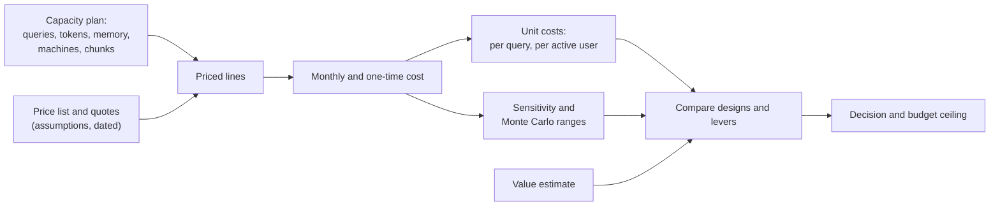

"What will it cost?" is asked at the start of every enterprise RAG project and answered, too often, with the price of the language-model API. That figure is real but rarely the largest. A system that serves 25,000 questions a day has hardware, a vector database, observability, security work, evaluation labelling, and the people who keep it correct as documents and models change. This lesson shows how to build an estimate that includes all of them, express it as a unit cost the business can reason about, and carry uncertainty through it honestly.

The earlier [cost engineering](/learn/cost-engineering/llm-inference-costs) module explains how individual cost centres work: how tokens are billed, what embedding costs, how caching saves money. This lesson sits above it. It asks how to assemble those pieces into a **total cost of ownership** (TCO) estimate for a whole design, tied to the [capacity plan](/learn/enterprise-rag-system-design/capacity-planning), and how to use the estimate to choose between designs. All prices below are **illustrative assumptions in pounds**; replace them with quotes and current price lists, which change often.

## Learning objectives

- Decompose the cost of an enterprise RAG system into one-time and recurring lines, and into fixed and usage-driven costs.
- Build a parametric cost model whose inputs come from the capacity plan, and compute cost per query and per active user.
- Run a sensitivity analysis and a Monte Carlo simulation to express a cost estimate as a range with a stated probability of exceeding a ceiling.
- Compare cost levers (context size, quantisation, model routing) by their saving and their quality risk.
- Frame cost against value, and identify the hidden costs that first estimates omit.

## Prerequisites

- [Capacity planning](/learn/enterprise-rag-system-design/capacity-planning): the quantities that get priced.
- [LLM inference costs](/learn/cost-engineering/llm-inference-costs) and [embedding costs](/learn/cost-engineering/embedding-costs): how the two largest variable lines are computed.
- [Cost-performance trade-offs](/learn/cost-engineering/cost-performance-trade-offs): where cost and quality pull against each other.

## Why this matters

Cost estimates fail in four familiar ways.

- **Omission.** The estimate covers model tokens and servers, then the project discovers that two engineers' time, a labelling budget and a security assessment together cost more than the cloud bill.
- **Single-point precision.** A figure such as "11,342 pounds a month" suggests accuracy the inputs cannot support. Token counts per query, usage growth and price changes each move it by tens of per cent.
- **Wrong shape.** A team assumes cost scales linearly with usage and either panics about growth or under-budgets for the fixed part. Enterprise RAG costs are usually dominated by fixed and semi-fixed items, which changes the economics of growth.
- **Cost without value.** A bill is only large or small relative to what it buys. Without a value estimate, cost reviews default to "can we make it cheaper?", which tends to degrade quality in ways nobody measures.

A good estimate is parametric, ranged, complete and paired with a value argument, so that decisions about design are made against numbers everyone can inspect.

## The intuition

Buying a delivery van is a good analogy. The sticker price is the visible part. The real cost is the van, the fuel per mile (variable), insurance and the vehicle tax (fixed), servicing, and above all the driver's wages. If you ask "what does it cost per delivery?" and divide only the fuel by the number of deliveries, you will believe deliveries cost pennies and be baffled when the books show a loss. Once the driver is counted, you also learn something useful: because wages are fixed, doing more deliveries with the same van and driver lowers the cost of each one.

RAG systems behave the same way. The model API is the fuel; the platform, observability and security are insurance and tax; the engineers and evaluators are the driver. Unit cost falls with usage until you need a second van.

## How it works

### The cost lines

List every line, grouped by when it occurs and what drives it.

| Line | When | Driver | Fixed or variable |
| --- | --- | --- | --- |
| **Build** (design, engineering, integration, security review) | One-time | Team size and duration | Fixed |
| **Initial ingestion** (parsing, OCR, embedding backfill) | One-time | Corpus size, tokens, OCR share | Scales with corpus |
| **Evaluation set and labelling** | One-time, then ongoing | Questions, reviewer time | Fixed, then steady |
| **Vector database and search infrastructure** | Monthly | Index memory, replicas, storage | Semi-fixed (steps with capacity) |
| **Reranker and application compute** | Monthly | Peak load | Semi-fixed |
| **Generation (model tokens)** | Monthly | Queries × tokens per query × price | Variable |
| **Incremental ingestion and re-embedding** | Monthly | Changed documents | Variable, small |
| **Observability, logging, audit retention** | Monthly | Log volume, retention | Variable, often under-estimated |
| **Environments** (staging, disaster recovery, fallback capacity) | Monthly | Copies of production | Fixed |
| **People to run it** (on-call, tuning, content owners, evaluation) | Monthly | Headcount | Fixed, and usually the largest |
| **Migration events** (embedding-model change, vendor exit) | Occasional | Corpus size | Lumpy |

Note what the table implies: only one monthly line, generation, scales directly with usage. A large share of the rest is determined by corpus size and operating discipline, not by how many people ask questions.

### From capacity to cost

Every priced line should trace to a quantity in the capacity plan. That gives the estimate a chain of reasoning that can be audited and updated:

- Generation cost = queries per month × (1 - share that skip generation) × (prompt tokens × input price + output tokens × output price).
- Database cost = replicas × cost of a node with enough RAM for the index (the capacity model's memory per replica chooses the node size).
- Reranker cost = machines × machine price.
- Ingestion cost = changed chunks × tokens × embedding price, or worker-hours × price.

A change to the design then flows through automatically. Quantising the index lowers the memory per replica, which allows a smaller node, which lowers a priced line; reducing retrieved context shrinks prompt tokens, which lowers generation cost. This is how cost becomes a design tool and not an after-the-fact report.



### Unit economics

Convert totals into **unit costs**, because they compare across designs and sizes:

- **Cost per query** = total monthly cost ÷ queries per month. Report it both with and without people, since the two answer different questions: the marginal cost of one more query (mostly model tokens) versus the all-in cost.
- **Cost per active user per month**, useful when finance thinks in per-seat terms.
- **Cost per successful answer.** A query that fails, abstains or is wrong does not deliver value, so divide by the fraction of answers that pass your quality check ([LLM inference costs](/learn/cost-engineering/llm-inference-costs) develops this).

### Cost levers and their quality risk

Savings are never free. Rank levers by the saving and by what could go wrong, and check each on the golden set before adopting it:

| Lever | Saving | Risk |
| --- | --- | --- |
| Fewer retrieved chunks in the prompt | Fewer input tokens | Missing evidence lowers faithfulness |
| Quantised index vectors | Smaller nodes | Slightly lower recall |
| Route easy queries to a smaller model | Cheaper tokens on a large share | Misrouting hard questions |
| Cache permitted repeats | Avoided generation | Staleness; permission leaks if keyed wrongly |
| Shorter answers | Fewer output tokens | Less complete answers |
| Cheaper embedding model | Lower ingestion cost | Quality loss that propagates to every query |
| Reserved or committed capacity | Lower unit prices | Lock-in; paying for unused capacity |

Beware the false economy of cutting the evaluation and observability budgets: they are small lines, and removing them makes every other line risky.

### Hidden costs

Several costs are routinely missing from first estimates: environments beyond production; the evaluation labelling that never ends; egress and cross-region transfer; log storage and audit retention (which can exceed the model bill when every prompt and response is stored); vendor minimum commitments and support tiers; the security and compliance review; the cost of re-embedding the corpus when a model is retired; and the engineering time lost to incidents. Add a line for each, even if the first entry is a small guess.

### Estimating under uncertainty

Give each uncertain input a range (low, most likely, high), then use two tools.

A **tornado analysis** moves one input at a time to its extremes and shows how far the total moves. It ranks the inputs by influence and tells you what to measure first. Often the answer is surprising: price changes matter less than headcount or usage.

A **Monte Carlo simulation** draws every uncertain input from its range at once, many thousands of times, and reports a distribution of the total. It answers the question finance actually asks: "how likely are we to exceed the ceiling?" A triangular distribution (defined by low, most likely and high values) is a sensible default when you have only those three numbers.

### Cost against value

Cost needs a counterweight. Estimate the value in the same careful, assumption-labelled way: the time saved per use, the number of uses, the loaded cost of that time, or the cost of an error avoided. Be conservative and show the break-even: how many minutes a day must each active user save for the system to pay for itself? A modest break-even makes the case more robust than a large claimed saving.

## The mathematics

### The cost model

**Intuition.** Monthly cost is a fixed part, which does not move with usage within a capacity step, plus a variable part proportional to usage.

$$
C = C_{\text{fixed}} + Q\,(1-a)\,\bar c, \qquad \bar c = \frac{p\,\pi_{\text{in}} + o\,\pi_{\text{out}}}{10^{6}}\,m
$$

$Q$ is queries per month; $a$ is the share of queries that skip generation; $p$ and $o$ are prompt and output tokens; $\pi_{\text{in}}$ and $\pi_{\text{out}}$ are prices per million input and output tokens; and $m$ is a mix factor for routing a share to a cheaper model. $C_{\text{fixed}}$ gathers infrastructure, environments and people.

**By hand.** With the assumed prices of 2.40 pounds per million input tokens and 12.00 per million output tokens: $\bar c = (2750 \times 2.40 + 350 \times 12.00)/10^6 = (6600 + 4200)/10^6 = 0.0108$ pounds per query. With $Q = 554{,}400$ and $a = 0.10$: $554{,}400 \times 0.9 \times 0.0108 = 5{,}389$ pounds a month on generation. The average cost per query overall is $C/Q$.

### Marginal versus average cost

The **average** cost per query is $C/Q$. The **marginal** cost of one more query is $(1-a)\bar c$, about 0.97 pence here. When $C_{\text{fixed}}$ is large, average cost falls as $Q$ rises, approaching the marginal cost. That is why doubling usage does not double the bill.

### Expected value and break-even

For a triangular distribution with low $l$, mode $m_0$ and high $h$, the mean is $(l + m_0 + h)/3$. For value, if each of $U$ active users saves $t$ minutes on each of $D$ working days at a loaded cost of $w$ pounds an hour, the monthly value is $U \cdot t/60 \cdot D \cdot w$, and the break-even time saving per user is

$$
t^{*} = \frac{60\,C}{U\,D\,w}
$$

**By hand.** $U = 3{,}150$, $D = 22$, $w = 30$ pounds and $C \approx 29{,}300$: $t^{*} = 60 \times 29{,}300 / (3{,}150 \times 22 \times 30) = 1{,}758{,}000/2{,}079{,}000 \approx 0.85$ minutes per user per working day. The weight of this number is that the case holds even if the real saving is a small fraction of any claimed saving; its weakness is that the wage figure and the saving are assumptions to be validated with the business.

## In code

The model below prices Northgate's design. Every price is an assumption, marked as such, and the usage inputs come from the capacity plan. It prints the baseline and three levers, a one-at-a-time sensitivity ranking, and a Monte Carlo summary. It needs only NumPy.

```bash
pip install numpy
```

```python
import numpy as np

# All prices are ILLUSTRATIVE ASSUMPTIONS in GBP. Replace them with quotes before using the model.
BASE = dict(
    queries_per_month=554_400,        # 25,200 a working day x 22 working days
    prompt_tokens=2750, output_tokens=350,
    price_in_per_m=2.40, price_out_per_m=12.00,   # GBP per million tokens, assumed
    generation_avoided=0.10,          # share of queries that skip generation (cache, abstain, passages-only)
    small_model_share=0.0, small_model_price_factor=0.30,
    db_replicas=3, db_node_gbp=600.0,             # 128 GB RAM nodes (float32 index)
    rerank_nodes=2, rerank_node_gbp=400.0,
    app_and_ingest_gbp=500.0, observability_gbp=800.0,
    fte_run=2.5, fte_gbp=8_000.0,                 # engineers and a part-time evaluation owner
)


def monthly(p):
    q = p["queries_per_month"] * (1 - p["generation_avoided"])
    mix = (1 - p["small_model_share"]) + p["small_model_share"] * p["small_model_price_factor"]
    per_query = (p["prompt_tokens"] * p["price_in_per_m"] + p["output_tokens"] * p["price_out_per_m"]) / 1e6
    model = q * per_query * mix
    infra = (p["db_replicas"] * p["db_node_gbp"] + p["rerank_nodes"] * p["rerank_node_gbp"]
             + p["app_and_ingest_gbp"] + p["observability_gbp"])
    people = p["fte_run"] * p["fte_gbp"]
    return dict(model=model, infra=infra, people=people,
                run_ex_people=model + infra, total=model + infra + people)


def show(label, p):
    m = monthly(p)
    print(f"{label:34s} model {m['model']:>7,.0f}  infra {m['infra']:>6,.0f}  people {m['people']:>7,.0f}  "
          f"run ex-people {m['run_ex_people']:>7,.0f}  per query {m['total'] / p['queries_per_month'] * 100:5.1f}p")


print("Monthly cost, GBP (illustrative assumptions)")
show("baseline", BASE)
show("context 6 -> 4 chunks", {**BASE, "prompt_tokens": 1950})
show("int8 index: 64 GB nodes", {**BASE, "db_node_gbp": 300.0})
show("route half of queries to small model", {**BASE, "small_model_share": 0.5})
show("all three levers", {**BASE, "prompt_tokens": 1950, "db_node_gbp": 300.0, "small_model_share": 0.5})

# Tornado: move each uncertain input to its low and high value, one at a time.
RANGES = {
    "queries_per_month": (0.7, 1.9),      # multipliers on the baseline value
    "prompt_tokens": (0.7, 1.3),
    "price_in_per_m": (0.5, 1.5),
    "price_out_per_m": (0.5, 1.5),
    "generation_avoided": (0.0, 0.25),    # absolute values
    "db_node_gbp": (0.5, 1.5),
    "fte_run": (1.5, 4.0),                # absolute values
}
ABS = {"generation_avoided", "fte_run"}
base_total = monthly(BASE)["total"]
rows = []
for k, (lo, hi) in RANGES.items():
    vals = [lo, hi] if k in ABS else [BASE[k] * lo, BASE[k] * hi]
    lo_t, hi_t = (monthly({**BASE, k: v})["total"] for v in vals)
    rows.append((k, lo_t - base_total, hi_t - base_total))
print(f"\nSensitivity of total monthly cost (baseline {base_total:,.0f}), swing from baseline:")
for k, lo_d, hi_d in sorted(rows, key=lambda r: -(abs(r[1]) + abs(r[2]))):
    print(f"  {k:20s} low {lo_d:>+8,.0f}   high {hi_d:>+8,.0f}")

# Monte Carlo over the same uncertainties (triangular: low, most likely, high).
rng = np.random.default_rng(11)
n = 20_000
def tri(lo, mode, hi): return rng.triangular(lo, mode, hi, n)
draws = dict(
    queries_per_month=tri(BASE["queries_per_month"] * 0.7, BASE["queries_per_month"], BASE["queries_per_month"] * 1.9),
    prompt_tokens=tri(1900, 2750, 3600),
    price_in_per_m=tri(1.2, 2.4, 3.6), price_out_per_m=tri(6.0, 12.0, 18.0),
    generation_avoided=tri(0.0, 0.10, 0.25), fte_run=tri(1.5, 2.5, 4.0),
)
sim = [monthly({**BASE, **{k: v[i] for k, v in draws.items()}}) for i in range(n)]
run = np.array([s["run_ex_people"] for s in sim]); tot = np.array([s["total"] for s in sim])
CEILING = 12_000
print(f"\nMonte Carlo ({n:,} draws)")
print(f"  run cost ex-people  P10 {np.percentile(run, 10):>7,.0f}  P50 {np.percentile(run, 50):>7,.0f}  P90 {np.percentile(run, 90):>7,.0f}")
print(f"  total cost          P10 {np.percentile(tot, 10):>7,.0f}  P50 {np.percentile(tot, 50):>7,.0f}  P90 {np.percentile(tot, 90):>7,.0f}")
print(f"  chance run cost ex-people exceeds the {CEILING:,} ceiling: {(run > CEILING).mean():.0%}")
```

```output
Monthly cost, GBP (illustrative assumptions)
baseline                           model   5,389  infra  3,900  people  20,000  run ex-people   9,289  per query   5.3p
context 6 -> 4 chunks              model   4,431  infra  3,900  people  20,000  run ex-people   8,331  per query   5.1p
int8 index: 64 GB nodes            model   5,389  infra  3,000  people  20,000  run ex-people   8,389  per query   5.1p
route half of queries to small model model   3,503  infra  3,900  people  20,000  run ex-people   7,403  per query   4.9p
all three levers                   model   2,880  infra  3,000  people  20,000  run ex-people   5,880  per query   4.7p

Sensitivity of total monthly cost (baseline 29,289), swing from baseline:
  fte_run              low   -8,000   high  +12,000
  queries_per_month    low   -1,617   high   +4,850
  price_in_per_m       low   -1,647   high   +1,647
  price_out_per_m      low   -1,048   high   +1,048
  prompt_tokens        low     -988   high     +988
  db_node_gbp          low     -900   high     +900
  generation_avoided   low     +599   high     -898

Monte Carlo (20,000 draws)
  run cost ex-people  P10   8,157  P50   9,989  P90   12,659
  total cost          P10  25,898  P50  31,390  P90  37,614
  chance run cost ex-people exceeds the 12,000 ceiling: 16%
```

**How it works.** `monthly` implements the formulas above and splits the result into model, infrastructure and people. The `RANGES` table gives each uncertain input a low and high value, as a multiplier or an absolute number. The tornado changes one input at a time; the Monte Carlo section draws all of them together from triangular distributions, with a fixed seed so the result is reproducible. The levers rows change only the inputs they claim to: context size changes prompt tokens (6 chunks of 400 tokens down to 4 removes 800 tokens, from 2,750 to 1,950), the int8 index halves the node cost on the assumption that a 64 GB node suffices (the capacity model gave 24 GB per replica), and routing sends half the queries to a model assumed to cost 30 per cent as much.

**What the output means.** The baseline total is about 29,300 pounds a month, 5.3 pence per query all-in. Look at where it goes: **people are 68 per cent**, generation 18 per cent, infrastructure 13 per cent. The sponsor's ceiling of 12,000 pounds applies to run cost excluding people, which is 9,289 pounds in the baseline, so the estimate fits, but the Monte Carlo says there is a 16 per cent chance of exceeding the ceiling, driven mainly by usage uncertainty. The tornado shows why a price negotiation is not the main lever: the headcount range moves the total by up to 12,000 pounds, usage by up to 4,850, and the input token price by only about 1,650 either way. The levers table shows that the three savings together cut run cost by about 37 per cent, from 9,289 to 5,880 pounds, but reduce the all-in cost per query by only about 11 per cent (5.3 to 4.7 pence) because people dominate. If the ceiling is the binding concern, those levers give comfortable margin; if total cost is the concern, headcount and scope are where the money is, and cutting the evaluation owner would save little and risk much.

**Common errors.** Using calendar days rather than working days for an office tool, which inflates usage by about a third. Applying price multipliers to the wrong side (a "high" price scenario that also lowers usage). Treating triangular ranges as predictions rather than as encoded beliefs. Pricing infrastructure by instance list price without committed-use or reserved discounts where they will be used, or including them where they will not.

**Extending it.** Add one-time costs and an amortisation period, add a growth factor per month to see cost over 24 months, add a cache hit rate that depends on permission-aware keying, and replace the fixed people line with a staffing model that steps up as the number of tenants or sources grows.

## A real-world example

Northgate's finance director asks for a three-year budget. The first draft from the platform team lists model tokens and servers: about 9,300 pounds a month, which fits under the 12,000-pound run ceiling and would have been approved.

Reviewing the cost lines table exposes what is missing: two engineers and a part-time evaluation owner (20,000 pounds a month by the team's own staffing assumption), an environment for staging and disaster-recovery rehearsal, and 14 months of audit-log retention for the regulator. Observability is already in the model at 800 pounds, but the log-retention estimate shows prompts and responses stored with source citations could take it higher. The honest total is closer to 29,000 pounds a month, which the director can still approve, now with open eyes.

The tornado and Monte Carlo change the conversation about risk. Finance had been worried about the cost of model tokens rising with adoption. The sensitivity table shows that if usage grew by 90 per cent, the total would rise by about 4,850 pounds, or 17 per cent, because most of the cost is fixed. The real risk is a staffing assumption. The team agrees to track cost per query and cost per active user monthly, and to review the levers (smaller context, routing, int8 index) if the run cost approaches the ceiling.

Finally, the sponsor asks whether it is worth it. The team does not claim a number it cannot defend. It computes the break-even: at 3,150 active users, 22 working days and a loaded cost of 30 pounds an hour, the system pays for itself if each active user saves under a minute a day, and runs a four-week time-and-motion study with 40 handlers to measure the real figure. The study, not the estimate, becomes the basis of the next budget round.

## Common mistakes

- **Pricing only tokens and servers.** People, environments, evaluation, logging and compliance often exceed the cloud bill; list every line.
- **False precision.** A single figure hides ranges; show low, expected and high, and the probability of crossing a ceiling.
- **Assuming linear scaling.** Mostly fixed costs mean average cost falls with usage; budgeting linearly overstates growth risk and understates the fixed floor.
- **Using list prices without checking quotes.** Prices and tiers change; date every price and keep it in a table that can be updated.
- **Optimising the wrong line.** Negotiating a 10 per cent token discount on an 18 per cent line saves less than a 10 per cent change in headcount on a 68 per cent line.
- **Cutting evaluation and monitoring to save money.** These small lines make the rest safe; removing them turns cost savings into quality risk.
- **No unit cost.** Totals cannot be compared across designs or periods; track cost per query and per active user.
- **Cost without value.** A cost estimate with no value estimate invites arbitrary cuts.

## Best practices

- Build a parametric model whose inputs trace to the capacity plan, so a design change flows through to cost.
- Include all lines: build, ingestion, evaluation, infrastructure, tokens, observability, environments, people and migration events.
- Mark every price as an assumption with a date and a source, and replace assumptions with quotes as they arrive.
- Report unit costs: per query (with and without people), per active user and per successful answer.
- Run a tornado analysis to find what to measure first and a Monte Carlo simulation to state the chance of exceeding a ceiling.
- Rank levers by saving and quality risk, and test each on the golden set before adopting it.
- Pair the cost estimate with a conservative, assumption-labelled value estimate and a break-even.
- Track actual cost against the model monthly, and re-run it when a measurement replaces an assumption.

## Performance considerations

Cost and performance interact through the same quantities. Reducing candidate counts and prompt tokens lowers cost and latency together, while adding replicas for availability raises cost without changing latency. A useful way to see the trade-off is cost per request against latency for each configuration: the configurations on the lower-left frontier are worth considering, and the others are dominated; [technical trade-offs](/learn/enterprise-rag-system-design/technical-trade-offs) builds this frontier. Fixed costs complicate the picture: because most of the bill does not scale with usage, running a lighter configuration at low utilisation saves less than the unit prices suggest, and extra capacity for peak resilience is cheap relative to the people and platform cost around it. At the model line, remember that cost scales with tokens and that long prompts also slow generation, so the same lever helps twice. Finally, reserved or committed capacity lowers unit prices but converts a variable cost into a fixed one; commit only for the portion of load you are confident will persist.

## Security considerations

Security and compliance are cost lines and should be priced openly. Penetration testing, access reviews, data-protection assessments, key management, encrypted backups and audit-log retention all carry cost, and they are the lines most tempted by savings. Do not size them down to meet a ceiling: a security incident costs far more than the line. Logging has a specific tension: storing full prompts and responses for audit raises storage cost and enlarges the sensitive-data footprint, so decide what is genuinely needed, apply retention limits, and price the result. Also treat cost as an attack surface: per-user rate limits and token caps bound the damage from a runaway client or a prompt-stuffing attack that inflates input tokens. Budget alerts on daily token spend catch such abuse early. Keep the cost model itself confidential because it reveals capacity, staffing and contract terms.

## Summary

- Enterprise RAG cost has many lines beyond tokens and servers: build, ingestion, evaluation, observability, environments, migration and, usually the largest, people.
- Only generation scales directly with usage; most other costs are fixed or step-fixed, so average cost per query falls as usage grows.
- A parametric model fed by the capacity plan turns design changes into cost changes and makes unit costs easy to track.
- Tornado analysis shows which inputs to measure first; Monte Carlo states the probability of exceeding a budget ceiling.
- Cost levers each have a quality risk; test them against the golden set and do not cut evaluation, monitoring or security to meet a number.
- Pair cost with a conservative value estimate and a break-even so that decisions weigh both.

## Exercises

**1. Cost per query.** A system serves 300,000 queries a month at 3,000 input and 400 output tokens, with prices of 2.00 pounds per million input tokens and 10.00 per million output tokens. 15 per cent of queries skip generation. Compute the monthly generation cost, and the marginal cost per query.

<details><summary>Show solution</summary>

Cost per generated query = (3,000 × 2.00 + 400 × 10.00) / 10^6 = (6,000 + 4,000)/10^6 = 0.010 pounds. Generated queries = 300,000 × 0.85 = 255,000. Monthly cost = 255,000 × 0.010 = 2,550 pounds. The marginal cost of one additional query is 0.85 × 0.010 = 0.0085 pounds, 0.85 pence. Average cost per query would also include fixed lines and be higher.

</details>

**2. Break-even.** A platform costs 15,000 pounds a month in total. It has 800 active users, 20 working days a month, and a loaded staff cost of 25 pounds an hour. How many minutes per user per day must it save to break even? Is that a robust case?

<details><summary>Show solution</summary>

t* = 60 × 15,000 / (800 × 20 × 25) = 900,000 / 400,000 = 2.25 minutes per user per working day. It is a fairly robust case: saving a couple of minutes a day is plausible for a tool people use several times daily. Validate with a time study rather than asking users to estimate, check that the saved time is genuinely redeployed, and note that the case depends on the active-user figure and the wage assumption.

</details>

**3. Read a tornado.** A tornado shows total monthly cost swings of: staffing ±9,000; usage -2,000/+6,000; token price ±1,200; node price ±800. You may negotiate only one thing. Which, and what do you measure before the next review?

<details><summary>Show solution</summary>

Staffing is the largest swing, but it is a scoping decision rather than a negotiation, so address it by clarifying the support model and the evaluation workload. Among the things you can negotiate, usage commitments (if a volume discount applies) and token price matter more than node price. Before the next review, measure actual usage and actual staffing time from the first months, since those two dominate the range; reduce the usage uncertainty with pilot logs. Node price is the least important and not worth effort beyond a reasonable quote.

</details>

**4. Extend the model.** Add a one-time build cost of 4 engineers for 4 months at the same monthly rate, amortised over 24 months, and report the monthly cost including amortisation and the resulting cost per query. Then explain what would change if the system's useful life were only 12 months.

<details><summary>Show solution</summary>

Build cost = 4 × 4 × 8,000 = 128,000 pounds. Over 24 months that adds 5,333 pounds a month, so the monthly cost becomes about 29,289 + 5,333 = 34,622 pounds, or about 6.2 pence per query at 554,400 queries. Over 12 months the amortisation doubles to 10,667 pounds a month, giving about 39,956 pounds and 7.2 pence per query. The point is that a shorter life raises the effective cost per query, so a system expected to be replaced soon needs a stronger value case, and a design that is cheap to build may beat one that is cheaper to run.

</details>

## Check your understanding

```quiz
[
  {
    "q": "In the example baseline, which line is the largest share of total monthly cost?",
    "options": [
      "Model tokens",
      "Infrastructure",
      "People to run and improve the system",
      "Observability"
    ],
    "answer": 2,
    "why": "At the assumed staffing level, people are about 68 per cent of the total, far above model tokens at 18 per cent."
  },
  {
    "q": "Why does doubling usage not double the monthly bill in this kind of system?",
    "options": [
      "Providers give automatic discounts.",
      "Most of the cost, such as people, infrastructure and environments, is fixed or step-fixed rather than per query.",
      "Queries become cheaper when there are more of them.",
      "Tokens are free after a threshold."
    ],
    "answer": 1,
    "why": "Only generation scales directly with queries; the rest is largely fixed, so average cost per query falls as usage rises."
  },
  {
    "q": "What question does a Monte Carlo simulation answer that a tornado analysis does not?",
    "options": [
      "Which single input matters most.",
      "How likely the total is to exceed a ceiling when all inputs are uncertain together.",
      "What the exact price will be.",
      "Whether the model is accurate."
    ],
    "answer": 1,
    "why": "A tornado varies one input at a time; Monte Carlo draws them jointly and yields a distribution and exceedance probabilities."
  },
  {
    "q": "A team cuts the evaluation and monitoring budget to meet a ceiling. What is the likely consequence?",
    "options": [
      "No effect, since those lines are small.",
      "Large savings with no risk.",
      "A small saving that makes every other line risky, because quality and cost problems go undetected.",
      "Lower latency."
    ],
    "answer": 2,
    "why": "Evaluation and monitoring are small lines that make quality and cost drift visible; removing them hides problems."
  },
  {
    "q": "A platform costs 15,000 pounds a month with 800 active users, 20 working days and 25 pounds an hour loaded cost. Break-even time saving per user per day is about:",
    "options": [
      "0.5 minutes",
      "2.25 minutes",
      "9 minutes",
      "22.5 minutes"
    ],
    "answer": 1,
    "why": "60 × 15,000 / (800 × 20 × 25) = 2.25 minutes."
  }
]
```

## Further reading

- Anthropic, OpenAI and other providers' pricing and token-counting documentation: check current prices and billing rules at decision time rather than relying on any figure printed in a course.
- Douglas W. Hubbard, *How to Measure Anything*: practical methods for estimating uncertain quantities, including Monte Carlo simulation of costs and benefits.
- Sam Savage, *The Flaw of Averages*: why plans based on single average values fail.
- J. R. Storment and Mike Fuller, *Cloud FinOps* (O'Reilly): unit economics and cost allocation in cloud environments.
- Steve McConnell, *Software Estimation: Demystifying the Black Art*: ranges, cones of uncertainty and estimating practices for engineering effort.
