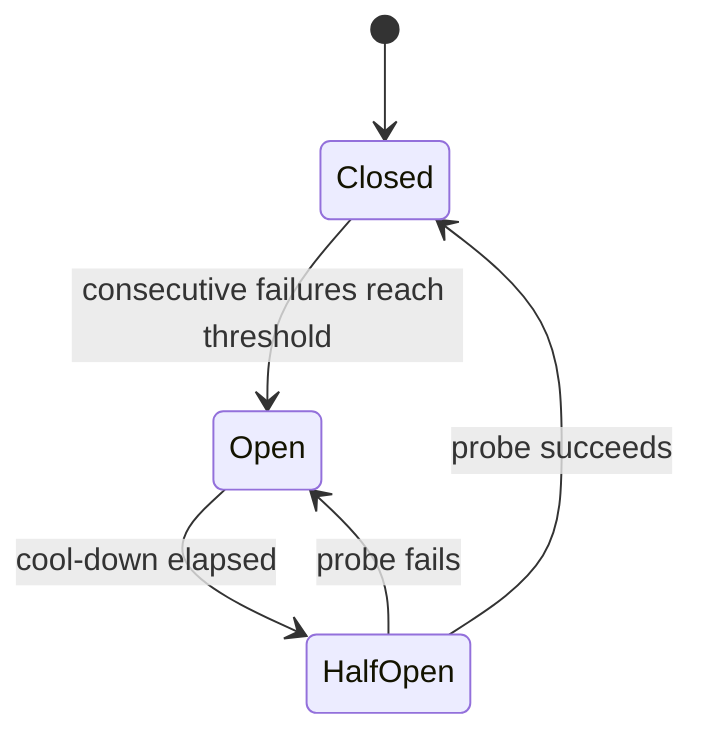
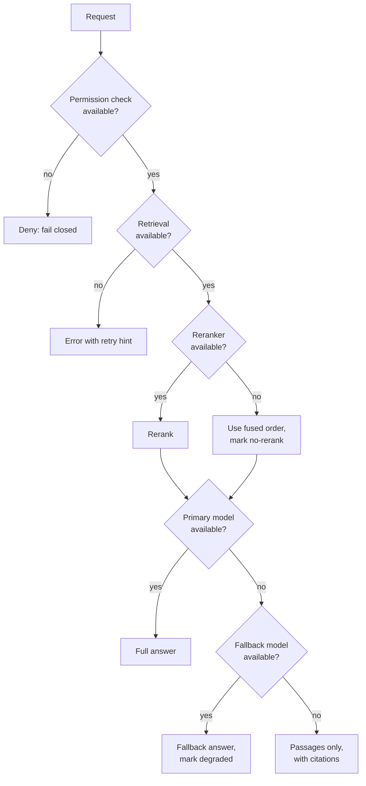

A RAG system can fail in two very different ways. The loud failure is an outage: the model provider is down, the vector database restarts, requests return errors. The quiet failure is worse: every request succeeds with HTTP 200, but the index silently stopped updating three days ago, or retrieval returns nothing and the model answers from memory, or a bad deployment mixed embeddings from two models. Dashboards stay green while users receive wrong answers.

**Reliability engineering** is the discipline of defining what "working" means in numbers, designing so that failures are contained and visible, and rehearsing them before they happen. This lesson covers the parts that matter most for enterprise RAG: service level objectives that include quality and freshness, a catalogue of how each stage fails, the patterns that contain failure (timeouts, retries, circuit breakers, fallbacks), recoverability of the index, safe change, and detection. The arithmetic of availability, redundancy and failure domains is in [high availability](/learn/production-architecture/high-availability); this lesson is about what the code does when a dependency misbehaves, and you will run a simulated outage to see the difference a degradation ladder makes.

## Learning objectives

- Define service level indicators and objectives for availability, latency, freshness and retrieval health, and compute an error budget and burn rate.
- Enumerate the failure modes of each RAG stage, including failures that return success codes.
- Implement timeouts, bounded retries with jitter and a circuit breaker, and explain how retries amplify load.
- Design a degradation ladder that keeps the system useful under partial failure and tells the user honestly what happened.
- Plan recoverability for derived data: recovery time and point objectives, index rebuild, and rollback of index versions.

## Prerequisites

- [High availability](/learn/production-architecture/high-availability): nines, series and parallel components, failure domains and N+1.
- [Scaling strategies](/learn/enterprise-rag-system-design/scaling-strategies): admission control and overload behaviour.
- [Logging](/learn/rag-observability/logging) and [retrieval monitoring](/learn/rag-observability/retrieval-monitoring): what you can observe when something fails.
- [Requirements gathering](/learn/enterprise-rag-system-design/requirements-gathering): the availability and freshness targets being protected.

## Why this matters

The first reason is dependence. A RAG request touches at least six components you do not fully control: an identity service, an embedding service, a vector database, a reranker, a language model provider, and the network between them. If each is available 99.9 per cent of the time and all are required, the request path is available less than 99.4 per cent, about 4 hours of failure a month. Reliability design is how you get a better result than the product of your dependencies.

The second reason is that RAG's most damaging failures are silent. A conventional service that breaks usually breaks loudly. A RAG system that retrieves nothing still produces fluent text. Without objectives for quality and freshness, and checks that run continuously, you learn of the problem from a user who acted on a wrong answer.

The third is that most incidents follow a change: a new embedding model version, a prompt edit, a re-index, a dependency upgrade. Reliability therefore includes how you ship change, not only how you survive faults.

## The intuition

A hospital does not stop operating when the mains power fails. It has a generator, and critical equipment runs on battery in the seconds between. Non-critical lighting dims, elective procedures wait, and staff are told which systems are degraded. The hospital decided in advance what degrades first and what must never fail, and it tests the generator monthly.

A reliable RAG system has the same structure: a ladder of **degraded modes** (answer without reranking, answer with a smaller model, show the retrieved passages without a generated summary), a clear idea of what must never fail (access control), honest messaging when a mode is active, and regular tests that the fallback works.

## How it works

### Reliability as measurable objectives

A **service level indicator** (SLI) is a measurement of behaviour, usually a ratio of good events to total events. A **service level objective** (SLO) is a target for it over a window. For RAG, availability and latency are not enough; add indicators that catch the quiet failures:

| SLI | Good event | Example SLO |
| --- | --- | --- |
| **Availability** | Request answered, including a degraded answer, without a server error | 99.9 per cent per 30 days |
| **Latency** | First token within the target | 95 per cent within 4 seconds |
| **Freshness** | A changed source document is searchable within the target | 99 per cent of changes within 60 minutes |
| **Retrieval health** | A query returns at least one passage above the relevance floor | At least 97 per cent of queries (a sudden drop signals index or embedding trouble) |
| **Groundedness (sampled)** | A sampled answer's claims are supported by its cited passages | At least 95 per cent of a weekly sample |

Freshness is measured with a **probe document**: a canary that is updated on a schedule, with a check that the new text becomes retrievable. Retrieval health is measured from production traffic. Groundedness is sampled and judged offline ([LLM-as-a-judge](/learn/testing-and-benchmarking/llm-as-a-judge)).

The gap between 100 per cent and the SLO is the **error budget**: the amount of unreliability you can spend on deployments, experiments and incidents. A budget that is nearly spent means slow down and fix reliability; a budget that is untouched means you can ship faster.

### A catalogue of failures

Knowing how each stage fails tells you what to guard. The right-hand column is the one that tends to be forgotten.

| Stage | Loud failure | Quiet failure |
| --- | --- | --- |
| Identity and permissions | Directory unreachable | Stale group membership: a leaver still sees documents, or a joiner sees none |
| Query embedding | Service timeout | A different model version than the corpus used: results look plausible but poor |
| Vector database | Node down, overloaded | Index not updated; deleted documents still returned; filter silently ignored |
| Reranker | Timeout, out of memory | Truncated inputs reduce quality |
| Language model provider | Outage, rate limit (HTTP 429), very slow responses | Refusal or filtered output; changed model behaviour after a provider update |
| Ingestion | Worker crash, parser error | Partial batch indexed; duplicates; a poison document that blocks the queue; scanned file extracted as empty text |
| Configuration and deployment | Failed rollout | Prompt or chunking change that degrades answers without errors |

Many quiet failures are detected only by **checking the outputs of the pipeline**, not the health of its processes; and many loud failures are survivable if the system has somewhere cheaper to fall back to.

### Containing failure: timeouts, retries and breakers

Four small mechanisms do most of the work.

**Timeouts with a deadline.** Every network call needs a timeout, and the sum of the timeouts along the path must fit inside the overall deadline. Pass the remaining time down the call chain so that a stage never works on a request nobody is waiting for. A missing timeout is an outage waiting to happen, because a hung dependency holds a slot indefinitely.

**Bounded retries with backoff and jitter.** A retry helps with a transient fault and harms with a persistent one. Wait exponentially longer between attempts, randomise the wait (jitter) so clients do not retry in lockstep, cap the attempts, and only retry operations that are safe to repeat. Retries multiply: if each of three layers makes three attempts against a failing dependency, one user request becomes up to 27 calls, which can turn a partial failure into a total one. Retry at one layer only, and keep a **retry budget**, such as "retries may add at most 10 per cent to the request rate".

**Circuit breakers.** A breaker watches a dependency's recent failures. After a threshold it **opens** and fails fast, sparing the dependency and your own slots, then after a cool-down it goes **half-open** and lets a probe through; success closes it. It prevents a dying dependency from being hammered and turns slow failures into fast ones.



**Bulkheads.** Isolate resources so one workload cannot starve another: separate worker pools and connection limits for interactive queries and batch ingestion, and per-tenant quotas. A backfill that shares a pool with live traffic will, eventually, take it down.

### The degradation ladder

When a dependency is unavailable, the choice is not between "full answer" and "error". Design a ladder in advance, ordered from least to most degraded, and decide what each rung costs in quality:

| Failure | Rung | What the user gets | Disclose? |
| --- | --- | --- | --- |
| Reranker down | Skip reranking, use fused retrieval order | Slightly lower precision | Log; optional note |
| Primary model down or throttled | Use a smaller or alternative model | Possibly less nuanced answer | Yes, in the response metadata |
| All models down | Return the top retrieved passages with citations, no generated answer | Evidence, no synthesis | Yes, plainly |
| Retrieval down | Return an error with a retry hint | Nothing; a model answering without retrieval would invent | Yes |
| Permission service down | **Fail closed**: deny | Nothing | Yes |

Two rules keep the ladder safe. **Degrade quality, never security:** if the access check cannot run, the answer is "try again later", not "answer without the check". And **never degrade silently:** a response should carry a mode label so that dashboards, logs and, where appropriate, the user know which path produced it.



### Recoverability: the index is derived data

A vector index is derived from three things: the source documents, the chunking and parsing code, and the embedding model. If you keep those, it can be rebuilt. This changes what you back up and how you think about disaster recovery ([disaster recovery](/learn/production-architecture/disaster-recovery), [backup and recovery](/learn/advanced-vector-database-engineering/backup-and-recovery)).

Two numbers define the target: the **recovery point objective** (RPO), how much recent data you can afford to lose, and the **recovery time objective** (RTO), how long you can be without the system. A pure rebuild has a long RTO: the capacity model estimated about 14 hours to re-embed 30 million chunks with eight workers, plus index construction. If the requirements say the RTO is four hours, you need **snapshots** of the index (restoring tens of gigabytes from object storage takes minutes to an hour, depending on bandwidth), kept alongside the model version and the chunking configuration, with a rebuild as the last resort.

Three further practices matter: **versioned indexes**, building a new index beside the live one and switching an alias, so that rollback is a pointer change ([index versioning](/learn/ci-cd-and-mlops/index-versioning)); **restore tests**, because a backup never restored is unproven; and **source-of-truth discipline**, keeping the original documents and the identity data durable and separately backed up, since they cannot be recomputed.

### Safe change

Because most incidents follow a change, protect the change path:

- Run the golden-set evaluation in continuous integration, with a gate on retrieval and groundedness metrics ([regression testing](/learn/testing-and-benchmarking/regression-testing)).
- Deploy gradually: **shadow** (run the new path on live queries without serving it), then a **canary** to a small share, with automatic rollback on SLO burn.
- Version prompts, chunking configurations and embedding model identifiers as deployable artefacts, and record which version served each answer.
- Use feature flags so a risky component can be turned off without a deployment.

### Detection and response

Alert on **SLO burn rate** rather than on raw errors, so that a brief blip does not page anyone but a sustained leak does. Keep a **runbook** for each alert: what it means, how to confirm it, and the first safe action (often a rollback or a feature flag). After an incident, hold a blameless review that ends in specific changes: a new alert, a new test, a new rung on the ladder. [Failure analysis](/learn/rag-observability/failure-analysis) shows how to trace a wrong answer back through the pipeline.

### Rehearsal

Test the unhappy paths on purpose. Inject failures in a staging environment (kill the reranker, block the model endpoint, slow the vector database to 5 seconds), assert that the ladder behaves and that the mode labels and alerts fire, and hold periodic **game days** where the team handles a simulated incident with the real runbooks.

## The mathematics

### Error budget and burn rate

**Intuition.** An SLO is a promise over a window; the budget is how much failure the window allows. How fast you are spending it matters more than the instantaneous error rate.

$$
B = 1 - \text{SLO}, \qquad \text{burn rate} = \frac{e}{B}, \qquad T_{\text{exhaust}} = \frac{W}{\text{burn rate}}
$$

$B$ is the budget as a fraction of requests, $e$ the currently observed error fraction, $W$ the window length. A burn rate of 1 spends the budget exactly over the window; a burn rate of 10 spends it in a tenth of the window.

**By hand.** For a 99.9 per cent SLO over 30 days, $B = 0.001$, which equals $0.001 \times 30 \times 24 \times 60 = 43.2$ minutes of complete outage. If the error fraction is $e = 0.0144$ (1.44 per cent), the burn rate is $14.4$ and the window is exhausted in $720/14.4 = 50$ hours. One hour at that rate consumes $14.4/720 = 2$ per cent of the monthly budget, which is a common basis for paging: a fast burn over a short window means a human must look now. A slow burn of 2 consumes the budget in 15 days, which warrants a ticket, not a page.

### Retry amplification

If every layer makes $a$ attempts against a failing dependency, and there are $L$ layers that each retry, up to $a^L$ calls reach it per user request. With $a = 3$ and $L = 3$ that is 27. The Python below prints these numbers, and the simulation after it shows the degradation ladder at work.

## In code

First the budget arithmetic:

```python
SLO = 0.999
WINDOW_DAYS = 30
budget = 1 - SLO
budget_minutes = budget * WINDOW_DAYS * 24 * 60
print(f"error budget: {budget:.3%} of requests = {budget_minutes:.1f} minutes of full outage per {WINDOW_DAYS} days")

for label, error_rate, hours in [("slow leak", 0.002, 24), ("provider incident", 0.0144, 1), ("full outage", 1.0, 0.5)]:
    burn = error_rate / budget
    spent = burn * hours / (WINDOW_DAYS * 24)
    exhausted_h = WINDOW_DAYS * 24 / burn
    print(f"{label:18s} error rate {error_rate:7.2%}  burn {burn:6.1f}x  "
          f"budget spent after {hours:>4} h: {spent:6.1%}  exhausted in {exhausted_h:7.1f} h")

print("\nRetry amplification (each layer makes 3 attempts; every attempt fails):")
for layers in (1, 2, 3):
    print(f"  {layers} layer(s): up to {3 ** layers} calls reach the failing dependency per user request")
```

```output
error budget: 0.100% of requests = 43.2 minutes of full outage per 30 days
slow leak          error rate   0.20%  burn    2.0x  budget spent after   24 h:   6.7%  exhausted in   360.0 h
provider incident  error rate   1.44%  burn   14.4x  budget spent after    1 h:   2.0%  exhausted in    50.0 h
full outage        error rate 100.00%  burn 1000.0x  budget spent after  0.5 h:  69.4%  exhausted in    0.7 h

Retry amplification (each layer makes 3 attempts; every attempt fails):
  1 layer(s): up to 3 calls reach the failing dependency per user request
  2 layer(s): up to 9 calls reach the failing dependency per user request
  3 layer(s): up to 27 calls reach the failing dependency per user request
```

A half-hour total outage spends about 69 per cent of a month's budget, and a slow 0.2 per cent leak spends 6.7 per cent a day. Both are alert-worthy, at different urgency.

Now the pipeline itself. The program below has no network access and no model: dependencies are simulated, and a **fake clock** makes the run deterministic. It implements the circuit breaker, bounded retries with jittered backoff, and the degradation ladder, then replays a 300-second scenario with three overlapping incidents: a model provider outage from second 60 to 139, a reranker failure from second 100 to 129, and both models failing from second 200 to 209. It compares a pipeline with no fallbacks against one with the ladder.

```python
import random
from collections import Counter
from dataclasses import dataclass, field


class Clock:
    """A fake clock so the demonstration is deterministic."""
    def __init__(self):
        self.now = 0.0

    def sleep(self, seconds):
        self.now += seconds


class Breaker:
    """Closed -> open after N consecutive failures; half-open after a cool-down."""
    def __init__(self, clock, threshold=3, cooldown=20.0):
        self.clock, self.threshold, self.cooldown = clock, threshold, cooldown
        self.failures, self.opened_at = 0, None

    def allow(self):
        if self.opened_at is None:
            return True
        if self.clock.now - self.opened_at >= self.cooldown:
            return True                       # half-open: let one probe through
        return False

    def record(self, ok):
        if ok:
            self.failures, self.opened_at = 0, None
        else:
            self.failures += 1
            if self.failures >= self.threshold:
                self.opened_at = self.clock.now


def call_with_retry(fn, breaker, clock, attempts=2, base_delay=0.2, rng=random.Random(0)):
    """Retry with exponential backoff and jitter, but never while the breaker is open."""
    for attempt in range(attempts):
        if not breaker.allow():
            raise RuntimeError("circuit open")
        try:
            result = fn()
            breaker.record(True)
            return result
        except Exception:
            breaker.record(False)
            if attempt + 1 < attempts:
                clock.sleep(base_delay * 2 ** attempt * rng.uniform(0.5, 1.5))
    raise RuntimeError("retries exhausted")


@dataclass
class Pipeline:
    clock: Clock
    down: set = field(default_factory=set)            # names of dependencies currently failing
    use_fallbacks: bool = True
    breakers: dict = field(default_factory=dict)

    def __post_init__(self):
        for name in ("retriever", "reranker", "llm_primary", "llm_fallback"):
            self.breakers[name] = Breaker(self.clock)

    def _dep(self, name, value):
        def run():
            if name in self.down:
                raise ConnectionError(name)
            return value
        return call_with_retry(run, self.breakers[name], self.clock)

    def answer(self, query):
        try:
            passages = self._dep("retriever", ["p1", "p2", "p3"])
        except RuntimeError:
            return "error: retrieval unavailable"            # nothing honest can be said without retrieval
        mode = []
        if self.use_fallbacks:
            try:
                passages = self._dep("reranker", passages)
            except RuntimeError:
                mode.append("no-rerank")
        else:
            passages = self._dep("reranker", passages) if "reranker" not in self.down else None
            if passages is None:
                return "error: reranker unavailable"
        try:
            self._dep("llm_primary", "generated")
            return "ok" + (" (" + ",".join(mode) + ")" if mode else "")
        except RuntimeError:
            if not self.use_fallbacks:
                return "error: model unavailable"
        try:
            self._dep("llm_fallback", "generated")
            return "degraded: fallback model" + (" (" + ",".join(mode) + ")" if mode else "")
        except RuntimeError:
            return "degraded: passages only, no generated answer"


def run(use_fallbacks):
    clock = Clock()
    p = Pipeline(clock, use_fallbacks=use_fallbacks)
    outcomes = Counter()
    for i in range(300):
        clock.sleep(1.0)                                  # one request per second
        p.down = set()
        if 60 <= i < 140:
            p.down.add("llm_primary")                     # provider outage
        if 100 <= i < 130:
            p.down.add("reranker")                        # overlapping reranker incident
        if 200 <= i < 210:
            p.down.add("llm_fallback"); p.down.add("llm_primary")   # both models gone
        outcomes[p.answer("q")] += 1
    return outcomes


for flag in (False, True):
    out = run(flag)
    useful = sum(v for k, v in out.items() if not k.startswith("error"))
    print(f"fallbacks={flag}: useful responses {useful}/300")
    for mode, n in sorted(out.items(), key=lambda kv: -kv[1]):
        print(f"    {n:>4}  {mode}")
```

```output
fallbacks=False: useful responses 189/300
     189  ok
      81  error: model unavailable
      30  error: reranker unavailable
fallbacks=True: useful responses 300/300
     198  ok
      41  degraded: fallback model (no-rerank)
      40  degraded: fallback model
      21  degraded: passages only, no generated answer
```

**How it works.** `Breaker.record` counts consecutive failures and opens at the threshold; `allow` refuses calls until the cool-down passes, then admits a probe. `call_with_retry` makes at most two attempts with jittered exponential backoff and refuses to retry while the breaker is open, so a dead dependency is not hammered. `Pipeline.answer` walks the ladder: retrieval is mandatory; the reranker is optional; the generation step tries the primary model, then the fallback, then returns the passages. Every response carries a mode string, which in production would also be a log field and a metric label.

**What the output means.** Without fallbacks the system returns an error for 111 of 300 requests, about 37 per cent, even though only individual components were down. With the ladder, none of the 300 requests returns an error, and the output shows exactly how many were served in each mode: 102 were degraded in some way, and 21 returned only passages. One detail deserves attention: the both-models outage lasted 10 seconds, yet 21 requests got passages only. The circuit breakers opened during the outage and stayed open for their 20-second cool-down, so the system kept degraded for about ten seconds after the dependency recovered. That is the price of fail-fast protection, and the cool-down is a tunable trade-off between sparing a struggling dependency and recovering quickly. Note that "useful" here means only "not an error"; whether a passages-only answer helps a claims handler is a requirements question.

**Common errors.** Retrying inside a breaker that is open, retrying non-idempotent operations, forgetting to reset breaker state on success, using wall-clock time in tests so they are flaky (the fake clock avoids this), and counting degraded responses as healthy in availability without tracking mode share.

**Extending it.** Add a deadline that shortens retries as time runs out, and emit one structured log line per request with the mode and the breaker states.

## A real-world example

Northgate's ClaimsCompanion is in its third month when the primary model provider has a partial outage lasting 50 minutes on a Tuesday morning. Before the ladder existed, such an event would have meant 50 minutes of error messages during the claims team's busiest period. With it, requests fall through to the fallback model, answers carry a "degraded" label, and the on-call engineer is paged by the burn-rate alert within minutes. The post-incident review finds that the fallback model's answers were noticeably less careful about exclusions in policy wordings, so the team adds a banner reminding handlers to confirm exclusions in the source document whenever the mode is degraded.

A quieter incident comes two weeks later. A change in the document management system's export format makes the nightly parser emit empty text for 1,800 scanned wordings. Nothing errors: the files are chunked into zero chunks and skipped. The only symptom is a rising rate of "no relevant passage" answers on policy-wording queries. The retrieval-health SLI, which counts queries with at least one passage above the relevance floor, drops from 98 to 93 per cent in a day and trips its alert. The runbook says to check the ingestion dashboard; the team finds the empty-extraction count, fixes the parser, re-ingests the affected files, and adds a new rule: any batch in which more than 0.5 per cent of documents yield no text fails loudly instead of skipping silently.

The team also runs a quarterly restore test. The first attempt restores a snapshot into a fresh cluster in 55 minutes, comfortably inside the four-hour RTO, but fails to start the query service because the snapshot's embedding model identifier does not match the deployed configuration. The fix is to store the model identifier and chunking configuration in the snapshot metadata and check them at startup, which is exactly the kind of defect only a rehearsal finds.

## Common mistakes

- **Measuring only uptime.** A system returning wrong answers with HTTP 200 is "up". Add freshness, retrieval-health and sampled-quality indicators.
- **No timeouts.** A hung dependency holds a worker slot for ever and spreads the failure upward.
- **Retries at every layer.** Three layers of three attempts make 27 calls per request against a failing dependency; retry in one place, with a budget.
- **Silent degradation.** A fallback without a mode label cannot be monitored, and users cannot calibrate their trust.
- **Degrading security.** Skipping an access check "to stay available" turns a reliability event into a data breach; fail closed.
- **Backups never restored.** An untested snapshot is a hope; restore into a clean environment regularly.
- **Skipping silently on bad input.** A parser that quietly drops a document makes the corpus smaller without anyone noticing; fail loudly above a threshold and quarantine the item.
- **Shipping changes without evaluation gates.** Most incidents follow a change; a prompt or embedding update with no regression test is an unmonitored experiment on users.

## Best practices

- Define SLOs for availability, latency, freshness and retrieval health, plus a sampled groundedness check, and track the error budget.
- Put a timeout on every call, retry only idempotent operations at one layer with jittered backoff and a budget, and use circuit breakers.
- Design the degradation ladder explicitly, test each rung, label every response with its mode, and fail closed on access control.
- Isolate interactive and batch workloads with separate pools and quotas.
- Treat the index as derived data: keep the sources, configuration and model identifiers durable, take snapshots to meet the RTO, and rehearse restores.
- Version indexes and switch by alias so rollback is instant.
- Gate deployments on the golden-set evaluation, then shadow and canary with automatic rollback.
- Alert on burn rate, write a runbook for every alert, and hold blameless reviews that end in a concrete change.
- Run failure injection and game days regularly.

## Performance considerations

Reliability mechanisms have costs worth budgeting. Timeouts and retries add tail latency: an attempt that times out at 2 seconds followed by a retry adds at least 2 seconds, so the sum of timeouts and retries must fit within the latency SLO, which often means one retry only on the fastest-failing stages. Circuit breakers cost almost nothing at runtime but can extend degraded periods by their cool-down, as the simulation showed. Fallback capacity is a standing cost: a warm fallback model deployment, or a reserved allocation with a second provider, sits mostly idle, and the idle capacity is the insurance premium; size it for the traffic you would shift, using the [capacity model](/learn/enterprise-rag-system-design/capacity-planning). A restore of 50 GB at an assumed 200 megabytes per second takes about 4 minutes of transfer, but loading the index into memory and warming caches usually dominates, so measure the whole recovery path, not the copy.

## Security considerations

Reliability and security interact in both directions. Fail closed for authentication and authorisation; a "graceful" bypass is a vulnerability. Fallbacks must hold the same data protections as the primary path: a second model provider needs the same contractual and residency approval, and cached or degraded outputs must respect permissions. Backups and snapshots contain the whole corpus and the permission metadata, so encrypt them, restrict access, and apply retention and deletion rules to them, or a document erased from the live index will survive in a snapshot ([secure deletion](/learn/enterprise-rag-governance/secure-deletion)). Error messages should not reveal internal hostnames, stack traces or the existence of restricted documents. Finally, an attacker who can trigger expensive requests can burn your error budget and model quota, so per-user limits belong in the reliability design.

## Summary

- Reliability for RAG needs objectives beyond uptime: freshness, retrieval health and sampled groundedness catch the quiet failures.
- Each stage fails loudly and quietly; guard against both, and detect quiet failures by checking the outputs of the pipeline.
- Timeouts, bounded jittered retries at a single layer, circuit breakers and bulkheads contain failures and prevent retry storms.
- A degradation ladder keeps the system useful under partial failure; label every mode and fail closed on access control.
- Treat the index as derived data: keep sources and configuration durable, snapshot to meet the RTO, version indexes, and rehearse restores.
- Most incidents follow change, so gate deployments with evaluation, canary them, and alert on SLO burn rate.

## Exercises

**1. Budget and burn.** An SLO is 99.5 per cent over 30 days. Compute the error budget in minutes of complete outage, and the burn rate and time to exhaustion if the error fraction is 3 per cent.

<details><summary>Show solution</summary>

Budget = 0.005 × 30 × 24 × 60 = 216 minutes. Burn rate = 0.03 / 0.005 = 6. Time to exhaustion = 720 hours / 6 = 120 hours, five days. A burn rate of 6 sustained for an hour spends 6/720 = 0.83 per cent of the budget, so whether it pages depends on the policy, but a sustained 6x burn needs action within a day.

</details>

**2. Design the ladder.** Your assistant answers HR policy questions. List four failures and, for each, the rung you would use and whether the user should be told.

<details><summary>Show solution</summary>

(1) Reranker timeout: use the fused order, log the mode, no user message needed. (2) Primary model rate-limited: switch to the fallback model, label the response as degraded in metadata, and show a short notice if answer nuance matters. (3) All models unavailable: show the top retrieved passages with citations and say that a summary could not be generated. (4) Permission service unreachable: deny with a retry message; never answer without the check. A fifth: the vector database is down; return an error with a retry hint, because a model answering without retrieval would invent policy.

</details>

**3. Find the amplification.** A gateway retries 3 times, the query service retries 3 times, and the model client retries 4 times against a model that is failing. What is the maximum number of model calls per user request, and what do you change?

<details><summary>Show solution</summary>

3 × 3 × 4 = 36 calls. Remove the retries at the gateway and query service, and keep one bounded retry in the model client (for example two attempts) with jittered backoff, a circuit breaker and a retry budget. The model call then makes at most two attempts per request, and the breaker stops attempts altogether when the failure rate is high.

</details>

**4. Add fail-closed access control.** Extend `Pipeline.answer` with a `permission_service` dependency that must succeed before retrieval, returning `"denied: access check unavailable"` when it fails, even when fallbacks are enabled. Add it to the failure scenario and show that the count of denied responses equals the outage length (plus any breaker cool-down), with no degraded answer given.

<details><summary>Show solution</summary>

Add `"permission"` to the breaker names. At the start of `answer`:

```python
try:
    self._dep("permission", True)
except RuntimeError:
    return "denied: access check unavailable"
```

Add `p.down.add("permission")` for an interval such as `250 <= i < 260`. The output will show roughly 10 denied responses plus up to 20 seconds of breaker cool-down (the breaker stays open until a probe succeeds), and no response in that interval will carry a degraded mode, because the ladder is never reached. The cool-down means the denial window outlasts the outage, which you may shorten for this dependency at the cost of more probing.

</details>

## Check your understanding

```quiz
[
  {
    "q": "Which indicator would most directly detect an ingestion job that silently stopped updating the index?",
    "options": [
      "HTTP 5xx rate.",
      "CPU utilisation of the query service.",
      "A freshness SLI measured with a probe document.",
      "Model token usage."
    ],
    "answer": 2,
    "why": "A silent ingestion failure produces no errors; only checking that a known change becomes searchable reveals it."
  },
  {
    "q": "A 99.9 per cent availability SLO over 30 days allows roughly how much complete outage?",
    "options": [
      "4.3 minutes",
      "43 minutes",
      "7.2 hours",
      "72 hours"
    ],
    "answer": 1,
    "why": "0.001 × 30 days × 24 × 60 = 43.2 minutes."
  },
  {
    "q": "The permission service is unreachable. What should the system do?",
    "options": [
      "Answer without the check to stay available.",
      "Answer from cached results for everyone.",
      "Deny the request and ask the user to retry, failing closed.",
      "Use the fallback model."
    ],
    "answer": 2,
    "why": "Degrade quality, never security: answering without the access check could expose restricted documents."
  },
  {
    "q": "Three layers each retry a failing call up to three times. How many calls can reach the dependency per user request?",
    "options": [
      "27",
      "9",
      "12",
      "81"
    ],
    "answer": 0,
    "why": "Attempts multiply across layers: 3 × 3 × 3 = 27, which can overwhelm a dependency that is already struggling."
  },
  {
    "q": "In the simulation, why did 21 requests receive passages only although the both-models outage lasted 10 seconds?",
    "options": [
      "The passages were cached.",
      "The circuit breakers stayed open for their cool-down after the dependencies recovered.",
      "Retrieval was slow.",
      "The clock was wrong."
    ],
    "answer": 1,
    "why": "An open breaker fails fast until the cool-down expires and a probe succeeds, so degraded service can outlast the fault."
  }
]
```

## Further reading

- Betsy Beyer et al. (eds.), *Site Reliability Engineering*, chapters on service level objectives, handling overload and postmortem culture (free online from Google).
- Betsy Beyer et al. (eds.), *The Site Reliability Workbook*, chapter on alerting on SLOs, which introduces multi-window burn-rate alerts.
- Michael Nygard, *Release It!*: stability patterns including timeouts, circuit breakers and bulkheads.
- Marc Brooker, "Timeouts, retries and backoff with jitter", Amazon Builders' Library.
- Casey Rosenthal and Nora Jones, *Chaos Engineering* (O'Reilly, 2020): failure injection as an engineering practice.
