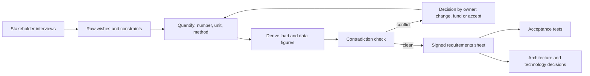

Every expensive RAG failure starts earlier than the code. A team builds a fast, accurate-looking assistant, and then learns in the pilot that claims handlers need answers that respect case-level permissions, that the legal department wants every answer cited to a paragraph, that the corpus is five times larger than anyone said, and that "real time" meant "within an hour". Each of these is cheap to learn in week one and ruinous to learn in month six, because each one changes the architecture rather than a setting.

This lesson is the first of the module on **Enterprise RAG System Design**, and it covers the step before any design: **requirements gathering**. You will learn what to ask, how to turn vague wishes into numbers a system can be built and tested against, how to find the contradictions hidden in a wish list, and how to record the result so that later decisions can be traced to it. The later lessons ([architecture selection](/learn/enterprise-rag-system-design/architecture-selection), [technology selection](/learn/enterprise-rag-system-design/technology-selection), [capacity planning](/learn/enterprise-rag-system-design/capacity-planning) and the rest) all consume the sheet this lesson produces.

Throughout the module we use one fictional customer. **Northgate Mutual** is an insurer with 9,000 staff. Its claims handlers and underwriters want an assistant, called ClaimsCompanion, that answers questions from policy wordings, claims manuals, underwriting guidelines and regulatory circulars. All Northgate figures are invented for teaching.

## Learning objectives

- Distinguish functional, quality, operational and constraint requirements, and write each as a measurable statement rather than an adjective.
- Derive load, corpus and update figures from a stakeholder interview using explicit assumptions.
- Detect contradictions between requirements, such as freshness against batch ingestion, using a checklist and a machine-checkable specification.
- Define success metrics and acceptance tests for retrieval quality, answer quality, latency and availability before building.
- Record requirements, assumptions and open questions in a form that later design decisions can cite.

## Prerequisites

- [End-to-end RAG lifecycle](/learn/rag-architecture-fundamentals/end-to-end-rag-lifecycle): the stages a requirement can constrain.
- [Traditional RAG architecture](/learn/rag-architecture-fundamentals/traditional-rag-architecture): the baseline design you will be adjusting.
- [Real-world RAG applications](/learn/introduction-to-rag/real-world-rag-applications): the kinds of systems requirements come from.

## Why this matters

A RAG system has an unusually wide design space. The same business sentence, "answer staff questions from our documents", is satisfied by a weekend prototype or by a multi-region platform with per-document access control, depending on details nobody mentioned. Requirements are what select a point in that space.

Three failure patterns recur when requirements are skipped:

- **The silent requirement.** Something everyone assumed, usually access control, audit or freshness, surfaces after the architecture is fixed. Retrofitting per-document permissions into an index built without them usually means re-indexing everything with permission metadata and rewriting retrieval; it is rarely a patch.
- **The adjective.** "Fast", "accurate", "secure" and "scalable" cannot be tested. Two engineers read "fast" as 300 milliseconds and 8 seconds, and both are correct until acceptance day.
- **The contradiction.** Two requirements that cannot both be met, such as sub-hour freshness with a nightly import job, are accepted separately and discovered together. The cost of finding it grows with every component built on top.

Requirements are also the only defence against the opposite failure, over-engineering. A team that does not know the system serves roughly one query per second at peak will be tempted to design for fifty.

## The intuition

Think of an architect meeting a client who wants "a house". The architect does not start drawing; she asks how many people will live in it, whether anyone uses a wheelchair, what the budget is, whether the plot has a flood risk, and when the family needs to move in. Some answers are preferences (a south-facing kitchen), some are constraints (planning permission), and some are measurable targets (four bedrooms, 200 square metres). Crucially, she looks for conflicts: a swimming pool and a budget of 150,000 pounds cannot coexist, and it is kinder to say so on day one.

Requirements gathering for RAG is the same conversation with a different checklist. The people who can answer are scattered: the business sponsor knows the value, the compliance team knows the constraints, the document owners know the data, the future users know what they actually ask, and operations knows what they can run. Your job is to interrogate each in turn, convert answers into numbers, and notice when two answers disagree.

## How it works

### Four kinds of requirement

Sorting requirements into kinds shows which ones decide the architecture.

| Kind | Question it answers | Example for ClaimsCompanion |
| --- | --- | --- |
| **Functional** | What must the system do? | Answer questions about policy terms; cite the clause; say "not found" when the corpus has no answer; support follow-up questions |
| **Quality** | How well? | Recall@10 of at least 0.90 on the golden set; at least 95 per cent of sampled answers fully supported by their citations |
| **Operational** | How fast, how available, how maintainable? | p95 time to first token under 4 seconds; 99.9 per cent monthly availability; a document change searchable within an hour |
| **Constraint** | What is fixed regardless of preference? | Data stays in the UK; users see only documents they are entitled to read; audit records kept for the regulator's retention period; monthly budget ceiling |

The first two kinds describe value and the last two shape the engineering. In practice the **constraints** and the **operational targets** do most of the architectural work: a quality requirement can usually be approached by iterating on a design, but a residency constraint or a document-level permission model eliminates whole families of design on day one.

### The interview: what to ask, of whom

Run structured interviews, not workshops that collect wishes. For each stakeholder group, these questions repay the time:

- **Sponsor.** What decision or task does this speed up, and what is it worth? What would make you switch it off? (The second question reveals the real quality bar.)
- **Users.** Bring ten questions you actually asked this week. Who asks, how often, and what do you do with the answer? What happens if the answer is wrong? (Wrong-answer cost sets how strict grounding and abstention must be.)
- **Document owners.** Where does each document live, who may read it, how often does it change, and what is the authoritative copy? Which formats are awkward: scanned PDFs, spreadsheets, images of forms?
- **Security and compliance.** Which data classes are present (personal data, health data, claims under legal privilege)? What residency, retention and deletion rules apply? Must every answer be auditable to the documents that produced it?
- **Operations and platform.** What does the organisation already run and have people to operate? What are the approved clouds and model providers? Who is on call?
- **Finance.** Is there a budget ceiling, and is it a build cost, a run cost, or both? How are shared platform costs charged?

The most valuable artefact from user interviews is a **question log**: real queries, ideally 100 or more, with the document each should be answered from. It becomes the seed of the [golden dataset](/learn/testing-and-benchmarking/golden-datasets) and tells you what retrieval must really do. If most real questions are lookups of one clause, a simple pipeline may suffice; if many compare two documents or aggregate across a hundred, you have just learned the system needs [query decomposition](/learn/advanced-retrieval/query-decomposition) or a different design.

### From wishes to numbers

Every requirement should end up as a statement with a number, a unit and a way to measure it. A useful template is: *for [population], [metric] is [at least or at most] [value], measured by [method], over [period]*. Compare:

- Wish: "Answers must be fast."
- Requirement: "For interactive queries, 95 per cent of requests deliver the first streamed token within 4 seconds, measured at the API gateway over each week."

The template forces three decisions. The **percentile** matters because averages hide the slow tail that users remember. The **measurement point** matters because "latency" at the model call, at the gateway and in the browser differ by seconds. The **period** matters because an objective measured over a day and one measured over a month have very different tolerance for a single bad hour; [high availability](/learn/production-architecture/high-availability) explains the arithmetic.

### Deriving the load and data figures

Stakeholders rarely give you queries per second. They give you headcount and habits, and you derive the rest, writing down each assumption so it can be challenged:

1. **Daily queries** = users with access × share active on a given day × queries per active user per day.
2. **Peak rate.** Traffic is not flat. Choose the share of a day's queries that fall in the busiest hour (for an office tool, 15 to 25 per cent is plausible; measure it from a pilot if you can), and divide by 3,600 seconds.
3. **Corpus size** = documents × chunks per document, where chunks per document comes from sampling real documents through a candidate chunker, not from a guess.
4. **Update volume** = documents changed per day × chunks per document, which bounds the daily re-embedding work.
5. **Growth.** Ask how the corpus and user base will change over the planning horizon (typically 12 to 36 months) and record it as a range.

Good practice is to give every figure a **range** (low, expected, high) and carry the high case into [capacity planning](/learn/enterprise-rag-system-design/capacity-planning). A single number invites false confidence.

### Hunting for contradictions

Requirements conflict in predictable ways, and a checklist finds most of them. Walk each pair and ask whether any design can satisfy both:

| Pair | Why it conflicts | Typical resolution |
| --- | --- | --- |
| Freshness within an hour and nightly batch ingestion | A nightly job cannot meet an hourly deadline | Event-driven or frequent incremental ingestion |
| Document-level permissions and a shared answer cache | A cached answer may contain text the next asker may not read | Cache only after the permission check, keyed on the user's permission set, or cache retrieval results rather than answers |
| 99.99 per cent availability and one region | A regional outage alone exceeds the monthly budget (about 4 minutes) | Realistic target of 99.9, or genuine multi-region at a cost the sponsor must accept |
| Complete cited answer in 3 seconds and a large generation model | Generation time alone exceeds the target | Stream, and define the target as time to first token; or shorten answers |
| Data residency in the UK and a model provider with no UK processing | The model call moves data out of scope | A provider or deployment with in-region processing, or self-hosting |
| "Never hallucinate" and "always give an answer" | Abstaining is the only reliable way to avoid unsupported claims | Agree that "I could not find this" is a correct answer, and measure abstention |
| Highest quality and lowest cost | Rerankers, larger models and more context cost money | Explicit priority order, and a cost per query the sponsor accepts |

Some conflicts are resolved by changing a requirement, some by money, some by accepting a risk. The important thing is that someone with authority decides explicitly, and the decision is recorded.

### Requirements that RAG projects forget

A few classes of requirement are routinely missing from first drafts:

- **Access control.** Decide early whether visibility is none, per role or per document, and where the permissions come from (the source system, a directory, a manual list). [Document-level permissions](/learn/access-control-and-privacy/document-level-permissions) is a design driver, not a feature.
- **Abstention and wrong-answer cost.** For an assistant that informs a claims decision, a confident wrong answer is worse than a refusal. Record the acceptable trade-off.
- **Provenance and audit.** Which documents, at which version, produced this answer? See [audit logs](/learn/enterprise-rag-governance/audit-logs) and [data lineage](/learn/enterprise-rag-governance/data-lineage).
- **Deletion.** If a document must be erased, it must vanish from the index, caches, backups and logs. Compare [secure deletion](/learn/enterprise-rag-governance/secure-deletion).
- **Languages and formats.** One language or six? Scanned images? Tables? Each answer changes parsing and embedding choices.
- **Feedback and evaluation.** Who labels answers, and how often? Without an owner, quality drifts silently.
- **Exit.** What happens if a vendor changes terms or a model is withdrawn? Record the tolerable migration effort.

### Acceptance tests: how you will know

A requirement without a test is a wish. For each quality and operational requirement, name the test at the same time:

- Retrieval quality: Recall@10 on a golden set built from the question log ([Recall@K](/learn/retrieval-evaluation/recall-k)).
- Answer quality: a sampled review against a rubric of faithfulness and citation accuracy, using human review and an LLM judge validated against it ([LLM-as-a-judge](/learn/testing-and-benchmarking/llm-as-a-judge)).
- Latency: a load test that replays the question log at the derived peak rate.
- Freshness: a probe document edited every hour whose new text must be retrievable within the target.
- Access control: a test suite of users and documents asserting that forbidden documents never appear in retrieval, prompt, citation or log.



### Assumptions and open questions

Some answers will not exist yet. Do not leave a blank and do not silently guess. Keep two lists beside the requirements. **Assumptions** are guesses you are proceeding on, each with an owner and a date by which it will be checked ("peak hour share is 18 per cent; verify from pilot logs by week 6"). **Open questions** are decisions still needed, each with an owner and a deadline. A design built on a flagged assumption can be revisited cheaply when the assumption changes; one built on an unrecorded assumption cannot.

## In code

Prose checklists are easy to skip. A requirements sheet kept as a typed, validated object can be reviewed in version control, and its contradiction rules can run on every change. The example below encodes the Northgate sheet with [Pydantic](https://docs.pydantic.dev), derives the load figures, and rejects a first draft that contains four contradictions.

It solves one problem: making the cross-checks of the previous section executable. Install the dependency with:

```bash
pip install pydantic
```

```python
from typing import Literal
from pydantic import BaseModel, Field, ValidationError, model_validator


class Requirements(BaseModel):
    """A machine-checkable requirements sheet for one RAG system."""

    name: str
    # Users and load
    users: int = Field(gt=0, description="people with access")
    daily_active_share: float = Field(gt=0, le=1)
    queries_per_active_user_day: float = Field(gt=0)
    busiest_hour_share: float = Field(gt=0, le=1, description="share of a day's queries in the busiest hour")
    # Data
    documents: int = Field(gt=0)
    chunks_per_document: int = Field(gt=0)
    changed_documents_per_day: int = Field(ge=0)
    # Quality and behaviour
    freshness_minutes: int = Field(gt=0, description="max age of an answer's source")
    p95_latency_s: float = Field(gt=0, description="to first useful output")
    streaming: bool
    availability: float = Field(gt=0.9, lt=1)
    citations_required: bool
    # Access and compliance
    access_model: Literal["none", "role", "document"]
    shared_answer_cache: bool
    data_residency: Literal["any", "uk", "eu"]
    regions: int = Field(ge=1)
    ingestion_mode: Literal["nightly_batch", "event_driven"]

    @property
    def daily_queries(self) -> float:
        return self.users * self.daily_active_share * self.queries_per_active_user_day

    @property
    def peak_qps(self) -> float:
        return self.daily_queries * self.busiest_hour_share / 3600

    @property
    def chunks(self) -> int:
        return self.documents * self.chunks_per_document

    @model_validator(mode="after")
    def no_contradictions(self) -> "Requirements":
        problems = []
        if self.freshness_minutes < 24 * 60 and self.ingestion_mode == "nightly_batch":
            problems.append("freshness under 24 h cannot be met by a nightly batch")
        if self.access_model == "document" and self.shared_answer_cache:
            problems.append("a shared answer cache can leak documents across permission boundaries")
        if self.availability >= 0.9999 and self.regions < 2:
            problems.append("99.99% availability is not credible with one region")
        if self.p95_latency_s < 4 and not self.streaming and self.citations_required:
            problems.append("a 4 s p95 to a complete cited answer is unrealistic without streaming")
        if self.data_residency != "any" and self.regions > 1:
            problems.append("multi-region needs every region inside the residency boundary")
        if problems:
            raise ValueError("; ".join(problems))
        return self


draft = dict(
    name="ClaimsCompanion", users=9000, daily_active_share=0.35, queries_per_active_user_day=8,
    busiest_hour_share=0.18, documents=600_000, chunks_per_document=50,
    changed_documents_per_day=1500, freshness_minutes=60, p95_latency_s=3.0, streaming=False,
    availability=0.9999, citations_required=True, access_model="document",
    shared_answer_cache=True, data_residency="uk", regions=1, ingestion_mode="nightly_batch",
)

try:
    Requirements(**draft)
except ValidationError as e:
    print("DRAFT REJECTED:")
    for problem in e.errors()[0]["msg"].removeprefix("Value error, ").split("; "):
        print(" -", problem)

fixed = {**draft, "streaming": True, "p95_latency_s": 4.0, "ingestion_mode": "event_driven",
         "shared_answer_cache": False, "availability": 0.999}
req = Requirements(**fixed)
print("\nAGREED SHEET:", req.name)
print(f"  daily queries   : {req.daily_queries:,.0f}")
print(f"  peak QPS        : {req.peak_qps:.2f}")
print(f"  chunks          : {req.chunks:,}")
print(f"  change rate     : {req.changed_documents_per_day * req.chunks_per_document:,} chunks/day re-embedded at most")
print(f"  downtime budget : {(1 - req.availability) * 30 * 24 * 60:.0f} min/month")
```

```output
DRAFT REJECTED:
 - freshness under 24 h cannot be met by a nightly batch
 - a shared answer cache can leak documents across permission boundaries
 - 99.99% availability is not credible with one region
 - a 4 s p95 to a complete cited answer is unrealistic without streaming

AGREED SHEET: ClaimsCompanion
  daily queries   : 25,200
  peak QPS        : 1.26
  chunks          : 30,000,000
  change rate     : 75,000 chunks/day re-embedded at most
  downtime budget : 43 min/month
```

**How it works.** The fields carry the units in their names (`freshness_minutes`, `p95_latency_s`), so no number is ambiguous. The three properties derive load figures from the stated assumptions, which keeps the arithmetic in one reviewed place. The `model_validator` runs after the whole object is built, so it can compare fields; it collects every problem before raising, so a reviewer sees all four contradictions at once rather than fixing them one failure at a time.

**What the output means.** The draft was typical of a first meeting: each line sounded reasonable. Four of them cannot coexist. The agreed sheet resolves them by decisions, not code: stream the answer and measure time to first token, move to event-driven ingestion, drop the shared answer cache (retrieval-level caching stays possible), and accept 99.9 per cent, which allows 43 minutes of downtime a month. The derived figures, 25,200 queries a day and 1.26 per second at the peak hour, are what the architecture will be sized for; 30 million chunks is the figure that decides [technology selection](/learn/enterprise-rag-system-design/technology-selection).

**Common errors.** Pydantic wraps a validator's `ValueError` in a `ValidationError`, so catch that, not `ValueError`, as the code does. A `Literal` field rejects any spelling not in the list, which is the point. If you read `e.errors()` you get one entry for the model-level validator, whose message begins with "Value error, ".

**Extending it.** Add rules as you learn them (for example, a multilingual flag that requires a multilingual embedding model), store the sheet as YAML in the repository, and run the validator in continuous integration so that no one can change a number without the contradiction check running. Compare each check to its acceptance test: a requirement that has a rule here and a test later is genuinely managed.

## A real-world example

The Northgate programme starts with a one-line brief from the claims director: "Give handlers an assistant that knows our manuals." The platform team resists the temptation to build a prototype and spends two weeks interviewing.

The claims interviews produce the question log: 140 real questions, of which about a third compare a policy wording against a manual ("does the 2022 wording cover escape of water if the property is unoccupied for more than 30 days, and what does the manual say about reserving?"). The team notes this as a hint that plain top-k retrieval will not suffice for a third of traffic.

Compliance adds three constraints the sponsor had not mentioned: claims involving legal privilege must be visible only to named handlers, all processing must stay in the UK, and every answer must be reproducible for the regulator, meaning the exact document versions used must be logged. Document owners add that 20 per cent of the corpus is scanned paper wordings, which means optical character recognition quality becomes a risk to recall that no retrieval tuning will fix.

The first requirements draft lists freshness of "real time", p95 latency of 3 seconds, 99.99 per cent availability and a shared cache "to save money". Running the contradiction checklist (exactly the checks in the code above) produces the four conflicts. The sponsor, shown the arithmetic that 99.99 per cent allows about four minutes of downtime a month and would need a second UK region, chooses 99.9 per cent. Freshness becomes "within one hour of a change in the source system", for which the corpus owners confirm event notifications are available.

The signed sheet has fourteen numbered requirements, five assumptions (with owners), and three open questions, including which team will label the golden set. Three months later, when procurement proposes a cheaper model provider that processes in another country, the decision is made in an afternoon by pointing to constraint C3. Nobody had to remember why.

## Common mistakes

- **Accepting adjectives.** Leaving "fast" or "secure" unquantified makes acceptance an argument. Convert every one to a number, a percentile and a measurement point.
- **Interviewing only the sponsor.** The sponsor knows the value but not the permissions, formats or operating limits; the constraints that break projects live with compliance, document owners and operations.
- **Skipping the question log.** Designing from imagined questions produces an architecture tuned to the team's guesses. Real questions often show multi-document comparison, abbreviations and identifiers that change the design.
- **Treating access control as a later feature.** Permissions affect the index schema, the cache, the filter strategy and the audit trail; adding them late means re-indexing and rewriting retrieval.
- **A single point estimate.** Single numbers hide uncertainty. Carry low, expected and high, and size for the high case where failure is costly.
- **Unrecorded decisions.** When a conflict is resolved in a meeting and not written down, the same debate returns at every review. Record the decision, the owner and the reason.
- **Requirements without tests.** A requirement that cannot be verified cannot be accepted, and will be reinterpreted at the worst moment.

## Best practices

- Write every requirement as population, metric, threshold, measurement method and period.
- Keep a requirements sheet as a version-controlled, validated artefact, and run the contradiction checks automatically.
- Collect a question log of at least 100 real queries before choosing an architecture, and use it as the seed of the golden dataset.
- Separate **must** from **should** from **could**, and record who may change each.
- Attach an owner and a due date to every assumption and open question.
- Ask about wrong-answer cost and abstention explicitly; they set the grounding strictness.
- Ask about deletion, audit and residency in the first week, when they are cheap to accommodate.
- Revisit the sheet at each milestone; requirements change, and an out-of-date sheet is worse than none.

## Performance considerations

Requirements gathering has a cost too, but it is small next to rework. Two weeks of interviews for a team of three is roughly six person-weeks; re-indexing a 30-million-chunk corpus after discovering a missing permission field costs engineering time, embedding compute and a migration window, and often a re-evaluation of the whole pipeline.

Performance requirements deserve special care because they are multiplicative. If the target is a p95 of 4 seconds to the first token and retrieval, reranking and prompt assembly together take 1.2 seconds at the 95th percentile, only about 2.8 seconds remain for the model to begin responding, which constrains the model tier and the prompt size. Writing the budget down at requirements time shows which targets are mutually tight before anyone has built the stage that fails them. The same logic applies to cost: a run-cost ceiling of 12,000 pounds a month at 25,200 queries a working day (about 554,000 a month over 22 working days) means about 2.2 pence per query for everything, a figure that eliminates some designs outright (see [cost estimation](/learn/enterprise-rag-system-design/cost-estimation)).

## Security considerations

Requirements are where security is cheapest. Capture data classification (what personal, health or privileged data is present), the identity source and permission model, residency and retention rules, and whether prompts and answers are logged and who may read those logs. Record the threat model assumptions: are documents written only by trusted staff, or can customers and suppliers contribute text that the system will index? The second case introduces [indirect prompt injection](/learn/rag-security-fundamentals/indirect-prompt-injection) as a design requirement. Treat the requirements sheet itself as sensitive: it describes data holdings and control gaps.

## Summary

- Requirements fall into functional, quality, operational and constraint groups; constraints and operational targets do most of the architectural work.
- Every requirement needs a number, a unit, a percentile or period, and a measurement method, plus an acceptance test.
- Stakeholder interviews and a real question log reveal needs that a sponsor brief omits, especially access control, audit, deletion and freshness.
- Derive load and data figures from stated assumptions, give each a range, and size for the high case.
- Check requirement pairs for contradictions and force an explicit decision, which is changing a requirement, paying for it or accepting the risk.
- Record assumptions and open questions with owners; keep the sheet validated and in version control.

## Exercises

**1. Convert adjectives.** Rewrite these as measurable requirements using the template: "The assistant must be accurate", "Uploads should appear quickly", "The system must be highly available".

<details><summary>Show solution</summary>

One acceptable set:

- Accuracy: "For questions in the golden set, Recall@10 is at least 0.90, and in a weekly sample of 100 answers at least 95 per cent are fully supported by their cited passages, as judged by the agreed rubric."
- Uploads: "A document added or changed in the source system is retrievable within 60 minutes for 99 per cent of changes, measured by a probe document edited hourly."
- Availability: "The query API returns a non-error response to at least 99.9 per cent of requests in each calendar month, measured at the gateway, excluding announced maintenance of up to two hours."

Each names a population, metric, threshold, measurement method and period. Other thresholds are fine as long as the sponsor has agreed them.

</details>

**2. Derive the load.** A firm has 2,000 staff; 60 per cent use the assistant on a given day, averaging 10 questions each; 25 per cent of a day's traffic arrives in the busiest hour. Compute the daily queries and the peak queries per second. Then say which assumption you would verify first, and why.

<details><summary>Show solution</summary>

Daily queries = 2,000 × 0.6 × 10 = 12,000. Busiest-hour queries = 12,000 × 0.25 = 3,000, so the peak rate is 3,000 / 3,600 ≈ 0.83 queries per second.

The busiest-hour share is the assumption to verify first. It scales the peak directly, and it is the least well known: the other two figures come from headcount and habit, but the shape of the day only appears in real logs. Verify it from pilot or analogous-system logs; if it is 40 per cent instead of 25 per cent, peak load rises 60 per cent.

</details>

**3. Find the conflicts.** A requirements draft says: answers must reflect documents changed within the last 15 minutes; ingestion runs as an hourly batch; the system must be available 99.99 per cent of the time; and every user sees only documents they are permitted to read, with a semantic cache of final answers shared across all users to cut cost. List the contradictions and a resolution for each.

<details><summary>Show solution</summary>

1. 15-minute freshness against an hourly batch: a document changed just after a run waits nearly an hour. Resolve with event-driven or 5-minute incremental ingestion, or relax freshness to 90 minutes.
2. 99.99 per cent availability gives about 4.3 minutes of downtime a month; this needs multi-zone and probably multi-region design, plus dependencies (model provider, identity) that also meet the target. Resolve by funding that design or choosing 99.9 per cent.
3. A shared answer cache with document-level permissions can serve one user an answer built from documents another user may not read. Resolve by dropping answer caching, or keying the cache on the user's permission set (low hit rate), or caching only permission-neutral steps such as query embeddings.

Whichever option is chosen, record who decided and why.

</details>

**4. Extend the validator.** Add a rule to the `Requirements` class: if `data_residency` is `"uk"` and the chosen model provider processes outside the UK, reject the sheet. Say what extra field you need and where else the same fact must be enforced.

<details><summary>Show solution</summary>

Add a field such as `model_processing_region: Literal["uk", "eu", "other"]` and, inside `no_contradictions`:

```python
if self.data_residency == "uk" and self.model_processing_region != "uk":
    problems.append("UK residency requires UK processing for the model provider")
```

The validator only checks the sheet. The same fact must be enforced in the running system: in provider contracts and configuration, in network egress rules that block calls to other endpoints, and in an acceptance test that fails if any request is routed elsewhere. A rule on paper that nothing enforces is documentation, not control.

</details>

## Check your understanding

```quiz
[
  {
    "q": "Which of these is a well-formed requirement?",
    "options": [
      "The system should respond quickly.",
      "For interactive queries, 95 per cent of requests stream a first token within 4 seconds, measured at the gateway each week.",
      "Latency must be as low as possible.",
      "The model should be the fastest available."
    ],
    "answer": 1,
    "why": "It names the population, percentile, threshold, measurement point and period, so it can be tested. The others are adjectives."
  },
  {
    "q": "Why is a shared answer cache a problem when access is controlled per document?",
    "options": [
      "Caches are always slower than retrieval.",
      "It cannot store text.",
      "A cached answer built from restricted documents could be served to a user who may not read them.",
      "It makes the index larger."
    ],
    "answer": 2,
    "why": "The answer embeds content from documents; reusing it for another user bypasses the permission check that retrieval would have applied."
  },
  {
    "q": "A stakeholder gives you headcount and habits, not queries per second. What is the right derivation of peak rate?",
    "options": [
      "Divide daily queries by 86,400 seconds.",
      "Daily queries times the share in the busiest hour, divided by 3,600.",
      "Multiply users by documents.",
      "Take the number of chunks divided by 3,600."
    ],
    "answer": 1,
    "why": "Traffic is concentrated; dividing by 86,400 gives an average that understates the peak the system must survive."
  },
  {
    "q": "Which requirement most strongly eliminates architectures rather than tuning one?",
    "options": [
      "Recall@10 of 0.90.",
      "A preference for a friendly tone.",
      "Document-level permissions with UK-only data residency.",
      "A target of 12 chunks per prompt."
    ],
    "answer": 2,
    "why": "Constraints such as access control and residency change the index schema, deployment and provider options; quality targets are usually approached by iterating on one design."
  },
  {
    "q": "What is the purpose of recording assumptions with an owner and a due date?",
    "options": [
      "To make the document look thorough.",
      "To ensure each guess is checked, so the design can be revisited cheaply when it proves wrong.",
      "To avoid having to measure anything.",
      "To replace acceptance tests."
    ],
    "answer": 1,
    "why": "An unrecorded assumption turns into a hidden risk; a flagged one has a date by which it will be verified."
  }
]
```

## Further reading

- Ian Sommerville, *Software Engineering*, chapters on requirements engineering: a standard treatment of functional and non-functional requirements and elicitation techniques.
- Len Bass, Paul Clements and Rick Kazman, *Software Architecture in Practice*: quality attribute scenarios, which are a precise way to state operational requirements.
- Google, *Site Reliability Engineering* (the book is available free on the Google SRE site): chapters on service level objectives.
- Pydantic documentation, the page on model validators: <https://docs.pydantic.dev>.
- Patrick Lewis et al., 2020, "Retrieval-Augmented Generation for Knowledge-Intensive NLP Tasks": the original RAG paper, for the baseline whose requirements you are shaping.
