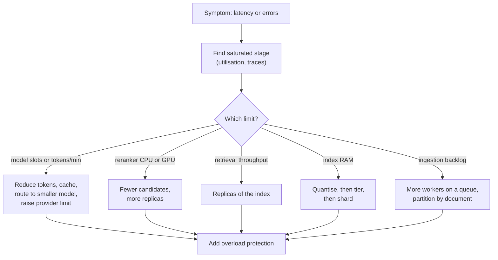
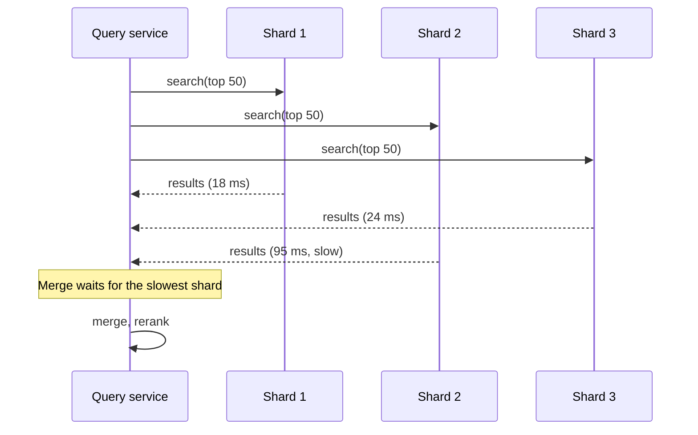

A [capacity plan](/learn/enterprise-rag-system-design/capacity-planning) tells you what the system needs today and in two years. **Scaling** is what you do when reality moves faster than the plan: the corpus grows to 100 million chunks, a new business unit joins, or a Monday surge saturates the language-model slots. The question is not "how do we make it bigger?" but "which limit are we hitting, and what is the cheapest change that moves it?"

This lesson is a decision guide. It lays out a **scaling ladder** in order of cost and risk, explains the difference between scaling for throughput (replicas) and scaling for data size (shards), and then examines two phenomena that surprise teams in production. The first is **tail amplification**: when one query fans out to many shards, the slowest shard sets the latency, so adding shards makes percentiles worse. The second is **overload**: without protection, a short surge turns into a long outage. You will simulate both and see what hedging, load shedding and graceful degradation buy. The queueing mathematics is in [scalable RAG systems](/learn/production-architecture/scalable-rag-systems), and the data-layer mechanics in [sharding](/learn/advanced-vector-database-engineering/sharding) and [replication](/learn/advanced-vector-database-engineering/replication); here we connect them into strategy.

## Learning objectives

- Order scaling interventions from cheapest to most expensive and say which limit each one relieves.
- Distinguish replicas from shards, and choose between them from the limit being hit.
- Explain and compute tail-latency amplification in scatter-gather retrieval, and describe how hedged requests reduce it.
- Choose a scaling signal for autoscaling that reflects the true bottleneck, and account for scale-out lag in a RAG system.
- Design overload protection (rate limits, load shedding, degradation) and evaluate it with a simulation.

## Prerequisites

- [Capacity planning](/learn/enterprise-rag-system-design/capacity-planning): the model whose limits you are now responding to.
- [Scalable RAG systems](/learn/production-architecture/scalable-rag-systems): utilisation, queues and the four dimensions of growth.
- [Sharding](/learn/advanced-vector-database-engineering/sharding) and [replication](/learn/advanced-vector-database-engineering/replication): how a vector database distributes data and copies it.

## Why this matters

Scaling mistakes are expensive in a particular way: they are made under pressure, with a production incident as the motivation. Three mistakes recur.

- **Scaling the wrong thing.** Adding replicas of a database that is memory-bound on index size does nothing, because each replica needs the whole index; adding API pods when generation slots are the limit does nothing.
- **Sharding too early.** Sharding multiplies operational complexity and, as shown below, worsens tail latency. A corpus that fits on one node should usually stay on one node.
- **No plan for overload.** A system with no admission control behaves well until the first surge, then degrades for everyone, including users who would have been served quickly if a few requests had been turned away.

A good scaling strategy therefore starts with measurement and with the cheapest change, keeps data in as few places as it fits, and decides in advance how the system behaves when demand exceeds capacity.

## The intuition

Think of a public library branch that has become too busy. The librarian has several options, and they are best tried in a sensible order. First she checks where the queue actually forms: is it the loan desk, or the shelves? Then she reduces work: self-service machines and a "most requested" shelf near the door (caching). She adds loan desks (replicas) if the queue is at the desk. If the building cannot hold the books any more, she opens a second branch and splits the collection by subject (shards), at the cost that a researcher whose question spans two subjects must visit both. And when the Saturday crowd is still too large, a marshal limits the door and offers a shorter queue for quick returns (load shedding and degradation), because a library where everyone waits two hours serves nobody.

Each of those has a RAG equivalent, and each has a downside the librarian also faces.

## How it works

### The scaling ladder

Work down this ladder and stop at the first rung that relieves the measured bottleneck. The order reflects cost and reversibility.

1. **Measure and find the binding constraint.** Use the stage-by-stage utilisation from the [capacity model](/learn/enterprise-rag-system-design/capacity-planning) and production traces ([tracing](/learn/rag-observability/tracing)). Never scale before you know which stage is saturated.
2. **Do less work per request.** Fewer reranker candidates, a shorter prompt, a smaller output limit, or a smaller model for easy queries. These are quality trade-offs and must be evaluated, but they cost nothing to run and they relieve generation, reranking and token limits at once.
3. **Avoid work: cache.** Cache what is safe to share: query embeddings, retrieval results keyed by query and permission set, and answers only where permissions allow ([caching strategies](/learn/cost-engineering/caching-strategies)).
4. **Scale up.** A bigger machine, more memory or a GPU. It is simple and has no distribution cost, which makes it the right answer more often than engineers expect, until a single machine's limits are reached.
5. **Replicate.** Run more identical copies of a stateless stage, or more replicas of an index, to add throughput and availability.
6. **Quantise and compress.** Reduce the memory per vector so the index fits on fewer machines ([scalar quantisation](/learn/vector-indexing-algorithms/scalar-quantisation), [product quantisation](/learn/vector-indexing-algorithms/product-quantisation)). This is data-size scaling without sharding.
7. **Tier the data.** Keep recent or frequently used chunks in a fast index, and older material in a cheaper, slower one, searched only when needed.
8. **Shard.** Split the index across machines when it no longer fits on one, or when write volume exceeds one node's capacity.
9. **Protect.** Rate limits, admission control, load shedding and degraded modes, so that the system bends instead of breaking. This rung is not last in time: you add it early, because it costs little.



### Replicas and shards solve different problems

This distinction is the most useful one in the lesson.

| | **Replicas** | **Shards** |
| --- | --- | --- |
| What each copy holds | The whole index | A part of the index |
| What it adds | Query throughput, availability | Data capacity, write throughput |
| Effect on memory per node | None; each node holds everything | Divides the index across nodes |
| Effect on query latency | None, or slightly better under load | Adds a fan-out: every query visits every shard, unless routed |
| Typical trigger | Retrieval utilisation too high; need to survive a node loss | Index no longer fits in RAM on one node |

If the problem is that the index does not fit, replicas cannot help. If the problem is request rate, shards cannot help (every query still visits every shard, and the work per query actually rises). Combined designs use both: each shard has replicas.

### Choosing a shard key

When sharding is unavoidable, the shard key decides how well it works:

- **By hash of chunk or document id.** Even distribution, simple, but every query must visit every shard (scatter-gather).
- **By tenant or business unit.** A query touches one shard, which gives isolation and lower latency, but shards are as uneven as tenants are, and a very large tenant can overflow a shard. This pairs naturally with [multi-tenant design](/learn/production-architecture/multi-tenant-rag).
- **By document type or time.** Useful for tiering: recent claims in one shard, closed historical claims in another, searched only when a query asks for them.

Where the access model allows it, routing a query to only the shards that can contain permitted content reduces both fan-out and exposure.

### Scatter-gather and tail amplification

With hash sharding, a query is sent to every shard and the results are merged. The query finishes when the **slowest** shard answers. Each shard occasionally has a slow response (a garbage collection pause, a cold cache, a competing background merge), and with many shards the chance that at least one is slow on a given query rises quickly. The effect is described precisely in the mathematics section and demonstrated in the code: median latency barely moves, but the 99th percentile, which users experience as "sometimes it hangs", gets worse with every shard you add.

Remedies include **fewer, bigger shards** (resist sharding beyond need), **routing** to reduce fan-out, **hedged requests** (send the same shard request to two replicas and use whichever answers first, at the price of extra load), and **timeouts with partial results** (return what arrived by a deadline, flagged as partial when completeness is not mandatory). Whether partial results are acceptable is a requirements question: for a compliance question, a silently incomplete retrieval could be worse than a slow one.



### Autoscaling for RAG

Autoscaling adds and removes copies of a stage based on a signal. Three points apply to RAG in particular.

**Choose the signal that reflects the bottleneck.** CPU utilisation is the default, and it is wrong for stages that wait on a model provider: a service holding 40 requests open on a remote model uses almost no CPU while being saturated. Scale generation workers on **in-flight requests** or **queue depth**, and rerankers on queue depth or accelerator utilisation.

**Account for lag.** A new API pod starts in seconds, but a new index replica must load or build its index (tens of gigabytes), and a new GPU worker must load a model. A surge that lasts two minutes is over before a heavy replica is ready. Autoscaling therefore suits slow-moving load and stateless stages; for index replicas, maintain the **minimum** capacity needed for the daily peak and use autoscaling only for the slow growth around it. Use scheduled scaling for predictable peaks (a known 09:00 surge) rather than hoping the signal will react in time.

**Prevent flapping.** Scale out quickly and scale in slowly, with a cool-down, because removing capacity during the brief lull between two bursts creates the next incident.

### Scaling ingestion

Ingestion scales differently from queries: it is throughput-oriented and can be delayed. Put documents on a queue ([queue-based pipelines](/learn/production-architecture/queue-based-pipelines)), run many stateless workers, partition by document id so one document is never processed twice concurrently, make each step idempotent so retries are harmless, and limit the embedding rate so a backfill cannot starve the query path of shared resources (a separate worker pool, or a lower priority).

### Scaling the language model

The generation model is usually the binding limit and the hardest to scale, because capacity belongs to a provider or to a GPU fleet. Levers, in order: reduce tokens per request; route easy queries to a smaller model; cache; request higher provider limits early, since approvals can take weeks; spread across multiple deployments or regions where the contract and residency allow; and keep a tested fallback model for overflow and outages ([model selection](/learn/cost-engineering/model-selection)).

### Protecting the system: admission control and degradation

Overload protection has three layers, and all three should exist before the first surge.

- **Rate limits** per user and per tenant, so one client cannot consume everyone's capacity.
- **Admission control and load shedding:** when the queue in front of a saturated stage exceeds a threshold, reject new requests quickly with a clear "busy, retry later" response. A fast rejection costs the user a retry; a slow failure costs them 30 seconds and still consumes a slot.
- **Graceful degradation:** serve something cheaper instead of nothing: a smaller model, fewer reranker candidates, a shorter answer, or retrieval results without a generated summary. [Reliability engineering](/learn/enterprise-rag-system-design/reliability-engineering) develops this into a full ladder.

## The mathematics

### Why more shards means a worse p99

**Intuition.** A query is slow if any shard is slow. Even if each shard is slow only 1 per cent of the time, with many shards the chance that at least one is slow becomes large.

If a single shard answers within time $t$ with probability $F(t)$, and the $S$ shards behave independently, the query answers within $t$ only if all do:

$$
P(\text{query} \le t) = F(t)^{S}
$$

To find the query's 99th percentile, set the left side to 0.99, so each shard must be inside its own $0.99^{1/S}$ quantile:

$$
q_S = 0.99^{1/S}
$$

**By hand.** With $S = 1$ the query's p99 is the shard's p99, $q = 0.99$. With $S = 16$, $q_{16} = 0.99^{1/16} = e^{\ln(0.99)/16} = e^{-0.000628} \approx 0.99937$. The query's p99 is therefore the shard's 99.94th percentile, far out in the tail. For 64 shards it is the 99.98th percentile.

**Hedging.** If each shard request is sent to two replicas and the first answer is used, a shard's response is slow only if both are slow: $F_{\text{hedged}} = 1 - (1 - F)^2$. A shard that is within its limit 99 per cent of the time is now within it $1 - 0.01^2 = 99.99$ per cent of the time, at the cost of twice the load on the shard tier. In practice, systems often hedge only after a short delay, so extra load stays small.

The code computes these numbers by simulation and by this formula.

## In code

The first simulation draws shard latencies from a lognormal distribution (a common model for service times, which has a long right tail). The median of 20 ms and the shape parameter are **assumptions** for illustration, not measurements of any engine. It needs only NumPy and SciPy:

```bash
pip install numpy scipy
```

```python
import numpy as np

rng = np.random.default_rng(42)
N = 200_000                      # simulated queries
MEDIAN_MS, SIGMA = 20.0, 0.6     # assumed per-shard latency: lognormal, median 20 ms


def shard_latency(size):
    return rng.lognormal(mean=np.log(MEDIAN_MS), sigma=SIGMA, size=size)


def pct(x, q):
    return float(np.percentile(x, q))


print(f"{'shards':>6} {'p50 ms':>8} {'p95 ms':>8} {'p99 ms':>8} {'p99 hedged':>11}")
for shards in (1, 4, 16, 64):
    plain = shard_latency((N, shards)).max(axis=1)                       # wait for the slowest shard
    two_replicas = np.minimum(shard_latency((N, shards)), shard_latency((N, shards)))
    hedged = two_replicas.max(axis=1)                                    # ask 2 replicas per shard, keep the first
    print(f"{shards:>6} {pct(plain, 50):>8.1f} {pct(plain, 95):>8.1f} {pct(plain, 99):>8.1f} {pct(hedged, 99):>11.1f}")

# Theory: P(max of S shards <= t) = F(t)^S, so the p99 of the maximum is the shard quantile 0.99^(1/S).
from scipy.stats import norm
print("\nShard quantile that sets the query's p99:")
for shards in (1, 4, 16, 64):
    q = 0.99 ** (1 / shards)
    t = MEDIAN_MS * np.exp(SIGMA * norm.ppf(q))
    print(f"  S={shards:>2}: shard quantile {q:.5f} -> {t:.1f} ms")
```


```output
shards   p50 ms   p95 ms   p99 ms  p99 hedged
     1     20.0     53.8     81.6        42.8
     4     36.4     76.4    107.7        53.7
    16     56.2    102.8    137.9        64.8
    64     79.4    132.7    174.1        76.3

Shard quantile that sets the query's p99:
  S= 1: shard quantile 0.99000 -> 80.8 ms
  S= 4: shard quantile 0.99749 -> 107.7 ms
  S=16: shard quantile 0.99937 -> 138.6 ms
  S=64: shard quantile 0.99984 -> 173.8 ms
```

**What the output means.** Going from one shard to 64 does not change the individual shard at all, yet the query's median rises from 20 to 79 ms and its p99 from 82 to 174 ms. The simulation and the formula agree (for example 137.9 against 138.6 ms at 16 shards; the small gaps are sampling noise). Hedging each shard request across two replicas roughly halves the p99 at every size, here 64.8 ms against 137.9 ms at 16 shards, and it does so by doubling the shard tier's load, which is the trade. Remember that the shard model is an assumption: real engines have different tails, so measure your own shard latency distribution before deciding that fan-out is or is not a problem.

The second simulation tests overload protection. It models the 19 generation slots from the capacity plan as a multi-server queue, with a two-minute surge to 5 requests per second against a slot capacity of about 3.2 per second (19 slots at a mean of 6 seconds). Users count a request as failed if it takes more than 30 seconds. All parameters are assumptions.

```python
import heapq
import numpy as np

SLOTS = 19                 # from the capacity plan
SIM_SECONDS = 1200
SURGE = (400, 520)         # a two-minute surge, e.g. everyone returns from a meeting
BASE_RATE, SURGE_RATE = 1.5, 5.0   # requests per second; slot capacity is 19 / 6 = 3.2 per second
FULL_MEAN_S, FAST_MEAN_S = 6.0, 2.0
GIVE_UP_S = 30.0           # a user who has waited this long counts the request as failed


def arrivals(rng):
    t, out = 0.0, []
    while t < SIM_SECONDS:
        rate = SURGE_RATE if SURGE[0] <= t < SURGE[1] else BASE_RATE
        t += rng.exponential(1 / rate)
        out.append(t)
    return out


def simulate(policy, seed=1):
    rng = np.random.default_rng(seed)
    free = [0.0] * SLOTS                  # time at which each slot becomes free
    heapq.heapify(free)
    waiting_starts = []                   # start times of requests that have not started yet
    lat, rejected, degraded = [], 0, 0
    for t in arrivals(rng):
        while waiting_starts and waiting_starts[0] <= t:
            heapq.heappop(waiting_starts)
        queue_len = len(waiting_starts)
        mean = FULL_MEAN_S
        if policy == "shed" and queue_len >= 30:
            rejected += 1
            continue
        if policy == "degrade" and queue_len >= 10:
            mean, degraded = FAST_MEAN_S, degraded + 1
        service = rng.lognormal(np.log(mean) - 0.125, 0.5)       # lognormal whose mean equals `mean`
        start = max(t, heapq.heappop(free))
        heapq.heappush(free, start + service)
        if start > t:
            heapq.heappush(waiting_starts, start)
        lat.append(start + service - t)
    lat = np.array(lat)
    n = len(lat) + rejected
    return dict(p50=np.percentile(lat, 50), p95=np.percentile(lat, 95),
                over_limit=(lat > GIVE_UP_S).sum() / n, rejected=rejected / n, degraded=degraded / n)


print(f"{'policy':>10} {'p50 s':>7} {'p95 s':>7} {'over 30 s':>10} {'rejected':>9} {'degraded':>9}")
for policy in ("none", "shed", "degrade"):
    r = simulate(policy)
    print(f"{policy:>10} {r['p50']:>7.1f} {r['p95']:>7.1f} {r['over_limit']:>10.1%} {r['rejected']:>9.1%} {r['degraded']:>9.1%}")
```

```output
    policy   p50 s   p95 s  over 30 s  rejected  degraded
      none     7.2    60.0      21.1%      0.0%      0.0%
      shed     6.1    16.8       0.1%      7.3%      0.0%
   degrade     5.3    11.9       0.1%      0.0%     13.5%
```

**How it works.** A min-heap holds the time each slot next becomes free; a request starts at the later of its arrival and the earliest free slot, which models first-come, first-served queueing exactly. A second heap tracks requests that have been admitted but not started, giving the queue length at each arrival. The `shed` policy rejects an arrival when 30 requests are already waiting. The `degrade` policy serves a cheaper answer, with a mean slot time of 2 seconds instead of 6, once 10 are waiting. Service times are lognormal, and the `- 0.125` term makes the mean exact, since the mean of a lognormal is $e^{\mu + \sigma^2/2}$ and $\sigma^2/2 = 0.125$ for $\sigma = 0.5$.

**What the output means.** With no protection, a two-minute surge pushes the p95 to 60 seconds and about 21 per cent of all requests in the 20-minute window exceed 30 seconds: the queue built during the surge takes minutes to drain, and everyone who arrives meanwhile waits behind it. Shedding turns away 7.3 per cent of requests quickly and keeps the p95 of served requests under 17 seconds, with only 0.1 per cent over the limit. Degrading rejects nobody, answers 13.5 per cent of requests with the cheaper path, and has the best p95 (11.9 seconds), because the faster path raises capacity exactly when it is needed, at a quality cost that must be acceptable. Neither is free: shedding costs some users a retry, degrading costs quality, and the choice should come from the requirements sheet.

**Common errors.** Setting the shed threshold by guesswork rather than from the target wait (a queue of 30 with 19 slots and a 6-second mean means roughly 9 more seconds of waiting, which is why 30 works here), counting rejected requests as successes in dashboards, and failing to make clients back off, so that retries multiply the surge.

**Extending it.** Add an autoscaler that adds slots after a lag of 90 seconds and see that it helps only when surges last longer than the lag. Add per-tenant limits so one tenant cannot cause shedding for others.

## A real-world example

Eighteen months into production, Northgate's corpus is 45 million chunks and three new regional business units are joining. The platform team compares options using the ladder rather than its instincts.

Index memory first. With the 384-dimension model and int8 scalar quantisation adopted last year, the index needs about 516 bytes per vector, so 100 million chunks would take about 79 GB per replica at a 0.65 fill factor. Even the optimistic growth case fits on a single large node, and the team decides **not to shard**; the plan records that the trigger to reconsider is a projected index above roughly 200 GB per replica.

Throughput next. Retrieval utilisation peaks at 55 per cent, so no change is needed, but the node loss test showed that a single failure would put the survivor over 100 per cent, so the team adds a third replica, chosen for availability rather than speed.

Then the real trouble: on the Monday after a holiday, generation slots saturate for six minutes and the p95 reaches 40 seconds. The queue was never bounded. The team adds per-user rate limits, a bounded queue that returns a "busy, please retry" message beyond a threshold, and a degraded mode that drops reranker candidates from 50 to 20 and switches to a smaller model when the queue exceeds a second threshold. They also schedule extra generation concurrency for 08:30 to 10:30 on weekdays instead of relying on a reactive signal, because the provider's new capacity takes minutes to appear.

Finally, the regional units need data isolation. Because queries from one unit never need another unit's documents, the team routes by business unit to separate collections on the same nodes. Each query now touches one collection instead of fanning out, which also removes the tail-amplification risk the simulation described.

## Common mistakes

- **Scaling before measuring.** Without stage-level utilisation, you scale the loudest component rather than the saturated one.
- **Sharding to fix throughput.** Shards divide data, not request load; every query still visits all of them, and tail latency worsens.
- **Replicating to fix memory.** Each replica holds the whole index, so memory per node is unchanged.
- **Autoscaling on CPU for model-bound stages.** A service waiting on a remote model shows low CPU while saturated, so it never scales out.
- **Expecting autoscaling to catch short surges.** Index replicas and model workers take minutes to be ready; a two-minute surge is over first.
- **Unbounded queues.** A queue with no limit turns a surge into minutes of delay for every user and can hold requests no one is still waiting for.
- **Retries without backoff.** Clients that retry immediately multiply the surge into a retry storm.
- **Hedging everything.** Sending every request twice doubles load; hedge only the slow tail, after a delay, or only for latency-critical paths.

## Best practices

- Identify the binding constraint with per-stage utilisation and traces before changing anything.
- Climb the ladder in order: reduce work, cache, scale up, replicate, quantise, tier, then shard.
- Keep the corpus on as few nodes as it fits, and write down the trigger that justifies sharding.
- Prefer routing queries to the relevant shard or collection over scatter-gather when the access model allows it.
- Scale model-bound stages on in-flight requests or queue depth, scale out quickly and in slowly, and schedule capacity for known peaks.
- Add rate limits, a bounded queue with fast rejection, and a degraded mode before the first surge.
- Require client backoff with jitter and a retry budget.
- Test scaling decisions with simulations or load tests that include a surge, not only steady load.

## Performance considerations

The numbers in this lesson show the shape of the trade-offs. At 16 shards in the simulation, the query's median is almost three times a single shard's and the p99 about 1.7 times; hedging recovers most of the p99 for roughly double the shard load. Replicas scale throughput almost linearly while the stage is the bottleneck, but each one holds the whole index, so memory cost scales with replica count. Quantisation is the cheapest data-size lever: int8 vectors cut the vector memory to a quarter, which may postpone sharding for years, at an accuracy cost to be measured ([recall versus latency](/learn/vector-indexing-algorithms/recall-versus-latency)).

For queues, the arithmetic of the simulation generalises: a surge of duration $D$ at rate $\lambda_s$ above a capacity $\mu$ leaves a backlog of $(\lambda_s - \mu)D$ requests, drained at the surplus capacity $\mu - \lambda_b$ under base rate $\lambda_b$. Here $(5 - 3.17) \times 120 \approx 220$ requests, drained at about $1.67$ per second, so the backlog takes over two minutes to clear after the surge ends, which explains the long tail of delay in the unprotected run. Autoscaling that takes 90 seconds to add capacity shortens the second half of that curve but cannot prevent the first.

## Security considerations

Scaling features are also attack surfaces and isolation boundaries. Rate limits and admission control are your first defence against resource-exhaustion attacks, including prompt-stuffing that inflates token use; apply them per user and per tenant, before the expensive stages. Shards and caches must carry permissions: a hedged or replicated request must apply the same access filter on every path, and a result cache must be keyed on the permission set. Routing by tenant improves isolation but only if routing decisions come from verified identity, not from a client-supplied header. Partial results returned after a timeout must not reveal that a shard contained matching documents the user may not see. Finally, autoscaled nodes must join with the same hardening, encryption and credential handling as the original ones.

## Summary

- Scale by a ladder: measure, do less work, cache, scale up, replicate, quantise, tier, shard, and protect, stopping at the first rung that relieves the bottleneck.
- Replicas add throughput and availability but not data capacity; shards add data capacity but not throughput, and add fan-out.
- In scatter-gather retrieval the slowest shard sets query latency, so p99 worsens as shards are added; routing, fewer shards and hedging reduce the effect.
- Autoscale model-bound stages on in-flight requests or queue depth, allow for the lag of heavy replicas, and schedule capacity for predictable peaks.
- Add rate limits, a bounded queue with fast rejection and a degraded mode before the first surge; a simulation shows they cap the damage of an overload.
- Write down the trigger for each scaling step so that decisions are driven by measured limits.

## Exercises

**1. Replicas or shards?** For each situation, say which you would add: (a) retrieval nodes at 90 per cent CPU with the index at 40 per cent of RAM; (b) the index at 95 per cent of RAM on every node, CPU at 30 per cent; (c) a node loss test that shows the survivor overloaded.

<details><summary>Show solution</summary>

(a) Replicas: the data fits, the problem is request rate. (b) First reduce memory per vector (quantisation) or tier cold data; if that is insufficient, shard, because replicas would each need the whole index. (c) Replicas, for redundancy: size them so the remaining nodes carry the load after one failure (N+1).

</details>

**2. Compute the tail.** A shard exceeds its 200 ms target 2 per cent of the time, and shards behave independently. What fraction of queries exceed 200 ms with 10 shards? With 10 shards and hedging across two replicas per shard?

<details><summary>Show solution</summary>

Without hedging, the probability that all ten are within target is 0.98^10 = 0.817, so about 18.3 per cent of queries exceed 200 ms. With hedging, a shard misses the target only if both replicas do, probability 0.02^2 = 0.0004; all ten are within target with probability (1 - 0.0004)^10 = 0.996, so about 0.4 per cent exceed it. The assumption that replicas fail independently matters: if both replicas share a slow disk or a noisy host, the improvement is smaller.

</details>

**3. Choose the autoscaling signal.** A generation worker pool calls a remote model; each worker is mostly idle waiting for the network. CPU averages 12 per cent while users report long waits. Propose a scaling signal, a scale-out and scale-in policy, and the minimum size.

<details><summary>Show solution</summary>

Scale on in-flight requests per worker (or queue depth), not CPU. Scale out when average in-flight requests exceed about 70 per cent of the per-worker concurrency limit for one to two minutes; scale in only when it stays below about 40 per cent for ten to fifteen minutes, removing one worker at a time. Set the minimum from the capacity plan's daily peak so that the pool never needs to scale to meet the predictable peak, and add scheduled scale-out ahead of known peaks. Also bound the queue so that when workers are saturated, new requests are rejected or degraded instead of waiting indefinitely.

</details>

**4. Extend the simulation.** Modify `simulate` to add a policy `"autoscale"` that adds 10 extra slots 90 seconds after the queue first exceeds 10, and compare it with the others. What do you expect, and what does the result say about surge length?

<details><summary>Show solution</summary>

Track the time `t_trigger` when `queue_len` first reaches 10, and from `t_trigger + 90` onward add 10 entries to the `free` heap (each with free time equal to the activation time). Expect it to beat "none" noticeably because the two-minute surge outlasts the 90-second lag, but to remain worse than shedding or degrading on p95, since the backlog formed in the first 90 seconds still has to drain. For a 20-second surge it would make no difference, because the surge is over before the capacity arrives; for a 20-minute surge it would be the best policy. The lesson is that autoscaling must be matched to the duration of the load changes you actually see, and complemented by admission control for the short ones.

</details>

## Check your understanding

```quiz
[
  {
    "q": "A retrieval cluster's index uses 95 per cent of RAM on every node while CPU is at 30 per cent. What is the right first response?",
    "options": [
      "Add more replicas.",
      "Reduce memory per vector, tier cold data, and shard only if that is not enough.",
      "Increase the burst factor.",
      "Add API pods."
    ],
    "answer": 1,
    "why": "Replicas each hold the whole index, so they do not relieve memory; memory per vector or data placement must change."
  },
  {
    "q": "Each of 16 independent shards is slow 1 per cent of the time. Roughly how often is a scatter-gather query slow?",
    "options": [
      "1 per cent",
      "About 15 per cent",
      "16 per cent",
      "About 50 per cent"
    ],
    "answer": 1,
    "why": "The probability that all 16 are fast is 0.99^16, about 0.85, so about 15 per cent of queries hit at least one slow shard."
  },
  {
    "q": "Why is CPU a poor autoscaling signal for a pool that calls a remote language model?",
    "options": [
      "Remote calls use all the CPU.",
      "Workers wait on the network, so CPU stays low even when the pool is saturated.",
      "CPU cannot be measured in containers.",
      "Models run on CPU."
    ],
    "answer": 1,
    "why": "Saturation shows up as many in-flight requests or a growing queue, not as CPU use."
  },
  {
    "q": "In the overload simulation, why does degrading to a cheaper path give a lower p95 than shedding?",
    "options": [
      "It rejects more users.",
      "It raises effective capacity during the surge, so the queue drains faster without refusing anyone.",
      "It removes the queue entirely.",
      "It uses fewer slots."
    ],
    "answer": 1,
    "why": "A 2-second path lets each slot serve three times as many requests, which clears the backlog quickly, at some cost in answer quality."
  },
  {
    "q": "What does hedging a shard request across two replicas cost?",
    "options": [
      "Nothing.",
      "Additional load on the shard tier, roughly double if every request is hedged.",
      "Lower recall.",
      "A larger index on each replica."
    ],
    "answer": 1,
    "why": "Hedging trades extra load for a smaller slow tail; delaying the second request reduces the extra load."
  }
]
```

## Further reading

- Jeffrey Dean and Luiz André Barroso, 2013, "The Tail at Scale", *Communications of the ACM*: the standard account of tail-latency amplification and hedged requests.
- Google, *Site Reliability Engineering*, chapters on handling overload and load balancing (available free from Google).
- Martin Kleppmann, *Designing Data-Intensive Applications*, chapter on partitioning and replication.
- Marc Brooker, writing on timeouts, retries and backoff with jitter in the Amazon Builders' Library (search for "Timeouts, retries and backoff with jitter").
- Kubernetes documentation on the Horizontal Pod Autoscaler: <https://kubernetes.io/docs/tasks/run-application/horizontal-pod-autoscale/>.
