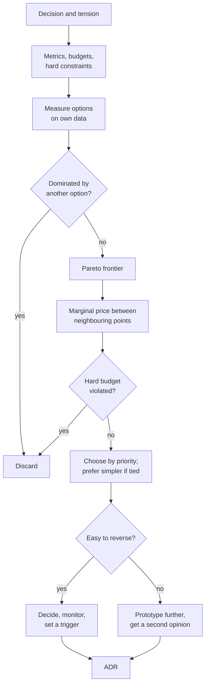

Every lesson in this module has ended in a choice that costs something: a stricter freshness target costs ingestion effort, a bigger model costs latency and money, a replica costs memory, a fallback costs quality. Engineering an enterprise RAG system is largely the practice of making such trades deliberately, with evidence, and in a form that other people can inspect and later reverse. This final lesson of the module pulls that practice together.

You will learn the standing tensions in RAG design, a method for reasoning about any trade-off (quantify both sides, find the options that are not strictly worse than another, decide by constraint first and preference second), how to weigh a choice by how easily it can be undone, and how to record it so the reasoning survives. The centrepiece is an experiment that measures a trade-off most teams only argue about: what an extra retrieval stage buys in quality and what it costs in latency. The answer on the data we use is a useful surprise, and the lesson is why.

## Learning objectives

- Name the recurring trade-offs in RAG design and the quantities that express each side.
- Identify dominated options and a Pareto frontier from measurements, and compute the marginal cost of extra quality.
- Distinguish reversible from hard-to-reverse decisions, and set the depth of analysis accordingly.
- Derive an answer-or-abstain threshold from the relative cost of wrong and right answers.
- Write an architecture decision record that makes a trade-off, its evidence and its reopening trigger explicit.

## Prerequisites

- [Requirements gathering](/learn/enterprise-rag-system-design/requirements-gathering) and [architecture selection](/learn/enterprise-rag-system-design/architecture-selection): the constraints and decision records this lesson builds on.
- [Technology selection](/learn/enterprise-rag-system-design/technology-selection): the bake-off method and the paired bootstrap.
- [Cost estimation](/learn/enterprise-rag-system-design/cost-estimation) and [reliability engineering](/learn/enterprise-rag-system-design/reliability-engineering): the cost and degradation models used below.
- [Recall versus latency](/learn/vector-indexing-algorithms/recall-versus-latency) and [cost-performance trade-offs](/learn/cost-engineering/cost-performance-trade-offs): earlier treatments of two specific trade-offs.

## Why this matters

Design arguments in a team often go wrong in one of four ways. People **defend a position without numbers**, so the loudest voice wins. They **treat a trade-off as free** ("it is just a better model"), so costs appear later as latency incidents and budget overruns. They **optimise one metric** (retrieval recall, say) while a neighbouring one (cost per answer, time to first token) deteriorates unnoticed. Or they **make a hard-to-reverse choice casually** and a reversible one with great ceremony.

A disciplined approach prevents all four. It makes both sides of each trade-off measurable, discards options that are strictly worse than another, spends analytical effort where reversal is expensive, and records the decision. An extra stage that costs a third of a second and improves nothing on your corpus is not a trade-off at all; it is a loss, and only measurement shows it.

## The intuition

A photographer choosing equipment faces a familiar set of tensions: a heavier lens gives sharper pictures but tires the shoulder on a long walk; a faster shutter freezes motion but needs more light. She does not ask for the best lens in the abstract. She drops options that are plainly worse than another (a lens both heavier and less sharp than a rival), then chooses among the rest by the constraint that bites: on a ten-mile walk, weight wins.

RAG design works the same way. The best configuration depends on the question mix, the latency budget and the consequence of a wrong answer, so the useful questions are "which options are strictly worse than another?" and "which constraint binds?", not "what is best?".

## How it works

### The standing tensions in RAG

These pairs recur in every enterprise design. Each is worth stating as a measurable pair, because "quality versus latency" is a slogan until you can name the metric on each side.

| Tension | Quality-side quantity | Cost-side quantity | Where it appears |
| --- | --- | --- | --- |
| **Retrieval depth** | Recall@k, nDCG@k | Reranker pairs per query, latency, tokens | Candidate count, top-k |
| **Quality versus latency** | nDCG, groundedness | p95 time to first token | Reranking, query rewriting, agents |
| **Quality versus cost** | Answer correctness | Pounds per query | Model size, context length |
| **Recall versus precision** | Share of relevant chunks found | Noise in the prompt, tokens | Number of chunks in context |
| **Chunk size** | Context per chunk | Specificity of match | Chunking ([chunk size experiments](/learn/chunking-optimisation/chunk-size-experiments)) |
| **Freshness versus effort** | Age of the newest searchable fact | Ingestion compute, operational load | Streaming versus batch ingestion |
| **Coverage versus risk** | Share of questions answered | Wrong answers given | Abstention threshold |
| **Security versus performance** | Correct, permission-filtered results | Filter cost, no shared caches | Pre-filtering, per-user cache keys |
| **Consistency versus availability** | Always-correct, always-fresh index | Downtime or stale answers | Replication, failover |
| **Isolation versus efficiency** | Tenant separation | Idle capacity, cost | Per-tenant collections versus a shared index |
| **Flexibility versus simplicity** | Ability to change components | Moving parts, operational burden | Frameworks, agents, microservices |
| **Build versus buy** | Fit, control | Time, vendor dependence, lock-in | Platform choices |

### A method for any trade-off

1. **State the decision and the tension.** One sentence for each: "Should we rerank the top 50 candidates? Quality against latency and cost."
2. **Name the metric on each side, and the budget.** For example, nDCG@10 against p95 latency, with a budget of 4 seconds for the whole path and a reranker share of at most 500 ms.
3. **Measure each option on your data.** Use the golden set and a replay of realistic load, with fixed seeds, and report the same metrics for each option.
4. **Remove dominated options.** An option is **dominated** if another is at least as good on every metric and strictly better on one. Dominated options are not trade-offs; they are mistakes, and they should vanish from the discussion.
5. **Examine the frontier.** The remaining options form the **Pareto frontier**: moving along it, you gain on one axis only by losing on another. Compute the **marginal price** between neighbouring points: how many milliseconds or pence per additional point of quality.
6. **Decide by constraint, then preference.** Remove options that violate a hard budget, then choose among the rest by the stated priorities, favouring the cheaper or simpler option when quality differences are within noise (see the bootstrap in [technology selection](/learn/enterprise-rag-system-design/technology-selection)).
7. **Weigh reversibility.** Prefer the option that keeps future choices open when the evidence is thin.
8. **Record it** in an ADR with the evidence and the trigger that would reopen it.



### Dominance and the frontier

Dominance is the most useful idea in the method because it is unarguable. If configuration X is both faster and more accurate than Y, nobody needs to debate Y. In practice, teams routinely run dominated configurations for months because the extra stage was added by someone confident that it must help, and nobody measured.

The frontier shows what the real choices are. Between two neighbouring frontier points, the **marginal price** is the extra latency (or cost) divided by the extra quality. Marginal prices usually rise steeply: the first improvement is cheap, the last very expensive.  A marginal price of 0.02 quality points per additional second says the last step is poor value unless the application is unusually quality-sensitive.

### Reversibility and optionality

Decisions differ in how costly they are to undo, and effort should follow. A **two-way door** can be walked back cheaply: swapping the reranker, changing the number of retrieved chunks, switching the generation model behind an interface. Decide quickly, measure, and adjust. A **one-way door** is expensive to reverse: the embedding model, the chunking scheme, the permission model, the choice of tenant isolation, a vendor contract with data egress costs. Spend your analysis there. Where evidence is thin, favour options that preserve choice: version the embedding and chunking configuration, store the model identifier with each vector, hide components behind interfaces, and delay the irreversible decision when delay is cheap.

### Common reasoning traps

- **Optimising a proxy.** Recall@50 can improve while answer correctness does not. Evaluate the end-to-end outcome.
- **Second-order effects.** More reranker candidates raise reranker load, which raises latency under concurrency, which triggers autoscaling, which raises cost. Trace the consequences through the [capacity model](/learn/enterprise-rag-system-design/capacity-planning).

## The mathematics

### Dominance and marginal price

**Intuition.** Compare options on two axes at once; drop any that another beats on both; then price the steps along what remains.

For options $i$ with latency $\ell_i$ (lower is better) and quality $q_i$ (higher is better), option $j$ **dominates** $i$ if

$$
\ell_j \le \ell_i, \quad q_j \ge q_i, \quad \text{and at least one inequality is strict.}
$$

The frontier is the set of options no other option dominates. For consecutive frontier options $a$ and $b$ sorted by latency, the marginal price of quality is

$$
\pi_{a \to b} = \frac{\ell_b - \ell_a}{q_b - q_a}
$$

in milliseconds per quality point (or its reciprocal, quality per second).

**By hand.** Take hypothetical options $A = (120\,\text{ms}, 0.70)$, $B = (300, 0.74)$ and $D = (900, 0.75)$. Moving from A to B costs 180 ms for 0.04 quality, a price of 4,500 ms per point (0.22 points per second). Moving from B to D costs 600 ms for 0.01, a price of 60,000 ms per point (0.02 points per second). The second step is 13 times worse value than the first. Whether D is justified depends on what that last hundredth of quality is worth, and on whether it exceeds the noise in the evaluation.

### The answer-or-abstain threshold

**Intuition.** Answering is a bet. If the answer is right you gain its value $V$; if it is wrong you lose $L$ (the cost of acting on a wrong answer, or of the rework it causes). Abstaining costs nothing in this simple model. You should answer only if the expected gain is positive.

$$
p\,V - (1-p)\,L > 0 \quad\Longleftrightarrow\quad p > \frac{L}{V + L}
$$

Here $p$ is the probability that the answer is correct, which in practice must be estimated from a calibrated confidence signal, such as a faithfulness score validated against human judgements.

**By hand.** If a wrong answer costs three times what a right one is worth ($L = 3V$), then $p > 3/4 = 0.75$. If wrong answers are nine times as costly (a claims decision that is hard to reverse), $p > 0.9$. The higher the cost of error, the more questions the system should refuse, and the coverage you give up is the price of that safety. This is the formal reason that requirements gathering should ask about wrong-answer cost: it sets the threshold.

## In code

The experiment compares eight retrieval configurations on **SciFact** from the BEIR benchmark (5,183 abstracts, 300 test claims with known relevant documents), the same dataset used in [technology selection](/learn/enterprise-rag-system-design/technology-selection). Dense retrieval uses the `bge-small-en-v1.5` embeddings from that lesson, the keyword side uses BM25 from `rank_bm25`, hybrid fusion is Reciprocal Rank Fusion ([reciprocal rank fusion](/learn/hybrid-search/reciprocal-rank-fusion)), and reranking uses either the small `cross-encoder/ms-marco-MiniLM-L-6-v2` or the larger `BAAI/bge-reranker-base`, over the top 20 or 50 candidates. Each query's full path (query encoding, search, fusion, reranking) is timed, and nDCG@10 and Recall@10 are computed against the relevance judgements. Timings come from a laptop CPU, so read them as relative costs, not as production figures. SciFact is a scientific-claim corpus, so what it shows about these models need not carry over to yours; that is precisely the point of measuring.

```bash
pip install sentence-transformers rank-bm25 pandas numpy huggingface_hub
```

The script assumes the file `emb_bge-small-en-v1.5.npy`, which is the document-embedding file saved by the bake-off script in [technology selection](/learn/enterprise-rag-system-design/technology-selection); run that first, or encode the documents here with the same model.

```python
"""Quality-versus-latency trade-off for eight retrieval configurations on SciFact (BEIR)."""
import re
import time
import numpy as np
import pandas as pd
from huggingface_hub import hf_hub_download
from rank_bm25 import BM25Okapi
from sentence_transformers import CrossEncoder, SentenceTransformer

np.random.seed(0)


def get(repo, path):
    return hf_hub_download(repo, path, repo_type="dataset")


corpus = pd.read_parquet(get("BeIR/scifact", "corpus/corpus-00000-of-00001.parquet"))
queries = pd.read_parquet(get("BeIR/scifact", "queries/queries-00000-of-00001.parquet"))
qrels = pd.read_csv(get("BeIR/scifact-qrels", "test.tsv"), sep="\t", dtype=str)
relevant = qrels.groupby("query-id")["corpus-id"].apply(set).to_dict()
queries = queries[queries["_id"].isin(relevant)].reset_index(drop=True)
doc_ids = corpus["_id"].to_numpy()
docs = (corpus["title"] + ". " + corpus["text"]).tolist()
claims = queries["text"].tolist()

tok = lambda s: re.findall(r"[a-z0-9]+", s.lower())
bm25 = BM25Okapi([tok(d) for d in docs])
D = np.load("emb_bge-small-en-v1.5.npy")                  # saved by the bake-off script
bge = SentenceTransformer("BAAI/bge-small-en-v1.5", device="cpu")
bge.max_seq_length = 256
rerankers = {
    "MiniLM": CrossEncoder("cross-encoder/ms-marco-MiniLM-L-6-v2", device="cpu", max_length=256),
    "bge-base": CrossEncoder("BAAI/bge-reranker-base", device="cpu", max_length=256),
}
PREFIX = "Represent this sentence for searching relevant passages: "
for m in rerankers.values():
    m.predict([(c, docs[0]) for c in claims[:32]], batch_size=32)   # warm-up at the real batch size


def rrf(rank_lists, k=60):
    score = {}
    for ranks in rank_lists:
        for r, d in enumerate(ranks):
            score[d] = score.get(d, 0.0) + 1.0 / (k + r + 1)
    return [d for d, _ in sorted(score.items(), key=lambda kv: -kv[1])]


def run(use_bm25, rerank_depth, reranker):
    out, lat = [], []
    for c in claims:
        t0 = time.perf_counter()
        q = bge.encode([PREFIX + c], normalize_embeddings=True)[0]
        dense = np.argsort(-(D @ q))[:100].tolist()
        if use_bm25:
            sparse = np.argsort(-bm25.get_scores(tok(c)))[:100].tolist()
            cands = rrf([dense, sparse])
        else:
            cands = dense
        if rerank_depth:
            head = cands[:rerank_depth]
            scores = rerankers[reranker].predict([(c, docs[i]) for i in head], batch_size=32)
            cands = [head[j] for j in np.argsort(-scores)]
        lat.append((time.perf_counter() - t0) * 1000)
        out.append(cands[:10])
    ndcg, rec = [], []
    for i, qid in enumerate(queries["_id"]):
        rel = relevant[qid]
        hits = [doc_ids[j] in rel for j in out[i]]
        ndcg.append(sum(h / np.log2(r + 2) for r, h in enumerate(hits)) / sum(1 / np.log2(r + 2) for r in range(min(len(rel), 10))))
        rec.append(sum(hits) / len(rel))
    return float(np.mean(ndcg)), float(np.mean(rec)), float(np.median(lat)), float(np.percentile(lat, 95))


CONFIGS = [("dense", False, 0, None), ("hybrid (RRF)", True, 0, None),
           ("dense + MiniLM rerank 20", False, 20, "MiniLM"), ("dense + MiniLM rerank 50", False, 50, "MiniLM"),
           ("hybrid + MiniLM rerank 20", True, 20, "MiniLM"), ("hybrid + MiniLM rerank 50", True, 50, "MiniLM"),
           ("dense + bge-base rerank 20", False, 20, "bge-base"), ("hybrid + bge-base rerank 20", True, 20, "bge-base")]
rows = []
for name, use_bm25, depth, reranker in CONFIGS:
    ndcg, rec, p50, p95 = run(use_bm25, depth, reranker)
    rows.append(dict(config=name, pairs=depth, ndcg10=round(ndcg, 3), recall10=round(rec, 3), p50_ms=round(p50), p95_ms=round(p95)))
df = pd.DataFrame(rows)
# A configuration is on the frontier if no other is at least as good on both axes and better on one.
df["frontier"] = [not any((o.p50_ms <= r.p50_ms and o.ndcg10 >= r.ndcg10) and (o.p50_ms < r.p50_ms or o.ndcg10 > r.ndcg10)
                          for o in df.itertuples()) for r in df.itertuples()]
print(df.to_string(index=False))
df.to_csv("tradeoff.csv", index=False)
```

```output
                     config  pairs  ndcg10  recall10  p50_ms  p95_ms  frontier
                      dense      0   0.703     0.816       5       6      True
               hybrid (RRF)      0   0.703     0.819      12      18     False
   dense + MiniLM rerank 20     20   0.690     0.816     145     147     False
   dense + MiniLM rerank 50     50   0.691     0.809     359     367     False
  hybrid + MiniLM rerank 20     20   0.683     0.817     156     161     False
  hybrid + MiniLM rerank 50     50   0.686     0.809     369     381     False
 dense + bge-base rerank 20     20   0.693     0.805     763     770     False
hybrid + bge-base rerank 20     20   0.681     0.814     767     775     False
```

**What the output means.** On this dataset and these models, plain dense retrieval is the only point on the frontier: every other configuration is slower and no better. Hybrid fusion ties on nDCG@10 (0.703) for 7 extra milliseconds, and its slightly higher Recall@10 (0.819 against 0.816) is well within noise. Every reranker configuration lowered nDCG@10 by 0.01 to 0.02 while adding between 140 and 760 ms: the small MiniLM cross-encoder costs about 140 ms at 20 candidates and about 350 ms at 50, scaling with the 2.5 times larger number of pairs, and the base-size reranker costs about 760 ms at 20.

Be careful about what this does and does not show. It does not show that rerankers are useless. The MiniLM cross-encoder was trained on web-search passages, SciFact asks whether an abstract supports or refutes a scientific claim, and all texts were truncated to 256 tokens; a gap of 0.01 to 0.02 on 300 queries is also within what a bootstrap would call noise. What is certain is the cost side: the latency increase is large and exact. The lesson is the decision rule it supports: an extra stage must earn its place on your own data, because on some corpus and model pairs it is dominated and the team pays for it in every request. On Northgate's identifier-heavy questions the answer may well differ, which is why the team measures them, as the example below shows.

The second script reads that table and applies the method: it names what dominates each configuration, shows what a frontier and its marginal prices look like when stages *do* pay for themselves (using a clearly labelled hypothetical table), and prints the abstention thresholds.

```python
import pandas as pd


def dominators(options, name):
    """Names of options at least as fast and at least as good as `name`, and strictly better on one axis."""
    lat, q = options[name]
    return [o for o, (l2, q2) in options.items()
            if o != name and l2 <= lat and q2 >= q and (l2 < lat or q2 > q)]


# 1. The measured table from the experiment above.
df = pd.read_csv("tradeoff.csv")
measured = {r.config: (r.p50_ms, r.ndcg10) for r in df.itertuples()}
base_lat, base_q = measured["dense"]
print("Price of each extra stage, relative to dense retrieval alone (measured):")
for name, (lat, q) in measured.items():
    if name == "dense":
        continue
    print(f"  {name:30s} {lat - base_lat:>+5} ms  {q - base_q:>+7.3f} nDCG@10   dominated by: {', '.join(dominators(measured, name)) or 'none'}")

# 2. A HYPOTHETICAL table in which the extra stages do help, to show frontier and marginal analysis.
toy = {"A": (120, 0.70), "B": (300, 0.74), "C": (310, 0.72), "D": (900, 0.75), "E": (150, 0.70)}
front = sorted((n for n in toy if not dominators(toy, n)), key=lambda n: toy[n][0])
print("\nHypothetical options on the frontier:", front)
for a, b in zip(front, front[1:]):
    gain, cost = toy[b][1] - toy[a][1], toy[b][0] - toy[a][0]
    print(f"  {a} -> {b}: +{gain:.2f} quality for +{cost} ms = {gain / cost * 1000:.2f} quality points per second")

# 3. Answer or abstain: answer only if p * V > (1 - p) * L, i.e. p > L / (V + L).
print("\nAnswer-or-abstain threshold:")
for loss in (1, 3, 9, 19):
    print(f"  wrong answer costs {loss:>2}x the value of a right one -> answer only above p = {loss / (1 + loss):.2f}")
```

```output
Price of each extra stage, relative to dense retrieval alone (measured):
  hybrid (RRF)                      +7 ms   +0.000 nDCG@10   dominated by: dense
  dense + MiniLM rerank 20        +140 ms   -0.013 nDCG@10   dominated by: dense, hybrid (RRF)
  dense + MiniLM rerank 50        +354 ms   -0.012 nDCG@10   dominated by: dense, hybrid (RRF)
  hybrid + MiniLM rerank 20       +151 ms   -0.020 nDCG@10   dominated by: dense, hybrid (RRF), dense + MiniLM rerank 20
  hybrid + MiniLM rerank 50       +364 ms   -0.017 nDCG@10   dominated by: dense, hybrid (RRF), dense + MiniLM rerank 20, dense + MiniLM rerank 50
  dense + bge-base rerank 20      +758 ms   -0.010 nDCG@10   dominated by: dense, hybrid (RRF)
  hybrid + bge-base rerank 20     +762 ms   -0.022 nDCG@10   dominated by: dense, hybrid (RRF), dense + MiniLM rerank 20, dense + MiniLM rerank 50, hybrid + MiniLM rerank 20, hybrid + MiniLM rerank 50, dense + bge-base rerank 20

Hypothetical options on the frontier: ['A', 'B', 'D']
  A -> B: +0.04 quality for +180 ms = 0.22 quality points per second
  B -> D: +0.01 quality for +600 ms = 0.02 quality points per second

Answer-or-abstain threshold:
  wrong answer costs  1x the value of a right one -> answer only above p = 0.50
  wrong answer costs  3x the value of a right one -> answer only above p = 0.75
  wrong answer costs  9x the value of a right one -> answer only above p = 0.90
  wrong answer costs 19x the value of a right one -> answer only above p = 0.95
```

**How it works.** `dominators` implements the definition from the mathematics section and returns, for each option, every option that beats it. Section 1 expresses each configuration's price as extra milliseconds and the change in nDCG@10 against plain dense retrieval, and names its dominators. Section 2 is not data: it is a made-up table, labelled as such, showing a frontier of three points, A, B and D (E is dominated by A, and C by B), and the marginal prices between them: 0.22 quality points per second for the first step and 0.02 for the second, so the last step is thirteen times worse value. Section 3 evaluates $p > L/(V+L)$ for several loss ratios.

**Common errors.** Comparing configurations on different query sets or at different times of day, so that timing noise masquerades as an effect; judging a stage on Recall@50 instead of the end-to-end metric; and forgetting that latency under concurrent load, not single-query latency, is what the capacity plan needs.

**Extending it.** Replace SciFact with your question log and a sample of your documents, add answer-level metrics so the frontier is on end-to-end quality, report slices by question type, and bootstrap the differences before pruning anything.

## A real-world example

Northgate's retrieval team is arguing. One engineer wants a reranker over the top 50 candidates "because everyone uses one"; another wants to leave it out to protect the latency budget; the product manager wants to know what it costs.

The team applies the method. They state the tension (retrieval quality against p95 latency and reranker compute) and set a rule: a stage may stay only if it improves nDCG@10 on the question log by an amount the bootstrap shows to be real, and the stage fits within 500 ms at the planned peak. They measure on 300 questions from the log against a 40,000-document sample, with the permission filter applied, and on slices (identifier lookups, policy-wording questions, comparisons).

The result for the first slice is the intuition-defying one: on identifier lookups, hybrid retrieval beats dense-only clearly, and a reranker adds nothing, because the exact match is already at the top. On policy-wording questions, a reranker lifts quality, with an interval excluding zero. On comparison questions, nothing helps much, which points to query planning rather than ranking. The team's decision follows the data: adopt hybrid retrieval for everything, adopt a reranker with 30 candidates for the policy-wording route only, and open a separate ticket for comparison questions. The reranker's compute is priced through the cost model and recorded beside the decision.

They also settle the abstention question that had been lingering. Claims handlers tell the team that acting on a wrong policy summary costs them about nine times what a right one saves them, so the threshold is 0.9 on the calibrated faithfulness score. At that threshold, the system declines a noticeable share of queries in the first month, which the claims director accepts as the price of safety, and the team commits to lowering the threshold only as the measured calibration improves. All three decisions are recorded in ADRs with their evidence and their reopening triggers.

## Common mistakes

- **Treating every stage as a free improvement.** An added stage can be dominated: slower and no better on your data. Measure it against the simpler pipeline, end to end.
- **Comparing without noise.** Hundredth-of-nDCG gaps on a few hundred queries are usually noise.
- **Ignoring wrong-answer cost.** Without it, the abstention threshold is arbitrary.
- **Undocumented trade-offs.** Unrecorded reasoning means the debate repeats at every staff change.

## Best practices

- State each trade-off as two named metrics with a budget before debating options.
- Measure options on your own data with the same queries, and report intervals and slices.
- Remove dominated options immediately, then price the steps along the frontier.
- Decide by hard constraints first and priorities second, preferring the simpler option when quality is tied.
- Match analysis depth to reversibility; keep hard-to-reverse choices versioned and behind interfaces.
- Derive the abstention threshold from the cost of a wrong answer, and calibrate the confidence score it relies on.
- Record each decision as an ADR: context, options, evidence, decision, consequences, reopening trigger.

## Performance considerations

Trade-offs are priced in the quantities this module has built. A stage's latency adds to the p95 budget directly, and its throughput limit adds to the capacity model: a reranker that takes 350 milliseconds per query on a CPU occupies a machine for that time, so at 1.9 queries per second it needs about two machines at the usual headroom, a cost that must be weighed against its measured quality gain. Latency measured on a single query understates cost under concurrency; confirm with a load test. A stage that adds compute but no new machines is cheap in money and still costly in latency; one that forces another machine is expensive in money even if its latency is acceptable. For stages that cost tokens, the cost model prices them directly: reducing context from six chunks to four cut input tokens by about 29 per cent in the earlier example, a saving that must be set against any loss in faithfulness, and measured on the golden set, not assumed.

## Security considerations

Security and performance are in tension in specific, well-known places, and the resolution should not be to weaken security. Per-user permission filters make caching harder and searches slower: accept that, and optimise within it (permission-aware cache keys, filter-friendly indexes) rather than caching across permission boundaries. Isolation versus efficiency is a genuine trade-off between a shared index with mandatory filters and per-tenant collections: if the data classification demands strong isolation, choose it and price it. Do not trade away audit logging to save storage; reduce what is logged and its retention instead, with compliance's agreement. A decision record should state which security properties were chosen over performance, so that a later optimisation does not quietly undo them.

## Summary

- RAG design is a set of recurring trade-offs; each becomes tractable when stated as two named metrics with a budget.
- Measure options on your own data, discard dominated ones, and price the steps along the Pareto frontier.
- An extra stage can be dominated: slower and no better on your data, so measure before adding sophistication.
- Decide by hard constraints first and priorities second, and apply more analysis to decisions that are hard to reverse.
- The answer-or-abstain threshold follows from the relative cost of wrong and right answers: answer only if $p > L/(V+L)$.
- Record every significant trade-off in an ADR with its evidence and the trigger that would reopen it.

## Exercises

**1. Spot the dominated options.** Options (latency in ms, quality): P (200, 0.71), Q (200, 0.74), R (500, 0.74), S (450, 0.78), T (1,200, 0.78). Which are on the frontier, and what is the marginal price between the frontier points?

<details><summary>Show solution</summary>

P is dominated by Q (same latency, better quality). R is dominated by Q (faster, same quality). T is dominated by S (faster, same quality). The frontier is Q and S. The marginal price from Q to S is 250 ms for 0.04 quality, 6,250 ms per quality point, or 0.16 points per second. Whether S is justified depends on what 0.04 of quality is worth against 250 ms of extra latency within the budget.

</details>

**2. The abstention threshold.** A right answer saves a handler 6 minutes; a wrong answer costs 45 minutes of rework. At what confidence should the system answer? If the system's confidence scores are poorly calibrated (they tend to overstate), which way should you adjust the threshold?

<details><summary>Show solution</summary>

V = 6 and L = 45, so p > 45 / (6 + 45) = 0.88. If confidence overstates the true probability of being correct, a nominal score of 0.88 corresponds to a lower true probability, so the threshold must be raised (or the score recalibrated, for example with a calibration curve fitted on labelled answers), otherwise the system answers too often and incurs more of the expensive errors than intended.

</details>

**3. Reversibility.** Classify each as a two-way or one-way door and say how much analysis it deserves: the number of chunks in the prompt, the embedding model, the tenant-isolation model, the generation model behind an interface.

<details><summary>Show solution</summary>

Number of chunks in the prompt: two-way, a configuration setting that can be changed and measured quickly; light analysis, then monitor. Embedding model: one-way in practice, because it forces re-embedding and an index rebuild; a rigorous bake-off with intervals. Tenant-isolation model: one-way, because it shapes the index layout, the security argument and the operations; careful analysis against the isolation requirement. Generation model behind an interface: two-way, but needs a regression evaluation before each change and a tested fallback; moderate analysis.

</details>

**4. Run the method on your data.** Extend the experiment so that, instead of SciFact, it uses a CSV of your own `(query, relevant_doc_id)` pairs and corpus. Add a bootstrap interval for the nDCG@10 difference between "dense" and the best-scoring other configuration, and a rule that prints "keep" or "drop" for each extra stage based on the interval and its added latency. Explain what you would do if the interval is wide.

<details><summary>Show solution</summary>

Replace the loading block with your corpus and a `relevant` dictionary built from the CSV. Have `run` also return the per-query nDCG array, compute `diff = ndcg_config - ndcg_dense` for each configuration, and bootstrap it as in the technology-selection lesson. Print "keep" if the lower bound exceeds a practical minimum (say 0.01 nDCG) and the added p95 latency fits the stage's budget, and "drop" otherwise. If the interval is wide, you do not have enough queries to decide: collect more labelled questions (aim for several hundred, with enough in each slice), or default to the simpler configuration and set a trigger to revisit once the question log has grown.

</details>

## Check your understanding

```quiz
[
  {
    "q": "Option X is slower than option Y and no better on quality. What is X called, and what should you do?",
    "options": [
      "Dominated; remove it from consideration.",
      "On the frontier; keep it.",
      "A trade-off; discuss it.",
      "Unmeasurable; ignore the data."
    ],
    "answer": 0,
    "why": "An option that another beats on every axis is dominated, so it is not a real trade-off."
  },
  {
    "q": "A wrong answer costs nine times the value of a right one. Above what probability of correctness should the system answer?",
    "options": [
      "0.50",
      "0.75",
      "0.90",
      "0.99"
    ],
    "answer": 2,
    "why": "Answer if p > L / (V + L) = 9 / 10 = 0.90."
  },
  {
    "q": "On the experiment's data, adding a cross-encoder reranker to dense retrieval did not raise nDCG@10 and added latency. What is the correct lesson?",
    "options": [
      "Rerankers never help.",
      "Always remove rerankers.",
      "Extra stages must be justified by measurement on your own data, since a stage can be dominated on a given corpus and model pair.",
      "Dense retrieval is always sufficient."
    ],
    "answer": 2,
    "why": "The result is specific to this corpus, these models and this truncation; it shows why measurement beats assumption, not that rerankers are useless."
  },
  {
    "q": "Which decision most deserves deep analysis because it is hard to reverse?",
    "options": [
      "The number of chunks in the prompt.",
      "The embedding model and chunking scheme.",
      "The wording of an error message.",
      "The reranker candidate count."
    ],
    "answer": 1,
    "why": "Changing either forces re-embedding and rebuilding the index and invalidates evaluations."
  },
  {
    "q": "Moving from frontier point A to B gains 0.04 quality for 180 ms, and from B to D gains 0.01 for 600 ms. What does this say?",
    "options": [
      "The step to D is far worse value; it needs a strong reason such as high sensitivity to quality.",
      "Always choose D.",
      "Latency does not matter.",
      "A and B are dominated."
    ],
    "answer": 0,
    "why": "The marginal price rises steeply along the frontier; the last step costs about thirteen times more per quality point."
  }
]
```

## Further reading

- Jeff Bezos, 2015 letter to Amazon shareholders (published in 2016), on "Type 1" and "Type 2" decisions: the source of the one-way and two-way door framing.
- Michael Nygard, "Documenting Architecture Decisions" (2011): the format for decision records.
- Kalyanmoy Deb, *Multi-Objective Optimization using Evolutionary Algorithms*: introductory chapters on dominance and Pareto-optimal fronts.
- Neal Ford, Rebecca Parsons and Patrick Kua, *Building Evolutionary Architectures*: guiding change with measurable fitness functions.
- Nandan Thakur et al., 2021, "BEIR: A Heterogeneous Benchmark for Zero-shot Evaluation of Information Retrieval Models": evidence that retrieval methods' relative performance varies by dataset, which is why local measurement matters.
